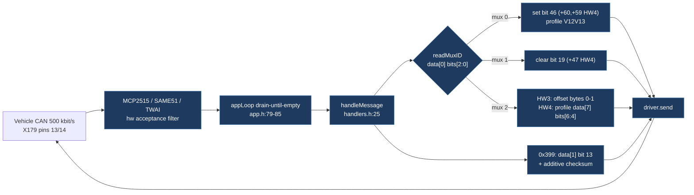
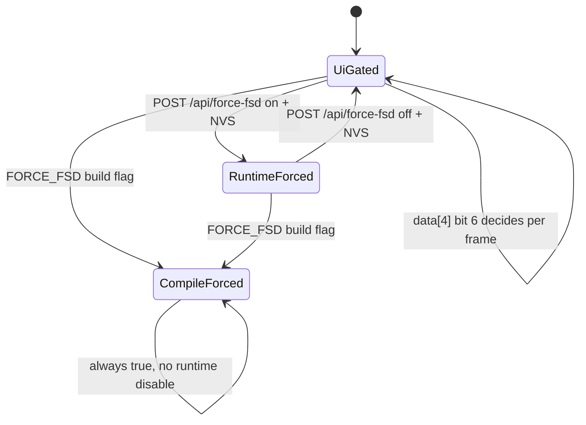
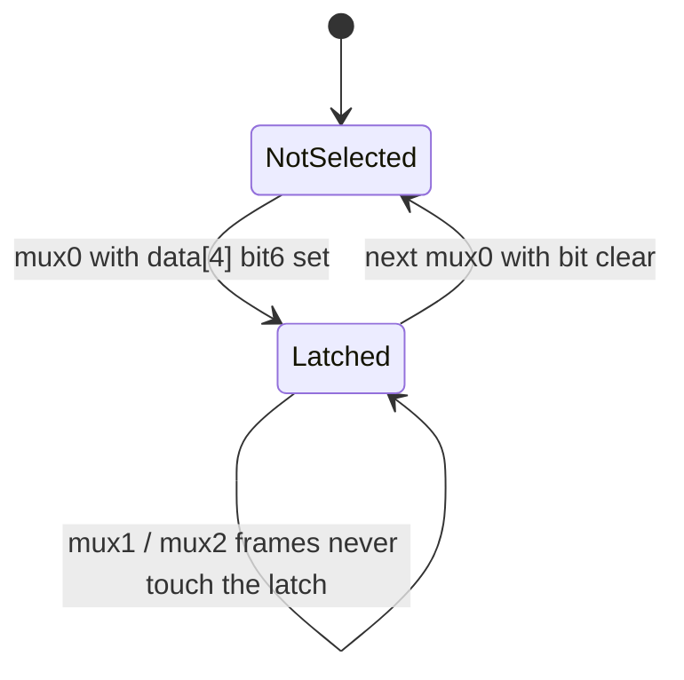
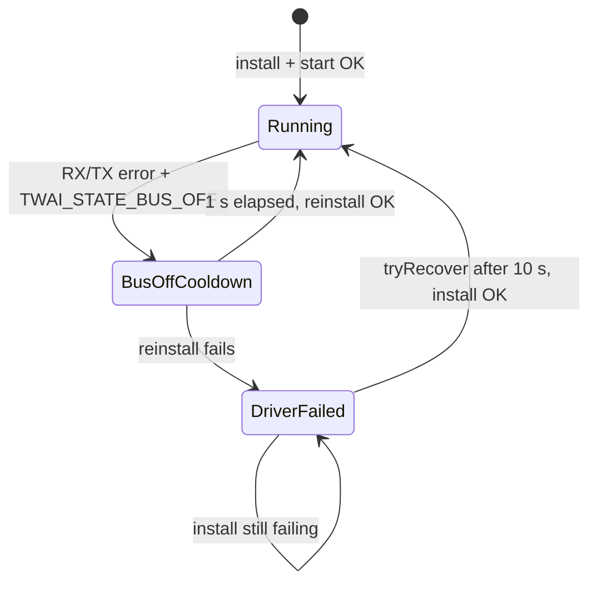

# 1-v-1-tesla-open-can-mod

Deep-dive analysis (replace mode). The pre-replace summary still exists in git history; cite it as `git show HEAD:docs/legacy/1-v-1-tesla-open-can-mod.md` (line numbers below refer to that blob). The original doc had **no `## Upstream (...)` sections**, so the preserve list is the YAML frontmatter only (kept byte-for-byte, including its defects, per the replace-mode rules — see section 6).

## 1. Provenance

- Submodule path: `legacy/1-v-1-tesla-open-can-mod`
- Pinned gitlink (canonical form): `160000 815e00015eab7a8c891a1d63889390aa849cc799 0`
- `git -C legacy/1-v-1-tesla-open-can-mod rev-parse HEAD` → `815e00015eab7a8c891a1d63889390aa849cc799` — matches the gitlink; worktree clean (`status --porcelain` empty).
- Last commit: `815e000` "Merge remote-tracking branch 'upstream/main'" (2026-04-02). 103 commits total, 2026-03-28 → 2026-04-02.
- Upstream URL: `https://github.com/1-v-1/tesla-open-can-mod` (GitHub mirror of a GitLab project; merge-commit style `Merge branch 'main' into 'main'`).
- License: GPL-3.0 (`LICENSE` header verified; standard text, RANGE-CITED).
- Analysis date: 2026-11-21.

Upstream files read in full (FULL-READ, every line):

| File                                              | Lines read |
| ------------------------------------------------- | ---------- |
| `include/handlers.h`                              | 1-301      |
| `include/can_helpers.h`, `can_frame_types.h`, `shared_types.h` | 1-46, 1-11, 1-11 |
| `include/app.h`                                   | 1-87       |
| `include/log_buffer.h`                            | 1-52       |
| `include/drivers/can_driver.h`                   | 1-13       |
| `include/drivers/mcp2515_driver.h`                | 1-69       |
| `include/drivers/same51_driver.h`                 | 1-70       |
| `include/drivers/twai_driver.h`                   | 1-151      |
| `include/drivers/mock_driver.h`                    | 1-32       |
| `include/web/web_server.h`                         | 1-383      |
| `include/web/web_ui.h`                            | 1-165      |
| `src/main.cpp`, `RP2040CAN.ino`                   | 1-47, 1-70 |
| `platformio.ini`, `.gitlab-ci.yml`, `.clang-format`, `.gitignore` | all |
| `scripts/platformio_sync_ino_defines.py`          | 1-107      |
| `test/test_native_legacy/test_legacy_handler.cpp` | 1-153      |
| `test/test_native_hw3/test_hw3_handler.cpp`       | 1-182      |
| `test/test_native_hw4/test_hw4_handler.cpp`       | 1-281      |
| `test/test_native_helpers/test_helpers.cpp`      | 1-208      |
| `test/test_native_force_fsd/test_force_fsd.cpp`  | 1-106      |
| `test/test_native_twai/test_twai_filter.cpp`      | 1-208      |
| `test/test_native_log_buffer/test_log_buffer.cpp`| 1-101      |
| `README.md`                                       | 1-405      |
| `guides/FSD_SUBSCRIPTION_GUIDE.md`, `guides/WIRING_GUIDE.md`, `guides/INSTALLATION_GUIDE_M4_CAN.md` | all |
| `THIRD_PARTY_LICENSES`, `lib/README`, `test/README` | all      |

Partial-read labels (honesty per skill):

- `README.zh-CN.md` — STRUCTURAL-PARSE: Chinese translation; structure and key tables (1016/1021/921, GPL-3.0) verified against the English version by grep, body not line-read.
- `LICENSE` — RANGE-CITED: header lines only; standard GPL-3.0 text assumed below.
- `guides/images/*.png` (4 files, ~13.5 MB) — explicitly NOT read (binary images).

Our-side files read for parity (all CODE-READ unless noted):

`firmware/lib/vehicle/can/handler/variant/{hw4,hw3,legacy,bits}.h`, `handler/{helpers,frame_readers,filters}.h`, `feature/fsd/{fsd,profile,offsets,isa_chime}.h`, `vehicle/can/{ids,checksum}.h`, `lib/core/types.h` (lines 30-66), `lib/core/can/{id_filter,health}.h`, `lib/core/log/ring.h` (RANGE-CITED, lines 1-60 only).

No hidden directories were missed: `git ls-files` inventory (40 paths) is fully covered above; the repo has no dot-directories with sources.

## 2. Executive verdict

A tiny, focused "FSD enabler": one ESP32-class board on the X179 chassis bus, intercepting 5 CAN IDs (69, 921, 1006, 1016, 1021), mutating a handful of bits in the 0x3FD/0x3EE FSD mux frames and re-transmitting. All frame math that matters (bit 46 FSD enable, bit 19 nag clear, bit 47 HW4 summon flag, HW3 offset encode, HW4 profile nibble, ISA 0x399 additive checksum) is CODE-READ and TEST-READ — and every formula is byte-identical to what TeslaCANModder already ships, which corroborates the old doc's "direct upstream" claim while proving there is nothing left to port from the core handlers. The genuinely interesting residue is operational, not frame-level: TWAI bus-off recovery with cooldown and driver-fail guard, cursor-delta log polling (`readSince`), surfaced CAN error counters in the status JSON, and a compact captive-portal web dashboard. Those are adaptation candidates. The README's ASS/EU-unrestricted claim, the `FORCE_FSD` entitlement-bypass flag, hardcoded AP credentials, and the unauthenticated `force-fsd` endpoint must never be ported as-is.

## 3. Evidence map

No CAPTURE evidence exists in this repo: no frame dumps, no bench logs — all claims are code- or test-derived.

| Source file | Lines | What it proves | Grade |
| ----------- | ----- | -------------- | ----- |
| `include/handlers.h` | 35-38, 99-104, 196-208 | Filter ID sets per variant: {69,1006}, {1016,1021}, {921,1016,1021} (921 only under `ISA_SPEED_CHIME_SUPPRESS`) | CODE-READ |
| `include/handlers.h` | 44-55 | Legacy stalk 0x045: `data[1] >> 5`, pos≤1→profile 2, 2→1, else 0 | TEST-READ |
| `include/handlers.h` | 61-76 | Legacy 0x3EE: mux0 gate on UI bit, set bit 46, write profile; mux1 clear bit 19 | TEST-READ |
| `include/handlers.h` | 112-127 | HW3 0x3F8: `data[5] & 0xE0 >> 5`, fd 1→2, 2→1, 3→0 | TEST-READ |
| `include/handlers.h` | 133-157 | HW3 0x3FD mux0: UI gate, offset read `data[3]>>1 & 0x3F − 30`, steps→profile, set bit 46, profile V12V13 | TEST-READ |
| `include/handlers.h` | 159-173 | HW3 mux1 clear bit 19; mux2 offset write into bytes 0-1 | TEST-READ |
| `include/handlers.h` | 213-226 | ISA 0x399: `data[1] \|= 0x20`, checksum `sum(data[0..6]) + (id&0xFF) + (id>>8)` in `data[7]` | TEST-READ |
| `include/handlers.h` | 232-250 | HW4 fd map 1→3, 2→2, 3→1, 4→0, 5→4 (5 levels) | TEST-READ |
| `include/handlers.h` | 259-282 | HW4 mux0: bits 46, 60, (+59 if `EMERGENCY_VEHICLE_DETECTION`); mux1: clear 19, set 47; mux2: `data[7]` bits[6:4] profile | TEST-READ |
| `include/can_helpers.h` | 8-11 | `readMuxID = data[0] & 0x07` | CODE-READ |
| `include/can_helpers.h` | 13-23 | FSD UI gate: `data[4] >> 6` (bit 38); `FORCE_FSD` compile flag and `forceFSDRuntime` both short-circuit to true | CODE-READ |
| `include/can_helpers.h` | 25-29 | `setSpeedProfileV12V13`: `data[6]` bits[2:1], mask 0x06 | CODE-READ |
| `include/can_helpers.h` | 31-46 | `setBit` bounds guard 0..63 (commit `a9c3bfe`) | CODE-READ |
| `include/app.h` | 17-25 | Variant `#define` required, else compile `#error` | CODE-READ |
| `include/app.h` | 30-31, 79-85 | ISR flag (`frameReady`) + drain-until-empty loop | CODE-READ |
| `include/app.h` | 49-52 | CAN init failure only printed, app continues | CODE-READ |
| `include/drivers/mcp2515_driver.h` | 19, 26-38, 47-56 | 500 kbps/MCP 16 MHz; 6 exact-match filters mask 0x7FF; read copies 8 bytes regardless of DLC | CODE-READ |
| `include/drivers/twai_driver.h` | 17-30, 32-56 | Queue sizes 32/16; single acceptance filter from differ-OR trick `<<21` | CODE-READ |
| `include/drivers/twai_driver.h` | 60-80, 82-101 | DLC clamp + zero-fill on RX; 2 ms TX timeout | CODE-READ |
| `include/drivers/twai_driver.h` | 104-142 | `BUSOFF_COOLDOWN_MS = 1000`, reinstall recovery, 10 s driver-fail `tryRecover` | CODE-READ |
| `include/drivers/same51_driver.h` | 24-39, 41-44 | Combined-mask single filter; `onReceive()` ISR pattern rejected by comment | CODE-READ |
| `include/web/web_server.h` | 19-20 | Hardcoded AP credentials `TeslaCAN` / `canmod12` | CODE-READ |
| `include/web/web_server.h` | 35-54, 167-205 | `force_fsd` NVS read/write; unauthenticated POST `/api/force-fsd` | CODE-READ |
| `include/web/web_server.h` | 58-68 | 500 ms rate limiter on toggles | CODE-READ |
| `include/web/web_server.h` | 123-157 | TWAI error counters (rx/tx/bus errors, rx_missed) in status JSON | CODE-READ |
| `include/web/web_server.h` | 255-318 | Hand-rolled DNS captive portal answering 192.168.4.1 | CODE-READ |
| `include/log_buffer.h` | 8-52 | 32×128 ring, cursor `head`, `readSince` delta reads | CODE-READ |
| `platformio.ini` | 32-46 | Native test envs; `native` sets `ISA_SPEED_CHIME_SUPPRESS` + `EMERGENCY_VEHICLE_DETECTION` | CODE-READ |
| `.gitlab-ci.yml` | 34-47 | CI runs `pio test -e native -e native_force_fsd` with JUnit output | CODE-READ |
| `scripts/platformio_sync_ino_defines.py` | 26-32, 79-96 | Build fails unless .ino defines and env define agree | CODE-READ |
| `test/test_native_hw4/test_hw4_handler.cpp` | 22-60, 83-125, 129-151, 189-229, 234-245 | HW4 fd maps, mux0 bits 46/60/59, mux1 bits 19/47, mux2 profile, ISA byte+checksum, filter IDs | TEST-READ |
| `test/test_native_hw3/test_hw3_handler.cpp` | 22-53, 57-91, 95-115 | HW3 fd map, FSDEnabled latch regression, bit 46, bit 19 | TEST-READ |
| `test/test_native_legacy/test_legacy_handler.cpp` | 22-53, 57-107 | Stalk map, 0x3EE mux0 bit 46 + profile, mux1 bit 19 | TEST-READ |
| `test/test_native_helpers/test_helpers.cpp` | 10-54, 58-84, 88-114, 118-148, 152-175 | setBit, readMuxID, UI bit, profile encode, runtime force | TEST-READ |
| `test/test_native_force_fsd/test_force_fsd.cpp` | 15-91 | Under `FORCE_FSD` all variants inject without UI toggle | TEST-READ |
| `test/test_native_twai/test_twai_filter.cpp` | 12-33, 40-180 | Filter math extracted and asserted (incl. exact mask values) | TEST-READ |
| `test/test_native_log_buffer/test_log_buffer.cpp` | 9-87 | Ring push/readSince/wrap/truncate semantics | TEST-READ |
| `README.md` | 37-134, 319-335 | Feature, variant, and profile claims (checked against code; see section 6) | SUMMARY-ONLY |

## 4. Architecture and build surface

Entry points: `RP2040CAN.ino` (Arduino IDE, compile-time `#define` block at lines 16-33) and `src/main.cpp` (PlatformIO, same defines injected via `platformio.ini` build flags). Both call the shared `appSetup<Driver>()` / `appLoop<Driver>()` templates in `include/app.h:37-87`. `scripts/platformio_sync_ino_defines.py` hard-fails the build if the .ino selection and the env's `DRIVER_*` flag disagree (`UserError` at lines 79-96).

Shared core vs platform port: all vehicle logic lives in `include/handlers.h` behind the `CarManagerBase` interface (`handlers.h:17-29`); only `include/drivers/*` is platform-specific. `Shared<T>` aliases `std::atomic<T>` on target and plain `T` under `NATIVE_BUILD` (`shared_types.h:4-11`), so the same handler code compiles on host for Unity tests.

Build flags: `DRIVER_MCP2515 | DRIVER_SAME51 | DRIVER_TWAI` (one of), `LEGACY | HW3 | HW4` (one of), optional `ISA_SPEED_CHIME_SUPPRESS`, `EMERGENCY_VEHICLE_DETECTION`, `FORCE_FSD` (`app.h:17-25` `#error`s without a variant). The ESP32 web dashboard compiles only under `DRIVER_TWAI && !NATIVE_BUILD` (`web_server.h:4`, `app.h:33-35`). Dependency boundary: three vendor CAN libraries (autowp MCP2515, Adafruit CAN, ESP-IDF TWAI) isolated behind `CanDriver` (`drivers/can_driver.h:5-13`).



Single bus, single controller: unlike TeslaCANModder's 3-lane X179 build, this project has exactly one CAN controller on the chassis/AP bus.

## 5. Mechanism catalogue

### 5.1 Legacy FSD activation (0x3EE + stalk 0x045)

- **Claim (README / summary):** Legacy = HW3-retrofit; FSD enable bit + speed profile from follow-distance stalk (README table "Legacy (HW3 Retrofit)").
- **Code path:** `handlers.h:40-94` — `LegacyHandler::handleMessage()` → 0x045 updates `speedProfile` (`handlers.h:44-55`) → 0x3EE mux0: `isFSDSelectedInUI` gate (`handlers.h:63`), `setBit(frame,46,true)`, `setSpeedProfileV12V13` (`handlers.h:64-70`) → `driver.send`; mux1: `setBit(frame,19,false)` (`handlers.h:71-76`).
- **Frame spec:** 0x045 DLC≥2, stalk pos = `data[1] >> 5` (comment maps 0x00/0x21/0x42/0x64/0x85/0xA6/0xC8 to positions 1-7); 0x3EE DLC≥8, mux in `data[0]&0x07`, UI gate `data[4]` bit 6, FSD bit 46 (`data[5]` bit 6), profile `data[6]` bits[2:1], nag bit 19 (`data[2]` bit 3). No counter increment, no checksum.
- **Gates and timing:** No AP-state gate, no timing windows — every matching RX frame is mutated and re-sent immediately.
- **State machine:** None found (stateless per-frame; `FSDEnabled` latch covered in 5.9).
- **Tests:** `test_legacy_stalk_pos0..3_sets_profile_*` at `test_legacy_handler.cpp:22-53`; `test_legacy_fsd_sets_bit46` at 77-85; `test_legacy_fsd_sets_speed_profile_in_frame` at 87-95; `test_legacy_nag_suppression_clears_bit19_on_mux1` at 99-107.
- **Evidence grade:** TEST-READ.
- **Verdict:** CONFIRMED.
- **Adapt to TeslaCANModder?** already present — our `handleLegacy` (`firmware/lib/vehicle/can/handler/variant/legacy.h:38-84`) performs the identical stalk map and mux0 bit-46 + profile injection.

### 5.2 HW3 FSD control (0x3FD + 0x3F8)

- **Claim (README / summary):** Same as legacy with different frame format; offset read from bits 25-30, injected at mux2 bits 6-13.
- **Code path:** `handlers.h:106-191` — 0x3F8 fd map → 0x3FD mux0: UI gate + offset auto-track (`handlers.h:138-139`), steps→profile (`handlers.h:140-153`), `setBit(46,true)`, profile V12V13 (`handlers.h:154-157`); mux1 clear bit 19 (`handlers.h:159-164`); mux2 offset write (`handlers.h:165-173`).
- **Frame spec:** 0x3FD DLC≥8; offset read: `(data[3]>>1)&0x3F` (bits 25-30), bias −30, `speedOffset = clamp(steps*5, 0, 100)`; mux2 write: `data[0] &= ~0xC0; data[1] &= ~0x3F; data[0] |= (off&0x03)<<6; data[1] |= off>>2` (bits 6-13).
- **Gates and timing:** None found beyond `FSDEnabled` latch and DLC guard (`handlers.h:131`).
- **State machine:** None found (per-frame; see 5.9).
- **Tests:** `test_hw3_follow_distance_*` at `test_hw3_handler.cpp:22-53`; `test_hw3_fsd_mux0_sends_with_bit46` at 95-103; `test_hw3_nag_suppression_clears_bit19_on_mux1` at 107-115.
- **Evidence grade:** TEST-READ.
- **Verdict:** CONFIRMED.
- **Adapt to TeslaCANModder?** already present — identical math in our `handleHW3` + `readHW3UiOffsetSteps`/`calculateHW3SpeedOffset` (`firmware/lib/vehicle/can/feature/fsd/offsets.h:31-50`) and `writeHW3SpeedOffset` (`offsets.h:17-24`).

### 5.3 HW4 FSD control (0x3FD + 0x3F8 + 0x399)

- **Claim (README / summary):** Extended 5-level profile; V14 bits 59/60; mux2 profile at bits 60-62.
- **Code path:** `handlers.h:210-300` — fd map 1→3/2→2/3→1/4→0/5→4 (`handlers.h:232-250`); mux0 bits 46+60, bit 59 under `EMERGENCY_VEHICLE_DETECTION` (`handlers.h:259-267`); mux1 clear 19 + set 47 (`handlers.h:269-274`); mux2 `data[7]` bits[6:4] profile (`handlers.h:276-282`).
- **Frame spec:** 0x3FD DLC≥8; profile encode `data[7] = (data[7] & ~(0x07<<4)) | (profile&0x07)<<4` (bits 60-62); no checksum touched. Note: HW4 mux0 does **not** set bits 38/39 (our side does — parity row in section 11).
- **Gates and timing:** None found beyond UI bit + latch. The 1016 branch does not `return` (unlike HW3's `handlers.h:127`); fall-through to the `1021` check is harmless but inconsistent.
- **State machine:** None found (per-frame; see 5.9).
- **Tests:** `test_hw4_fsd_mux0_sets_bits_46_and_60` at `test_hw4_handler.cpp:83-92`; `test_hw4_fsd_mux0_sets_emergency_bit59` at 94-102; `test_hw4_nag_suppression_clears_bit19_sets_bit47` at 116-125; `test_hw4_mux2_injects_speed_profile` at 129-139; `test_hw4_mux2_clears_old_profile_bits` at 141-151.
- **Evidence grade:** TEST-READ.
- **Verdict:** CONFIRMED.
- **Adapt to TeslaCANModder?** already present — identical in our `handleHW4` (`firmware/lib/vehicle/can/handler/variant/hw4.h:65-169`) and `writeHW4SpeedProfile` (`feature/fsd/profile.h:30-36`).

### 5.4 Follow-distance → speed-profile auto mapping

- **Claim (README / summary):** "Reads the follow-distance stalk setting, maps it dynamically to a speed profile."
- **Code path:** `handlers.h:112-127` (HW3: 1→2, 2→1, 3→0, default keep) and `handlers.h:232-250` (HW4: five cases, no default — fd 0 or >5 keeps prior profile).
- **Frame spec:** 0x3F8 DLC≥6; fd = `(data[5] & 0b11100000) >> 5`.
- **Gates and timing:** Runs on every 0x3F8 RX; no pin/override concept (contrast our `profile:lock`).
- **State machine:** None found.
- **Tests:** `test_hw3_follow_distance_*` (4 cases incl. fd 0 keeps default) and `test_hw4_follow_distance_*` (5 cases) at `test_hw3_handler.cpp:22-53` / `test_hw4_handler.cpp:22-60`.
- **Evidence grade:** TEST-READ.
- **Verdict:** CONFIRMED.
- **Adapt to TeslaCANModder?** already present — identical tables in `mapHW3FollowDistToProfile` / `mapHW4FollowDistToProfile` (`firmware/lib/vehicle/can/feature/fsd/profile.h:43-58`), plus our pin/override extension.

### 5.5 HW3 speed-offset auto-track (mux0 bits 25-30)

- **Claim (README / summary):** HW3 table row "1021 mux 0 bits 25-30 read offset".
- **Code path:** `handlers.h:138-139` — `speedOffset = clamp(((field−30)*5), 0, 100)` recomputed per mux0 frame; `handlers.h:140-153` — same field's low values 0/1/2 double as a profile selector.
- **Frame spec:** field = `(data[3] >> 1) & 0x3F`, signed via −30 bias, scale ×5, clamp [0,100]. Output written to mux2 bits 6-13 (see 5.2).
- **Gates and timing:** Only inside the `FSDEnabled && mux==0` branch.
- **State machine:** None found.
- **Tests:** None found — the offset read/scale has no direct test (HW3 tests cover fd, latch, bit46, bit19 only). Risk: the ×5 scale and −30 bias are untested constants.
- **Evidence grade:** CODE-READ.
- **Verdict:** CONFIRMED; test gap noted above.
- **Adapt to TeslaCANModder?** already present — identical in `readHW3UiOffsetSteps`/`calculateHW3SpeedOffset` (`firmware/lib/vehicle/can/feature/fsd/offsets.h:31-50`).

### 5.6 ISA speed chime suppression (0x399)

- **Claim (README / summary):** HW4-only chime suppress; "speed limit sign will be empty while driving" (RP2040CAN.ino:30).
- **Code path:** `handlers.h:212-227` — gate `#if defined(ISA_SPEED_CHIME_SUPPRESS)`, `data[1] |= 0x20` (bit 13), checksum recompute, `return` (skips all other logic).
- **Frame spec:** 0x399/921 DLC≥8; suppress bit = `data[1]` bit 5; checksum `data[7] = (Σ data[0..6] + (921 & 0xFF) + (921 >> 8)) & 0xFF`.
- **Gates and timing:** Build-flag only — when compiled in, every 0x399 frame is mutated and re-sent, unconditionally (contrast our `apGateOpen` + runtime `isa-chime:on` toggle).
- **State machine:** None found.
- **Tests:** `test_hw4_isa_suppress_sets_bit5_of_data1`, `..._preserves_existing_data1_bits`, `..._checksum_correct` (0xD1 expected), `..._returns_early_no_further_processing` at `test_hw4_handler.cpp:189-230` — the checksum test recomputes the expectation by hand, an independent oracle.
- **Evidence grade:** TEST-READ.
- **Verdict:** CONFIRMED at the byte level; the in-vehicle effect (empty speed-limit sign) stays SUMMARY-ONLY because no capture exists in this repo.
- **Adapt to TeslaCANModder?** already present — byte-identical formula in `computeHW4IsaChecksum` (`firmware/lib/vehicle/can/checksum.h:47-56`) and same suppress byte/mask constants (`handler/variant/bits.h:48-50`); ours adds the AP gate (`hw4.h:70-81`).

### 5.7 HW4 mux1 "Summon / EU unlock" bit 47

- **Claim (README / summary):** "ASS (Actually Smart Summon) is no longer restricted by EU regulations" (README.md:39); README's HW4 table labels bit 47 `UI_hardCoreSummon` "enable summon".
- **Code path:** `handlers.h:269-274` — `setBit(frame, 19, false); setBit(frame, 47, true);` on every mux1 frame. Nothing else.
- **Frame spec:** bit 47 = `data[5]` bit 7, set unconditionally with the nag clear.
- **Gates and timing:** No region detection, no EU gating, no ECE R79 bit-20 handling anywhere (negative anchor, section 16). The entire EU claim rests on this one bit.
- **State machine:** None found.
- **Tests:** `test_hw4_nag_suppression_clears_bit19_sets_bit47` at `test_hw4_handler.cpp:116-125` asserts bit 47 set — it proves the code sets the bit, not that it unlocks ASS in the EU.
- **Evidence grade:** TEST-READ (the bit-level mechanism; the ASS/EU effect claim is SUMMARY-ONLY and cannot drive any decision).
- **Verdict:** PARTIAL — bit confirmed, claim unvalidated.
- **Adapt to TeslaCANModder?** never port on SUMMARY-ONLY — we already set bit 47 in `applyHW4NagSuppressBits` (`hw4.h:43`) as "Summon EU unlock", and our ECE R79 handling is strictly safer because it is region-gated (`hw4.h:49-50`). A bench capture would be required before believing the ASS claim, and `docs/checklists/can-review-checklist.md` applies.

### 5.8 FORCE_FSD override (build flag + runtime + NVS)

- **Claim (README / summary):** `FORCE_FSD` — "Always enable FSD without requiring Traffic Light and Stop Sign Control toggle" (RP2040CAN.ino:32).
- **Code path:** `can_helpers.h:15-17` (compile flag → always true) / `can_helpers.h:19-20` (`forceFSDRuntime`) / `can_helpers.h:21` (real UI bit) → web toggle `POST /api/force-fsd` (`web_server.h:167-205`) → NVS namespace `canmod`, key `force_fsd` (`web_server.h:35-54`) → loaded at boot (`web_server.h:326-331`).
- **Frame spec:** None found — pure gate change; identical frame bytes as gated mode.
- **Gates and timing:** Web toggles rate-limited to 500 ms (`web_server.h:58-68`); UI confirm dialog in `web_ui.h:150-154`.
- **State machine:**



- **Tests:** `test_force_fsd_helper_returns_true_when_bit_clear/set` at `test_force_fsd.cpp:15-27`; per-variant injection-without-toggle at 31-91; runtime toggle at `test_helpers.cpp:152-175`.
- **Evidence grade:** TEST-READ.
- **Verdict:** CONFIRMED.
- **Adapt to TeslaCANModder?** already present — our `fsd:force:on|off` command (`firmware/lib/vehicle/can/feature/fsd/fsd.h:45-58`) with NVS persistence; we deliberately have no compile-time entitlement-bypass flag.

### 5.9 FSDEnabled latch (mux0-only read)

- **Claim (README / summary):** Not documented upstream; discovered via history (`1c0a89a` "Fix FSDEnabled shadowing bug in HW3 and HW4 handlers", 2026-03-30).
- **Code path:** `handlers.h:63`, `135`, `257-258` — `FSDEnabled = isFSDSelectedInUI(frame)` only when `readMuxID(frame) == 0`; mux1/mux2 frames never overwrite the latched value.
- **Frame spec:** None found (latch state, not frame content).
- **Gates and timing:** Latch persists until the next mux0 frame clears it.
- **State machine:**



- **Tests:** `test_hw3_fsd_enabled_only_set_on_mux0` / `test_hw4_fsd_enabled_only_set_on_mux0` at `test_hw3_handler.cpp:57-74` / `test_hw4_handler.cpp:64-79` — regression tests for the shadow bug.
- **Evidence grade:** TEST-READ.
- **Verdict:** CONFIRMED.
- **Adapt to TeslaCANModder?** already present / immune by design — our handlers are stateless: `isFSDSelectedInUI(f)` is evaluated per frame and only used in the `mux==0` branch (`hw4.h:133-136`), so there is no latch to shadow.

### 5.10 CanDriver abstraction + driver trio + mock

- **Claim (README / summary):** "abstract `CanDriver` interface so that all vehicle logic is shared across boards" (README.md:342).
- **Code path:** `drivers/can_driver.h:5-13` (pure virtual init/setFilters/enableInterrupt/read/send) ← `MCP2515Driver` (`kSupportsISR=true`, `mcp2515_driver.h:9-69`), `SAME51Driver` (`same51_driver.h:7-70`), `TWAIDriver` (`twai_driver.h:7-151`), `MockDriver` records `sent` (`mock_driver.h:7-32`). App selects via `#define` (`app.h:17-25`, `main.cpp:10-25`).
- **Frame spec:** `CanFrame {u32 id; u8 dlc=8; u8 data[8]}` (`can_frame_types.h:6-10`).
- **Gates and timing:** ISR path only for MCP2515 (`app.h:55-58`); TWAI/SAME51 poll (`kSupportsISR=false`).
- **State machine:** None found.
- **Tests:** None found for the real drivers (mock used by handler tests). Risk: all driver behavior is only field-tested.
- **Evidence grade:** CODE-READ.
- **Verdict:** CONFIRMED.
- **Adapt to TeslaCANModder?** already present — our multi-bus MCP2515 driver layer under `firmware/lib/core/can/` + `firmware/lib/core/driver/` generalizes the same idea.

### 5.11 MCP2515 driver: exact-match filters + ISR flag-and-drain

- **Claim (README / summary):** README.md:143 says `PIN_CAN_INTERRUPT` is "unused; polling mode" — contradicted (section 6, row C3).
- **Code path:** `mcp2515_driver.h:26-38` — config mode, both masks `0x7FF` exact, 6 filters filled (repeat `ids[0]` when count < 6); `mcp2515_driver.h:40-45` — `attachInterrupt(FALLING)`; `app.h:30-31, 72-85` — ISR sets `frameReady`, loop drains.
- **Frame spec:** 500 kbps, MCP 16 MHz crystal (`mcp2515_driver.h:19`).
- **Gates and timing:** None found — no error-flag reads, no bus-off concept, no re-init on failure.
- **State machine:** None found.
- **Tests:** None found. Risk: filter programming return values ignored; a failed `setFilter` silently widens/narrows acceptance.
- **Evidence grade:** CODE-READ.
- **Verdict:** CONFIRMED for the mechanism; the README's "polling mode" claim is CONTRADICTED separately in row C3.
- **Adapt to TeslaCANModder?** already present — our `applyFilters` (`firmware/lib/vehicle/can/handler/filters.h:34-96`) programs per-feature dynamic sets across 3 buses.

### 5.12 TWAI driver: acceptance filter, DLC clamp, TX timeout, bus-off recovery

- **Claim (README / summary):** "ESP32 TWAI: native peripheral, FreeRTOS queue-based RX" (README.md:347); history: non-blocking TX + cooldown (`186c13b`), DLC clamp (`9674664`), 0→2 ms timeout compromise (`57af532`).
- **Code path:** `twai_driver.h:15-30` install (rx_queue 32, tx_queue 16, 500 kbps); `twai_driver.h:32-56` single acceptance filter: `differ = OR(ids[0]^ids[i])`, `code = (ids[0] & ~differ) << 21`, `mask = (differ << 21) | 0x001FFFFF`, then stop/uninstall/reinstall; `twai_driver.h:60-80` read clamps DLC≤8 and zero-fills; `twai_driver.h:82-101` send with `pdMS_TO_TICKS(2)`; `twai_driver.h:104-142` bus-off handling.
- **Frame spec:** N/A (driver layer).
- **Gates and timing:** `BUSOFF_COOLDOWN_MS = 1000` between recovery attempts; `driverOK_=false` blocks all `send`; `tryRecover` gated at 10× cooldown (10 s).
- **State machine:**



- **Tests:** `test_native_twai/test_twai_filter.cpp:12-33` tests a **re-implemented copy** of the filter math, not the driver; the bus-off/recovery paths have no test.
- **Evidence grade:** CODE-READ (filter math additionally asserted by tests; recovery paths untested).
- **Verdict:** CONFIRMED; filter math asserted, recovery paths untested.
- **Adapt to TeslaCANModder?** candidate — we ship no TWAI target, but the cooldown+driver-fail-guard pattern and the surfaced error counters (5.13) are the reusable ideas; see section 13.

### 5.13 ESP32 web dashboard (AP + captive DNS + status + toggles)

- **Claim (README / summary):** History `5efeac9` "add ESP32 web dashboard for live CAN status and runtime settings".
- **Code path:** `web_server.h:324-381` init (WiFi AP, DNS task pinned to core 0, `httpd` core 0, stack 8192) → routes: `GET /` (`web_ui.h` HTML), `GET /api/status?log_since=N` (`web_server.h:79-165`), `POST /api/force-fsd`, `POST /api/enable-print`, captive redirects `/generate_204`, `/hotspot-detect.html` (`web_server.h:360-378`); DNS A-answers 192.168.4.1 TTL 60 (`web_server.h:255-318`); UI polls 500 ms (`web_ui.h:161`).
- **Frame spec:** None found (transport surface).
- **Gates and timing:** 500 ms rate limit on POSTs (`web_server.h:58-68`) returning 429.
- **State machine:** None found.
- **Tests:** None found.
- **Evidence grade:** CODE-READ.
- **Verdict:** CONFIRMED (with security findings, section 12).
- **Adapt to TeslaCANModder?** no impact — we already ship a WiFi REST API + HTML dashboard (`firmware/lib/io/wifi/`, `firmware/lib/client/dashboard/`); the hand-rolled DNS responder and unauthenticated toggles are anti-patterns for us.

### 5.14 Log ring buffer with cursor-delta reads

- **Claim (README / summary):** Not in README; exists to feed the dashboard log panel.
- **Code path:** `log_buffer.h:8-52` — 32 entries × 128 chars, monotonic `head` (`Shared`), `push` overwrites oldest, `readSince(cursor, out, maxOut)` returns only entries newer than the client's cursor; status JSON ships `log_head` so the UI can poll deltas (`web_server.h:108-120`, `web_ui.h:141`).
- **Frame spec:** None found.
- **Gates and timing:** `readSince` bounded by capacity and `maxOut`; truncation at 127 chars (`test_log_buffer.cpp:78-87`).
- **State machine:** None found.
- **Tests:** `test_native_log_buffer/test_log_buffer.cpp:9-87` — head increments, delta reads, wrap drops oldest, `maxOut` respected, truncation.
- **Evidence grade:** TEST-READ.
- **Verdict:** CONFIRMED.
- **Adapt to TeslaCANModder?** candidate — our `log` command dumps the full 256-entry ring (`firmware/lib/core/log/ring.h:10-33`, RANGE-CITED); a cursor-delta protocol would shrink payloads for the live status stream.

## 6. Summary vs code contradiction table

Pre-replace doc claims are cited as `git show HEAD:docs/legacy/1-v-1-tesla-open-can-mod.md` (line numbers in that blob). Upstream doc claims cite live files.

| # | Claim | Evidence | Contradiction |
| - | ----- | -------- | ------------- |
| C1 | Pre-replace line 66: "This is the **direct upstream** of our Tesla-CAN-Mod firmware. Our firmware/ directory is derived from this codebase." | Byte-identical bit math across handlers (section 11) is consistent with derivation, but nothing in either repo's pinned snapshot proves authorship flow. | Not contradicted, but **SUMMARY-ONLY** — cannot drive decisions; verifying requires early TeslaCANModder git history. |
| C2 | Frontmatter (preserved bytes): `description:` truncated mid-sentence with trailing space; `repo: v-1-tesla-open-can-mod` missing the `1-` prefix vs directory `1-v-1-tesla-open-can-mod`. | `git show HEAD:docs/legacy/1-v-1-tesla-open-can-mod.md` lines 3 and 8. | Stale metadata, kept byte-for-byte per replace-mode rules. |
| C3 | README.md:143-145: "`PIN_CAN_INTERRUPT` — interrupt pin (unused; polling mode)". | `mcp2515_driver.h:42-43` `attachInterrupt(...)`, consumed at `app.h:55-58`. | Contradicted — ISR flag-and-drain is active, not polling. |
| C4 | `guides/INSTALLATION_GUIDE_M4_CAN.md:29`: "`#define HW_TARGET TARGET_HW3`". | No such identifiers exist; real defines are `LEGACY|HW3|HW4` (`RP2040CAN.ino:22-26`, `app.h:17-25`). | Contradicted — stale guide snippet; build would fail. |
| C5 | `guides/INSTALLATION_GUIDE_M4_CAN.md:57`: X179 is "behind the driver's side trunk panel". | `guides/WIRING_GUIDE.md:16`: X179 is "on the **passenger side footwell**". | Internal upstream contradiction — one of the two guides is wrong; unresolved (SUMMARY-ONLY either way). |
| C6 | `guides/INSTALLATION_GUIDE_M4_CAN.md:33`: serial shows `CANSAME5x ready @ 500k`. | `src/main.cpp:32` prints `"SAME51 CAN ready @ 500k"`. | Contradicted — cosmetic, but the guide's verify step cannot match reality. |
| C7 | README.md:39: "ASS (Actually Smart Summon) is no longer restricted by EU regulations." | Only code basis is `setBit(frame, 47, true)` (`handlers.h:272`); no region detection, no ECE R79 bit-20 handling (negative anchor A1, section 16). | Partially contradicted — claim overstates what one unconditional bit proves. |
| C8 | README.md:66 + 328-335: HW4 has a 5-level speed profile. | Handler maps 5 levels (`handlers.h:232-250`), but the dashboard labels only 3: `profNames=['Chill','Normal','Sport']` (`web_ui.h:85`) — profiles 3/4 render as `P3`/`P4` fallback. | Partially contradicted — firmware supports 5, its own UI labels 3. |
| C9 | `guides/WIRING_GUIDE.md:37-38` calls the X179 13-14 pair "CAN-H/L (**Body Bus**)". | Our docs and upstream README map X179 13-14 to the chassis/AP bus (`README.md:303-308`; our `ids.h:12`). | Naming conflict inside upstream docs — treat upstream's "Body Bus" label as wrong; do not propagate it. |

## 7. CAN frame and signal inventory

Five frames total. One bus (chassis/AP via X179 13-14). No periods are encoded anywhere — the repo reacts to whatever arrives; "period" is not stated in code and is UNVERIFIED for all rows. No frame is built from zeros; every mutation edits a received frame in place and re-sends it.

| ID (hex + dec) | Bus | DLC | Byte/bit layout | Scale/units | Counter | Checksum | R/W | Grade |
| -------------- | --- | --- | --------------- | ----------- | ------- | -------- | --- | ----- |
| 0x045 (69) `STW_ACTN_RQ` | chassis | ≥2 | stalk pos = `data[1]` bits[7:5] | 8 positions (0x00..0xC8 raw) | None found | None found | R | TEST-READ |
| 0x399 (921) `DAS_status` (ISA) | chassis | ≥8 | suppress = `data[1]` bit 5 (`\|= 0x20`); checksum `data[7]` = `Σ data[0..6] + (id&0xFF) + (id>>8)` mod 256 | boolean | None found (mux nibble untouched) | additive, recomputed | R+W | TEST-READ |
| 0x3EE (1006) `Legacy FSD mux` | chassis | ≥8 | mux `data[0]&0x07`; UI gate `data[4]` bit 6; FSD bit 46; profile `data[6]` bits[2:1]; nag bit 19 | profile 0-2 | mux read only, never incremented | None found | R+W | TEST-READ |
| 0x3F8 (1016) `UI_driverAssistControl` | chassis | ≥6 | follow distance `data[5]` bits[7:5] | fd 0-7 (used 1-5) | None found | None found | R | TEST-READ |
| 0x3FD (1021) `UI_autopilotControl` | chassis | ≥8 | mux `data[0]&0x07`; UI gate `data[4]` bit 6 (bit 38); FSD bit 46; V14 bit 60; EVD bit 59 (flag); nag bit 19 (clear); summon bit 47 (HW4, set); HW4 profile `data[7]` bits[6:4]; HW3 offset read `data[3]` bits[6:1] (bias −30, ×5, clamp 0-100); HW3 offset write `data[0]` bits[7:6] + `data[1]` bits[5:0] | profiles 0-4; offset 0-100 km/h-class units | mux read only, never incremented | None found | R+W | TEST-READ |

No vendored DBC/JSON catalog exists — the README tables (README.md:84-125) are the only signal-name source (SUMMARY-ONLY, cross-checked against code in section 6).

## 8. Constants and tuning table

| Constant | Value | File:line | Meaning | Grade |
| -------- | ----- | --------- | ------- | ----- |
| mux mask | `0x07` | `can_helpers.h:10` | 3-bit mux in `data[0]` bits[2:0] | CODE-READ |
| FSD UI gate bit | `data[4] >> 6` (bit 38) | `can_helpers.h:21` | "Traffic Light & Stop Sign Control" selected → FSD trigger | CODE-READ |
| V12V13 profile field | `data[6]` bits[2:1], mask `0x06` | `can_helpers.h:27-28` | HW3/Legacy profile encode | CODE-READ |
| setBit bound | 0..63 | `can_helpers.h:33-34` | buffer-overrun guard (commit `a9c3bfe`) | CODE-READ |
| FSD enable bit | 46 | `handlers.h:66,154,261` | set on mux0 when gated | CODE-READ |
| HW4 V14 bit | 60 | `handlers.h:262` | FSD v14 enable | CODE-READ |
| EVD bit | 59 | `handlers.h:264` | emergency vehicle detection, `EMERGENCY_VEHICLE_DETECTION` flag | CODE-READ |
| nag bit | 19 (clear) | `handlers.h:73,161,271` | hands-on nag clear on mux1 | CODE-READ |
| HW4 summon bit | 47 (set) | `handlers.h:272` | "UI_hardCoreSummon" per README | CODE-READ |
| HW4 profile field | `data[7]` bits[6:4], `0x07 << 4` | `handlers.h:278-279` | 3-bit profile nibble on mux2 | CODE-READ |
| HW3 offset read | `(data[3]>>1)&0x3F − 30`, ×5, clamp 0..100 | `handlers.h:138-139` | UI offset steps → speed offset | CODE-READ |
| HW3 offset write | `data[0]` bits[7:6] + `data[1]` bits[5:0] | `handlers.h:167-170` | offset encode on mux2 | CODE-READ |
| HW3 fd→profile | 1→2, 2→1, 3→0 | `handlers.h:113-126` | follow distance mapping | CODE-READ |
| HW4 fd→profile | 1→3, 2→2, 3→1, 4→0, 5→4 | `handlers.h:232-250` | 5-level mapping | CODE-READ |
| Legacy stalk→profile | ≤1→2, 2→1, else 0 | `handlers.h:48-54` | stalk position mapping | CODE-READ |
| ISA suppress bit | `0x20` in `data[1]` | `handlers.h:217` | chime suppress flag | CODE-READ |
| ISA checksum | `Σ data[0..6] + (id&0xFF) + (id>>8)` | `handlers.h:218-222` | additive, in `data[7]` | TEST-READ |
| TWAI bus-off cooldown | `1000` ms | `twai_driver.h:104` | recovery attempt spacing | CODE-READ |
| TWAI driver-fail window | `10 ×` cooldown | `twai_driver.h:133` | tryRecover spacing (10 s) | CODE-READ |
| TWAI TX timeout | `2` ms | `twai_driver.h:96` | "0ms → 2ms compromise" (`57af532`); comment: 10 ms risks overflowing the 32-deep RX queue | CODE-READ |
| TWAI queue sizes | rx 32 / tx 16 | `twai_driver.h:18-19` | driver queues | CODE-READ |
| MCP2515 clock | `CAN_500KBPS`, `MCP_16MHZ` | `mcp2515_driver.h:19` | bitrate + crystal profile | CODE-READ |
| MCP2515 masks | `0x7FF` both banks | `mcp2515_driver.h:29,32` | exact-match acceptance | CODE-READ |
| AP credentials | `TeslaCAN` / `canmod12` | `web_server.h:19-20` | hardcoded WPA2 AP | CODE-READ |
| Toggle rate limit | `500` ms | `web_server.h:59` | POST throttle | CODE-READ |
| Log ring | 32 entries × 128 chars | `log_buffer.h:10-11` | dashboard log capacity | CODE-READ |
| DNS answer | 192.168.4.1, TTL 60 s | `web_server.h:307-313` | captive portal | CODE-READ |
| Serial baud | 115200 | `app.h:42` | debug output | CODE-READ |

Trivial constants (pin numbers `GPIO_NUM_5/4`, `PIN_LED 2`, DNS port 53, formatting widths) omitted per skill.

## 9. Failure modes and edge cases

| Failure | Handling code path | Tested? | Grade |
| ------- | ------------------ | ------- | ----- |
| CAN controller init fails | Print "CAN init failed", app continues headless (`app.h:49-52`) | No | CODE-READ |
| Frame shorter than expected | DLC guards return early: `handlers.h:46,59,110,131,215,230,254` (commit `e589357`) | Partially — handlers tested with default DLC 8, short-DLC rejection itself untested | CODE-READ |
| setBit out-of-range index | Bounds guard 0..63, silent no-op (`can_helpers.h:33-34`) | Yes — `test_helpers.cpp:10-54` exercise in-range only; negative/out-of-range untested | CODE-READ |
| MCP2515 RX with DLC < 8 | `memcpy(frame.data, raw.data, 8)` copies 8 bytes regardless of DLC — stale tail bytes (`mcp2515_driver.h:54`) | No | CODE-READ |
| TWAI RX with DLC > 8 | Clamp to 8 + zero-fill (`twai_driver.h:76-78`) | No (driver untested) | CODE-READ |
| SAME51 RX with DLC < 8 | Bytes beyond `packetSize` left stale (`same51_driver.h:54-57`) | No | CODE-READ |
| MCP2515 filter programming failure | `setFilter` return values ignored (`mcp2515_driver.h:29-36`) | No | CODE-READ |
| CAN bus-off (TWAI) | `isBusOff` → `recoverWithCooldown` (1 s gate), reinstall; persistent failure → `driverOK_=false` blocks send, `tryRecover` every 10 s (`twai_driver.h:104-142`) | No | CODE-READ |
| TWAI TX queue full | 2 ms timeout drop + bus-off check (`twai_driver.h:96-100`) | No | CODE-READ |
| Driver dead (`driverOK_=false`) | `read` attempts `tryRecover`; `send` silently drops (`twai_driver.h:62-66,84-86`) | No | CODE-READ |
| NVS corrupt/new version | Erase + reinit fallback (`web_server.h:26-32`); read failure → force FSD off (`web_server.h:35-44,332-335`) | No | CODE-READ |
| HTTP body invalid | 400 on empty body / bad JSON (`web_server.h:177-190`) | No | CODE-READ |
| Rapid toggles | 429 after >1 toggle per 500 ms (`web_server.h:61-68`) | No | CODE-READ |
| DNS query ≥ ~496 bytes | 16 answer bytes appended past `len` into a 512-byte buffer — overflow writes out of bounds (`web_server.h:278-317`) | No | CODE-READ |
| Log ring concurrent access | `head` is atomic on target; entries are not — `push` (loop task) can race `readSince` (httpd task) (`log_buffer.h:22-51`) | No | CODE-READ |
| Watchdog / brownout / reboot state | None found — no watchdog feeds, no brownout hooks, no OTA-pause concept | No | CODE-READ |
| Missing-frame timeouts | None found — no staleness/freshness gating anywhere | No | CODE-READ |

## 10. Test coverage map

Per test file:

- `test_native_helpers/test_helpers.cpp` (208 lines) — asserts `setBit` byte/bit math, `readMuxID` masking, UI gate bit isolation, V12V13 profile encode preserving other bits, runtime `forceFSDRuntime` override semantics.
- `test_native_legacy/test_legacy_handler.cpp` (153) — stalk 4-position map, 0x3EE mux0 gate/bit46/profile, no-send-when-disabled, mux1 bit 19, unrelated ID ignored, filter ID set.
- `test_native_hw3/test_hw3_handler.cpp` (182) — fd map incl. fd 0 default, FSDEnabled latch regression (shadow bug), mux2-blocked-when-disabled, bit 46, bit 19, send counts, filters.
- `test_native_hw4/test_hw4_handler.cpp` (281) — 5-level fd map, latch regression, mux0 bits 46/60/59, mux1 bits 19/47, mux2 profile inject+clear-old, ISA bit set/preserve/checksum (independent 0xD1 oracle)/early-return, filters incl. 921.
- `test_native_force_fsd/test_force_fsd.cpp` (106) — under `-DFORCE_FSD` all three variants inject mux0 with UI bit clear; HW3 mux2 latched path.
- `test_native_twai/test_twai_filter.cpp` (208) — extracted (copied) acceptance-filter math: accept/reject matrices, exact mask values, empty input.
- `test_native_log_buffer/test_log_buffer.cpp` (101) — head/delta reads, wrap drops oldest, `maxOut`, truncation.

Critical paths with NO test:

- All real drivers (MCP2515/SAME51/TWI install, filter programming, bus-off recovery, cooldown, DLC clamp) — field-only; the TWAI test asserts a copy of the math, not `TWAIDriver::setFilters`.
- The entire web stack (routes, NVS, DNS, rate limiter, JSON shape).
- `app.h` loop/ISR interaction and short-DLC handler guards.
- The DNS answer-overflow edge (section 9) — could crash on a crafted query.

## 11. Parity matrix with TeslaCANModder

Every our-side cell below is CODE-READ from the cited file (grep anchors in section 16). No row relies on memory or on the old summary.

| Signal / frame | Upstream decode/inject (cite) | Our decode/inject (cite) | Delta | Action |
| -------------- | ----------------------------- | ------------------------ | ----- | ------ |
| FSD UI-selected bit (data[4] bit 6 = bit 38) | `can_helpers.h:13-23` | `firmware/lib/vehicle/can/ids.h:119-122` | Identical | Align — no change |
| 0x3FD mux0 HW4 bit set | `handlers.h:259-267` (46, 60, +59 flag) | `hw4.h:136-147` (38, 39, 46, 60, +59 state) | Ours adds bits 38/39; upstream ships without them | Capture-first — bench-verify 38/39 are needed; upstream field reports suggest 46+60 suffice |
| 0x3FD mux0 HW3 bit set | `handlers.h:154-157` (46 + profile) | `hw3.h:131-135` (38, 39, 46 + profile) | Same 38/39 delta | Capture-first |
| 0x3FD mux1 HW4 | `handlers.h:269-274` (clear 19, set 47) | `hw4.h:40-53` + `bits.h:26-27,42` (clear 19, set 47, optional 46/45, region-gated bit 20) | Identical core; ours strictly richer | Align — keep ours |
| 0x3FD mux1 HW3 / Legacy | `handlers.h:159-164`, `71-76` (clear 19) | `hw3.h:40-53`, `legacy.h:75-81` (clear 19, +EAP/lane-graph/ECE R79) | Identical core | Align — keep ours |
| 0x3FD mux2 HW4 profile | `handlers.h:276-282` (`data[7]` bits[6:4]) | `profile.h:30-36` `writeHW4SpeedProfile` (same mask/shift) + DLC guard | Identical | Align |
| 0x3FD mux2 HW4 speed offset | None found (upstream never writes) | `hw4.h:160-164` + `bits.h:53-54` (`data[1]` bits[5:0]) | Ours only | Keep — upstream offers no counter-evidence |
| 0x3FD mux2 HW3 offset encode | `handlers.h:165-173` | `offsets.h:17-24` `writeHW3SpeedOffset` | Identical encoding (clear+set bytes 0-1) | Align |
| HW3 offset auto-track (bits 25-30) | `handlers.h:138-153` (−30 bias, ×5, clamp 0..100, steps→profile) | `offsets.h:31-50` (`readHW3UiOffsetSteps`, `calculateHW3SpeedOffset`) + `hw3.h:125-129` | Identical math | Align |
| 0x3F8 HW3 fd→profile | `handlers.h:112-127` (1→2, 2→1, 3→0) | `profile.h:43-47` `mapHW3FollowDistToProfile` | Identical (+our pin/override) | Align |
| 0x3F8 HW4 fd→profile | `handlers.h:232-250` (1→3, 2→2, 3→1, 4→0, 5→4) | `profile.h:54-58` `mapHW4FollowDistToProfile` | Identical | Align |
| 0x045 stalk→profile | `handlers.h:44-55` | `legacy.h:40-53` | Identical | Align |
| 0x3EE legacy mux0 | `handlers.h:61-70` (bit 46 + V12V13 profile) | `legacy.h:63-72` (FSD_BIT_EAP=46 + profile; also auto-tracks steps) | Identical core; ours adds steps tracking | Align — keep ours |
| 0x399 ISA suppress + checksum | `handlers.h:213-226` | `hw4.h:70-81` + `checksum.h:47-56` `computeHW4IsaChecksum` | Byte-identical formula; ours adds `apGateOpen` + runtime `isa-chime:on` toggle + HW4 variant gate (`isa_chime.h:28-29`) | Align — keep ours (safer gating) |
| FORCE_FSD gate | `can_helpers.h:15-22` + `web_server.h:35-54,167-205` (web+NVS) | `fsd.h:45-58` `fsd:force:` command (serial/BLE, NVS) | Equivalent runtime+persist; upstream adds compile-time bypass flag | Align — keep ours; never add the compile flag |
| FSDEnabled latch semantics | `handlers.h:63,135,257-258` (mux0-only latch) | Stateless per-frame gate (`hw4.h:133-136`) | Ours immune to the upstream shadow bug by design | Align |
| `setBit` guard | `can_helpers.h:31-46` (fixed 0..63) | `core/types.h:45-56` (DLC-relative) | Equivalent safety; ours also refuses writes past DLC | Align — keep ours |
| `readMuxID` | `can_helpers.h:8-11` (`0x07`) | `core/types.h:63-66` (`MUX_MASK 0x07` + DLC guard) | Identical mask | Align |
| MCP2515 acceptance filters | `mcp2515_driver.h:26-38` (static 6-slot exact match) | `filters.h:34-96` + `id_filter.h` (dynamic per-feature, 3 buses) | Ours strictly richer | Align |
| Bus-off / error counters | `twai_driver.h:104-142` + `web_server.h:123-149` (TWAI only) | `health.h:43-72` (detected/receiving only; no MCP2515 EFLG/error counters) | **Gap on our side** | Candidate — surface MCP2515 error flags in `checkCanHealth` |
| Log ring | `log_buffer.h:8-52` (32×128, cursor delta) | `core/log/ring.h:10-33` (256×64, full dump; RANGE-CITED) | Ours bigger capacity, no delta protocol | Candidate — add cursor-delta reads |
| Region / ECE R79 handling | None found (negative anchor A1) | `region.h` + `hw4.h:49-50` region-gated bit 20 | Ours only, strictly safer than upstream's unconditional bit 47 | Keep — never "simplify" toward upstream |
| TWAI acceptance-filter math | `twai_driver.h:32-56` + `test_twai_filter.cpp` | No our-side TWAI (MCP2515 only) | No overlap today | No impact (candidate only if a TWAI target is ever added) |
| Web dashboard | `web_server.h` (esp_http_server + hand DNS) | `firmware/lib/io/wifi/` + `firmware/lib/client/dashboard/` | Different stack, overlapping function | No impact |

## 12. Surface inventory and security notes

Transport surfaces:

| Surface | Semantics | Provenance |
| ------- | --------- | ---------- |
| USB Serial 115200 | Debug log lines only (`app.h:42`, `handlers.h:77-92`); no command parser — zero remote control over serial | CODE-READ |
| WiFi AP `TeslaCAN` + HTTP | `GET /` dashboard; `GET /api/status?log_since=N`; `POST /api/force-fsd {enabled}`; `POST /api/enable-print {enabled}`; captive redirects (`web_server.h:360-378`) | CODE-READ |
| DNS UDP :53 | Captive portal A-answers to 192.168.4.1 (`web_server.h:255-318`) | CODE-READ |
| BLE | None found — this repo has no BLE | CODE-READ |

Security findings:

- Hardcoded AP credentials `TeslaCAN`/`canmod12` committed in source (`web_server.h:19-20`) — anyone who has read the repo can join the AP.
- **No authentication on any HTTP route** — anyone on the AP can flip Force FSD (`web_server.h:167-205`) or silence logs (`web_server.h:207-242`); only a 500 ms rate limit stands.
- DNS answer overflow: `buf[512]` with 16 bytes appended at `pos = len` — a query of 496+ bytes writes past the buffer (`web_server.h:278-317`).
- `FORCE_FSD` build flag is an entitlement bypass baked into the binary (README ban warning itself acknowledges the policy, README.md:9-12).
- No untrusted archives, no dangerous compiler flags, no secrets in tests; third-party licenses properly vendored (`THIRD_PARTY_LICENSES`).

## 13. Adaptation assessment

| Mechanism | Value | Cost | Risk | Evidence | Decision |
| --------- | ----- | ---- | ---- | -------- | -------- |
| Core FSD/nag/profile/offset/ISA frame math (5.1-5.6) | Zero — byte-identical to ours | — | — | TEST-READ | already present; no PR |
| HW4 mux0 bits 38/39 divergence | Field evidence that upstream works without them | Small (remove two setBits + capture) | Low, needs bench capture | CODE-READ both sides | capture-first backlog item, not a port |
| TWAI bus-off cooldown + driver-fail guard (5.12) | Robust degradation pattern; we expose no MCP2515 error state at all | Medium (read MCP2515 EFLG/TEC/REC in `health.h`) | Low, read-only diagnostics | CODE-READ upstream | candidate for future PR — surface MCP2515 error counters in `checkCanHealth` and the status payload (can-review-checklist applies only if mutation changes; this is diagnostics) |
| Log cursor-delta reads (5.14) | Cuts `log`/status payload size for live polling | Small (cursor param on our `log` command / status JSON) | Low | TEST-READ | candidate for future PR |
| Captive-portal DNS + unauth web toggles (5.13) | Convenience for phones | — | Auth bypass, hardcoded creds, overflow | CODE-READ | never port as-is; our auth'd REST API stays |
| `FORCE_FSD` compile flag (5.8) | — | — | Entitlement bypass; permanent-ban warning in upstream's own README | CODE-READ | never port (runtime `fsd:force` already covers legit debugging) |
| Bit-47 "ASS EU unlock" claim (5.7) | Uncertain | — | SUMMARY-ONLY effect; unconditional injection | CODE-READ bit, SUMMARY-ONLY claim | never port on SUMMARY-ONLY; region-gated `ecer79` already shipped |
| Define-sync guard script | Build hygiene for .ino users | — | — | CODE-READ | no impact (no .ino in our tree) |
| ISR flag-and-drain loop | Simple and adequate for one bus | — | Superseded by our lock-free ring buffer pipeline | CODE-READ | no impact |

## 14. Do-not-copy list

- `web_server.h:19-20` — hardcoded AP credentials; never reproduce secrets in source.
- `web_server.h:167-242` — unauthenticated state-mutating POST routes; our REST surface must keep auth.
- `web_server.h:255-318` — hand-rolled DNS responder with an out-of-bounds write; do not vendor even as reference.
- `can_helpers.h:15-17` — compile-time `FORCE_FSD` entitlement bypass; policy rejected by upstream's own README ban warning.
- `mcp2515_driver.h:54` — 8-byte `memcpy` regardless of DLC (stale tail bytes); our TWAI-less equivalent must zero-fill short frames as `twai_driver.h:76-78` does.
- `handlers.h:97-301` — three near-duplicate handler structs with copy-pasted mux logic; violates our refactor-over-duplication rule (one shared pipeline, variant tables instead of cloned structs).
- `can_helpers.h:31-46` — fixed 0..63 `setBit` bound; inferior to our DLC-relative guard (`firmware/lib/core/types.h:45-56`).
- `RP2040CAN.ino:16-33` — manual `#define`-editing workflow; our NVS-persisted runtime commands are the pattern to keep.

## 15. History and evolution

Mined from the submodule's local `git log` (103 commits, 2026-03-28 → 2026-04-02; no network queries):

- `60d0e61` 2026-03-28 — initial commit; `d620b1c` "licence"; `eef98dd` 2026-03-29 adds GPL-3.0.
- `3bfb430` 2026-03-30 — renamed `canFeather.ino` → `RP2040CAN.ino` to prepare multi-board support.
- `90303e8` 2026-03-30 — "fixed legacy fsd activation & mapped distance control stalk to speed profiles" (legacy variant made functional).
- `8df284a` 2026-03-30 — docs-only commit claiming ASS EU-restriction removal; the code basis (bit 47 on mux1) enters via the big refactor — pickaxe `setBit(frame, 47` resolves to `500def0` (2026-03-30). The claim and its code never meet in one reviewable commit.
- `edef8ba` 2026-03-30 — ISA chime suppression made an opt-in build flag ("add toggle for opt-in").
- `500def0` 2026-03-30 — "Add PlatformIO support, CAN driver abstraction, unit tests & M4 CAN Express compatibility": the pivotal refactor that produced the current architecture (driver abstraction, handler structs, native tests) and introduced bit 47.
- `1c0a89a` 2026-03-30 — "Fix FSDEnabled shadowing bug in HW3 and HW4 handlers"; now guarded by regression tests (`test_hw*_fsd_enabled_only_set_on_mux0`). The bug: FSDEnabled was re-read from non-mux0 frames, letting a mux2 frame with the UI bit clear kill injection mid-drive.
- `068b3f1` / `a956db9` 2026-03-30 — ESP32 TWAI driver with bus-off recovery; CAN frame filtering + interrupt-based processing.
- `934af44` 2026-03-30 — MIT attribution for the MCP2515 library (license hygiene).
- `25b2e2f` 2026-03-31 — GitLab CI (clang-format Werror + `pio test -e native -e native_force_fsd`).
- `977a6ee` 2026-03-31 — reworked the README CAN-message tables into the current per-variant layout.
- `6eff520` 2026-04-01 — `FORCE_FSD` flag "for regions without traffic light toggle".
- `a9c3bfe`, `e589357`, `9674664`, `186c13b` 2026-04-01 — hardening batch: setBit bounds, DLC guards on all handlers, TWAI DLC clamp, non-blocking TX + bus-off cooldown + driver-fail guard.
- `57af532` 2026-04-01 — "TWAI TX timeout: 0ms → 2ms compromise": the author first shipped a fully non-blocking send (0 ms, silently dropping modified frames), then rolled back to a 2 ms block with the queue-depth rationale comment now at `twai_driver.h:93-95`. A genuine tried-and-abandoned data point.
- `c6781bc`, `9b8dcbe` 2026-04-01 — FSD entitlement policy + permanent-ban warning text added to README (policy-only change; no code impact).
- `5efeac9` 2026-04-02 — web dashboard (also introduced `forceFSDRuntime` + NVS per pickaxe).
- `712f23d`, `526efb2` 2026-04-02 — M4 CAN Express and ESP32 marked "Tested" in README.
- `815e000` 2026-04-02 — pin: merge of GitLab `upstream/main` bringing the dashboard, CI, TWAI hardening, and the Model YL image into the GitHub mirror.

Approaches the author rejected: SAME51 `onReceive()` ISR consumption ("incompatible with our flag + drain pattern", `same51_driver.h:41-44`); fully non-blocking TWAI TX (see `57af532`); per-filter TWAI filter banks (single combined acceptance filter instead).

## 16. Re-verification recipe

```bash
OLD=815e00015eab7a8c891a1d63889390aa849cc799
git -C legacy/1-v-1-tesla-open-can-mod fetch --tags --prune
git -C legacy/1-v-1-tesla-open-can-mod log --oneline $OLD..origin/main
git -C legacy/1-v-1-tesla-open-can-mod diff --stat $OLD..origin/main
git -C legacy/1-v-1-tesla-open-can-mod diff $OLD..origin/main -- include/ src/ test/ platformio.ini
git ls-files -s legacy/1-v-1-tesla-open-can-mod   # must show: 160000 815e00015eab7a8c891a1d63889390aa849cc799 0
```

All anchors below were **run at write time** (bash, `grep -nE`) and the expected hits pasted from the actual output. If line numbers drift more than ~10, re-read the whole function; do not trust this document's numbers.

Upstream anchors:

```text
grep -nE 'setBit\(frame, 46, true\)' include/handlers.h
  -> 3 hits: 66, 154, 261 (legacy, HW3, HW4 mux0)
grep -nE 'BUSOFF_COOLDOWN_MS = 1000' include/drivers/twai_driver.h
  -> 1 hit: 104
grep -nE 'sum \+= \(921 & 0xFF\) \+ \(921 >> 8\)' include/handlers.h
  -> 1 hit: 221 (ISA checksum)
grep -nE '0x07 << 4' include/handlers.h
  -> 1 hit: 278 (HW4 profile nibble)
grep -nE 'AP_SSID = |AP_PASS = ' include/web/web_server.h
  -> 2 hits: 19, 20 ("TeslaCAN" / "canmod12")
grep -nE 'frame.data\[4\] >> 6' include/can_helpers.h
  -> 1 hit: 21 (FSD UI gate)
grep -nE 'frame.dlc < ' include/handlers.h
  -> 7 hits: 46, 59, 110, 131, 215, 230, 254 (DLC guards)
grep -nE 'frame.data\[0\] & 0x07' include/can_helpers.h
  -> 1 hit: 10 (readMuxID)
grep -nE 'nvsReadForceFSD|force_fsd' include/web/web_server.h
  -> 5 hits: 35, 41, 51, 103, 329
grep -nE 'profNames' include/web/web_ui.h
  -> 2 hits: 85, 107 (3 labels only — contradiction C8)
grep -nE 'PIN_CAN_INTERRUPT' include/drivers/mcp2515_driver.h
  -> 2 hits: 42, 43 (attachInterrupt — contradiction C3)
```

Upstream negative anchors (absence claims):

```text
grep -nE 'ecer79|ECE|0x39B|0x398|0x273|BLE|mqtt|0x370' include/handlers.h
  -> no output (no region/telemetry/BLE/EPAS logic upstream)
grep -nE 'TWAI' include/drivers/mcp2515_driver.h
  -> no output (drivers cleanly separated)
```

Our-side drift anchors (the `already present` decisions rest on these):

```text
grep -nE 'define FSD_BIT_AP_ACTIVE +38' firmware/lib/vehicle/can/handler/variant/bits.h
  -> 1 hit: 19
grep -nE 'NAG_BIT_HANDS_ON_REQUIREMENT' firmware/lib/vehicle/can/handler/variant/bits.h
  -> 1 hit: 42 (value 19)
grep -nE 'computeHW4IsaChecksum' firmware/lib/vehicle/can/checksum.h
  -> 1 hit: 47
grep -nE 'mapHW4FollowDistToProfile' firmware/lib/vehicle/can/feature/fsd/profile.h
  -> 1 hit: 54
grep -nE 'writeHW4SpeedProfile|writeHW3SpeedOffset' firmware/lib/vehicle/can/feature/fsd/profile.h firmware/lib/vehicle/can/feature/fsd/offsets.h
  -> 2 hits: profile.h:30, offsets.h:17
grep -nE 'inline void setBit' firmware/lib/core/types.h
  -> 1 hit: 45
grep -nE 'fsd:force:' firmware/lib/vehicle/can/feature/fsd/fsd.h
  -> 1 code hit: 47 (plus 2 doc-comment hits: 36, 41)
grep -nE 'isFSDSelectedInUI' firmware/lib/vehicle/can/ids.h
  -> 1 hit: 119
grep -nE 'LOG_RING_SIZE 256' firmware/lib/core/log/ring.h
  -> 1 hit: 10
grep -nE 'CAN_ID_ISA_SPEED' firmware/lib/vehicle/can/ids.h
  -> 1 hit: 21 (0x399)
```

Pre-pin upstream history (before 2026-03-28): not reviewed — only the pinned snapshot and its 103-commit local log (summary-level, plus pickaxe queries for bit 47 / `forceFSDRuntime` / `BUSOFF_COOLDOWN`). Merge commits hide some intermediate states from pickaxe, so "first commit that set bit 47" may predate `500def0`.

## 17. Open questions and explicitly not investigated

UNVERIFIED items (inherited gaps, with what would settle each):

- "Direct upstream of TeslaCANModder" (pre-replace line 66) — UNVERIFIED provenance; would settle by reading the earliest TeslaCANModder commits for shared authorship/lineage.
- Vehicle-side effect of HW4 mux0 bits 38/39 (upstream omits them) — UNVERIFIED; settles with a listen-only bench capture comparing injected vs. base frames and DAS reaction, per `docs/checklists/can-review-checklist.md`.
- The ASS/EU-unrestricted claim (5.7) — UNVERIFIED; settles only with an EU-market capture showing bit 47 alone lifts the restriction.
- README.md:69 firmware-version guidance ("2026.8.x branch = FSD v13, compile HW3") — SUMMARY-ONLY; no version detection exists in code; contradicts nothing but proves nothing.
- X179 13-14 bus naming ("Body Bus" in the wiring guide vs chassis everywhere else) — unresolved upstream sloppiness; a wiring guide fix belongs upstream.
- DNS answer-overflow behavior on a crafted long query — UNVERIFIED on hardware; code reading strongly suggests OOB write.
- `README.zh-CN.md` full translation fidelity — STRUCTURAL-PARSE only.
- Whether the `native` env's absence of a variant define ever bites tests — it does not today (tests instantiate handler structs directly, bypassing `app.h`), but any future test including `app.h` will hit the `#error`.
- Our-side `core/log/ring.h` was RANGE-CITED (lines 1-60); its full drain/overflow behavior beyond line 60 is unverified here.

Explicitly not investigated: `guides/images/*.png` (binary), the LICENSE body below its header, GitHub/GitLab issues or PRs (network-only claims stay UNVERIFIED), and upstream commits' individual diffs except where pickaxe-queried.
