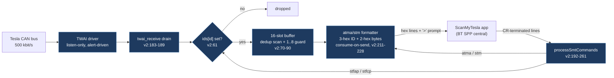
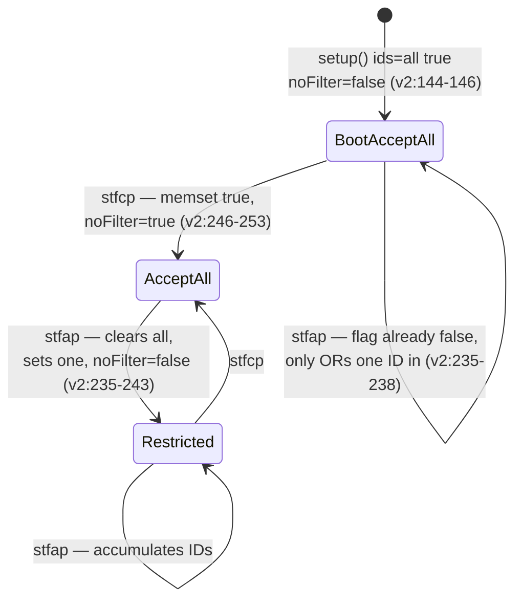

# Adminius-ESP32-ScanMyTesla

## 1. Provenance

- **Mode:** replace (user-directed). The pre-replace summary survives in git history; its claims are cited below as `git show HEAD:docs/legacy/Adminius-ESP32-ScanMyTesla.md` (line numbers refer to that blob).
- **Frontmatter:** preserved byte-for-byte. The description line carries no inherited trailing whitespace (`grep -nP ' +$'` on the pre-replace doc → no output), so nothing was stripped. The description is truncated mid-sentence (`... Android app. I`) — defect kept as bytes, recorded in section 6.
- **Preserved `## Upstream (...)` sections:** none existed in the pre-replace doc (`git grep -nE '^## Upstream'` → no output), so there is nothing to re-append after section 14.
- **Submodule:** `legacy/Adminius-ESP32-ScanMyTesla`, gitlink `160000 7f41cd56c82b0e42df6bfc79d6a710e937f96688 0`; `git -C legacy/Adminius-ESP32-ScanMyTesla rev-parse HEAD` matches; worktree clean (`status --porcelain` empty).
- **Upstream:** https://github.com/Adminius/ESP32-ScanMyTesla — license GPL-3.0.
- **Analysis date:** 2026-11-21.
- **Snapshot quirk:** the submodule is a shallow clone (`.git/modules/legacy/Adminius-ESP32-ScanMyTesla/shallow` pins `7f41cd5`); `git log HEAD` shows only one commit. The full 8-commit chain is reachable through tags (`git log --all`), and section 15 uses it.

Upstream files read:

| File | Lines | Coverage |
| --- | --- | --- |
| `ESP32-ScanMyTesla.ino` (v2, shipping) | 1-295 | FULL-READ |
| `ESP32-ScanMyTesla_v1.ino` | 1-251 | FULL-READ |
| `README.md` | 1-14 | FULL-READ |
| `README.md.bak` | 1-12 | FULL-READ |
| `LICENSE` | 1-5 of 674 | RANGE-CITED (standard GPL-3.0 text; lines 1-5 confirm) |

Files explicitly NOT read: `ESP32_can_connection.png` (binary wiring image, content unreadable as text). No hidden or platform subdirectories exist — `git -C legacy/Adminius-ESP32-ScanMyTesla ls-files` lists exactly the six files above.

Our-side files read for parity (TeslaCANModder):

| File | Lines | Coverage |
| --- | --- | --- |
| `firmware/lib/vehicle/can/feature/telemetry/bms.h` | 1-585 | FULL-READ |
| `firmware/lib/vehicle/can/feature/telemetry/powertrain.h` | 1-111 | FULL-READ |
| `firmware/lib/vehicle/can/feature/telemetry/tpms.h` | 1-93 | FULL-READ |
| `firmware/lib/io/serial/bluetooth/esp32/init.h` | 1-29 | FULL-READ |
| `firmware/lib/core/can/id_filter.h` | 1-45 | RANGE-CITED |
| `firmware/lib/core/can/ring_buffer.h` | 12, 33, 43, 53, 65 | RANGE-CITED |
| `firmware/lib/io/serial/usb/esp32/common.h` | 623 | RANGE-CITED |
| `firmware/lib/vehicle/can/feature/telemetry/motor_temps.h`, `firmware/lib/vehicle/can/ids.h` | grep hits only | RANGE-CITED |
| `packages/protocol/src/commands.ts` | 432-441 | RANGE-CITED |
| `client/src/components/IntegrationPanel.tsx` | 96-113 | RANGE-CITED |
| `docs/reference/commands.md` | 863-864 | RANGE-CITED |

## 2. Executive verdict

This repo is a 300-line Arduino sketch that turns a classic ESP32 plus SN65HVD230 transceiver into a Bluetooth-Serial CAN reader for the ScanMyTesla Android app: TWAI in listen-only mode at 500 kbit/s, a 2048-bit ID bitmap gate, a 16-slot frame buffer, and an ELM327/ST1110-style `at*`/`st*` line protocol (`atma`/`stm` dump, `stfap` add filter, `stfcp` clear) over SPP. It decodes, mutates, and injects nothing — all signal interpretation lives in the phone app. The mechanisms that matter for us are the protocol emulation shape (M4) and the alert-driven TWAI drain (M1); the ID-bitmap filter (M2) and frame buffer (M3) already exist in our code in better form (`id_filter.h`, `ring_buffer.h`). The one genuinely open adaptation path: our repo ships a `smt:on`/`smt:off` command in `packages/protocol` and renders a ScanMyTesla state row in the client, but the firmware has no handler for it at all — if we ever want a real SMT bridge, this repo (plus the fuller ELM327 emulator in `legacy/Akisoft41-TeslapLX`) is the upstream reference, and it must be built capture-first. Nothing here is safe to copy line-for-line: the dedup comparator, the boot filter state, and the `substring(9,6)` parse are all defective or fragile (see section 14). TPMS-style decode comparison is impossible from this repo — it never touches 0x219.

## 3. Evidence map

| Source file | Lines | What it proves | Grade |
| --- | --- | --- | --- |
| `ESP32-ScanMyTesla.ino` | 103-114 | TWAI `TWAI_MODE_LISTEN_ONLY`, GPIO 16/17, 500 kbit/s, accept-all hardware filter, rx_queue_len 127 | CODE-READ |
| `ESP32-ScanMyTesla.ino` | 132-139 | Alert mask = `RX_DATA \| ERR_PASS \| BUS_ERROR \| RX_QUEUE_FULL`; no `BUS_OFF`, no recovery call | CODE-READ |
| `ESP32-ScanMyTesla.ino` | 53-91 | `processCanMessage`: ids[] gate, dedup scan, 1..8 DLC guard, ring write | CODE-READ |
| `ESP32-ScanMyTesla.ino` | 144-146 | Boot sets `noFilter = false` but `memset(ids, true, ...)` — accept-all with a contradictory flag | CODE-READ |
| `ESP32-ScanMyTesla.ino` | 203-260 | `processSmtCommands`: at/st gate, `atma`/`stm` dump with consume-on-send, `stfap`/`stfcp`, `substring(9,6)`, `OK` + `>` prompt | CODE-READ |
| `ESP32-ScanMyTesla.ino` | 273-289 | `btLoop`: CR framing, 126-char cap, `tolower`, tautology condition that preserves spaces | CODE-READ |
| `ESP32-ScanMyTesla_v1.ino` | 52-57 | Static 48-ID Tesla whitelist (`relevantIds`) | CODE-READ |
| `ESP32-ScanMyTesla_v1.ino` | 37-49 | `DATA_SIMULATION` fixtures: six 8-byte sample frames (0x132 ×2, 0x129, 0x352, 0x292, 0x252) | CODE-READ |
| `ESP32-ScanMyTesla_v1.ino` | 110-118 | v1 uses collin80 `CAN0.begin(500000)`; boot seeds the 48-ID whitelist; no listen-only anywhere in v1 source | CODE-READ |
| `ESP32-ScanMyTesla_v1.ino` | 168-216 | v1 dump re-sends buffer without consuming (sticky dump); same `stfap` quirk | CODE-READ |
| `README.md` | 6-10 | Hardware list, Arduino core v3.0.4, "Does NOT work with iOS" | SUMMARY-ONLY |
| `README.md.bak` | 1-12 | Pre-`e942d15` README; diff shows the "readme update" only added core-version and iOS lines | CODE-READ |
| `LICENSE` | 1-5 | GPL-3.0 | RANGE-CITED |

No TEST-READ evidence exists: this repo ships no tests. No CAPTURE evidence exists in this repo: the `DATA_SIMULATION` arrays are hardcoded test vectors whose origin is unknown (whether they are real bus samples is UNVERIFIED — see section 11).

## 4. Architecture and build surface

Two self-contained Arduino sketches, no shared core, no library of their own:

- **Entry points:** `setup()` (v2: `ESP32-ScanMyTesla.ino:93-150`; v1: `:100-119`) initializes BluetoothSerial (`"ESP-SMT"`, v2:99) then the CAN driver; `loop()` (`:292-295`) polls `canLoop()` and `btLoop()` — bare superloop, no RTOS tasks.
- **v2 stack:** Arduino ESP32 core only — `driver/twai.h` + `BluetoothSerial.h`. Build flags: `DEBUG` (debug UART 250000, v2:16,34-51). Single TWAI instance, listen-only.
- **v1 stack:** external collin80 `esp32_can`/`can_common` libraries (v1:7) — the dependency the v2 rewrite removed. Build flags: `DEBUG`, `DATA_SIMULATION` (v1:25-26).
- **Dependency boundary:** none — everything is in one translation unit per sketch; `String` heap use in the BT response path.
- **TX pipeline:** None found: no frame mutation or injection pipeline exists in this repo. `twai_transmit` never appears (negative anchor, section 16), and TWAI runs in listen-only mode.



There is no mutate/gate-then-TX stage at all — the only "gate" is the RX-side ID bitmap, and the only outputs are the BT dump and debug prints.

## 5. Mechanism catalogue

### M1 — TWAI listen-only driver with alert-driven RX drain (v2)

- **Claim (README / summary):** reads CAN via "the ESP32's built-in TWAI peripheral in listen-only mode" (`git show HEAD:docs/legacy/Adminius-ESP32-ScanMyTesla.md`, line 15/48).
- **Code path:** `ESP32-ScanMyTesla.ino:93-150` — `setup()` → `twai_driver_install()` (117) → `twai_start()` (125) → `twai_reconfigure_alerts()` (134); then `canLoop()` (153-190) → `twai_read_alerts()` (161) → `twai_receive()` drain (186) → `processCanMessage()`.
- **Frame spec:** none — raw frames only, never decoded, never transmitted.
- **Gates and timing:** alert-driven, non-blocking; `rx_queue_len = 127`; drain loop runs while `twai_receive` returns `ESP_OK`. `TWAI_MODE_LISTEN_ONLY` at line 103.
- **State machine:** two booleans only: `driver_installed` (set at 142) and per-loop alert bits. `driver_installed == false` → 1 s delay loop (154-157).
- **Tests:** None found — repo ships no tests.
- **Evidence grade:** CODE-READ
- **Verdict:** CONFIRMED (listen-only, no TX anywhere)
- **Adapt to TeslaCANModder?** no impact — our hardware path is MCP2515-over-SPI on the X179 connector; `git grep -niE 'twai' -- firmware` returns nothing, so we have no TWAI code to align with.

### M2 — 2048-bit ID bitmap filter with stfap/stfcp gate

- **Claim (README / summary):** "filters by known Tesla IDs" and "only whitelisted IDs are processed" (`git show HEAD:...`, lines 35 and 43).
- **Code path:** `ESP32-ScanMyTesla.ino:61` (RX gate) ← `processSmtCommands()` (192-261) — `stfap <id>,<mask>` sets `ids[filter] = true` (243), `stfcp` sets all true (250); v1 equivalent at `:183-207` with a static boot whitelist (`:52-57, 115-117`).
- **Frame spec:** none — pure ID-level accept/reject, payload-agnostic.
- **Gates and timing:** boot state is accept-all (`memset(ids, true, ...)` v2:146) while `noFilter` is already `false` (v2:144) — so the first `stfap` after boot only ORs one more ID in (235-238) and does not restrict traffic until the app first sends `stfcp`. The mask half of `stfap 3d2,7ff` is parsed away and ignored (232-234).
- **State machine:** three reachable states (see diagram below).
- **Tests:** None found.
- **Evidence grade:** CODE-READ
- **Verdict:** CONFIRMED mechanism, CONTRADICTED summary (boot default is accept-all, not a known-ID whitelist — that list exists only in v1).
- **Adapt to TeslaCANModder?** already present — `firmware/lib/core/can/id_filter.h:18-45` implements the same 2048-bit/64-word bitmask (`IdFilter`, `idFilterClear`, `idFilterAdd`) with correct clear semantics; nothing to port.



### M3 — 16-slot consume-on-dump frame buffer with broken mux dedup

- **Claim (README / summary):** "replaces existing buffer entry if same ID + same first byte (multiplex index)" (`git show HEAD:...`, line 42).
- **Code path:** `ESP32-ScanMyTesla.ino:53-91` — `processCanMessage()` scans the buffer, then writes at `lineNumber`; the dump loop (211-228) formats each slot as `LLLDDDD...` (3-hex ID, 2-hex bytes) and zeroes `canDataBufferId[i]` after sending (226), so each frame is delivered exactly once per `atma`.
- **Frame spec:** none — bytes stored verbatim; DLC guard `0 < length < 9` (80) drops everything else, including legal DLC-0 frames.
- **Gates and timing:** no timing; buffer is a snapshot of the most recent 16 accepted (non-mux-deduped) frames at poll time.
- **State machine:** fill → wrap at `BUFFER_LENGTH` (87) → consumed slot freed by the next `atma`. Not a real state machine — linear ring.
- **Tests:** None found.
- **Evidence grade:** CODE-READ
- **Verdict:** CONTRADICTED — the dedup comparator reads `canDataBufferData[lineNumber][0]` (the write-target slot) instead of slot `i` (v2:71), so mux dedup only works by coincidence when `lineNumber == i`; multiplexed frames (the author's own stated use case, comment v2:69) generally are not deduped and wrap the ring.
- **Adapt to TeslaCANModder?** already present in better form — `firmware/lib/core/can/ring_buffer.h:12,43,65` (`RING_BUF_SIZE = 256`, lock-free `canRingBuffer`, per-consumer `RingConsumer`). The upstream ID+data[0] dedup idea is the only novel bit and is exactly the part that is broken upstream.

### M4 — ELM327/ST1110 SPP protocol emulation

- **Claim (README / summary):** "Bluetooth SPP profile (`ESP-SMT`) for ScanMyTesla app communication" (`git show HEAD:...`, line 44).
- **Code path:** `ESP32-ScanMyTesla.ino:192-261` — `processSmtCommands()`; `btLoop()` (273-289) frames lines on CR (13); responses end with `>` prompt (258); unknown non-at/st lines get a bare newline (203-208); all other at/st commands get `OK` (254-257).
- **Frame spec:** the BT wire format, not CAN: `atma`/`stm` reply = per-frame lines `LLL` + `DD`×DLC + `\n`, then `>`; `stfap`/`stfcp` reply `OK\n>`; v1 additionally ends every reply with `\n` after the `>` (v1:214, from commit `d8554e2`).
- **Gates and timing:** none — no auth, no rate limit; any paired central can drive it.
- **State machine:** stateless per line, except the filter bitmap it mutates (M2) and the buffer it consumes (M3).
- **Tests:** None found.
- **Evidence grade:** CODE-READ
- **Verdict:** CONFIRMED for the four commands (`atma`, `stm`, `stfap`, `stfcp`); UNVERIFIED whether this subset is sufficient for the real ScanMyTesla app handshake (only upstream README and commit messages say so).
- **Adapt to TeslaCANModder?** candidate for future PR — see parity row P8 and section 13.

### M5 — BT SPP line assembler

- **Claim (README / summary):** not mentioned in the old summary.
- **Code path:** `ESP32-ScanMyTesla.ino:273-289` — `btLoop()` reads bytes, terminates on CR (278) or overflow at 126 (278), lowercases (285). The "ignore newline/space" comment (283-284) is implemented as `if (tmp != 10 || tmp != 32)` — a tautology that is always true, so spaces ARE stored.
- **Frame spec:** N/A — char stream; `buffer[128]`.
- **Gates and timing:** the space-preserving "bug" is load-bearing: `stfap 3d2,7ff` needs the space at index 5 for `substring(6,9)` (via Arduino's argument swap of `substring(9,6)`, v2:232) to land on `3d2`. Fixing the tautology to `&&` would break filter parsing.
- **State machine:** single state (accumulate until CR).
- **Tests:** None found.
- **Evidence grade:** CODE-READ
- **Verdict:** CONFIRMED (including the tautology and its accidental necessity)
- **Adapt to TeslaCANModder?** no impact — our serial line handling exists (`firmware/lib/io/serial/usb/esp32/common.h:623`, `handleChar`), JSON-RPC shaped, and does not need to accept ELM327 text.

### M6 — v1 static 48-ID Tesla whitelist

- **Claim (README / summary):** "filters by known Tesla IDs" (`git show HEAD:...`, line 35) — true only for v1.
- **Code path:** `ESP32-ScanMyTesla_v1.ino:52-57` — `relevantIds[]`, 48 IDs; applied at boot `:115-117`.
- **Frame spec:** none — IDs only: `0x108 0x118 0x129 0x132 0x1D5 0x1D8 0x186 0x20C 0x212 0x241 0x244 0x252 0x257 0x261 0x264 0x266 0x267 0x268 0x292 0x29D 0x2A8 0x2B4 0x2C1 0x2D2 0x2E5 0x312 0x315 0x321 0x332 0x334 0x336 0x33A 0x352 0x376 0x381 0x382 0x395 0x396 0x3A1 0x3B6 0x3D2 0x3F2 0x3FE 0x401 0x541 0x557 0x5D7 0x692`.
- **Gates and timing:** none beyond the bitmap; `stfap` from the app accumulates on top without clearing (v1:188-199).
- **State machine:** None found.
- **Tests:** None found.
- **Evidence grade:** CODE-READ
- **Verdict:** CONFIRMED (v1 only; superseded by accept-all in v2)
- **Adapt to TeslaCANModder?** no impact as code; the list itself is a useful bench-capture checklist of what the SMT app considers interesting on Model 3 — capture hint, not a port.

### M7 — v1 legacy stack (collin80 CAN, DATA_SIMULATION, sticky dump)

- **Claim (README / summary):** "ESP32-ScanMyTesla_v1.ino — Older version kept for reference" (`git show HEAD:...`, line 36).
- **Code path:** `ESP32-ScanMyTesla_v1.ino:7` (external lib), `:110` (`CAN0.begin(500000)`), `:122-155` (polling `CAN0.read`), `:157-217` (protocol), `:37-49` (simulation fixtures); dump re-sends the same slots every poll without consuming (`:171-182`).
- **Frame spec:** None found — same raw-hex forwarding.
- **Gates and timing:** no listen-only configuration anywhere in v1 source (negative anchor, section 16); whether the collin80 driver defaults to listen-only is UNVERIFIED (external library not vendored in this repo).
- **State machine:** None found beyond the v1 filter flag.
- **Tests:** None found (the `DATA_SIMULATION` fixtures are compile-time test vectors, not assertions).
- **Evidence grade:** CODE-READ
- **Verdict:** PARTIAL — v1 is a full second implementation, not just "kept for reference"; the summary hides that it uses a different CAN stack with no proven listen-only mode.
- **Adapt to TeslaCANModder?** never port — external-library dependency, no explicit listen-only, sticky-dump defect.

## 6. Summary vs code contradiction table

| # | Claim (pre-replace doc or upstream README) | Code reality | Verdict |
| --- | --- | --- | --- |
| C1 | Frontmatter description ends mid-sentence: `... to the "ScanMyTesla" Android app. I` (`git show HEAD:docs/legacy/Adminius-ESP32-ScanMyTesla.md`, line 3) | Editorial defect, no code counterclaim; preserved byte-for-byte per skill, flagged here | defect (kept bytes) |
| C2 | "filters by known Tesla IDs" (`git show HEAD:...`, line 35) | v2 boot = accept-all: `noFilter = false` then `memset(ids, true, sizeof(ids))` (`ESP32-ScanMyTesla.ino:144-146`); a known-ID whitelist exists only in v1 (`_v1.ino:52-57`) | CONTRADICTED |
| C3 | "only whitelisted IDs are processed" / "whitelist populated by the ScanMyTesla app" (`git show HEAD:...`, lines 43, 50) | The app can only add IDs (`stfap`, v2:230-244) or re-open all (`stfcp`, v2:246-253); after boot the first `stfap` does not restrict because `noFilter` is already `false` (v2:144, 235-238) | CONTRADICTED |
| C4 | "replaces existing buffer entry if same ID + same first byte (multiplex index)" (`git show HEAD:...`, line 42) | Comparator reads the write-target slot: `canDataBufferId[i] == id && canDataBufferData[lineNumber][0] == data[0]` (`ESP32-ScanMyTesla.ino:71`) — dedup only works when `lineNumber == i`; muxed frames wrap the ring | CONTRADICTED |
| C5 | Repo-wide: "reads CAN frames via the ESP32's built-in TWAI peripheral in listen-only mode" (`git show HEAD:...`, line 15) | True for v2 only; v1 uses the external collin80 `esp32_can` library (`_v1.ino:7,110`) and its own source never configures listen-only (`grep -nE 'LISTEN|listen'` → no output); library default mode UNVERIFIED | PARTIAL |
| C6 | Our side: `smt:on` — "Enable ScanMyTesla Bluetooth SPP bridge", mapped to status field `scanMyTesla` (`docs/reference/commands.md:863`, `docs/reference/connections.md:203`) | `git grep -niE 'smt' -- firmware` → no output; `git grep -niE 'scanMyTesla' -- firmware` → no output. The command exists in `packages/protocol/src/commands.ts:437` and the client renders `state.scanMyTesla` (`client/src/components/IntegrationPanel.tsx:103-107`), but no firmware handler or status field exists | CONTRADICTED (our doc stack, not upstream) |

Everything else the pre-replace doc claims (listen-only TWAI v2, 16-frame buffer, 1..8 byte guard, SPP name `ESP-SMT`, no injection, iOS limitation) agrees with the code and is recorded in section 3 instead.

## 7. CAN frame and signal inventory

This repo **decodes, mutates, and injects nothing**. Every frame is forwarded as raw hex; all signal interpretation lives in the phone app. Verified by negative anchors (section 16): no scale factors, no counters, no checksum code anywhere. Per the contract, the only code-referenced frames are the v1 `DATA_SIMULATION` fixtures and the forwarded-ID sets.

Fixture frames (`ESP32-ScanMyTesla_v1.ino:37-49`, gated by `DATA_SIMULATION`):

| ID (hex+dec) | Bus | Period | DLC | Byte/bit layout | Scale/units | Counter position | Checksum | Read or write | Grade |
| --- | --- | --- | --- | --- | --- | --- | --- | --- | --- |
| 0x132 (306) | single lane, unlabeled | not stated | 8 | `2E 97 F6 FF FD 26 FF 0F` | no decode | None found | None found | read | CODE-READ (fixture bytes; origin UNVERIFIED) |
| 0x132 (306) | single lane, unlabeled | not stated | 8 | `2E 97 F2 FF F6 26 FF 0F` | no decode | None found | None found | read | CODE-READ (fixture bytes; origin UNVERIFIED) |
| 0x129 (297) | single lane, unlabeled | not stated | 8 | `E3 24 55 20 FF 1F FF 3F` | no decode | None found | None found | read | CODE-READ (fixture bytes; origin UNVERIFIED) |
| 0x352 (850) | single lane, unlabeled | not stated | 8 | `D8 CA 8F 7D EC 43 85 10` | no decode | None found | None found | read | CODE-READ (fixture bytes; origin UNVERIFIED) |
| 0x292 (658) | single lane, unlabeled | not stated | 8 | `73 B7 9D 77 DD 0A 03 00` | no decode | None found | None found | read | CODE-READ (fixture bytes; origin UNVERIFIED) |
| 0x252 (594) | single lane, unlabeled | not stated | 8 | `00 00 0F 09 00 00 A0 0F` | no decode | None found | None found | read | CODE-READ (fixture bytes; origin UNVERIFIED) |

Forwarded-ID sets (no per-frame layout exists to tabulate):

- v1 boot whitelist: the 48 IDs listed in mechanism M6 (`ESP32-ScanMyTesla_v1.ino:52-57`) — forward-only, no layout.
- v2: all 11-bit IDs accepted at boot (`ESP32-ScanMyTesla.ino:146`), narrowed only by app `stfap` after a `stfcp` (M2) — forward-only, no layout.

A vendored DBC/JSON catalog: None found. TPMS 0x219: absent from this repo entirely (not in the whitelist, not in any fixture).

## 8. Constants and tuning table

| Constant | Value | File:line | Meaning | Grade |
| --- | --- | --- | --- | --- |
| `BUFFER_LENGTH` | 16 | `ESP32-ScanMyTesla.ino:11`, `_v1.ino:23` | ring/dump batch size; frames-per-`atma` | CODE-READ |
| `RX_PIN` / `TX_PIN` | 16 / 17 | `ESP32-ScanMyTesla.ino:13-14` | TWAI GPIOs (history: commit `b5f5f1f` "pins swapped" touched only the PNG) | CODE-READ |
| `ids[]` | 2048 entries | `ESP32-ScanMyTesla.ino:20`, `_v1.ino:31` | full 11-bit ID bitmap, 1 byte/ID in v2, settings-byte in v1 | CODE-READ |
| `rx_queue_len` / `tx_queue_len` | 127 / 1 | `ESP32-ScanMyTesla.ino:108-109` | TWAI queue sizing; tx=1 is vestigial in listen-only | CODE-READ |
| alert mask | `RX_DATA \| ERR_PASS \| BUS_ERROR \| RX_QUEUE_FULL` | `ESP32-ScanMyTesla.ino:133` | excludes `TWAI_ALERT_BUS_OFF` → no bus-off handling | CODE-READ |
| bit rate | `TWAI_TIMING_CONFIG_500KBITS()` | `ESP32-ScanMyTesla.ino:113`, `_v1.ino:110` | Tesla bus rate | CODE-READ |
| BT line cap | 128-byte buffer, process at >126 | `ESP32-ScanMyTesla.ino:27-28,278` | overflow forces a (garbage) command dispatch | CODE-READ |
| CR terminator | 13 | `ESP32-ScanMyTesla.ino:278`, `_v1.ino:234` | command framing | CODE-READ |
| `substring(9,6)` | args swap → effective (6,9) | `ESP32-ScanMyTesla.ino:232`, `_v1.ino:185` | filter-ID parse; relies on Arduino `String::substring` swapping reversed args | CODE-READ |
| response literals | `"OK"`, `">"`, `"\n"` | `ESP32-ScanMyTesla.ino:244,253,256,258,204` | ST1110-style replies | CODE-READ |
| SPP device name | `"ESP-SMT"` | `ESP32-ScanMyTesla.ino:99`, `_v1.ino:108` | advertised BT name | CODE-READ |
| debug baud | 250000 | `ESP32-ScanMyTesla.ino:96`, `_v1.ino:102` | `DEBUG`-only UART | CODE-READ |
| `CAN_ID_BIT_RELEVANT` | 0 | `_v1.ino:22` | v1 per-ID settings-bit scheme (bits 1-7 all "tbd") | CODE-READ |
| `relevantIds[]` | 48 IDs | `_v1.ino:52-57` | v1 boot whitelist (M6) | CODE-READ |
| strncmp prefixes | `at`/`st` (2), `atma` (4), `stm` (3), `stfap ` (6), `stfcp` (5) | `ESP32-ScanMyTesla.ino:203,211,230,246` | command grammar | CODE-READ |

## 9. Failure modes and edge cases

| Failure | Handling code path | Tested? | Grade |
| --- | --- | --- | --- |
| TWAI bus-off | None — `TWAI_ALERT_BUS_OFF` not in mask (`ESP32-ScanMyTesla.ino:133`), no `twai_initiate_recovery` anywhere (negative anchor) | No | CODE-READ |
| Error-passive / bus error | debug print only (166-173); release builds compile prints to no-ops (48-50), so silent | No | CODE-READ |
| RX queue overrun | alert → debug print of `rx_missed_count`/`rx_overrun_count` (174-182); no counter exposed over BT, no backoff | No | CODE-READ |
| Driver install/start failure | early `return` from `setup()` (121, 129); BT was already up (99), so the device answers protocol commands forever with an empty dump — no error surfaced to the client | No | CODE-READ |
| Muxed-frame flood | dedup broken (71, see M3) — author's own comment admits the mux problem (69); ring wraps, older frames lost | No | CODE-READ |
| DLC 0 or >8 | dropped silently (80, 89) — legal DLC-0 frames never buffered | No | CODE-READ |
| CAN ID 0x000 | buffered but never dumped — `if(canDataBufferId[i] == 0) continue;` treats 0 as the empty-slot sentinel (215) | No | CODE-READ |
| First `stfap` after boot | does not restrict traffic (M2, 235-238) — filter appears "not working" until the app sends `stfcp` first | No | CODE-READ |
| BT line overflow | processes a truncated command at >126 chars (278) | No | CODE-READ |
| Space/NL in commands | tautology `tmp != 10 \|\| tmp != 32` stores them (284) — accidental, and required for `stfap` to parse (M5) | No | CODE-READ |
| v1 stale dump | buffer not consumed on send (`_v1.ino:171-182`) — app re-reads the same 16 frames until they are overwritten | No | CODE-READ |

Untested error paths: all of them — the repo ships no tests, so every row above is unverified by anything except reading the code.

## 10. Test coverage map

None found — `git -C legacy/Adminius-ESP32-ScanMyTesla ls-files` shows six files, none of them tests; `git grep -nE 'assert|UNITY'` matches only GPL license text (`LICENSE:41,340`). The `DATA_SIMULATION` block (`_v1.ino:37-49`) is a compile-time data source, not an assertion.

Critical paths with no test: dedup correctness (broken, M3), filter state transitions (M2), protocol formatting widths (the 3-hex/2-hex zero-padding at 217-218, 223-224), alert/overflow handling. Risk in one line: every behavior in this repo is validated only by the author driving the real app against a real car.

## 11. Parity matrix with TeslaCANModder

| Signal/frame | Upstream decode (cite) | Our decode (cite) | Delta | Action |
| --- | --- | --- | --- | --- |
| P1 0x132 BMS_hvBusStatus | forward-only + fixture `2E 97 F6 FF...` (`_v1.ino:39`) | `decodeBmsVoltage` bytes 0-1 BE ×0.01 V; `decodeBmsCurrent` bytes 2-3 signed BE ×0.1 A (`firmware/lib/vehicle/can/feature/telemetry/bms.h:18-33`); charge-time bits 48-59 (`bms.h:567-571`) | upstream has no layout; fixture decodes to 119.27 V / -230.5 A under our formulas — implausible, so the fixture is a synthetic vector, not a decode oracle | ignore (nothing to align; capture-first if sample vectors are ever wanted) |
| P2 0x292 BMS_socStatus | forward-only + fixture `73 B7 9D...` (`_v1.ino:42`) | `decodeBmsSoc` bits 0-9 ×0.1 % (`bms.h:50-54`); UI/max/avg SoC and initial full pack at `bms.h:191-228` | fixture decodes to 95.1 % under our formula — plausible, but still synthetic-origin | ignore |
| P3 0x252 BMS_powerAvailable | forward-only + fixture `00 00 0F 09...` (`_v1.ino:43`) | `decodeBmsMaxRegenPower` bytes 0-1 ×0.01 kW, `decodeBmsMaxDischargePower` bytes 2-3 (`bms.h:147-162`), heat/HVAC budgets (`bms.h:169-184`) | no upstream layout | ignore |
| P4 0x352 BMS_energyStatus | forward-only + fixture `D8 CA 8F 7D...` (`_v1.ino:41`) | mux-0 nominal full/remaining/ideal ×0.02 kWh (`bms.h:92-118`), mux-1 expected/buffer/to-complete (`bms.h:448-474`) | fixture mux-0 nominal-full decodes to 734.66 kWh — implausible, synthetic | ignore |
| P5 0x129 steering angle | forward-only + fixture `E3 24 55 20...` (`_v1.ino:40`) | `decodeSteeringAngle` bytes 0-1 signed ×10° (`powertrain.h:59-63`) | fixture decodes to -738.8° — implausible, synthetic | ignore |
| P6 0x219 TPMS | absent upstream: not in the 48-ID whitelist (`_v1.ino:52-57`), no fixture, no decode | `decodeTpmsFrame` bytes 0-3 ×0.025 bar, bytes 4-7 offset-40 °C (`tpms.h:12,51-63`) | upstream contributes nothing on TPMS — the SMT app decodes it client-side over its own transport | ignore (no comparison possible from this repo) |
| P7 whitelist overlap | v1 forwards 48 IDs raw (`_v1.ino:52-57`) | we decode/inject most of the overlap: 0x118 (`powertrain.h:29-42`), 0x257 (`powertrain.h:18-22`), 0x212/0x2D2/0x312/0x332/0x33A/0x352/0x3D2/0x3F2 (`bms.h:354-357, 404-441, 61-74, 125-140, 81-85, 92-118, 491-520`), 0x376 (`motor_temps.h:46-68`, `ids.h:61`), 0x3A1/0x401 (`ids.h:65,71`) | upstream is a raw pipe; no layout claim to align on any of them | ignore |
| P8 SMT SPP bridge | the entire repo (M4; `ESP32-ScanMyTesla.ino:192-289`) | command builder `scanMyTesla()` (`packages/protocol/src/commands.ts:437`), client row reading `state.scanMyTesla` (`client/src/components/IntegrationPanel.tsx:103-107`), docs (`docs/reference/commands.md:863-864`) — but no firmware handler and no `scanMyTesla` status field (`git grep -niE 'smt\|scanMyTesla' -- firmware` → no output) | we advertise the feature end-to-end in protocol/client/docs while firmware answers "Unknown command"; upstream proves the minimal working protocol (`atma`/`stm`/`stfap`/`stfcp` + `>` prompt) | capture-first: bench-capture the real app's command stream (and cross-check `legacy/Akisoft41-TeslapLX`'s fuller emulator) before writing any handler; our SPP transport already exists (`firmware/lib/io/serial/bluetooth/esp32/init.h:10-23`) |

P1-P6 grades: upstream side CODE-READ (bytes/lists read), our side CODE-READ; the plausibility arithmetic is derived from both reads, fixture origin itself UNVERIFIED. No row in this matrix rests on SUMMARY-ONLY.

## 12. Surface inventory and security notes

| Surface | Semantics | Notes |
| --- | --- | --- |
| BT SPP (`"ESP-SMT"`, classic Bluetooth) | CR-terminated line commands: `atma`/`stm` dump-then-consume; `stfap <hexid>,<mask>` add filter (mask ignored); `stfcp` allow-all; any other `at*`/`st*` → `OK`; anything else → bare newline. Replies end with `>` prompt (v2:192-261) | no auth beyond BT pairing; any paired central can reconfigure filters and drain frames |
| Debug UART 250000 | `DEBUG`-only frame/alert prints (v2:34-51) | compiled out in release |
| WiFi / BLE GATT / web / OTA | None found | — |

Security/provenance findings:

- Hardcoded credentials: None found (`git grep -niE 'password|secret|credential'` → only GPL boilerplate, `LICENSE:340`).
- Untrusted archives / dangerous build flags: None found.
- The CAN side is listen-only (v2:103), so the repo exposes no injection surface to the vehicle; the attack surface is only "paired phone can read bus traffic" — which is the product's purpose.
- BluetoothSerial pairing mode is left at library defaults; whether that is Just-Works or PIN-based is UNVERIFIED (library-internal behavior, not in this repo's source).

## 13. Adaptation assessment

| Mechanism | Value | Cost | Risk | Evidence grade | Decision |
| --- | --- | --- | --- | --- | --- |
| M1 TWAI listen-only drain | low — different silicon path (we use MCP2515) | new driver layer | no bus impact, but dead code for us | CODE-READ | no impact (no TWAI code in our firmware) |
| M2 ID bitmap filter | none — ours exists (`id_filter.h:18-45`) with correct clear semantics | — | — | CODE-READ | already present |
| M3 16-slot buffer | none — ours is 256-entry lock-free multi-consumer (`ring_buffer.h:12,43,65`) | — | — | CODE-READ | already present |
| M4 SMT/ST1110 protocol | high — closes the P8 gap: our `smt:on` is a documented no-op in firmware; the app-side protocol shape is proven working upstream | a new command handler + line protocol on our existing SPP transport (`io/serial/bluetooth/esp32/init.h`) | protocol subset UNVERIFIED against the real app; frame-shape claims need independent validation | CODE-READ (protocol) + UNVERIFIED (app sufficiency) | candidate for future PR, capture-first; cross-reference the fuller emulator in `legacy/Akisoft41-TeslapLX` (`main/elm.c`) |
| M5 BT line assembler | none — our JSON-RPC parser exists (`common.h:623`) | — | — | CODE-READ | no impact |
| M6 48-ID whitelist | low — bench-capture checklist only | none | none | CODE-READ | no impact as code; keep as capture hint |
| M7 v1 stack | none | — | external lib, no listen-only proof | CODE-READ | never port |

If M4 is ever implemented: behavior, constants, and byte layout only — independent implementation in our `Frame`/`State` style, an independent test oracle, and `docs/checklists/can-review-checklist.md` plus a listen-only bench capture before landing (the bridge itself is RX-only, but it rides the same dispatch surface as our mutating features).

## 14. Do-not-copy list

| Item | File:line | Reason |
| --- | --- | --- |
| Dedup comparator `canDataBufferData[lineNumber][0] == canMessage.data[0]` | `ESP32-ScanMyTesla.ino:71` | reads the write-target slot instead of slot `i` — the exact defect that kills mux dedup (M3) |
| Boot filter state: `noFilter = false` + accept-all memset | `ESP32-ScanMyTesla.ino:144-146` | contradictory state; first `stfap` silently fails to restrict (M2) |
| `substring(9,6)` filter parse | `ESP32-ScanMyTesla.ino:232`, `_v1.ino:185` | reversed-args magic that only works because Arduino swaps them; author's own comment flags it |
| Tautology `if (tmp != 10 \|\| tmp != 32)` | `ESP32-ScanMyTesla.ino:284`, `_v1.ino:240` | comment says "ignore space/NL", code always stores them; accidentally load-bearing for `stfap` — copying it cements the bug |
| ID-0 sentinel collision | `ESP32-ScanMyTesla.ino:215` | empty-slot sentinel equals CAN ID 0x000, so real ID-0 frames become undumpable |
| Arduino `String` building in the BT response path | `ESP32-ScanMyTesla.ino:192-271` | heap churn per command in a superloop; our C++ conventions (fixed buffers, `Frame`, tabs/Allman) forbid it anyway |

## 15. History and evolution

All eight commits are reachable locally via tags; every claim below comes from `git -C legacy/Adminius-ESP32-ScanMyTesla log --all` and read-back diffs, no network.

| Commit | Date | Subject | What it actually did |
| --- | --- | --- | --- |
| `2fe6548` | 2020-11-17 | Initial commit | LICENSE + 2-line README only |
| `000bfd0` | 2020-11-17 | initial upload | v1 sketch (240 lines): collin80 CAN stack, 48-ID whitelist, SPP bridge |
| `5cb28c4` | 2020-11-18 | BF: can dump didn't work | +24/-13 in the dump path; tagged `1.0.1` |
| `b5f5f1f` | 2021-01-02 | RX\<\>TX pins swapped | PNG only (git stat: 1 binary file) — the code pins never changed in this commit; the wiring diagram was corrected |
| `d8554e2` | 2022-05-18 | BF for SMT 2.x | 2-line diff: trailing newline moved outside the at/st branch so every reply (including unknown commands) ends with `\n` — SMT 2.x app compat |
| `93ca2b1` | 2024-09-14 | New v2, without external libs, but TWAI driver | full rewrite (378 lines changed): dropped collin80 for the built-in TWAI driver, accept-all boot instead of the whitelist, consume-on-dump instead of sticky dump; v1 preserved as `_v1.ino` |
| `e942d15` | 2024-09-14 | readme update | README +5/-2: added Arduino-core v3.0.4 line and iOS note; old text kept as `README.md.bak`; tagged `2.0.0` |
| `7f41cd5` | 2024-09-16 | iOS hint | the pinned HEAD: README wording "Does NOT work with iOS. Apple doesn't Bluetooth Serial." |

Evolution story: the author started on an external CAN library, hit a dump bug and a pin-labeling bug, patched SMT 2.x compat, then abandoned the external-dependency approach entirely in favor of the vendor TWAI driver — trading the curated 48-ID whitelist for accept-all-plus-app-filters. Nothing was rolled back after the v2 rewrite; v1 survives as a reference copy with different (and partly worse) semantics.

## 16. Re-verification recipe

```bash
OLD=7f41cd56c82b0e42df6bfc79d6a710e937f96688
git -C legacy/Adminius-ESP32-ScanMyTesla fetch --tags --prune
git -C legacy/Adminius-ESP32-ScanMyTesla log --oneline $OLD..origin/main
git -C legacy/Adminius-ESP32-ScanMyTesla diff --stat $OLD..origin/main
git ls-files -s legacy/Adminius-ESP32-ScanMyTesla   # expect: 160000 7f41cd56... 0
# history note: the clone is shallow at HEAD; use `log --all` (tags) or fetch --unshallow for full history
```

Anchors below were demonstrated at write time with `git grep -nE` (this Windows workspace lacks a standalone `grep`; on POSIX use `grep -nE` with the same patterns and files).

Upstream anchors:

```text
git -C legacy/Adminius-ESP32-ScanMyTesla grep -nE 'TWAI_MODE_LISTEN_ONLY' -- ESP32-ScanMyTesla.ino
  -> expect hits at :102 (commented default) and :103 (active config)

git -C legacy/Adminius-ESP32-ScanMyTesla grep -nE 'stfap|stfcp|atma|stm' -- ESP32-ScanMyTesla.ino
  -> expect hits at :211 (atma/stm), :230 (stfap), :246 (stfcp)

git -C legacy/Adminius-ESP32-ScanMyTesla grep -nE 'substring\(9,6\)'
  -> expect hits at ESP32-ScanMyTesla.ino:232 and ESP32-ScanMyTesla_v1.ino:185

git -C legacy/Adminius-ESP32-ScanMyTesla grep -nE 'canDataBufferData\[lineNumber\]\[0\]' -- ESP32-ScanMyTesla.ino
  -> expect hit at :71 (the dedup defect)

git -C legacy/Adminius-ESP32-ScanMyTesla grep -nE 'relevantIds' -- ESP32-ScanMyTesla_v1.ino
  -> expect hits at :52 (definition), :115-116 (boot seeding)
```

Upstream negative anchors (absence claims):

```text
git -C legacy/Adminius-ESP32-ScanMyTesla grep -nE 'twai_transmit|TWAI_MODE_NORMAL|TWAI_ALERT_BUS_OFF|twai_initiate_recovery'
  -> expect no output (no TX, no bus-off handling)

git -C legacy/Adminius-ESP32-ScanMyTesla grep -nE 'LISTEN|listen' -- ESP32-ScanMyTesla_v1.ino
  -> expect no output (v1 never sets listen-only in its own source)
```

Our-side drift anchors (the "already present" and P8 decisions rest on these):

```text
git grep -niE 'smt|scanMyTesla' -- firmware
  -> expect no output (firmware has no SMT handler/status field)

git grep -nE 'scanMyTesla' -- packages/protocol/src/commands.ts
  -> expect hit at :437 ("smt:on" / "smt:off" builder)

git grep -nE 'BluetoothSerial|btSerial' -- firmware/lib/io/serial/bluetooth/esp32/init.h
  -> expect hits at :10, :13, :21 (our SPP transport exists)

git grep -nE 'RING_BUF_SIZE|canRingBuffer' -- firmware/lib/core/can/ring_buffer.h
  -> expect hits at :12 (256), :43 (canRingBuffer)

git grep -nE 'CAN_ID_MAX|idFilterAdd' -- firmware/lib/core/can/id_filter.h
  -> expect hits at :18 (2048) and :45 (idFilterAdd)

git grep -nE 'decodeBmsVoltage|decodeBmsCurrent|decodeBmsSoc\(' -- firmware/lib/vehicle/can/feature/telemetry/bms.h
  -> expect hits at :18, :29, :42, :50

git grep -nE 'decodeSteeringAngle' -- firmware/lib/vehicle/can/feature/telemetry/powertrain.h
  -> expect hit at :59

git grep -nE 'CAN_ID_TPMS|decodeTpmsFrame' -- firmware/lib/vehicle/can/feature/telemetry/tpms.h
  -> expect hits at :12, :51, :74

git grep -niE 'twai' -- firmware
  -> expect no output (no TWAI path in our firmware; MCP2515 only)
```

If line numbers drift more than ~10 after an upstream bump, re-read the whole function; do not trust this document's numbers. Upstream history before the pinned SHA was not reviewed — only the pinned snapshot plus the locally reachable tag history.

## 17. Open questions and explicitly not investigated

- **Pre-pin history:** not reviewed beyond the locally reachable chain; the shallow clone cuts at HEAD, and anything before `2fe6548` (if it exists upstream) is invisible here. Network (GitHub issues, PRs) was not consulted — all such claims would be UNVERIFIED.
- **ScanMyTesla app protocol sufficiency:** whether `atma`/`stm`/`stfap`/`stfcp` + `OK`/`>` is the app's full command set, and whether the app sends `stfcp` before its first `stfap` (which would mask the M2 boot quirk in practice), is UNVERIFIED. A bench capture of the app against this firmware, or a cross-read of `legacy/Akisoft41-TeslapLX`'s emulator, would settle it.
- **Fixture origin:** the six `DATA_SIMULATION` frames decode implausibly under our layouts in three of five distinct IDs (119.27 V pack, 734.66 kWh nominal, -738.8° steering) and plausibly in two (95.1 % SoC, 38.49 kW discharge) — likely synthetic vectors, but a real vehicle capture would confirm. They must not be used as decode oracles either way.
- **collin80 library default mode (v1):** whether v1's `CAN0.begin()` ran listen-only is UNVERIFIED — the library is an external Arduino dependency not vendored in this repo.
- **`ESP32_can_connection.png`:** wiring details unread (binary); the README claims SN65HVD230 without termination resistor — SUMMARY-ONLY.
- **Our-side gap (P8) scope:** this analysis proves the firmware lacks any `smt` handler, but did not investigate whether any open issue/plan already tracks it, nor what `docs/reference/connections.md:203`'s `scanMyTesla` status field was ever emitted by.
- **TPMS expectation:** the task hint anticipated ScanMyTesla-style BMS/TPMS decode layouts; this repo contains none — TPMS (0x219) is entirely absent and BMS frames are forwarded raw, so no TPMS parity row beyond P6's absence finding is possible from this source.
