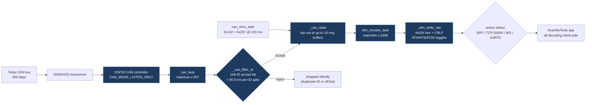
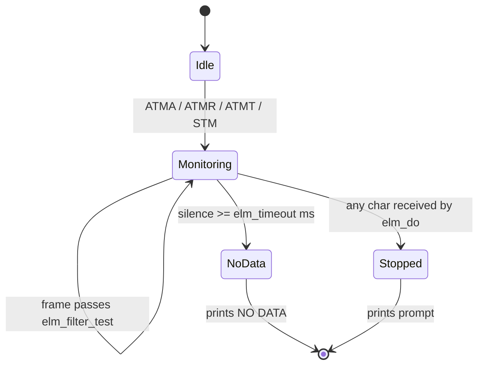
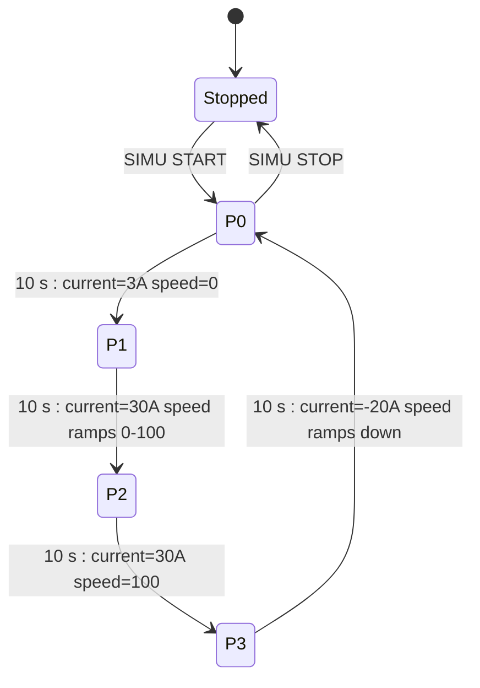

# Akisoft41-TeslapLX

## 1. Provenance

- **Mode:** replace (user-directed). The pre-replace summary survives in git history; its claims are cited below as `git show HEAD:docs/legacy/Akisoft41-TeslapLX.md` (line numbers refer to that blob).
- **Frontmatter:** preserved byte-for-byte. The description line carries no inherited trailing whitespace (trailing-space check on the pre-replace doc → no output), so nothing was stripped. The description is truncated mid-sentence (`... It accepts connections over`) and says "ST1110" where the code emulates an STN1110 — both defects kept as bytes, recorded in section 6.
- **Preserved `## Upstream (...)` sections:** none existed in the pre-replace doc, so there is nothing to re-append after section 14.
- **Submodule:** `legacy/Akisoft41-TeslapLX`, gitlink `160000 48b2cbc9abd3a784076d98f7650258b7fbfc74f5 0`; `git -C legacy/Akisoft41-TeslapLX rev-parse HEAD` matches; worktree clean (`status --porcelain` empty).
- **Upstream:** https://github.com/Akisoft41/TeslapLX — license Apache-2.0 (`LICENSE` lines 1-5; every `main/*.c|h` carries the Apache-2.0 header).
- **Analysis date:** 2026-11-21.
- **Snapshot quirk:** the submodule history is a single squashed commit (`48b2cbc 2021-02-05 "httpd"`; `rev-list --count HEAD` = 1, no tags, `branch -a` shows only `master`). Section 15 records what can and cannot be mined from that.

Upstream files read:

| File | Lines | Coverage |
| --- | --- | --- |
| `main/elm.c` | 1-1647 | FULL-READ |
| `main/can.c` | 1-474 | FULL-READ |
| `main/bt.c` | 1-498 | FULL-READ |
| `main/wifi.c` | 1-731 | FULL-READ |
| `main/httpd.c` | 1-281 | FULL-READ |
| `main/ota.c` | 1-189 | FULL-READ |
| `main/main.c` | 1-195 | FULL-READ |
| `main/elog.c` | 1-78 | FULL-READ |
| `main/uart.c` | 1-46 | FULL-READ |
| `main/can.h`, `elm.h`, `bt.h`, `wifi.h`, `httpd.h`, `ota.h`, `elog.h`, `uart.h` | all | FULL-READ |
| `README.md`, `CMakeLists.txt`, `main/CMakeLists.txt`, `partitions.csv`, `.gitignore` | all | FULL-READ |
| `.vscode/settings.json` | 1-15 | FULL-READ (clang-format style only, no build defines) |
| `sdkconfig` | 13 selected lines of 1498 | RANGE-CITED (target, flash, BT classic, FreeRTOS tick) |
| `LICENSE` | 1-5 of ~200 | RANGE-CITED (standard Apache-2.0 text; lines 1-5 confirm) |

Files explicitly NOT read: `.vscode/c_cpp_properties.json`, `.vscode/launch.json`, `.vscode/tasks.json`, `TeslapLX.code-workspace` (IDE-only configs; a grep for `VEHICLEBUS_ID`, `-D`, and `add_compile_definitions` across `.vscode/`, both `CMakeLists.txt`, and the workspace file returned no build-time overrides — the `VEHICLEBUS_ID` macro is defined only inside `main/can.c:73-205` behind an `#ifndef` guard).

Our-side files read for parity (TeslaCANModder):

| File | Lines | Coverage |
| --- | --- | --- |
| `firmware/lib/vehicle/can/feature/telemetry/bms.h` | 1-219 | RANGE-CITED (decode functions) |
| `firmware/lib/vehicle/can/feature/telemetry/powertrain.h` | 1-75 | RANGE-CITED |
| `firmware/lib/core/can/ring_buffer.h` | 1-146 | FULL-READ |
| `firmware/lib/core/can/id_filter.h` | 1-115 | FULL-READ |
| `firmware/lib/io/serial/bluetooth/esp32/init.h`, `print.h`, `board.h` | all | FULL-READ |
| `firmware/lib/io/serial/usb/esp32/common.h` | 594, 636, 647 + grep context | RANGE-CITED |
| `firmware/lib/vehicle/can/feature/misc/can_sim.h`, `stream.h` | grep hits + header docs | RANGE-CITED |
| `firmware/lib/vehicle/can/ids.h` | 37, 42, 44, 71, 72 | RANGE-CITED |
| `firmware/lib/vehicle/can/feature/safety/ban_detect.h` | 1-40 | RANGE-CITED |
| `firmware/lib/core/config/esp32/board.h` | 35 | RANGE-CITED |
| `packages/protocol/src/commands.ts` | 437 | RANGE-CITED |
| `client/src/components/IntegrationPanel.tsx` | 104-111 | RANGE-CITED |
| `client/src/components/monitor/sections/ConnectionSection.tsx` | 209, 218-219, 435, 439, 452, 459 | RANGE-CITED |
| `docs/reference/commands.md` | 863-871 | RANGE-CITED |

## 2. Executive verdict

TeslapLX is the most complete ScanMyTesla-facing bridge in `legacy/`: an Apache-2.0 ESP-IDF (native C, not Arduino) firmware that runs the ESP32's own CAN controller in listen-only mode at 500 kbit/s and speaks an ELM327/STN1110 line protocol over four transports at once — Bluetooth SPP (`TeslapLX` / `teslap-server`), TCP port 35000, a websocket at `/ws`, and UART0. It decodes nothing and transmits nothing on the bus: every frame is forwarded as `XXX`-hex text and all signal interpretation lives in the phone app. The mechanisms that matter for us are the ELM327/STN1110 monitor REPL (M1) — the exact minimal command set (`ATI/ATZ/ATE/ATL/ATH/ATS/ATSP/ATMA/ATMR/ATMT/ATST/ATCRA/ATCF/ATCM` plus `STDI/STFPA/STFBA/STM`) a ScanMyTesla-style client needs — the per-ID ~90.9 ms RX throttle (M3) and the NO-DATA monitor timeout semantics (M5). That maps directly onto our advertised-but-unimplemented `smt:on`/`smt:off` and `elm327:on`/`elm327:off` surface: `packages/protocol/src/commands.ts:437` generates the strings, `client/src/components/monitor/sections/ConnectionSection.tsx:439,452,459` sends them, `docs/reference/commands.md:863-871` documents them, but the firmware has no `smt` or `elm327` handler at all (negative anchors in section 16) — only the SPP pipe exists (`firmware/lib/io/serial/bluetooth/esp32/init.h:21`). The ring-buffer fan-out (M4), ID accept filter, and CAN simulator are already present in our code in better form. Two cross-repo decode conflicts surfaced (`0x132` current endianness/scale, `0x257` speed layout) that must be settled by bench capture before any code is written against them. Never port: the plain-HTTP OTA updater (M10), auto-PIN/auto-SSP pairing, and the open default AP.

## 3. Evidence map

No TEST-READ evidence exists: this repo ships no tests (no test directory in `git ls-files`; section 10). No CAPTURE evidence exists in this repo — every frame claim below comes from the simulator writer or commented DBC lines, not from a real vehicle.

| Source file | Lines | What it proves | Grade |
| --- | --- | --- | --- |
| `main/can.c` | 49-71 | `CAN_MODE_LISTEN_ONLY`, 500 kbit/s timing, accept-all hardware filter, tx_queue 5 / rx_queue 50, alert mask incl. `BUS_OFF`/`ERR_PASS` | CODE-READ |
| `main/can.c` | 73-205 | `VEHICLEBUS_ID`: 128-entry static Tesla ID accept list (0x00C..0x7FF, incl. `0x405` VIN, `0x7FF` Car Config) | CODE-READ |
| `main/can.c` | 210-213 | Per-ID delay gate: `can_id_delay_us = 1000000 / 11` with per-ID `can_id_last_us[]` | CODE-READ |
| `main/can.c` | 250-263 | `_can_filter_id()`: O(n) linear scan of 128 IDs per frame + 90.9 ms per-ID throttle | CODE-READ |
| `main/can.c` | 265-355 | `can_simu_task()`: synthetic `0x132` + `0x257` every 100 ms, 4-phase current/speed script | CODE-READ |
| `main/can.c` | 275-276 | Commented-out `sg_t` DBC lines: `SmoothBattCurrent132` (len 16, factor -0.1) and `UIspeed_signed257` (len 12, factor 0.08, offset -40, range -40..287.6 KPH) | CODE-READ |
| `main/can.c` | 313-340 | Simu frame writers: `0x132` with `data[0]=0x40, data[1]=0x9C` commented "Battery Voltage 400V", current as little-endian int16 in `data[2..3]`; `0x257` with 12-bit speed spread over `data[1..2]` | CODE-READ |
| `main/can.c` | 357-437 | `can_task()`: `can_receive` loop, 10 s stats, alert poll, `state != CAN_STATE_RUNNING` → task exit | CODE-READ |
| `main/elm.c` | 114-128, 134-141 | Protocol table (0..C), version strings `ELM327 v1.3a Teslap` / `STN1110 r0.1 Teslap`, prompt `>` | CODE-READ |
| `main/elm.c` | 144-165 | Defaults: headers ON, echo ON, linefeed ON, spaces ON, DLC off, timeout 5000 ms, adaptive 1 | CODE-READ |
| `main/elm.c` | 254-288 | `elm_filter_test()`: AT pattern/mask + up to 100 pass + 100 block ST filters | CODE-READ |
| `main/elm.c` | 528-1436 | `elm_do_cmd()`: shell (REBOOT/PS/FREE/ELOG/SIMU/WIFI/OTA), ST, AT command dispatch; fall-through prints `?` | CODE-READ |
| `main/elm.c` | 1440-1456 | `_elm_write_can()`: `%03X` ID + optional DLC + hex bytes, honoring ATH/ATS/ATD0 toggles | CODE-READ |
| `main/elm.c` | 1458-1547 | Monitor task: ring consumer, `NO DATA` after `elm_timeout` ms of silence, any input char stops it | CODE-READ |
| `main/elm.c` | 1575-1647 | `elm_do()`: per-connection REPL with echo, backspace, CR dispatch, EOF/ctrl-D exit | CODE-READ |
| `main/bt.c` | 38-48 | SPP server `teslap-server`, device `TeslapLX`, ring buffers 100 B RX / 10 KB TX, `ESP_SPP_MODE_CB`, `SEC_AUTHENTICATE` | CODE-READ |
| `main/bt.c` | 66-73, 140-223 | Single-connection policy; TX-ring-full stall workaround with 5 s timeout (`// bug:` comments) | CODE-READ |
| `main/bt.c` | 370-392 | Legacy pairing auto-replies PIN `1234` or 16 zeros; SSP confirm auto-accepted | CODE-READ |
| `main/bt.c` | 473-498 | `fopencookie` bridge: SPP handle becomes a `FILE*` for the REPL | CODE-READ |
| `main/wifi.c` | 65, 118-193 | TCP server on port 35000, single-accept loop | CODE-READ |
| `main/wifi.c` | 352-381, 587-625 | Default AP `TeslapLX` with static IP 192.168.0.10; open auth when no password given | CODE-READ |
| `main/httpd.c` | 100-144, 215-218 | `/ws` websocket handler feeding the same ELM REPL via ring buffer + cookie FILE | CODE-READ |
| `main/httpd.c` | 223-244 | `/api/system/info` returns IDF version/chip info as JSON | CODE-READ |
| `main/ota.c` | 56-187 | OTA from arbitrary plain-HTTP URL; header length check only; `esp_ota_set_boot_partition` + restart | CODE-READ |
| `main/main.c` | 170-195 | `app_main` wiring; UART0 REPL restarted in an infinite loop | CODE-READ |
| `main/elog.c` | 58-78 | `esp_log_set_vprintf` redirect steers ESP_LOG into the active transport | CODE-READ |
| `partitions.csv` | all | `ota_0`/`ota_1` 1900k each; factory line commented out — no factory fallback partition | CODE-READ |
| `README.md` | 1-52 | Wiring (SN65HVD), transports, command list, "EDP-IDF 4.1", 100 ms claim | SUMMARY-ONLY |
| `sdkconfig` | selected | `CONFIG_BT_CLASSIC_ENABLED=y`, `CONFIG_FREERTOS_HZ=100`, ESP32 target, 4 MB DIO flash | RANGE-CITED |

## 4. Architecture and build surface

Entry point `app_main()` (`main/main.c:170`): `log_init()` → NVS init with erase-retry → `esp_event_loop` → `can_init()` → `bt_init(cb)` → `wifi_init(cb)` → `net_httpd_ws_init(cb)` → infinite UART0 REPL loop. Four transports each get an `elm_do()` REPL session by swapping the global `stdin`/`stdout` `FILE*` to a `fopencookie` stream over their native handle (`main.c:52-53, 84-85, 112-113, 145-146`). There is no shared core/platform split beyond `main/` — the whole firmware is one ESP-IDF component. Build flags: none exist (no `-D` in either CMake file or `.vscode/`; feature set is fixed by `sdkconfig`: BT classic on, 4 MB flash, FreeRTOS 100 Hz). Dependency boundaries: legacy `driver/can.h` (pre-TWAI API), `esp_spp`, `esp_http_server` (websocket support), `cJSON`, `app_update`, `mdns`/`netbiosns`. The CAN pipeline is RX-only — there is no TX path anywhere in the tree.



## 5. Mechanism catalogue

### M1. ELM327/STN1110 command REPL

- **Claim (README / summary):** "The program emulate a ELM327 and ST1110 commands. Emulate partial commands set, sufficient for 'Scan My Tesla'" (README:27-28); pre-replace doc: "translating OBD-like ELM327 commands into raw CAN reads".
- **Code path:** `main/elm.c:1575` — `elm_do(tag)` → fgetc loop → `elm_do_cmd()` (elm.c:528) → shell/ST/AT handlers → `printf`/`elm_writeln` → stdout cookie.
- **Frame spec:** None found — the REPL emits text only. `_elm_write_can()` (elm.c:1440-1456) formats a frame as `%03X` ID (if ATH on), `%02X` DLC (if ATD0 on), then `%02X` bytes, honoring ATL (CRLF vs CR) and ATS (spaces).
- **Gates and timing:** Echo/backspace handled at elm.c:1606-1641; empty line repeats previous command (elm.c:534-539); buffer cap `ELM_BUFFER_LEN` 128; EOF/ctrl-D ends session.
- **State machine:** per-session `elm_globals_t` (elm.c:55-87) — no inter-session persistence; `elm_reset()` restores defaults (elm.c:292-317).
- **Tests:** None found.
- **Evidence grade:** CODE-READ.
- **Verdict:** CONFIRMED as a text REPL; the pre-replace "translating ... into raw CAN reads" wording is CONTRADICTED — there is no OBD PID request/response path; any non-AT/ST/shell input falls through to the `_err:` label and prints `?` (elm.c:1433-1436).
- **Adapt to TeslaCANModder?** candidate — this is the reference command set for a real `smt:*`/`elm327:*` handler.

### M2. fopencookie stdio transport bridge

- **Claim (README / summary):** "Connexion: Serial UART0 (USB), Bluetooth SPP, WIFI TCP port 35000" (README:20-23).
- **Code path:** `main/main.c:47-165` — `bt_task`/`tcp_task`/`ws_task`/`uart_task` each wrap their handle in `bt_fopen` (bt.c:495), `tcp_fopen` (wifi.c:110), `net_httpd_ws_fopen` (httpd.c:215), `uart_fopen` (uart.c:42) and call the same `elm_do()`.
- **Frame spec:** None found (transport plumbing only).
- **Gates and timing:** BT sessions get a pinned 8 KB task (main.c:68); TCP sessions run inline in the accept loop (main.c:96-102, with an author comment about task pinning); UART runs in `app_main`'s infinite loop (main.c:192-194).
- **State machine:** None found — sessions are independent REPL instances; but all four swap the **global** `stdin`/`stdout` pointers (main.c:52-53, 84-85, 112-113, 145-146; elm.c:1463), so concurrent sessions race on the same globals.
- **Tests:** None found.
- **Evidence grade:** CODE-READ.
- **Verdict:** CONFIRMED for UART/SPP/TCP; the pre-replace transport list omitted the websocket (`/ws`, main.c:107-134) — CONTRADICTED-by-omission.
- **Adapt to TeslaCANModder?** no impact — our Arduino-stack transports differ; keep only the idea "one engine, many streams".

### M3. Listen-only CAN RX with per-ID rate gate

- **Claim (README / summary):** "The can messages are filtered for know Tesla ID, and are limited to one same ID on 100ms (max 10 messages per second and per ID)" (README:30-31).
- **Code path:** `main/can.c:439` — `can_init()` → `can_task()` (can.c:357) → `_can_filter_id()` (can.c:250) → `_can_raise()` (can.c:215).
- **Frame spec:** standard 11-bit frames; no counter or checksum logic anywhere (negative anchor: no `checksum|crc|0xAA` match in `main/`).
- **Gates and timing:** `can_id_delay_us = 1000000 / 11` (can.c:212) ≈ 90.9 ms per ID → **11** messages/s per ID, not the README's 100 ms / 10 per second; accept list is the 128-entry `VEHICLEBUS_ID` (can.c:73-205); scan is O(n) per frame.
- **State machine:** None found — single RX loop; `state != CAN_STATE_RUNNING` or receive error breaks the loop and the task deletes itself (can.c:383-386, 411-414) with no restart.
- **Tests:** None found.
- **Evidence grade:** CODE-READ.
- **Verdict:** CONFIRMED mechanism, CONTRADICTED numbers (90.9 ms/11 Hz, not 100 ms/10 Hz — inherited by the pre-replace doc).
- **Adapt to TeslaCANModder?** candidate — as output-side flow control for an `smt:*` bridge (our firmware has no per-ID RX throttle; see parity row).

### M4. Multi-consumer ring-buffer fan-out

- **Claim (README / summary):** pre-replace doc: "CAN RX uses FreeRTOS ring buffers to fan out received frames to multiple consumer tasks".
- **Code path:** `main/can.c:46` — `can_rx_ringbuf[CAN_MAX_CB=10]`; `_can_raise()` pushes each accepted frame into every registered ring (can.c:215-224); consumers register via `can_ringbuf_new(itemNum)` (can.c:226-235).
- **Frame spec:** `can_message_timestamp_t` = driver frame + `uint64_t` µs timestamp (can.h:19-23).
- **Gates and timing:** ring created with `xRingbufferCreateNoSplit`, consumer sizes its own depth (monitor uses 50 items, elm.c:1466); full ring → `ESP_LOGW` + drop (can.c:220-221).
- **State machine:** None found — producers never block (timeout 0).
- **Tests:** None found.
- **Evidence grade:** CODE-READ.
- **Verdict:** CONFIRMED.
- **Adapt to TeslaCANModder?** already present — our `firmware/lib/core/can/ring_buffer.h:31-146` implements the same multi-consumer contract lock-free with per-consumer sequence gap detection; do not re-port.

### M5. ELM monitor mode with NO DATA timeout

- **Claim (README / summary):** "Monitor bus using current filters" / "Monitor all messages on bus" (elm.c:759-768 log strings).
- **Code path:** `main/elm.c:1523` — `elm_monitor_start()` → `elm_monitor_task()` (elm.c:1458) → `elm_filter_test()` (elm.c:254) → `_elm_write_can()` (elm.c:1440).
- **Frame spec:** output text only; see M1 formatter.
- **Gates and timing:** 100 ms ring receive timeout; prints `NO DATA` and exits after `G.elm_timeout * 1000` µs without a passing frame (elm.c:1497-1502); **any** input character stops the monitor (elm.c:1601-1604); 10 s stats line.
- **State machine:**



- **Tests:** None found.
- **Evidence grade:** CODE-READ.
- **Verdict:** CONFIRMED.
- **Adapt to TeslaCANModder?** candidate — the timeout + any-char-stop semantics are exactly what a ScanMyTesla-style client expects from `atma`; our `stream:on` (JSON) has no such session lifecycle.

### M6. CAN simulator (4-phase script)

- **Claim (README / summary):** "SIMU START: start a simple simulation of the car" (README:36).
- **Code path:** `main/can.c:464-473` — `can_simu_start()/stop()` → `can_simu_task()` (can.c:265).
- **Frame spec:** `0x132` DLC 8: `data[0]=0x40, data[1]=0x9C` (comment: "Battery Voltage 400V"), `data[2..3]` little-endian int16 = `-amps*10`, `data[6..7]=FF 0F`; `0x257` DLC 8: 12-bit speed in `data[1]<<4 | data[2]>>4`, encoded as `(kmh+40)/0.08` (can.c:310-340).
- **Gates and timing:** `vTaskDelayUntil(&last_tick, 10)` → 100 ms period at `CONFIG_FREERTOS_HZ=100`; frames go into the internal ring only — never on the physical bus (listen-only driver, no TX path).
- **State machine:**



- **Tests:** None found.
- **Evidence grade:** CODE-READ.
- **Verdict:** CONFIRMED.
- **Adapt to TeslaCANModder?** already present — `firmware/lib/vehicle/can/feature/misc/can_sim.h:33` `canSimTick()` covers the same IDs plus 0x292/0x219/0x118; no action.

### M7. ELM/ST filter model (pass/block lists)

- **Claim (README / summary):** None found in README; pre-replace doc does not mention filters.
- **Code path:** `main/elm.c:254-288` — `elm_filter_test()` combines one AT pattern/mask pair (`ATCF h` elm.c:879, `ATCM h` elm.c:889, `ATCRA fXX` elm.c:917-945 with `X` wildcard nibbles) with up to 100 pass (`STFPA p,m` elm.c:683) and 100 block (`STFBA` elm.c:717) entries.
- **Frame spec:** filters test the 11/29-bit ID only, never payload.
- **Gates and timing:** `ATCRA` (bare) resets pattern/mask to 0 (elm.c:908-915); `STFAC`/`STFCA` clears both lists (elm.c:675-681); `id == 0` never passes (elm.c:256).
- **State machine:** None found — flat filter tables, mask=0 marks a free slot.
- **Tests:** None found.
- **Evidence grade:** CODE-READ.
- **Verdict:** CONFIRMED.
- **Adapt to TeslaCANModder?** candidate — as the filter vocabulary for the `smt:*` bridge; note our `can:raw:on`/variant filters are a different (coarser) model.

### M8. WiFi AP/STA + TCP server + mDNS/NetBIOS

- **Claim (README / summary):** "Default configuration for WIFI: AP mode, ssid TeslapLX without password" (README:47-48).
- **Code path:** `main/wifi.c:383-427` — `wifi_init()` → default AP if mode NULL; `wifi_ap()` (587), `wifi_sta()` (542), `wifi_scan()` (652), TCP server task (118-193).
- **Frame spec:** None found (network plumbing).
- **Gates and timing:** AP static IP 192.168.0.10 (wifi.c:355-359); servers (TCP + httpd) start on `AP_START` and `GOT_IP`, stop on disconnect (wifi.c:197-222, 266-277); STA auto-reconnect flag (wifi.c:270-277).
- **State machine:** event-group bits AP_STARTED / STA_CONNECTING / STA_CONNECTED (wifi.c:50-52).
- **Tests:** None found.
- **Evidence grade:** CODE-READ.
- **Verdict:** CONFIRMED; note `wifi_scan()` leaves the radio in `WIFI_MODE_NULL` (wifi.c:724-727) — WiFi stays off after a scan until the next AP/STA command.
- **Adapt to TeslaCANModder?** no impact — our WiFi stack already exists; do not port the open AP default.

### M9. WebSocket ELM bridge

- **Claim (README / summary):** None found — README and pre-replace doc never mention the websocket.
- **Code path:** `main/httpd.c:100-136` — `_httpd_handler_ws` → 256-byte bytebuf ring → `_ws_read` cookie (httpd.c:147-165) → same `elm_do("elm-ws")` session (main.c:107-134).
- **Frame spec:** text frames in, text frames out; each inbound websocket message is terminated with a synthetic `\r` (httpd.c:124) so the CR-based REPL can dispatch it.
- **Gates and timing:** single client (`httpd_ws_fd`); close type resets state (httpd.c:128-130); writes go through `httpd_queue_work` async sends (httpd.c:167-186).
- **State machine:** None found — one open/one close per fd.
- **Tests:** None found.
- **Evidence grade:** CODE-READ.
- **Verdict:** CONFIRMED (and absent from both README and the pre-replace doc).
- **Adapt to TeslaCANModder?** no impact — informational only; our REST/WS surfaces differ.

### M10. Plain-HTTP OTA updater

- **Claim (README / summary):** "OTA [url]: update firmware by dowloding binary file from url" (README:42).
- **Code path:** `main/ota.c:56` — `ota_update(url)` → `esp_http_client` → header-length check (ota.c:103-127) → `esp_ota_begin(OTA_SIZE_UNKNOWN)` → write loop → `esp_ota_set_boot_partition` → `esp_restart()` (ota.c:186).
- **Frame spec:** None found.
- **Gates and timing:** 1024-byte chunks; 5000 ms HTTP timeout (ota.c:61); progress hex every 16 KB (ota.c:138); 2 s delay before restart.
- **State machine:** None found — single-shot, terminal restart.
- **Tests:** None found.
- **Evidence grade:** CODE-READ.
- **Verdict:** CONFIRMED.
- **Adapt to TeslaCANModder?** never port — plain HTTP, no server auth, no version comparison (new version is printed, never checked, ota.c:108), and `partitions.csv` has no factory partition to fall back to.

## 6. Summary vs code contradiction table

Pre-replace claims are cited as `git show HEAD:docs/legacy/Akisoft41-TeslapLX.md` (line numbers refer to that blob).

| Pre-replace claim | Code reality | Verdict |
| --- | --- | --- |
| `ST1110` emulator (frontmatter description, HEAD blob line 3; body line 15) | `ST_VERSION_STRING "STN1110 r0.1 Teslap"` — `main/elm.c:135`; README also says "ST1110" | CONTRADICTED — device is an STN1110; frontmatter bytes kept, staleness recorded here |
| "translating OBD-like ELM327 commands into raw CAN reads" (blob line 15) and "translates AT commands and CAN frame requests" (blob line 62) | No OBD PID request path exists; anything that is not AT/ST/shell hits the `_err:` label and prints `?` — `main/elm.c:1433-1436`; CAN data only flows via monitor commands | CONTRADICTED — the surface is a monitor/filter REPL, not an OBD translator |
| "`main/httpd.c` — HTTP server for web UI" (blob line 46) | httpd registers exactly two URIs: `/ws` websocket and `/api/system/info` — `main/httpd.c:138-144, 240-244`; no HTML/UI asset exists anywhere in `git ls-files` | CONTRADICTED — there is no web UI |
| "Rate-limits CAN IDs to max 10 messages/second per ID (100 ms throttle)" (blob lines 52, 60; inherited from README:31) | `can_id_delay_us = 1000000 / 11` — `main/can.c:212` → 90.9 ms → 11 msgs/s per ID | CONTRADICTED — the number is 11/s, not 10/s |
| "CAN driver — TWAI init" (blob line 42) | `#include "driver/can.h"` and `can_driver_install()` — `main/can.c:20, 444`; the pre-rename IDF 4.x API, not TWAI naming | CONTRADICTED (anachronism) — code predates the TWAI rename |
| Transports "Bluetooth SPP, UART (USB), and WiFi TCP (port 35000)" (blob line 15) | A fourth ELM transport exists: websocket `/ws` — `main/main.c:107-134`, `main/httpd.c:139` | CONTRADICTED by omission |
| Frontmatter description truncated mid-sentence: "It accepts connections over" (blob line 3) | Description was cut mid-list before the replace; actual transports are SPP, UART0, TCP 35000, WS | Stale-but-preserved — bytes kept per replace-mode rules |

Non-contradictions worth recording: "ESP32 built-in CAN peripheral at 500 kbit/s" (blob line 21) is CONFIRMED (`CAN_TIMING_CONFIG_500KBITS()`, can.c:50); "SN65HVD230" (blob line 21) is plausible (README says "SN65HVD") but no part number appears in code — SUMMARY-ONLY; "ESP-IDF 4.1" (blob line 19, README:50 with typo "EDP") is consistent with the `driver/can.h` API era but UNVERIFIED from the tree.

## 7. CAN frame and signal inventory

The repo decodes, mutates, and injects nothing on a real bus. The only frames it *constructs* are simulator-internal (never transmitted — listen-only driver, no TX call in the tree). All other IDs are pass-through hex text.

| ID (hex+dec) | Bus | Period | DLC | Byte/bit layout | Scale/units | Counter | Checksum | R/W | Grade |
| --- | --- | --- | --- | --- | --- | --- | --- | --- | --- |
| 0x132 (306) BMS HV | n/a (simu-internal) | 100 ms | 8 | simu: `data[0]=0x40, data[1]=0x9C` (comment: "Battery Voltage 400V"), `data[2..3]` little-endian int16 current, `data[6..7]=FF 0F` (can.c:313-324) | current: raw × −0.1 A (commented `sg_t` can.c:275); voltage: no formula in repo — 0x409C → "400V" comment only | None found | None found | internal simu inject only | CODE-READ (simu writer); real-car layout UNVERIFIED |
| 0x257 (599) UI speed | n/a (simu-internal) | 100 ms | 8 | simu: 12-bit field `data[1]=speed<<4, data[2]=speed>>4` (can.c:331-339) | (raw × 0.08) − 40, range −40..287.6 KPH (commented `sg_t` can.c:276 + encoder can.c:311) | None found | None found | internal simu inject only | CODE-READ (simu writer); real-car layout UNVERIFIED |
| VEHICLEBUS_ID catalog | chassis/vehicle (single bus in this design) | n/a | n/a | 128-entry static accept list `0x00C..0x7FF` (can.c:73-205), incl. `0x405` "VIN" (can.c:185) and `0x7FF` "Car Config" (can.c:203) | none — no decode of any kind | n/a | n/a | read-only filter | STRUCTURAL-PARSE |

Negative finding: no counter, CRC, or checksum logic exists anywhere in `main/` (demonstrated anchor in section 16). The commented `#include "dbc_vehicle.h"` (can.c:29) references a DBC-to-C generator that is not vendored in this snapshot.

## 8. Constants and tuning table

| Constant | Value | File:line | Meaning | Grade |
| --- | --- | --- | --- | --- |
| `can_id_delay_us` | `1000000 / 11` (~90.9 ms) | main/can.c:212 | per-ID accept gate → 11 frames/s per ID | CODE-READ |
| `CAN_TX_PIN` / `CAN_RX_PIN` | 17 / 16 | main/can.c:35-36 | transceiver wiring (ESP-CAM alt pins commented out) | CODE-READ |
| `CAN_MAX_CB` | 10 | main/can.c:44 | max concurrent ring consumers | CODE-READ |
| `tx_queue_len` / `rx_queue_len` | 5 / 50 | main/can.c:57-58 | driver queues (TX unused in listen-only) | CODE-READ |
| `CAN_TASK_PRIO` / `CAN_TASK_CORE` | 9 / 1 | main/can.c:42-43 | RX task pinned to core 1 | CODE-READ |
| `ELM_BUFFER_LEN` | 128 | main/elm.c:47 | REPL line cap | CODE-READ |
| `ELM_ST_FILTER_LEN` | 100 | main/elm.c:48 | max pass + max block ST filters | CODE-READ |
| `ELM_TIMEOUT` | 5000 ms | main/elm.c:159 | monitor NO-DATA window default (ATST hex override) | CODE-READ |
| `ELM_HEADERS` | `true` | main/elm.c:144 | headers ON by default — unlike a real ELM327 (off); load-bearing for app parsing | CODE-READ |
| `ELM_VERSION_STRING` / `ST_VERSION_STRING` | "ELM327 v1.3a Teslap" / "STN1110 r0.1 Teslap" | main/elm.c:134-135 | what ATI/ATZ and STDI report | CODE-READ |
| `ELM_DEVICE_STRING` | "Espnux" | main/elm.c:138 | AT@1 identity | CODE-READ |
| `WIFI_TCP_PORT` | 35000 | main/wifi.c:65 | raw TCP ELM port | CODE-READ |
| `teslap_soft_ap_ip` | 192.168.0.10/24 | main/wifi.c:355-359 | static AP address | CODE-READ |
| `OTA_BUFFSIZE` | 1024 | main/ota.c:33 | OTA chunk size | CODE-READ |
| OTA HTTP timeout | 5000 ms | main/ota.c:61 | client timeout, no other TLS/auth config | CODE-READ |
| `BT_SPP_RINGBUF_RX_SIZE` / `_TX_SIZE` | 100 B / 10 KB | main/bt.c:41-42 | SPP bytebuf rings | CODE-READ |
| SPP TX stall re-init threshold | 5 s | main/bt.c:200 | tx-ring-full + no write event → force `_write()` (author-marked `// bug:`) | CODE-READ |
| monitor ring depth | 50 items | main/elm.c:1466 | per-monitor ring capacity | CODE-READ |
| simu current encode | `current = -amps * 10` | main/can.c:310 | pairs with −0.1 factor | CODE-READ |
| simu speed encode | `(kmh + 40) / 0.08 + 0.5` | main/can.c:311 | pairs with 0.08/−40 decode | CODE-READ |
| simu period | `vTaskDelayUntil(…, 10)` @ 100 Hz | main/can.c:281 + sdkconfig | 100 ms simu tick | CODE-READ |
| pairing PIN fallbacks | "1234" / 16×'0' | main/bt.c:373-384 | auto-replied legacy PINs | CODE-READ |
| `CONFIG_FREERTOS_HZ` | 100 | sdkconfig (selected) | tick rate the delays assume | RANGE-CITED |

## 9. Failure modes and edge cases

| Failure | Handling code path | Tested? | Grade |
| --- | --- | --- | --- |
| CAN receive error | log + `break` → task self-deletes; no restart, no driver reinstall (main/can.c:383-386) | no | CODE-READ |
| Controller leaves RUNNING state (incl. bus-off) | `can_get_status_info` → log + `break`; alerts only logged every 10 s (can.c:404-414); no recovery/restart call | no | CODE-READ |
| RX ring full (consumer too slow) | `ESP_LOGW("rx buffer full")` + silent drop (can.c:219-221) | no | CODE-READ |
| SPP TX ring full + lost write event | 5 s stall detector force-calls `_write()`; author comments mark both branches as driver bugs (bt.c:196-210) | no | CODE-READ |
| Second SPP connection while one is open | new handle disconnected immediately (bt.c:66-73) | no | CODE-READ |
| Monitor write error (peer gone) | `break` out of monitor loop (elm.c:1488-1492) | no | CODE-READ |
| Monitor silence | `NO DATA` + task exit after `elm_timeout` ms (elm.c:1497-1502) | no | CODE-READ |
| Concurrent REPL sessions | four tasks reassign **global** `stdin`/`stdout` (main.c:52-146, elm.c:1463) — cross-session output corruption is possible; nothing serializes them | no | CODE-READ |
| Websocket write path | `malloc` results unchecked (httpd.c:176-182, 197-203) → heap-exhaustion crash | no | CODE-READ |
| OTA: short/invalid header | length-only check, then `esp_ota_begin(OTA_SIZE_UNKNOWN)` (ota.c:103-127); new version printed but never compared | no | CODE-READ |
| OTA connection reset | errno `ECONNRESET`/`ENOTCONN` breaks read loop (ota.c:146-153) | no | CODE-READ |
| OTA both slots bad | no factory partition (partitions.csv factory line commented out) → no fallback image | no | CODE-READ |
| WiFi scan side effect | radio left in `WIFI_MODE_NULL` after scan (wifi.c:724-727) — transport down until next mode command | no | CODE-READ |
| UART session EOF | outer `while(true) uart_start(UART_NUM_0)` restarts a fresh REPL (main.c:192-194) | no | CODE-READ |
| Globals allocation failure | `elm_globals_init` returns NULL → session silently dead (elm.c:1554-1558) | no | CODE-READ |
| NVS init failure | erase + retry once (main.c:175-180) | no | CODE-READ |
| Log output to dead stream | `_elog_vprintf` falls back to the real stderr and re-points the sink (elog.c:64-69) | no | CODE-READ |

## 10. Test coverage map

None found — `git -C legacy/Akisoft41-TeslapLX ls-files` contains no test files, no CI config, no verification script. Consequently every failure path in section 9 and every constant in section 8 is untested upstream. Highest-risk untested paths, one line each: global-stdio swapping between concurrent transports (silent data corruption); SPP write-event loss workaround (device hang class); OTA version-noncheck (downgrade/rollback brick class).

## 11. Parity matrix with TeslaCANModder

| Signal/frame | Upstream decode (cite) | Our decode (cite) | Delta | Action |
| --- | --- | --- | --- | --- |
| 0x132 current | simu writes little-endian int16 ×(−0.1) A (can.c:310, 319-320; commented `sg_t` can.c:275) | `decodeBmsCurrent` big-endian signed ×0.1, negative = discharging (`firmware/lib/vehicle/can/feature/telemetry/bms.h:29-33`) | byte order **and** sign convention conflict | capture-first: bench-capture a real 0x132 under known load |
| 0x132 voltage | no formula; comment claims `0x40,0x9C` = "400V" (can.c:317-318) | `decodeBmsVoltage` big-endian ×0.01 V → 0x409C = 165.4 V (`bms.h:18-22`) | factor conflict: 0.01 vs ~0.024 implied | capture-first |
| 0x257 speed | 12-bit @ `data[1..2]`, ×0.08 −40, −40..287.6 KPH (can.c:276, 311, 332-334) | `decodeVehicleSpeed` bytes 2-3 signed ÷100 (`firmware/lib/vehicle/can/feature/telemetry/powertrain.h:18-22`) | incompatible bit layouts — cannot both be right for the same car | capture-first (top cross-repo conflict) |
| 0x292 SoC | monitor-only, accept list (can.c:128) | `decodeBmsSoc` bits 0-9 ×0.1 % (`bms.h:50-54`) | upstream adds no layout claim | ignore |
| 0x312 thermal | monitor-only (can.c:145) | `decodeBmsTempMin/Max` byte0/byte1 −40 °C (`bms.h:61-73`) | none from upstream | ignore |
| 0x118 DI state | monitor-only (can.c:82) | `decodeGearState` bits 3:1, `decodeAccelPedal` byte 1 (`powertrain.h:29-42`) | none from upstream | ignore |
| 0x129 steering | monitor-only (can.c:85) | `decodeSteeringAngle` bytes 0-1 signed ÷10 (`powertrain.h:59-63`) | none from upstream | ignore |
| 0x33A energy | monitor-only (can.c:159) | `decodeBmsWhPerKm` bytes 0-1 ×0.1 (`bms.h:81-85`) | none from upstream | ignore |
| 0x7FF GTW config | monitor-only "Car Config" (can.c:203) | active defense target: tier decode `ban_detect.h:15-16`, snapshot defense `ban_shield.h:44,84` | we consume it for safety, upstream for telemetry | ignore (different purpose) |
| Multi-consumer frame distribution | per-consumer FreeRTOS rings, max 10 (can.c:46, 215-248) | lock-free shared ring + `RingConsumer` seq-gap detection (`firmware/lib/core/can/ring_buffer.h:12-146`) | same contract, our implementation has overflow accounting | already present |
| Per-ID RX throttle | 90.9 ms per-ID gate (can.c:212, 250-263) | absent — only DAS TX injection is rate-limited (`firmware/lib/io/serial/usb/esp32/loop.h:64`); no per-ID RX gate in `core/can` (negative anchor, section 16) | we ship no freshness gate | candidate (output flow control for an smt bridge) |
| ID accept filter | 128-ID static list, O(n) scan per frame (can.c:73-211, 250-263) | O(1) 2048-bit bitmask `IdFilter` (`firmware/lib/core/can/id_filter.h:18-77`) | ours is strictly better | already present |
| CAN simulation | `can_simu_task` 0x132+0x257 @ 100 ms (can.c:265-355) | `canSimTick` 0x132/0x292/0x219/0x257/0x118 (`firmware/lib/vehicle/can/feature/misc/can_sim.h:33-86`) | ours covers a superset | already present |
| `smt:*` / `elm327:*` command surface | full ELM327/STN1110 REPL over SPP (elm.c:528-1436; bt.c:38-39) | transport exists (`firmware/lib/io/serial/bluetooth/esp32/init.h:21`, device name `TeslaCANModder` `firmware/lib/core/config/esp32/board.h:35`) but **no handler**: no `smt`/`elm327` match in `firmware/lib` or `firmware/src` (negative anchors, section 16), while `packages/protocol/src/commands.ts:437`, `client/src/components/monitor/sections/ConnectionSection.tsx:439,452,459`, and `docs/reference/commands.md:863-871` advertise it | advertised surface with zero firmware backing | candidate: implement the handler against this repo's command set, capture-first |
| Telemetry wire format | ELM text: `%03X` + hex bytes + CR(LF), ATH/ATS/ATD0 toggles (elm.c:1440-1456) | JSON lines: `{"t":"frame",...}` stream (`firmware/lib/vehicle/can/feature/misc/stream.h:23-30`) and JSON-RPC input (`firmware/lib/io/serial/usb/esp32/common.h:594,647`) | incompatible wire shapes; ScanMyTesla-class apps parse ELM text | align (inside the future smt bridge only — do not change our JSON transport) |

All rows carry our-side CODE-READ citations; no SUMMARY-ONLY rows.

## 12. Surface inventory and security notes

| Surface | Semantics | Provenance/security note |
| --- | --- | --- |
| UART0 REPL | full ELM/shell command set, restarts on EOF (main.c:192-194) | unauthenticated; physical access implied |
| Bluetooth SPP (`TeslapLX` / `teslap-server`) | same REPL; single connection (bt.c:66-73) | auto-replies legacy PIN "1234"/16 zeros (bt.c:370-385); SSP confirm auto-accepted (bt.c:389-392) — any nearby phone can pair |
| TCP :35000 | same REPL inline in accept loop (wifi.c:118-193) | unauthenticated, single client |
| Websocket `/ws` | same REPL via ring + cookie FILE (httpd.c:100-144) | unauthenticated; unchecked `malloc` on write path (httpd.c:176-182) |
| HTTP GET `/api/system/info` | IDF version + chip info JSON (httpd.c:223-244) | information disclosure only |
| Shell extras | REBOOT, PS, FREE, ELOG, SIMU, WIFI (incl. `WIFI AP <ssid> <pwd>`), OTA `<url>` (elm.c:546-652) | `esp_restart()` on a serial string (elm.c:547); WiFi passwords logged in cleartext (wifi.c:569, elm.c:624) |
| OTA `<url>` | downloads and flashes any plain-HTTP URL (ota.c:56-187) | no TLS, no server auth, no anti-rollback version check (new version printed, never compared, ota.c:108); no factory partition fallback (partitions.csv) |
| Default AP | open `TeslapLX` at 192.168.0.10 (wifi.c:587-625, 355-359) | open network bridging the CAN bus to anyone in range |
| mDNS/NetBIOS | hostname `TeslapLX` advertised (wifi.c:324-348) | discovery convenience, no auth impact |

## 13. Adaptation assessment

| Mechanism | Value | Cost | Risk | Evidence | Decision |
| --- | --- | --- | --- | --- | --- |
| M1 ELM327/STN1110 monitor REPL | high — fills our advertised-but-dead `smt:*`/`elm327:*` surface | medium — new `smt:` dispatch handler + per-connection state | low — read-only text over existing SPP (`init.h:21`) | CODE-READ | candidate for future PR (capture-first: bench-test with the real app) |
| M3 per-ID ~91 ms throttle | high — output flow control an SMT client needs; prevents ring overflow on bursty IDs | low — one last-seen-per-ID table in the bridge task | low — RX-side only, no bus impact | CODE-READ | candidate (part of the smt bridge) |
| M5 monitor NO-DATA timeout + any-char stop | medium — session semantics clients expect from `atma` | low | low | CODE-READ | candidate (part of the smt bridge) |
| M7 STFPA/STFBA pass/block filters | medium — lets the app select frames without new firmware commands | low | low | CODE-READ | candidate (part of the smt bridge) |
| M4 ring fan-out | none — ours exists (`ring_buffer.h:12-146`) | — | — | CODE-READ | already present |
| M6 CAN simulator | none — ours covers a superset (`can_sim.h:33-86`) | — | — | CODE-READ | already present |
| M2 fopencookie stdio bridge | low — our Arduino transports already abstract streams | — | — | CODE-READ | no impact |
| M8 WiFi AP/STA | none | — | — | CODE-READ | no impact (never port the open-AP default) |
| M9 WS bridge | none — informational | — | — | CODE-READ | no impact |
| M10 plain-HTTP OTA | negative | — | brick + remote-flash exposure | CODE-READ | never port |

Cross-repo prerequisite before any smt PR: settle the 0x132 and 0x257 decode conflicts (section 11) with a listen-only bench capture — the app and our firmware must agree on what the car actually sends.

## 14. Do-not-copy list

- `main/bt.c:370-385` — auto-replied pairing PINs ("1234", 16 zeros). Reason: any-device pairing; never ship.
- `main/bt.c:389-392` — `esp_bt_gap_ssp_confirm_reply(..., true)` auto-confirm. Reason: defeats SSP.
- `main/ota.c:56-187` — plain-HTTP OTA without TLS, auth, or version compare. Reason: remote flash exposure; port nothing from this file.
- `main/httpd.c:176-186, 197-203` — unchecked `malloc` in the websocket write path. Reason: heap-exhaustion crash.
- `main/elm.c:1530` — `fflush(stdin)` inside `elm_monitor_start`. Reason: undefined behavior on an input stream per the C standard.
- `main/wifi.c:569` and `main/elm.c:624` — WiFi credentials printed to logs. Reason: secret leakage.
- `main/can.c:250-263` — O(n) linear scan of 128 IDs for every received frame. Reason: our `id_filter.h:72-77` bitmask is O(1); port nothing from this pattern.
- `main/main.c:52-53, 84-85, 112-113, 145-146` — global `stdin`/`stdout` reassignment per transport. Reason: concurrent sessions corrupt each other's streams; any port must use per-session IO contexts.
- `main/elm.h:25` vs `main/elm.c:1575` — `void elm_do();` prototype vs `void elm_do(const char* tag)` definition. Reason: K&R-style mismatched declaration compiles silently in C; latent defect pattern.

## 15. History and evolution

The local submodule history contains exactly one commit: `48b2cbc 2021-02-05 "httpd"`. No tags, no other branches, `git log --all` shows the same single commit. What can still be read from the snapshot: `main/httpd.c` carries a 2021 copyright while all other files say 2020, and the commit subject is "httpd" — so the websocket bridge (M9) was the last feature added, on top of an earlier SPP/TCP/UART bridge. The `esp_netif` API usage (wifi.c:372-381, custom `teslap_esp_netif_create_default_wifi_ap`) replaced an older `esp_wifi` default-AP call that survives as a comment (wifi.c:400). Nothing else about what was tried, abandoned, or rolled back is recoverable locally. Pre-pin upstream history (the GitHub repo's earlier commits, issues, PRs) was NOT reviewed and stays UNVERIFIED.

## 16. Re-verification recipe

Pinned snapshot: gitlink `160000 48b2cbc9abd3a784076d98f7650258b7fbfc74f5 0` (`git ls-files -s legacy/Akisoft41-TeslapLX`), matching `git -C legacy/Akisoft41-TeslapLX rev-parse HEAD`.

After an upstream bump:

```bash
OLD=48b2cbc9abd3a784076d98f7650258b7fbfc74f5
git -C legacy/Akisoft41-TeslapLX fetch --tags --prune
git -C legacy/Akisoft41-TeslapLX log --oneline $OLD..origin/master
git -C legacy/Akisoft41-TeslapLX diff --stat $OLD..origin/master
git -C legacy/Akisoft41-TeslapLX diff $OLD..origin/master -- main/
git ls-files -s legacy/Akisoft41-TeslapLX   # compare gitlink to rev-parse HEAD
```

Upstream anchors (all demonstrated at write time; `git grep` shown because it is available on this Windows host — plain `grep -nE` inside the submodule is equivalent):

```text
git -C legacy/Akisoft41-TeslapLX grep -nE 'STN1110' -- main/elm.c
  -> main/elm.c:135:#define ST_VERSION_STRING "STN1110 r0.1 Teslap"
git -C legacy/Akisoft41-TeslapLX grep -nE '1000000 / 11' -- main/can.c
  -> main/can.c:212:static const uint32_t can_id_delay_us = 1000000 / 11; // max msg per second
git -C legacy/Akisoft41-TeslapLX grep -nE 'CAN_MODE_LISTEN_ONLY' -- main/can.c
  -> main/can.c:52:    .mode = CAN_MODE_LISTEN_ONLY,
git -C legacy/Akisoft41-TeslapLX grep -nE '0\.08f|0\.08' -- main/can.c
  -> main/can.c:276 (commented sg_t: factor 0.08, offset -40) and main/can.c:311 (encoder)
git -C legacy/Akisoft41-TeslapLX grep -nE '\-0\.1' -- main/can.c
  -> main/can.c:275 (commented sg_t: SmoothBattCurrent132 factor -0.1)
git -C legacy/Akisoft41-TeslapLX grep -nE 'SPP_DEVICE_NAME|SPP_SERVER_NAME' -- main/bt.c
  -> main/bt.c:38,39,300,301,303
git -C legacy/Akisoft41-TeslapLX grep -nE 'WIFI_TCP_PORT' -- main/wifi.c
  -> main/wifi.c:65,130,145,148,158
git -C legacy/Akisoft41-TeslapLX grep -nE '0x405' -- main/can.c
  -> main/can.c:185: 0x405, /* 1029 VIN */
git -C legacy/Akisoft41-TeslapLX grep -nE 'dbc_vehicle' -- main/can.c
  -> main/can.c:29 (commented include only — the DBC generator is not vendored)
git -C legacy/Akisoft41-TeslapLX grep -nE 'esp_restart' -- main/elm.c main/ota.c
  -> main/elm.c:547, main/ota.c:186
```

Negative anchors (absence claims):

```text
git -C legacy/Akisoft41-TeslapLX grep -nE 'can_transmit' -- main/          -> no output (no bus TX path)
git -C legacy/Akisoft41-TeslapLX grep -nEi 'checksum|crc|0xAA' -- main/    -> no output (no checksum logic)
git -C legacy/Akisoft41-TeslapLX grep -nE 'VEHICLEBUS_ID' -- .vscode CMakeLists.txt main/CMakeLists.txt TeslapLX.code-workspace
  -> no output (no build-time ID-list override)
```

Our-side drift anchors (the `already present` / gap decisions rest on these):

```text
git grep -nE 'decodeVehicleSpeed' -- firmware/lib/vehicle/can/feature/telemetry/powertrain.h
  -> powertrain.h:18 inline float decodeVehicleSpeed(...)
git grep -nE 'btSerial\.begin|BLE_DEVICE_NAME' -- firmware/lib/io/serial/bluetooth/esp32/init.h firmware/lib/core/config/esp32/board.h
  -> init.h:21 btSerial.begin(BLE_DEVICE_NAME); board.h:35 #define BLE_DEVICE_NAME "TeslaCANModder"
git grep -nE 'RING_BUF_SIZE = 256' -- firmware/lib/core/can/ring_buffer.h
  -> ring_buffer.h:12
git grep -nE 'scanMyTesla' -- packages/protocol/src/commands.ts
  -> commands.ts:437 scanMyTesla: (on) => (on ? "smt:on" : "smt:off")
git grep -nE 'smt:' -- docs/reference/commands.md
  -> commands.md:863-864 (smt:on / smt:off advertisement)
git grep -nEi '"smt|smt:' -- firmware/lib firmware/src        -> no output (no firmware smt handler)
git grep -nEi 'elm327' -- firmware/lib firmware/src           -> no output (no firmware elm327 handler)
git grep -nEi 'throttle|rate.?limit' -- firmware/lib/core/can firmware/lib/vehicle/can/feature/misc/stream.h
  -> only the DAS TX rate limiter (loop.h:64); no per-ID RX gate
```

If line numbers drift more than ~10, re-read the whole function; do not trust this document's numbers.

## 17. Open questions and explicitly not investigated

- Pre-pin upstream history was NOT reviewed (single squashed local commit; see section 15). What would settle it: `git fetch` the upstream repo and diff earlier commits — network access, out of scope here.
- ScanMyTesla's app-side DBC is not vendored in this repo; the real-car layouts of `0x132` (voltage factor, current endianness) and `0x257` (speed bits) are UNVERIFIED. A listen-only bench capture of a real vehicle, decoded independently, would settle both cross-repo conflicts in section 11.
- Whether the ScanMyTesla app requires the non-standard headers-ON default (`ELM_HEADERS true`, elm.c:144) or tolerates headers-off — only a live app session can confirm; relevant if we build the `smt:*` bridge.
- Exact ESP-IDF version: README says 4.1 (with "EDP-IDF" typo); the `driver/can.h` API is consistent with 4.x but the tree carries no version pin. UNVERIFIED; `sdkconfig` diff against known IDF defaults would narrow it.
- Whether `0x405` ("VIN") is readable as plain text on the bus — both repos list the ID but neither decodes it.
- `sdkconfig` (1498 lines) was RANGE-CITED, not read in full; build-defines-relevant keys were spot-checked (target, flash, BT classic, tick rate). A full read is only needed if someone builds this snapshot.
- Not read: `.vscode/c_cpp_properties.json`, `.vscode/launch.json`, `.vscode/tasks.json`, `TeslapLX.code-workspace` — IDE configs; grep confirmed they contain no build-time ID overrides or protocol content.
- The relationship between this repo and `legacy/Adminius-ESP32-ScanMyTesla.md` (same app, smaller Arduino sketch, same `smt:` gap conclusion) was not investigated beyond noting the overlap; a future agent could diff their command sets to derive the minimal ScanMyTesla handshake.
