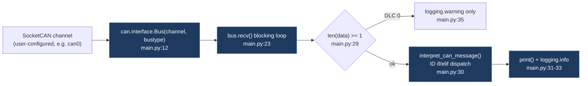

# Arkay92-TeslaCANInterpreter

## 1. Provenance

- **Submodule path:** `legacy/Arkay92-TeslaCANInterpreter`
- **Pinned gitlink:** `160000 1484da49e2b43b125a894d3981bcdd8ccb2de8c2 0` (from `git ls-files -s legacy/Arkay92-TeslaCANInterpreter`); matches `git -C legacy/Arkay92-TeslaCANInterpreter rev-parse HEAD`; submodule `status --porcelain` is empty (clean tree).
- **Upstream URL:** https://github.com/Arkay92/TeslaCANInterpreter
- **License:** MIT, Copyright (c) 2024 Robert McMenemy (`LICENSE:1-17`, FULL-READ).
- **Analysis date:** 2026-11-21.
- **Upstream history:** exactly one commit — `1484da4 2024-03-06 "Update README.md"`. The pinned SHA is the entire history.
- **Complete upstream inventory** (`git -C legacy/Arkay92-TeslaCANInterpreter ls-files`; hidden/platform dirs checked — none exist):
  - `main.py` (78 lines) — FULL-READ
  - `README.md` (53 lines) — FULL-READ
  - `LICENSE` (17 lines) — FULL-READ
- **Files explicitly NOT read:** none — the three files above are the whole repo. No tests, no CI, no dependency manifests, no hidden directories.
- **Our-side files read (RANGE-CITED, see section 11 for per-row citations):** `firmware/lib/vehicle/can/handler/bus/vehicle.h` (lines 348-372, 420-535), `firmware/lib/vehicle/can/feature/fsd/region.h` (lines 1-80), `firmware/lib/vehicle/can/feature/telemetry/vehicle_config.h` (lines 40-114), `firmware/lib/vehicle/can/feature/telemetry/bms.h` (lines 30-89), `firmware/lib/vehicle/can/ids.h` (lines 25-72), `firmware/lib/core/can/ring_buffer.h` (grep-anchored), `firmware/lib/core/log/ring.h` (grep-anchored), `firmware/lib/vehicle/can/feature/comfort/climate.h` (grep-anchored).
- **Replace-mode notes:** the pre-replace summary is still in git history — cite it as `git show HEAD:docs/legacy/Arkay92-TeslaCANInterpreter.md#<line>`. The original doc had **no** `## Upstream (...)` sections, so none are re-appended after section 14. The original doc **had** YAML frontmatter, so none was invented; it is preserved byte-for-byte. Its `description:` line is truncated mid-word (`…a handful of Tesla-spe`) — inherited defect, kept as-is; the line carries no trailing whitespace, so nothing was stripped.

## 2. Executive verdict

Arkay92-TeslaCANInterpreter is a 78-line MIT-licensed Python 3 host script: a blocking `python-can` read loop over a user-configured SocketCAN channel that stringifies every received frame and "interprets" four Tesla CAN IDs — 0x10C (headlights), 0x2C8 (charge percent), 0x398 ("country code"), 0x268 (climate status and setpoint). It is strictly passive (no TX, no checksum, no counter, no state) and ships no tests, no captures, and no dependency pin. Its only overlap with our stack is 0x398, where its UTF-8 text decode of a binary config frame is contradicted by our bitfield decode of the same frame (das_hw / region / platform / year) — that mechanism must never be ported. The other three IDs are unverified guesses on frames absent from our decode set; they are capture-first backlog items at best. Nothing else is novel: the RX loop and per-frame logging patterns are already present and far more robust in our firmware ring-buffer and log-ring pipelines.

## 3. Evidence map

No TEST-READ evidence exists: this repo ships no tests. No CAPTURE evidence exists in this repo.

| Source file                                                   | Lines                                   | What it proves                                                                                                                        | Grade        |
| ------------------------------------------------------------- | --------------------------------------- | ------------------------------------------------------------------------------------------------------------------------------------- | ------------ |
| `legacy/Arkay92-TeslaCANInterpreter/main.py`                  | 1-78 (FULL-READ)                        | Entire implementation: CLI args, Bus bootstrap, blocking RX loop, 4-ID string interpreter, dual-sink logging                          | CODE-READ    |
| `legacy/Arkay92-TeslaCANInterpreter/README.md`                | 1-53 (FULL-READ)                        | Prerequisites, usage (`sudo python main.py --interface can0`), 500 kbit/s setup instruction, disclaimers                              | SUMMARY-ONLY |
| `legacy/Arkay92-TeslaCANInterpreter/LICENSE`                  | 1-17 (FULL-READ)                        | MIT, © 2024 Robert McMenemy                                                                                                           | CODE-READ    |
| `git show HEAD:docs/legacy/Arkay92-TeslaCANInterpreter.md`    | full (FULL-READ of replaced doc)        | Pre-replace summary claims; contradiction-table source only                                                                           | SUMMARY-ONLY |
| `firmware/lib/vehicle/can/handler/bus/vehicle.h`              | 348-372, 436-482, 517-535 (RANGE-CITED) | Our 0x398 handling: region decode + CN lock, das_hw bits[7:6] variant auto-detect, all-zero frame rejection, vehicle-config piggyback | CODE-READ    |
| `firmware/lib/vehicle/can/feature/fsd/region.h`               | 14-30 (RANGE-CITED)                     | Our region decode: 0x398 byte[2] bits[7:4]                                                                                            | CODE-READ    |
| `firmware/lib/vehicle/can/feature/telemetry/vehicle_config.h` | 49-85 (RANGE-CITED)                     | Our platform decode: 0x398 byte[1] bits[7:4], year = 2016 + byte[2]                                                                   | CODE-READ    |
| `firmware/lib/vehicle/can/feature/telemetry/bms.h`            | 45-54 (RANGE-CITED)                     | Our SoC decode: 0x292 10-bit, ×0.1 %                                                                                                  | CODE-READ    |
| `firmware/lib/vehicle/can/ids.h`                              | 44, 48, 62 (RANGE-CITED)                | Our ID registry: 0x292, 0x2F3, 0x398 entries                                                                                          | CODE-READ    |
| `firmware/lib/core/can/ring_buffer.h`                         | 43, 53-65 (RANGE-CITED)                 | Our per-consumer CAN ring (supersedes upstream read loop)                                                                             | CODE-READ    |
| `firmware/lib/core/log/ring.h`                                | 26-44 (RANGE-CITED)                     | Our log ring (supersedes upstream file logging)                                                                                       | CODE-READ    |
| `firmware/lib/vehicle/can/feature/comfort/climate.h`          | 5, 13, 22-51 (RANGE-CITED)              | Our climate path is TX-only 0x2F3 mutate + burst                                                                                      | CODE-READ    |

## 4. Architecture and build surface

- **Entry point:** `main.py:74-78` — `if __name__ == "__main__":` → `parse_arguments()` → `setup_can_interface()` → `read_and_interpret_can_messages()`.
- **Shared core vs platform port:** none — a single self-contained script. The only dependency is `python-can` (`import can`, `main.py:1`), **unpinned** (no `requirements.txt` / `setup.py` / `pyproject.toml` — negative anchor in section 16). The Bus call `can.interface.Bus(interface, bustype=channel_type)` (`main.py:12`) is the pre-4.x python-can convention; compatibility with python-can ≥ 4 is UNVERIFIED.
- **Build flags / build system:** none. No CI, no packaging, no feature gating. Bitrate is never configured in code — it is entirely the user's `ip link` setup (`README.md:20`).
- **Frame pipeline:** RX → decode → print/log. There is **no mutate/gate/TX stage** — the repo is strictly passive (negative anchor: no `send(`/`transmit` in `main.py`).



## 5. Mechanism catalogue

Four mechanisms. None has a state machine with 3 or more states — every card's `State machine` field reads `None found` and no state diagram is warranted.

### M1 — python-can Bus bootstrap

- **Claim (README / summary):** README:15 assumes a SocketCAN-compatible interface on Linux; replaced doc `git show HEAD:docs/legacy/Arkay92-TeslaCANInterpreter.md#L19` says "Platform: Linux (SocketCAN)".
- **Code path:** `main.py:74-78` `__main__` → `parse_arguments()` (`main.py:67-72`) → `setup_can_interface()` (`main.py:9-17`) → `can.interface.Bus(interface, bustype=channel_type)` (`main.py:12`).
- **Frame spec:** None found — no frame handling in this mechanism.
- **Gates and timing:** `--interface` is a required CLI arg and is passed as the **channel** (first positional); `--channel_type` defaults to `socketcan` but accepts any python-can backend as a free string. No bitrate or bit-timing setup anywhere in code.
- **State machine:** None found.
- **Tests:** None found.
- **Evidence grade:** CODE-READ.
- **Verdict:** CONFIRMED as code behavior, with the caveat that the code is bustype-agnostic while the docs frame it as Linux/SocketCAN-only (contradiction C2).
- **Adapt to TeslaCANModder?** no impact — host-side Python tooling; our transport is MCP2515 C++ (`firmware/lib/core/can/`).

### M2 — Blocking RX read loop with guarded dispatch

- **Claim (README / summary):** replaced doc `git show HEAD:docs/legacy/Arkay92-TeslaCANInterpreter.md#L44` claims an "Infinite loop reading CAN frames, logging to console and file".
- **Code path:** `read_and_interpret_can_messages()` (`main.py:19-40`) → `bus.recv()` (`main.py:23`) → `len(data) >= 1` gate (`main.py:29`) → `interpret_can_message()` (`main.py:30`) → print + `logging.info` (`main.py:31-33`).
- **Frame spec:** None found — the loop is ID-agnostic.
- **Gates and timing:** no `recv()` timeout — blocks indefinitely; `KeyboardInterrupt` is the only clean exit (`main.py:37-38`); any recv exception logs and **terminates** the loop with no retry (`main.py:39-40`). The `is not None` check at `main.py:24` is dead code with a blocking recv.
- **State machine:** None found.
- **Tests:** None found.
- **Evidence grade:** CODE-READ.
- **Verdict:** PARTIAL — the loop is not infinite under error; exceptions end it.
- **Adapt to TeslaCANModder?** already present (concept only) — our multi-consumer ring pipeline (`firmware/lib/core/can/ring_buffer.h:43`, per-consumer `RingConsumer` at `:65`) supersedes it.

### M3 — Per-ID string interpreter (4 IDs)

- **Claim (README / summary):** README:3 promises "insights into various vehicle parameters like charge level, climate control status, and more"; replaced doc `git show HEAD:docs/legacy/Arkay92-TeslaCANInterpreter.md#L15` lists headlights, charge level, country code, climate control.
- **Code path:** `interpret_can_message()` (`main.py:42-65`) — if/elif on `can_id`, returns a human-readable string.
- **Frame spec:**

| ID (hex+dec) | DLC gate | Bytes read       | Code formula                                                                                             |
| ------------ | -------- | ---------------- | -------------------------------------------------------------------------------------------------------- |
| 0x10C (268)  | >= 1     | data[0]          | `data[0] in [0x89, 0x88]` → "Headlights: On", else "Off" (`main.py:45-47`)                               |
| 0x2C8 (712)  | >= 1     | data[0]          | raw byte printed as "Charge Level: N%" (`main.py:49-51`)                                                 |
| 0x398 (920)  | >= 1     | whole payload    | `data.decode('utf-8', errors='ignore')` → "Country Code: <text>" (`main.py:53-55`)                       |
| 0x268 (616)  | >= 7     | data[0], data[6] | `data[0] == 0x55` → "Climate Control: On"; `data[6]` printed as "Set Temperature: N°C" (`main.py:57-60`) |

- **Gates and timing:** per-ID `len(data)` gates only. No mux handling, no counter increment or check, no checksum computation anywhere in the repo.
- **State machine:** None found.
- **Tests:** None found.
- **Evidence grade:** CODE-READ for the code behavior; real-world layout correctness of all four decodes is UNVERIFIED (no captures), and the 0x398 decode is CONTRADICTED by our-side CODE-READ (contradiction C1).
- **Verdict:** PARTIAL — code confirmed, decode semantics unverified, 0x398 wrong.
- **Adapt to TeslaCANModder?** 0x398: never port. 0x2C8 / 0x10C / 0x268: capture-first backlog, not portable on CODE-READ alone.

### M4 — Dual-sink per-frame logging (stdout + file)

- **Claim (README / summary):** replaced doc `git show HEAD:docs/legacy/Arkay92-TeslaCANInterpreter.md#L59` says "Logs all frames to `tesla_can.log` with timestamps".
- **Code path:** `logging.basicConfig(filename='tesla_can.log', level=INFO, format='%(asctime)s - %(message)s')` at import (`main.py:7`) → per-frame `logging.info` (`main.py:33`) or `logging.warning` for DLC-0 frames (`main.py:35`).
- **Frame spec:** None found.
- **Gates and timing:** log file is opened at import time in the current working directory; every received frame yields exactly one log line (interpreted line or the incomplete-message warning).
- **State machine:** None found.
- **Tests:** None found.
- **Evidence grade:** CODE-READ.
- **Verdict:** CONFIRMED.
- **Adapt to TeslaCANModder?** already present — our log ring (`firmware/lib/core/log/ring.h:26-44`) plus per-frame JSON streaming cover this.

## 6. Summary vs code contradiction table

Pre-replace claims cited as `git show HEAD:docs/legacy/Arkay92-TeslaCANInterpreter.md#<line>`.

| #   | Pre-replace / README claim                                                                                                                                  | Code (or our-side CODE-READ) says                                                                                                                                                                                                                                                                                                                                                                                                                  | Verdict                 |
| --- | ----------------------------------------------------------------------------------------------------------------------------------------------------------- | -------------------------------------------------------------------------------------------------------------------------------------------------------------------------------------------------------------------------------------------------------------------------------------------------------------------------------------------------------------------------------------------------------------------------------------------------- | ----------------------- |
| C1  | 0x398 row: "Country code (UTF-8 decode of data bytes)" (`HEAD:docs/legacy/Arkay92-TeslaCANInterpreter.md#L55`)                                              | `main.py:54` decodes the whole payload as UTF-8 text, but our side reads 0x398 as binary GTW_carConfig: das_hw in byte[0] bits[7:6] (`firmware/lib/vehicle/can/handler/bus/vehicle.h:451`), region in byte[2] bits[7:4] (`firmware/lib/vehicle/can/feature/fsd/region.h:29`), platform in byte[1] bits[7:4] and year 2016+byte[2] (`firmware/lib/vehicle/can/feature/telemetry/vehicle_config.h:60,83`). Text decode of this frame yields garbage. | CONTRADICTED            |
| C2  | "Platform: Linux (SocketCAN)" (`HEAD:docs/legacy/Arkay92-TeslaCANInterpreter.md#L19`)                                                                       | `main.py:71` defaults `--channel_type` to `socketcan` but accepts any python-can backend as a free string; no Linux-specific API anywhere in `main.py`. The platform constraint is a README setup assumption, not a code property.                                                                                                                                                                                                                 | CONTRADICTED            |
| C3  | "CAN Interface: SocketCAN (can0) via python-can library, 500 kbit/s" presented as a script property (`HEAD:docs/legacy/Arkay92-TeslaCANInterpreter.md#L21`) | The code never sets, checks, or asserts a bitrate. 500 kbit/s appears only as a user instruction (`README.md:20`, `sudo ip link set can0 up type can bitrate 500000`). The script runs on whatever the channel is configured to.                                                                                                                                                                                                                   | CONTRADICTED (framing)  |
| C4  | CAN ID table column header "Hex" while the paired values are decimal (`HEAD:docs/legacy/Arkay92-TeslaCANInterpreter.md#L52-56`, values 268/712/920/616)     | 268, 712, 920, 616 are the decimal renderings of 0x10C, 0x2C8, 0x398, 0x268 — the header mislabels the column.                                                                                                                                                                                                                                                                                                                                     | CONTRADICTED (labeling) |

The replaced doc hedged itself at `HEAD:docs/legacy/Arkay92-TeslaCANInterpreter.md#L61` ("interpretations appear to be basic/approximate and may not be fully accurate") — code-reading confirms that hedge is warranted for all four IDs, and decisively so for 0x398.

## 7. CAN frame and signal inventory

All four frames are RX-only in upstream; "bus" upstream is a single user-configured sniffer channel with no bus-index concept. Periods are unobservable from a passive sniffer. No CAPTURE evidence exists in this repo — the layout correctness of every row is UNVERIFIED against real vehicles, and the 0x398 row is contradicted by our decode (C1).

| ID (hex+dec) | Bus                                                           | Period     | DLC  | Byte/bit layout                                                                                                                                                               | Scale/units                                      | Counter position | Checksum   | Read or write | Grade     |
| ------------ | ------------------------------------------------------------- | ---------- | ---- | ----------------------------------------------------------------------------------------------------------------------------------------------------------------------------- | ------------------------------------------------ | ---------------- | ---------- | ------------- | --------- |
| 0x10C (268)  | single sniffer channel; unused on our side                    | None found | >= 1 | data[0] membership test {0x89, 0x88} (`main.py:46`)                                                                                                                           | On/Off label                                     | None found       | None found | RX only       | CODE-READ |
| 0x2C8 (712)  | single sniffer channel; unused on our side                    | None found | >= 1 | data[0] as percent (`main.py:50-51`)                                                                                                                                          | raw byte → %, no scale/offset                    | None found       | None found | RX only       | CODE-READ |
| 0x398 (920)  | Vehicle bus on our side (`firmware/lib/vehicle/can/ids.h:62`) | None found | >= 1 | upstream: whole payload `decode('utf-8', errors='ignore')` (`main.py:54`). ours: byte[0] bits[7:6] das_hw, byte[1] bits[7:4] platform, byte[2] year, byte[2] bits[7:4] region | upstream: None found (renders raw bytes as text) | None found       | None found | RX only       | CODE-READ |
| 0x268 (616)  | single sniffer channel; unused on our side                    | None found | >= 7 | data[0] == 0x55 climate-On; data[6] setpoint (`main.py:58-59`)                                                                                                                | raw byte as °C, no offset/scale                  | None found       | None found | RX only       | CODE-READ |

No vendored DBC/JSON catalog exists in this repo, so no STRUCTURAL-PARSE row is needed.

## 8. Constants and tuning table

| Constant              | Value               | File:line             | Meaning                                                                                                                                         | Grade                            |
| --------------------- | ------------------- | --------------------- | ----------------------------------------------------------------------------------------------------------------------------------------------- | -------------------------------- |
| Headlight On values   | `0x89, 0x88`        | `main.py:46`          | data[0] membership test → "Headlights: On"; any other value → "Off". The pair differs only in bit 0 (possibly low vs high beam lumped together) | CODE-READ (semantics UNVERIFIED) |
| Climate On threshold  | `0x55`              | `main.py:58`          | data[0] == 0x55 → "Climate Control: On"                                                                                                         | CODE-READ (semantics UNVERIFIED) |
| Climate setpoint byte | `data[6]`           | `main.py:59`          | printed directly as °C with no offset/scale                                                                                                     | CODE-READ (semantics UNVERIFIED) |
| DLC gates             | `>= 1` (×3), `>= 7` | `main.py:45,49,53,57` | minimum payload length before a decode attempt                                                                                                  | CODE-READ                        |
| Bus bitrate           | `500000`            | `README.md:20` only   | user-side `ip link` instruction; never referenced by `main.py`                                                                                  | SUMMARY-ONLY                     |

## 9. Failure modes and edge cases

No TEST-READ evidence exists: this repo ships no tests — every row below is untested.

| Failure                                 | Handling code path                                                                                                                                         | Tested? | Grade               |
| --------------------------------------- | ---------------------------------------------------------------------------------------------------------------------------------------------------------- | ------- | ------------------- |
| CAN interface init failure              | `setup_can_interface` catches all exceptions, logs, returns None; `__main__` then exits **silently with exit code 0** (`main.py:15-17, 77-78`)             | No      | CODE-READ           |
| recv() raises (bus-off, interface down) | generic `except` logs the error and the read loop terminates — no retry, no re-open (`main.py:39-40`)                                                      | No      | CODE-READ           |
| Zero-length payload (DLC 0)             | warning branch only: `logging.warning("Received incomplete message...")`, frame never printed (`main.py:29, 34-35`)                                        | No      | CODE-READ           |
| Decode exception inside interpreter     | caught per frame, error string returned and printed as the "Interpreted:" field (`main.py:64-65`)                                                          | No      | CODE-READ           |
| recv() stall                            | no timeout configured — blocks forever; the `is not None` guard (`main.py:24`) is dead code with a blocking recv                                           | No      | CODE-READ           |
| Log-line injection via 0x398            | payload bytes pass through `decode('utf-8', errors='ignore')` — control characters (e.g. 0x0A) embed into the printed/logged line (`main.py:54-55, 31-33`) | No      | CODE-READ           |
| Watchdog / brownout / OTA               | None found — host script with no watchdog, OTA, or power-state concept; nothing in `main.py` enumerates these                                              | No      | CODE-READ (absence) |

## 10. Test coverage map

None found — the repo contains no test files, no test runner, no CI configuration (`git -C legacy/Arkay92-TeslaCANInterpreter ls-files` returns exactly `LICENSE`, `README.md`, `main.py`).

Critical paths with NO test, and the risk in one line each:

- The 4-ID interpreter — a wrong ID/scale guess ships silently and feeds wrong "insights" to the operator.
- Init-failure path — silent exit code 0 means automation/CI cannot detect a dead interface.
- recv-exception path — the "infinite" loop silently ends on the first bus error.
- 0x398 UTF-8 path — control bytes from the bus reach console and log unescaped.

## 11. Parity matrix with TeslaCANModder

Every row carries an our-side CODE-READ citation (absence claims are proven by the demonstrated negative anchor in section 16).

| Signal/frame                      | Upstream decode (cite)                                                                                                   | Our decode (cite)                                                                                                                                                                                                                                                                                                                                                       | Delta                                                                              | Action                                       |
| --------------------------------- | ------------------------------------------------------------------------------------------------------------------------ | ----------------------------------------------------------------------------------------------------------------------------------------------------------------------------------------------------------------------------------------------------------------------------------------------------------------------------------------------------------------------- | ---------------------------------------------------------------------------------- | -------------------------------------------- | -------------------------------- | ------------------------------------ |
| GTW_carConfig 0x398 (920)         | whole payload → UTF-8 "Country Code" string, DLC >= 1 (`main.py:53-55`)                                                  | binary decode: das_hw byte[0] bits[7:6] with all-zero frame rejection (`firmware/lib/vehicle/can/handler/bus/vehicle.h:438-482`), region byte[2] bits[7:4] + CN lock (`vehicle.h:355-370`, `firmware/lib/vehicle/can/feature/fsd/region.h:27-30`), platform byte[1] bits[7:4] + year 2016+byte[2] (`firmware/lib/vehicle/can/feature/telemetry/vehicle_config.h:55-85`) | upstream decode is textual garbage on a binary frame — same ID, incompatible model | ignore — never port (C1)                     |
| Battery SoC                       | 0x2C8 (712) data[0] raw byte as % , no scale (`main.py:49-51`)                                                           | 0x292 (658) 10-bit bits 0-9 × 0.1 % (`firmware/lib/vehicle/can/feature/telemetry/bms.h:50-54`, `firmware/lib/vehicle/can/ids.h:44`)                                                                                                                                                                                                                                     | different ID and scale; 0x2C8 is not in our decode set at all                      | capture-first for 0x2C8; otherwise ignore    |
| Headlight status 0x10C (268)      | data[0] in {0x89, 0x88} → On (`main.py:45-47`)                                                                           | no counterpart — `grep -rnE '0x10C                                                                                                                                                                                                                                                                                                                                      | 0x2C8                                                                              | 0x268' firmware/lib/` → no output            | frame absent from our decode set | capture-first; dashboard nicety only |
| Climate status 0x268 (616)        | On = data[0]==0x55, setpoint = data[6] (`main.py:57-60`)                                                                 | no 0x268 decode (same negative anchor); our climate path is TX-only 0x2F3 (755) mutate + burst (`firmware/lib/vehicle/can/feature/comfort/climate.h:22-51`, `firmware/lib/vehicle/can/ids.h:48`)                                                                                                                                                                        | no overlap: upstream reads a frame we never touch                                  | capture-first; no bearing on our TX features |
| Passive sniff + per-frame logging | read-only loop, one console line + one log line per frame (`main.py:22-33`; negative anchor: no TX symbols in `main.py`) | multi-consumer CAN ring (`firmware/lib/core/can/ring_buffer.h:43,65`) + log ring (`firmware/lib/core/log/ring.h:26-44`)                                                                                                                                                                                                                                                 | ours is strictly richer (per-consumer overflow tracking, transports)               | already present — no port                    |

## 12. Surface inventory and security notes

| Surface                                    | Semantics                                                                                                                                                            | Notes                                                       |
| ------------------------------------------ | -------------------------------------------------------------------------------------------------------------------------------------------------------------------- | ----------------------------------------------------------- |
| CLI `--interface` (required)               | value is passed as the first positional to `can.interface.Bus` — i.e. the python-can **channel** (`can0`), despite the flag name (`main.py:70, 76, 12`)              | naming mismatch: "interface" is actually the channel        |
| CLI `--channel_type` (default `socketcan`) | python-can **bustype**; free string, accepts any backend the installed python-can supports (`main.py:71`)                                                            | unpinned dependency                                         |
| stdout                                     | one line per frame: `Time:, CAN ID:, Data:, Interpreted:` (`main.py:31-32`)                                                                                          | untrusted payload reaches console (see 0x398 note)          |
| `tesla_can.log`                            | INFO-level file log opened at import in the current working directory, `asctime` format; every frame lands here as interpreted line or warning (`main.py:7, 33, 35`) | run under `sudo` per `README.md:36` → root-owned log in CWD |

Security/provenance findings:

- No hardcoded credentials, keys, or certs. No network or BLE surface at all.
- No vendored archives, no dangerous build flags.
- Log-line injection: the 0x398 branch writes bus-controlled bytes (via UTF-8 decode) into console and log lines (`main.py:54-55`) — section 9 row 6.
- License MIT (permissive); the author's disclaimer (`README.md:39-49`) covers warranty/legality but not the decode-correctness risk.

## 13. Adaptation assessment

| Mechanism                         | Value                                      | Cost                         | Risk                                                                | Evidence grade | Decision                                                      |
| --------------------------------- | ------------------------------------------ | ---------------------------- | ------------------------------------------------------------------- | -------------- | ------------------------------------------------------------- |
| M1 python-can Bus bootstrap       | low — host-side pattern only               | none (not our stack)         | none                                                                | CODE-READ      | no impact                                                     |
| M2 blocking RX loop               | low — concept-level                        | none                         | none                                                                | CODE-READ      | already present — `firmware/lib/core/can/ring_buffer.h:43,65` |
| M3a 0x398 UTF-8 "country code"    | negative — contradicted decode model       | none (nothing to build)      | high if ported — garbage text on a config frame we decode correctly | CODE-READ      | never port                                                    |
| M3b 0x2C8 raw-byte charge %       | unknown — frame absent from our decode set | small (one decoder function) | unverified ID/scale could feed wrong dashboard data                 | CODE-READ      | capture-first backlog — not a PR candidate                    |
| M3c 0x10C headlights              | low — status nicety for a future dashboard | small                        | same — magic values unvalidated                                     | CODE-READ      | capture-first backlog                                         |
| M3d 0x268 climate status/setpoint | low — readback for climate UI              | small                        | same — 0x55 threshold and raw °C unvalidated                        | CODE-READ      | capture-first backlog                                         |
| M4 dual-sink logging              | low                                        | none                         | none                                                                | CODE-READ      | already present — `firmware/lib/core/log/ring.h:26-44`        |

Any future port of M3b/M3c/M3d requires `docs/checklists/can-review-checklist.md` and a listen-only bench capture first; none may be ported on upstream CODE-READ evidence alone (no CAPTURE, no TEST-READ anywhere in this repo).

## 14. Do-not-copy list

| Item                                                  | File:line       | Reason                                                                                            |
| ----------------------------------------------------- | --------------- | ------------------------------------------------------------------------------------------------- |
| UTF-8 decode of binary 0x398 payload                  | `main.py:54-55` | wrong decode model (frame is binary GTW_carConfig per our CODE-READ); also a log-injection vector |
| Magic-value membership test `data[0] in [0x89, 0x88]` | `main.py:46`    | heuristic with no bitfield/mux analysis; semantics UNVERIFIED                                     |
| Raw byte as SoC percent                               | `main.py:50-51` | no scale/offset; conflicts with our 0x292 10-bit ×0.1 decode                                      |
| Raw byte as °C setpoint                               | `main.py:59`    | no offset/scale; guesswork                                                                        |
| Pre-4.x `bustype=` Bus call with unpinned python-can  | `main.py:12`    | dependency drift; irrelevant to our ESP32/MCP2515 stack anyway                                    |
| Silent exit code 0 on interface init failure          | `main.py:77-78` | masks setup failures from callers and automation                                                  |

## 15. History and evolution

- Local `git log` (entire history): one commit — `1484da4 2024-03-06 "Update README.md"`, which is the pinned gitlink SHA.
- Nothing was visibly tried, abandoned, or rolled back: there is no earlier code state, no changelog, no branches to compare. Pre-pin upstream history review: moot — no commits exist before the pin.
- Network sources (issues, PRs, other branches) were not consulted; any claim about upstream intent beyond this commit would be UNVERIFIED.

## 16. Re-verification recipe

Pinned SHA (canonical gitlink form): `160000 1484da49e2b43b125a894d3981bcdd8ccb2de8c2 0`.

```bash
OLD=1484da49e2b43b125a894d3981bcdd8ccb2de8c2
git -C legacy/Arkay92-TeslaCANInterpreter fetch --tags --prune
git -C legacy/Arkay92-TeslaCANInterpreter log --oneline $OLD..origin/main
git -C legacy/Arkay92-TeslaCANInterpreter diff --stat $OLD..origin/main
git ls-files -s legacy/Arkay92-TeslaCANInterpreter   # compare gitlink to rev-parse HEAD
```

All anchors below were demonstrated at write time with `git grep -nE` (identical regex, identical line numbers to GNU `grep -nE`; the session shell lacked GNU grep). Run from the repo root unless noted.

Upstream anchors (cwd `legacy/Arkay92-TeslaCANInterpreter` for the plain-`grep` forms):

```text
grep -nE '0x10C|0x89, 0x88' main.py
  -> main.py:45:        if can_id == 0x10C and len(data) >= 1:
  -> main.py:46:            status = "On" if data[0] in [0x89, 0x88] else "Off"
grep -nE '0x2C8' main.py
  -> main.py:49:        elif can_id == 0x2C8 and len(data) >= 1:
grep -nE '0x398|utf-8' main.py
  -> main.py:53:        elif can_id == 0x398 and len(data) >= 1:
  -> main.py:54:            country_code = data.decode('utf-8', errors='ignore')
grep -nE '0x268|0x55|data\[6\]' main.py
  -> main.py:57:        elif can_id == 0x268 and len(data) >= 7:
  -> main.py:58:            climate_status = "On" if data[0] == 0x55 else "Off"
  -> main.py:59:            set_temperature = data[6]
grep -nE 'bustype|can\.interface\.Bus' main.py
  -> main.py:12:        bus = can.interface.Bus(interface, bustype=channel_type)
grep -nE 'bitrate 500000' README.md
  -> README.md:20:    sudo ip link set can0 up type can bitrate 500000
```

Upstream negative anchors (absence claims — expect no output):

```text
grep -nE 'send\(|transmit|checksum|crc|counter' main.py -> no output (passive, no TX, no checksum handling)
grep -nE 'requirements|setup\.py|pyproject' main.py    -> no output (no dependency manifest)
```

Our-side drift anchors (repo root — these back the `already present` and absence claims):

```text
grep -nE 'CAN_ID_GTW_CAR_CFG' firmware/lib/vehicle/can/handler/bus/vehicle.h
  -> 355, 438, 528
grep -nE 'das_hw' firmware/lib/vehicle/can/handler/bus/vehicle.h
  -> 436, 437, 451
grep -nE 'decodeBmsSoc' firmware/lib/vehicle/can/feature/telemetry/bms.h
  -> 50 (plus sibling decoders 191, 202, 213)
grep -nE 'decodeRegionCode' firmware/lib/vehicle/can/feature/fsd/region.h
  -> 27, 37, 39
grep -nE 'CAN_ID_BMS_SOC' firmware/lib/vehicle/can/ids.h
  -> 44
grep -rnE '0x10C|0x2C8|0x268' firmware/lib/ -> no output (frames absent from our decode set)
```

If line numbers drift more than ~10, re-read the whole function; do not trust this document's numbers.

## 17. Open questions and explicitly not investigated

- Whether the 0x10C, 0x2C8, and 0x268 decode layouts match any real Tesla build — UNVERIFIED; a listen-only bench capture with our firmware plus an independent decode cross-check would settle it.
- Whether `data[0] == 0x55` on 0x268 actually correlates with HVAC state — UNVERIFIED (0x55 may be a mux/status nibble coincidence).
- Origin of the four ID guesses: the author cites no DBC, capture, or source — unknown.
- python-can ≥ 4 compatibility of `can.interface.Bus(channel, bustype=...)` — UNVERIFIED; verify in a venv with `pip install python-can` then `python -c "import can; can.Bus('vcan0', bustype='socketcan')"`.
- Pre-pin upstream history: not reviewed — moot, the pinned commit is the repository's only commit.
- Network sources (GitHub issues/PRs) not consulted; no claims in this doc rest on them.
- The replaced pre-2026 summary remains reachable via `git show HEAD:docs/legacy/Arkay92-TeslaCANInterpreter.md`; its "CAN ID reference" line (`#L70`) must not be trusted without capture (see C1).
- Inherited frontmatter truncation (`description:` ends mid-word at `Tesla-spe`) — deliberately not fixed, per replace-mode preservation rules.
