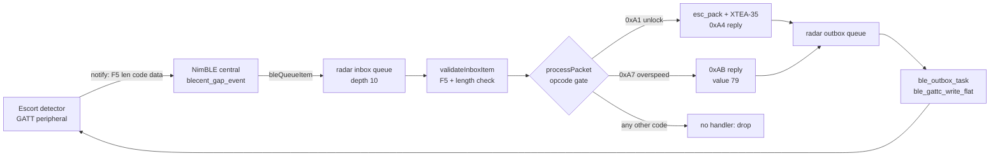
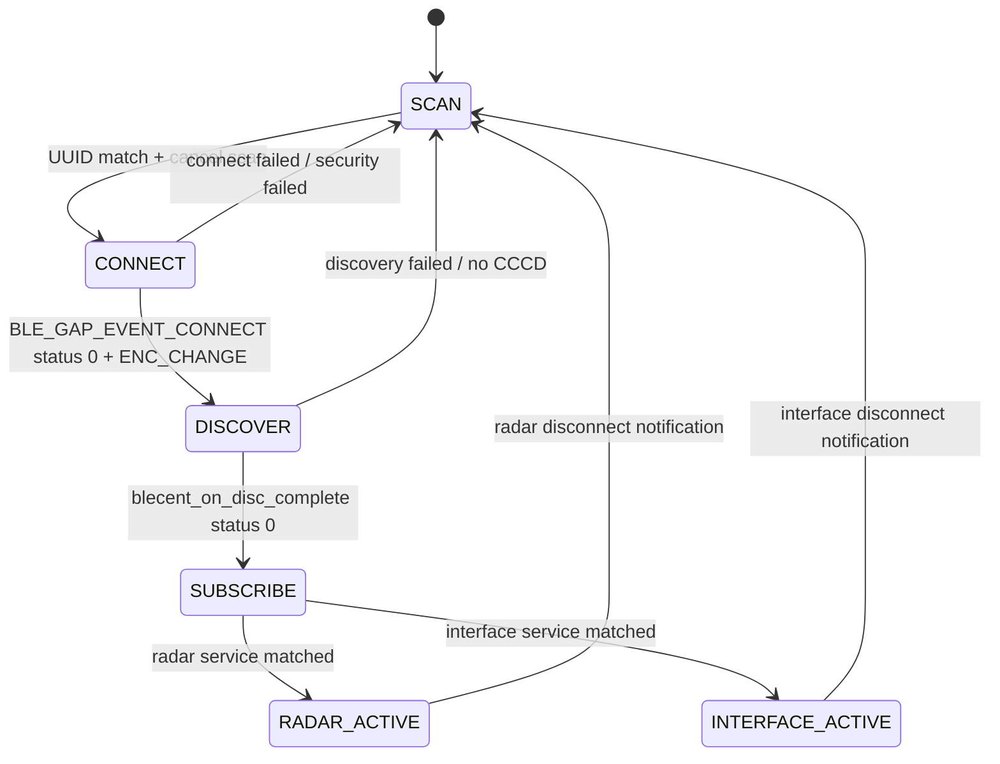
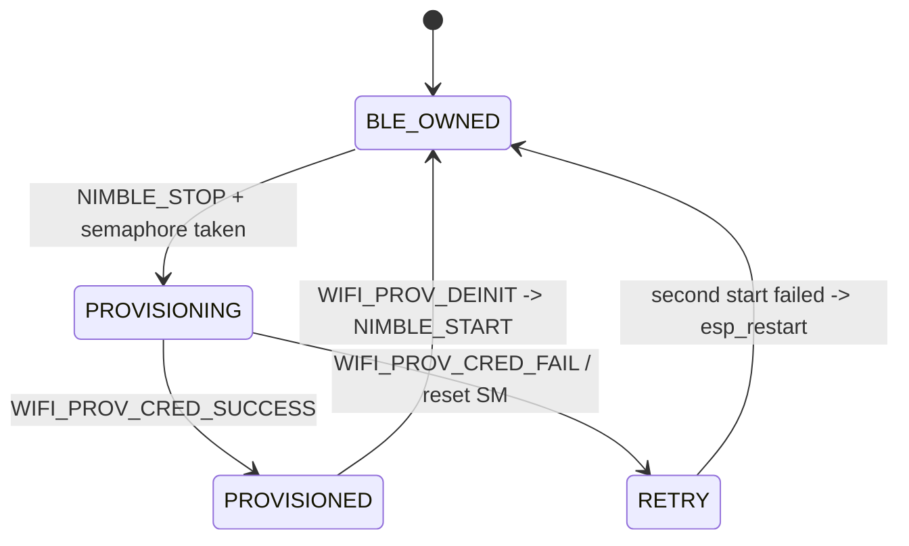

# BluedDot-IT-TeslaCANalyzer-Controller

## 1. Provenance

- Submodule path: `legacy/BluedDot-IT-TeslaCANalyzer-Controller`.
- Pinned gitlink: `160000 870513e99583c24c637d280c21b1b9dc2f9dc5c6 0` (from `git ls-files -s`).
- `git -C legacy/BluedDot-IT-TeslaCANalyzer-Controller rev-parse HEAD` = `870513e99583c24c637d280c21b1b9dc2f9dc5c6`; `status --porcelain` empty. Analysis describes the pinned snapshot.
- Upstream: `https://github.com/BluedDot-IT/TeslaCANalyzer-Controller` (origin fetch/push).
- License: no project `LICENSE` file in the tracked tree. Vendored Espressif files carry `SPDX-License-Identifier: Unlicense OR CC0-1.0` (`esp_central.h:4`, `misc.c:4`, `peer.c:4`); `blecent.h:1-18` carries Apache-2.0 boilerplate.
- Analysis date: 2026-11-21.
- Replace mode: original frontmatter preserved byte-for-byte (description line was already free of trailing whitespace). The pre-replace doc had **no** `## Upstream (...)` section, so none could be preserved. Pre-replace claims are cited as `git show HEAD:docs/legacy/BluedDot-IT-TeslaCANalyzer-Controller.md#<line>`.

Files read (all line numbers are from the pinned snapshot):

| File | Lines read | Coverage |
| --- | --- | --- |
| `.gitignore` | 1-112 | FULL-READ |
| `CMakeLists.txt` | 1-7 | FULL-READ |
| `README.md` | 1-32 | FULL-READ |
| `components/nimble_central_utils/CMakeLists.txt` | 1-2 | FULL-READ |
| `components/nimble_central_utils/esp_central.h` | 1-111 | FULL-READ |
| `components/nimble_central_utils/misc.c` | 1-234 | FULL-READ |
| `components/nimble_central_utils/peer.c` | 1-70, 586-855 | RANGE-CITED; 71-585 inventoried by symbol grep only |
| `main/CMakeLists.txt` | 1-11 | FULL-READ |
| `main/main.cpp` | 1-34 | FULL-READ |
| `main/ble/ble_task.cpp` | 1-469 | FULL-READ |
| `main/ble/ble_task.h` | 1-58 | FULL-READ |
| `main/ble/blecent.h` | 1-40 | FULL-READ |
| `main/debug.hpp` | 1-17 | FULL-READ |
| `main/interface/interface_task.cpp` | 1-29 | FULL-READ |
| `main/interface/interface_task.h` | 1-15 | FULL-READ |
| `main/mqtt/mqtt_task.cpp` | 1-116 | FULL-READ |
| `main/mqtt/mqtt_task.h` | 1-25 | FULL-READ |
| `main/provisioning/provisioning_task.cpp` | 1-108 | FULL-READ |
| `main/provisioning/provisioning_task.h` | 1-17 | FULL-READ |
| `main/radar/escort-jni.hpp` | 1-59 | FULL-READ |
| `main/radar/packet_processing.cpp` | 1-83 | FULL-READ |
| `main/radar/packet_processing.h` | 1-122 | FULL-READ |
| `main/radar/radar_task.cpp` | 1-171 | FULL-READ |
| `main/radar/radar_task.h` | 1-40 | FULL-READ |
| `main/wifi/wifi_task.cpp` | 1-83 | FULL-READ |
| `main/wifi/wifi_task.h` | 1-5 | FULL-READ |
| `partitions.csv` | 1-5 | FULL-READ |
| `sdkconfig` | 387-458 | RANGE-CITED (NimBLE section only; generated, 1995 lines) |
| `sdkconfig.old` | none | STRUCTURAL-PARSE (SHA-256 identical to `sdkconfig`) |

Our-side files read for parity (CODE-READ): `firmware/lib/io/serial/usb/esp32/state.h:20-26`, `firmware/lib/io/serial/usb/esp32/loop.h:30-49`, `firmware/lib/io/serial/usb/esp32/common.h:638-655`, `firmware/lib/client/command/dispatch.h:31-58`, `firmware/lib/vehicle/can/feature/misc/mqtt_bridge.h:1-88`, `firmware/lib/vehicle/ble/feature/session.h:1-60`, `firmware/lib/vehicle/ble/feature/key.h:12-20` (grep inventory), `firmware/lib/io/ble/esp32/init.h:1-80`, `firmware/lib/io/wifi/esp32/config.h:88-111`, `firmware/lib/core/can/ring_buffer.h:41-62`, `packages/protocol/src/commands.ts:112-113,381-395` (grep inventory).

Files explicitly NOT read: `main/mqtt/secrets.h` (gitignored at `.gitignore:112`, absent from tracked tree); `peer.c:71-585` body (only function names inventoried); full `sdkconfig` body outside 387-458; `sdkconfig.old` body; any pre-pin upstream history or network-only issues/PRs.

## 2. Executive verdict

An ESP32 / ESP-IDF C++ bridge that connects as a **NimBLE central** to an Escort radar detector and a separate LVGL "interface" peripheral, parses Escort's `F5 len code data` binary messages, replies to two command codes, and renders status text on the detector's display over GATT. It also runs a BLE WiFi provisioner, a WiFi STA link, and an MQTT client that only subscribes to one topic. Despite the repo name there is **no CAN code at all**: no MCP2515, no TWAI, no Tesla command set. The mechanisms that matter are the F5 length validation, the dual-role NimBLE discovery/CCCD subscribe flow, the BLE-vs-provisioning semaphore handoff, and the periodic status/speed-limit timers. None are candidates for shipping: upstream's alert decoder is dead code, its XTEA-35 unlock uses a hardcoded key and undersized heap buffers, and its MQTT path publishes nothing. At most, the *idea* of a periodic radio status poll and MAC-derived topic naming can be compared with our already-present `status:live` and MQTT bridge. Nothing here should be ported into `firmware/`, `client/`, `packages/`, or `tools/`.

## 3. Evidence map

| Source file | Lines | What it proves | Grade |
| --- | --- | --- | --- |
| `main/main.cpp` | 12-34 | Boot order: NVS init/erase fallback, default event loop, BLE semaphore taken/given, `blecent_init` → `provisioning_init` → `wifi_init` → `mqtt_init`, 5 s heap log loop | CODE-READ |
| `main/radar/packet_processing.h` | 8-111 | `RESP_START`/`REQ_START` = `0xF5`; ~100 Escort response/request opcode constants with claimed data lengths (catalog only) | CODE-READ |
| `main/radar/packet_processing.h` | 112-122 | `RadarPacket` struct and four public helpers | CODE-READ |
| `main/radar/packet_processing.cpp` | 13-18 | `validateInboxItem` checks `data[0] == 0xF5` and `data_length - 2 == data[1]` | CODE-READ |
| `main/radar/packet_processing.cpp` | 20-39 | `headingCalculation` bearing math with `abs(i) <= 180` and `floor(d / 2.0)` | CODE-READ |
| `main/radar/packet_processing.cpp` | 41-50 | `getDisplayLocationPacket` packs alert type + distance + heading into 5 bytes, all bytes masked `& 127` | CODE-READ |
| `main/radar/packet_processing.cpp` | 52-81 | `processPacket` gates on only `0xA1` (unlock) and `0xA7` (overspeed); all other codes fall through | CODE-READ |
| `main/radar/escort-jni.hpp` | 6-23 | Hardcoded `SMARTCORD_KEY`, non-standard XTEA `delta = 0xf160a3d8`, 35 rounds, `esc_pack`/`esc_unpack` bit packing | CODE-READ |
| `main/radar/radar_task.cpp` | 11-21 | `radar_status_request` builds `{0xF5,0x01,0x94}` | CODE-READ |
| `main/radar/radar_task.cpp` | 24-35 | `radar_update_speed_limit` builds `{0xF5,0x03,0xA9,86,0}` | CODE-READ |
| `main/radar/radar_task.cpp` | 40-99 | Two FreeRTOS timers @5000 ms, queues depth 10, notification-driven teardown, F5 parse and dispatch | CODE-READ |
| `main/radar/radar_task.cpp` | 102-171 | `send_alert`, `clear_alert`, `play_tone`, `show_message` build `0xAD`/`0xAE`/`0x9B`/`0x9A` packets; only `show_message` has callers | CODE-READ |
| `main/radar/radar_task.h` | 15-31 | Alert type enum: speed trap, speed camera, red light, RL+speed, laser, police | CODE-READ |
| `main/ble/ble_task.cpp` | 42-65 | Passive scan forever; 3 s one-shot retry timer on scan failure | CODE-READ |
| `main/ble/ble_task.cpp` | 67-122 | Connect only to advertisers carrying either 128-bit service UUID; 30 s connect timeout | CODE-READ |
| `main/ble/ble_task.cpp` | 132-178 | CCCD `0x2902` write `{1,1}`, then spawn radar or interface task by matched service UUID | CODE-READ |
| `main/ble/ble_task.cpp` | 252-368 | GAP event switch: discovery, connect, encryption, disconnect notifications, notify RX routing, repeat pairing | CODE-READ |
| `main/ble/ble_task.cpp` | 378-410 | `sm_io_cap = NO_IO`, `sm_bonding = 1`, `sm_sc = 0`, device name `tCANcontroller`, `peer_init(3,64,64,64)` | CODE-READ |
| `main/ble/ble_task.cpp` | 412-469 | Outbox task drains radar/interface queues with `portMAX_DELAY` and `ble_gattc_write_flat` | CODE-READ |
| `main/ble/ble_task.h` | 10-37 | Radar and interface service/TX/RX UUIDs, CCCD UUID | CODE-READ |
| `main/provisioning/provisioning_task.cpp` | 17-55 | Provisioning event handler including `WIFI_PROV_DEINIT` → BLE restart | CODE-READ |
| `main/provisioning/provisioning_task.cpp` | 57-108 | BLE provisioning scheme, `WIFI_PROV_SECURITY_0`, SSID `TeslaCANalyzer`, restart-on-failure paths | CODE-READ |
| `main/wifi/wifi_task.cpp` | 19-64 | STA start/disconnect/GOT-IP handler; >5 failures triggers reprovisioning; MQTT START/STOP notifications | CODE-READ |
| `main/wifi/wifi_task.cpp` | 66-83 | Hostname `TeslaCAN-<MAC12>` derived from STA MAC | CODE-READ |
| `main/mqtt/mqtt_task.cpp` | 18-71 | Subscribe to `teslacan/<MAC>/live_alerts` QoS 1; reassemble multi-part messages; no publish call | CODE-READ |
| `main/mqtt/mqtt_task.cpp` | 76-117 | Broker config from `secrets.h`, TLS CRT bundle, reconnect 2500 ms, buffer 4096 | CODE-READ |
| `main/mqtt/mqtt_task.h` | 13-19 | `MQTTMessage` with 50-byte topic buffer; `MQTT_START`/`MQTT_STOP` | CODE-READ |
| `main/interface/interface_task.cpp` | 10-29 | Interface task only creates/deletes queues; no inbound processing | CODE-READ |
| `components/nimble_central_utils/esp_central.h` | 12-17 | `bleQueueItem` with `uint8_t data_length`, `BLEDeviceTaskNotification` enum | CODE-READ |
| `components/nimble_central_utils/peer.c` | 1-70, 586-855 | Espressif-style peer cache: `peer_add`, `peer_find`, `peer_disc_all`, `peer_init(3,64,64,64)` pools | CODE-READ |
| `components/nimble_central_utils/misc.c` | 19-235 | Logging helpers only (`addr_str`, `print_conn_desc`, `print_adv_fields`) | CODE-READ |
| `main/CMakeLists.txt` | 1-11 | GLOB all `*.cpp`, REQUIRES bt/esp_wifi/nvs_flash/nimble_central_utils/wifi_provisioning/mqtt; two warning suppressions | CODE-READ |
| `partitions.csv` | 1-5 | OTA-capable partition table (app0/app1 0x1f0000 each) | CODE-READ |
| `sdkconfig` | 387-458 | NimBLE central + peripheral both enabled, 3 connections, bonding, SC build flag, internal memory | CODE-READ |
| `.gitignore` | 112 | `main/mqtt/secrets.h` is deliberately untracked | CODE-READ |
| `README.md` | 1-32 | Generic `idf.py create-project` sample text; no Tesla or radar documentation | CODE-READ |
| `docs/legacy/BluedDot-IT-TeslaCANalyzer-Controller.md` (pre-replace) | 15, 36-42 | Source of the claims tested in section 6 | SUMMARY-ONLY |

No TEST-READ evidence exists: the tracked tree has no test files and no test target in either `CMakeLists.txt`. No CAPTURE evidence exists: no frames, logs, or decoded traces are checked in.

## 4. Architecture and build surface

- Entry point: `main/main.cpp:12` `app_main()`.
- Shared core vs platform port: `components/nimble_central_utils/` is vendored Espressif NimBLE peer/print boilerplate; all product code is under `main/` and compiled into one `idf_component_register` via `file(GLOB_RECURSE NESTED_SRC **.cpp)` (`main/CMakeLists.txt:1-9`). No unit-test component, no host/native port.
- Build flags: none for CAN or features. `sdkconfig:387-458` enables NimBLE central *and* peripheral roles, 3 links, bonding, NVS persistence. `main/CMakeLists.txt:11-12` appends `-Wno-missing-field-initializers` and `-Wno-error=parentheses`.
- Dependency boundary: `bt`, `esp_wifi`, `nvs_flash`, `nimble_central_utils`, `wifi_provisioning`, `mqtt`. No CAN/TWAI component anywhere.
- Data flow (BLE only — no CAN pipeline exists):



## 5. Mechanism catalogue

### Escort F5 framing and inbox validation

- **Claim (README / summary):** BLE protocol with `0xF5` command prefix (`git show HEAD:docs/legacy/BluedDot-IT-TeslaCANalyzer-Controller.md#46`).
- **Code path:** `main/radar/radar_task.cpp:76-97` — `xQueueReceive` → `validateInboxItem()` (`packet_processing.cpp:13`) → `RadarPacket` split → `processPacket()`.
- **Frame spec:** `F5 | len | code | data[len]`; `len` is `data[1]` and `data_length - 2` must equal it; opcode is `data[2]`. No counter, no checksum.
- **Gates and timing:** inbox poll timeout 50 ms; invalid packets logged and freed. `data_length` is `uint8_t`, so `data_length - 2` underflows for short frames.
- **State machine:** None found.
- **Tests:** None found.
- **Evidence grade:** CODE-READ.
- **Verdict:** CONFIRMED for the framing; PARTIAL for robustness (underflow path).
- **Adapt to TeslaCANModder?** no impact — our transports carry JSON-RPC lines (`common.h:647`), not binary length-prefixed frames.

### XTEA-35 Bluetooth unlock handshake

- **Claim (README / summary):** None found.
- **Code path:** `main/radar/packet_processing.cpp:54-73` — `RESP_BLUETOOTH_PROTOCOL_UNLOCK_REQUEST (0xA1)` → `esc_pack()` → `xtea_encrypt(35, out, SMARTCORD_KEY, enc)` (`escort-jni.hpp:8`) → `esc_unpack()` → 13-byte `REQ_BLUETOOTH_PROTOCOL_UNLOCK_RESPONSE (0xA4)` → outbox.
- **Frame spec:** RX `F5 0A A1 <10 data bytes>`; TX `{F5, 0x0B, 0xA4, unpack[0..9]}` = 13 bytes. `esc_pack` folds 10×7-bit bytes into two `uint32_t`; XTEA `delta = 0xf160a3d8`, 35 rounds, key words `B67423AB 7B7F599E 831E63EB 535C1285`. Counter: none. Checksum: none.
- **Gates and timing:** triggered only by the `0xA1` notification; `portMAX_DELAY` on outbox send.
- **State machine:** None found.
- **Tests:** None found.
- **Evidence grade:** CODE-READ.
- **Verdict:** CONFIRMED as implemented; the length byte `0x0B` disagrees with the 10 payload bytes and the catalog's `d=10` note (`packet_processing.h:45`).
- **Adapt to TeslaCANModder?** never — hardcoded symmetric key, custom XTEA delta, and heap overflow (section 14).

### Overspeed warning auto-reply

- **Claim (README / summary):** None found.
- **Code path:** `main/radar/packet_processing.cpp:74-81` — `RESP_OVERSPEED_WARNING_REQUEST (0xA7)` → `{F5,02,AB,79}` → outbox.
- **Frame spec:** TX opcode `0xAB` (`REQ_OVERSPEED_LIMIT_DATA`), one data byte `79` = 64+15, meaning "15 over limit" per `packet_processing.h:107`.
- **Gates and timing:** event-driven only; 4-byte heap allocation; `portMAX_DELAY` enqueue.
- **State machine:** None found.
- **Tests:** None found.
- **Evidence grade:** CODE-READ.
- **Verdict:** CONFIRMED.
- **Adapt to TeslaCANModder?** no impact — detector-specific UI setting, no Tesla signal.

### Periodic status and speed-limit poll timers

- **Claim (README / summary):** "relays radar alerts through MQTT and WiFi" (`git show HEAD:docs/legacy/BluedDot-IT-TeslaCANalyzer-Controller.md#15`) — not what these timers do.
- **Code path:** `main/radar/radar_task.cpp:11-35` (builders) and `40-55` (timers).
- **Frame spec:** status `{0xF5,0x01,0x94}` — length byte says 1 but there is no data byte though `packet_processing.h:82` documents `d=0`; speed limit `{0xF5,0x03,0xA9,86,0}` (86 km/h). No counter/checksum.
- **Gates and timing:** 5000 ms period, 1000 ms initial start; both timers are auto-reload; stopped only after `vTaskDelete(NULL)` on disconnect (unreachable, see section 9).
- **State machine:** None found.
- **Tests:** None found.
- **Evidence grade:** CODE-READ.
- **Verdict:** PARTIAL — cadence confirmed, status-frame length byte suspect.
- **Adapt to TeslaCANModder?** no impact — our periodic status already exists at 250 ms live / 5000 ms normal (`state.h:25-26`, `loop.h:38`).

### Alert display packet builder (dead code)

- **Claim (README / summary):** handles speed trap, speed camera, red light camera, laser, police alerts with distance and heading (`git show HEAD:docs/legacy/BluedDot-IT-TeslaCANalyzer-Controller.md#36`).
- **Code path:** `main/radar/radar_task.cpp:102-129` `send_alert`/`clear_alert` → `getDisplayLocationPacket()` (`packet_processing.cpp:41-50`); **no call site exists** for `send_alert`, `clear_alert`, or `headingCalculation` outside their definitions/declarations.
- **Frame spec:** `REQ_DISPLAY_LOCATION (0xAD)` = `{F5,06,AD,b0..b4}`; 5 bytes: `b0=alertType&0xFF`, `b1=((alertType>>7)|(distanceFt<<1))&127`, `b2=(distanceFt>>6)&127`, `b3=(distanceFt>>13 | heading8<<3)&127`, `b4=((0&3)<<5 | heading8>>4 | (1&1)<<4)&127`. `REQ_DISPLAY_CLEAR_LOCATION (0xAE)` = `{F5,01,AE}`.
- **Gates and timing:** would be event-driven; no timer wires them up.
- **State machine:** None found.
- **Tests:** None found.
- **Evidence grade:** CODE-READ (definition and absence-of-callers verified by anchor A4).
- **Verdict:** CONTRADICTED — implementation exists but is unreachable.
- **Adapt to TeslaCANModder?** no impact — TeslaCANModder has no alert-display surface.

### NimBLE dual-role central discovery and GATT subscribe

- **Claim (README / summary):** BLE central connection pattern with NimBLE (`git show HEAD:docs/legacy/BluedDot-IT-TeslaCANalyzer-Controller.md#55`).
- **Code path:** `main/ble/ble_task.cpp:42-65` scan → `67-122` filter/connect → `240-250` service discovery → `132-178` CCCD subscribe + task spawn → `198-229` write → `333-355` notify routing.
- **Frame spec:** advertising must include radar service UUID `B5E22DE931EE42ABBE6A9BE0837AA344` (reversed from `ble_task.h:14`) or interface service UUID `BBC03CA072CC12857F477BCE69722EAF`; CCCD write value `{1,1}` to `0x2902`; device name `tCANcontroller`.
- **Gates and timing:** 30 s connect timeout, 3 s scan retry, passive scan, duplicate filter on, 50 ms outbox poll, peer pools `peer_init(3,64,64,64)`.
- **State machine:**



- **Tests:** None found.
- **Evidence grade:** CODE-READ.
- **Verdict:** CONFIRMED.
- **Adapt to TeslaCANModder?** no impact — our BLE is a peripheral GATT server (`init.h:51-78`), the opposite role.

### BLE / provisioning semaphore handoff

- **Claim (README / summary):** provisioning system (`git show HEAD:docs/legacy/BluedDot-IT-TeslaCANalyzer-Controller.md#39`).
- **Code path:** `main/main.cpp:23-24` gives `xBLESemaphore`; `ble_task.cpp:378-405` takes it in `nimble_subsystem_init`; `provisioning_task.cpp:70-88` on start failure sends `NIMBLE_STOP` and takes the semaphore; `provisioning_task.cpp:46-51` on `WIFI_PROV_DEINIT` gives it back and sends `NIMBLE_START`; `ble_task.cpp:419-446` handles stop/start.
- **Frame spec:** None found (control notifications only: `NIMBLE_STOP = 0`, `NIMBLE_START = 1` per `ble_task.h:57`).
- **Gates and timing:** `portMAX_DELAY` semaphore take; provisioning uses `WIFI_PROV_SECURITY_0` and SSID `TeslaCANalyzer`; second failed start calls `esp_restart()`.
- **State machine:**



- **Tests:** None found.
- **Evidence grade:** CODE-READ.
- **Verdict:** CONFIRMED; security posture is weak (section 12).
- **Adapt to TeslaCANModder?** no impact — our WiFi is STA/AP config (`config.h:92-111`), not a BLE provisioner.

### WiFi → MQTT lifecycle bridge

- **Claim (README / summary):** MQTT task for publishing/subscribing radar data (`git show HEAD:docs/legacy/BluedDot-IT-TeslaCANalyzer-Controller.md#37`).
- **Code path:** `main/wifi/wifi_task.cpp:36-62` GOT-IP → `MQTT_START`, disconnect → `MQTT_STOP`; `mqtt_task.cpp:24-67` subscribe + reassembly; `mqtt_task.cpp:110-113` inbox receive only logs.
- **Frame spec:** topic `teslacan/<12-hex-STA-MAC>/live_alerts`, QoS 1, `CRT bundle` verification, username/password from untracked `secrets.h`.
- **Gates and timing:** reconnect 2500 ms, timeout 10000 ms, MQTT task buffer 4096, inbox poll 10 ms.
- **State machine:** MQTT_START / MQTT_STOP only; no reconnect state machine in our code.
- **Tests:** None found.
- **Evidence grade:** CODE-READ.
- **Verdict:** CONTRADICTED — subscribe-only; `esp_mqtt_client_publish` absent (negative anchor A9b), and no radar data reaches MQTT.
- **Adapt to TeslaCANModder?** already present — our bridge has validated commands and a publish gate (`mqtt_bridge.h:26-87`).

### FreeRTOS queue fan-out and outbox pump

- **Claim (README / summary):** "inbox/outbox queue pattern", "FreeRTOS tasks and queues throughout" (`git show HEAD:docs/legacy/BluedDot-IT-TeslaCANalyzer-Controller.md#40,42`).
- **Code path:** `radar_task.cpp:57-58`, `interface_task.cpp:13-14`, `mqtt_task.cpp:79-80` create depth-10 queues; `ble_task.cpp:412-469` drains both outboxes with `portMAX_DELAY` and writes over GATT.
- **Frame spec:** queue element `bleQueueItem { uint8_t data_length; uint8_t *data; }` (`esp_central.h:12-15`).
- **Gates and timing:** both outbox receives use 50 ms blocking waits; no queue-full timeout or drop path.
- **State machine:** None found.
- **Tests:** None found.
- **Evidence grade:** CODE-READ.
- **Verdict:** CONFIRMED.
- **Adapt to TeslaCANModder?** already present — our lock-free ring with per-consumer drop accounting (`ring_buffer.h:43-114`) is strictly more robust.

## 6. Summary vs code contradiction table

| # | Pre-replace claim | Code evidence | Verdict | Grade |
| --- | --- | --- | --- | --- |
| 1 | Frontmatter description: "relays radar alerts thro..." (`git show HEAD:docs/legacy/BluedDot-IT-TeslaCANalyzer-Controller.md#3`) | MQTT only subscribes (`mqtt_task.cpp:34-35`) and its inbox handler only logs (`mqtt_task.cpp:110-113`); no publish call anywhere | CONTRADICTED — stale bytes preserved as required | CODE-READ |
| 2 | "relays radar alerts through MQTT and WiFi" (`...md#15`) | Same as row 1; radar alerts are drawn on the detector via `REQ_DISPLAY_LOCATION` (`radar_task.cpp:109-115`) and that function has no callers | CONTRADICTED | CODE-READ |
| 3 | "License: None" (`...md#22`) | Vendored SPDX Unlicense/CC0 headers (`esp_central.h:4`, `misc.c:4`, `peer.c:4`), Apache-2.0 `blecent.h:1-18`; no root `LICENSE` | PARTIAL — no project license, vendored files are licensed | CODE-READ |
| 4 | Architecture diagram "Radar → ESP → MQTT / WiFi relay" (`...md#26-33`) | `processPacket` handles only `0xA1`/`0xA7` (`packet_processing.cpp:54-81`); no radar-to-MQTT edge exists | CONTRADICTED | CODE-READ |
| 5 | "handles ... alerts with distance and heading" (`...md#36`) | `send_alert`, `clear_alert`, `headingCalculation` have definitions/declarations only (`radar_task.cpp:102,119`, `packet_processing.cpp:20`) — no call site | CONTRADICTED | CODE-READ |
| 6 | "MQTT task for publishing/subscribing radar data" (`...md#37`) | Subscribe only; `esp_mqtt_client_publish` absent; topic is `live_alerts` for an external producer | CONTRADICTED | CODE-READ |
| 7 | Upstream README: "# _Sample project_", "sample_project contains one source file in C language main.c" (`README.md:1,16`) | `CMakeLists.txt:8` project `TeslaCANalyzer-Controller`; `main/main.cpp` plus 12 other C++ sources | CONTRADICTED | CODE-READ |
| 8 | Upstream README: sample folder tree with only `main.c` (`README.md:24-30`) | Tree contains `main/ble`, `main/radar`, `main/mqtt`, `main/wifi`, `main/provisioning`, `main/interface`, `components/nimble_central_utils` | CONTRADICTED | CODE-READ |

Agreements (not contradictions, recorded here so they are not re-litigated): "no direct CAN bus code" (`...md#21,46`) is confirmed by negative anchor A9; `0xF5` prefix (`...md#46`) is confirmed at `packet_processing.h:8,61`; BLE-based provisioning (`...md#39`) is confirmed at `provisioning_task.cpp:11,73`; task/queue architecture (`...md#42`) is confirmed at `radar_task.cpp:57-58`.

## 7. CAN frame and signal inventory

No CAN frames exist in this repo — no CAN ID, bus, DLC, counter, or checksum applies. The table inventories the **Escort-over-BLE** packets actually referenced by code. The ~100-opcode constant catalog at `packet_processing.h:8-111` is STRUCTURAL-PARSE only and is deliberately not dumped here.

| ID (hex+dec) | Bus | Period | DLC | Byte/bit layout | Scale/units | Counter | Checksum | Read/write | Grade |
| --- | --- | --- | --- | --- | --- | --- | --- | --- | --- |
| `0xF5` / 245 framing | N/A (GATT notify/write) | per message | 3..N | `b0=F5`, `b1=len`, `b2=code`, `b3..=data` | len = `data_length-2` | none | none | both | CODE-READ |
| `0xA1` / 161 unlock request | N/A | event | 13 RX | `F5 0A A1 <10 bytes>` | 10×7-bit packed | none | none | read | CODE-READ |
| `0xA4` / 164 unlock response | N/A | event | 13 TX | `F5 0B A4 <10 bytes>` | unpacked 7-bit bytes | none | none | write | CODE-READ |
| `0xA7` / 167 overspeed warning req | N/A | event | 3 RX | `F5 02 A7 <1>` | code only | none | none | read | CODE-READ |
| `0xAB` / 171 overspeed limit data | N/A | event | 4 TX | `F5 02 AB 4F` | 79 = 64+15 over limit | none | none | write | CODE-READ |
| `0x94` / 148 status request | N/A | 5000 ms | 3 TX | `F5 01 94` (no data byte) | none | none | none | write | CODE-READ |
| `0xA9` / 169 speed limit update | N/A | 5000 ms | 5 TX | `F5 03 A9 56 00` | 86 km/h | none | none | write | CODE-READ |
| `0xAD` / 173 display location | N/A | dead code | 8 TX | `F5 06 AD b0..b4` | feet, half-bearing | none | none | write | CODE-READ |
| `0xAE` / 174 display clear | N/A | dead code | 3 TX | `F5 01 AE` | none | none | none | write | CODE-READ |
| `0x9A` / 154 display message | N/A | event | 4+N TX | `F5 (2+N) 9A 09 <msg>` | N = 7 or 10 | none | none | write | CODE-READ |
| `0x9B` / 155 play tone | N/A | event | 4 TX | `F5 02 9B tone` | tone type 1 | none | none | write | CODE-READ |
| `0x82` / 130 and `0xA9` / 169 alert responses | N/A | unknown | `4*n` / `5*n` RX | declared in catalog only; no decoder in `processPacket` | UNVERIFIED | none | none | read | UNVERIFIED |

## 8. Constants and tuning table

| Constant | Value | File:line | Meaning | Grade |
| --- | --- | --- | --- | --- |
| `RESP_START` / `REQ_START` | `0xF5` | `packet_processing.h:8,61` | Escort frame start byte | CODE-READ |
| `RESP_BLUETOOTH_PROTOCOL_UNLOCK_REQUEST` | `0xA1` | `packet_processing.h:44` | RX trigger for unlock handshake | CODE-READ |
| `REQ_BLUETOOTH_PROTOCOL_UNLOCK_RESPONSE` | `0xA4` | `packet_processing.h:100` | TX unlock reply opcode | CODE-READ |
| Unlock reply length byte | `0x0B` | `packet_processing.cpp:62` | 11 declared vs 10 payload bytes in catalog | CODE-READ |
| XTEA rounds | `35` | `packet_processing.cpp:59` | custom round count | CODE-READ |
| XTEA delta | `0xf160a3d8` | `escort-jni.hpp:13` | non-standard XTEA delta | CODE-READ |
| `SMARTCORD_KEY` | `B67423AB 7B7F599E 831E63EB 535C1285` | `escort-jni.hpp:6` | hardcoded 128-bit symmetric key | CODE-READ |
| `REQ_OVERSPEED_WARNING_REQUEST` | `0xA7` | `packet_processing.h:50` | RX overspeed event | CODE-READ |
| `REQ_OVERSPEED_LIMIT_DATA` | `0xAB` | `packet_processing.h:107` | TX overspeed setting | CODE-READ |
| Overspeed value | `79` | `packet_processing.cpp:77` | 64 + 15 mph over limit | CODE-READ |
| Status request opcode | `0x94` | `radar_task.cpp:15` | periodic detector poll | CODE-READ |
| Speed-limit opcode / value | `0xA9` / `86` | `radar_task.cpp:29` | periodic posted limit | CODE-READ |
| Radar timer period / start | 5000 / 1000 ms | `radar_task.cpp:43,50` | status + speed-limit poll | CODE-READ |
| Clear-message timer | 5000 ms period, 50 ms start | `radar_task.cpp:169-170` | one-shot display clear | CODE-READ |
| Queue depth | `10` | `radar_task.cpp:57-58` | inbox/outbox capacity | CODE-READ |
| Task stack / priority | 4096 / 1 or 5 | `ble_task.cpp:167,170,409`, `mqtt_task.cpp:117` | FreeRTOS task sizing | CODE-READ |
| Scan retry | 3000 / 1000 ms | `ble_task.cpp:62-63` | passive scan relaunch | CODE-READ |
| Connect timeout | 30000 ms | `ble_task.cpp:114` | `ble_gap_connect` timeout | CODE-READ |
| WiFi disconnect retry limit | `>5` | `wifi_task.cpp:45` | triggers reprovisioning | CODE-READ |
| MQTT topic | `teslacan/<MAC>/live_alerts` | `mqtt_task.cpp:34` | subscribe-only topic, QoS 1 | CODE-READ |
| MQTT reconnect / timeout / buffer | 2500 / 10000 ms / 4096 | `mqtt_task.cpp:92-96` | client network tuning | CODE-READ |
| Provisioning scheme / auth | BLE / `WIFI_PROV_SECURITY_0` | `provisioning_task.cpp:73,77` | open provisioning | CODE-READ |
| Provisioning SSID / device name | `TeslaCANalyzer` / `tCANcontroller` | `provisioning_task.cpp:77`, `ble_task.cpp:398` | advertised identities | CODE-READ |
| Peer pool sizes | `3,64,64,64` | `ble_task.cpp:395` | peers/services/chars/descs | CODE-READ |
| NimBLE SM config | `bonding=1, sc=0, io_cap=NO_IO` | `ble_task.cpp:391-393` | pairing posture | CODE-READ |

## 9. Failure modes and edge cases

| Failure | Handling code path | Tested? | Grade |
| --- | --- | --- | --- |
| Invalid F5 frame | `radar_task.cpp:79-83` validates then frees and `continue`s | No | CODE-READ |
| Short frame (<2 bytes) | `packet_processing.cpp:14` `data_length - 2` underflows on `uint8_t` | No | CODE-READ |
| malloc failure on packet buffer | `radar_task.cpp:87-90` logs and continues | No | CODE-READ |
| Undersized XTEA buffers | `packet_processing.cpp:56-60`: `malloc(2)` for two `uint32_t` (needs 8) → heap overflow on `esc_pack`/`xtea_encrypt`/`esc_unpack` | No | CODE-READ |
| Dangling log string | `radar_task.cpp:94-95`: `.c_str()` of a temporary `std::string` used on the next statement | No | CODE-READ |
| Disconnect teardown order | `radar_task.cpp:66-72`: `vTaskDelete(NULL)` before `xTimerStop` makes the stops unreachable; deleted queues may still be polled by outbox task | No | CODE-READ |
| Outbox queue full | `radar_task.cpp:73,80,115,127,139,150,167` all use `portMAX_DELAY` — producer blocks forever, no drop path | No | CODE-READ |
| BLE scan failure | `ble_task.cpp:60-64` one-shot 3 s retry timer | No | CODE-READ |
| Service discovery failure / no CCCD | `ble_task.cpp:152-156,240-245` terminates link and restarts scan | No | CODE-READ |
| Peer pool OOM | `peer.c:721-725` returns `BLE_HS_ENOMEM`; caller `ble_task.cpp:273-277` only logs, leaving link open | No | CODE-READ |
| Host reset callback | `ble_task.cpp:370` logs reason only; no state recovery beyond NVS bonding | No | CODE-READ |
| Brownout / reboot | `main.cpp:14-18` erases NVS on no-free-pages/new-version; provisioning failures call `esp_restart()` (`provisioning_task.cpp:84,93`) | No | CODE-READ |
| MQTT message reassembly | `mqtt_task.cpp:50-65` unbounded `strncpy` into 200-byte topic, then `strcpy` into 50-byte field; `dataBuf` never freed | No | CODE-READ |
| OTA behavior | None in code. `partitions.csv:3-5` reserves OTA slots, but no update or pause logic exists | No | CODE-READ |

## 10. Test coverage map

Test files: None found. No test target exists in `CMakeLists.txt` or `main/CMakeLists.txt`; no TEST-READ evidence exists.

Critical paths with NO test:

- F5 length validation and the `data_length - 2` underflow (`packet_processing.cpp:14`).
- `esc_pack` / XTEA-35 / `esc_unpack` round trip and buffer sizing (`escort-jni.hpp:8-59`).
- Both `processPacket` branches, especially the 13-byte unlock reply shape (`packet_processing.cpp:52-81`).
- 5-byte `getDisplayLocationPacket` bit packing and heading wraparound (`packet_processing.cpp:20-50`).
- Timer start/stop ordering across disconnect (`radar_task.cpp:43-72`).
- MQTT multi-part reassembly and topic truncation (`mqtt_task.cpp:43-66`).
- Provisioning NIMBLE_STOP/START semaphore handoff (`provisioning_task.cpp:46-88`).

Risk: every byte-level claim in this document rests on CODE-READ alone; a refactor could silently change a frame shape with no test to catch it.

## 11. Parity matrix with TeslaCANModder

| Signal / frame | Upstream decode (cite) | Our decode / implementation (cite) | Delta | Action |
| --- | --- | --- | --- | --- |
| Periodic status cadence | `radar_task.cpp:15,43` — `0x94` poll @5000 ms | `state.h:25-26` live 250 ms / normal 5000 ms; `loop.h:38-42` tick | Same normal interval, ours has live mode and JSON payload | already present |
| MQTT telemetry bridge | `mqtt_task.cpp:34,88-89` — subscribe-only, secrets in untracked header | `mqtt_bridge.h:13-18,26-87` — validated `mqtt:*` commands, 500-60000 ms clamp, publish gate | Ours is configurable and publish-capable | already present |
| BLE pairing / session key | `escort-jni.hpp:6-23` — XTEA-35, hardcoded 4-word key | `session.h:5-9,25-30,41` — ECDH + AES-128-GCM; `key.h:12-20` P-256 mbedTLS | Ours uses authenticated ephemeral crypto | already present |
| BLE role | `ble_task.cpp:42-122` central scan/connect, 2 GATT peers | `init.h:49-78` peripheral server with TX notify / RX write | Opposite roles; no shared command surface | no impact |
| Wire framing | `packet_processing.h:8`, `packet_processing.cpp:14` — `F5 len code data` | `common.h:642-648` — single-line JSON-RPC, errors `rpc: expected json object` | Incompatible framing; do not mix | ignore |
| Inbound queueing | `radar_task.cpp:57-58` — FreeRTOS queues, depth 10, `portMAX_DELAY` | `ring_buffer.h:43-59,105-114` — lock-free ring with per-consumer overflow detection | Ours detects drops instead of blocking producers | already present |
| WiFi STA / provisioning | `wifi_task.cpp:66-83` STA + `provisioning_task.cpp:73-77` open BLE prov | `config.h:92-111` STA with 15 s timeout + AP fallback on `TeslaCANModder` | Different topology and security model | no impact |
| CAN frames / signals | None found in upstream | `docs/reference/can-ids.md` documents the full Tesla set (SUMMARY-ONLY cross-check) | No upstream counterpart to compare | ignore |

Every row except the last has an our-side CODE-READ citation. The last row is intentionally SUMMARY-ONLY and drives no decision.

## 12. Surface inventory and security notes

| Surface | Location | Semantics |
| --- | --- | --- |
| BLE GATT central → radar | `ble_task.h:13-20`, `ble_task.cpp:139-159` | Connects to two 128-bit services, subscribes to RX CCCD, writes commands to TX |
| BLE GATT central → interface | `ble_task.h:25-34`, `ble_task.cpp:146-150,170` | Same pattern for LVGL interface peripheral; `interface_task.cpp:10-29` has no message decoder |
| Escort command set | `packet_processing.h:60-111` | ~50 request opcodes (settings, flash erase, lockout DB, display, tones) declared; only two handled in code |
| MQTT subscribe | `mqtt_task.cpp:34-35` | `teslacan/<MAC>/live_alerts`, QoS 1; no publish surface |
| WiFi provisioning | `provisioning_task.cpp:73-77` | BLE scheme, SSID `TeslaCANalyzer`, security level 0 |
| WiFi STA + REST | `wifi_task.cpp:66-83` | Station mode only; no HTTP server in this repo |
| Serial console | None found | No command parser; `main.cpp` only logs heap |
| OTA / update surface | `partitions.csv:3-5` | Partitions reserved, no implementation |

Security findings:

- Hardcoded symmetric key `SMARTCORD_KEY` (`escort-jni.hpp:6`) with a custom XTEA delta; this is vendor protocol reverse-engineering, not a credential to reuse.
- `main/mqtt/secrets.h` is excluded by `.gitignore:112`; MQTT host, username, and password (`mqtt_task.cpp:88-89`) are build-local and UNVERIFIED in content. No credentials are committed.
- `WIFI_PROV_SECURITY_0` (`provisioning_task.cpp:77,83`) means unauthenticated provisioning; `sm_sc = 0` and `NO_IO` (`ble_task.cpp:391-393`) further weaken pairing. Our BLE path requires `setSecurityAuth(true,true,true)` (`init.h:55`) — keep ours.
- `esp_crt_bundle_attach` (`mqtt_task.cpp:88`) does verify broker certificates — the one good security control here.
- `main/CMakeLists.txt:11-12` disables `-Wmissing-field-initializers` and demotes `-Wparentheses`, masking exactly the classes of bug found above.
- `assert()` in production GAP callbacks (`ble_task.cpp:270,295,361,374,399`) can abort the device on unexpected stack state.
- Untrusted input handling: `mqtt_task.cpp:46,62` copies topic bytes without bounds checks; `esp_central.h:13` uses `uint8_t` length, enabling underflow.

## 13. Adaptation assessment

| Mechanism | Value | Cost | Risk | Evidence grade | Decision |
| --- | --- | --- | --- | --- | --- |
| F5 framing + length validation | Low — different transport framing | Low | Underflow bug | CODE-READ | no impact |
| XTEA-35 unlock handshake | Low — vendor-specific detector auth | High | Hardcoded key, heap overflow | CODE-READ | never port |
| Overspeed auto-reply | Low | Low | None to us | CODE-READ | no impact |
| Periodic status / speed-limit poll | Medium — idea only, cadence already covered | Low | Status length byte suspect | CODE-READ | already present |
| Alert display builder | Low — unreachable code | Medium | Bit-packing errors | CODE-READ | no impact |
| NimBLE dual-role discovery | Medium — shows a two-peripheral central pattern | High | Opposite role to ours | CODE-READ | no impact |
| BLE / provisioning semaphore handoff | Medium — mutual exclusion of shared radio | Medium | Open provisioning | CODE-READ | no impact |
| MQTT lifecycle bridge | Low — ours is stronger | Low | Topic overflow upstream | CODE-READ | already present |
| Queue fan-out / outbox pump | Medium — contrast with our ring | Low | `portMAX_DELAY` starvation | CODE-READ | already present |

No candidate for a future PR. The only reusable artifacts are negative lessons (section 14) and two "already present" confirmations.

## 14. Do-not-copy list

| Item | File:line | Reason |
| --- | --- | --- |
| `xtea_encrypt` and `delta = 0xf160a3d8` | `escort-jni.hpp:8-23` | Custom crypto with hardcoded key; ours uses ECDH + AES-GCM (`session.h:5-9`) |
| `SMARTCORD_KEY` words | `escort-jni.hpp:6` | Credential-shaped constant; never ship vendor key material |
| `uint32_t *out = malloc(2)` / `enc = malloc(2)` | `packet_processing.cpp:56,58` | 2-byte allocation for 8 bytes of output — heap overflow |
| `uint8_to_hex_string(...).c_str()` used on next statement | `radar_task.cpp:94-95` | Dangling pointer from a destroyed temporary |
| `strncpy(lastTopic, event->topic, event->topic_len)` | `mqtt_task.cpp:46` | Unbounded copy into 200-byte static buffer |
| `strcpy(messageItem.topic, lastTopic)` | `mqtt_task.cpp:62` | Copy into 50-byte field (`mqtt_task.h:16`) without length check |
| `vTaskDelete(NULL)` before `xTimerStop` | `radar_task.cpp:70-72` | Unreachable cleanup; live timers outlive their task |
| `WIFI_PROV_SECURITY_0` | `provisioning_task.cpp:77,83` | Unauthenticated provisioning |
| `assert()` in GAP callbacks | `ble_task.cpp:270,295,361,374,399` | Production abort on recoverable conditions |
| `-Wno-missing-field-initializers` / `-Wno-error=parentheses` | `main/CMakeLists.txt:11-12` | Suppresses warnings relevant to the observed bugs |
| `uint8_t data_length` with `data_length - 2` | `esp_central.h:13`, `packet_processing.cpp:14` | Integer underflow on short frames |
| `portMAX_DELAY` on every outbox enqueue | `radar_task.cpp:73,80,115,127,139,150,167` | Unbounded producer blocking; no backpressure policy |

## 15. History and evolution

The submodule's local object store contains exactly **one** commit reachable from HEAD:

- `870513e99583c24c637d280c21b1b9dc2f9dc5c6` — 2023-11-26 — `work on radar packet processing`.

`git rev-list --count HEAD` returns `1`; no tags, no changelog, no branches beyond HEAD, and no `.git/shallow` marker — the submodule was grafted at this snapshot. Therefore nothing can be said about what was tried, abandoned, or rolled back before the pin. `sdkconfig` and `sdkconfig.old` are byte-identical (same SHA-256), so even the config backup records no evolution. Network-only material (GitHub issues, PRs, release notes) was not consulted and stays UNVERIFIED.

## 16. Re-verification recipe

```bash
OLD=870513e99583c24c637d280c21b1b9dc2f9dc5c6
git -C legacy/BluedDot-IT-TeslaCANalyzer-Controller fetch --tags --prune
git -C legacy/BluedDot-IT-TeslaCANalyzer-Controller log --oneline $OLD..origin/main
git -C legacy/BluedDot-IT-TeslaCANalyzer-Controller diff --stat $OLD..origin/main
git -C legacy/BluedDot-IT-TeslaCANalyzer-Controller diff $OLD..origin/main -- main components
git ls-files -s legacy/BluedDot-IT-TeslaCANalyzer-Controller   # expect: 160000 870513e99583c24c637d280c21b1b9dc2f9dc5c6 0
git -C legacy/BluedDot-IT-TeslaCANalyzer-Controller rev-parse HEAD
git -C legacy/BluedDot-IT-TeslaCANalyzer-Controller status --porcelain
```

Anchors below were run against the pinned snapshot; expectations are the observed output. If line numbers drift more than ~10, re-read the whole function — do not trust this document's numbers.

```text
A1  grep -nE 'RESP_START = 0xF5|REQ_START = 0xF5' main/radar/packet_processing.h -> 8, 61
A2  grep -nE 'xtea_encrypt|SMARTCORD_KEY' main/radar/packet_processing.cpp main/radar/escort-jni.hpp -> packet_processing.cpp:59; escort-jni.hpp:6,8
A3  grep -nE 'malloc.2.' main/radar/packet_processing.cpp -> 56, 58
A4  grep -rnE 'send_alert' main/ -> radar_task.cpp:102 (definition), radar_task.h:37 (declaration) only; no caller
A5  grep -nE 'MQTT_HOST|MQTT_USERNAME|MQTT_PASSWORD|secrets.h' main/mqtt/mqtt_task.cpp -> 12, 88, 89
A6  grep -nE 'WIFI_PROV_SECURITY_0|TeslaCANalyzer' main/provisioning/provisioning_task.cpp -> 77, 83
A7  grep -nE '0x94|0xA9|5000' main/radar/radar_task.cpp -> 15, 43, 50, 169
A8  grep -nE 'vTaskDelete|xTimerStop' main/radar/radar_task.cpp -> 70, 71, 72
A9  grep -rnE 'MCP2515|twai|driver/can.h|CAN_bus' main components -> no output (no CAN code)
A9b grep -rnE 'esp_mqtt_client_publish|mqtt_publish' main -> no output (subscribe-only)
A10 grep -nE 'STATUS_LIVE_INTERVAL_MS = 250|STATUS_INTERVAL_MS = 5000' firmware/lib/io/serial/usb/esp32/state.h -> 25, 26  [ours]
A11 grep -nE 'MQTT_TOPIC_PREFIX|MQTT_MIN_INTERVAL|executeMqttCmd' firmware/lib/vehicle/can/feature/misc/mqtt_bridge.h -> 15, 18, 26, 65  [ours]
A12 grep -nE 'TeslaSession|mbedtls/gcm.h|mbedtls/ecdh.h' firmware/lib/vehicle/ble/feature/session.h -> 9, 25, 28, 41  [ours]
A13 grep -nE 'NimBLEDevice::createServer|NimBLEDevice::init' firmware/lib/io/ble/esp32/init.h -> 51, 58  [ours, peripheral role]
A14 grep -nE 'rpc: expected json object' firmware/lib/io/serial/usb/esp32/common.h -> 647  [ours]
A15 grep -nE 'canRingBuffer|ringPush' firmware/lib/core/can/ring_buffer.h -> 43, 51, 53, 54, 57, 59, ...  [ours]
A16 grep -nE 'WIFI_STA_TIMEOUT|startSTA' firmware/lib/io/wifi/esp32/config.h -> 30, 90, 92, 104  [ours]
A17 grep -nE 'TEST|test_' CMakeLists.txt main/CMakeLists.txt -> no output (no tests)
```

## 17. Open questions and explicitly not investigated

- Pre-pin upstream history was **not** reviewed: the local submodule has one commit only, so no earlier attempts or reverts could be examined.
- `main/mqtt/secrets.h` content is UNVERIFIED — gitignored and absent. Would verify by reading a build-local copy (never commit it).
- Actual Escort detector responses are UNVERIFIED — no CAPTURE exists; the opcode/data-length comments in `packet_processing.h:8-111` are code comments only.
- Whether the `0x0B` unlock-reply length byte (`packet_processing.cpp:62`) or the `0x01` status length byte (`radar_task.cpp:15`) are intentional or bugs needs a listen-only BLE capture against a real detector.
- `peer.c:71-585` body was not line-read (function-name inventory only); no claim in this document depends on those lines.
- Full `sdkconfig` and `sdkconfig.old` bodies were not reviewed; only the NimBLE section 387-458 and the identical-hash check were used.
- Network-only claims (GitHub issues, PRs, upstream discussions) were not consulted and remain UNVERIFIED.
- The "interface" peripheral's protocol is entirely unknown — `interface_task.cpp` has no decoder; the LVGL UUIDs at `ble_task.h:25-34` are the only clue.
- No build was attempted: ESP-IDF toolchain and `secrets.h` are not present in this environment, so compile-time behavior is UNVERIFIED.
