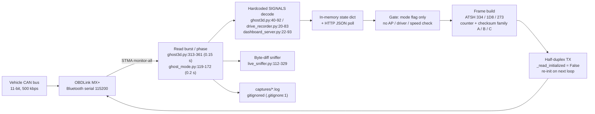
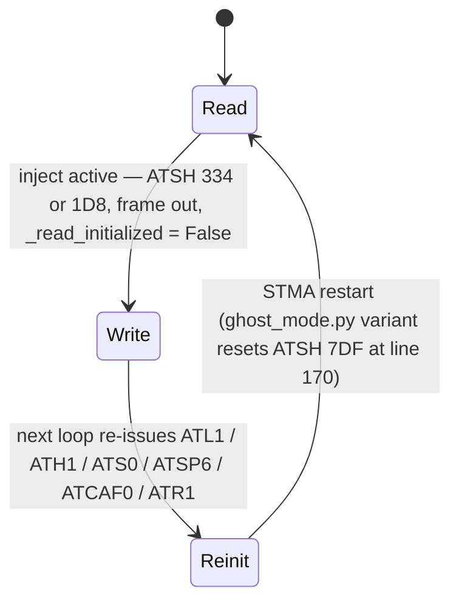

# ColinM-sys-tesla-can-boost

## 1. Provenance

- Submodule path: `legacy/ColinM-sys-tesla-can-boost`
- Pinned gitlink SHA: `185e76e4fe9825b6c5a7039ad82eea581270c701` (parent `160000` entry); `git -C legacy/ColinM-sys-tesla-can-boost rev-parse HEAD` matches; `status --porcelain` empty.
- Upstream URL: `https://github.com/ColinM-sys/tesla-can-boost` (origin fetch/push)
- HEAD subject: `docs: note the Tesla Mod (Flipper Zero and ESP32) credit and link to it (#1)`
- Upstream license: **CC BY-NC 4.0** (`LICENSE:1-26`) — README says MIT (`README.md:226`); contradiction below. Our repo is GPL-3.0.
- Analysis date: 2026-11-20

Files read (load-bearing, line ranges):

| File | Lines read |
| --- | --- |
| `README.md` | 1-233 (full) |
| `LICENSE` | 1-26 (full) |
| `.gitignore` | 1-5 (full) |
| `START_GHOST.bat` | 1-11 (full) |
| `boost_now.py` | 1-27 (full) |
| `capture334.py` | 1-33 (full) |
| `chill_to_standard.py` | 1-42 (full) |
| `colin_checksum.py` | 1-25 (full) |
| `colin_fast.py` | 1-27 (full) |
| `colin_nonstop.py` | 1-22 (full) |
| `colin_now.py` | 1-33 (full) |
| `hammer.py` / `hammer5.py` | full |
| `inject_and_read.py` | 1-72 (full) |
| `test_bytes.py` | 1-55 (full) |
| `torque_test.py` | 1-55 (full) |
| `try_FF.py` / `tryall.py` / `tryall2.py` / `trycom4only.py` / `trycom5.py` | full |
| `tools/pedalmap_test.py` / `tools/pedalmap_v2.py` | full |
| `tools/can_write_test.py` | 1-225 (full) |
| `tools/gamepad_throttle.py` | 1-112 (full) |
| `tools/ghost3d.py` | 1-538 (full) |
| `tools/ghost_mode.py` | 1-376 (full) |
| `tools/ghost_ui.py` | 17-20, 230-339; MODE_BYTES grep at 17-20 |
| `tools/can_capture.py` | 1-115 (full) |
| `tools/can_decode.py` | 1-81 (full) |
| `tools/analyze_unknown.py` | 1-75 (full) |
| `tools/analyze_drive.py` | 1-80 |
| `tools/live_sniffer.py` | 1-361 (full) |
| `tools/drive_recorder.py` | 1-120 |
| `tools/dashboard_server.py` | 46-50, 96, 328-335, 373 (grep anchors) |
| `tools/scan_ports.py` / `tools/test_connection.py` / `tools/quick_test.py` / `tools/write_test2.py` | full |
| `dbc/Model3CAN.dbc` | 1-12, 1336-1351 (BO_ 820), 2192-2211 (BO_ 472), 2508-2537 (BO_ 609), 2587-2598 (BO_ 280), 2752-2758 (BO_ 614), 3870 (VAL_ 820), plus grep anchors |

Files explicitly NOT read in full: `tools/dashboard.html` (357 lines), `tools/performance_dash.html` (744 lines), `tools/ghost_ui.py` lines 1-16 and 340-363 (embedded HTML / tail), `tools/dashboard_server.py` body outside the cited anchors, `tools/drive_recorder.py` lines 121-338, `tools/analyze_drive.py` lines 81-134. No capture logs exist in the tree (`captures/` is gitignored at `.gitignore:1`).

Our counterpart read for adaptation: `firmware/lib/vehicle/can/feature/drive/drive_mode.h:1-152`, `firmware/lib/vehicle/can/ids.h:80-96`, `firmware/lib/vehicle/can/handler/bus/vehicle.h:375-376`.

## 2. Executive verdict

A small, exploratory **laptop + Bluetooth OBDLink MX+ Python toolkit** whose only genuinely interesting mechanism is drive-mode ("ghost mode") injection on CAN 0x334; everything else is one-off capture/decode/dashboard scaffolding. The 0x334 idea is real and already shipped in our `drive_mode.h`, so the useful delta is narrow: our `driveChecksum()` has no `+0x37` constant while several upstream builders use one, our injected frame copies the cached counter unchanged while upstream rotates/increments it, and upstream's checksum-offset inference helper (`analyze_unknown.py`) is a reusable bench idea. **Do not port any code or most constants**: upstream license is CC BY-NC 4.0 (README contradicts it with "MIT"), the byte-0/bit encoding and checksum formula are mutually contradictory across its own scripts, several scripts inject unsafe 640 kW / 10300 Nm power-torque limits, and no capture or test in the tree validates any of it. With one exception (checksum-offset inference idea), all mechanisms are `already present`, `no impact`, or `never port`.

## 3. Evidence map

| Source file | Lines | What it proves | Grade |
| --- | --- | --- | --- |
| `README.md` | 29-51, 63-68 | Docstring-level claim: 0x334 `UI_pedalMap`, byte0 bits 5-6, `BF/DF/9F` frame bytes, 50 ms injection | SUMMARY-ONLY |
| `README.md` | 74-81, 199-202 | "Confirmed working" horn/drive-mode writes; admits counter/checksum rotation is not a proper CRC | SUMMARY-ONLY |
| `README.md` | 111, 226 | Claims 2,897 DBC signals and MIT license | SUMMARY-ONLY (contradicted) |
| `LICENSE` | 1-26 | Actual license CC BY-NC 4.0, commercial use prohibited | CODE-READ |
| `dbc/Model3CAN.dbc` | 1338-1350 | BO_ 820: `UI_pedalMap` bit 5 len 2, checksum byte 7 bit 56 len 8, counter bit 52 len 4; power/torque limit scaling | CODE-READ |
| `dbc/Model3CAN.dbc` | 3870 | `VAL_ 820 UI_pedalMap 0 CHILL 2 PERFORMANCE 1 SPORT` | CODE-READ |
| `dbc/Model3CAN.dbc` | 2194-2199 | BO_ 472 `ID1D8RearTorque`: checksum byte 7, counter bit 53 len **3**, torque request bit 8 len 13 scale 0.222 signed | CODE-READ |
| `dbc/Model3CAN.dbc` | 2508, 2752-2758 | 0x261 = `ID261_12vBattStatus`; 0x266 = `ID266RearInverterPower`, `RearPower266` 11-bit signed scale 0.5 | CODE-READ |
| `dbc/Model3CAN.dbc` | 2138, 2212 | 0x318 = `ID318SystemTimeUTC`; `ESP_vehicleSpeed` lives on 0x155 bit 42 len 10 scale 0.5 | CODE-READ |
| `tools/ghost3d.py` | 24-28, 148-155, 275-311, 368-394 | Most complete injector: MODE_BYTES, `sum+0x37` checksums, half-duplex read/inject loop, Colin/Drift modes | CODE-READ |
| `tools/ghost3d.py` | 67-72 | Declares `UI_pedalMap` as bit 7 len 1 and `0x318` speed — both disagree with DBC | CODE-READ |
| `tools/ghost_mode.py` | 23-38, 119-172 | `9F/BF/DF` mode bytes, 0x200 ms read + 3-frame inject phase, rotating last-2 bytes | CODE-READ |
| `tools/ghost_ui.py` | 17-20, 290-317 | Same `9F/BF/DF`, 20 Hz thread, rotating last-2 bytes | CODE-READ |
| `tools/pedalmap_v2.py` | 17-38 | "Use real frame" claim but hardcodes `DF 3F 14 80 FC 07` + rotates bytes 6-7 | CODE-READ |
| `colin_checksum.py` / `chill_to_standard.py` / `test_bytes.py` / `try_FF.py` / `inject_and_read.py` | cited in §5 | `byte7 = (sum(bytes0-6) + 0x37) & 0xFF` family | CODE-READ |
| `boost_now.py` / `colin_fast.py` / `colin_now.py` / `colin_nonstop.py` | cited in §5 | "CRACKED/CORRECT checksum" docstrings but implement `((cnt+0xD)&0xF)<<4`, no sum | CODE-READ (CONTRADICTED) |
| `gamepad_throttle.py` | 21-45 | 0x1D8 torque encode + `sum+0xD9`, 400 Nm cap, 50 Hz loop | CODE-READ |
| `can_write_test.py` | 6-11, 46-60, 68-139 | 0x273 bit packing (honk bit 61, dome bit 59, frunk bit 5) + `STCSM` send | CODE-READ |
| `analyze_unknown.py` | 50-68 | Infers byte-7 checksum offset from captured frames: `offset = (b7 - sum(b0..b6)) & 0xFF` | CODE-READ |
| `live_sniffer.py` | 112-161, 174-290 | Baseline byte-value sets → live diff/new-ID detection | CODE-READ |
| `can_capture.py` | 31-104 | AT init sequence + `STMA` capture; no committed logs | CODE-READ |
| `dashboard_server.py` | 3, 12, 328-335, 373 | Docstring says WebSocket; code is `HTTPServer` + JSON polling | CODE-READ (CONTRADICTED) |
| `docs/legacy/ColinM-sys-tesla-can-boost.md` (pre-rewrite) | 47, 54, 62, 72-78 | Existing summary claims WebSocket, 2,897 signals, 0x318 speed, "counter/checksum byte rotation strategy" | SUMMARY-ONLY |
| `firmware/lib/vehicle/can/feature/drive/drive_mode.h` | 84-112 | **Our** 0x334 frame builder: cached frame + bits 6:5 + checksum | CODE-READ |
| `firmware/lib/vehicle/can/ids.h` | 90-96 | **Our** `driveChecksum()` = sum of bytes 0..len-2, **no offset** | CODE-READ |
| Test artifacts (upstream) | — | None found; no `test_*`, no assertions. No `TEST-READ` evidence exists | UNVERIFIED |
| Captured frames (upstream) | — | `captures/` gitignored; no log committed. No `CAPTURE` evidence exists | UNVERIFIED |

## 4. Architecture and build surface

- **Entry points**: standalone root one-shot scripts (`boost_now.py`, `colin_checksum.py`, `colin_now.py`, `colin_fast.py`, `colin_nonstop.py`, `chill_to_standard.py`, `try_FF.py`, `torque_test.py`) and `tools/*.py` utility scripts; `START_GHOST.bat:10` launches `tools/ghost_ui.py -p COM5`. No package entry point, no CLI install.
- **Shared core**: none. Every injector duplicates the AT init sequence (`ATZ`, `ATE0`, `ATH1`, `ATSP6`, `ATCAF0`, sometimes `ATS0/ATS1`, `ATL1`, `ATR1`) and `ATSH <id>` header set — e.g. `boost_now.py:5-11`, `tools/ghost3d.py:181-185`, `tools/can_capture.py:33-42`. There is no shared frame builder or checksum module.
- **Build flags**: none (Python). No compile step, no feature gating, no bus model.
- **Dependency boundaries**: `pyserial` is the only hard runtime dep in code; README also lists `python-can` (`README.md:120`) but no source imports it. `pygame` only in `tools/gamepad_throttle.py:14-18`. Dashboards use stdlib `http.server` + static HTML, no WebSocket lib.
- **Transport**: Bluetooth OBDLink MX+ presented as a Windows COM port, 115200 baud (`tools/can_capture.py:11,61`); raw 11-bit 500 kbps via `ATSP6`/`ATCAF0`; read via `STMA`, write via `ATSH` + data bytes or `STCSM` (`tools/can_write_test.py:78-79`).
- **Data assets**: `dbc/Model3CAN.dbc` (4127 lines, 159 `BO_` messages, 2752 `SG_` signals) used as reference only — no tool actually loads the DBC; every decoder hardcodes its own bit layout.



## 5. Mechanism catalogue

### M1 — 0x334 drive-mode ("ghost mode") injection

- **Claim (README / summary):** `README.md:29-51` — touchscreen sends `UI_pedalMap` on 0x334; byte 0 bits 5-6 = mode (`9F/DF/BF` bytes); inject Performance every 50 ms; motor controller trusts newest frame, UI does not update.
- **Code path:** `tools/ghost3d.py:24-28` `MODE_BYTES` → `_inject_one_334()` `275-290` → `ATSH 334` + frame → TX. Variant paths: `tools/ghost_mode.py:34-38,151-167`, `tools/ghost_ui.py:17-20,290-317`, `tools/pedalmap_v2.py:17-38`, `tools/pedalmap_test.py:14-37`.
- **Frame spec:** ID 0x334 (820), DLC 8. Base payload `[mode_byte, 0x3F, 0x0A/0x14, 0x80, 0xFC, 0x07, b6, b7]`. DBC (`dbc:1338-1350`): `UI_pedalMap` bit 5 len 2, counter bit 52 len 4 (byte 6 high nibble), checksum bit 56 len 8 (byte 7), system power limit bit 0 len 5 scale 20 offset 20, torque limit bit 8 len 6 scale 100 offset 4000.
- **Gates and timing:** none on AP/driver state; timed loops only. `ghost_ui.py:317` 50 ms (20 Hz), `pedalmap_v2.py:35` 50 ms, `ghost_mode.py:122-169` 0.2 s read + 3 injections, `ghost3d.py:324` 0.15 s read burst ⇒ ~5 Hz.
- **State machine:** `ghost3d.py:202-247` — `set_ghost` / `set_drift` / `set_colin` / `set_tc` mutate mode flags; `set_ghost(None)` clears all. `ghost_ui.py:271-288` starts/stops an injection thread.
- **Tests:** none.
- **Evidence grade:** CODE-READ (frame bytes, DBC layout); CAPTURE absent.
- **Verdict:** PARTIAL — injection pattern confirmed as code; byte-0 byte values and checksum constant are internally contradictory (§6) and unvalidated by any capture.
- **Adapt to TeslaCANModder?** **already present** — our `drive_mode.h:84-112` builds from cached 0x334, sets bits 6:5, runs at 50 ms with `hasDrive` + `apGateOpen()` gates. See M2 for the only real deltas.

```mermaid
stateDiagram-v2
    [*] --> Off
    Off --> Ghost : set_ghost(mode) — ghost3d.py:202-215
    Ghost --> Off : set_ghost(off) clears drift, colin, tc
    Ghost --> Drift : set_drift(true) forces performance + tc dyno
    Drift --> Ghost : set_drift(false) tc normal, injection continues
    Ghost --> Colin : set_colin(true) stacks drift + dyno + 1D8 torque 0
    Colin --> Off : set_colin(false) clears all flags
    note right of Drift : tc_mode never reaches the wire — _inject_one_334 reads only MODE_BYTES (ghost3d.py:275-290)
```

### M2 — 0x334 counter / checksum byte construction (three incompatible families)

- **Claim (README / summary):** `README.md:202` "last 2 bytes ... are counter/checksum. Current implementation rotates values — a proper CRC implementation would be more reliable."
- **Code path & constants:**
  - Family A — additive + constant: `colin_checksum.py:1,19`, `chill_to_standard.py:20,36`, `test_bytes.py:17`, `try_FF.py:19`, `inject_and_read.py:35`, `tools/ghost3d.py:148-150` → `b7 = (sum(b0..b6) + 0x37) & 0xFF`.
  - Family B — nibble rotation, no sum: `boost_now.py:16-22`, `colin_fast.py:16-21`, `colin_now.py:16-27`, `colin_nonstop.py:15-18` → `b6 = (cnt<<4)|0x04`, `b7 = ((cnt+0xD)&0xF)<<4` (docstrings still say "CRACKED"/"CORRECT checksum").
  - Family C — rotating last two bytes: `tools/pedalmap_v2.py:31-33`, `tools/ghost_ui.py:305-307`, `tools/ghost_mode.py:159-162` → `b7 = counter*16`, `b8 = counter*4` (mod 256).
- **Frame spec:** byte 6 high nibble = 4-bit counter (DBC `dbc:1344` bit 52 len 4), byte 7 = checksum (DBC `dbc:1343` bit 56 len 8). DBC does not encode the checksum polynomial/offset.
- **Gates and timing:** per-frame counter increments (`count += 1`, `& 0xF`) in families A/B; mod-256 in family C. No re-arm logic.
- **Tests:** none; upstream `analyze_unknown.py:50-68` can *infer* the offset from a capture but is never run against these scripts.
- **Evidence grade:** CODE-READ for each family; correctness UNVERIFIED (no capture, no DBC formula).
- **Verdict:** CONTRADICTED (three mutually exclusive formulas; two mislabeled as checksums).
- **Adapt to TeslaCANModder?** **candidate for future PR, narrow**: our `drive_mode.h:90-110` copies `lastDrive` bytes unchanged (counter never advances) and `ids.h:90-96` uses `sum & 0xFF` with **no `+0x37`**. Two deltas worth investigating: (a) advance the cached 4-bit counter per injection, (b) confirm whether a `+0x37` offset is required. Both need a listen-only bench capture and `docs/checklists/can-review-checklist.md`; neither can be decided from these docs.

### M3 — 0x334 system power / torque limit maxing ("Colin Mode")

- **Claim (README / summary):** not in README; scripts claim "MAX POWER + MAX TORQUE" (`colin_now.py:12`) and "CRACKED checksum" (`boost_now.py:1`).
- **Code path:** `colin_now.py:19-27` sets `byte0 = 0x5F`, `byte1 = 0x3F`; duplicated in `colin_fast.py:19-21` and `colin_nonstop.py:18`; mirrored in `tools/ghost3d.py:228-243` `set_colin()` which stacks performance + dyno + drift.
- **Frame spec:** byte0 low 5 bits `0x1F` × 20 + 20 = **640 kW** (`dbc:1348` `UI_systemPowerLimit` bit 0 len 5); byte1 `0x3F` × 100 + 4000 = **10300 Nm** (`dbc:1349` `UI_systemTorqueLimit` bit 8 len 6). Constants are DBC-consistent; the *unsafe intent* is the issue.
- **Gates and timing:** `colin_now.py:15` 120 s; `colin_fast.py:15,23` 10 ms; `colin_nonstop.py:14` unbounded no-sleep loop; `ghost3d` toggled from HTTP `/api/colin` (`ghost3d.py:472-476`). No speed, gear, AP, or driver-presence gate.
- **Tests:** none.
- **Evidence grade:** CODE-READ (constants) / UNVERIFIED (vehicle actually honors them).
- **Verdict:** CONFIRMED as code; safety posture unreviewed.
- **Adapt to TeslaCANModder?** **never port**. Unbounded actuator-limit override with no gate; our firmware has no equivalent and should not gain one. Also blocked by license (CC BY-NC).

### M4 — 0x1D8 rear-torque injection (gamepad / Colin mode)

- **Claim (README / summary):** `README.md:42` lists gamepad throttle as a "latest session script"; `tools/gamepad_throttle.py:1-8` documents right trigger → direct torque on 0x1D8.
- **Code path:** `tools/gamepad_throttle.py:25-45` `checksum()` → `encode_torque()` → `send_frame()` → `ATSH 1D8` + TX; `tools/torque_test.py:15-27` one-shot probe; `tools/ghost3d.py:292-311` `_inject_one_1D8()`.
- **Frame spec:** ID 0x1D8 (472), DLC 8, base `[0x29, b1, b2, 0, 0, 0, b6, b7]`. `raw = int(nm / 0.222) & 0x1FFF` (13-bit), `b1 = raw & 0xFF`, `b2 = raw >> 8`; `b6 = (cnt<<4)`; `b7 = (sum(b0..b6) + 0xD9) & 0xFF`. DBC (`dbc:2197`) confirms 13-bit signed at bit 8 scale 0.222; DBC (`dbc:2196`) says counter is **3 bits at bit 53**, not a 4-bit high nibble.
- **Gates and timing:** `gamepad_throttle.py:98` only when trigger > 0.05; 50 Hz loop (`gamepad_throttle.py:103`); hard cap 400 Nm (`gamepad_throttle.py:21`). `ghost3d.py:391-392` injects `torque_nm=0` when `colin_mode`. No AP/speed gate.
- **Tests:** none.
- **Evidence grade:** CODE-READ; counter width CONTRADICTED by DBC.
- **Verdict:** PARTIAL.
- **Adapt to TeslaCANModder?** **never port**. Our actuator control goes through DAS Drive (`0x2B9/0x488/0x27D`) with arm/speed-cap gates; a raw rear-torque frame bypasses that safety model.

### M5 — 0x273 UI_vehicleControl writes (horn / dome / frunk)

- **Claim (README / summary):** `README.md:74-81` horn "Confirmed working", dome/frunk untested; write method `ATSH` + data.
- **Code path:** `tools/can_write_test.py:51-60` `set_bit()` → `68-97` `try_honk()` (`STCSM 273,8,...`), `100-118` `try_dome_light()`, `142-196` interactive menu; `tools/write_test2.py:24-64` probes 8 adapter command formats; `tools/ghost3d.py:249-262` and `tools/ghost_ui.py:260-269` honk via `ATSH 273` + `00 00 00 00 00 00 00 20`.
- **Frame spec:** ID 0x273 (627), DLC 8. `UI_honkHorn` bit 61 (`dbc:462`), `UI_frunkRequest` bit 5 (`dbc:460`), dome light bit 59 (code comment `can_write_test.py:107-110`; DBC name not re-verified at that bit).
- **Gates and timing:** interactive, one-shot.
- **Tests:** none.
- **Evidence grade:** CODE-READ for packing; "Confirmed working" SUMMARY-ONLY (no captured log).
- **Verdict:** PARTIAL.
- **Adapt to TeslaCANModder?** **already present / no impact** — our cached-0x273 vehicle command pipeline covers horn/frunk/dome. No delta.

### M6 — Half-duplex read/write alternation on one serial link

- **Claim (README / summary):** `README.md:3-4,11` live read + write + recording.
- **Code path:** `tools/ghost_mode.py:119-172` read phase `STMA` 0.2 s → stop → write phase 3 frames → `ATSH 7DF` reset; `tools/ghost3d.py:313-395` `_read_burst()` 0.15 s → `_init_for_read()` re-init after writes; `tools/ghost_ui.py:290-317` separate injection thread with a shared `threading.Lock`.
- **Frame spec:** none (transport pattern).
- **Gates and timing:** read 0.15-0.2 s, re-init on every write (`_read_initialized = False`).
- **Tests:** none.
- **Evidence grade:** CODE-READ.
- **Verdict:** CONFIRMED.
- **Adapt to TeslaCANModder?** **no impact** — we have three real MCP2515 buses with independent RX/TX; no shared half-duplex adapter to manage.



### M7 — Checksum-offset inference from captures

- **Claim (README / summary):** not claimed in README; buried in `tools/analyze_unknown.py:1`.
- **Code path:** `tools/analyze_unknown.py:6-39` parse capture → `50-68` for each ID take first 10 8-byte frames, compute `offset = (byte7 - sum(bytes0..6)) & 0xFF`, print a single-offset match as `byte7 = (sum + 0xNN) & 0xFF`.
- **Frame spec:** generic 8-byte frame; no ID-specific assumption.
- **Gates and timing:** needs ≥5 frames per ID; offline.
- **Tests:** none.
- **Evidence grade:** CODE-READ (algorithm); CAPTURE absent (never exercised on committed data).
- **Verdict:** CONFIRMED as code.
- **Adapt to TeslaCANModder?** **candidate for future PR (idea only)** — an independent bench utility in `tools/` that infers the 0x334 checksum offset from a listen-only capture would settle M2's `+0x37` question. Must be independently implemented in our Node ESM style, not copied, and attributed as "derived idea, independent implementation".

### M8 — Baseline-vs-live byte-diff sniffer

- **Claim (README / summary):** `README.md:12` "Signal Analysis — Timeline view of pedal position, steering angle, speed, power".
- **Code path:** `tools/live_sniffer.py:112-161` `record_baseline()` stores set of seen byte values per ID/byte → `174-290` `live_diff()` flags values outside baseline and entirely new IDs → `293-329` `live_monitor()` change-only view.
- **Frame spec:** none; byte-level, no DBC decode.
- **Gates and timing:** 15 s baseline default (`live_sniffer.py:112`); 60 s diff loop.
- **Tests:** none.
- **Evidence grade:** CODE-READ.
- **Verdict:** CONFIRMED.
- **Adapt to TeslaCANModder?** **no impact** — our recorder/ring buffer + frame streaming already cover this; a byte-diff UI would be redundant.

### M9 — DBC-style signal decode + HTTP JSON dashboards

- **Claim (README / summary):** `README.md:7,10,90-111` 300+ signals, live web dashboard, 2,897-signal DBC.
- **Code path:** per-tool hardcoded `SIGNALS` tables — `tools/drive_recorder.py:20-83` and `tools/dashboard_server.py:46-50` use DBC-correct `UI_pedalMap` (bit 5 len 2) and `{0:Chill,1:Sport,2:Performance}` (`drive_recorder.py:85`, `dashboard_server.py:96`); `tools/ghost3d.py:40-92` uses DBC-wrong bit 7 len 1 and `{0:Chill,1:Standard}`. Dashboards are `HTTPServer` + `application/json` polling (`dashboard_server.py:328-335,373`), not WebSocket.
- **Frame spec:** signal start bit / length / scale / offset duplicated per tool; examples `DI_accelPedalPos` bit 32 len 8 scale 0.4; `ESP_vehicleSpeed` bit 12 len 12 scale 0.05 (DBC-wrong, see §6).
- **Gates and timing:** HTTP poll loop; no gates.
- **Tests:** none.
- **Evidence grade:** CODE-READ; "WebSocket" SUMMARY-ONLY/CONTRADICTED.
- **Verdict:** PARTIAL.
- **Adapt to TeslaCANModder?** **already present** — our protocol package decoder + client dashboard are the maintained equivalents; upstream decode tables are less accurate than our own.

### M10 — Adapter bring-up, port discovery, capture pipeline

- **Claim (README / summary):** `README.md:113-146` install/connect/capture flow.
- **Code path:** `tools/scan_ports.py:5-14`, `tools/test_connection.py:6-55`, `tools/can_capture.py:14-48,51-104`, `tools/ghost3d.py:496-500` `find_port()`, `hammer.py:3-21` / `hammer5.py:3-22` reconnect loops, `tryall*.py` COM-port probes.
- **Frame spec:** AT command sequence only — `ATZ`, `ATE0`, `ATL1`, `ATH1`, `ATS0/ATS1`, `ATSP6`, `ATCAF0`, `ATR1`, then `STMA`.
- **Gates and timing:** 115200 baud; 0.5-2 s per init command.
- **Tests:** none.
- **Evidence grade:** CODE-READ.
- **Verdict:** CONFIRMED.
- **Adapt to TeslaCANModder?** **no impact** — our `tools/` bridge/CLI already own serial transport.

## 6. Summary vs code contradiction table

| # | Summary / README claim | Code / DBC reality | Verdict |
| --- | --- | --- | --- |
| 1 | License MIT (`README.md:226`) | `LICENSE:1-26` CC BY-NC 4.0, commercial use prohibited | CONTRADICTED |
| 2 | DBC has 2,897 signals (`README.md:111`; old doc `:54,72,75`) | 2752 `SG_` lines / 159 `BO_` in `dbc/Model3CAN.dbc` | CONTRADICTED |
| 3 | `dashboard_server.py` is a WebSocket server (`README.md:10`; old doc `:47`; `dashboard_server.py:3`) | `HTTPServer` + `application/json` polling (`dashboard_server.py:12,328-335,373`) | CONTRADICTED |
| 4 | Clone URL `tesla-can-toolkit` (`README.md:118-119`) | Upstream repo is `tesla-can-boost` (origin remote) | CONTRADICTED |
| 5 | Performance byte `DF`, Chill `9F` (`README.md:43-51`; `ghost_mode.py:34-38`; `ghost_ui.py:17-20`) | `ghost3d.py:24-28` uses `0x7F` / `0x3F`; `test_bytes.py:10-11` labels `0x7F` "Perf?" | CONTRADICTED |
| 6 | `UI_pedalMap` byte0 bits 5-6, 2-bit (`README.md:48`; `pedalmap_v2.py:18-21`) | `ghost3d.py:68` decodes bit 7 len 1; DBC `dbc:1342` = bit 5 len 2 | CONTRADICTED (ghost3d) |
| 7 | Mode value 1 = Standard (`README.md:33`; `ghost_mode.py:28-32`; `ghost3d.py:94`) | DBC `dbc:3870` value 1 = `SPORT`; `drive_recorder.py:85` = "Sport" | CONTRADICTED |
| 8 | Vehicle speed on 0x318 (`README.md:98`; old doc `:62`; `ghost3d.py:64-66`; `analyze_drive.py:28-30`) | `dbc:2138` 0x318 = `ID318SystemTimeUTC`; `dbc:2212` `ESP_vehicleSpeed` = 0x155 bit 42 len 10 scale 0.5 | CONTRADICTED |
| 9 | `0x261` used as traction `DI_elecPower` (`ghost3d.py:55-57`) | `dbc:2508` 0x261 = `ID261_12vBattStatus`; old doc `:62` is correct | CONTRADICTED (ghost3d) |
| 10 | `RearPower266` range −30…+156 kW (old doc `:62`) | DBC `dbc:2758` `RearPower266` 11-bit signed scale 0.5, range −500…+500 kW | CONTRADICTED (empirical range presented as spec) |
| 11 | "Correct/CRACKED checksum" docstrings (`colin_checksum.py:1`; `boost_now.py:1`) | Families A/B/C incompatible; B and C never sum the bytes (`boost_now.py:20`; `pedalmap_v2.py:31-32`) | CONTRADICTED |
| 12 | 0x1D8 counter is 4-bit high nibble (`ghost3d.py:295`; `gamepad_throttle.py:40`) | DBC `dbc:2196` `Counter1D8` = bit 53 len **3** | CONTRADICTED |
| 13 | "50 ms intervals" (`README.md:37`) | `ghost3d.py:324` 0.15 s read ⇒ ~5 Hz; `ghost_mode.py:126,158` 3 frames/loop; only `ghost_ui.py:317` is 20 Hz | CONTRADICTED for some tools |
| 14 | "Counter/checksum byte rotation strategy" as takeaway (old doc `:77`) | Rotation is explicitly admitted non-CRC by `README.md:202`; additive `+0x37` family contradicts it | CONTRADICTED |
| 15 | Our checksum should match upstream | Our `ids.h:90-96` omits `+0x37`; upstream `ghost3d.py:150` includes it | UNVERIFIED which is bus-correct — needs capture |

## 7. CAN frame and signal inventory

`dbc/Model3CAN.dbc` is a vendored catalog: reading coverage is STRUCTURAL-PARSE/RANGE-CITED — 159 `BO_` and 2752 `SG_` lines (both counts verified at write time), no checksum formulas encoded in it. Rows below are code-referenced frames only, never a wholesale catalog dump. All traffic flows through one OBDLink MX+ on a single CAN segment, so the bus column cites the DBC's own bus label. Decoded frames arrive via the untimed `STMA` stream: the period column is populated only for injected rows, and the counter/checksum columns only where code actually touches them.

| ID (hex+dec) | bus | period | DLC | byte/bit layout | scale/units | counter | checksum | R/W | grade |
| --- | --- | --- | --- | --- | --- | --- | --- | --- | --- |
| `0x334` (820) | VehicleBus | 20 Hz (`ghost_ui.py:317`); 50 ms (`boost_now.py:23`); 3 frames per 0.2 s cycle (`ghost_mode.py:158-167`); ~5-6.7 Hz in ghost3d (`ghost3d.py:324`, 0.15 s read burst) | 8 | byte0 bits 6:5 `UI_pedalMap` (`dbc:1342`, bit 5 len 2); byte0 bits 4:0 `UI_systemPowerLimit` (`dbc:1348`); byte1 bits 0:5 `UI_systemTorqueLimit` (`dbc:1349`); bytes 2-5 fixed `0A` or `14`, `80`, `FC`, `07`; byte6 high nibble counter (`dbc:1344`, bit 52 len 4), low nibble fixed `0x04` | kW raw×20+20 (`dbc:1348`); Nm raw×100+4000 (`dbc:1349`) | byte6 bits 7:4, code rotates `& 0xF` (`ghost3d.py:277`) | byte7 (`dbc:1343`, bit 56 len 8): family A `(sum(b0..b6)+0x37)&0xFF` (`ghost3d.py:150`), family B `((cnt+0xD)&0xF)<<4` (`boost_now.py:20`), family C `counter*4` (`ghost_ui.py:306`) — mutually exclusive | write | CODE-READ |
| `0x1D8` (472) | VehicleBus | 50 Hz (`gamepad_throttle.py:103`); 10-frame one-shot (`torque_test.py:16-27`) | 8 | byte0 flags `0x29` (`ghost3d.py:302`); bytes1-2 `RearTorqueRequest1D8` bit 8 len 13 signed (`dbc:2197`); byte6 high nibble counter in code | Nm raw×0.222 signed | DBC `Counter1D8` bit 53 len 3 (`dbc:2196`); code uses a 4-bit nibble (`gamepad_throttle.py:39-40`) — width contradicted | byte7 `Checksum1D8` bit 56 len 8 (`dbc:2195`); code `(sum+0xD9)&0xFF` (`ghost3d.py:155`) | write | CODE-READ |
| `0x273` (627) | VehicleBus | one-shot interactive menu (`can_write_test.py:142-196`); single honk frame (`ghost3d.py:249-262`) | 8 | `UI_honkHorn` bit 61 (`dbc:462`); `UI_domeLightSwitch` bit 59 len 2 (`dbc:455`); `UI_frunkRequest` bit 5 (`dbc:460`); writers send zero-based frames | — | None found (no counter signal in the DBC frame) | None found (no writer computes one) | write | CODE-READ |
| `0x118` (280) | VehicleBus | untimed | 8 | `DI_accelPedalPos` bit 32 len 8 (`dbc:2590`, `drive_recorder.py:22`); `DI_brakePedalState` bit 19 len 2 (`ghost3d.py:43`) | %; state | — | — | read | CODE-READ |
| `0x129` (297) | VehicleBus | untimed | 8 | `SteeringAngle129` bit 16 len 14 (`dbc:2544`, `ghost3d.py:46`); `SteeringSpeed` bit 32 len 14 (`ghost3d.py:47`) | deg ×0.1 off −819.2; deg/s ×0.5 | — | — | read | CODE-READ |
| `0x132` (306) | VehicleBus | untimed | 8 | `HVBatt_SOC_raw` bit 0 len 10 (`ghost3d.py:49-51`) — own DBC names the frame `ID132HVBattAmpVolt` (`dbc:2801`) | % | — | — | read | CODE-READ |
| `0x252` (594) | VehicleBus | untimed | 8 | `BMS_packVoltage` bit 0 len 16 (`drive_recorder.py:32-34`, `ghost3d.py:52-54`) — DBC frame `ID252BMS_powerAvailable` (`dbc:2628`) | V ×0.01 | — | — | read | CODE-READ |
| `0x261` (609) | VehicleBus | untimed | 8 | `DI_elecPower` bit 0 len 11 (`ghost3d.py:55-56`, `drive_recorder.py:35-36`) — DBC frame `ID261_12vBattStatus` (`dbc:2508`) | kW ×0.5 off −512 | — | — | read | CODE-READ |
| `0x266` (614) | VehicleBus | untimed | 8 | `RearPower_kW` bit 0 len 11 (`dashboard_server.py:37-38` unsigned offset 0; `analyze_drive.py:35` signed) — DBC `RearPower266` signed (`dbc:2758`) | kW ×0.5 | — | — | read | CODE-READ |
| `0x292` (658) | VehicleBus | untimed | 8 | `BMS_packCurrent` bit 0 len 16 (`ghost3d.py:58-59`) — DBC frame `ID292BMS_SOC` (`dbc:2647`) | A ×0.1 off −1000 | — | — | read | CODE-READ |
| `0x2B3` (691) | VehicleBus | untimed | 8 | `EPAS_steeringAngle` bit 0 len 16 (`ghost3d.py:61-63`) — no `BO_ 691` in own DBC | deg ×0.1 off −819.2 | — | — | read | CODE-READ |
| `0x318` (800) | VehicleBus | untimed | 8 | `ESP_vehicleSpeed` bit 12 len 12 (`ghost3d.py:64-66`, `analyze_drive.py:28-30`) — DBC frame `ID318SystemTimeUTC`; speed lives on 0x155 `ESP_vehicleSpeed` bit 42 len 10 (`dbc:2212`) | km/h ×0.05 | — | — | read | CODE-READ |
| `0x334` (820) readback | VehicleBus | untimed | 8 | `UI_pedalMap`: ghost3d decodes bit 7 len 1 (`ghost3d.py:68`, wrong); drive_recorder and dashboard_server decode bit 5 len 2 (`drive_recorder.py:47-48`, `dashboard_server.py:49-50`) | — | — | — | read | CODE-READ |
| `0x388`-`0x38B` (904-907) | — | untimed | 8 | `WheelSpeed_*` bit 0 len 16 each (`ghost3d.py:74-77`, `drive_recorder.py:50-61`) — no such `BO_` in own DBC | km/h ×0.01 | — | — | read | CODE-READ |
| `0x201` (513) | VehicleBus | untimed | 8 | pack temps bits 0 and 8, len 8 (`ghost3d.py:78-81`) — DBC frame `ID201VCFRONT_loggingAndVitals10H` (`dbc:2455`) | °C ×0.5 off −40 | — | — | read | CODE-READ |
| `0x2E1` (737), `0x2E3` (739) | VehicleBus | untimed | 8 | door states bits 0 and 2, len 2 (`drive_recorder.py:66-69`, `dashboard_server.py:68-75`) — DBC 0x2E1 is `ID2E1VCFRONT_status` (`dbc:1892`); own DBC doors live on 0x122 `VCLEFT_frontDoorState` bit 17 len 3 (`dbc:202`) | state | — | — | read | CODE-READ |
| `0x312` (786) | VehicleBus | untimed | 8 | `BMS_kwhChargeTotal` bit 0 len 32; `BMS_kwhDischargeTotal` bit 32 len 32 (`dashboard_server.py:79-82`) — DBC frame `ID312BMSthermal` (`dbc:2636`) | kWh ×0.001 | — | — | read | CODE-READ |
| `0x3F5` (1013) | VehicleBus | untimed | 8 | `AmbientTemp` bit 0 len 8 (`ghost3d.py:86`) — DBC frame `ID3F5VCFRONT_lighting` (`dbc:863`) | °C ×0.5 off −40 | — | — | read | CODE-READ |
| `0x376` (886) | VehicleBus | untimed | 8 | `DI_inverterTemp` bit 0 len 8; `DI_statorTemp` bit 8 len 8 (`ghost3d.py:87-90`) — DBC frame `ID376FrontInverterTemps` (`dbc:2726`) | °C ×1 off −40 | — | — | read | CODE-READ |
| `0x293` (659) | VehicleBus | untimed | 8 | `UI_steeringTuneRequest` bit 0 len 2 (`ghost3d.py:91`) — DBC frame `ID293UI_chassisControl` (`dbc:2314`) | state | — | — | read | CODE-READ |
| `0x528` (1320) | VehicleBus | untimed | 8 | `UI_powertrainControl` bit 0 len 8 (`drive_recorder.py:80-82`, `dashboard_server.py:87-89`) — DBC frame `ID528UnixTime` (`dbc:2146`) | state | — | — | read | CODE-READ |

Every row above is CODE-READ. Ten of the decode rows contradict the repo's own DBC frame names (0x132, 0x252, 0x261, 0x292, 0x201, 0x2E1/0x2E3, 0x312, 0x3F5, 0x293, 0x528 — see the layout column); those contradictions feed §11. The bus-accepted correctness of every injected checksum, counter, and mode byte is UNVERIFIED — no capture exists in the tree.

## 8. Constants and tuning table

| Constant | Value | File:line | Meaning | Grade |
| --- | --- | --- | --- | --- |
| `+0x37` | 0x37 | `colin_checksum.py:19`; `chill_to_standard.py:20,36`; `test_bytes.py:17`; `try_FF.py:19`; `inject_and_read.py:35`; `tools/ghost3d.py:150` | 0x334 checksum offset, family A: `b7 = (sum(b0..b6) + 0x37) & 0xFF` | CODE-READ |
| `+0xD9` | 0xD9 | `tools/ghost3d.py:155`; `tools/gamepad_throttle.py:26`; `torque_test.py:21` | 0x1D8 checksum offset, same additive form | CODE-READ |
| Family B tail | `((cnt+0xD)&0xF)<<4` | `boost_now.py:20`; `colin_fast.py:18`; `colin_now.py:18`; `colin_nonstop.py:17` | nibble arithmetic, no byte sum; docstrings still say "CRACKED/CORRECT checksum" | CODE-READ |
| Counter byte | `(cnt<<4)\|0x04` | `tools/ghost3d.py:278`; `boost_now.py:18`; `chill_to_standard.py:18` | 4-bit counter in the high nibble plus a fixed `0x04` low nibble | CODE-READ |
| Family C tail | `counter*16`, `counter*4` (mod 256) | `tools/ghost_ui.py:305-306`; `tools/pedalmap_v2.py:31-32`; `tools/ghost_mode.py:160-161` | rotating last-2-bytes; admitted non-CRC by `README.md:202` | CODE-READ |
| `MODE_BYTES` ghost3d | `3F` / `BF` / `7F` | `tools/ghost3d.py:24-28` | chill / standard / performance byte-0 encoding | CODE-READ |
| `MODE_BYTES` ghost_ui / ghost_mode | `9F` / `BF` / `DF` | `tools/ghost_mode.py:34-38`; `tools/ghost_ui.py:17-20` | same three modes, different bytes — mutually exclusive with the row above | CODE-READ |
| Colin byte0 | `0x5F` | `colin_now.py:23`; `colin_fast.py:19`; `colin_nonstop.py:18` | performance bits plus power-limit raw 31 → 640 kW (`dbc:1348`) | CODE-READ |
| Colin byte1 | `0x3F` | `colin_now.py:26` | torque-limit raw 63 → 10300 Nm (`dbc:1349`) | CODE-READ |
| Base payload | `3F 0A/14 80 FC 07` | `tools/ghost3d.py:280` (`0A`); `tools/ghost_mode.py:26,162` (`14`); `tools/pedalmap_v2.py:21` (`14`) | hardcoded captured base bytes; `0A` vs `14` divergence is unexplained | CODE-READ |
| Torque encode | `int(nm/0.222) & 0x1FFF` | `tools/gamepad_throttle.py:31`; `tools/ghost3d.py:297`; `dbc:2197` | 13-bit signed rear-torque raw conversion | CODE-READ |
| Torque cap | 400 Nm | `tools/gamepad_throttle.py:21` | hard ceiling on injected torque | CODE-READ |
| Trigger deadzone | 0.05 | `tools/gamepad_throttle.py:98` | ignore gamepad trigger below 5% | CODE-READ |
| Inject rates | 50 ms / 10 ms / no sleep | `tools/ghost_ui.py:317`; `colin_fast.py:23`; `colin_nonstop.py:14` | 20 Hz, 100 Hz, and unbounded flood variants | CODE-READ |
| Read burst | 0.15 s | `tools/ghost3d.py:324` | half-duplex read window; bounds effective inject rate at ~5-6.7 Hz | CODE-READ |
| Read phase | 0.2 s + 3 frames | `tools/ghost_mode.py:126,158` | alternate read/write cycle | CODE-READ |
| No-data watchdog | 3 s | `tools/dashboard_server.py:231`; `tools/drive_recorder.py:239` | silent-`STMA` detection triggers monitor restart | CODE-READ |
| Reconnect cap | 10 attempts | `tools/dashboard_server.py:279` | serial reopen attempts before the reader thread gives up | CODE-READ |
| Run windows | 120 s / 60 s / forever | `boost_now.py:15`; `try_FF.py:15`; `chill_to_standard.py:32`; `colin_nonstop.py:14` | bounded vs unbounded injection sessions | CODE-READ |
| Baseline window | 15 s | `tools/live_sniffer.py:112` | byte-value baseline recording for the diff sniffer | CODE-READ |
| `TC_MODES` | 7 values (0-6, incl. `dyno`) | `tools/ghost3d.py:30-38` | traction modes; never read by `_inject_one_334` (`ghost3d.py:279` uses only `MODE_BYTES`) — dead for TX | CODE-READ |
| 0x1D8 flags byte0 | `0x29` | `tools/ghost3d.py:302`; `tools/gamepad_throttle.py:41` | "flags from car" (`TorqueFlags1D8`, `dbc:2199`) hardcoded rather than captured | CODE-READ |
| Baud | 115200 | every script, e.g. `tools/can_capture.py:11` | OBDLink serial rate | CODE-READ |

All values are CODE-READ. Whether the vehicle honors any of the three checksum families, either mode-byte encoding, or the counter construction is UNVERIFIED without a bench capture.

## 9. Failure modes and edge cases

No TEST-READ evidence exists: this repo ships no tests, so every path below is untested; the `tested?` column is `no` throughout.

| Failure | Handling code path | Tested? | Grade |
| --- | --- | --- | --- |
| Serial disconnect during read | `tools/dashboard_server.py:276-292` — `SerialException` → close/reopen, up to 10 retries, then reader stops; `tools/drive_recorder.py:260-272` retries unbounded | no | CODE-READ |
| Silent monitor stall (no data) | `tools/dashboard_server.py:230-234` + `restart_monitor()` 203-217; `tools/drive_recorder.py:238-241,170-180` — 3 s watchdog restarts `STMA` | no | CODE-READ |
| Initial connect failure | `tools/ghost3d.py:190-192` sets `connected = False`; `run_loop` 374-379 retries every 1 s; `hammer.py:3-21` / `hammer5.py:3-22` brute-open COM4/COM5 (60/120 attempts) | no | CODE-READ |
| `SerialException` inside read burst | `tools/ghost3d.py:363-364` → `connected = False` → reconnect next loop | no | CODE-READ |
| Inject exception | `tools/ghost3d.py:393-394` print-and-continue; `tools/ghost_ui.py:314-315` print-and-continue — thread keeps spinning at 20 Hz even with a dead serial | no | CODE-READ |
| Honk serial failure | `tools/ghost3d.py:261-262` bare `except Exception: pass` — silently swallowed | no | CODE-READ |
| Read re-init failure | `tools/ghost3d.py:272-273` silent pass; `_read_initialized` stays false and is retried next burst | no | CODE-READ |
| Adapter error / overflow lines | dropped by parse filters: `tools/ghost3d.py:118` (`STOPPED`, `ERROR`, `BUFFER`...), `tools/drive_recorder.py:111`, `tools/dashboard_server.py:149` — no counting, no recovery of their own; bus-off is the OBDLink's problem | no | CODE-READ |
| HTTP handler crash | `tools/ghost_ui.py:349-364` has no try/except around honk/set_mode — an exception propagates to `BaseHTTPRequestHandler`, the connection drops, the single-threaded server continues | no | CODE-READ |
| Ctrl+C shutdown | `tools/ghost3d.py:529-534` clears ghost mode and closes the log; `tools/can_capture.py:95-101` stops `STMA` in `finally`; `tools/gamepad_throttle.py:105-108` closes serial | no | CODE-READ |
| Missing-frame staleness | decoded values persist in the state dict with timestamps (`tools/ghost3d.py:348-354`) but no consumer checks age | no | CODE-READ |
| Log flush / rotation | flush every 500 frames (`tools/ghost3d.py:396-397`, `tools/drive_recorder.py:191-192`); no rotation, no disk-full handling | no | CODE-READ |
| Thread races | `tools/ghost_ui.py:271-288` `set_mode` writes `active_mode` unlocked while `_inject_loop` 292-294 reads it; `tools/ghost3d.py:337-343` state writes are lock-protected | no | CODE-READ |
| Watchdog / OTA / brownout / reboot state | None found — plain laptop scripts: no watchdog, no OTA awareness, no persisted state to recover | no | CODE-READ |

## 10. Test coverage map

None found. `git -C legacy/ColinM-sys-tesla-can-boost ls-files` shows no test suite, no CI configuration, and no assertion anywhere in the tree. The files named `test_*`, `try_*`, or `quick_test` (`test_bytes.py`, `tools/can_write_test.py`, `tools/test_connection.py`, `tools/quick_test.py`, `tools/write_test2.py`, `try_FF.py`, `tryall.py`, `tryall2.py`, `trycom4only.py`, `trycom5.py`, `torque_test.py`) are manual bench probes: each prints adapter responses and exits; none asserts a decoded value, a checksum, or a frame shape.

Critical paths with no test, one risk line each:

- 0x334 checksum families (§8) — any of the three could be silently bus-rejected; correctness risk on every injection.
- 0x334 counter rotation — a stale counter can make frames look like replays; no oracle exists.
- Mode-byte encodings (`9F/BF/DF` vs `3F/BF/7F`) — at most one family can be bus-accepted.
- 0x1D8 torque encode — signedness and counter width both disagree with the repo's own DBC.
- Decode tables — ten rows in §7 contradict the repo's own DBC; nothing would catch a wrong decode.

## 11. Parity matrix with TeslaCANModder

Rows cover every frame or signal both sides touch. Upstream cites are CODE-READ from this submodule; our-side cites are CODE-READ from `firmware/lib/vehicle/can/` (read for this analysis, not recalled). Where both disagree, upstream's own DBC is used as arbiter.

| Signal / frame | Upstream decode (cite) | Our decode (cite) | Delta | Action |
| --- | --- | --- | --- | --- |
| 0x334 pedalMap bits | DBC `UI_pedalMap` bit 5 len 2 (`dbc:1342`); `drive_recorder.py:47-48` and `dashboard_server.py:49-50` decode bit 5 len 2; `ghost3d.py:68` decodes bit 7 len 1 (wrong) | `drive_mode.h:109` writes byte0 bits 6:5 on the cached frame | bit position agrees (except ghost3d); injected byte-0 values are two mutually exclusive encodings | capture-first |
| 0x334 checksum | `(sum+0x37)&0xFF` (`ghost3d.py:150`) or two non-sum variants (§8) | `ids.h:90-96` `driveChecksum()` — plain sum, no offset | `+0x37` vs `+0x00`; at most one is bus-correct | capture-first |
| 0x334 counter | rotates 4-bit `& 0xF` (`ghost3d.py:277`) with fixed `0x04` low nibble | `drive_mode.h:90-91` copies all 8 cached bytes unchanged | rotation vs frozen counter | capture-first |
| 0x334 power/torque limit fields | maxed: byte0 `0x5F`, byte1 `0x3F` → 640 kW / 10300 Nm (`colin_now.py:23,26`; `dbc:1348-1349`) | not touched — only bits 6:5 and the checksum byte are written (`drive_mode.h:109-110`) | upstream overrides actuator limits; we deliberately do not | ignore (never port, M3) |
| 0x273 honk | bit 61 (`can_write_test.py:73-75`; `ghost3d.py:254-257`) | `lock.h:58-66` `setHornRequest` — `data[7] \|= 0x20`, bit 61 | agree; both match `dbc:462` | ignore |
| 0x273 dome light | bits 59-60 len 2 (`can_write_test.py:107-110`) | `light.h:102-106` `setDomeLightSwitch` — bits 59-60 | agree; both match `dbc:455` | ignore |
| 0x273 frunk | bit 5 (`can_write_test.py:10`) | `trunk.h:35,50-54` — bit 5 of byte[0] | agree; both match `dbc:460` | ignore |
| 0x273 frame base | zero-based synthetic frames (`can_write_test.py:46-48`; `ghost3d.py:257` sends `00..20`) | `fwd.h:24-28` `makeCtrlFrame` copies the cached real 0x273 payload | upstream sends synthetic zeros; we replay a captured base (upstream's own `pedalmap_v2.py:1` admits "use real frame") | ignore (ours is the safer form) |
| 0x1D8 rear torque | raw 13-bit ×0.222 inject, no gates (`gamepad_throttle.py:29-45`; `ghost3d.py:292-311`) | None found for 0x1D8; our actuator path is DAS 0x2B9/0x488/0x27D with arm gate, 200 kph cap, 150 ms dead-man (`das_drive.h:18-20,54,58,420`) | upstream bypasses every safety gate our DAS model enforces | never port (M4) |
| 0x118 accel pedal | `DI_accelPedalPos` bit 32 len 8 ×0.4 (`dbc:2590`; `drive_recorder.py:22`) | `powertrain.h:39-42` `decodeAccelPedal` — `data[1]` raw 0-100 | byte 4 ×0.4 vs byte 1 raw; upstream matches its own DBC | capture-first |
| 0x118 brake state | bit 19 len 2 (`ghost3d.py:43`) | `powertrain.h:49-52` — `(data[2]>>3)&0x03`, bits 20:19 | agree | ignore |
| 0x129 steering angle | `SteeringAngle129` bit 16 len 14 ×0.1 off −819.2 (`dbc:2544`; `ghost3d.py:46`) | `powertrain.h:59-63` — bytes 0-1 big-endian signed, /10 | DBC puts the signal at little-endian bits 16-29 (bytes 2-3); ours reads bytes 0-1 | capture-first |
| 0x257 vehicle speed | no decoder — only a label (`live_sniffer.py:38`); speed is decoded from 0x318 instead (wrong frame, §7) | `powertrain.h:18-22` — bytes 2-3 signed ×0.01 kph; wired at `vehicle.h:381-385` | upstream decodes speed from the wrong frame; its own DBC names BO_ 599 `ID257DIspeed`, matching our choice | ignore upstream |
| 0x292 SoC | upstream decodes pack current (`ghost3d.py:58-59`) — mislabel | `bms.h:50-54` `decodeBmsSoc` — bits 0-9 ×0.1% | upstream contradicts its own DBC (`dbc:2647` `ID292BMS_SOC`) | ignore upstream |
| 0x132 HV bus | upstream decodes `HVBatt_SOC_raw` (`ghost3d.py:49-51`) — mislabel | `bms.h:18-33` — voltage bytes 0-1 ×0.01, current bytes 2-3 ×0.1 | upstream mislabels `ID132HVBattAmpVolt` (`dbc:2801`) | ignore upstream |
| 0x312 pack temps | upstream decodes kWh totals (`dashboard_server.py:79-82`) — mislabel | `bms.h:61-74` — temps bytes 0/1, −40 offset | upstream mislabels `ID312BMSthermal` (`dbc:2636`) | ignore upstream |
| 0x252 | upstream decodes pack voltage (`drive_recorder.py:32-34`) — mislabel | `vehicle.h:250-261` — BMS power limits decode | upstream mislabels `ID252BMS_powerAvailable` (`dbc:2628`) | ignore upstream |
| 0x376 front inverter temps | upstream bytes 0/1 ×1 off −40 (`ghost3d.py:87-90`) | `motor_temps.h:50-65` — byte 1 (inverter) and byte 2 (stator), −40 offset | one-byte shift; at most one is right | capture-first |
| 0x388-0x38B wheel speeds | per-wheel frames, bit 0 len 16 ×0.01 (`ghost3d.py:74-77`); absent from upstream's own DBC | `wheel_speeds.h:18-61` — single 0x175 frame, four 13-bit signals ×0.04 with 8191 SNA (`ids.h:16`) | different frames; upstream layout unvalidated | capture-first (if wheel telemetry ever disagrees with GPS speed) |
| 0x3F5 | upstream `AmbientTemp` (`ghost3d.py:86`) — mislabel | `turn_signal.h:42-52` + `vehicle.h:163-168` — lights/turn-signal decode | upstream mislabels `ID3F5VCFRONT_lighting` (`dbc:863`) | ignore upstream |
| 0x2E1 / 0x2E3 doors | upstream door decode (`drive_recorder.py:66-69`) — mislabel | `vehicle.h:178-191` — doors from 0x102/0x103 | upstream mislabels; its own DBC puts door state on 0x122 (`dbc:202`) | ignore upstream |
| 0x318 | upstream decodes vehicle speed — wrong frame (`ghost3d.py:64-66`) | `ids.h:52` defines `CAN_ID_GTW_CAR_STATE` 0x318, but no handler in `firmware/lib/vehicle/can/` reads it (repo-wide grep finds only the define); our docs' OTA-guard claim for 0x318 is SUMMARY-ONLY on our side | both sides misuse or underuse the frame | align (wire the decode or retire the docs claim) |

Our-side drift anchors, demonstrated at write time (these pin the "our decode" column by symbol, not line number alone):

```text
grep -nE 'inline uint8_t driveChecksum' firmware/lib/vehicle/can/ids.h
  -> 90 (sum of bytes & 0xFF, no +0x37)
grep -nE 'buildDriveModeFrame|driveModeTick|DRIVE_MODE_INTERVAL_MS' firmware/lib/vehicle/can/feature/drive/drive_mode.h
  -> 14 (50 ms), 84, 119
grep -nE 'inline Frame makeCtrlFrame' firmware/lib/vehicle/can/fwd.h
  -> 24
grep -nE 'inline void setHornRequest' firmware/lib/vehicle/can/feature/body/lock.h
  -> 58 (data[7] |= 0x20 = bit 61)
grep -nE 'setDomeLightSwitch' firmware/lib/vehicle/can/feature/comfort/light.h
  -> 102 (bits 59-60)
grep -nE 'inline float decodeBmsSoc' firmware/lib/vehicle/can/feature/telemetry/bms.h
  -> 50
grep -nE 'decodeVehicleSpeed|decodeAccelPedal|decodeBrakePedalState|decodeSteeringAngle' firmware/lib/vehicle/can/feature/telemetry/powertrain.h
  -> 18, 39, 49, 59
grep -nE 'decodeFrontInvTemp' firmware/lib/vehicle/can/feature/telemetry/motor_temps.h
  -> 50
grep -nE 'decodeWheelSpeedFL' firmware/lib/vehicle/can/feature/telemetry/wheel_speeds.h
  -> 18
grep -nE 'controlTurnSignal' firmware/lib/vehicle/can/feature/body/turn_signal.h
  -> 42
grep -nE 'DAS_SPEED_CAP_MAX_KPH|DAS_DEADMAN_MS|0x2B9|0x488|0x27D' firmware/lib/vehicle/can/feature/das/das_drive.h
  -> 18-20, 54, 58
grep -nE 'CAN_ID_UI_VEHICLE_CTRL|CAN_ID_DRIVE_CONFIG|CAN_ID_DI_STATE|CAN_ID_VEHICLE_SPEED|CAN_ID_FRONT_INV_TEMPS' firmware/lib/vehicle/can/handler/bus/vehicle.h
  -> 49, 67, 381, 387, 427
grep -rnE 'CAN_ID_GTW_CAR_STATE' firmware/
  -> ids.h:52 only (no handler reads it)
```

## 12. Surface inventory and security notes

| Surface | Bind / access | Semantics | Cite |
| --- | --- | --- | --- |
| OBDLink serial AT/ST console | local Bluetooth COM port, no auth | `ATZ/ATE0/ATL1/ATH1/ATS0/ATS1/ATSP6/ATCAF0/ATR1` init; `STMA` monitor-all RX; `ATSH <id>` + bytes TX; `STCSM id,dlc,data` TX | `tools/can_capture.py:33-42`; `tools/ghost3d.py:181-185,283-288`; `tools/can_write_test.py:79` |
| dashboard_server HTTP | `0.0.0.0:8080` | GET `/api/state` (CORS `*`), GET `/` serves dashboard.html; read-only polling | `tools/dashboard_server.py:324-340,373` |
| drive_recorder HTTP | `0.0.0.0:8080` | GET `/api/state`, `/`, `/performance`; read-only polling | `tools/drive_recorder.py:310-332,366` |
| ghost_ui HTTP | `0.0.0.0:9090` | GET `/`, `/api/status`; POST `/api/mode` {mode}, `/api/honk` — unauthenticated drive-mode and horn injection | `tools/ghost_ui.py:334-364,396` |
| ghost3d HTTP | `0.0.0.0:9090` | GET `/api/state`, `/`, plus arbitrary static file serving (see below); POST `/api/mode`, `/api/honk`, `/api/drift`, `/api/colin`, `/api/tc` — unauthenticated 0x334 and 0x1D8 injection | `tools/ghost3d.py:425-490,521` |
| START_GHOST.bat launcher | double-click on the laptop | runs ghost_ui on hardcoded `COM5` | `START_GHOST.bat:10` |

Security findings:

- **No authentication anywhere + `0.0.0.0` binds + `Access-Control-Allow-Origin: *`** (`tools/dashboard_server.py:329,373`; `tools/ghost3d.py:433,521`; `tools/drive_recorder.py:315,366`; `tools/ghost_ui.py:396`): any LAN host can POST drive-mode, honk, or colin (0x1D8) injection; a cross-origin `fetch` from any webpage the laptop visits can trigger the same POSTs and read the responses.
- **Arbitrary file read in ghost3d** (`tools/ghost3d.py:438-442`): `fname = self.path.lstrip("/")` then `Path(__file__).parent / fname` — `GET /../LICENSE` escapes the tools directory, and on Windows an absolute path in the request replaces the base entirely; the bytes are served as `text/html`.
- **Personal LAN/Tailscale IP hardcoded in console output**: `100.113.229.71` (`tools/dashboard_server.py:375`; `tools/drive_recorder.py:368`). Minor information leak.
- **Hardcoded machine-specific COM ports** (`COM5`/`COM4` in 20+ scripts, e.g. `boost_now.py:3`, `START_GHOST.bat:10`): operational fragility, not a secret.
- **No credentials, keys, certs, or tokens found**: `grep -nE 'password|passwd|api[_-]?key|secret|token' *.py tools/*.py START_GHOST.bat` → no output (demonstrated at write time).
- **No dangerous code paths**: `grep -nE 'eval\(|exec\(|urllib|requests\.|socket\.socket|subprocess' *.py tools/*.py` → no output (demonstrated at write time). Scripts are offline; the only untrusted input is adapter serial text, defensively filtered (`tools/ghost3d.py:116-119`).
- **Dangerous build flags**: None found — pure Python, no build step, no firmware images.

## 13. Adaptation assessment

| Mechanism | Value | Cost | Risk | Evidence | Decision |
| --- | --- | --- | --- | --- | --- |
| M1 0x334 drive-mode inject | low (we ship it) | low | high if frame shape changed | CODE-READ | **already present** |
| M2 counter/checksum construction | medium (real delta) | medium | high (checksum/routing change) | CODE-READ, correctness UNVERIFIED | **candidate for future PR — capture-gated only** |
| M3 power/torque maxing | none | low | extreme (actuator limits, no gate) | CODE-READ, unsafe | **never port** |
| M4 0x1D8 torque inject | none | medium | extreme (bypasses DAS gate) | CODE-READ, DBC conflict | **never port** |
| M5 0x273 writes | none | low | medium | CODE-READ | **already present / no impact** |
| M6 half-duplex alternation | none | — | — | CODE-READ | **no impact** |
| M7 checksum-offset inference | medium (settles M2) | low (tools/ utility) | low (read-only) | CODE-READ, unexercised | **candidate for future PR (idea only)** |
| M8 byte-diff sniffer | low | medium | low | CODE-READ | **no impact** |
| M9 decode + dashboard | none | — | low | CODE-READ, upstream decode wrong | **already present** |
| M10 adapter/capture plumbing | none | — | low | CODE-READ | **no impact** |

Top three candidates, in order: (1) capture-verify the 0x334 checksum offset `+0x37` against our `driveChecksum()`; (2) advance the cached 4-bit counter in `buildDriveModeFrame()` instead of copying it unchanged; (3) add an independent checksum-offset inference utility under `tools/`. All three require `docs/checklists/can-review-checklist.md` where frame shape is touched, plus a listen-only bench capture; none may be implemented from `SUMMARY-ONLY` claims.

## 14. Do-not-copy list

| Item (file:line) | Reason |
| --- | --- |
| Any verbatim source text (all scripts) | Upstream `LICENSE:1-26` is CC BY-NC 4.0; our repo is GPL-3.0. Port behavior/constants only, after legal review, attributed as "derived idea, independent implementation". |
| `LICENSE` claim `README.md:226` "MIT" | False; do not propagate. |
| Rotating last-two-byte "checksum" (`pedalmap_v2.py:31-32`, `ghost_ui.py:305-306`, `ghost_mode.py:160-161`) | Not a checksum; explicitly disowned by `README.md:202`. |
| `b7 = ((cnt+0xD)&0xF)<<4` (`boost_now.py:20`, `colin_fast.py:18`, `colin_now.py:18`, `colin_nonstop.py:17`) | Mislabeled "CRACKED/CORRECT checksum"; no byte sum, low nibble zero. |
| `byte0=0x5F`, `byte1=0x3F` power/torque max (`colin_now.py:23,26`; DBC `dbc:1348-1349`) | 640 kW / 10300 Nm actuator-limit override, no safety gate. |
| 0x1D8 raw torque injection + `+0xD9` (`gamepad_throttle.py:22,26,41`; `torque_test.py:21`) | Bypasses our DAS arm/speed-cap model; also wrong counter width vs DBC. |
| Hardcoded counter `(cnt<<4)|0x04` (`ghost3d.py:278`) | Conflicts with DBC 3-bit counter at bit 53 (`dbc:2196`); do not port until decoded from capture. |
| `UI_pedalMap` as bit 7 len 1 (`ghost3d.py:68`) | Contradicted by DBC `dbc:1342`; do not port decode tables. |
| `0x318` vehicle-speed decode (`ghost3d.py:64-66`, `analyze_drive.py:28-30`, old doc `:62`) | Wrong CAN ID per DBC `dbc:2138,2212`. |
| Hardcoded `COM4`/`COM5` ports (`boost_now.py:3`, `hammer.py:5`, `hammer5.py:5`, many others) | Machine-specific; our transports are abstracted. |
| Signal-count "2,897" (`README.md:111`, old doc `:54,72,75`) | Wrong (2752); do not propagate. |
| "WebSocket dashboard" (`dashboard_server.py:3`, old doc `:47`) | Plain HTTP JSON; do not mirror the mislabel. |

## 15. History and evolution

Mined from the submodule's local `git log` (linear, single branch, no tags, all four commits by the repo owner). Evidence is the log and the diffs themselves; SHAs are cited so a future agent can re-run the commands.

| Commit | Date | Subject | What it shows |
| --- | --- | --- | --- |
| `dc6e013` | 2026-04-16 | initial import | Repo appears fully formed: 24 files, 9091 insertions — ghost3d / ghost_mode / ghost_ui, both dashboards, the capture/decode/analyze suite, the DBC, README, and the CC BY-NC LICENSE. No history exists locally before this commit, so pre-import evolution is UNVERIFIED. |
| `50002e4` | 2026-04-19 | Add gamepad throttle control + all session scripts | +18 files, 635 insertions: the one-shot family (`boost_now`, `colin_*`, `hammer*`, `tryall*`, `trycom*`, `inject_and_read`, `test_bytes`, `try_FF`, `torque_test`, `capture334`, `chill_to_standard`) plus `tools/gamepad_throttle.py`. All three checksum families (§8) land in this single commit, so their relative chronology is not recoverable from git and stays UNVERIFIED; the coexistence of the `+0x37` family with two non-sum variants reads as a session log of attempts, not a converged implementation. |
| `a9339d2` | 2026-04-19 | Fix power signal: 0x261 was wrong (12V battery), use 0x266 RearPower266 | The only evidence-backed rollback: the author caught the 0x261 mislabel and corrected exactly two of four decoders — `tools/analyze_drive.py:35` (signed) and `tools/dashboard_server.py:37-38` — leaving `tools/ghost3d.py:55-56` and `tools/drive_recorder.py:35-36` decoding 0x261 as `DI_elecPower` to this day. Partial-fix anchors, demonstrated at write time: `grep -nE '0x261|DI_elecPower' tools/ghost3d.py` → 55-56; same on `tools/drive_recorder.py` → 35-36; `grep -nE '0x266|RearPower' tools/dashboard_server.py` → 37-38; `grep -nE '0x266|Power_kW' tools/analyze_drive.py` → 35. |
| `185e76e` | 2026-11-17 | docs: note the Tesla Mod (Flipper Zero and ESP32) credit and link to it (#1) | README-only (+10 lines), matching the preserved Upstream section below. No code change. |

- No commit deletes anything (every diff is pure insertions), so nothing that landed was abandoned after the fact; abandoned approaches, if any, are invisible because pre-import history is lost.
- What was tried and never converged: three incompatible 0x334 checksum families and two mode-byte encodings, all kept side by side (§6 rows 5, 11; §8). The one deliberate rollback is the a9339d2 0x261→0x266 decode fix — and it was applied to only half the decoders.
- Network-only claims stay UNVERIFIED: the README's hypery11 / flipper-tesla-fsd credit with commit `b4ebde9`, issue `#211`, and the v2.16.0 dates (`README.md:14-21`) reference upstream history outside this submodule and were not fetched.
- Scope: only the pinned snapshot's local log was reviewed. Upstream history before `dc6e013` does not exist locally and was not reviewed.

## 16. Re-verification recipe

```bash
OLD=185e76e4fe9825b6c5a7039ad82eea581270c701
git -C legacy/ColinM-sys-tesla-can-boost fetch --tags --prune
git -C legacy/ColinM-sys-tesla-can-boost log --oneline $OLD..origin/main
git -C legacy/ColinM-sys-tesla-can-boost diff --stat $OLD..origin/main
git -C legacy/ColinM-sys-tesla-can-boost diff $OLD..origin/main -- README.md LICENSE tools/ dbc/
git ls-files -s legacy/ColinM-sys-tesla-can-boost   # gitlink must equal rev-parse HEAD
git -C legacy/ColinM-sys-tesla-can-boost status --porcelain  # must be empty
```

Grep anchors with expected hits (from pinned SHA):

```text
R=legacy/ColinM-sys-tesla-can-boost
grep -n 'SG_ UI_pedalMap' $R/dbc/Model3CAN.dbc          -> 5|2@1+ (1,0) [0|2]
grep -n 'VAL_ 820 UI_pedalMap' $R/dbc/Model3CAN.dbc     -> 0 CHILL 2 PERFORMANCE 1 SPORT
grep -n 'Counter1D8' $R/dbc/Model3CAN.dbc               -> 53|3@1+
grep -n 'byte7 = (sum' $R/tools/ghost3d.py              -> + 0x37 ... & 0xFF
grep -n -A4 'MODE_BYTES = {' $R/tools/ghost3d.py        -> 3F / BF / 7F
grep -n -A4 'MODE_BYTES = {' $R/tools/ghost_ui.py       -> 9F / BF / DF
grep -c '^ *SG_ ' $R/dbc/Model3CAN.dbc                  -> 2752
grep -n 'CC BY-NC' $R/LICENSE                           -> CC BY-NC 4.0
grep -n '^MIT' $R/README.md                             -> MIT
grep -n '2,897' $R/README.md                            -> line 111
grep -n 'git clone' $R/README.md                        -> tesla-can-toolkit
```

If line numbers drift more than ~10, re-read the whole function; do not trust this document's numbers. Compare `git ls-files -s` gitlink to `rev-parse HEAD` before trusting any claim here.

## 17. Open questions and explicitly not investigated

- **No CAPTURE evidence.** `captures/` is gitignored (`.gitignore:1`) and no log is committed. Every "Confirmed working" claim (`README.md:74-77`) is SUMMARY-ONLY. Verify with a listen-only capture of real 0x334 and 0x1D8 frames.
- **No TEST-READ evidence.** Upstream has no tests. Our own `firmware/test/` checksum tests exist but do not prove the `+0x37` offset is bus-correct; an independent test oracle recomputing the expected frame from a capture is required.
- **Checksum constants UNVERIFIED:** `+0x37` (0x334), `+0xD9` (0x1D8), and our own zero-offset `driveChecksum()` — determine which the vehicle actually accepts via capture + bench injection.
- **External credit claims UNVERIFIED:** `README.md:14-21` attributes the 0x334 acceleration-mode idea to hypery11/flipper-tesla-fsd with commit `b4ebde9`, issue `#211`, v2.16.0, dates 2026-10-08/14. Verify by fetching that upstream; not checked here (scope limited to this repo).
- **DBC provenance UNVERIFIED:** README says `joshwardell/model3dbc` (`README.md:111`), but `dbc/Model3CAN.dbc:1` has `VERSION ""` and no in-file attribution.
- **HTML dashboards not read in full** (`tools/dashboard.html`, `tools/performance_dash.html`, embedded HTML in `ghost_ui.py`). Visual behavior not assessed.
- **Shipping-build reachability not investigated:** our `BUS_VEHICLE_ACTIVE` is off by default (`AGENTS.md` bus table), so `driveModeTick()`'s `driverSend(f, BUS_VEHICLE)` may be unreachable in default ESP32 envs; confirm before treating M1/M2 as actionable.
- **0x261 dome/bit-59 signal name** in `can_write_test.py:107-110` was not re-verified against DBC.

## Upstream (2026-11-20)

- `185e76e`: docs-only credit/link to Tesla Mod (Flipper Zero and ESP32). No code change.
- Full list: `docs/legacy/upstream-review-2026-11-20.md`.
