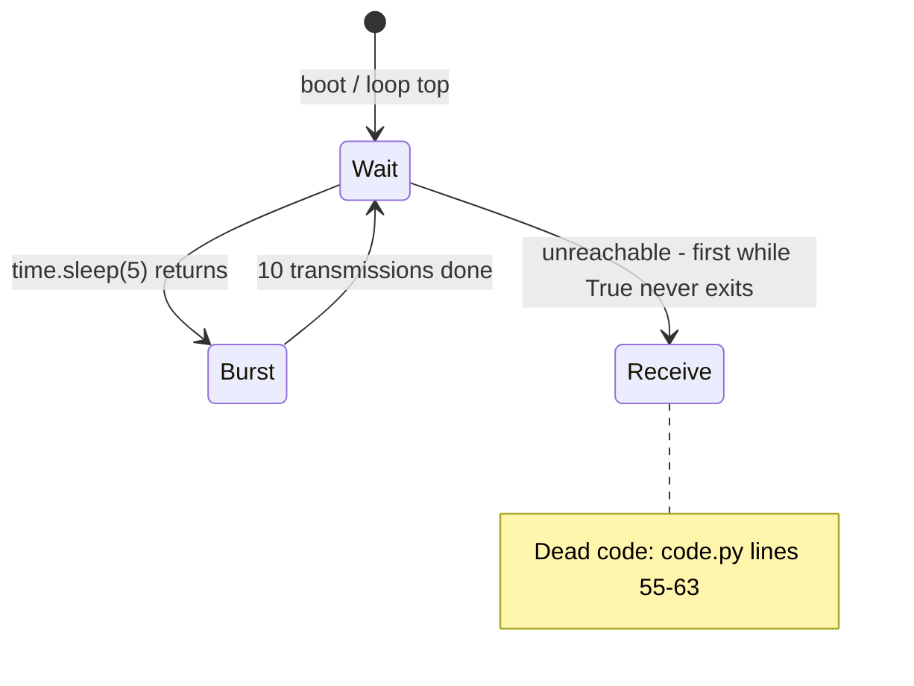

# DemiVis-charge-port-opener

## 1. Provenance

- **Submodule path:** `legacy/DemiVis-charge-port-opener`
- **Pinned gitlink:** `160000 7aeb00f28d78d8d138e24314f2013cacc018a71d 0` — matches `git -C legacy/DemiVis-charge-port-opener rev-parse HEAD`; `git status --porcelain` empty. Clean, correct snapshot.
- **Upstream URL:** `https://github.com/DemiVis/charge-port-opener` (origin, fetch + push).
- **License:** none. No `LICENSE`/`NOTICE`/`COPYING` in `git ls-files`; README declares no license. Pre-replace summary also recorded "License: None" (`git show HEAD:docs/legacy/DemiVis-charge-port-opener.md` line 22).
- **Analysis date:** 2026-11-21.
- **Mode:** replace. Existing YAML frontmatter preserved byte-for-byte (line 3 description ends in `ope` with no trailing whitespace — verified via `grep -nP ' +$'`; no edit). No pre-existing `## Upstream (...)` sections existed, so none to carry over.

Files read (full line ranges unless noted):

- `code.py` lines 1–63 (full).
- `README.md` lines 1–12 (full).
- `boot_out.txt` lines 1–3 (full).
- `lib/adafruit_bus_device/__init__.py` — 0 lines, empty.
- `lib/adafruit_bus_device/i2c_device.mpy` — 1171 bytes, **STRUCTURAL-PARSE**: compiled CircuitPython bytecode; only embedded printable strings extracted (Adafruit BusDevice v5.2.6, repo URL, `I2CDevice`, `write_then_readinto`, `__probe_for_device`). Bytecode semantics not disassembled.
- `lib/adafruit_bus_device/spi_device.mpy` — 817 bytes, **STRUCTURAL-PARSE**: same library v5.2.6, `SPIDevice`, `try_lock`/`unlock`/`configure`.
- Pre-replace summary `docs/legacy/DemiVis-charge-port-opener.md` lines 1–51 (full), read after code for contradiction hunting only.
- Our side (CODE-READ): `firmware/lib/vehicle/can/feature/body/charge.h` lines 1–80; `firmware/lib/vehicle/can/ids.h` line 55; `firmware/lib/client/command/dispatch.h` line 413; `firmware/lib/vehicle/can/handler/bus/vehicle.h` line 61; `firmware/lib/vehicle/can/handler/filters.h` line 112; `firmware/test/test_native_charge/test_charge.cpp` lines 40–79.

Files explicitly NOT read:

- Bytecode disassembly of the two `.mpy` blobs (binary, no source in repo).
- `adafruit_rfm69` module source — imported at `code.py:4` but **not vendored**; absent from `git ls-files`.
- Pre-pin upstream history — local clone has a single grafted commit; no earlier commits, tags, or branches available. Network issues/PRs not consulted.
- Any Tesla vehicle/trace capture; no CAPTURE evidence exists in this repo.

## 2. Executive verdict

A 63-line CircuitPython proof-of-concept for an Adafruit Feather M0 RFM69 (SAMD21) that replays a captured 315 MHz RF datagram (sync word `0x8ACB`, hardcoded 42-byte payload) to pop a Tesla Model 3 charge port. There is **no CAN bus, no frame decoder, and no command surface** — the only mechanism of research interest is raw RFM69 FIFO injection (`code.py:28-42`), which bypasses `adafruit_rfm69.send()` because the library inserts headers the author did not want. That idea is not portable to TeslaCANModder: our charge-port open already ships over CAN 0x333 (`charge.h:31-48`) and our firmware has no sub-GHz RF surface. The 10-bursts-per-5-seconds beacon and the dead receiver loop are equally irrelevant. Must not copy: the captured RF payload, the lifted library `send_message` body, the compiled `.mpy` blobs, and the unreachable receive loop. Overall research value is low; the repo is a historical curiosity documenting that some Tesla charge-port actuation is RF-based, not CAN-based.

## 3. Evidence map

| Source file | Lines | What it proves | Grade |
| --- | --- | --- | --- |
| `code.py` | 10 | RF carrier `315.0` MHz | CODE-READ |
| `code.py` | 11 | Sync word `"\x8A\xCB"` | CODE-READ |
| `code.py` | 12 | 42-byte hardcoded RF payload literal (count verified: 42 `\xNN` escapes) | CODE-READ |
| `code.py` | 17–26 | LED + SPI + RFM69 init, `preamble_length=3`, `frequency=radio_freq` | CODE-READ |
| `code.py` | 28 | Author abandoned `rfm69.send()` because library adds headers; comment "doesn't work" | CODE-READ |
| `code.py` | 29–42 | `send_message()` raw-FIFO path: `idle()` → `_write_from(0x00, payload)` → `transmit()` → `check_timeout()` | CODE-READ |
| `code.py` | 44–53 | Forever loop: `sleep(5)` then `range(0, 10)` bursts, LED toggles | CODE-READ |
| `code.py` | 55–63 | Second `while True` receive loop is unreachable (dead code) | CODE-READ |
| `README.md` | 2 | Author self-describes as "weak attempt … based on what I can find online" | SUMMARY-ONLY |
| `README.md` | 5 | Idea derived from `akrutsinger/tesla-charge-port-signal` (external, not reviewed) | SUMMARY-ONLY |
| `README.md` | 12 | 29 cm quarter-wave antenna claim for 315 MHz | SUMMARY-ONLY |
| `boot_out.txt` | 1–3 | CircuitPython 8.2.9, board `feather_m0_rfm69`, SAMD21G18; exposes board UID | CODE-READ |
| `lib/adafruit_bus_device/*.mpy` | n/a | Vendored compiled BusDevice v5.2.6; strings-level only | STRUCTURAL-PARSE |
| `docs/legacy/DemiVis-charge-port-opener.md` (pre-replace) | 15, 33, 37, 49–51 | Prior summary claims (42 B, sync, 315 MHz, exact reproduction) — leads only | SUMMARY-ONLY |
| `firmware/lib/vehicle/can/feature/body/charge.h` | 15–49 | Our charge-port-open action: CAN 0x333, `data[0] |= 0x01`, burst 20×20 ms | CODE-READ |
| `firmware/lib/vehicle/can/ids.h` | 55 | `CAN_ID_CHARGE 0x333` | CODE-READ |
| `firmware/test/test_native_charge/test_charge.cpp` | 56–70 | Our port-open bit asserted by tests | TEST-READ |

No TEST-READ evidence exists: this repo ships no tests. No CAPTURE evidence exists in this repo.

## 4. Architecture and build surface

- **Entry point:** `code.py` — executed top-to-bottom on boot by CircuitPython; no `main()`, no modules of its own.
- **Shared core vs platform port:** no application core. Only vendored dependency is `lib/adafruit_bus_device/` (two compiled `.mpy` helpers v5.2.6). `adafruit_rfm69` is imported but not vendored — it must pre-exist on the board's CIRCUITPY volume; this is an unmanaged runtime dependency.
- **Build flags / build system:** none. No `platformio.ini`, no CMake, no Makefile — a raw script drop.
- **Dependency boundaries:** `board`, `busio`, `digitalio`, `time`, `micropython.const` (CircuitPython core); `adafruit_rfm69` (external, missing); `adafruit_bus_device` (transitive, compiled).
- **Transport:** sub-GHz ISM RF at 315.0 MHz via RFM69 SPI radio; no serial/BLE/WiFi/CAN interface.

None found: no frame pipeline in this repo. (No RX → decode → mutate/gate → TX CAN path exists. The only data flow is a one-way CPU → RFM69 FIFO → antenna replay; it is documented in mechanism card 1.)

## 5. Mechanism catalogue

### Raw-FIFO RF datagram injection

- **Claim (README / summary):** "writes the raw Tesla signal directly to the FIFO register for exact signal reproduction" (`git show HEAD:docs/legacy/DemiVis-charge-port-opener.md` line 37).
- **Code path:** `code.py:28` (commented-out `rfm69.send()`) → `send_message()` at `code.py:29-42` → `rfm69_object.idle()` (`:34`) → `_write_from(const(0x00), tesla_charge_port_signal)` (`:36`) → `.transmit()` (`:38`) → `adafruit_rfm69.check_timeout(...)` (`:41`).
- **Frame spec:** sub-GHz RF, carrier 315.0 MHz; radio adds `preamble_length=3` preamble bytes and sync word `\x8A\xCB` (`code.py:11,25`); payload is a literal 42-byte string `code.py:12` beginning `AA AA AA 8A CB 32 CC CC CB … 32 AD 28`. Counter position: none. Checksum: none — verbatim capture replay. DLC: n/a (fixed 42-byte payload).
- **Gates and timing:** caller must have radio initialised (`code.py:25`); `idle()` clears FIFO first; no DAS/AP/vehicle-state gate of any kind.
- **State machine:** None found (single one-shot function; no internal states).
- **Tests:** None found (repo ships no tests; grade TEST-READ unavailable).
- **Evidence grade:** CODE-READ.
- **Verdict:** CONFIRMED (code does exactly this; "exact reproduction" effectiveness on a real car is UNVERIFIED).
- **Adapt to TeslaCANModder?** no impact — no RF surface on our hardware; our CAN frame builders already control byte layout.

### Periodic 10-burst / 5-second beacon

- **Claim (README / summary):** "repeatedly sends a hardcoded 42-byte RF signal every 5 seconds (10 bursts per cycle)" (`git show HEAD:docs/legacy/DemiVis-charge-port-opener.md` line 33).
- **Code path:** `code.py:44-53` — `while True` → `time.sleep(5)` (`:46`) → `for i in range(0, 10)` (`:48`) → LED high (`:49`) → `send_message(rfm69)` (`:50`) → LED low (`:52`).
- **Frame spec:** same 42-byte payload each burst; no per-burst counter, jitter, or checksum recompute.
- **Gates and timing:** fixed 5000 ms inter-cycle delay; 10 back-to-back transmissions with no inter-burst delay; `send_message()` return value (TX timeout) ignored at `:50`.
- **State machine:** three phases incl. one unreachable; diagram below (dead RECEIVE phase retained to document intent).



- **Tests:** None found.
- **Evidence grade:** CODE-READ.
- **Verdict:** CONFIRMED.
- **Adapt to TeslaCANModder?** no impact — our charge-port burst is 20 frames × 20 ms on `BUS_VEHICLE` (`charge.h:48`), a different cadence on a different transport.

### RF receive loop (dead code)

- **Claim (README / summary):** None found — the pre-replace summary does not mention receiving (it describes transmit only).
- **Code path:** `code.py:55-63` — second `while True` calling `rfm69.receive(timeout=60.0, with_header=True)` (`:58`), printing packets or "Didn't get anything.. :(".
- **Frame spec:** RX of RFM69 packets with library header intact; nothing decoded or acted upon.
- **Gates and timing:** 60 s blocking receive timeout.
- **State machine:** None found (never reached).
- **Tests:** None found.
- **Evidence grade:** CODE-READ.
- **Verdict:** CONFIRMED as unreachable — the preceding `while True` at `code.py:44` has no `break`.
- **Adapt to TeslaCANModder?** never port — dead code with no behavior.

### LED activity indicator

- **Claim (README / summary):** None found.
- **Code path:** `code.py:17-19` (init, off), `:49` (on before each burst), `:52` (off after).
- **Frame spec:** None found (no frame involvement).
- **Gates and timing:** toggles once per the 10 transmissions.
- **State machine:** None found.
- **Tests:** None found.
- **Evidence grade:** CODE-READ.
- **Verdict:** CONFIRMED.
- **Adapt to TeslaCANModder?** no impact — cosmetic, board-specific GPIO.

## 6. Summary vs code contradiction table

Numeric claims checked out: the pre-replace summary's 315 MHz, sync `0x8ACB`, 42-byte payload, and "no CAN" statements all match code. Only genuine disagreements/staleness are listed here; agreements live in section 3.

| Pre-replace claim (source) | Code / evidence | Nature | Grade |
| --- | --- | --- | --- |
| "It sends a known RF signal sequence … wirelessly" and Architecture diagram terminating at "Tesla charge port (open)" — implies a working opener (`git show HEAD:docs/legacy/DemiVis-charge-port-opener.md` lines 15, 28–29). | README line 2 calls it a "weak attempt … based on what I can find online"; no test, capture, or success confirmation anywhere in repo. | Characterization mismatch: summary asserts function, author disclaims verification. | SUMMARY-ONLY |
| Frontmatter `description` ends mid-word "…charge port ope" (`git show HEAD:docs/legacy/DemiVis-charge-port-opener.md` line 3). | Project is a charge-port **opener**; description is truncated. Frontmatter preserved byte-for-byte per replace mode; recorded here as required staleness note. | Stale/incomplete frontmatter, not a code disagreement. | SUMMARY-ONLY |
| "bypasses … `send()` … for exact signal reproduction" (`git show HEAD:docs/legacy/DemiVis-charge-port-opener.md` line 37). | `code.py:25` still configures `preamble_length=3` and radio sync — the air waveform is not a pure 42-byte replay; "exact" overstates it. | Precision mismatch. | CODE-READ |
| Prior summary lists only `code.py`, `lib/adafruit_bus_device/`, `boot_out.txt` (`git show HEAD:docs/legacy/DemiVis-charge-port-opener.md` lines 33–35) with no dependency caveat. | `adafruit_rfm69` imported (`code.py:4`) but absent from `git ls-files`; project cannot run from this repo alone. | Omission of load-bearing dependency. | CODE-READ |

## 7. CAN frame and signal inventory

No CAN frames are decoded, mutated, or injected — `grep -nE 'CAN|can_bus|mcp2515|0x333|0x3FD' code.py` returns no output (demonstrated). The single transmitted datagram is RF, listed for completeness:

| ID (hex+dec) | Bus | Period | DLC | Byte/bit layout | Scale/units | Counter position | Checksum | Read or write | Grade |
| --- | --- | --- | --- | --- | --- | --- | --- | --- | --- |
| N/A — sync `0x8ACB` (dec 35531), no protocol ID | 315.0 MHz ISM RF (RFM69) | 10 back-to-back bursts per 5000 ms cycle | n/a (fixed 42-byte payload) | Radio emits `preamble_length=3` preamble + sync `\x8A\xCB`; payload `code.py:12` = `AA AA AA 8A CB 32 CC CC CB 4D 2D 4A D3 4C AB 4B 15 96 65 99 99 96 9A 5A 95 A6 99 56 96 2B 2C CB 33 33 2D 34 B5 2B 4D 32 AD 28` | raw octets, no scaling | none | none (static capture replay) | write (TX); RX loop exists but is unreachable | CODE-READ |

Vendored DBC/JSON catalogs: none present. The two `.mpy` files are compiled library bytecode, not a frame catalog — labeled STRUCTURAL-PARSE in section 1, not dumped here.

## 8. Constants and tuning table

| Constant | Value | File:line | Meaning | Grade |
| --- | --- | --- | --- | --- |
| `radio_freq` | `315.0` | `code.py:10` | RF carrier in MHz | CODE-READ |
| `tesla_sync_word` | `"\x8A\xCB"` | `code.py:11` | RFM69 sync word | CODE-READ |
| `tesla_charge_port_signal` | 42 bytes (see §7) | `code.py:12` | Raw captured RF payload | CODE-READ |
| `preamble_length` | `3` | `code.py:25` | Radio-inserted preamble bytes | CODE-READ |
| `const(0x00)` | `0x00` | `code.py:36` | RFM69 FIFO start address for `_write_from` | CODE-READ |
| burst delay | `5` seconds | `code.py:46` | Inter-cycle sleep | CODE-READ |
| burst count | `range(0, 10)` | `code.py:48` | Transmissions per cycle | CODE-READ |
| RX timeout (dead) | `60.0` seconds | `code.py:58` | Blocking receive timeout, unreachable | CODE-READ |
| antenna length | 29 cm | `README.md:12` | Claimed quarter-wave at 315 MHz; hardware, unverified | SUMMARY-ONLY |
| runtime | CircuitPython 8.2.9 | `boot_out.txt:1`, `README.md:7` | Board firmware version | CODE-READ |

## 9. Failure modes and edge cases

| Failure | Handling code path | Tested? | Grade |
| --- | --- | --- | --- |
| TX timeout / packet not sent | `check_timeout(rfm69_object.packet_sent, rfm69_object.xmit_timeout)` at `code.py:41`; `send_message()` returns `not timed_out`, but caller at `:50` **discards the return value** | No tests | CODE-READ |
| Stale FIFO before TX | `rfm69_object.idle()` at `code.py:34` clears FIFO | No | CODE-READ |
| Missing RFM69 dependency | none — `import adafruit_rfm69` at `code.py:4` fails at boot if module absent (it is not vendored) | No | CODE-READ |
| Unreachable receiver | none — second loop at `code.py:55-63` can never execute; no `break` in first loop | No | CODE-READ |
| Bus-off / watchdog / OTA pause / queue overflow / brownout state | None found — no CAN bus, no RTOS, no persistence, no state machine | No | CODE-READ |
| Missing-frame timeout | None found for TX; dead RX loop has 60 s timeout at `code.py:58` | No | CODE-READ |

## 10. Test coverage map

None found: this repo ships no tests (`git ls-files` contains no test files; no test framework). Critical untested paths and their risk:

- RF payload correctness (42 bytes) — no capture proves the waveform opens any charge port; risk: entire premise unverified.
- TX timeout branch (`code.py:41`) — return value ignored; risk: silent transmission failure.
- Dependency presence — import failure unhandled; risk: board boots to error with no diagnostic beyond REPL.
- Timing cadence (5 s / 10×) — no bench measurement; risk: cadence may be irrelevant to receiver.
- Dead receive loop — never exercised; risk: misleading future readers.

## 11. Parity matrix with TeslaCANModder

| Signal/frame | Upstream decode (cite) | Our decode (cite) | Delta | Action |
| --- | --- | --- | --- | --- |
| Charge-port open actuation | 42-byte RF datagram, raw FIFO TX (`code.py:12,36-42`) | `CHARGE_PORT_OPEN` mutates cached 0x333: `f.data[0] |= 0x01`, DLC 5, `startBurst(..., BUS_VEHICLE, 20, 20)` (`firmware/lib/vehicle/can/feature/body/charge.h:19,43-48`) | Entirely different transport: sub-GHz RF vs CAN 0x333 | ignore (function already present on our side) |
| Sync word `0x8ACB` | `code.py:11,25` | No sub-GHz RF surface in firmware (`grep -nE '315\.0|0x8ACB|RFM69|rfm69|sub-GHz|subghz' firmware/lib firmware/src` → no output, demonstrated) | Concept absent from our stack | ignore |
| Burst cadence | 10 bursts / 5000 ms (`code.py:46,48`) | 20 frames × 20 ms (`charge.h:48`) | Different medium and timing | ignore |
| Freshness/cached-frame gate | None — static literal, no base frame (`code.py:12`) | `hasCharge` cache check + non-LEGACY gate (`charge.h:59-62`) | Our side has a safety/fidelity gate upstream lacks | already present (our side stronger) |
| Command surface | None — no CLI/serial/BLE commands | `executeChargeCmd()` handles `charge:port` / `chargeport` (`charge.h:57,74-76`; dispatched at `firmware/lib/client/command/dispatch.h:413`) | We expose a named command; upstream is autonomous loop | ignore |
| Receive path | Unreachable RF RX (`code.py:55-63`) | CAN RX decode pipeline exists (`firmware/lib/vehicle/can/handler/bus/vehicle.h:61`, `filters.h:112`) | Unrelated; upstream RX is dead | ignore |

All our-side citations above are CODE-READ. No SUMMARY-ONLY row drives a decision.

## 12. Surface inventory and security notes

- **Command/transport surfaces:** None found. No serial, HTTP, BLE, MQTT, or web endpoints; `code.py` is an autonomous loop with no input parsing. The only "input" is the dead RF receive loop at `code.py:58`.
- **Credentials / keys / certs:** None found in tracked files.
- **Hardcoded payload:** `code.py:12` is a static captured RF waveform — not a secret, but unlicensed and unattributed beyond `README.md:5`'s reference to `akrutsinger/tesla-charge-port-signal`.
- **Vendored binaries:** `lib/adafruit_bus_device/*.mpy` are compiled bytecode from a public upstream (embedded URL strings, v5.2.6). No untrusted archives, no build flags, no dangerous eval/exec.
- **Device identifier leak:** `boot_out.txt:3` contains a board UID (`172BA67B5352305020312E4C131510FF`) — a device-specific identifier; do not replicate into our docs or code.
- **Unmanaged dependency risk:** `adafruit_rfm69` imported but not pinned or vendored — supply-chain/availability gap, not a security credential issue.

## 13. Adaptation assessment

| Mechanism | Value | Cost | Risk | Grade | Decision |
| --- | --- | --- | --- | --- | --- |
| Raw-FIFO RF injection (bypass library headers) | Low — we control CAN frame construction already | High — no RF hardware on our target | n/a for our stack | CODE-READ | no impact |
| 10×/5 s retry beacon | Low — our burst mechanism already covers repetition | Low | Cadence irrelevant to receiver | CODE-READ | no impact |
| Cached-frame mutation + gate (our side) | High — safety/fidelity property | Already shipped | None new | CODE-READ | already present |
| Command-driven actuation (`charge:port`) | Medium — better UX than autonomous blasting | Already shipped | None new | CODE-READ | already present |
| RF receive loop | None | Low | Dead code | CODE-READ | never port |
| Hardcoded captured payload | None | Low | Unlicensed, unverified, wrong transport | CODE-READ | never port |

No mechanism is a candidate for a future PR. If future hardware adds a sub-GHz radio, the *idea* "emit the captured waveform below framing headers rather than through `send()`" could be reconsidered — as a derived idea with independent implementation only, never line-copied.

## 14. Do-not-copy list

| Item | File:line | Reason |
| --- | --- | --- |
| 42-byte captured RF payload | `code.py:12` | Unlicensed capture replay, unverified on any vehicle, irrelevant transport |
| `send_message()` body ("stolen directly from adafruit_rfm69.RFM69 send") | `code.py:28-42` | Verbatim copy of third-party library code with unknown license; forbidden by skill policy |
| Unreachable receive loop | `code.py:55-63` | Dead code, no behavior |
| Compiled `.mpy` binaries | `lib/adafruit_bus_device/i2c_device.mpy`, `spi_device.mpy` | Never import binary blobs into shipping dirs (`firmware/`, `client/`, `packages/`, `tools/`) |
| Board UID | `boot_out.txt:3` | Device-specific identifier; not a behavior to replicate |
| RF carrier/sync constants | `code.py:10-11` | Meaningless without RF hardware; would mislead future readers |

No pre-existing `## Upstream (...)` section was present in the replaced document, so none is preserved here.

## 15. History and evolution

Local `git log` contains a single commit: `7aeb00f28d78d8d138e24314f2013cacc018a71d` — 2024-01-15 — "Update README.md" — which added all six tracked files in one shot (78 insertions). No tags, no other branches, no changelog. No evidence of iterative development beyond one in-code fossil: `code.py:28` shows the author first tried `rfm69.send()` and abandoned it with the comment "doesn't work cause library adds data and headers", then wrote the raw-FIFO replacement at `code.py:29-42`. No rollback, no alternative approach, and no pre-pin history is available in this shallow/grafted snapshot. Network-only claims (GitHub issues, PRs, upstream release notes) stay UNVERIFIED.

## 16. Re-verification recipe

Pinned gitlink in canonical form: `160000 7aeb00f28d78d8d138e24314f2013cacc018a71d 0`.

```bash
OLD=7aeb00f28d78d8d138e24314f2013cacc018a71d
git -C legacy/DemiVis-charge-port-opener fetch --tags --prune
git -C legacy/DemiVis-charge-port-opener log --oneline $OLD..origin/main
git -C legacy/DemiVis-charge-port-opener diff --stat $OLD..origin/main
git -C legacy/DemiVis-charge-port-opener diff $OLD..origin/main -- code.py README.md lib/
git ls-files -s legacy/DemiVis-charge-port-opener          # expect: 160000 7aeb00f28d78d8d138e24314f2013cacc018a71d 0
git -C legacy/DemiVis-charge-port-opener rev-parse HEAD    # must match the gitlink SHA
```

Grep anchors — all demonstrated at write time (2026-11-21) with the hits below. Use `grep -nE` (extended regex); plain `grep -n 'a|b'` is BRE and will not match alternation.

```text
grep -nE 'radio_freq = 315\.0' legacy/DemiVis-charge-port-opener/code.py
  -> 10:radio_freq = 315.0  # float in MHz
grep -nE 'tesla_sync_word' legacy/DemiVis-charge-port-opener/code.py
  -> 11:tesla_sync_word = "\x8A\xCB"
grep -nE 'preamble_length=3|frequency=radio_freq' legacy/DemiVis-charge-port-opener/code.py
  -> 25:rfm69 = adafruit_rfm69.RFM69(spi, cs, reset, sync_word=tesla_sync_word, preamble_length=3, frequency=radio_freq)
grep -nE 'range\(0, 10\)|time\.sleep\(5\)' legacy/DemiVis-charge-port-opener/code.py
  -> 46:    time.sleep(5)   /   48:    for i in range(0, 10):
grep -nE '_write_from|check_timeout' legacy/DemiVis-charge-port-opener/code.py
  -> 36:        rfm69_object._write_from(const(0x00), tesla_charge_port_signal)
  -> 41:        timed_out = adafruit_rfm69.check_timeout(rfm69_object.packet_sent, rfm69_object.xmit_timeout)
```

Negative anchors (absence claims):

```text
grep -nE 'CAN|can_bus|mcp2515|0x333|0x3FD' legacy/DemiVis-charge-port-opener/code.py
  -> no output (confirmed: no CAN surface upstream)
grep -rniE 'rfm69' legacy/DemiVis-charge-port-opener/lib
  -> no output (confirmed: RFM69 library not vendored)
grep -rnE '315\.0|0x8ACB|RFM69|rfm69|sub-GHz|subghz' firmware/lib firmware/src
  -> no output (confirmed: no RF surface in our firmware)
```

Our-side drift anchors (pin by symbol, so `already present` decisions survive line drift):

```text
grep -nE 'CAN_ID_CHARGE' firmware/lib/vehicle/can/ids.h
  -> 55:#define CAN_ID_CHARGE            0x333 // 819 — UI_chargeRequest (TX, charge limit/port/schedule)
grep -nE 'CHARGE_PORT_OPEN|f\.data\[0\] \|= 0x01|startBurst' firmware/lib/vehicle/can/feature/body/charge.h
  -> 19:	CHARGE_PORT_OPEN = 2
  -> 44:		f.data[0] |= 0x01;  // Set bit 0 — unlatch charge port
  -> 48:	startBurst(s, f, BUS_VEHICLE, 20, 20);
grep -nE 'charge:port|chargeport' firmware/lib/vehicle/can/feature/body/charge.h
  -> 74:	if (strcmp(cmd, "charge:port") == 0 || strcmp(cmd, "chargeport") == 0)
grep -nE 'test_charge_port_open|0x01, s\.burstFrame\.data\[0\]' firmware/test/test_native_charge/test_charge.cpp
  -> 57:void test_charge_port_open()   /   62:	TEST_ASSERT_EQUAL_UINT8(0x01, s.burstFrame.data[0] & 0x01);
```

Payload byte-count check (line 12 must stay 42 bytes):

```text
line 12 of code.py contains 42 '\xNN' escapes (verified by regex count at write time).
Re-count after any bump; a drift from 42 changes the frame spec in section 7.
```

If line numbers drift more than ~10, re-read the whole function; do not trust this document's numbers. Pre-pin upstream history was **not** reviewed — the local clone exposes only the single grafted commit at the pinned SHA. Re-run the fetch/diff block on any upstream bump before reusing any claim here.

## 17. Open questions and explicitly not investigated

- **UNVERIFIED:** whether the 42-byte payload actually opens any Tesla charge port; no CAPTURE, TEST-READ, or bench evidence exists in this repo. Verification: bench RF capture against a real vehicle with a spectrum analyzer/SDR and compare to the literal.
- **UNVERIFIED:** whether 315 MHz is correct for all Model 3 markets (315 MHz FCC vs 433 MHz EU/other regions). Verification: regional RF regulatory docs + capture.
- **UNVERIFIED:** `adafruit_rfm69` API version/behavior (not vendored); `check_timeout`, `xmit_timeout`, and `_write_from` semantics inferred from call sites only. Verification: read the library source pinned to CircuitPython 8.2.9.
- **UNVERIFIED:** external reference `akrutsinger/tesla-charge-port-signal` (`README.md:5`) — not reviewed; the payload may originate there.
- **Not investigated:** bytecode semantics of the two `.mpy` blobs (strings-level STRUCTURAL-PARSE only).
- **Not investigated:** pre-pin upstream history — single grafted commit in local clone; no earlier commits, tags, or changelog.
- **Not investigated:** network-only claims — GitHub issues, PRs, discussions, upstream release notes.
- **Not investigated:** whether sub-GHz RF charge-port actuation persists on HW4 / 2026.x vehicles — outside this repo's evidence.
- **Inherited gap:** the pre-replace summary's confident "exact signal reproduction" framing (section 6) remains untested; treat all prior-summary claims as SUMMARY-ONLY until a capture exists.
