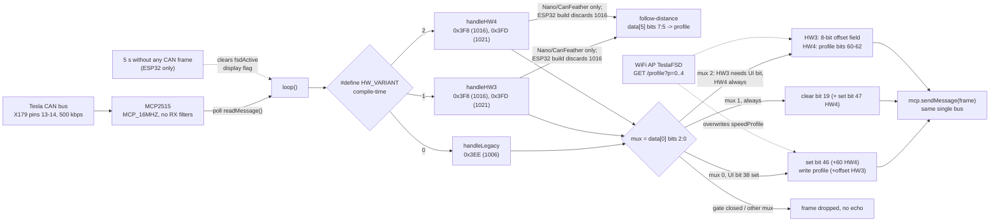

# EzeLLM-fsd-spoofing

Deep-dive analysis of `legacy/EzeLLM-fsd-spoofing` (replace mode: this document supersedes the previous summary, which remains retrievable via `git show HEAD:docs/legacy/EzeLLM-fsd-spoofing.md`).

## 1. Provenance

- **Submodule path:** `legacy/EzeLLM-fsd-spoofing`
- **Pinned gitlink:** `160000 0825db426f2a6d5a037c2902dfa18a3be695dbcf 0` (from `git ls-files -s legacy/EzeLLM-fsd-spoofing`); matches `git -C legacy/EzeLLM-fsd-spoofing rev-parse HEAD`; `status --porcelain` empty.
- **Upstream URL:** `https://github.com/EzeLLM/fsd-spoofing`
- **License:** GPL-3.0, stated in each sketch header (`firmware/nano/nano_fsd.ino:3`, `firmware/esp32/esp32_fsd.ino:4`, `firmware/original/CanFeather.ino:3`). README itself states no license.
- **Analysis date:** 2026-11-21.
- **Replace-mode preservation note:** the pre-replace doc has **no YAML frontmatter** and **no `## Upstream (...)` section**; there was nothing to preserve, and no frontmatter was invented. The inherited trailing whitespace flagged in the replace instruction lives on the pre-replace hard-break lines 3-4 (`**Source:**` / `**License:**`), which are replaced summary content, not frontmatter; this document carries no trailing whitespace.
- **Files read (all FULL-READ, every line):**

| File | Lines |
| --- | --- |
| `README.md` | 1-603 |
| `firmware/esp32/esp32_fsd.ino` | 1-275 |
| `firmware/nano/nano_fsd.ino` | 1-235 |
| `firmware/original/CanFeather.ino` | 1-231 |
| `docs/CANADA_SUBSCRIPTION_GUIDE.md` | 1-96 |
| `docs/LINKS_TO_VISIT.md` | 1-46 |
| `docs/WIRING_GUIDE.md` | 1-137 |
| `schematics/README.md` | 1-449 |
| `.gitignore` | 1-7 |

- **Files explicitly NOT read:** none — the full inventory is the 9 files above (`git -C legacy/EzeLLM-fsd-spoofing ls-files`; no hidden directories exist). Two files are **referenced but absent from the pinned tree**: `telegram_export (1).jsonl` (README:22; excluded by `.gitignore:7`) and `firmware/esp32-c6/` (README:459; no such path in the tree).
- **Reading coverage:** FULL-READ for all 9 files; no DBC/JSON catalogs or generated code exist in this repo.
- **Our-side files read for parity (CODE-READ):** `firmware/lib/vehicle/can/handler/variant/hw4.h` (FULL-READ 1-169), `legacy.h` (FULL-READ 1-84), `bits.h` (FULL-READ 1-58), `feature/fsd/profile.h` (FULL-READ 1-111), `feature/fsd/fsd.h` (FULL-READ 1-58); RANGE-CITED: `hw3.h` (60-155), `feature/fsd/offsets.h` (1-60), `ids.h` (95-122), `lib/core/types.h` (grep hit at 315). Evidence-map prose below states the absence grades: **No TEST-READ evidence exists: this repo ships no tests.** **No CAPTURE evidence exists in this repo.**

## 2. Executive verdict

This repo is a community "FSD region spoofing" guide packaging three Arduino sketches (RP2040/M4 CAN Feather "original", Nano, ESP32+WiFi) that all implement the same jvanakker-lineage FSD CAN mod: intercept `0x3EE` (legacy) or `0x3F8`+`0x3FD` (HW3/HW4) on the single X179 CAN bus, set bit 46 (plus bit 60 on HW4 mux 0, bit 47 on HW4 mux 1), clear bit 19 on mux 1, write speed profile / offset fields on mux 0/2, and echo the mutated frame back. Every frame-level mechanism is **already present in TeslaCANModder** with byte-identical layouts and stricter gating (AP gate, nag-mode gate, DLC guards, runtime toggles, filters); nothing here is a port candidate except two capture-first audit items: the divergent semantic labels our side and upstream attach to bit 60, and a lower-footprint HW4 mux-0 bit set (46+60 only, no 38/39/59) worth a bench A/B. The account-transfer "Canada subscription" procedure and all community efficacy claims are SUMMARY-ONLY and must never be ported.

## 3. Evidence map

| Source file | Lines | What it proves | Grade |
| --- | --- | --- | --- |
| `firmware/nano/nano_fsd.ino` | 47-58 | Mux read `data[0]&0x07`; UI-selected gate `data[4]>>6&1`; V12/V13 profile write `data[6]` bits[2:1] mask `0x06` | CODE-READ |
| `firmware/nano/nano_fsd.ino` | 73-101 | Legacy handler: `0x3EE` mux0 sets bit 46 + profile (UI-gated); mux1 clears bit 19 unconditionally | CODE-READ |
| `firmware/nano/nano_fsd.ino` | 103-148 | HW3 handler: 1016 follow-distance map; 1021 mux0 bit 46 + offset decode `((data[3]>>1)&0x3F)-30)*5` clamp 0..100; mux1 bit 19; mux2 offset encode 2+6 bit split | CODE-READ |
| `firmware/nano/nano_fsd.ino` | 150-192 | HW4 handler: 1016 five-level map; 1021 mux0 bits 46+60; mux1 bit 19 clear + bit 47 set; mux2 profile `data[7]` bits[6:4] | CODE-READ |
| `firmware/nano/nano_fsd.ino` | 204-209 | `CAN_500KBPS, MCP_16MHZ`; init failure halts in blink loop | CODE-READ |
| `firmware/esp32/esp32_fsd.ino` | 30-31, 88-121 | WiFi AP `TeslaFSD`/`fsd12345`; profile names; `/profile?p=N` constrained 0..4 | CODE-READ |
| `firmware/esp32/esp32_fsd.ino` | 164-167, 196 | ESP32 build **discards** 1016 (no follow-distance auto-map; web-only profile) | CODE-READ |
| `firmware/esp32/esp32_fsd.ino` | 253-274 | Poll loop; 5000 ms no-CAN timeout clears display flag `fsdActive` | CODE-READ |
| `firmware/original/CanFeather.ino` | 5, 16-21, 65-70 | Header says "Adafruit Feather M4 CAN"; variant via `#define HW` macro aliases; base class with misspelled `handelMessage` | CODE-READ |
| `firmware/original/CanFeather.ino` | 75-197 | Same three handlers as Nano, C++ struct form, no DLC guards | CODE-READ |
| `firmware/original/CanFeather.ino` | 209-216 | CAN init failure only prints and **continues** (unlike Nano/ESP32 halt) | CODE-READ |
| `schematics/README.md` | 320-355 | Frame diagram claims HW4 profile at "bits 52-54" and bit 60 = FSDV14 (contradicts code, section 6) | CODE-READ |
| `README.md` | 47-73, 290-345 | Wire-level claims (IDs 1006/1016/1021, bits 46/60/19/47, profile levels 3 vs 5) — all confirmed against code | CODE-READ (code), SUMMARY-ONLY (as standalone claims) |
| `README.md` | 251-287, 463-485, 523-560 | Subscription workaround, unlock efficacy, Turkey test ratings — no code or capture backing | SUMMARY-ONLY |
| `docs/CANADA_SUBSCRIPTION_GUIDE.md` | 14-74 | Account-transfer procedure; pricing | SUMMARY-ONLY |
| `docs/WIRING_GUIDE.md`, `schematics/README.md` | wiring/passim | X179 pin 13/14, 120-ohm termination removal, buck converter advice | SUMMARY-ONLY (no schematic files in tree, ASCII art only) |
| `docs/LINKS_TO_VISIT.md` | 1-46 | External URLs (YouTube, X, papers); not fetched during this analysis | UNVERIFIED |

## 4. Architecture and build surface

- **Entry points:** Arduino `setup()`/`loop()` per sketch. No RTOS, no tasks: `loop()` polls `mcp.readMessage()` and dispatches to one compile-time-selected handler (`nano_fsd.ino:218-235`, `esp32_fsd.ino:253-275`, `CanFeather.ino:220-231`).
- **Shared core vs ports:** the three sketches are the same logic in three dialects — Nano (plain C-style functions), ESP32 (Nano logic + WiFi `WebServer` overlay), CanFeather "original" (C++ handler structs via `CarManagerBase`, `CanFeather.ino:65-70`). There is no shared library; each `.ino` is self-contained.
- **Build flags:** none. Variant selection is a source edit: `#define HW_VARIANT` (`nano_fsd.ino:30`, `esp32_fsd.ino:27`) or `#define HW` (`CanFeather.ino:21`). No PlatformIO, no CI, no tests.
- **Dependencies:** `mcp2515` by autowp + `SPI` (all sketches); ESP32 adds `WiFi.h` + `WebServer.h` (`esp32_fsd.ino:20-23`).
- **Dependency boundaries:** none — sketches talk straight to the MCP2515; no ring buffer, no filters, no checksum layer (negative anchors N1/N5, section 16).
- **Transport surfaces:** serial debug prints only; ESP32 adds an unauthenticated WiFi AP + HTTP profile setter (section 12).



No mechanism in this repo has a runtime state machine with 3 or more states, so no state diagrams are applicable; every mechanism card below records `None found` for state machine.

## 5. Mechanism catalogue

### M1: Legacy FSD enable on 0x3EE (1006)

- **Claim (README / summary):** LEGACY variant monitors CAN ID 1006, 3 profiles, FSD enable bit 46 (`README.md:294-300`); pre-replace doc said "FSD Spoofing (bit46) across three hardware platforms" (`git show HEAD:docs/legacy/EzeLLM-fsd-spoofing.md` L27).
- **Code path:** `nano_fsd.ino:73-101` — `handleLegacy()` → `readMuxID()` → mux 0: `isFSDSelectedInUI()` gate → `setBit(frame,46,true)` + `setSpeedProfileV12V13()` → `mcp.sendMessage()`; mux 1: `setBit(frame,19,false)` → TX.
- **Frame spec:** ID 0x3EE/1006, DLC assumed 8 (never checked). Mux in `data[0]` bits[2:0]. Mux 0: UI gate at `data[4]` bit 6 (global bit 38); sets bit 46 (`data[5]` bit 6); profile 2-bit field `data[6]` bits[2:1] (`nano_fsd.ino:55-58`); profile source = UI offset steps `((data[3]>>1)&0x3F)-30` with 0/1/2 → profile 0/1/2 (`nano_fsd.ino:79-84`). Mux 1: clears bit 19 (`data[2]` bit 3). Counter: None found. Checksum: None found.
- **Gates and timing:** UI-selected bit only; no interval logic (echo-on-receipt); no runtime toggle.
- **State machine:** None found.
- **Tests:** None found — repo ships no tests.
- **Evidence grade:** CODE-READ.
- **Verdict:** CONFIRMED.
- **Adapt to TeslaCANModder?** already present — our `handleLegacy` (`firmware/lib/vehicle/can/handler/variant/legacy.h:56-83`) does the same edits plus `fsdForceEnabled`, `apGateOpen`, `nagModeUsesBit19` gates and profile pinning.

### M2: HW3 FSD enable + speed offset on 0x3F8/0x3FD

- **Claim (README / summary):** HW3 monitors 1016, 1021; "Additional: Speed offset calculation (0-100 range)" (`README.md:302-309`).
- **Code path:** `nano_fsd.ino:103-148` — `handleHW3()` → 1016: `readFollowDistance` `data[5]` bits[7:5] → profile map → return; 1021 mux 0 (UI-gated): offset decode `((data[3]>>1)&0x3F)-30` ×5 clamp 0..100, set bit 46, profile write, TX; mux 1: clear bit 19, TX; mux 2 (UI-gated): offset encode into `data[0]` bits[7:6] + `data[1]` bits[5:0], TX.
- **Frame spec:** 0x3F8/1016 read-only: dial 1..3 at `data[5]` bits[7:5], map 1→2, 2→1, 3→0 (`nano_fsd.ino:105-110`). 0x3FD/1021 mux 0: bit 46; profile `data[6]` bits[2:1]. Mux 2: 8-bit offset field split 2 bits (`data[0]` bits[7:6]) + 6 bits (`data[1]` bits[5:0]), value 0..100 (`nano_fsd.ino:132-137`). Counter: None found. Checksum: None found.
- **Gates and timing:** mux 0 and mux 2 gated on `isFSDSelectedInUI`; mux 1 unconditional; echo-on-receipt.
- **State machine:** None found.
- **Tests:** None found.
- **Evidence grade:** CODE-READ.
- **Verdict:** CONFIRMED.
- **Adapt to TeslaCANModder?** already present — `handleHW3` (`hw3.h:114-153`) plus `readHW3UiOffsetSteps`/`calculateHW3SpeedOffset`/`writeHW3SpeedOffset` (`offsets.h:31-50`, `offsets.h:17-24`) are formula-identical with DLC guards and gates.

### M3: HW4 FSDV14 enable on 0x3F8/0x3FD

- **Claim (README / summary):** HW4 monitors 1016, 1021; 5 profiles; "FSD enable bits: 46, 60", "Additional feature bits: 47 (in nag frame)" (`README.md:311-318`).
- **Code path:** `nano_fsd.ino:150-192` — `handleHW4()` → 1016: five-level map 1→3, 2→2, 3→1, 4→0, 5→4; 1021 mux 0 (UI-gated): `setBit(frame,46,true)` + `setBit(frame,60,true)`, TX; mux 1: clear bit 19 + set bit 47, TX; mux 2 (**unconditional**): profile `data[7] &= ~(0x07<<4); data[7] |= (profile&0x07)<<4`, TX.
- **Frame spec:** 0x3FD mux 0: bits 46, 60. Mux 1: bit 19 clear, bit 47 set (`data[5]` bit 7). Mux 2: 3-bit profile at `data[7]` bits[6:4] = **global bits 60-62** (the schematic's "bits 52-54" is wrong, section 6). Counter: None found. Checksum: None found.
- **Gates and timing:** mux 0 UI-gated; mux 1 and mux 2 unconditional (no runtime toggle exists anywhere in the sketch).
- **State machine:** None found.
- **Tests:** None found.
- **Evidence grade:** CODE-READ.
- **Verdict:** CONFIRMED (frame layout) / PARTIAL (semantics: upstream labels bit 60 "FSDV14 feature" (`README.md:64`, `nano_fsd.ino:170`); our side labels the same bit `FSD_BIT_DAS_DEV` "DAS developer" (`bits.h:23`) — open question Q2).
- **Adapt to TeslaCANModder?** already present — `handleHW4` (`hw4.h:128-168`); see adaptation assessment for the two capture-first audit items.

### M4: Follow-distance → speed profile auto-mapping

- **Claim (README / summary):** "They're mapped from the follow-distance setting on your stalk/screen" (`README.md:326`); pre-replace doc: "Speed profiles (5 levels HW4, 3 levels HW3/Legacy)" (`git show HEAD:docs/legacy/EzeLLM-fsd-spoofing.md` L31).
- **Code path:** `nano_fsd.ino:104-110` (HW3 map), `nano_fsd.ino:151-160` (HW4 map); **ESP32 build skips both** — `esp32_fsd.ino:165-167` and `196` return on 1016 without reading it, so the web profile is the only source.
- **Frame spec:** read-only decode of `data[5]` bits[7:5]; HW3 dial 1..3 → profiles {2,1,0}; HW4 dial 1..5 → profiles {3,2,1,0,4}.
- **Gates and timing:** none (pure decode; applied at next mux 0/2 echo).
- **State machine:** None found.
- **Tests:** None found.
- **Evidence grade:** CODE-READ.
- **Verdict:** CONFIRMED.
- **Adapt to TeslaCANModder?** already present and byte-identical — `readFollowDistance` (`ids.h:106-108`), `mapHW3FollowDistToProfile` ({-1,2,1,0} at `profile.h:43-47`), `mapHW4FollowDistToProfile` ({-1,3,2,1,0,4} at `profile.h:54-58`).

### M5: ESP32 WiFi web profile control

- **Claim (README / summary):** "ESP32 with WiFi web control" (`git show HEAD:docs/legacy/EzeLLM-fsd-spoofing.md` L30, L38).
- **Code path:** `esp32_fsd.ino:222-249` — `WiFi.softAP("TeslaFSD","fsd12345")` + `server.on("/",handleRoot)`, `server.on("/profile",handleProfile)`; `handleProfile()` (`esp32_fsd.ino:115-121`) reads `p`, `toInt()`, `constrain(0,4)`.
- **Frame spec:** None found (no frame emitted; mutates the in-memory `speedProfile` consumed by M2/M3).
- **Gates and timing:** none — no authentication, no origin check.
- **State machine:** None found.
- **Tests:** None found.
- **Evidence grade:** CODE-READ.
- **Verdict:** CONFIRMED.
- **Adapt to TeslaCANModder?** no impact — our REST API (`/api/command`, `fsd:on` etc. per `docs/reference/commands.md`) plus the authenticated dashboard superset this surface.

### M6: ESP32 CAN-activity timeout flag

- **Claim (README / summary):** not mentioned anywhere upstream; pre-replace doc does not mention it either.
- **Code path:** `esp32_fsd.ino:257-262` — on `readMessage() != ERROR_OK`, if `millis()-lastFrameTime > 5000` then `fsdActive=false`; `lastFrameTime` updates on **any** received frame.
- **Frame spec:** None found.
- **Gates and timing:** 5000 ms; display-only — `fsdActive` feeds the web status page (`esp32_fsd.ino:101-102`) and never gates TX.
- **State machine:** None found (two boolean states).
- **Tests:** None found.
- **Evidence grade:** CODE-READ.
- **Verdict:** CONFIRMED.
- **Adapt to TeslaCANModder?** no impact — our per-bus MCP2515 health/detection (`status:can`, `docs/reference/commands.md`) is a strict superset.

## 6. Summary vs code contradiction table

| # | Claim (source) | Code evidence | Verdict |
| --- | --- | --- | --- |
| 1 | Pre-replace summary: "Platform: Arduino Nano, ESP32, RP2040" (`git show HEAD:docs/legacy/EzeLLM-fsd-spoofing.md` L5) and "RP2040 CAN Feather" (L39); upstream README:13 "Original Adafruit RP2040 code" | `firmware/original/CanFeather.ino:5` header: "HARDWARE: Adafruit Feather M4 CAN (or MCP25625/MCP2515 compatible board)" | CONTRADICTED (doc vs code header). The sketch uses `PIN_CAN_*` defines compatible with either Adafruit CAN Feather; which board actually runs it is Q3. |
| 2 | `schematics/README.md:342-344`: HW4 speed profile at "Bits 52-54" | `nano_fsd.ino:181-182` writes `data[7]` bits[6:4] = global bits 60-62 (same in `CanFeather.ino:187-188`, `esp32_fsd.ino:214-215`) | CONTRADICTED — schematic diagram is wrong; the same schematic also calls bit 60 "FSDV14 feature" (schematics:338), i.e. outside its own claimed profile field. |
| 3 | `README.md:459`: "Community-contributed code available (see `firmware/esp32-c6/`)" | `git ls-files`: 9 files only, no `firmware/esp32-c6/` (anchor N3) | CONTRADICTED — README references a directory that does not exist in the pinned snapshot. |
| 4 | `README.md:22`: repo tree includes `telegram_export (1).jsonl ← Source community messages` | Absent from tree; excluded by `.gitignore:7` (`*.jsonl`) (anchor N4) | CONTRADICTED — the claimed primary source material is not reproducible from the pinned snapshot. |
| 5 | Pre-replace summary: `firmware/nano/` features "Basic FSD enable" (`git show HEAD:docs/legacy/EzeLLM-fsd-spoofing.md` L37) | `nano_fsd.ino:103-192` implements the full HW3/HW4 pipeline: follow-distance mapping, offset decode/encode, bit 19/47 nag edits, profile writes | CONTRADICTED (understatement) — treat the rest of the pre-replace feature table as SUMMARY-ONLY. |

Agreements (not contradictions) verified against code: CAN IDs 1006/1016/1021 (`README.md:61`), bits 46/60/19/47 (`README.md:63-65`, `schematics/README.md:436-439`), profile counts 3 vs 5 (pre-replace L31 vs `esp32_fsd.ino:118` constrain 0..4; HW3 profiles 0..2), X179 pins 13/14 (`docs/WIRING_GUIDE.md:7-8`), 500 kbps + 16 MHz (all three `setBitrate(CAN_500KBPS, MCP_16MHZ)` calls).

## 7. CAN frame and signal inventory

No vendored DBC/JSON catalog exists in this repo; every row below is code-referenced.

| ID (hex+dec) | Bus | Period | DLC | Byte/bit layout | Scale/units | Counter | Checksum | Read or write | Grade |
| --- | --- | --- | --- | --- | --- | --- | --- | --- | --- |
| 0x3EE / 1006 | single CAN on X179 13-14 (our chassis lane) | None found (echo-on-receipt) | assumed 8, never validated | mux `data[0]` bits[2:0]; UI-select `data[4]` bit 6; FSD enable bit 46 = `data[5]` bit 6; profile `data[6]` bits[2:1]; nag bit 19 = `data[2]` bit 3; offset steps `data[3]` bits[6:1] | offset steps bias -30 | None found | None found (never recomputed; anchor N1) | RX + mutate + TX (mux 0, mux 1) | CODE-READ |
| 0x3F8 / 1016 | same single bus | None found | assumed 8 | follow-distance dial `data[5]` bits[7:5] | HW3 dial 1..3, HW4 dial 1..5 (unitless stalk position) | None found | None found | RX decode only (Nano/CanFeather); read-and-discard on ESP32 build (`esp32_fsd.ino:165-167,196`) | CODE-READ |
| 0x3FD / 1021 | same single bus | None found (echo-on-receipt) | assumed 8 | mux `data[0]` bits[2:0]; mux 0: bit 46 (+ bit 60 HW4), profile `data[6]` bits[2:1]; mux 1: bit 19 clear (+ bit 47 set HW4); mux 2: HW3 offset = `data[0]` bits[7:6] + `data[1]` bits[5:0], HW4 profile = `data[7]` bits[6:4] (bits 60-62) | HW3 offset 0..100; HW4 profile 0..4 | None found | None found | RX + mutate + TX (all three muxes) | CODE-READ |

## 8. Constants and tuning table

| Constant | Value | File:line | Meaning | Grade |
| --- | --- | --- | --- | --- |
| `HW_VARIANT` | 1 (default) | `nano_fsd.ino:30`, `esp32_fsd.ino:27` | compile-time variant: 0=LEGACY, 1=HW3, 2=HW4 | CODE-READ |
| `HW` | `HW3` (default) | `CanFeather.ino:21` | same gate in the original sketch, macro-aliased at `:16-18` | CODE-READ |
| mux mask | `0x07` | `nano_fsd.ino:47-49` | mux index = `data[0]` bits[2:0] | CODE-READ |
| UI FSD-selected bit | `data[4]` bit 6 (global bit 38) | `nano_fsd.ino:51-53` | gate for mux 0 (and HW3 mux 2) edits | CODE-READ |
| FSD enable bit | 46 | `nano_fsd.ino:85,122,169` | `data[5]` bit 6, set on mux 0 | CODE-READ |
| FSDV14 bit (HW4 mux 0) | 60 | `nano_fsd.ino:170` | README:64 labels it "FSDV14 feature" | CODE-READ |
| FSDV14 bit (HW4 mux 1) | 47 | `nano_fsd.ino:176` | set alongside bit 19 clear | CODE-READ |
| nag bit | 19 | `nano_fsd.ino:91,128,175` | cleared on mux 1, all variants | CODE-READ |
| V12/V13 profile field | `data[6]` bits[2:1], mask `0x06` | `nano_fsd.ino:55-58` | 2-bit profile write (HW3/Legacy) | CODE-READ |
| HW4 profile field | `data[7]` bits[6:4], mask `0x70` | `nano_fsd.ino:181-182` | 3-bit profile (global bits 60-62) | CODE-READ |
| offset decode bias | `((data[3]>>1)&0x3F) - 30` | `nano_fsd.ino:79,120` | UI offset steps, bias -30 centers zero | CODE-READ |
| offset scale/clamp | steps ×5, clamp 0..100 | `nano_fsd.ino:121` | steps → speed offset | CODE-READ |
| offset encode | `(off&0x03)<<6` in `data[0]`, `off>>2` in `data[1]` | `nano_fsd.ino:132-137` | 8-bit field split 2+6 across bytes 0-1 | CODE-READ |
| follow-distance field | `data[5]` bits[7:5] | `nano_fsd.ino:105` | 3-bit dial | CODE-READ |
| HW3 fd→profile map | 1→2, 2→1, 3→0 | `nano_fsd.ino:106-110` | dial to 3-level profile | CODE-READ |
| HW4 fd→profile map | 1→3, 2→2, 3→1, 4→0, 5→4 | `nano_fsd.ino:152-159` | dial to 5-level profile | CODE-READ |
| legacy steps→profile | 2→2, 1→1, 0→0 | `nano_fsd.ino:79-84` | UI offset steps double as legacy profile select | CODE-READ |
| CAN bitrate/clock | `CAN_500KBPS`, `MCP_16MHZ` | `nano_fsd.ino:205`, `esp32_fsd.ino:240`, `CanFeather.ino:211` | bus rate + MCP2515 crystal | CODE-READ |
| activity timeout | 5000 ms | `esp32_fsd.ino:259` | no-CAN decay of display flag | CODE-READ |
| web profile clamp | `constrain(p, 0, 4)` | `esp32_fsd.ino:118` | 5 valid HW4 profile values | CODE-READ |

Trivial constants (LED pins, `CAN_CS_PIN`, STBY pin, 115200 baud) are excluded per skill scope.

## 9. Failure modes and edge cases

| Failure | Handling code path | Tested? | Grade |
| --- | --- | --- | --- |
| CAN init failure | Nano/ESP32 halt forever in LED blink loop (`nano_fsd.ino:206-208`, `esp32_fsd.ino:240-243`); CanFeather prints "setBitrate failed" and **continues** (`CanFeather.ino:211-215`) — inconsistent across variants | No | CODE-READ |
| MCP2515 read errors | every `readMessage() != ERROR_OK` treated as "no frame"; bus-off, error counters and overflow are invisible (`nano_fsd.ino:221-224`, `esp32_fsd.ino:257-263`, `CanFeather.ino:222-227`) | No | CODE-READ |
| Short frames | no DLC validation anywhere (anchor N2); stale trailing bytes re-sent unvalidated | No | CODE-READ |
| No RX filters | no `setFilter`/mask config (anchor N5); full bus load passes software ID gates in a single poll loop | No | CODE-READ |
| Bus silence | ESP32 clears `fsdActive` after 5000 ms — display only, TX never gated (`esp32_fsd.ino:258-262`); Nano/CanFeather only set LED HIGH | No | CODE-READ |
| WiFi garbage input | `toInt()` of non-numeric `p` yields 0 → silently selects Chill profile (`esp32_fsd.ino:116-120`) | No | CODE-READ |
| Bus-off recovery / watchdog / brownout | None found (FULL-READ of all three sketches; no watchdog or reboot handling exists) | No | CODE-READ (absence) |
| OTA-during-injection guard | None found — no 0x318/OTA awareness; injection continues through an OTA | No | CODE-READ (absence) |

## 10. Test coverage map

None found — this repo ships no tests, no CI, no build system beyond Arduino IDE upload. No TEST-READ evidence exists.

Critical paths with NO test and their risk:

- Mutated-frame echo correctness (M1-M3): a wrong bit/mask silently alters driver-assist behavior on a real vehicle; risk is undetectable without bench capture.
- Checksum/counter absence (N1): if 0x3FD/0x3EE gain a counter or checksum on future Tesla firmware, mod frames would be dropped or flagged; no test could catch it because the repo never models them.
- ESP32 halt-on-init (M5/M6): a failing MCP2515 bricks the web surface too, with no recovery path.
- HW4 mux 2 unconditional TX (M3): profile echo is emitted even with FSD not selected and no UI gate; on-vehicle effect untested.

## 11. Parity matrix with TeslaCANModder

Every row cites our side from code actually read this session (no SUMMARY-ONLY rows).

| Signal/frame | Upstream decode (cite) | Our decode (cite) | Delta | Action |
| --- | --- | --- | --- | --- |
| 0x3FD mux 0 FSD enable (HW3) | bit 46 + profile write, UI-gated (`nano_fsd.ino:119-125`) | `hw3.h:123-137`: sets bits 38, 39, 46 + profile; gated on `s.fsdEnabled`, `fsdForceEnabled`, `apGateOpen` | ours superset: extra bits 38/39, runtime gates, force mode | ignore (already present) |
| 0x3FD mux 0 FSD enable (HW4) | bits 46+60, UI-gated (`nano_fsd.ino:168-172`) | `hw4.h:136-147`: sets bits 38, 39, 46, 60 (+59 EVD optional), same gates | ours sets 4-5 bits vs upstream 2 — lower-footprint variant is an audit candidate | capture-first (A/B bench, then can-review-checklist) |
| UI FSD-selected gate | reads `data[4]` bit 6 (`nano_fsd.ino:51-53`) | `ids.h:119-122` identical read; bypassed by `fsd:force` (`hw3.h:121`, `legacy.h:61`, `hw4.h:134`, `fsd.h:45-58`) | identical decode; ours adds force bypass | ignore |
| 0x3FD mux 1 nag (HW3) | bit 19 cleared **unconditionally** (`nano_fsd.ino:127-130`) | `hw3.h:140-145` gated on `nagModeUsesBit19(s.nagMode)` (`lib/core/types.h:315`) + AP gate | ours adds runtime toggle; upstream is always-on | ignore |
| 0x3FD mux 1 nag (HW4) | bit 19 clear + bit 47 set unconditionally (`nano_fsd.ino:174-178`) | `hw4.h:150-155` → `applyHW4NagSuppressBits` (`hw4.h:40-53`): bit 19 clear, bit 47 set, EAP bit, lane-graph bit, ECE R79 bit 20 | ours superset | ignore |
| 0x3FD mux 2 HW3 offset encode | 2+6 bit split (`nano_fsd.ino:132-137`) | `offsets.h:17-24` `writeHW3SpeedOffset` — identical layout + DLC guard | identical | ignore |
| 0x3FD mux 2 HW4 profile | `data[7]` bits[6:4] (`nano_fsd.ino:180-184`) | `profile.h:30-36` `writeHW4SpeedProfile` — identical mask `0x70` + clamp + DLC guard; ours also encodes HW4 offset in byte 1 (`hw4.h:157-165`, `bits.h:53-54`) | ours adds HW4 offset encode upstream lacks | ignore |
| HW3 offset decode | `((data[3]>>1)&0x3F)-30` ×5 clamp 0..100 (`nano_fsd.ino:120-121`) | `offsets.h:31-50` `readHW3UiOffsetSteps`/`calculateHW3SpeedOffset` — formula-identical + DLC guard | identical | ignore |
| Follow-distance decode | `data[5]` bits[7:5] (`nano_fsd.ino:105`) | `ids.h:106-108` `readFollowDistance` — identical + DLC guard | identical | ignore |
| HW3 fd→profile map | {1→2, 2→1, 3→0} (`nano_fsd.ino:106-110`) | `profile.h:43-47` map {-1,2,1,0} | identical | ignore |
| HW4 fd→profile map | {1→3,2→2,3→1,4→0,5→4} (`nano_fsd.ino:152-159`) | `profile.h:54-58` map {-1,3,2,1,0,4} | identical | ignore |
| 0x3EE legacy mux | bit 46 + profile, UI-gated; mux 1 bit 19 (`nano_fsd.ino:73-101`) | `legacy.h:56-83` same + force/AP/nag gates + pinning | ours superset | ignore |
| 0x045 legacy stalk | None found upstream | `legacy.h:40-54` maps stalk bits[7:5] of byte 1 to profile | ours-only feature | ignore |
| bit 60 semantics | "FSDV14 feature" (`README.md:64`, `nano_fsd.ino:170`) | `FSD_BIT_DAS_DEV` "DAS developer" (`bits.h:23`) | same bit, divergent labels; also the low bit of the mux 2 profile field (bits 60-62) | capture-first (open question Q2) |
| Runtime toggle surface | none — compile-time variant only (`nano_fsd.ino:30`) | `fsd:on/off`, `fsd:force:on/off` (`fsd.h:19-58`), filter-level gating (`handler/filters.h:57-78`) | ours-only | ignore |
| ESP32 1016-discard | `esp32_fsd.ino:165-167,196` drops follow-distance mapping (web-only profile) | `hw3.h:69-77`, `hw4.h:83-91` always map | upstream variant quirk | ignore |

## 12. Surface inventory and security notes

| Surface | Semantics | Citation | Grade |
| --- | --- | --- | --- |
| USB Serial 115200 | debug prints only (variant banner, profile/offset traces); no command parser, nothing accepted | `nano_fsd.ino:201-213`, `esp32_fsd.ino:224-248` | CODE-READ |
| WiFi AP + HTTP (ESP32 build) | AP `TeslaFSD` / `fsd12345` at 192.168.4.1; `GET /` status page; `GET /profile?p=0..4` sets speed profile; no auth | `esp32_fsd.ino:30-31,99-121,228-236` | CODE-READ |
| CAN | single 500 kbps bus on X179 13/14; mutated echo TX of 0x3EE/0x3FD frames | `nano_fsd.ino:87,124,183` etc. | CODE-READ |
| BLE | None found | — | CODE-READ (absence) |

Security and provenance findings:

- **Hardcoded AP credentials** in source: `AP_PASS = "fsd12345"` (`esp32_fsd.ino:31`), also printed in upstream docs (`docs/WIRING_GUIDE.md:69`, `schematics/README.md:224`).
- **Unauthenticated web endpoint mutates a frame-shaping parameter** (speed profile → HW4 mux 2 field); any nearby client can change it; no rate limit, no validation beyond `constrain` (`esp32_fsd.ino:115-121`).
- **No CAN RX filters** (anchor N5) — full bus traffic handled in one poll loop; overflow behavior undefined.
- No keys/certs/signed archives in tree; the only claimed external evidence file (`telegram_export (1).jsonl`) is absent (contradiction #4). External links in `docs/LINKS_TO_VISIT.md` were not fetched and are UNVERIFIED.
- Upstream recommends physically removing the 120-ohm MCP2515 termination before tapping the bus (`README.md:147`, `docs/WIRING_GUIDE.md:106-119`) — wiring guidance, not code; consistent with our own X179 bench practice.

## 13. Adaptation assessment

| Mechanism | Value | Cost | Risk | Evidence grade | Decision |
| --- | --- | --- | --- | --- | --- |
| M1 Legacy 0x3EE edits | none — ours superset (`legacy.h:56-83`) | zero | none | CODE-READ | already present |
| M2 HW3 0x3FD edits + offset | none — formula-identical (`hw3.h:114-153`, `offsets.h:17-50`) | zero | none | CODE-READ | already present |
| M3 HW4 0x3FD edits | two audit leads: (a) minimal-footprint mux 0 set (46+60 only vs our 38/39/46/60/59) for detectability A/B; (b) bit 60 label divergence (FSDV14 vs DAS_DEV) | small bench experiment | mutation change — requires `docs/checklists/can-review-checklist.md` + listen-only capture first | CODE-READ both sides; vehicle effect UNVERIFIED | capture-first; possible candidate for future PR after bench evidence |
| M4 follow-distance maps | none — byte-identical maps (`profile.h:43-58`) | zero | none | CODE-READ | already present |
| M5 WiFi web control | none — our REST + authenticated dashboard superset (`docs/reference/commands.md`) | zero | none (we do not port the open AP) | CODE-READ | no impact |
| M6 5 s activity flag | none — our per-bus health detection supersedes (`status:can`) | zero | none | CODE-READ | no impact |
| ESP32-S3 + SN65HVD230 (TWAI, no MCP2515) | hardware-docs curiosity only; "community firmware in development" (`schematics/README.md:256-257`) — no code exists | n/a | none to us | SUMMARY-ONLY | never port code (none exists); wiring note only |
| Canada subscription / account transfer | procedural ToS-circumvention documentation, no code | n/a | legal exposure if mirrored into our docs | SUMMARY-ONLY | never port |

Top adaptation candidates (all capture-first, none code-port): (1) HW4 mux 0 minimal-footprint A/B; (2) bit 60 semantic audit on a 2026.2.3+ vehicle; (3) long-horizon hardware note: single-chip TWAI transceiver wiring as a future bench variant. No SUMMARY-ONLY item may drive a PR.

## 14. Do-not-copy list

- `firmware/nano/nano_fsd.ino`, `firmware/esp32/esp32_fsd.ino`, `firmware/original/CanFeather.ino` — wholesale copies forbidden (GPL-3.0 headers at `nano_fsd.ino:3`, `esp32_fsd.ino:4`, `CanFeather.ino:3`; our pipeline already supersedes every line). Port behavior and constants only, with `derived idea, independent implementation` attribution.
- `handelMessage` misspelled virtual identifier — `CanFeather.ino:68,76,111,158`; never copy upstream identifiers.
- Hardcoded AP credentials — `esp32_fsd.ino:30-31`; security anti-pattern.
- Unconditional mux 1 echo (no runtime gate) — `nano_fsd.ino:127-130,174-178`; unsafe versus our gated path (`hw4.h:150`).
- `while(1)` blink halt on CAN init failure — `nano_fsd.ino:207`, `esp32_fsd.ino:242`; anti-pattern versus our error reporting.
- Unguarded `frame.data[]` reads with no DLC checks — all three sketches (anchor N2); regression versus our DLC guards (`profile.h:19,32`, `offsets.h:19,34`, `ids.h:108,121`).
- Account-transfer procedure — `docs/CANADA_SUBSCRIPTION_GUIDE.md:14-50`; ToS circumvention, SUMMARY-ONLY, legal exposure; keep out of our docs and client-rendered material.
- "What Gets Unlocked" efficacy claims — `README.md:463-485`; no capture backing; marketing prose.

## 15. History and evolution

- **Local history:** exactly one commit — `0825db426f2a6d5a037c2902dfa18a3be695dbcf` "Initial commit: complete Tesla FSD region spoofing guide"; single `main` branch, no tags. Nothing was visibly tried and rolled back inside this repo; it is a squashed snapshot import.
- **Pre-pin history:** NOT reviewed — none exists locally. The sketch headers state derivation: "Adapted from: https://github.com/jvanakker/tesla-fsd-can-mod" (`nano_fsd.ino:2`, `esp32_fsd.ino:3`) and "Source: https://github.com/jvanakker/tesla-fsd-can-mod" (`CanFeather.ino:2`). README:567-568 additionally cites a taken-down GitLab (`Starmixcraft/tesla-fsd-can-mod`). Whether the EzeLLM sketches differ from the jvanakker originals is UNVERIFIED (network-only claim; not fetched).
- **Abandoned directions visible in-tree:** none in code; the ESP32-S3/C6 TWAI firmware is announced as "in development" (`schematics/README.md:256-257`, `README.md:448-459`) but never landed — treat as abandoned/aspirational.
- The three sketches are a derivation family (CanFeather "original" → Nano/ESP32 adaptations per their headers), with two independent drifts introduced during adaptation: the ESP32 build dropped the 1016 mapping (M4) and added the 5 s activity flag (M6), while Nano kept the mapping; CanFeather alone tolerates CAN init failure (section 9).

## 16. Re-verification recipe

Pinned SHA (canonical gitlink form): `160000 0825db426f2a6d5a037c2902dfa18a3be695dbcf 0`.

```bash
OLD=0825db426f2a6d5a037c2902dfa18a3be695dbcf
git ls-files -s legacy/EzeLLM-fsd-spoofing        # expect: 160000 0825db426f2a6d5a037c2902dfa18a3be695dbcf 0
git -C legacy/EzeLLM-fsd-spoofing rev-parse HEAD  # expect: same SHA
git -C legacy/EzeLLM-fsd-spoofing fetch --tags --prune
git -C legacy/EzeLLM-fsd-spoofing log --oneline $OLD..origin/main
git -C legacy/EzeLLM-fsd-spoofing diff --stat $OLD..origin/main
git -C legacy/EzeLLM-fsd-spoofing diff $OLD..origin/main -- firmware/ docs/ schematics/
```

Anchors — every one demonstrated at write time (run as `git -C legacy/EzeLLM-fsd-spoofing grep -nE ...` or `Select-String` on our tree):

```text
git -C legacy/EzeLLM-fsd-spoofing grep -nE "setBit\(frame, 46, true\)" -- firmware/
  -> expect 9 hits: esp32_fsd.ino:154,178,204; nano_fsd.ino:85,122,169; CanFeather.ino:88,129,175
git -C legacy/EzeLLM-fsd-spoofing grep -nE "fsd12345"
  -> expect 3 hits: docs/WIRING_GUIDE.md:69; firmware/esp32/esp32_fsd.ino:31; schematics/README.md:224
git -C legacy/EzeLLM-fsd-spoofing grep -nE "MCP_16MHZ" -- firmware/
  -> expect 3 hits: esp32_fsd.ino:240; nano_fsd.ino:205; CanFeather.ino:211
git -C legacy/EzeLLM-fsd-spoofing grep -nE "#define HW_VARIANT" -- firmware/
  -> expect 2 hits: esp32_fsd.ino:27; nano_fsd.ino:30
git -C legacy/EzeLLM-fsd-spoofing grep -nE "0x07 << 4" -- firmware/
  -> expect 3 hits: esp32_fsd.ino:214; nano_fsd.ino:181; CanFeather.ino:187
git -C legacy/EzeLLM-fsd-spoofing grep -nE "speedOffset & 0x03" -- firmware/
  -> expect 3 hits: esp32_fsd.ino:189; nano_fsd.ino:135; CanFeather.ino:142
git -C legacy/EzeLLM-fsd-spoofing grep -nEi "checksum|crc"
  -> expect no output (exit 1): no checksum/counter handling anywhere
git -C legacy/EzeLLM-fsd-spoofing grep -nE "dlc|can_dlc"
  -> expect no output (exit 1): no DLC validation anywhere
git -C legacy/EzeLLM-fsd-spoofing grep -nEi "setFilter|FilterMask|RXM[01]|CNF"
  -> expect no output (exit 1): no RX filter configuration anywhere
git -C legacy/EzeLLM-fsd-spoofing grep -nE "esp32-c6"
  -> expect 1 hit: README.md:459 only; no file under firmware/ (contradiction #3)
git -C legacy/EzeLLM-fsd-spoofing grep -nE "jsonl"
  -> expect 2 hits: .gitignore:7 and README.md:22; no jsonl file tracked (contradiction #4)
```

Our-side drift anchors (the `already present` decisions rest on these):

```text
Select-String "FSD_BIT_EAP|FSD_BIT_DAS_DEV" firmware/lib/vehicle/can/handler/variant/bits.h
  -> expect bits.h:21 "#define FSD_BIT_EAP 46" and bits.h:23 "#define FSD_BIT_DAS_DEV 60"
Select-String "mapHW4FollowDistToProfile|\{-1, 3, 2, 1, 0, 4\}|\{-1, 2, 1, 0\}|0x70|~0x06" firmware/lib/vehicle/can/feature/fsd/profile.h
  -> expect profile.h:22 (~0x06), :35 (~0x70), :45 ({-1, 2, 1, 0}), :54/:56 (HW4 map {-1, 3, 2, 1, 0, 4})
Select-String "isFSDSelectedInUI|0xE0" firmware/lib/vehicle/can/ids.h
  -> expect ids.h:108 (0xE0 follow-distance) and ids.h:119 (isFSDSelectedInUI)
Select-String "writeHW3SpeedOffset|~0xC0|calculateHW3SpeedOffset|steps \* 5" firmware/lib/vehicle/can/feature/fsd/offsets.h
  -> expect offsets.h:17, :22, :42, :44
Select-String "NAG_BIT_HANDS_ON_REQUIREMENT|FSD_BIT_NAG_ORGANIC" firmware/lib/vehicle/can/handler/variant/hw4.h
  -> expect hw4.h:42 (bit 19 clear) and hw4.h:43 (bit 47 set)
Select-String "nagModeUsesBit19" firmware/lib/core/types.h
  -> expect types.h:315 (definition)
Select-String "CAN_ID_FSD_MUX|CAN_ID_FOLLOW_DIST|CAN_ID_LEGACY_FSD_MUX|CAN_ID_LEGACY_STALK" firmware/lib/vehicle/can/ids.h
  -> expect ids.h:15 (0x045), :23 (0x3EE), :24 (0x3F8), :25 (0x3FD)
```

If line numbers drift more than ~10 after an upstream bump, re-read the whole function; do not trust this document's numbers.

## 17. Open questions and explicitly not investigated

- **Q1 — Pre-pin history:** NOT reviewed; no local history exists (single squashed initial commit). Whether the EzeLLM sketches differ from the jvanakker/tesla-fsd-can-mod originals (and from the taken-down Starmixcraft GitLab) is UNVERIFIED — fetching those remotes would settle it.
- **Q2 — Bit 60 semantics (HW4):** upstream labels it "FSDV14 feature" (`README.md:64`), our side labels it `FSD_BIT_DAS_DEV` (`bits.h:23`), and it is also the low bit of the mux 2 profile field at bits 60-62. UNVERIFIED what the vehicle actually decodes; a listen-only bench capture of 0x3FD mux 0/mux 2 on a 2026.2.3+ HW4 vehicle would settle it.
- **Q3 — Original target board:** code header says "Adafruit Feather M4 CAN" (`CanFeather.ino:5`) while README says RP2040 (contradiction #1). UNVERIFIED which board actually runs the sketch; an upstream issue/board-package check would settle it.
- **Q4 — Counter/checksum on 0x3FD/0x3EE:** upstream never recomputes either (anchor N1). Whether 2026.x firmware versions carry one is UNVERIFIED; capture needed.
- **Q5 — Community efficacy claims:** Turkey test ratings, YouTube/X links, commercial-device claims (`README.md:163-199,463-560`, `docs/LINKS_TO_VISIT.md`) — not fetched, not investigated, UNVERIFIED.
- **Q6 — BlackHat voltage-glitching method** (`README.md:203-247`): out of scope for a CAN-repo analysis; not investigated.
- **Q7 — `telegram_export (1).jsonl`:** the claimed source community messages are absent from the snapshot (gitignored); not reviewed, UNVERIFIED whether they still exist upstream.
- **Q8 — Vehicle-side effect of any bit edit:** no CAPTURE evidence exists anywhere in this repo; all frame layouts are CODE-READ only. Any port decision requires independent validation, not doc-to-doc agreement.
