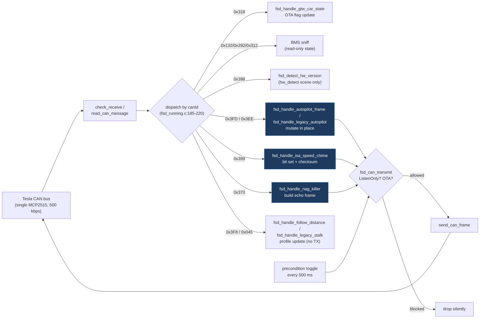
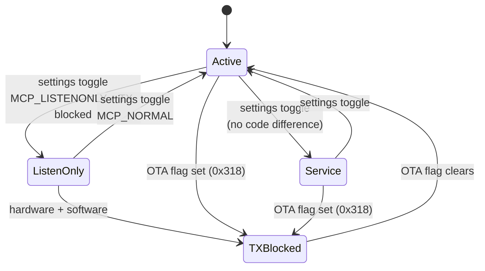

# J0811-flipper-tesla-fsd

## 1. Provenance

- **Submodule path:** `legacy/J0811-flipper-tesla-fsd`
- **Pinned gitlink (canonical form):** `160000 40e090562ce7c3677cea66329c023bf5327d6109 0` — matches `git -C legacy/J0811-flipper-tesla-fsd rev-parse HEAD`; `git status --porcelain` clean at analysis time.
- **Upstream URL:** `https://github.com/J0811/flipper-tesla-fsd` (fork of `hypery11/flipper-tesla-fsd`; README badges and the in-app About screen at `scenes/about.c:20` still credit hypery11).
- **License:** GPL-3.0 (`LICENSE`, RANGE-CITED lines 1-5, standard GPLv3 preamble).
- **Analysis date:** 2026-11-21.
- **Mode:** replace. The pre-replace doc exists in git history; pre-replace claims are cited below as `git show HEAD:docs/legacy/J0811-flipper-tesla-fsd.md` (line-anchored). The replaced doc's YAML frontmatter was preserved byte-for-byte (no trailing whitespace was found on the description line, so nothing was stripped; the description sentence is truncated mid-word — "It auto-detect" — inherited, kept as bytes). The replaced doc contained **no** `## Upstream (...)` sections, so there was nothing to re-attach after section 14.
- **Files read (upstream, FULL-READ):** `fsd_logic/fsd_handler.h` (1-98), `fsd_logic/fsd_handler.c` (1-270), `tesla_fsd_app.c` (1-85), `tesla_fsd_app.h` (1-72), `scenes/fsd_running.c` (1-289), `scenes/hw_detect.c` (1-122), `scenes/hw_select.c` (1-42), `scenes/settings.c` (1-92), `scenes/main_menu.c` (1-77), `scenes/about.c` (1-34), `scenes_config/app_scene_config.h` (1-6), `scenes_config/app_scene_functions.c` (1-26), `scenes_config/app_scene_functions.h` (1-25), `libraries/mcp_can_2515.h` (1-398), `libraries/mcp_can_2515.c` (1-773), `libraries/Spi_lib.h` (1-23), `libraries/Spi_lib.c` (1-83), `libraries/log_user.h` (1-20), `README.md` (1-193), `changelog.md` (1-40), `application.fam` (1-15), `.github/RELEASE_v1.0.0.md` (1-27), `.github/UPSTREAM_GITLAB_ISSUE.md` (1-30).
- **Files read (upstream, RANGE-CITED):** `README_zh-TW.md` (only grep-verified lines 22-23, 123, 131, 142, 150-152 — CAN ID claims match the English README), `LICENSE` (lines 1-5).
- **Files explicitly NOT read:** `.github/ISSUE_TEMPLATE_ROGUEMASTER.md`, `.github/ISSUE_TEMPLATE_UNLEASHED.md`, `.github/REDDIT_POST.md` (marketing/submission templates, no protocol claims), `.gitignore`, `.DS_Store` (committed macOS noise — provenance smell, no content value), all images (`icon.png`, `assets/fsd_splash.png`, `images/social_preview.png`, `images/wiring_diagram.png`, `screenshots/*.png`).
- **Our-side files read for parity (all citations in sections 11 and 16):** `firmware/lib/vehicle/can/handler/variant/hw4.h`, `hw3.h`, `legacy.h`, `bits.h` (FULL-READ); `handler/helpers.h`, `handler/frame_readers.h`, `handler/dispatch.h`, `handler/ticks.h` (FULL-READ); `handler/filters.h`, `handler/bus/vehicle.h`, `firmware/lib/vehicle/can/ids.h`, `firmware/lib/core/types.h` (RANGE-CITED — exact ranges cited per row); `feature/fsd/{fsd,profile,offsets,isa_chime,nag}.h`, `feature/misc/variant.h`, `feature/comfort/precondition.h`, `feature/telemetry/bms.h`, `vehicle/can/checksum.h`, `vehicle/can/burst.h`, `core/can/health.h`, `core/driver/common.h` (FULL-READ of cited functions); `firmware/platformio.ini` (RANGE-CITED lines 21-22, 79, 116, 119); `firmware/lib/io/schemas/io.schema.json` (RANGE-CITED lines 1205, 1267, 1578, 1599, 1620, 1632).

## 2. Executive verdict

A single-bus Flipper Zero FAP that read-modify-retransmits Tesla autopilot UI frames: auto-detects HW3/HW4 from `GTW_carConfig` (0x398), flips FSD-enable bits on `UI_autopilotControl` (0x3FD, legacy 0x3EE), clears the nag bit, and optionally echoes EPAS 0x370 with counter+1 to spoof hands-on at the sensor layer. v2.3 added a live BMS sniff (0x132/0x292/0x312) and a 500 ms `UI_tripPlanning` (0x082) battery-precondition injector. Two mechanisms are genuinely ahead of our shipping firmware and are adaptation candidates: the OTA TX guard (0x318 byte6 bits[1:0] → global TX pause; our side defines the CAN ID, advertises `otaInProgress` in `io.schema.json`, but has no handler) and hardware listen-only mode (MCP2515 REQOP). The 0x370/0x399 mutation machinery, profile/offset encodings, and HW-detect are all already present in our firmware — usually as strict supersets. The BMS decoders contradict ours on byte order (both sides CODE-READ, mutually exclusive) and must be settled by capture before any port. The vendored MCP2515 driver has real latent bugs (`sizeof(data)` on a pointer parameter, a copy-paste TX-status test) — never port it. Service mode is a UI no-op; the "unrestricted" comment is false.

## 3. Evidence map

No TEST-READ evidence exists: this repo ships no tests. No CAPTURE evidence exists in this repo: no frame dumps, no .trc/.csv captures.

| Source file | Lines | What it proves | Grade |
| ----------- | ----- | -------------- | ----- |
| `fsd_logic/fsd_handler.h` | 7-18 | All 12 CAN IDs used, single header table (`CAN_ID_AP_CONTROL 0x3FD` etc.) | CODE-READ |
| `fsd_logic/fsd_handler.c` | 87-95 | HW detect: `das_hw = (buffer[0] >> 6) & 0x03`; 2→HW3, 3→HW4, else Unknown; **no DLC guard** | CODE-READ |
| `fsd_logic/fsd_handler.c` | 16-28 | OTA guard: 0x318 `buffer[6] & 0x03` nonzero → `tesla_ota_in_progress`; `fsd_can_transmit()` blocks ListenOnly+OTA only | CODE-READ |
| `fsd_logic/fsd_handler.c` | 122-180 | HW3/HW4 0x3FD mutation: mux 0/1/2 branches, bit sets/clears, profile and offset encodings | CODE-READ |
| `fsd_logic/fsd_handler.c` | 195-217 | Legacy 0x3EE mutation: bit46+profile byte6[2:1] on mux0, bit19 clear on mux1 | CODE-READ |
| `fsd_logic/fsd_handler.c` | 221-230 | ISA chime: `buffer[1] |= 0x20`, checksum = sum(bytes0-6)+0x99+0x03 | CODE-READ |
| `fsd_logic/fsd_handler.c` | 234-270 | Nag killer echo: handsOnLevel==0 gate, fixed torque `0x08/0xB6`, counter byte6+1, checksum sum(bytes0-6)+0x70+0x03 | CODE-READ |
| `fsd_logic/fsd_handler.c` | 32-53 | BMS decode: V/I little-endian, SoC `(buffer[1]&0x03)<<8|buffer[0]`, temps bytes 4/5 | CODE-READ |
| `fsd_logic/fsd_handler.c` | 57-63 | Precondition frame: synthetic zeros, DLC 8, `buffer[0]=0x05` | CODE-READ |
| `scenes/fsd_running.c` | 117-148 | MCP2515 500 kbps @ 16 MHz crystal; ListenOnly→`MCP_LISTENONLY`; RXB0 exact-match filter, RXB1 open | CODE-READ |
| `scenes/fsd_running.c` | 155-244 | Worker loop: EFLG sample every 250 ms, precondition inject every 500 ms, per-ID dispatch, display refresh 250 ms | CODE-READ |
| `scenes/hw_detect.c` | 4-5, 22-29, 33 | 8 s detect timeout, 5 ms poll, filters pinned to 0x398 on both RX buffers | CODE-READ |
| `libraries/mcp_can_2515.c` | 4-13, 47-56 | `read_register`/`mcp_get_status` pass `sizeof(data)` where `data` is a `uint8_t*` — 4-byte read into 1-byte caller buffer | CODE-READ |
| `libraries/mcp_can_2515.c` | 431-442 | `read_rx_tx_status` tests `MCP_STAT_TX0IF` for all three TX-buffer checks (copy-paste) | CODE-READ |
| `README.md` | 40-47, 122-131 | HW bit table, firmware-compatibility warnings (2026.x versions) | SUMMARY-ONLY |
| `changelog.md` | 3-5, 14 | Claims `enhauto-re/CAN_DICTIONARY.md` and `enhauto-re/RESEARCH.md` exist | SUMMARY-ONLY (contradicted — see section 6) |
| `application.fam` | 1-15 | ufbt/fbt external app, entry `tesla_fsd_main`, stack 4096, appid `tesla_fsd`, version 2.3.0 | CODE-READ |

## 4. Architecture and build surface

- **Entry point:** `tesla_fsd_main()` (`tesla_fsd_app.c:76-85`) → scene manager + view dispatcher (Flipper GUI SDK). No serial/web/BLE transport exists anywhere; the only user surface is the on-device UI.
- **Shared core vs platform port:** `fsd_logic/` is pure C with no Flipper dependencies (only `mcp_can_2515.h` types); `libraries/` is the Flipper SPI port of the Electronic Cats MCP2515 driver; `scenes*/` is UI. The core logic (`fsd_handler.c`) is cleanly separable — this is the repo's main structural virtue.
- **Build:** Flipper `fbt`/`ufbt` external app (`application.fam`), `requires=["gui"]`, stack 4096, worker thread 2048 (`scenes/fsd_running.c:259`). No CI workflows, no tests, no build flags.
- **Hardware assumption:** one MCP2515 on the Flipper SPI GPIO header (`Spi_lib.h:10-13`, CS=PA4/SCK=PB3/MOSI=PA7/MISO=PA6), 8 MHz SPI preset (`Spi_lib.c:52`), 16 MHz crystal, 500 kbps (`fsd_running.c:118-119`).
- **Dependency boundary:** state is copied from UI app struct into `FSDState` once at worker start under mutex (`fsd_running.c:105-113`); settings toggles changed mid-run are only picked up on scene re-entry. No persistence layer — every toggle is runtime-only and resets on app exit (`tesla_fsd_app.c:43-51`).



## 5. Mechanism catalogue

### HW auto-detect (0x398 GTW_carConfig)

- **Claim (README / summary):** Auto-detect HW3/HW4 from `GTW_carConfig` (0x398), byte0 bits 6-7 (README:162; pre-replace doc line 57).
- **Code path:** `scenes/hw_detect.c:7-61` — `hw_detect_worker()` → filter 0x398 on both RX buffers → `fsd_detect_hw_version()` (`fsd_handler.c:87-95`) → scene event → `fsd_state_init(hw)`.
- **Frame spec:** 0x398 (920), DLC not checked; `das_hw = (buffer[0] >> 6) & 0x03`; 2→`TeslaHW_HW3`, 3→`TeslaHW_HW4`, 0/1→`TeslaHW_Unknown` (never Legacy).
- **Gates and timing:** 8 s timeout (`DETECT_TIMEOUT_MS 8000`), 5 ms poll; manual override menu (`scenes/main_menu.c:23-26`, `scenes/hw_select.c:14-15`).
- **State machine:** None found (two-shot poll → detected/timeout/fail events).
- **Tests:** None found.
- **Evidence grade:** CODE-READ.
- **Verdict:** CONFIRMED (claim matches code, including bit position).
- **Adapt to TeslaCANModder?** already present — ours adds an all-zero-frame rejection guard for Juniper/Giga Shanghai noise (`firmware/lib/vehicle/can/handler/bus/vehicle.h:440-449`) and maps 0/1→LEGACY.

### HW4 FSD mux mutation (0x3FD mux 0/1/2)

- **Claim (README / summary):** HW4 mode sets bit46 + bit60, bit47; 5-level profile 0-4 (README:44; pre-replace doc line 61).
- **Code path:** `fsd_running.c:216-219` → `fsd_handle_autopilot_frame()` HW4 branch (`fsd_handler.c:155-176`) → `send_can_frame`.
- **Frame spec:** 0x3FD (1021), DLC≥8. Mux = `buffer[0] & 0x07`. UI-FSD-selected gate = `buffer[4]>>6 & 0x01` (bypassed when `force_fsd`). Mux0: `fsd_set_bit(46)`, `fsd_set_bit(60)`, optional `fsd_set_bit(59)` when `emergency_vehicle_detect`. Mux1: clear bit19, set bit47. Mux2: `buffer[7] = (buffer[7] & ~0x70) | ((profile & 0x07) << 4)`. No counter or checksum on this frame (pure bit passthrough).
- **Gates and timing:** mutation only when `fsd_enabled` latched from UI bit on mux0; every real frame retransmitted mutated; no interval logic.
- **State machine:** None found (stateless per-frame mutation).
- **Tests:** None found.
- **Evidence grade:** CODE-READ.
- **Verdict:** CONFIRMED.
- **Adapt to TeslaCANModder?** already present — ours is a superset (also sets bits 38/39; `firmware/lib/vehicle/can/handler/variant/hw4.h:136-147`, `bits.h:19-23`).

### HW3 FSD mux mutation (0x3FD mux 0/1/2)

- **Claim (README / summary):** HW3 sets bit46, 3-level profile 0-2 (README:43).
- **Code path:** `fsd_handle_autopilot_frame()` HW3 branch (`fsd_handler.c:130-154`).
- **Frame spec:** 0x3FD, DLC≥8. Mux0: `fsd_set_bit(46)` + profile into `buffer[6]` bits[2:1] (`(buffer[6] & ~0x06) | ((profile & 0x03) << 1)`); also reads UI offset `((buffer[3] >> 1) & 0x3F) - 30`, ×5, clamp 0-100. Mux1: clear bit19. Mux2: offset written as `buffer[0]` bits[7:6] = `offset & 0x03`, `buffer[1]` bits[5:0] = `offset >> 2`.
- **Gates and timing:** same UI-latch gate as HW4.
- **State machine:** None found.
- **Tests:** None found.
- **Evidence grade:** CODE-READ.
- **Verdict:** CONFIRMED.
- **Adapt to TeslaCANModder?** already present — offset read/write formulas byte-identical to ours (`firmware/lib/vehicle/can/feature/fsd/offsets.h:17-50`).

### Legacy autopilot mutation (0x3EE + 0x045 stalk)

- **Claim (README / summary):** Legacy mode for HW1/HW2 Model S/X, frame 0x3EE instead of 0x3FD, "bit 46 FSD, bit 19 nag" (README:135; pre-replace doc line 59).
- **Code path:** `fsd_running.c:204-209` → `fsd_handle_legacy_stalk()` (`fsd_handler.c:184-193`) + `fsd_handle_legacy_autopilot()` (`fsd_handler.c:195-217`).
- **Frame spec:** 0x3EE (1006), DLC≥8, mux in `buffer[0] & 0x07`, same UI-bit gate at `buffer[4]>>6`. Mux0: `fsd_set_bit(46)` + profile `buffer[6]` bits[2:1]. Mux1: clear bit19. 0x045 (69) stalk, DLC≥2: `pos = buffer[1] >> 5`; pos≤1→profile 2, pos==2→profile 1, else 0.
- **Gates and timing:** only dispatched when `hw_version == TeslaHW_Legacy` (`fsd_running.c:204,206`); RXB0 filter accepts only 0x3EE + 0x045 in Legacy mode (`fsd_running.c:127-135`).
- **State machine:** None found.
- **Tests:** None found.
- **Evidence grade:** CODE-READ (bit layout); the README itself labels Legacy "**Looking for testers**" (README:131) — real-vehicle validity UNVERIFIED.
- **Verdict:** PARTIAL (code confirmed; vehicle behavior unvalidated by the upstream author).
- **Adapt to TeslaCANModder?** already present (`firmware/lib/vehicle/can/handler/variant/legacy.h:40-83`), equally unvalidated — neither repo has a capture proving 0x3EE mux behavior.

### Follow-distance → speed-profile mapping (0x3F8)

- **Claim (README / summary):** "Speed profile defaults to fastest, syncs from follow-distance stalk" (README:27); byte5 bits 5-7 (README:163).
- **Code path:** `fsd_running.c:214-215` → `fsd_handle_follow_distance()` (`fsd_handler.c:99-120`).
- **Frame spec:** 0x3F8 (1016), DLC≥6, `fd = (buffer[5] & 0xE0) >> 5`. HW3: 1→2, 2→1, 3→0. HW4: 1→3, 2→2, 3→1, 4→0, 5→4. Read-only, no TX.
- **Gates and timing:** none (always updates profile, no pinning concept).
- **State machine:** None found.
- **Tests:** None found.
- **Evidence grade:** CODE-READ.
- **Verdict:** CONFIRMED.
- **Adapt to TeslaCANModder?** already present — maps byte-identical (`firmware/lib/vehicle/can/feature/fsd/profile.h:43-58`); ours adds profile pinning (`profile:lock`).

### ISA speed-chime suppression (0x399, HW4)

- **Claim (README / summary):** "Kill the ISA speed warning chime (HW4 only, CAN ID 0x399)" (README:35; pre-replace doc line 58 — which misnames the frame "DAS_status").
- **Code path:** `fsd_running.c:210-213` → `fsd_handle_isa_speed_chime()` (`fsd_handler.c:221-230`).
- **Frame spec:** 0x399 (921), DLC≥8, write: `buffer[1] |= 0x20`; checksum `buffer[7] = (sum(buffer[0..6]) + 0x99 + 0x03) & 0xFF` (CAN ID bytes folded in, `fsd_handler.c:227`). Read-modify-retransmit.
- **Gates and timing:** `suppress_speed_chime` toggle; TX gate.
- **State machine:** None found.
- **Tests:** None found.
- **Evidence grade:** CODE-READ.
- **Verdict:** CONFIRMED (behavior); the pre-replace doc's frame *name* is wrong (see section 6).
- **Adapt to TeslaCANModder?** already present — byte, mask, and checksum byte-identical (`bits.h:47-50`, `checksum.h:47-56`).

### Nag killer — EPAS counter+1 echo (0x370)

- **Claim (README / summary):** "Nag Killer: CAN 880 counter+1 echo method — spoofs EPAS handsOnLevel to suppress nag at the sensor layer (ported from upstream MR !44)" (changelog.md:18; pre-replace doc line 56).
- **Code path:** `fsd_running.c:199-203` → `fsd_handle_nag_killer()` (`fsd_handler.c:234-270`) → `send_can_frame(echo)`.
- **Frame spec:** 0x370 (880), DLC≥8. Gate: handsOnLevel read from `buffer[4] >> 6 & 0x03`; echo only when it is 0. Echo frame: `buffer[0..1]` copied, `buffer[2] = 0x08`, `buffer[3] = 0xB6` (comment: torsionBarTorque = 1.80 Nm — the Nm interpretation is UNVERIFIED), `buffer[4] |= 0x40` (handsOnLevel = 1), `buffer[5]` copied, `buffer[6]` low nibble = source counter+1 (wraps 0x0F), `buffer[7] = (sum(buffer[0..6]) + 0x70 + 0x03) & 0xFF`.
- **Gates and timing:** `nag_killer` toggle; TX gate. No interval/jitter — echoes every eligible frame.
- **State machine:** None found (single gate, no escalation states).
- **Tests:** None found.
- **Evidence grade:** CODE-READ; "MR !44" provenance is UNVERIFIED (network-only).
- **Verdict:** CONFIRMED (code), UNVERIFIED (vehicle acceptance — no capture in repo).
- **Adapt to TeslaCANModder?** already present and superseded — our nag pipeline has 7 modes with organic state machine, feifan walk, and 12-bit torque encoding preserving `data[2]` high nibble (`nag.h:412-487`); upstream's full-byte `data[2]=0x08` write clobbers that status nibble. One cheap idea worth a bench test: upstream's gate reads handsOnLevel **in-frame** (0x370 byte4 bits[7:6]) — we already capture that as `nagOrganicRealHandsOn` (`handler/bus/vehicle.h:325`) but only use it for organic bypass.

### OTA TX guard (0x318 GTW_carState)

- **Claim (README / summary):** "OTA detection: monitors GTW_carState for GTW_updateInProgress and auto-suspends CAN TX when Tesla is pushing a firmware update" (changelog.md:9; pre-replace doc line 55).
- **Code path:** `fsd_running.c:184-187` → `fsd_handle_gtw_car_state()` (`fsd_handler.c:16-22`) → `state.tesla_ota_in_progress` → `fsd_can_transmit()` (`fsd_handler.c:24-28`).
- **Frame spec:** 0x318 (792), DLC≥7, read-only: `buffer[6] & 0x03` — any nonzero = OTA in progress (deliberately conservative, per in-code comment at `fsd_handler.c:18-19`).
- **Gates and timing:** global — blocks every TX path (autopilot, ISA, nag echo, precondition) while set; never cleared except by a subsequent frame reading zero.
- **State machine:** None found (boolean latch).
- **Tests:** None found.
- **Evidence grade:** CODE-READ.
- **Verdict:** CONFIRMED.
- **Adapt to TeslaCANModder?** **candidate for future PR** — our firmware defines `CAN_ID_GTW_CAR_STATE 0x318` (`firmware/lib/vehicle/can/ids.h:52`) with zero callers, and our wire schema already advertises `otaInProgress` (`firmware/lib/io/schemas/io.schema.json:1205,1267`) that no code ever populates; our reference docs promise the behavior (`docs/reference/can-protocol.md` "OTA Guard"). Byte/bit position needs capture-first validation, then `docs/checklists/can-review-checklist.md`.

### Operation modes and TX gate (Active / ListenOnly / Service)

- **Claim (README / summary):** "Operation modes: Active (RX+TX), ListenOnly (passive sniff), Service (unrestricted)" (pre-replace doc line 41, echoing `fsd_handler.h:30` comment "unrestricted, gates aggressive features").
- **Code path:** `scenes/settings.c:34-40,72-74` (3-option toggle) → copied into `state.op_mode` (`fsd_running.c:112`) → `mcp->mode = (op_mode == OpMode_ListenOnly) ? MCP_LISTENONLY : MCP_NORMAL` (`fsd_running.c:117`) → `fsd_can_transmit()` (`fsd_handler.c:24-28`).
- **Frame spec:** None found (transport-level gate, no frame).
- **Gates and timing:** ListenOnly = MCP2515 hardware listen-only register (REQOP 0x60, `mcp_can_2515.h:196`) **plus** software TX block — belt and suspenders. Service: no distinct code path anywhere; identical to Active.
- **State machine:** 3 states, one meaningful transition (Active↔ListenOnly); Service is decorative.



- **Tests:** None found.
- **Evidence grade:** CODE-READ.
- **Verdict:** PARTIAL — ListenOnly CONFIRMED; Service CONTRADICTED (see section 6 row 1).
- **Adapt to TeslaCANModder?** ListenOnly = candidate for future PR (hardware register mode; our driver has no listen-only API — negative anchor in section 16); Service = never port (no-op).

### BMS live sniff (0x132 / 0x292 / 0x312)

- **Claim (README / summary):** "Live BMS dashboard: parses 0x132 (voltage/current), 0x292 (SoC), 0x312 (battery temp)" (changelog.md:3; pre-replace doc lines 52-54). Templates credited to `tuncasoftbildik/tesla-can-mod` (`fsd_handler.c:30`).
- **Code path:** `fsd_running.c:188-197` → `fsd_handle_bms_hv/soc/thermal` (`fsd_handler.c:32-53`) → `FSDState` → display swap (`fsd_running.c:77-89`).
- **Frame spec:** 0x132 (306) DLC≥4: V = `((uint16_t)buffer[1] << 8 | buffer[0]) × 0.01` V (low byte first), I = `(int16_t)(buffer[3] << 8 | buffer[2]) × 0.1` A. 0x292 (658) DLC≥2: SoC = `((buffer[1] & 0x03) << 8 | buffer[0]) × 0.1` %. 0x312 (786) DLC≥6: Tmin = `buffer[4] - 40`, Tmax = `buffer[5] - 40` °C. All read-only, mode-independent.
- **Gates and timing:** none (pure sniff).
- **State machine:** None found.
- **Tests:** None found.
- **Evidence grade:** CODE-READ (upstream); byte order **contradicts our CODE-READ decoders** — see section 11 rows 14-16.
- **Verdict:** PARTIAL — mechanism confirmed; byte layout disputed between the two implementations, mutually exclusive; capture required.
- **Adapt to TeslaCANModder?** already present — but the byte-order conflict must be settled by bench capture before either side is trusted; do not port upstream's layout blindly.

### Precondition injection (0x082 UI_tripPlanning)

- **Claim (README / summary):** "Precondition toggle ... periodically injects UI_tripPlanning (0x082 byte[0]=0x05) every 500ms to trigger BMS battery preheat ... Goes through the OTA / listen-only TX gate" (changelog.md:4; pre-replace doc line 51).
- **Code path:** `fsd_running.c:169-176` → `fsd_build_precondition_frame()` (`fsd_handler.c:57-63`) → `send_can_frame`.
- **Frame spec:** 0x082 (130), DLC 8, synthetic zeros frame (not cached from bus), `buffer[0] = 0x05` (comment: bit0 tripPlanningActive + bit2 requestActiveBatteryHeating).
- **Gates and timing:** `precondition` toggle + `fsd_can_transmit` (ListenOnly/OTA); every 500 ms (`PRECOND_INTERVAL_MS`, `fsd_running.c:7`).
- **State machine:** None found.
- **Tests:** None found.
- **Evidence grade:** CODE-READ.
- **Verdict:** CONFIRMED.
- **Adapt to TeslaCANModder?** already present — our `preconditionTick` re-fires every 500 ms behind the AP gate (`firmware/lib/vehicle/can/handler/ticks.h:58-74`); delta: our stop path sends a 0x00 clear frame (`feature/comfort/precondition.h:19-27`), upstream just stops injecting.

### MCP2515 filter layout and driver surface

- **Claim (README / summary):** Not documented upstream (implicit in code).
- **Code path:** `scenes/fsd_running.c:126-148` → `init_mask`/`init_filter` (`mcp_can_2515.c:365-428`).
- **Frame spec:** None found (configuration).
- **Gates and timing:** HW3/HW4: RXB0 mask 0x7FF exact-match on 0x3FD (both filters), RXB1 mask 0x000 wide open — deliberate so 0x318/0x370/0x399/0x3F8 always reach software dispatch (`fsd_running.c:137-139` comment). Legacy: all six filters on 0x3EE/0x045. hw_detect: all six filters on 0x398.
- **State machine:** None found.
- **Tests:** None found.
- **Evidence grade:** CODE-READ.
- **Verdict:** CONFIRMED.
- **Adapt to TeslaCANModder?** no impact — ours uses per-bus exact-match filter lists via `driverSetBusFilters` (`firmware/lib/vehicle/can/handler/filters.h:55-96`) with auto-detect discriminators; different, equally valid mechanism. Driver itself: never port (section 14).

### Wiring sanity check + EFLG sampling (diagnostics)

- **Claim (README / summary):** "Wiring sanity check: shows a clear 'no CAN traffic — check wiring' warning after 5s with zero RX" and "CRC error counter sampled from MCP2515 EFLG register" (changelog.md:11-13).
- **Code path:** `fsd_running.c:17-31` (warning) + `fsd_running.c:159-167` (EFLG poll) → display lines TX/RX/Err (`fsd_running.c:67-73`).
- **Frame spec:** None found.
- **Gates and timing:** warning after 5000 ms with `rx_count == 0` (`WIRING_WARN_TIMEOUT_MS`); EFLG sampled every ~250 ms; any nonzero EFLG bit increments `crc_err_count` (misnamed — includes RX overflow and error-warning bits, not just CRC).
- **State machine:** None found.
- **Tests:** None found.
- **Evidence grade:** CODE-READ.
- **Verdict:** CONFIRMED.
- **Adapt to TeslaCANModder?** no impact — ours already has per-bus detection/receiving health (`firmware/lib/core/can/health.h:16-35`), 1 s frame-rate metering (`handler/helpers.h:42-62`), and **bus-off auto-recovery** (`firmware/lib/core/driver/common.h:204-219`) which upstream lacks entirely.

## 6. Summary vs code contradiction table

Pre-replace doc claims cited from git history: `git show HEAD:docs/legacy/J0811-flipper-tesla-fsd.md`.

| # | Claim (source) | Code reality (citation) | Verdict |
| - | -------------- | ----------------------- | ------- |
| 1 | "Service (unrestricted)" mode — `git show HEAD:docs/legacy/J0811-flipper-tesla-fsd.md` line 41, echoing `fsd_handler.h:30` | `OpMode_Service` has no distinct behavior: worker maps it to `MCP_NORMAL` (`fsd_running.c:117`) and `fsd_can_transmit` never tests it (`fsd_handler.c:24-28`). Only trace: the "SVC" display label (`fsd_running.c:53`). The header comment "gates aggressive features" is false — no gate exists. | CONTRADICTED |
| 2 | "0x399 (921) — DAS_status" — `git show HEAD:docs/legacy/J0811-flipper-tesla-fsd.md` line 58 | Code names 0x399 the ISA speed chime (`fsd_handler.h:9`); DAS_status lives on 0x39B in Tesla's actual layout (also our `ids.h`). ID and behavior correct, frame name wrong. | CONTRADICTED (name only) |
| 3 | "Speed profile defaults to fastest" — upstream `README.md:27`, repeated in `.github/RELEASE_v1.0.0.md:10` | True for HW3 (default 2, max 2) and HW4 (default 4, max 4) but **false for Legacy**: `fsd_state_init` sets profile 1 (`fsd_handler.c:9-10`) while the Legacy range is 0-2 (display `fsd_running.c:36`). | PARTIAL |
| 4 | "New `enhauto-re/CAN_DICTIONARY.md` references..." (`changelog.md:5`) and "notes ... live in `enhauto-re/RESEARCH.md`" (`changelog.md:14`) | No `enhauto-re/` directory exists in the pinned tree (`git ls-files` has no entry; on-disk check negative). The only `enhauto` matches are the changelog lines themselves. | CONTRADICTED |
| 5 | "DLC validation on all frame handlers" (`changelog.md:28`) | `fsd_detect_hw_version` reads `frame->buffer[0]` with no DLC check (`fsd_handler.c:87-89`) — and hw_detect's `CANFRAME frame` is an uninitialized stack local, so a DLC-0 0x398 read is stale memory. Ten handlers do guard (`fsd_handler.c` grep `data_lenght <` → 10 hits); this one does not. | PARTIAL |
| 6 | Screen shows "Frames modified: 12345" — upstream `README.md:108-114` | Actual display shows `HW/Profile`, `FSD/Nag [mode]`, `TX:%lu RX:%lu Err:%lu`, and a BMS-or-flags line (`fsd_running.c:46-93`). Cosmetic drift only. | PARTIAL (cosmetic) |

Treat the rest of the pre-replace doc as SUMMARY-ONLY until re-checked; its remaining frame-level claims (0x045, 0x082, 0x132, 0x292, 0x312, 0x318, 0x370, 0x398, 0x3EE, 0x3F8, 0x3FD) were spot-verified against code in section 5 and held up.

## 7. CAN frame and signal inventory

Single CAN bus (one MCP2515, 500 kbps, 16 MHz crystal; README calls it Party CAN / Bus 0, alternative tap X179 pins 13-14). Periods are not stated in code except where noted; frames are event-driven from the bus.

| ID (hex / dec) | Bus | Period | DLC | Byte/bit layout | Scale/units | Counter | Checksum | R/W | Grade |
| -------------- | --- | ------ | --- | --------------- | ----------- | ------- | -------- | --- | ----- |
| 0x045 / 69 | single | on RX | ≥2 | `data[1] bits[7:5]` stalk position | 3-bit pos | None found | None found | read | CODE-READ |
| 0x082 / 130 | single | 500 ms while toggled (`fsd_running.c:7,171`) | 8 | synthetic zeros; `data[0] = 0x05` (bits 0+2 per comment) | — | None found | None found | write (synthetic) | CODE-READ |
| 0x132 / 306 | single | on RX | ≥4 | V: `data[1]<<8 \| data[0]` (low byte first); I: `(int16)(data[3]<<8 \| data[2])` | ×0.01 V; ×0.1 A signed | None found | None found | read | CODE-READ |
| 0x292 / 658 | single | on RX | ≥2 | 10-bit SoC: `(data[1]&0x03)<<8 \| data[0]` (low byte first) | ×0.1 % | None found | None found | read | CODE-READ |
| 0x312 / 786 | single | on RX | ≥6 | Tmin: `data[4]-40`; Tmax: `data[5]-40` | °C | None found | None found | read | CODE-READ |
| 0x318 / 792 | single | on RX | ≥7 | OTA flag: `data[6] bits[1:0]`, nonzero = in progress | boolean | None found | None found | read (gates all TX) | CODE-READ |
| 0x370 / 880 | single | on RX | 8 | handsOnLevel `data[4] bits[7:6]` (gate); echo: `data[2]=0x08, data[3]=0xB6, data[4]\|=0x40, data[6] low nibble +1` | torque raw 0x08B6 (≈1.80 Nm claimed, UNVERIFIED) | `data[6] bits[3:0]` +1 | `data[7] = (sum(data[0..6]) + 0x70 + 0x03) & 0xFF` | read + write (echo) | CODE-READ |
| 0x398 / 920 | single | on RX | unchecked | `data[0] bits[7:6]` das_hw: 2=HW3, 3=HW4 | enum | None found | None found | read | CODE-READ |
| 0x399 / 921 | single | on RX | 8 | `data[1] \|= 0x20` chime-suppress bit | boolean | None found | `data[7] = (sum(data[0..6]) + 0x99 + 0x03) & 0xFF` | read + write | CODE-READ |
| 0x3EE / 1006 | single | on RX | 8 | mux `data[0] bits[2:0]`; UI gate `data[4] bit6`; mux0: bit46 + profile `data[6] bits[2:1]`; mux1: bit19 cleared | 2-bit profile | None found | None found | read + mutate + write | CODE-READ |
| 0x3F8 / 1016 | single | on RX | ≥6 | `data[5] bits[7:5]` follow distance | 3-bit fd | None found | None found | read | CODE-READ |
| 0x3FD / 1021 | single | on RX | 8 | mux `data[0] bits[2:0]`; UI gate `data[4] bit6`; HW3 mux0: bit46 + profile `data[6] bits[2:1]`, UI offset read `(data[3]>>1 & 0x3F)-30`; HW3 mux2: offset `data[0] bits[7:6]` + `data[1] bits[5:0]`; HW4 mux0: bits 46, 60, opt 59; HW4 mux1: bit19 clear, bit47 set; HW4 mux2: profile `data[7] bits[6:4]` | offsets ×5 clamp 0-100 | None found | None found | read + mutate + write | CODE-READ |

No DBC or JSON frame catalog is vendored (opendbc is credited in README:183 but not shipped), so no STRUCTURAL-PARSE rows apply.

## 8. Constants and tuning table

| Constant | Value | File:line | Meaning | Grade |
| -------- | ----- | --------- | ------- | ----- |
| `PRECOND_INTERVAL_MS` | 500 | `scenes/fsd_running.c:7` | precondition re-inject period | CODE-READ |
| `FSD_DISPLAY_REFRESH_MS` | 250 | `scenes/fsd_running.c:5` | UI refresh period | CODE-READ |
| `WIRING_WARN_TIMEOUT_MS` | 5000 | `scenes/fsd_running.c:6` | no-RX wiring warning threshold | CODE-READ |
| `DETECT_TIMEOUT_MS` / `DETECT_POLL_MS` | 8000 / 5 | `scenes/hw_detect.c:4-5` | HW detect window / poll | CODE-READ |
| EFLG sample period | ~250 ms | `scenes/fsd_running.c:161` | bus error register poll | CODE-READ |
| `MCP_500KBPS` + `MCP_16MHZ` | 500 kbps @ 16 MHz | `scenes/fsd_running.c:118-119` | bus speed and **crystal** assumption (our shipping envs default 8 MHz — `firmware/platformio.ini:79,116`) | CODE-READ |
| precondition payload | `0x05` | `fsd_handler.c:62` | tripPlanningActive + requestActiveBatteryHeating bits | CODE-READ |
| OTA mask | `data[6] & 0x03` | `fsd_handler.c:20` | GTW_updateInProgress, any-nonzero semantics | CODE-READ |
| nag echo torque | `0x08` / `0xB6` | `fsd_handler.c:250-251` | fixed 16-bit torque; comment claims 1.80 Nm (UNVERIFIED) | CODE-READ |
| nag echo handsOnLevel | `\| 0x40` | `fsd_handler.c:252` | forces handsOnLevel = 1 in byte4 bits[7:6] | CODE-READ |
| nag echo counter | byte6 low nibble +1 | `fsd_handler.c:256-258` | rolling counter position for 0x370 | CODE-READ |
| nag/ISA checksum | sum(bytes0-6) + CAN-ID bytes | `fsd_handler.c:227,264` | `+0x70+0x03` for 0x370, `+0x99+0x03` for 0x399 | CODE-READ |
| HW detect mask | `(data[0] >> 6) & 0x03` | `fsd_handler.c:89` | das_hw; 2=HW3, 3=HW4 | CODE-READ |
| UI-FSD gate | `data[4] >> 6 & 0x01` | `fsd_handler.c:84` | FSD selected in UI (bit38-adjacent gate) | CODE-READ |
| mux mask | `0x07` | `fsd_handler.c:78` | 3-bit mux in byte0 | CODE-READ |
| follow distance mask | `(data[5] & 0xE0) >> 5` | `fsd_handler.c:101` | stalk/dial position | CODE-READ |
| HW3 UI offset | `((data[3]>>1 & 0x3F) - 30) × 5`, clamp 0-100 | `fsd_handler.c:132-135` | speed offset decode | CODE-READ |
| HW3 profile write | `data[6] bits[2:1]`, mask `~0x06` | `fsd_handler.c:139-140` | 2-bit profile | CODE-READ |
| HW4 profile write | `data[7] bits[6:4]`, mask `~0x70` | `fsd_handler.c:172-173` | 3-bit profile | CODE-READ |
| HW3 offset write | `data[0] bits[7:6]` + `data[1] bits[5:0]` | `fsd_handler.c:149-152` | 8-bit offset split | CODE-READ |
| ISA suppress | `data[1] \|= 0x20` | `fsd_handler.c:223` | chime kill bit | CODE-READ |
| default profiles | HW4→4, Legacy→1, else→2 | `fsd_handler.c:7-12` | startup profile per variant | CODE-READ |
| legacy stalk map | pos≤1→2, ==2→1, else→0 | `fsd_handler.c:186-192` | stalk→profile | CODE-READ |
| BMS scales | ×0.01 V, ×0.1 A, ×0.1 %, −40 °C | `fsd_handler.c:36-37,44,50-51` | decode scales | CODE-READ |
| MCP2515 listen-only REQOP | `0x60` | `mcp_can_2515.h:196` | hardware no-TX mode | CODE-READ |

## 9. Failure modes and edge cases

| Failure | Handling code path | Tested? | Grade |
| ------- | ----------------- | ------- | ----- |
| MCP2515 absent / SPI dead | `mcp2515_init != ERROR_OK` → `TeslaFSDEventNoDevice` → "CAN Module Not Found" (`fsd_running.c:121-124,268-274`; `hw_detect.c:16-19`) | no | CODE-READ |
| No CAN traffic (wiring fault) | 5 s zero-RX → warning screen with swap-H/L, termination hints (`fsd_running.c:17-31`) | no | CODE-READ |
| Tesla OTA in progress | 0x318 flag → all TX blocked globally (`fsd_handler.c:16-28`) | no | CODE-READ |
| Bus error flags (overflow, error warn, TX warn) | EFLG polled every 250 ms, any bit → counter++ (`fsd_running.c:159-167`); RX0/RX1 overflow bits cleared (`mcp_can_2515.c:499-506`) | no | CODE-READ |
| **Bus-off** | **Not handled** — TXBO only increments the counter; no controller reset/recovery (contrast ours: `firmware/lib/core/driver/common.h:204-219` auto-resets) | no | CODE-READ |
| `read_register`/`mcp_get_status` `sizeof(data)` on pointer param | **Latent stack overrun**: 4-byte SPI read into 1-byte caller buffer on every register read (`mcp_can_2515.c:8-9,52-53`); line 451 is safe (`data` is a real array there) | no | CODE-READ |
| `read_rx_tx_status` TX1/TX2 checks | Copy-paste bug: all three test `MCP_STAT_TX0IF` (`mcp_can_2515.c:438-439`); receive path unaffected | no | CODE-READ |
| `set_new_mode` already-in-mode | Returns `false` when chip already in target mode (`mcp_can_2515.c:104`) — misleading API; callers ignore the value | no | CODE-READ |
| `set_new_mode` wake-from-sleep path | Checks `get_mode(spi) != MCP_LISTENONLY` then bails (`mcp_can_2515.c:115-117`) — appears wrong; dead code (sleep mode never requested anywhere) | no | CODE-READ |
| TX buffer exhaustion | `get_free_buffer == 0xFF` → `ERROR_ALLTXBUSY`, frame dropped silently (`mcp_can_2515.c:679`) | no | CODE-READ |
| TX never completes | 5-tick wait then gives up (`mcp_can_2515.c:666`) — silent drop, no retry/escalation | no | CODE-READ |
| DLC-0 / stale-frame read in HW detect | `fsd_detect_hw_version` lacks a DLC guard and `hw_detect_worker`'s `CANFRAME frame` is uninitialized stack (`hw_detect.c:9,41-42`; `fsd_handler.c:87-89`) | no | CODE-READ |
| Worker thread shutdown | `WorkerFlagStop` flag + join on scene exit (`fsd_running.c:155-157,279-287`) — correct | no | CODE-READ |
| State tearing UI↔worker | mutex-guarded copies (`fsd_running.c:105-113,222-229`); but toggles changed in Settings mid-run are not live — worker copies flags once at start, re-entry required | no | CODE-READ |
| `static` locals in driver | `get_free_buffer` status, `send_can_message` aux frame (`mcp_can_2515.c:606,627`) — single-thread safe here, not reentrant | no | CODE-READ |

## 10. Test coverage map

None found — the repo ships no test files, no test framework, no CI. Every mechanism in section 5 and every failure path in section 9 is untested. No TEST-READ evidence exists: this repo ships no tests.

Critical paths with NO test, and the risk in one line:

- Nag-echo checksum/counter (`fsd_handler.c:256-265`) — a wrong counter or checksum is undetectable until a real car rejects the frame; risk: silent feature failure on vehicle.
- OTA byte/bit position (`fsd_handler.c:20`) — a wrong bit means TX is never paused during a Tesla update; risk: update corruption.
- BMS byte order (`fsd_handler.c:34-44`) — inverted endianness yields garbage voltage/SoC; risk: wrong dashboard data only (read-only path).
- HW detect mask (`fsd_handler.c:89`) — wrong nibble → wrong variant → wrong mutation set applied to a live bus.
- MCP2515 driver SPI sequences — no hardware-in-loop test; the `sizeof(data)` overrun could exist for months unnoticed (it plausibly has).

## 11. Parity matrix with TeslaCANModder

All our-side citations are CODE-READ from `firmware/` at analysis time. Rows without an our-side citation would be SUMMARY-ONLY and are excluded.

| # | Signal / frame | Upstream decode (cite) | Our decode (cite) | Delta | Action |
| - | -------------- | ---------------------- | ----------------- | ----- | ------ |
| 1 | 0x398 das_hw | `fsd_handler.c:87-95`: `(buffer[0]>>6)&0x03`; 2→HW3, 3→HW4, else Unknown | `handler/bus/vehicle.h:438-481`: same bits; 3→HW4, 2→HW3, **0/1→LEGACY**; rejects all-zero frames (440-449) | ours richer (zero-frame guard, legacy fallback) | ignore |
| 2 | UI FSD-selected bit (0x3FD b4 bit6) | `fsd_handler.c:81-85` | `ids.h:119-121` | identical | already present |
| 3 | HW3 mux0 profile write (b6 bits[2:1]) | `fsd_handler.c:138-140` | `feature/fsd/profile.h:17-23` | identical mask `~0x06`, shift 1 | already present |
| 4 | HW3 UI offset read `-30`, ×5, clamp 0-100 | `fsd_handler.c:132-136` | `feature/fsd/offsets.h:31-50` | identical | already present |
| 5 | HW3 mux2 offset write (b0[7:6]+b1[5:0]) | `fsd_handler.c:148-153` | `feature/fsd/offsets.h:17-24` | identical | already present |
| 6 | HW4 mux0 FSD bits | `fsd_handler.c:157-163`: sets 46, 60 (+59 opt) | `handler/variant/hw4.h:136-147` + `bits.h:19-23`: sets 38, 39, 46, 60 (+59 opt) | ours is a superset (adds bits 38/39) | ignore (upstream subset) |
| 7 | HW4 mux1 nag bits | `fsd_handler.c:165-169`: clear 19, set 47 | `hw4.h:40-53` + `bits.h:42`: clear 19, set 47, + EAP/lane-graph/ECE-R79 extras | ours superset | already present |
| 8 | HW4 mux2 profile write (b7 bits[6:4]) | `fsd_handler.c:171-174` | `profile.h:30-36` | identical | already present |
| 9 | Follow-distance read + maps | `fsd_handler.c:99-120`: HW3 {1→2,2→1,3→0}, HW4 {1→3,2→2,3→1,4→0,5→4} | `ids.h:106-108` + `profile.h:43-58`: identical maps | none | already present |
| 10 | ISA chime (0x399 b1 bit5 + checksum) | `fsd_handler.c:221-230` | `bits.h:47-50` + `checksum.h:47-56` | byte/mask/checksum identical | already present |
| 11 | Legacy stalk (0x045 b1[7:5]) + 0x3EE mux | `fsd_handler.c:184-217` | `handler/variant/legacy.h:40-83` | identical thresholds and bits | already present (both unvalidated on-vehicle) |
| 12 | **OTA guard (0x318 b6 bits[1:0])** | `fsd_handler.c:16-28` + `fsd_running.c:182` | **absent** — `ids.h:52` defines the ID with zero callers; `io.schema.json:1205,1267` advertises `otaInProgress`, no code populates it | we lack the mechanism entirely; our docs already promise it | **capture-first, then implement** (top candidate) |
| 13 | Nag echo 0x370 | `fsd_handler.c:234-270`: gate on in-frame handsOnLevel==0 (b4[7:6]); fixed 0x08B6 torque; **counter b6**; handsOnLevel=1; full-byte torque write | `nag.h:412-487` + `handler/bus/vehicle.h:319-345`: 7 modes; counter **b1** (legacy/safe/natural) or **b6** (organic/feifan); 12-bit torque preserving `data[2]` high nibble; handsOnLevel 0/1/2 | counter-byte and torque-encoding conventions differ; ours already ships both counter positions | capture-first to validate b1 vs b6 acceptance; no port |
| 14 | BMS 0x132 V/I byte order | `fsd_handler.c:32-39`: **low byte first** (`b1<<8\|b0`) | `feature/telemetry/bms.h:18-33`: **big-endian** (`b0<<8\|b1`) | mutually exclusive layouts | **capture-first** — one side is wrong |
| 15 | BMS 0x292 SoC byte order | `fsd_handler.c:41-46`: `(b1&0x03)<<8\|b0` | `bms.h:50-54`: `(b0&0x03)<<8\|b1` | mutually exclusive | **capture-first** |
| 16 | BMS 0x312 temp bytes | `fsd_handler.c:48-53`: bytes **4/5** | `bms.h:61-74`: bytes **0/1** | mutually exclusive; note our own `docs/reference/can-protocol.md` says bytes 4/5 — our docs agree with upstream, our code disagrees with both | **capture-first** + internal reconciliation ticket |
| 17 | Precondition 0x082 `b0=0x05`, 500 ms loop | `fsd_running.c:169-176` | `handler/ticks.h:58-74` (`preconditionTick`) + `feature/comfort/precondition.h:19-27` | same payload/period; gate differs (theirs: ListenOnly/OTA; ours: AP gate); ours sends a 0x00 clear frame on off | already present |
| 18 | Hardware listen-only mode | `fsd_running.c:117` → `MCP_LISTENONLY` (REQOP 0x60) | absent — `grep -rniE 'listenonly\|REQOP' firmware/lib/core/driver` → no output; our passive posture is filter-based | we lack hardware-level no-TX guarantee | candidate (low priority) |
| 19 | EFLG sampling / bus-off | count-only (`fsd_running.c:159-167`) | poll + **auto bus-off recovery** (`core/driver/common.h:204-219`) + per-bus health (`core/can/health.h:16-35`) | ours richer | ignore |
| 20 | CAN crystal profile | fixed 16 MHz (`fsd_running.c:119`) | build-flag selectable, default 8 MHz (`platformio.ini:21-22,79,116`), runtime auto-detect via `canclock:auto` | platform-appropriate divergence | ignore |

## 12. Surface inventory and security notes

- **Transport surfaces:** none besides the Flipper UI. No serial console, no WiFi/BLE, no web endpoints, no file I/O, no network code. The only attack surface is physical: an app that mutates vehicle CAN frames.
- **UI surface (semantics):** main menu → Auto Detect & Start / Force HW3 / Force HW4 / Force Legacy / Settings / About (`scenes/main_menu.c:23-28`); Settings toggles: Force FSD, Suppress Chime, Emerg. Vehicle, Nag Killer, Mode (Active/Listen/Service), Precondition (`scenes/settings.c:56-78`).
- **Persistence:** none — every toggle is runtime state, reset on app exit (`tesla_fsd_app.c:43-51`). No storage API usage. (Contrast: ours persists to NVS.)
- **Credentials/keys/certs:** None found.
- **Untrusted archives / dangerous build flags:** None found. Build is a standard fbt/ufbt FAP manifest.
- **Provenance/security notes:** `.DS_Store` committed (macOS metadata noise — indicates commits made from a Mac desktop; no sensitive content observed). README/marketing encourage plugging into OBD-II; the wiring diagram (not read) claims the CAN Add-On termination resistor must be cut (README:64) — SUMMARY-ONLY.

## 13. Adaptation assessment

| Mechanism | Value | Cost | Risk | Evidence | Decision |
| --------- | ----- | ---- | ---- | -------- | -------- |
| OTA TX guard (0x318) | High — safety net our schema and docs already promise; blocks injection during Tesla updates | Low — one decode branch + one gate in our dispatch; landing spots exist (`ids.h:52`, `io.schema.json` `otaInProgress`) | Medium — byte/bit position from upstream CODE-READ only; wrong bit = no protection | CODE-READ (upstream) | **candidate for future PR** (capture-first, then `can-review-checklist.md`) |
| Hardware listen-only mode | Medium — hardware-guaranteed no-TX for bench capture sessions | Medium — new driver API in `core/driver`, command surface (`listen:on/off`) | Low — additive, no frame mutation | CODE-READ (upstream) | **candidate for future PR** |
| Nag-echo in-frame handsOnLevel gate (0x370 b4[7:6]) | Low-medium — a second, cheaper gate signal for echo modes; we already decode it (`vehicle.h:325`) | Low — one condition in `nagEchoShouldEcho` | Low — additive gate | CODE-READ (upstream) | candidate (bench-test first) |
| BMS byte-order resolution | High — one of the two repos decodes garbage | Low (bench capture + reconcile) | Low (read-only path) | CODE-READ both sides, contradictory | **capture-first, then fix whichever side is wrong** (ours may be the wrong one) |
| Precondition periodic injection | Already equal (500 ms, same payload) | — | — | CODE-READ both | already present |
| HW detect / FSD mux / profile / offset / ISA / legacy mutations | Upstream is a subset of what we ship | — | — | CODE-READ both | already present |
| EFLG diagnostics / wiring warning | Ours strictly richer (bus-off recovery) | — | — | CODE-READ both | already present |
| Service mode | None — behavioral no-op upstream | — | — | CODE-READ | never port |
| MCP2515 driver (`libraries/`) | None — ours exists and is safer | — | — | CODE-READ | never port (latent `sizeof` overrun, TX-status copy-paste, static locals) |

## 14. Do-not-copy list

- `libraries/mcp_can_2515.c:8-9` and `:52-53` — `furi_hal_spi_bus_rx(spi, data, sizeof(data), ...)` where `data` is a `uint8_t*` parameter: reads 4 bytes into callers' 1-byte buffers. Real stack-overrun pattern; line 451 is the only safe instance (array, not pointer).
- `libraries/mcp_can_2515.c:438-439` — TX1/TX2 buffer checks both test `MCP_STAT_TX0IF`; copy-paste bug.
- `libraries/mcp_can_2515.c:104-124` — `set_new_mode` returns `false` when already in the requested mode, and the sleep-wake path bails on a `MCP_LISTENONLY` check that looks wrong. Do not replicate this control flow.
- `libraries/mcp_can_2515.c:606,627` — `static` locals inside driver functions (`status`, `auxiliar_frame`): not reentrant.
- `fsd_handler.c:87-89` — `fsd_detect_hw_version` reads `buffer[0]` without a DLC guard (fed by an uninitialized stack `CANFRAME` in `hw_detect.c:9`). Copy the guard behavior, not the omission.
- `fsd_handler.c:250-251` — nag echo writes full `data[2]=0x08`, clobbering the byte's high-nibble status bits; our `nagEchoApply` 12-bit preserve path (`nag.h:468-475`) is the correct pattern.
- `mcp_can_2515.h:335` — `data_lenght` misspelling; do not copy upstream identifiers.
- `.DS_Store` — committed build noise; never import.
- License note: GPL-3.0, same as ours — compatible, but per repo rules port behavior and byte layouts only, with attribution comments and independent test oracles; never import legacy files into `firmware/`, `client/`, `packages/`, or `tools/`.

## 15. History and evolution

All history is local (`git -C legacy/J0811-flipper-tesla-fsd log`); 15 commits total, i.e. the pinned snapshot includes the repo's entire local history. Commit messages were reviewed; per-commit diffs were not re-read.

```text
40e0905 v2.3.0: live BMS dashboard, battery precondition trigger
09ad9a5 v2.2.0: OTA detect auto-stop TX, listen-only mode, CRC error counter, wiring sanity check
25316da add Featured on FSD CAN Mod Hub badge
2e698b7 v2.1.0: nag killer — CAN 880 counter+1 echo method
b093938 v2.0.0: Legacy mode, Force FSD, chime suppress, emergency detect, DLC validation
515ab42 add Flipper screenshots to README
e053c66 add badges, wiring diagram, social preview
b529bb8 add Traditional Chinese README
60ae02c add HW1/HW2 legacy support call for testers
3d66609 add screenshots and changelog for catalog submission
c23956a fix build: correct MCP2515 struct member names, remove deprecated API call
5d76aa1 add catalog metadata to application.fam
e959cfd set github username
79b547b add release notes, submission templates, launch posts
b7805e4 add app icon and splash assets
25c3181 initial release — Tesla FSD unlock for Flipper Zero
```

- **Trajectory:** v1.0 HW3/HW4 unlock → v2.0 breadth (legacy, force, chime, EVD, runtime settings) → v2.1 EPAS counter echo → v2.2 safety/diagnostics (OTA, listen-only, wiring check) → v2.3 telemetry comfort (BMS, precondition). Nothing was visibly rolled back; the one corrective commit is the build fix `c23956a` (struct member names + deprecated API removal) — evidence the vendored driver needed adaptation work, consistent with the latent bugs still in it.
- **Abandoned / vanished work:** the changelog's `enhauto-re/` research notes (CAN dictionary, S3XY Commander RE) are referenced at v2.2/v2.3 but absent from the tree — either never committed to this fork or removed before the pinned snapshot. Treat the "cross-source Tesla CAN signal dictionary" claims as leads, not evidence.
- **UNVERIFIED network claims (not checkable from the local repo):** "ported from upstream MR !44" (changelog.md:18); the Starmixcraft/CanFeather GitLab lineage (README:137,185); the GitLab issue template addressed to `Tesla-OPEN-CAN-MOD/tesla-open-can-mod` (`.github/UPSTREAM_GITLAB_ISSUE.md:30`) — a *different* upstream project than the README credit, which is worth resolving before citing provenance anywhere; "Already accepted into RogueMaster firmware" (same file:22); hypery11 issue #1 legacy captures (README:144).

## 16. Re-verification recipe

```bash
OLD=40e090562ce7c3677cea66329c023bf5327d6109
git -C legacy/J0811-flipper-tesla-fsd fetch --tags --prune
git -C legacy/J0811-flipper-tesla-fsd log --oneline $OLD..origin/main
git -C legacy/J0811-flipper-tesla-fsd diff --stat $OLD..origin/main
git -C legacy/J0811-flipper-tesla-fsd diff $OLD..origin/main -- fsd_logic/ scenes/ libraries/
git ls-files -s legacy/J0811-flipper-tesla-fsd   # must print: 160000 40e090562ce7c3677cea66329c023bf5327d6109 0
```

All anchors below were executed at write time (2026-11-21) and their expected hits pasted from actual output. Run them from the repo root; upstream anchors use `legacy/J0811-flipper-tesla-fsd/` as the working directory.

Upstream anchors:

```text
grep -nE 'CAN_ID_AP_CONTROL +0x3FD' fsd_logic/fsd_handler.h
  -> 12:#define CAN_ID_AP_CONTROL     0x3FD  // 1021 - autopilot control (HW3/HW4)

grep -nE 'in_progress = \(frame->buffer\[6\] >> 0\) & 0x03' fsd_logic/fsd_handler.c
  -> 20:    uint8_t in_progress = (frame->buffer[6] >> 0) & 0x03;

grep -nE '0x08|0xB6' fsd_logic/fsd_handler.c
  -> 250:    out->buffer[2] = 0x08;
  -> 251:    out->buffer[3] = 0xB6; // torsionBarTorque = 1.80 Nm

grep -nE 'sum \+= \(CAN_ID_EPAS_STATUS' fsd_logic/fsd_handler.c
  -> 264:    sum += (CAN_ID_EPAS_STATUS & 0xFF) + (CAN_ID_EPAS_STATUS >> 8);

grep -nE 'das_hw = \(frame->buffer\[0\] >> 6\)' fsd_logic/fsd_handler.c
  -> 89:    uint8_t das_hw = (frame->buffer[0] >> 6) & 0x03;

grep -nE 'buffer\[1\] << 8' fsd_logic/fsd_handler.c
  -> 34:    uint16_t raw_v = ((uint16_t)frame->buffer[1] << 8) | frame->buffer[0];   # little-endian BMS claim

grep -nE 'buffer\[4\] - 40|buffer\[5\] - 40' fsd_logic/fsd_handler.c
  -> 50: ... buffer[4] - 40 ... / 51: ... buffer[5] - 40                          # temp bytes 4/5

grep -nE '\(CAN_ID_ISA_SPEED & 0xFF\)' fsd_logic/fsd_handler.c
  -> 227:    sum += (CAN_ID_ISA_SPEED & 0xFF) + (CAN_ID_ISA_SPEED >> 8);

grep -nE 'OpMode_Service' fsd_logic/fsd_handler.h scenes/fsd_running.c
  -> fsd_handler.h:30 (enum + comment), fsd_running.c:53 ("SVC" label)  # no behavioral branch anywhere

grep -nE 'MCP_LISTENONLY' scenes/fsd_running.c
  -> 117:    mcp->mode = (state.op_mode == OpMode_ListenOnly) ? MCP_LISTENONLY : MCP_NORMAL;

grep -nE 'sizeof\(data\)' libraries/mcp_can_2515.c
  -> 9, 53 (pointer-param overrun), 451 (safe: array)

grep -nE 'data_lenght < 8' fsd_logic/fsd_handler.c
  -> 123, 196, 222, 235  # four DLC-8 guards; 0x398 detect is NOT among them

grep -nE 'DETECT_TIMEOUT_MS|PRECOND_INTERVAL_MS|WIRING_WARN' scenes/hw_detect.c scenes/fsd_running.c
  -> hw_detect.c:4 (=8000), hw_detect.c:33, fsd_running.c:6 (=5000), fsd_running.c:7 (=500), fsd_running.c:18, fsd_running.c:171
```

Negative anchors (absence claims):

```text
grep -nE 'enhauto' --include=*.c --include=*.h -r .      (in legacy/J0811-flipper-tesla-fsd)
  -> no output  # changelog-referenced enhauto-re/ files do not exist in code

grep -rn 'CAN_ID_GTW_CAR_STATE' firmware/lib | grep -v 'ids.h:52'
  -> no output  # our 0x318 define has no consumers

grep -rniE 'updateInProgress|otaInProgress|ota_in_progress|GTW_updateInProgress' firmware/lib --include=*.h --include=*.cpp
  -> no output  # otaInProgress exists only in io.schema.json (contract without implementation)

grep -rniE 'listenonly|listen_only|REQOP' firmware/lib/core/driver
  -> no output  # our driver has no hardware listen-only mode
```

Our-side drift anchors (the `already present` decisions rest on these):

```text
grep -nE 'data\[0\] << 8\) \| data\[1\]' firmware/lib/vehicle/can/feature/telemetry/bms.h
  -> 20, 83, 149, 406   # our big-endian convention, multiple frames

grep -nE 'data\[0\]\) - 40|data\[1\]\) - 40' firmware/lib/vehicle/can/feature/telemetry/bms.h
  -> 63, 73   # our temp decode uses bytes 0/1, contradicting both upstream and our own reference doc

grep -nE 'precondLastMs' -r firmware/lib --include=*.h
  -> core/types.h:583 (field), handler/ticks.h:65,67 (periodic 500 ms re-fire)

grep -nE 'CAN_ID_GTW_CAR_CFG +0x398' firmware/lib/vehicle/can/ids.h
  -> 62   # our 0x398 define, byte[0] bits[7:6] per comment

grep -nE 'ISA_CHIME_SUPPRESS_MASK' firmware/lib/vehicle/can/handler/variant/bits.h
  -> 50 (0x20)

grep -nE 'writeHW3SpeedOffset|readHW3UiOffsetSteps' firmware/lib/vehicle/can/feature/fsd/offsets.h
  -> 17, 31
```

If line numbers drift more than ~10 lines, re-read the whole function; do not trust this document's numbers.

## 17. Open questions and explicitly not investigated

- **Pre-pin history:** the pinned SHA contains the repo's full local history (15 commits). Commit messages were reviewed; individual commit diffs before HEAD were NOT re-read. Network-side history (hypery11 parent repo, GitLab upstreams, MR !44, issue #1) was not fetched — all such claims stay UNVERIFIED.
- **`enhauto-re/` files:** referenced by `changelog.md:5,14`, absent from the pinned tree. Verify what happened via `git -C legacy/J0811-flipper-tesla-fsd log --all --diff-filter=D -- enhauto-re/` on a full clone, or against the hypery11 parent. Would settle whether the "cross-source CAN dictionary" work ever existed here.
- **BMS byte order (rows 14-16):** the single most consequential open question. A single bench capture of 0x132/0x292/0x312 with known pack voltage and SoC settles all three rows and may prove **our** decoders wrong (our own `docs/reference/can-protocol.md` agrees with upstream on temp bytes 4/5, contradicting our code at `bms.h:61-74`).
- **OTA bit position:** 0x318 byte6 bits[1:0] is upstream CODE-READ only, "treat any non-zero as in-progress" by their own admission (`fsd_handler.c:18-19`). Needs a live capture during an actual Tesla update, or a second independent implementation, before we ship a guard on it.
- **0x370 rolling-counter byte:** upstream uses byte6; our legacy/safe modes use byte1, organic/feifan byte6. Both cannot be simultaneously right for the same vehicle generation — capture needed.
- **Torque constant:** `0x08B6` = "1.80 Nm" is a comment claim only; no scale evidence in the repo.
- **Wiring claims:** OBD-II Party CAN and the X179 "Pin 18/19 on 26-pin" variant (README:66) — not verifiable from code; our repo's X179 pin table covers only pins 13-14. SUMMARY-ONLY.
- **Vehicle firmware compatibility table** (README:46,122-131 — 2026.2.9.x / 2026.8.6 broken on HW4): pure upstream assertion, no code or capture backing. SUMMARY-ONLY; do not import into our compatibility docs without independent confirmation.
- **Legacy (0x3EE) mode:** upstream author themselves labels it "Looking for testers" (README:131) — both repos ship an unvalidated bit layout for HW1/HW2.
- **Not investigated:** the binary/image assets, the marketing `.github` templates (RogueMaster/Unleashed issue templates, Reddit post), and the wiring diagram PNG. None can carry code claims.
