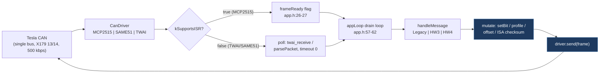
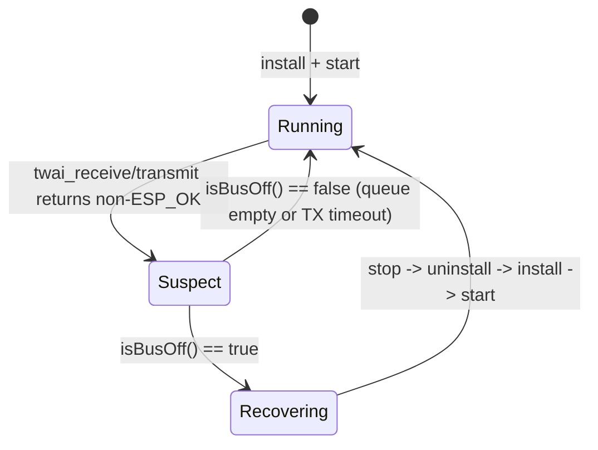

# JelloEa-Tesla-Open-CAN-Mod

## 1. Provenance

- **Submodule path:** `legacy/JelloEa-Tesla-Open-CAN-Mod`
- **Pinned gitlink (parent repo, canonical form):** `160000 ce475c30ee3b97657be41ffce412c4f9985afabe 0`
- **Submodule HEAD:** `ce475c30ee3b97657be41ffce412c4f9985afabe` — matches gitlink; `git status --porcelain` clean
- **HEAD commit:** `ce475c3 2026-03-31 Fix sync workflow: add contents write permission`
- **Upstream URL:** `https://github.com/JelloEa/Tesla-Open-CAN-Mod` (GitHub mirror; workflow syncs from `https://gitlab.com/Tesla-OPEN-CAN-MOD/tesla-open-can-mod.git`, see `.github/workflows/sync-upstream.yml:22`)
- **License:** GPL-3.0 (`LICENSE:1-4`, RANGE-CITED). Third-party: MIT (autowp MCP2515, Adafruit CAN) and Apache-2.0 (ESP-IDF) in `THIRD_PARTY_LICENSES:1-30` (RANGE-CITED; remainder is the standard license texts)
- **Analysis date:** 2026-11-20
- **Mode:** Replace. The original doc's YAML frontmatter is preserved byte-for-byte above (line endings normalized CRLF→LF per the hygiene contract; text characters unchanged). The frontmatter `description` is truncated mid-word in the source file itself ("...messages to e"); preserved as-is rather than silently repaired. The original doc had **no `## Upstream (...)` sections** to preserve; its replaced summary lives in git history (`git show HEAD:docs/legacy/JelloEa-Tesla-Open-CAN-Mod.md`).
- **Reading coverage:** No TEST-READ grades exist for driver/platform claims beyond the native Unity suite; `pio test -e native` was NOT executed in this analysis — test behavior is TEST-READ from source. No CAPTURE evidence exists in this repo. Coverage vocabulary per file below.

Files read in the submodule (FULL-READ):

| File | Lines |
| --- | --- |
| `include/handlers.h` | 1-177 |
| `include/app.h` | 1-63 |
| `include/can_frame_types.h` | 1-10 |
| `include/can_helpers.h` | 1-27 |
| `include/drivers/can_driver.h` | 1-12 |
| `include/drivers/mcp2515_driver.h` | 1-61 |
| `include/drivers/same51_driver.h` | 1-60 |
| `include/drivers/twai_driver.h` | 1-101 |
| `include/drivers/mock_driver.h` | 1-28 |
| `src/main.cpp` | 1-45 |
| `RP2040CAN.ino` | 1-62 |
| `platformio.ini` | 1-32 |
| `test/test_native_helpers/test_helpers.cpp` | 1-158 |
| `test/test_native_hw3/test_hw3_handler.cpp` | 1-167 |
| `test/test_native_hw4/test_hw4_handler.cpp` | 1-269 |
| `test/test_native_legacy/test_legacy_handler.cpp` | 1-139 |
| `test/test_native_twai/test_twai_filter.cpp` | 1-185 |
| `README.md` | 1-377 |
| `.github/workflows/sync-upstream.yml` | 1-38 |
| `lib/README` | 1-46 |
| `test/README` | 1-11 |
| `guides/WIRING_GUIDE.md` | 1-66 |
| `guides/FSD_SUBSCRIPTION_GUIDE.md` | 1-36 |
| `guides/INSTALLATION_GUIDE_M4_CAN.md` | 1-82 |
| `.gitignore` | 1-4 |

Files NOT read: `LICENSE` lines 11+ (standard GPL-3.0 text, RANGE-CITED 1-10), `THIRD_PARTY_LICENSES` lines 31+ (standard MIT/Apache-2.0 texts, RANGE-CITED 1-30), `guides/images/*.png` (3 binary images — pinout and connector photos).

Our-side files read for the parity matrix (CODE-READ citations): `firmware/lib/vehicle/can/handler/variant/hw4.h`, `hw3.h`, `legacy.h`, `bits.h`; `firmware/lib/vehicle/can/feature/fsd/profile.h`, `offsets.h`, `isa_chime.h`; `firmware/lib/vehicle/can/checksum.h`; `firmware/lib/vehicle/can/ids.h:85-122`; `firmware/lib/core/types.h:55-66`; `firmware/lib/core/can/bus.h`; `firmware/lib/core/can/id_filter.h`; `firmware/lib/core/driver/common.h:1-60`; `firmware/lib/vehicle/can/handler/frame_readers.h`; `firmware/lib/vehicle/can/handler/helpers.h`.

## 2. Executive verdict

This repo is the canonical minimal "FSD enabler": a single-bus (X179 pins 13-14) Arduino/PlatformIO firmware that echoes three FSD-related CAN frames back with a handful of bits flipped — bit 46 (+60/59 on HW4) on the 0x3FD/0x3EE mux-0 frame when the UI FSD-selected bit (data[4] bit 6) is seen, bit 19 cleared on mux 1, profile/offset fields rewritten on mux 2, plus an optional ISA-chime suppression on 0x399 with a recomputed additive checksum. Its value to TeslaCANModder is confirmation-grade, not adaptation-grade: every byte-level formula it ships (profile masks, offset bias −30 ×5, follow-distance maps, ISA checksum) is already present in our handlers with identical values, and in several places (HW4 mux-0 bits 38/39, HW4 mux-2 offset field, EAP/lane-graph/ECE-R79 additions) we are a deliberate superset. The genuinely interesting deltas are (a) upstream ships a *smaller* HW4 mux-0 bit set {46, 60, 59} that reportedly works on-vehicle, (b) the FSD-v13-on-HW4 (2026.8.x) → compile-as-HW3 operational note, and (c) the M5Stack Atomic CAN Base environment as a cheap tested ESP32 target — all three are capture-first backlog, not ports. Nothing here should be copied verbatim; the PlatformIO build story is actually broken as shipped (no vehicle-variant define in any env), and the wiring guides contradict each other on where X179 physically lives.

## 3. Evidence map

| Source file | Lines | What it proves | Grade |
| --- | --- | --- | --- |
| `include/handlers.h` | 26-62 | LegacyHandler: filter IDs {69, 1006}; stalk `data[1]>>5` → profile; mux0 bit 46 + profile; mux1 bit 19 clear | CODE-READ |
| `include/handlers.h` | 64-118 | HW3Handler: filter {1016, 1021}; fd map 1→2/2→1/3→0; offset `(data[3]>>1 & 0x3F)−30` ×5 clamp 0..100; mux2 offset write bytes 0-1 | CODE-READ |
| `include/handlers.h` | 120-177 | HW4Handler: filter {921, 1016, 1021}; ISA `data[1]|=0x20` + checksum; fd map 1→3/2→2/3→1/4→0/5→4; bits 46/60/59; mux1 bits 19/47; mux2 profile byte 7 | CODE-READ |
| `include/can_helpers.h` | 5-27 | `readMuxID` mask 0x07; `isFSDSelectedInUI` data[4] bit 6; `setSpeedProfileV12V13` data[6] bits 1-2; generic `setBit` | CODE-READ |
| `include/app.h` | 13-21 | Vehicle variant from build flags `HW4`/`HW3`/`LEGACY`, `#error` otherwise | CODE-READ |
| `include/app.h` | 26-48 | ISR flag pattern; Serial 115200; `setFilters` from handler filter IDs; init failure only prints | CODE-READ |
| `include/drivers/mcp2515_driver.h` | 15-34 | 500 kbps hardcoded with `MCP_16MHZ`; 6 exact-ID filters with 0x7FF masks | CODE-READ |
| `include/drivers/twai_driver.h` | 14-51 | TWAI 500 kbps, RX/TX queues 32/16, combined acceptance-mask filter math, driver reinstall on filter change | CODE-READ |
| `include/drivers/twai_driver.h` | 59-94 | Polling read (timeout 0), 10 ms TX timeout, bus-off detect + full reinstall recovery | CODE-READ |
| `include/drivers/same51_driver.h` | 11-56 | ATSAME51 native MCAN, standby/boost pins, combined-mask filter, polling | CODE-READ |
| `include/drivers/mock_driver.h` | 7-28 | Records sent frames for native unit tests | CODE-READ |
| `platformio.ini` | 1-32 | 4 hardware envs + native test env; no env defines the vehicle variant; M5 env pins 22/19, PIN_LED 27 | CODE-READ |
| `src/main.cpp` + `RP2040CAN.ino` | full | Driver selection via `#define`; `.ino` also carries vehicle defines; `main.cpp` does not | CODE-READ |
| `test/test_native_helpers` | 1-158 | Bit-helper exactness (setBit/readMuxID/isFSDSelectedInUI/setSpeedProfileV12V13) | TEST-READ |
| `test/test_native_legacy` | 1-139 | Stalk map, mux0/mux1 behavior, filter IDs | TEST-READ |
| `test/test_native_hw3` | 1-167 | fd map, FSDEnabled latch regression (shadowing bug), mux0/mux1/mux2, send counts | TEST-READ |
| `test/test_native_hw4` | 1-269 | fd 5-level map, bits 46/60/59, mux1 bits 19/47, mux2 profile, ISA incl. checksum 0xD1 case | TEST-READ |
| `test/test_native_twai` | 1-185 | Filter math extracted and verified for accept/reject cases incl. mask bits 0x065 | TEST-READ |
| `.github/workflows/sync-upstream.yml` | 1-38 | Daily 06:00 UTC auto-merge from GitLab upstream with `contents: write` | CODE-READ |
| `README.md` | 57-63, 82-107 | Variant table (HW4 row omits 921), CAN message tables, v13/v14 note | SUMMARY-ONLY |
| `README.md` | 113-118 | Board status claims ("Tested" vs "needs on-vehicle testing") | SUMMARY-ONLY |
| `README.md` | 140 | 120 Ω termination removal practice | SUMMARY-ONLY |
| `git show HEAD:docs/legacy/JelloEa-Tesla-Open-CAN-Mod.md` | 15-85 | Prior summary: platform list, CAN claims, reusability takeaways | SUMMARY-ONLY |

Agreements confirmed in code (kept out of the contradiction table): prior-summary claims at lines 59-71 (frame IDs, mux bits, layouts) all verify against `include/handlers.h`; line 85 (daily GitLab auto-sync) verifies against the workflow; line 61's "5 levels" verifies against the HW4 fd switch.

## 4. Architecture and build surface

Entry points: `src/main.cpp` (PlatformIO) and `RP2040CAN.ino` (Arduino IDE) both call the templated `appSetup<Driver>()` / `appLoop<Driver>()` in `include/app.h:29-63`. The driver is chosen at compile time (`DRIVER_MCP2515` / `DRIVER_SAME51` / `DRIVER_TWAI`, `src/main.cpp:10-25`); the vehicle variant is chosen at compile time (`HW4` / `HW3` / `LEGACY`, `include/app.h:13-21`). Shared core = handlers + helpers; platform port = `include/drivers/*`. No dependency boundary beyond `CanDriver` (5 virtual methods, `can_driver.h:5-11`). Build flags per env in `platformio.ini:1-32`; native test env `NATIVE_BUILD` strips Arduino calls (`handlers.h:9-11`, `app.h:9-11`).

Single bus only: everything lands on one CAN pair (X179 13/14 per `README.md:275-280`). No command transport exists — the only surface is a 115200 debug print. `enableEmergencyVehicleDetection` is a compile-time constant, not a setting.



## 5. Mechanism catalogue

### M1. Compile-time platform selection + driver abstraction

- **Claim (README / summary):** "abstract `CanDriver` interface so that all vehicle logic is shared across boards" (`README.md:312-324`).
- **Code path:** `src/main.cpp:27-44` → `appSetup<Driver>` / `appLoop<Driver>` (`app.h:29-63`) → `CanDriver` vtable (`can_driver.h:5-11`) → concrete `MCP2515Driver` / `SAME51Driver` / `TWAIDriver` / `MockDriver`.
- **Frame spec:** None found (plumbing).
- **Gates and timing:** `kSupportsISR` constexpr per driver selects ISR-flag vs pure polling (`app.h:43-45,52-55`); MCP2515 only ISR-capable (`mcp2515_driver.h:11`).
- **State machine:** None found (stateless template dispatch).
- **Tests:** `MockDriver` underpins all handler suites (`mock_driver.h:11-23`); no test drives the template wiring itself.
- **Evidence grade:** CODE-READ.
- **Verdict:** CONFIRMED.
- **Adapt to TeslaCANModder?** already present — we use per-platform drivers under `firmware/lib/core/driver/` plus native Unity suites instead of a virtual base.

### M2. Acceptance filtering

- **Claim (README / summary):** prior summary listed filtering as foundational (`git show HEAD:docs/legacy/JelloEa-Tesla-Open-CAN-Mod.md#79` "driver abstraction pattern").
- **Code path:** `appSetup` → `appDriver->setFilters(appHandler->filterIds(), ...)` (`app.h:42`) → per-driver: MCP2515 exact-ID ×6 with 0x7FF masks (`mcp2515_driver.h:23-34`); TWAI/SAME51 combined mask `base = ids[0] & ~differ`, TWAI layout `code = base << 21`, `mask = (differ << 21) | 0x001FFFFF` (`twai_driver.h:27-51`, `same51_driver.h:21-33`).
- **Frame spec:** 11-bit standard IDs only; mask bits that differ between any pair of wanted IDs become don't-care.
- **Gates and timing:** TWAI path reinstalls the whole driver to change filters (`twai_driver.h:47-50`); MCP2515 falls back to `ids[0]` for unused filter slots, silently ignoring `count > 6`.
- **State machine:** None found.
- **Tests:** `test_twai_filter.cpp:35-158` — accept/reject cases for all three ID sets plus exact mask-bit assertions (`0x065 << 21 | 0x001FFFFF`); MCP2515/SAME51 filter paths untested.
- **Evidence grade:** CODE-READ + TEST-READ (TWAI math only).
- **Verdict:** CONFIRMED (TWAI math), UNVERIFIED on hardware (no on-vehicle capture).
- **Adapt to TeslaCANModder?** no impact — we filter in software with a 2048-bit `IdFilter` (`firmware/lib/core/can/id_filter.h:25-115`) plus MCP2515 masks; the combined-mask trick is worth remembering only if we ever exceed 6 exact IDs or add a native-CAN board.

### M3. LegacyHandler (0x045 stalk → 0x3EE FSD mux)

- **Claim (README / summary):** "Sets FSD enable bit and speed profile control via follow distance" (`README.md:59`).
- **Code path:** `LegacyHandler::handleMessage` (`handlers.h:33-61`) → `readMuxID` → `isFSDSelectedInUI` → `setBit(46, true)` + `setSpeedProfileV12V13` → `driver.send`.
- **Frame spec:** 0x045 (69): `data[1] >> 5` = stalk position 0-7 (comment legend raw bytes 0x00/0x21/0x42/0x64/0x85/0xA6/0xC8, `handlers.h:35`). 0x3EE (1006) DLC 8: mux = `data[0] & 0x07`; mux0: UI FSD bit `data[4]` bit 6, set bit 46 (`data[5]` bit 6), profile `data[6]` bits 1-2; mux1: clear bit 19 (`data[2]` bit 3). Counter low 3 bits of `data[0]` echoed untouched; no checksum on this frame.
- **Gates and timing:** `FSDEnabled` latched from mux0 only; mux0 edits only when latched true; mux1 edits unconditional. Echo-per-received-frame; no intervals, no jitter, no pause windows.
- **State machine:** `FSDEnabled` bool latch (2 states; see M6).
- **Tests:** `test_legacy_handler.cpp:21-48` (stalk pos 0-3), `:52-86` (mux0 gating + bit 46 + profile), `:90-97` (mux1 bit 19), `:101-105` (unrelated ID ignored).
- **Evidence grade:** CODE-READ + TEST-READ.
- **Verdict:** CONFIRMED.
- **Adapt to TeslaCANModder?** already present — `handleLegacy` (`firmware/lib/vehicle/can/handler/variant/legacy.h:40-84`) has the identical stalk map and mux bits; ours adds ap-gate and log-once.

### M4. HW3Handler (0x3F8 follow distance → 0x3FD mux 0/1/2)

- **Claim (README / summary):** "calculate speed offset; set bit 46; write speed profile; clear bit 19; write speed offset to bits 6-7 of byte 0 and bits 0-5 of byte 1" (`README.md:95-97`).
- **Code path:** `HW3Handler::handleMessage` (`handlers.h:73-117`).
- **Frame spec:** 0x3F8 (1016): `data[5]` bits 7:5 = follow distance; map 1→profile 2, 2→1, 3→0. 0x3FD (1021) DLC 8: mux0 — UI FSD bit `data[4]` bit 6; offset steps `((data[3] >> 1) & 0x3F) - 30`; speedOffset = clamp(steps × 5, 0, 100); steps 2/1/0 → profile 2/1/0; set bit 46; profile → `data[6]` bits 1-2. mux1 — clear bit 19. mux2 — offset field: `data[0]` bits 7:6 = offset & 0x03, `data[1]` bits 5:0 = offset >> 2. Counter untouched; no checksum.
- **Gates and timing:** mux0/mux2 edits gated on latched `FSDEnabled`; mux1 unconditional. Event-driven echo.
- **State machine:** `FSDEnabled` latch (M6).
- **Tests:** `test_hw3_handler.cpp:21-48` (fd map incl. fd=0 keeps default 1), `:52-84` (latch regression pair), `:88-106` (bit 46, bit 19), `:110-131` (unrelated ID, send counts).
- **Evidence grade:** CODE-READ + TEST-READ.
- **Verdict:** CONFIRMED.
- **Adapt to TeslaCANModder?** already present — identical formulas in `readHW3UiOffsetSteps` / `calculateHW3SpeedOffset` / `writeHW3SpeedOffset` (`firmware/lib/vehicle/can/feature/fsd/offsets.h:17-50`) and `handleHW3` (`hw3.h:114-154`).

### M5. HW4Handler (0x399 ISA + 0x3F8 5-level + 0x3FD)

- **Claim (README / summary):** "ISA speed chime suppression (optional, disabled by default)"; mux0 sets bits 46, 60, 59; mux1 clears 19, sets 47; mux2 writes profile to bits 4-6 of byte 7 (`README.md:103-107`).
- **Code path:** `HW4Handler::handleMessage` (`handlers.h:129-176`).
- **Frame spec:** 0x399 (921) DLC 8: `data[1] |= 0x20`; checksum `data[7] = (sum(data[0..6]) + (921 & 0xFF) + (921 >> 8)) & 0xFF` = sum + 0x99 + 0x03 (`handlers.h:131-135`). 0x3F8: fd map 1→3, 2→2, 3→1, 4→0, 5→4 (`handlers.h:140-147`). 0x3FD (1021): mux0 — set bits 46, 60, and 59 (EVD, constexpr always-on `handlers.h:13`); mux1 — clear bit 19, set bit 47; mux2 — profile `data[7]` bits 6:4 (`handlers.h:166-167`). No offset read or write anywhere in the HW4 path. Counter untouched; no CRC anywhere in the repo.
- **Gates and timing:** ISA gated on `isaSpeedChimeSuppress` (default false, `handlers.h:14,121`) and returns early (`handlers.h:130-138`); no DLC check before indexing `data[7]`. mux0 gated on latch; mux1/mux2 unconditional. Event-driven echo.
- **State machine:** `FSDEnabled` latch (M6).
- **Tests:** `test_hw4_handler.cpp:21-54` (fd 5-level), `:58-72` (latch regression), `:76-102` (bits 46/60/59, no-send when disabled), `:106-138` (mux1 bits, mux2 profile incl. old-bits clearing), `:172-220` (ISA: disabled ignores 921, bit 0x20, preserves existing bits, checksum 0xD1 exact case, early return).
- **Evidence grade:** CODE-READ + TEST-READ.
- **Verdict:** CONFIRMED.
- **Adapt to TeslaCANModder?** already present — `handleHW4` (`hw4.h:65-169`) matches byte-for-byte on ISA and profile; deltas documented in the parity matrix (we add bits 38/39 on mux0, EAP/lane-graph/ECE-R79 on mux1, and a mux2 offset write upstream never does; our ISA path adds `apGateOpen` + DLC guard).

### M6. FSDEnabled latch (vehicle-UI trigger)

- **Claim (README / summary):** "FSD enable bit is set when 'Traffic Light and Stop Sign Control' is enabled" (`README.md:43,73`) — the semantic label for `data[4]` bit 6.
- **Code path:** mux0 → `isFSDSelectedInUI` (`can_helpers.h:9-11`) → `FSDEnabled` stored on the handler struct; consumed by mux0/mux2 branches (`handlers.h:45-46,86-87,151-152`).
- **Frame spec:** trigger = `data[4]` bit 6 of the mux0 frame (0x3FD HW3/HW4, 0x3EE legacy).
- **Gates and timing:** latch evaluated only on mux0; other muxes reuse the stored value.
- **State machine:** 2 states (latched false / latched true); no third state, so no state diagram per contract.
- **Tests:** `test_hw3_fsd_enabled_only_set_on_mux0` / `test_hw3_fsd_disabled_on_mux0_prevents_mux2_send` (`test_hw3_handler.cpp:52-84`), `test_hw4_fsd_enabled_only_set_on_mux0` (`test_hw4_handler.cpp:58-72`) — regression suite for the "FSDEnabled shadowing" bug fixed in `1c0a89a`.
- **Evidence grade:** CODE-READ + TEST-READ.
- **Verdict:** CONFIRMED; the "Traffic Light and Stop Sign Control" naming is SUMMARY-ONLY (README semantics for a bit our code labels `STEERING_MODE = 5`, `ids.h:111-114`).
- **Adapt to TeslaCANModder?** no impact — ours is command-driven (`fsd:on` + optional `fsd:force`), a deliberate divergence; the latch regression-test pattern is already reflected in our native suites.

### M7. TWAI bus-off detection and recovery

- **Claim (README / summary):** commit `068b3f1 Add ESP32 TWAI CAN driver with bus-off recovery`; no README prose.
- **Code path:** `TWAIDriver::read`/`send` → on ESP-IDF error → `isBusOff()` (`twai_driver.h:83-87`) → `recover()` = full `twai_stop` → `twai_driver_uninstall` → `twai_driver_install` → `twai_start` (`twai_driver.h:89-94`).
- **Frame spec:** None found (driver-level).
- **Gates and timing:** checked only when a TWAI API call fails (`twai_driver.h:62,77-79`); recovery is a cold restart of the whole controller; no backoff, no retry limit.
- **State machine:**



- **Tests:** None found — `test_native_twai` covers only the extracted filter math; `recover()` and `isBusOff()` are untested.
- **Evidence grade:** CODE-READ.
- **Verdict:** CONFIRMED code path, UNVERIFIED behavior (no test, no capture).
- **Adapt to TeslaCANModder?** no impact for shipping MCP2515 firmware; ours has its own MCP2515 error recovery in `firmware/lib/core/driver/common.h`. Candidate reference only if a native-CAN (TWAI) board target is ever added.

### M8. MCP2515 ISR flag + drain loop

- **Claim (README / summary):** `README.md:127` claims `PIN_CAN_INTERRUPT — interrupt pin (unused; polling mode)` — CONTRADICTED, see section 6.
- **Code path:** `canISR` sets `frameReady` (`app.h:26-27`) → `enableInterrupt` attaches FALLING interrupt (`mcp2515_driver.h:36-40`) → `appLoop` drains `while (appDriver->read(frame))` and toggles `PIN_LED` per batch (`app.h:57-62`).
- **Frame spec:** None found.
- **Gates and timing:** `delay(1500)` + up to 1000 ms Serial wait at boot (`app.h:32-35`); LED low during drain, high when idle.
- **State machine:** single volatile bool; 2 states; no diagram per contract.
- **Tests:** None found (no driver-level test).
- **Evidence grade:** CODE-READ.
- **Verdict:** CONFIRMED (and contradicts the README's "unused" note).
- **Adapt to TeslaCANModder?** no impact — our MCP2515 plumbing already uses ISR-driven flags plus a ring buffer.

## 6. Summary vs code contradiction table

| # | Claim (with citation) | Code (with citation) | Verdict |
| --- | --- | --- | --- |
| 1 | `README.md:61` — HW4 variant "Listens on CAN IDs 1016, 1021" | `handlers.h:124` — `ids[] = {921, 1016, 1021}` (also `README.md:103` lists 921) | CONTRADICTED (README variant table omits 921) |
| 2 | `README.md:127` — "`PIN_CAN_INTERRUPT` — interrupt pin (unused; polling mode)" | `mcp2515_driver.h:36-40` attaches a FALLING ISR; `app.h:43-45` enables it; `app.h:26-27` ISR flag | CONTRADICTED (stale note predating `a956db9`) |
| 3 | `README.md:228-231` — "Select your vehicle by editing the define near the top of `src/main.cpp`: `#define LEGACY`" | `src/main.cpp` has no such define (grep A8, no output); `platformio.ini` sets no `-DHW4/HW3/LEGACY` in any env (grep A9, no output); `app.h:20` `#error` fires without one | CONTRADICTED (PlatformIO path as documented cannot build; only `RP2040CAN.ino:24-26` carries the vehicle defines) |
| 4 | `README.md:34` — "ASS (Actually Smart Summon) is no longer restricted by EU regulations" | no summon/ASS code path anywhere in `include/ src/ test/` (grep A7, no output) | CONTRADICTED (docs-only claim from `8df284a`; no mechanism exists in code) |
| 5 | `README.md:74` — "Speed profile is derived from the scroll-wheel offset or follow-distance setting" (presented as general behavior) | HW3 only: both sources (`handlers.h:74-82` and `:88-95`); HW4 has no offset source — profile comes solely from 0x3F8 (`handlers.h:139-147`) | PARTIAL (over-generalized; HW4 never derives from offset) |
| 6 | `guides/WIRING_GUIDE.md:16` — X179 is in the "passenger side footwell" | `guides/INSTALLATION_GUIDE_M4_CAN.md:57` — X179 is "behind the driver's side trunk panel" | CONTRADICTED (upstream guides disagree with each other; unresolved here) |

Pre-replace summary (`git show HEAD:docs/legacy/JelloEa-Tesla-Open-CAN-Mod.md`): lines 59-71 and 79-85 checked claim-by-claim — no contradictions found beyond those above; line 84's "HW4 firmware version determines FSD version (v13 vs v14)" is a faithful paraphrase of `README.md:63` and remains SUMMARY-ONLY. The preserved frontmatter `description` line is truncated mid-word in the source file; kept byte-for-byte per replace-mode rules.

## 7. CAN frame and signal inventory

All frames live on the single upstream bus (X179 pins 13/14 — the connector pair our docs call the Chassis bus; see section 12 note). Period: not applicable — every write is an echo triggered by frame reception; no timers anywhere in the repo. DLC: never checked by any handler (no `dlc` reference in `include/handlers.h`, grep A13).

| ID (hex+dec) | Bus | Period | DLC | Byte/bit layout | Scale/units | Counter | Checksum | R/W | Grade |
| --- | --- | --- | --- | --- | --- | --- | --- | --- | --- |
| 0x045 (69) | single | n/a (echo) | 8 assumed | `data[1]` bits 7:5 = stalk position 0-7; raw legend 0x00=Pos1 … 0xC8=Pos7 (`handlers.h:35`) | position index | none | none | read-only | CODE-READ + TEST-READ |
| 0x399 (921) | single | n/a (echo) | 8 assumed, **unchecked** | `data[1]` bit 5 OR 0x20 (chime suppress); `data[7]` checksum | boolean | none on this frame | additive: `sum(data[0..6]) + 0x99 + 0x03`, low byte (`handlers.h:131-135`) | mutate + retransmit (HW4, opt-in default off) | CODE-READ + TEST-READ (checksum 0xD1 case) |
| 0x3EE (1006) | single | n/a (echo) | 8 assumed | mux = `data[0]` bits 2:0. mux0: read `data[4]` bit 6 (UI FSD); set bit 46 (`data[5]` bit 6); profile `data[6]` bits 2:1. mux1: clear bit 19 (`data[2]` bit 3) | profile 0-2 | `data[0]` bits 2:0 echoed untouched | none | read + mutate + retransmit (Legacy) | CODE-READ + TEST-READ |
| 0x3F8 (1016) | single | n/a (echo) | 8 assumed | `data[5]` bits 7:5 = follow distance 0-7 | HW3 uses 1-3; HW4 uses 1-5 | none | none | read-only | CODE-READ + TEST-READ |
| 0x3FD (1021) | single | n/a (echo) | 8 assumed | mux = `data[0]` bits 2:0. HW3 mux0: read `data[4]` bit 6; read `data[3]` bits 6:1 (offset steps); set bit 46; profile `data[6]` bits 2:1. HW4 mux0: set bits 46, 60, 59. mux1: clear bit 19; HW4 also set bit 47 (`data[5]` bit 7). HW3 mux2: offset `data[0]` bits 7:6 + `data[1]` bits 5:0. HW4 mux2: profile `data[7]` bits 6:4 | offset steps bias −30, ×5 → km/h-of-offset 0-100; profile 0-4 | `data[0]` bits 2:0 echoed untouched | none | read + mutate + retransmit | CODE-READ + TEST-READ |

No CRC-8/OPENSAFETY code exists anywhere in this repo (grep A12, no output) — unlike our `crc8.h` path for 0x229/0x249/0x370. Upstream never increments any frame counter; it echoes frames as received.

## 8. Constants and tuning table

| Constant | Value | File:line | Meaning | Grade |
| --- | --- | --- | --- | --- |
| `enableEmergencyVehicleDetection` | `true` (constexpr, always-on) | `handlers.h:13` | forces EVD bit 59 on every HW4 mux0 edit | CODE-READ |
| `DEFAULT_ISA_SPEED_CHIME_SUPPRESS` | `false` | `handlers.h:14,121` | ISA chime suppression opt-in | CODE-READ |
| `speedProfile` default | `1` | `handlers.h:17` | boot profile | CODE-READ |
| Stalk thresholds | `pos<=1 → 2; pos==2 → 1; else → 0` | `handlers.h:37-40` | legacy stalk → profile map | CODE-READ + TEST-READ |
| Stalk raw byte legend | 0x00/0x21/0x42/0x64/0x85/0xA6/0xC8 | `handlers.h:35` (comment only) | documented stalk positions 1-7 | CODE-READ (comment; legend values themselves UNVERIFIED) |
| HW3 fd map | 1→2, 2→1, 3→0 | `handlers.h:77-79` | follow distance → profile | CODE-READ + TEST-READ |
| HW4 fd map | 1→3, 2→2, 3→1, 4→0, 5→4 | `handlers.h:141-147` | 5-level map incl. "Sloth" profile 4 | CODE-READ + TEST-READ |
| HW3 offset steps | `((data[3]>>1)&0x3F) − 30` | `handlers.h:88-89` | UI offset steps, bias −30 | CODE-READ |
| HW3 speedOffset | `steps × 5`, clamp [0, 100] | `handlers.h:88` | offset in km/h-of-speed-units | CODE-READ |
| HW3 steps→profile | 2→2, 1→1, 0→0 | `handlers.h:90-95` | second profile source on mux0 | CODE-READ |
| `readMuxID` mask | `0x07` | `can_helpers.h:6` | mux/counter low 3 bits of byte 0 | CODE-READ + TEST-READ |
| `isFSDSelectedInUI` | `data[4] >> 6 & 0x01` | `can_helpers.h:10` | UI FSD-selected trigger bit | CODE-READ + TEST-READ |
| `setSpeedProfileV12V13` | `data[6] &= ~0x06; \|= profile << 1` | `can_helpers.h:14-15` | profile bits 2:1 of byte 6 | CODE-READ + TEST-READ |
| FSD bits | 46 (EAP), 60 (DAS dev/V14), 59 (EVD), 19 (nag), 47 (nag-organic) | `handlers.h:47,52,153-156,161-162` | the whole mutation vocabulary | CODE-READ + TEST-READ |
| HW4 profile field | `data[7]`: clear `0x07<<4`, set `(profile & 0x07) << 4` | `handlers.h:166-167` | 3-bit profile in byte 7 bits 6:4 | CODE-READ + TEST-READ |
| HW3 offset field | `data[0]` bits 7:6 (`& 0x03 << 6`) + `data[1]` bits 5:0 (`>> 2`) | `handlers.h:105-108` | 8-bit offset split across bytes 0-1 | CODE-READ + TEST-READ |
| ISA suppress | `data[1] \|= 0x20`; checksum `+0x99 +0x03` | `handlers.h:131-135` | chime bit + ID-bytes checksum | CODE-READ + TEST-READ |
| MCP2515 bitrate | `CAN_500KBPS, MCP_16MHZ` | `mcp2515_driver.h:17` | hardcoded 16 MHz crystal assumption | CODE-READ |
| MCP2515 filter masks | `0x7FF` exact ×6 | `mcp2515_driver.h:25-32` | exact-ID acceptance | CODE-READ |
| TWAI queues | RX 32, TX 16 | `twai_driver.h:16-17` | buffering depth | CODE-READ |
| TWAI TX timeout | `pdMS_TO_TICKS(10)` | `twai_driver.h:77` | send blocking bound | CODE-READ |
| TWAI filter layout | `code = base << 21`, `mask = (differ << 21) \| 0x001FFFFF` | `twai_driver.h:41-44` | standard-frame single filter | CODE-READ + TEST-READ |
| TWAI default pins | TX GPIO5, RX GPIO4; M5: TX 22, RX 19, `PIN_LED 27` | `src/main.cpp:18-21`, `platformio.ini:27` | board pin maps | CODE-READ |
| Boot timing | `delay(1500)`; Serial wait ≤ 1000 ms; 115200 baud | `app.h:32-35` | startup sequencing | CODE-READ |

## 9. Failure modes and edge cases

| Failure | Handling code path | Tested? | Grade |
| --- | --- | --- | --- |
| TWAI bus-off | `isBusOff()` on RX/TX error → `recover()` full reinstall (`twai_driver.h:62,77-79,83-94`) | no | CODE-READ |
| MCP2515 init failure | prints "CAN init failed", continues running with a dead driver, no retry (`app.h:38-40`) | no | CODE-READ |
| DLC shorter than 8 | none — handlers index `data[7]` etc. without any DLC check (`handlers.h:130-135` and all mux branches; grep A13 no `dlc` hit). A short 0x399 frame would be echoed with a garbage checksum | no | CODE-READ |
| MCP2515 filter count > 6 | extras silently ignored via `ids[0]` fallback (`mcp2515_driver.h:27-32`); max used today is 3 | n/a (unreachable today) | CODE-READ |
| TWAI filter change | full `twai_stop`/uninstall/install/start cycle — brief RX gap on every `setFilters` (`twai_driver.h:47-50`) | no (filter math tested, reinstall not) | CODE-READ |
| RX overflow | none: MCP2515 has 2 HW buffers behind one ISR flag; frames dropped silently under load; TWAI relies on the 32-deep queue; no overflow counter anywhere | no | CODE-READ (absence) |
| `MockDriver` drift | mock never models read() frames — all handler tests are send-side only (`mock_driver.h:17-19`) | inherent | CODE-READ |
| Watchdog / brownout / OTA | None found — no watchdog, no brownout hook, no OTA awareness | no | CODE-READ (absence) |
| MCP2515 send failure | `sendMessage` return ignored (void) (`mcp2515_driver.h:51-57`) | no | CODE-READ |

## 10. Test coverage map

Five native Unity suites, 83 `RUN_TEST` invocations total, run with `pio test -e native` (host-only; `platformio.ini:29-32`):

| Test file | Tests | What it asserts |
| --- | --- | --- |
| `test_native_helpers/test_helpers.cpp` | 18 | bit-exact `setBit` (incl. byte 5/7 targets), `readMuxID` masking, `isFSDSelectedInUI` bit 6, `setSpeedProfileV12V13` bits 1-2 with preservation |
| `test_native_legacy/test_legacy_handler.cpp` | 12 | stalk pos 0-3 → profiles, mux0 gating + bit 46 + profile write, mux1 bit 19, unrelated-ID silence, filter IDs {69, 1006} |
| `test_native_hw3/test_hw3_handler.cpp` | 13 | fd map incl. fd=0 default, FSDEnabled latch regression pair (shadowing bug), mux0 bit 46, mux1 bit 19, mux2 gating, send counts, filter IDs |
| `test_native_hw4/test_hw4_handler.cpp` | 23 | fd 1-5 → profiles 3/2/1/0/4, latch regression, bits 46/60/59, mux1 bits 19/47, mux2 profile write + old-bit clearing, ISA disabled/enabled/preserving/checksum 0xD1/early-return, filter IDs |
| `test_native_twai/test_twai_filter.cpp` | 17 | extracted combined-mask math: accepts wanted IDs, rejects 1000/500/0/100, exact mask `(0x065 << 21) \| 0x001FFFFF`, empty-count zero result |

Critical paths with NO test: all three real drivers (only `MockDriver` and the extracted TWAI filter function are exercised); `app.h` wiring (ISR flag, drain loop, init-failure path); `TWAIDriver::recover()`; `SAME51Driver::filter()` combined-mask path; every on-vehicle assumption — risk: the entire mutation set rests on code symmetry, never on a captured frame. `pio test -e native` itself was not executed during this analysis (TEST-READ grades come from reading the test sources).

## 11. Parity matrix with TeslaCANModder

Our-side citations are CODE-READ from the listed file:line. Upstream = `legacy/JelloEa-Tesla-Open-CAN-Mod`.

| Signal/frame | Upstream decode (cite) | Our decode (cite) | Delta | Action |
| --- | --- | --- | --- | --- |
| 0x3FD mux0 FSD bits | sets 46; HW4 adds 60, 59 — never 38 or 39 (`handlers.h:96,153-158`) | sets 38, 39, 46, 60 + 59 when `evdEnabled` (`bits.h:19-23`, `hw4.h:136-147`) | ours adds bits 38/39; upstream forces EVD always-on, ours toggles | capture-first — bench capture to decide whether 38/39 are required on HW4 |
| 0x3FD mux0 profile (HW3/legacy) | `data[6]` bits 2:1 (`can_helpers.h:13-16`) | `setSpeedProfileV12V13` same mask + DLC guard (`profile.h:17-23`) | ours adds DLC guard | ignore |
| 0x3FD mux1 | clear 19; HW4 set 47 (`handlers.h:52,161-162`) | clear 19, set 47, optional EAP 46, lane-graph 45, ECE-R79 bit 20 (`hw4.h:40-53`) | ours is a superset | ignore (deliberate) |
| 0x3FD mux2 HW3 offset field | `data[0]` bits 7:6 + `data[1]` bits 5:0 (`handlers.h:105-108`) | identical layout (`offsets.h:17-24`) | none | already present |
| 0x3FD mux2 HW4 profile | `data[7]` bits 6:4 (`handlers.h:166-167`) | identical (`profile.h:30-36`) | none | already present |
| 0x3FD mux2 HW4 offset | **not written upstream** (HW4 mux2 touches only byte 7) | ours writes `data[1]` bits 5:0 via `HW4_OFFSET_FIELD_MASK 0x3F` (`hw4.h:160-164`, `bits.h:53-54`) | ours-only extension, no upstream corroboration | capture-first (does the vehicle honor this field?) |
| HW3 offset derivation | steps `−30`, ×5, clamp 0-100 (`handlers.h:88-89`) | identical (`offsets.h:31-50`) | none (ours splits read/calc) | already present |
| HW3 steps→profile | 0/1/2 → 0/1/2 (`handlers.h:90-95`) | identical (`hw3.h:126-127`) | none | already present |
| 0x3F8 follow-distance maps | HW3 {1→2,2→1,3→0}; HW4 {1→3,2→2,3→1,4→0,5→4} (`handlers.h:75-81,140-147`) | identical maps (`profile.h:43-58`) | none | already present |
| 0x045 stalk map | `pos<=1→2, ==2→1, else→0` (`handlers.h:36-41`) | identical (`legacy.h:43-51`) | ours adds DLC ≥ 2 guard | already present |
| 0x399 ISA suppress + checksum | bit 5 of byte 1, checksum `sum+0x99+0x03` (`handlers.h:130-137`) | identical formula (`hw4.h:70-81`, `checksum.h:47-56`) | ours adds ap-gate, DLC ≥ 8 guard, HW4-variant gate | already present |
| UI FSD-selected bit | `data[4]` bit 6 (`can_helpers.h:9-11`) | identical (`ids.h:119-121`) | naming only: upstream README "Traffic Light and Stop Sign Control" vs our `STEERING_MODE = 5` comment | ignore |
| Mux read | `data[0] & 0x07` (`can_helpers.h:5-7`) | identical (`types.h:63-66`) | ours adds DLC guard | already present |
| FSD gating philosophy | latches vehicle-UI bit on mux0, zero user input (`handlers.h:45,86,151`) | user command `fsd:on` + optional force, per-frame UI check on mux0 (`hw3.h:120-123`, `hw4.h:134`) | deliberate design divergence | ignore |
| MCP2515 crystal | hardcoded `MCP_16MHZ` (`mcp2515_driver.h:17`) | runtime 8/16/20 with auto-fallback (`common.h:39-60`) | ours superset | already present |
| ID filtering | 6 exact-ID HW filters / combined mask (`mcp2515_driver.h:23-34`, `twai_driver.h:27-51`) | 2048-bit software `IdFilter` per bus (`id_filter.h:25-115`) | different mechanism, same goal | no impact |
| Bus architecture | single bus, X179 13/14 | 3 buses: chassis 0 / vehicle 1 / body 2 (`bus.h:12-26`) | ours superset | already present |

## 12. Surface inventory and security notes

| Surface | Semantics | Grade |
| --- | --- | --- |
| USB Serial @ 115200 | debug print only (`app.h:33`, `handlers.h:56-58,111-114,170-173`); **no command parser at all** — nothing like our JSON-RPC dispatch | CODE-READ |
| `.github/workflows/sync-upstream.yml` | daily 06:00 UTC merge from GitLab upstream using `secrets.GITHUB_TOKEN` with `contents: write` (lines 3-9, 27-38) | CODE-READ |
| Build envs | 4 hardware envs + native tests (`platformio.ini:1-32`) | CODE-READ |

Security/provenance: no hardcoded credentials, keys, certs, or archives anywhere; `.gitignore` covers `.pio/.vscode/.idea/.cursor` only. Naming note: `guides/WIRING_GUIDE.md:37-38` labels the X179 13/14 CAN pair "**Body Bus**" (via the Enhance Auto cable), while TeslaCANModder's `docs/reference/can-protocol.md` calls the same pins the **Chassis** bus — a label conflict to keep in mind when comparing captures, not a code bug.

## 13. Adaptation assessment

| Mechanism | Value | Cost | Risk | Evidence | Decision |
| --- | --- | --- | --- | --- | --- |
| M1 driver abstraction + mock | low (we have drivers + native tests) | low | low | CODE-READ + TEST-READ | already present |
| M2 acceptance filtering | low | low | medium (filter math on live bus) | CODE-READ + TEST-READ (TWAI math) | no impact |
| M3 legacy handler | confirmation of our byte layout | none | none | CODE-READ + TEST-READ | already present (identical) |
| M4 HW3 handler | confirmation of offset/profile formulas | none | none | CODE-READ + TEST-READ | already present (identical) |
| M5 HW4 handler | minimal-bit-set datapoint {46,60,59}; ours adds 38/39 + mux2 offset | a bench capture on HW4 | medium (frame mutation → can-review-checklist + listen-only capture first) | CODE-READ + TEST-READ | candidate for future PR (simplification study, capture-first) |
| M6 FSDEnabled latch | regression-test pattern | none | none | CODE-READ + TEST-READ | no impact (our gating is deliberately command-driven) |
| M7 TWAI bus-off recovery | only relevant if we add a native-CAN board | medium (new port) | medium | CODE-READ only | no impact today |
| M8 ISR flag + drain | we already have ISR + ring buffer | none | none | CODE-READ | already present |
| M5-adjacent: HW4 mux2 offset field (ours-only) | validate a field upstream never touches | one capture | low (listen-only) | CODE-READ (ours) vs absence (upstream) | candidate for future PR (confirm or remove, capture-first) |
| M5-adjacent: v13-on-HW4 → compile HW3 note (`README.md:63`) | informs our `variant:auto` edge cases | analysis only | low | SUMMARY-ONLY | backlog — capture-first, never port on SUMMARY-ONLY |
| M5-adjacent: M5Stack Atomic CAN Base env (`platformio.ini:24-27`) | cheap tested ESP32+CA-IS3050G target for our PlatformIO if we add M5 hardware | medium (new board env + wiring) | medium | CODE-READ (env) + SUMMARY-ONLY ("Tested") | candidate for future PR |

## 14. Do-not-copy list

| Item | File:line | Reason |
| --- | --- | --- |
| Inline `std::max(std::min(...))` offset clamp | `include/handlers.h:88-89` | duplicated expression; ours is already split into `readHW3UiOffsetSteps` + `calculateHW3SpeedOffset` (`offsets.h`) — port behavior, never the expression |
| Hardcoded `MCP_16MHZ` | `include/drivers/mcp2515_driver.h:17` | would regress our runtime 8/16/20 MHz clock-profile fallback (`core/driver/common.h`) |
| Full reinstall `recover()` cycle | `include/drivers/twai_driver.h:89-94` | heavyweight cold-restart pattern; do not transplant into our MCP2515 recovery path |
| Daily auto-merge workflow | `.github/workflows/sync-upstream.yml:27-38` | unreviewed upstream merges with `contents: write` — never wire this into our repo |
| FSD subscription region workaround | `guides/FSD_SUBSCRIPTION_GUIDE.md:1-36`, `README.md:24-30` | Tesla ToS workaround guidance; legal-risk content, keep out of our docs |
| Hand-edited `#define` selection blocks | `RP2040CAN.ino:18-26` | our build-flag/env system already covers this without user source edits |
| Any `include/handlers.h` / `can_helpers.h` source text | whole files | GPL-3.0 compatible but line-copying is still barred by our conventions; reimplement with our names, tab/Allman style, and an attribution comment |

## 15. History and evolution

Mined from the submodule's local `git log` (no network used; network-only claims stay UNVERIFIED):

- **2026-03-28:** `60d0e61` initial commit; `d620b1c` "licence"; `01ba780` "Refactor HW4Handler definition and cleanup setup function" — early shape was a single-board "canFeather" sketch.
- **2026-03-29:** `eef98dd` adds GPL-3.0 properly; `c24e323`/`61bd546`/`1852a48`/`c9050e3` successive README reworks; `87a2a66` merge of a cherry-pick branch — GitLab MR-style history ("Merge branch '...' into 'main'") shows this GitHub repo is a mirror of a GitLab original.
- **2026-03-30 (the heavy day):** `3bfb430` renames `canFeather.ino` → `RP2040CAN.ino` to go multi-board; `8df284a` docs-only "removal of EU restrictions for Actually Smart Summon" (no code ever followed — contradiction #4); `90303e8` "fixed legacy fsd activation & mapped distance control stalk to speed profiles" — the legacy path was broken before this; `edef8ba` moves vehicle variant to explicit defines; `8eae8b7` makes ISA chime opt-in (default off); `1c0a89a` "Fix FSDEnabled shadowing bug in HW3 and HW4 handlers" — mux2 frames could clear the latch; the regression test pairs in `test_hw3_handler.cpp:52-84` and `test_hw4_handler.cpp:58-72` guard it; `d1777d7` "Fixes: #12" (issue content UNVERIFIED); `934af44` MIT attribution; `500def0` adds PlatformIO, the CanDriver abstraction, unit tests, M4 CAN Express; `068b3f1` adds ESP32 TWAI with bus-off recovery (imported via cherry-pick `494deb1`); `a956db9` adds frame filtering + interrupt processing (and made README:127's "unused; polling mode" note stale — contradiction #2); `3772d09` documents the CAN message tables; `f93b75f` + `f19a00c` add M5Stack Atomic CAN Base with a GPIO fix; `286ed3f` adds the FSD subscription guide; `75aa4c1` adds the wiring guide.
- **2026-03-31:** `c92d851` include-path/header consolidation (last code-touching commit); `309dff6` moves the disclaimer to the top of the README; `3028c7a` + `ce475c3` (HEAD) add and fix the daily GitLab sync workflow — the repo is now an auto-updating mirror.
- **Abandoned/rolled back:** nothing visible in the log; `7b51a73` "fixed error" is too vague to classify.
- **Pre-pin history:** only the local mirror history (from `60d0e61`, 2026-03-28) was reviewed; whether the GitLab original has older history is UNVERIFIED and was not investigated.

## 16. Re-verification recipe

Pinned snapshot: gitlink `160000 ce475c30ee3b97657be41ffce412c4f9985afabe 0`; submodule HEAD `ce475c30ee3b97657be41ffce412c4f9985afabe`.

```bash
OLD=ce475c30ee3b97657be41ffce412c4f9985afabe
git -C legacy/JelloEa-Tesla-Open-CAN-Mod fetch --tags --prune
git -C legacy/JelloEa-Tesla-Open-CAN-Mod log --oneline $OLD..origin/main
git -C legacy/JelloEa-Tesla-Open-CAN-Mod diff --stat $OLD..origin/main
git -C legacy/JelloEa-Tesla-Open-CAN-Mod diff $OLD..origin/main -- include/ src/ test/ platformio.ini
git ls-files -s legacy/JelloEa-Tesla-Open-CAN-Mod   # compare gitlink to rev-parse HEAD
```

All anchors below were executed at write time with GNU grep (`grep -nE`, extended regex) from the submodule root; expected hits pasted from the actual run. "No output" means grep exit code 1.

Upstream anchors:

```text
grep -nE 'setBit\(frame, 46, true\)' include/handlers.h
  -> 47:, 96:, 153: (legacy/HW3/HW4 mux0 FSD bit)
grep -nE 'sum \+= \(921 & 0xFF\)' include/handlers.h
  -> 134: (ISA checksum adds ID low+high bytes)
grep -nE 'MCP_16MHZ' include/drivers/mcp2515_driver.h
  -> 17: (hardcoded 16 MHz crystal)
grep -nE 'acceptance_code = base << 21' include/drivers/twai_driver.h
  -> 42: (TWAI combined-mask filter)
grep -nE '\{921, 1016, 1021\}' include/handlers.h
  -> 124: (HW4 filter set — contradicts README:61)
grep -nE 'enableEmergencyVehicleDetection = true' include/handlers.h
  -> 13: (EVD forced always-on)
grep -nE 'attachInterrupt' include/drivers/mcp2515_driver.h
  -> 38: (contradicts README:127 "unused; polling mode")
grep -nE 'PIN_LED' include/app.h platformio.ini
  -> include/app.h:59,62 (used); platformio.ini:27 (defined only for the m5stack env)
grep -rnE 'summon|Actually Smart' include/ src/ test/
  -> no output (README ASS claim has no code)
grep -nE '#define (HW4|HW3|LEGACY)' src/main.cpp
  -> no output (README:228-231 PlatformIO instruction is broken)
grep -nE 'HW4|HW3|LEGACY' platformio.ini
  -> no output (no env defines the vehicle variant)
grep -rnE 'EPAS|0x370|torque' include/ src/ test/
  -> no output (no EPAS echo upstream)
grep -rnE 'crc|CRC' include/ src/
  -> no output (only the additive ISA checksum exists)
grep -nE 'dlc' include/handlers.h
  -> no output (no DLC guards in any handler)
```

Our-side drift anchors (from repo root; the `already present` decisions rest on these):

```text
grep -nE 'computeHW4IsaChecksum' firmware/lib/vehicle/can/checksum.h
  -> 47: (identical ISA checksum formula)
grep -nE 'FSD_BIT_AP_ACTIVE' firmware/lib/vehicle/can/handler/variant/bits.h
  -> 19: (bit 38, which upstream never sets)
grep -nE 'writeHW4SpeedProfile' firmware/lib/vehicle/can/feature/fsd/profile.h
  -> 30: (identical data[7] bits 6:4 write)
grep -nE 'calculateHW3SpeedOffset' firmware/lib/vehicle/can/feature/fsd/offsets.h
  -> 42: (identical steps ×5 clamp 0-100)
grep -nE 'MCP_8MHZ' firmware/lib/core/driver/common.h
  -> 24: (runtime clock profiles vs upstream's hardcoded MCP_16MHZ)
grep -nE 'isFSDSelectedInUI' firmware/lib/vehicle/can/ids.h
  -> 119: (identical data[4] bit 6)
grep -nE 'mapHW4FollowDistToProfile' firmware/lib/vehicle/can/feature/fsd/profile.h
  -> 54: (identical 5-level map)
grep -nE 'HW4_OFFSET_FIELD_MASK' firmware/lib/vehicle/can/handler/variant/hw4.h
  -> 163: (our mux2 HW4 offset write — absent upstream)
grep -nE 'stalk <= 1' firmware/lib/vehicle/can/handler/variant/legacy.h
  -> 46: (identical stalk map)
grep -nE 'idFilterTest' firmware/lib/core/can/id_filter.h
  -> 72: (our software filter, different mechanism)
```

If line numbers drift more than ~10 lines after an upstream bump, re-read the whole function; do not trust this document's numbers. Re-run `git ls-files -s legacy/JelloEa-Tesla-Open-CAN-Mod` first: if the gitlink no longer matches `ce475c30...`, this analysis describes the wrong snapshot.

## 17. Open questions and explicitly not investigated

- Pre-pin upstream history (GitLab before `60d0e61`, 2026-03-28) was NOT reviewed — only the pinned mirror snapshot.
- Whether `env:esp32_twai` compiles as shipped: `PIN_LED` is used in `include/app.h:59,62` but defined only in the `m5stack-atomic-can-base` env (`platformio.ini:27`) — the base env may fail to build. UNVERIFIED; `pio run -e esp32_twai` would settle it.
- Board status claims ("Tested" RP2040/Atomic, "needs on-vehicle testing" M4/ESP32, `README.md:113-118`) are SUMMARY-ONLY; no capture or CI build evidence exists in the repo.
- X179 physical location conflict (contradiction #6: footwell vs trunk panel) — needs vehicle-side confirmation; not investigable from source.
- The "Traffic Light and Stop Sign Control" semantic for `data[4]` bit 6 (`README.md:43`) vs our `STEERING_MODE = 5` comment (`ids.h:114`) — same bit, two labels; a decode of the UI settings frame would settle which label is right.
- What issue #12 (`d1777d7`) contained — network-only, UNVERIFIED.
- Whether the vehicle honors our HW4 mux2 offset field (`data[1]` bits 5:0) — upstream never writes it, so no independent corroboration exists.
- Whether the HW4 minimal bit set {46,60,59} suffices without our bits 38/39 — requires a listen-only bench capture on an HW4 vehicle; `docs/checklists/can-review-checklist.md` applies before any resulting firmware change.
- The stalk raw-byte legend (`handlers.h:35`, 0x00/0x21/0x42/…) is comment-only; the code only uses `>> 5`. The legend values themselves are UNVERIFIED.
- No CAPTURE evidence exists anywhere in this repo; every frame-layout claim above rests on CODE-READ symmetry with our independently written handlers, not on recorded vehicle frames.
