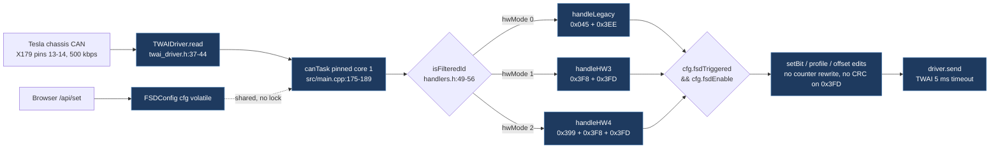
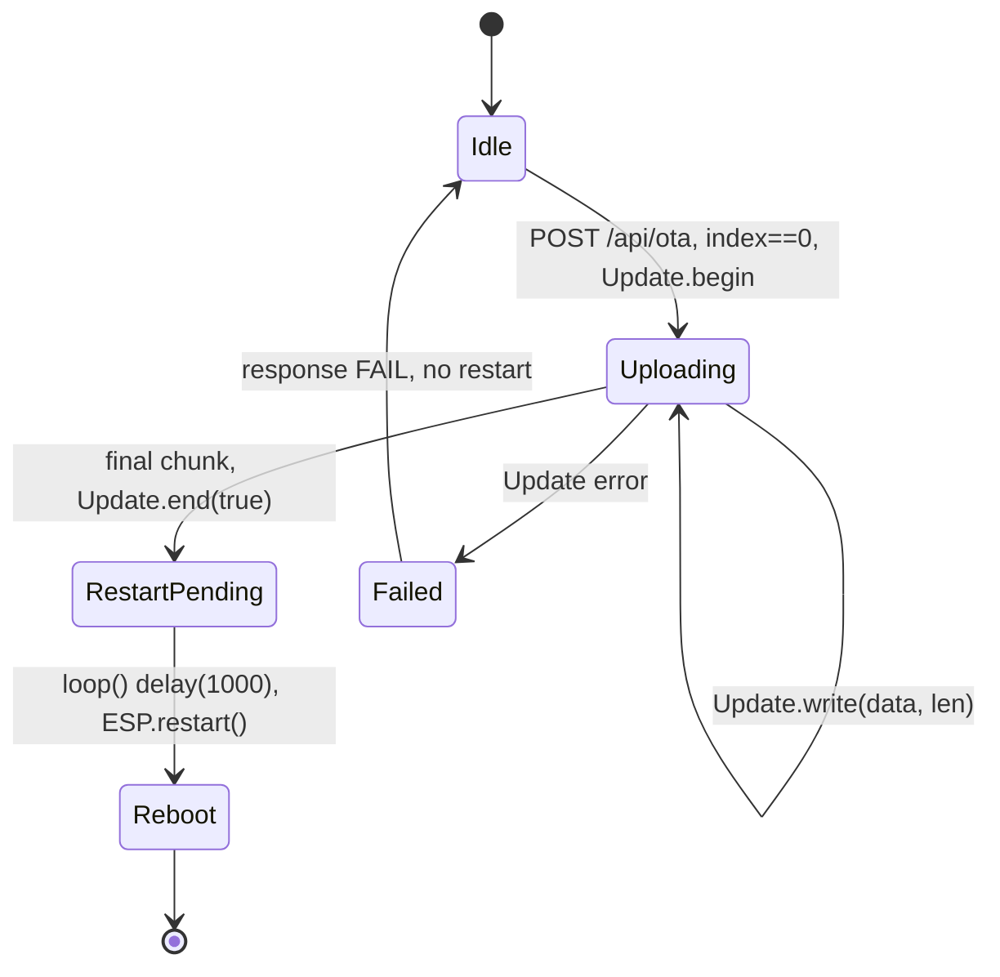

# JelloEa-tesla-fsd-controller

## 1. Provenance

- Submodule path: `legacy/JelloEa-tesla-fsd-controller`
- Pinned gitlink (canonical form from `git ls-files -s`): `160000 28268245aa8b462fb9aed8f5c08b831822e1e3ef 0` — matches `git -C legacy/JelloEa-tesla-fsd-controller rev-parse HEAD`, working tree clean (`status --porcelain` empty)
- Upstream: <https://github.com/JelloEa/tesla-fsd-controller> (fetch/push `origin`)
- License: GPL-3.0 (`LICENSE` is a stub pointing to gnu.org; `src/main.cpp:1-7` header says "GPLv3 — Based on tesla-open-can-mod")
- Analysis date: 2026-11-21
- Last local commit: `2826824 2026-03-31 "Add .gitignore, remove .DS_Store"`. The submodule is a **shallow clone** (`rev-parse --is-shallow-repository` → `true`); no earlier history exists locally.
- Files read (all FULL-READ, entire tree is 10 files):
    - `legacy/JelloEa-tesla-fsd-controller/src/main.cpp` (lines 1-238)
    - `legacy/JelloEa-tesla-fsd-controller/include/handlers.h` (lines 1-177)
    - `legacy/JelloEa-tesla-fsd-controller/include/can_helpers.h` (lines 1-31)
    - `legacy/JelloEa-tesla-fsd-controller/include/can_frame_types.h` (lines 1-9)
    - `legacy/JelloEa-tesla-fsd-controller/include/drivers/can_driver.h` (lines 1-12)
    - `legacy/JelloEa-tesla-fsd-controller/include/drivers/twai_driver.h` (lines 1-49)
    - `legacy/JelloEa-tesla-fsd-controller/include/web_ui.h` (lines 1-177)
    - `legacy/JelloEa-tesla-fsd-controller/platformio.ini` (lines 1-12)
    - `legacy/JelloEa-tesla-fsd-controller/README.md` (lines 1-284, read after code, for comparison)
    - `legacy/JelloEa-tesla-fsd-controller/.gitignore` (lines 1-4), `LICENSE` (stub)
- Cross-check file (RANGE-CITED, grep hits only, not a full read): `legacy/JelloEa-Tesla-Open-CAN-Mod/include/handlers.h` (lines 47-162) — used to verify the "same FSD logic as Tesla-Open-CAN-Mod" claim.
- Our-side files read for parity (cited per row in section 11): `firmware/lib/vehicle/can/handler/variant/hw4.h`, `hw3.h`, `legacy.h`, `bits.h`, `firmware/lib/vehicle/can/handler/frame_readers.h`, `firmware/lib/vehicle/can/ids.h`, `firmware/lib/vehicle/can/checksum.h`, `firmware/lib/vehicle/can/feature/fsd/profile.h`, `offsets.h`, `isa_chime.h`, `region.h`, `firmware/lib/vehicle/can/feature/misc/variant.h`, `firmware/lib/core/types.h`, `firmware/lib/core/persist/esp32/board.h`, `firmware/lib/client/api/auth.h`
- Files explicitly NOT read: none — the entire tracked tree was read. No hidden dot-directories exist (`git -C legacy/JelloEa-tesla-fsd-controller ls-files` shows 10 paths, none under a dot-directory).
- Replace-mode preservation notes: the original frontmatter is preserved byte-for-byte except the inherited trailing space on the `description:` line, which was stripped as instructed. The original doc contained **no `## Upstream (...)` sections**, so there was nothing else to preserve. The pre-replace summary still exists in git history and is cited below as `git show HEAD:docs/legacy/JelloEa-tesla-fsd-controller.md` (with line numbers of that revision).

## 2. Executive verdict

This repo is a small (10-file, single-TU) Arduino/PlatformIO ESP32 app: a WiFi AP + async web panel that toggles a shared `FSDConfig` struct, plus a core-1 FreeRTOS task that reads the chassis CAN bus via the ESP32 TWAI peripheral, filters 2-3 IDs per hardware mode, and echoes modified `0x3FD`/`0x399`/`0x3EE` frames back onto the bus. The CAN mechanisms are a faithful, verified-against-upstream subset of the `tesla-open-can-mod` lineage that our firmware already implements — and in several places (HW4/HW3 mux-0 bits 38/39, HW4 mux-2 offset, AP gating, nag-mode gating) our implementation is a strict superset. The genuinely interesting deltas are three: upstream's leaner HW4 mux-0 bit set (`{46,60}` vs our `{38,39,46,60}`), a latched `fsdTriggered` install-time diagnostic, and the README's field claim that HW4 cars on FSD v13 firmware (≤2026.8.x) work better with the HW3 handler. The web/OTA layer (default AP credentials, unauthenticated `/api/set`, unsigned `/api/ota`) must never be ported. Candidates: two small diagnostics plus one capture-first experiment; everything CAN-side is already present.

## 3. Evidence map

| source file | lines | what it proves | grade |
| --- | --- | --- | --- |
| `src/main.cpp` | 20-27, 195-229 | WiFi AP `FSD-Controller`/`12345678`, NVS load with clamps, TWAI init, `canTask` pinned to core 1 (8192 stack, prio 2) | CODE-READ, FULL-READ |
| `src/main.cpp` | 70-169 | Web surface: `/`, `/api/status` (320-byte hand-rolled JSON), `/api/set` (range-validated), `/api/ota` (unsigned upload, flag restart) | CODE-READ, FULL-READ |
| `src/main.cpp` | 231-237 | OTA restart handled in `loop()` after 1000 ms delay, outside async context | CODE-READ, FULL-READ |
| `include/handlers.h` | 9-56 | Shared `FSDConfig` (volatile, no locks), per-mode filter ID sets, `isFilteredId` | CODE-READ, FULL-READ |
| `include/handlers.h` | 59-82 | Legacy handler: 0x045 stalk map, 0x3EE mux0 bit 46 + v12/v13 profile, mux1 bit 19 clear | CODE-READ, FULL-READ |
| `include/handlers.h` | 85-119 | HW3 handler: 0x3F8 stalk map, 0x3FD mux0 bit 46 + profile, mux1 bit 19, mux2 offset formula | CODE-READ, FULL-READ |
| `include/handlers.h` | 122-166 | HW4 handler: 0x399 chime bit + additive checksum, 0x3F8 map, 0x3FD mux0 bits 46/60/59, mux1 bits 19/47, mux2 profile field | CODE-READ, FULL-READ |
| `include/handlers.h` | 169-177 | Unified dispatch: `handleMessage` routes by `cfg.hwMode` after software filter | CODE-READ, FULL-READ |
| `include/can_helpers.h` | 4-31 | Mux read `data[0]&0x07`, UI FSD select `data[4]>>6&1`, v12/v13 profile field `data[6]` bits[2:1]; comment "Verified against upstream" TOCM | CODE-READ, FULL-READ |
| `include/can_frame_types.h` | 5-9 | `CanFrame{id, dlc=8 default, data[8]}` — fixed 8-byte storage regardless of received DLC | CODE-READ, FULL-READ |
| `include/drivers/twai_driver.h` | 19-48 | TWAI install 500 kbps, rx/tx queues 32/16, 5 ms TX timeout, `setFilters` is an empty stub (software filtering only) | CODE-READ, FULL-READ |
| `include/web_ui.h` | 3-177 | Embedded zh-CN panel; 1 s `/api/status` poll; unauthenticated `fetch('/api/set?...')`; XHR OTA upload of raw `.bin` | CODE-READ, FULL-READ |
| `platformio.ini` | 1-12 | `esp32dev`/arduino, unpinned git-URL deps (ESPAsyncWebServer, AsyncTCP), pins 5/4, `min_spiffs.csv` | CODE-READ, FULL-READ |
| `README.md` | 26-58, 112-117 | Parts/wiring: SN65HVD230 3.3 V, GPIO 5 TX / GPIO 4 RX, X179 pins 13-14 or X652 pins 1-2 | SUMMARY-ONLY where not code-backed; pins confirmed by `twai_driver.h:5-10` |
| `README.md` | 129-149, 190, 209, 238-239 | Stale/incorrect claims — see section 6 contradiction table | SUMMARY-ONLY |
| `LICENSE`, `.gitignore` | 1-5, 1-4 | GPL-3.0 stub; ignores `.DS_Store`, `.pio/` | CODE-READ, FULL-READ |
| `legacy/JelloEa-Tesla-Open-CAN-Mod/include/handlers.h` | 47-162 (grep) | Bit-for-bit identical `setBit` sites to this repo's handlers — confirms "same FSD logic as TOCM" claim at code level | CODE-READ, RANGE-CITED |

No TEST-READ evidence exists: this repo ships no tests (no `test/` path in `git ls-files`; contrast the sibling TOCM port which ships `test/test_native_hw3|hw4|legacy`). No CAPTURE evidence exists in this repo; every frame-shape claim below is CODE-READ only and needs bench validation per `docs/checklists/can-review-checklist.md` before any of it lands in shipping code.

## 4. Architecture and build surface

- Entry points: Arduino `setup()`/`loop()` (framework default core) and `canTask` pinned to core 1 (`src/main.cpp:175-189, 228`).
- Shared core: none — single translation unit; `include/handlers.h:27` defines `static FSDConfig cfg` in a header, shared across the web task and the CAN task with `volatile` only, no lock.
- Platform port: `include/drivers/can_driver.h` is an abstract interface; `twai_driver.h` is the only real implementation (there is no MCP2515 path, no multi-bus, no second connector lane — single chassis bus only).
- Build flags: `TWAI_TX_PIN=5`, `TWAI_RX_PIN=4` (`platformio.ini:8-10`), `PIN_LED` overridable (`src/main.cpp:30-32`).
- Dependency boundaries: `ESPAsyncWebServer` + `AsyncTCP` pinned by git URL only, no tags/SHAs (`platformio.ini:5-7`).
- Bus note: README targets the same X179 pins 13-14 (chassis CAN) our firmware calls bus 0, but this device is a single-bus interceptor; it has no vehicle/body lanes, no recorder, no streaming, no serial command parser (serial is log-output only, `src/main.cpp:196-198`).



## 5. Mechanism catalogue

### TWAI driver and software ID filter

- **Claim (README / summary):** ESP32 native TWAI at 500 kbps with SN65HVD230 transceiver on GPIO 5/4.
- **Code path:** `src/main.cpp:211` → `TWAIDriver::init()` `twai_driver.h:19-27` → `canTask` → `TWAIDriver::read()` `twai_driver.h:37-44` → `handleMessage()`.
- **Frame spec:** hardware filter is `TWAI_FILTER_CONFIG_ACCEPT_ALL` (`twai_driver.h:24`); `CanDriver::setFilters()` is an empty stub (`twai_driver.h:46-48`); filtering happens in software in `isFilteredId()` (`include/handlers.h:49-56`) against per-mode ID arrays (`handlers.h:30-32`).
- **Gates and timing:** `twai_receive` non-blocking (0 timeout, `twai_driver.h:39`); task yields with `vTaskDelay(1)` each pass (`src/main.cpp:187`); TX timeout 5 ms (`twai_driver.h:34`); rx queue 32, tx queue 16 (`twai_driver.h:21-22`).
- **State machine:** None found.
- **Tests:** None found.
- **Evidence grade:** CODE-READ.
- **Verdict:** CONFIRMED.
- **Adapt to TeslaCANModder?** already present — our MCP2515 core (`firmware/lib/core/can/`) supersedes it; the empty-virtual `setFilters` stub is an anti-pattern (see section 14).

### Runtime variant dispatch (hwMode)

- **Claim (README / summary):** README section 3.2 (`README.md:129-149`) says you pick HW4/HW3/LEGACY by leaving exactly one `#define` enabled at the top of `include/handlers.h`; pre-replace doc says modes are "selectable via web UI".
- **Code path:** `/api/set?hwMode=N` `src/main.cpp:108-111` → `cfg.hwMode` (clamped ≤ 2) → `handleMessage()` `handlers.h:172-176` → `handleLegacy|handleHW3|handleHW4`.
- **Frame spec:** none (dispatch only).
- **Gates and timing:** NVS-loaded default 2 (HW4), clamped `hwMode > 2 → 2` on load (`src/main.cpp:41, 50`); web write validated `v <= 2` (`src/main.cpp:110`).
- **State machine:** 3 dispatch states (0=LEGACY, 1=HW3, 2=HW4) selected by a runtime uint8; no transitions beyond direct writes.
- **Tests:** None found.
- **Evidence grade:** CODE-READ.
- **Verdict:** CONTRADICTED (vs README's `#define` instructions — see section 6, row 1); the web-select behavior the pre-replace doc described is CONFIRMED.
- **Adapt to TeslaCANModder?** already present — ours has `variant:hw3|hw4|legacy|auto` with auto-detect from 0x398 (`firmware/lib/vehicle/can/feature/misc/variant.h:26-41`), a superset.

### HW4 FSD mux-0 injection (0x3FD)

- **Claim (README / summary):** FSD unlock on CAN; pre-replace doc: "FSD enable (bit 46), FSD V14 (bit 60)".
- **Code path:** `handleHW4()` `include/handlers.h:143-152` — `readMuxID` → gate → `setBit(frame, 46/60, true)` (+ 59 when `emergencyDetection`) → `driver.send(frame)`.
- **Frame spec:** ID 0x3FD (1021), mux in `data[0]` bits[2:0] (`can_helpers.h:9-11`); sets bit 46, bit 60, optionally bit 59; mux byte echoed unmodified; no counter rewrite; no checksum handling on this frame.
- **Gates and timing:** per-frame: `cfg.fsdTriggered` (latched from mux0: `cfg.chinaMode || isFSDSelectedInUI(frame)`, `data[4]` bit 6, `handlers.h:145`) AND `cfg.fsdEnable`. No AP-state gate, no park/summon gate, no interval logic — echoes at the bus's own 0x3FD rate.
- **State machine:** 2-state latch `fsdTriggered`, re-evaluated on every mux-0 frame.
- **Tests:** None found.
- **Evidence grade:** CODE-READ.
- **Verdict:** CONFIRMED (code matches TOCM sibling port `JelloEa-Tesla-Open-CAN-Mod/include/handlers.h:153-156` bit-for-bit).
- **Adapt to TeslaCANModder?** already present — ours sets the same bits plus 38 (`FSD_BIT_AP_ACTIVE`) and 39 (`FSD_BIT_CONTINUE_ON_GREEN`) (`firmware/lib/vehicle/can/handler/variant/hw4.h:136-148`, `bits.h:19-23`). The leaner upstream set is a capture-first question, not a port.

### HW4 mux-1 nag suppress (bit 19 clear + bit 47 set)

- **Claim (README / summary):** pre-replace doc: "nag suppression (bit 19)".
- **Code path:** `handleHW4()` `include/handlers.h:153-158` — `setBit(frame, 19, false)`, `setBit(frame, 47, true)` → `driver.send(frame)`.
- **Frame spec:** ID 0x3FD mux 1; bit 19 cleared, bit 47 set; no checksum handling.
- **Gates and timing:** unconditional on every mux-1 frame (no DAS hands-on check — unlike our `nag:mode:safe` lineage).
- **State machine:** None found.
- **Tests:** None found.
- **Evidence grade:** CODE-READ.
- **Verdict:** CONFIRMED.
- **Adapt to TeslaCANModder?** already present — ours clears bit 19 (`NAG_BIT_HANDS_ON_REQUIREMENT`) and sets bit 47 (`FSD_BIT_NAG_ORGANIC`) but only under `nagModeUsesBit19(s.nagMode)` + `apGateOpen()` (`hw4.h:40-53, 150-155`), plus optional EAP/lane-graph/ECE-R79 extras upstream lacks.

### HW4 mux-2 speed profile write

- **Claim (README / summary):** README 5.3 (`README.md:192-200`): profiles 0-4 map to Chill/Normal/Hurry/Max/Sloth on the car UI.
- **Code path:** `handleHW4()` `include/handlers.h:159-164` — `data[7] = (data[7] & ~(0x07<<4)) | ((cfg.speedProfile & 0x07) << 4)` → `driver.send(frame)`.
- **Frame spec:** ID 0x3FD mux 2, `data[7]` bits[6:4], 3-bit field; web clamp keeps values 0-4 (`src/main.cpp:113-114`), auto-map can produce 4 max.
- **Gates and timing:** unconditional on every mux-2 frame (no `fsdTriggered`/`fsdEnable` gate on this mux — note mux 0 and mux 1 differ).
- **State machine:** None found.
- **Tests:** None found.
- **Evidence grade:** CODE-READ.
- **Verdict:** CONFIRMED (encoding identical to our `writeHW4SpeedProfile`, `firmware/lib/vehicle/can/feature/fsd/profile.h:30-36`).
- **Adapt to TeslaCANModder?** already present (identical); the Chill→Sloth display-label mapping itself is car-UI behavior, SUMMARY-ONLY.

### HW3 FSD mux-0 injection + v12/v13 profile

- **Claim (README / summary):** pre-replace doc: FSD enable bit 46.
- **Code path:** `handleHW3()` `include/handlers.h:95-103` — gate → `setBit(frame, 46, true)` + `setSpeedProfileV12V13(frame, cfg.speedProfile)` → `driver.send(frame)`.
- **Frame spec:** ID 0x3FD mux 0; bit 46 set; profile written to `data[6]` bits[2:1], mask `~0x06`, 2-bit (`can_helpers.h:17-20`).
- **Gates and timing:** same `fsdTriggered && fsdEnable` gate as HW4 mux 0.
- **State machine:** 2-state latch as HW4.
- **Tests:** None found.
- **Evidence grade:** CODE-READ.
- **Verdict:** CONFIRMED.
- **Adapt to TeslaCANModder?** already present — ours also sets bits 38/39 and reads UI offset steps on mux 0 (`hw3.h:114-137`); identical profile encoding (`setSpeedProfileV12V13`, `profile.h:17-23`).

### HW3 mux-2 speed offset pipeline

- **Claim (README / summary):** pre-replace doc mentions "speed profile" only; offset not mentioned.
- **Code path:** `handleHW3()` `include/handlers.h:109-117` — read `data[3]` bits[6:1] (`& 0x3F`), subtract 30, ×5, clamp 0-100 → write `data[0]` bits[7:6] (`off & 0x03`) and `data[1]` bits[5:0] (`off >> 2`) → `driver.send(frame)`.
- **Frame spec:** ID 0x3FD mux 2; offset stored across bytes 0-1; no checksum handling.
- **Gates and timing:** gated on `fsdTriggered && fsdEnable` (upstream gates mux 2 on HW3 but not on HW4 — inconsistent; ours gates both).
- **State machine:** None found.
- **Tests:** None found.
- **Evidence grade:** CODE-READ.
- **Verdict:** CONFIRMED.
- **Adapt to TeslaCANModder?** already present — our `readHW3UiOffsetSteps`/`calculateHW3SpeedOffset`/`writeHW3SpeedOffset` implement the identical formula (`firmware/lib/vehicle/can/feature/fsd/offsets.h:17-50`), plus mux-0 auto-tracking (`hw3.h:125-129`) upstream lacks.

### HW4 ISA speed chime suppression (0x399)

- **Claim (README / summary):** pre-replace doc: "0x399 (921) — ISA speed chime suppression (HW4, optional)".
- **Code path:** `handleHW4()` `include/handlers.h:123-131` — `data[1] |= 0x20`; checksum: `sum(data[0..6]) + (921 & 0xFF) + (921 >> 8)`, stored `& 0xFF` in `data[7]` → `driver.send(frame)`.
- **Frame spec:** ID 0x399 (921), 8 bytes; suppress mask `0x20` in byte 1; additive checksum incl. both ID bytes in byte 7. No DLC check before touching `data[7]`.
- **Gates and timing:** `cfg.isaChimeSuppress` only; unconditional per frame otherwise; no AP gate.
- **State machine:** None found.
- **Tests:** None found.
- **Evidence grade:** CODE-READ.
- **Verdict:** CONFIRMED.
- **Adapt to TeslaCANModder?** already present — our `ISA_CHIME_SUPPRESS_MASK 0x20` + `computeHW4IsaChecksum` (`bits.h:48-50`, `firmware/lib/vehicle/can/checksum.h:47-56`, `hw4.h:70-81`) is the identical formula with a DLC≥8 guard and AP-gate upstream lacks.

### Follow-distance to profile auto mapping (0x3F8)

- **Claim (README / summary):** README 5.2/5.3: stalk position controls profile when "mode source" is auto; smaller number = more aggressive.
- **Code path:** `handleHW3()` `handlers.h:86-94`, `handleHW4()` `handlers.h:133-142` — `fd = (data[5] & 0b11100000) >> 5` → switch map into `cfg.speedProfile`. No TX of this frame.
- **Frame spec:** ID 0x3F8 (1016); follow distance in `data[5]` bits[7:5]. HW3 map: 1→2, 2→1, 3→0. HW4 map: 1→3, 2→2, 3→1, 4→0, 5→4.
- **Gates and timing:** only when `cfg.profileModeAuto`; runs on every 0x3F8 frame.
- **State machine:** None found.
- **Tests:** None found.
- **Evidence grade:** CODE-READ.
- **Verdict:** CONFIRMED.
- **Adapt to TeslaCANModder?** already present — our `mapHW3FollowDistToProfile`/`mapHW4FollowDistToProfile` are the identical tables ({-1,2,1,0} and {-1,3,2,1,0,4}, `firmware/lib/vehicle/can/feature/fsd/profile.h:43-58`); ours also honors `profileOverride` (pin) and injects assist bits on this frame upstream never touches (`hw3.h:69-110`).

### Legacy stalk profile mapping (0x045)

- **Claim (README / summary):** not mentioned in README or pre-replace doc.
- **Code path:** `handleLegacy()` `include/handlers.h:60-66` — `pos = frame.data[1] >> 5` → pos ≤ 1 → profile 2; pos == 2 → 1; else 0. No TX.
- **Frame spec:** ID 0x045 (69); stalk position in `data[1]` bits[7:5]. No DLC check.
- **Gates and timing:** only when `cfg.profileModeAuto`.
- **State machine:** None found.
- **Tests:** None found.
- **Evidence grade:** CODE-READ.
- **Verdict:** CONFIRMED.
- **Adapt to TeslaCANModder?** already present — identical mapping incl. the same three-bucket logic in `firmware/lib/vehicle/can/handler/variant/legacy.h:40-53` (ours adds a DLC≥2 guard).

### Legacy FSD mux (0x3EE)

- **Claim (README / summary):** pre-replace doc: "Supports Legacy ... modes"; no frame detail.
- **Code path:** `handleLegacy()` `include/handlers.h:67-81` — mux 0: gate → `setBit(frame, 46, true)` + v12/v13 profile → send; mux 1: `setBit(frame, 19, false)` → send.
- **Frame spec:** ID 0x3EE (1006); mux in `data[0]` bits[2:0]; bit 46 set on mux 0; bit 19 cleared on mux 1; profile in `data[6]` bits[2:1]; no checksum handling.
- **Gates and timing:** mux 0 gated on `fsdTriggered && fsdEnable`; mux 1 unconditional.
- **State machine:** 2-state latch as HW3/HW4.
- **Tests:** None found.
- **Evidence grade:** CODE-READ.
- **Verdict:** CONFIRMED.
- **Adapt to TeslaCANModder?** already present — identical bits in `legacy.h:56-83` (ours adds the AP gate and nag-mode gating).

### China-mode UI-select bypass

- **Claim (README / summary):** README `README.md:190, 238-239`: CN firmware CAN frame format differs; without China mode the device is "completely ineffective".
- **Code path:** `include/handlers.h:69, 97, 145` — `cfg.fsdTriggered = cfg.chinaMode || isFSDSelectedInUI(frame)` on every mux-0 frame of all three variants.
- **Frame spec:** no frame bytes change; it only forces the trigger-gate latch true.
- **Gates and timing:** persistent NVS bool (`src/main.cpp:46, 62, 128-131`); evaluated per mux-0 frame.
- **State machine:** 2-state latch with an OR-override input.
- **Tests:** None found.
- **Evidence grade:** CODE-READ.
- **Verdict:** CONTRADICTED as to mechanism (see section 6, row 2): the code bypasses the UI FSD-selected bit; no CN frame-format branch exists anywhere.
- **Adapt to TeslaCANModder?** already present via a different route — `fsd:force:on` ORs into the same gate shape (`hw4.h:134`, `hw3.h:121`, `legacy.h:61`) and `region:spoof:cn`/`isChineseMarket` handle CN-region signaling (`firmware/lib/vehicle/can/feature/fsd/region.h:72-75, 108-116, 175-186`).

### Web config surface and NVS persistence

- **Claim (README / summary):** pre-replace doc: runtime configuration without re-flashing, NVS persistence, input validation.
- **Code path:** `/api/set` `src/main.cpp:101-135` (validated) → `cfg.*` → `saveConfig()` `src/main.cpp:54-64` → NVS namespace `"fsd"`; `loadConfig()` `src/main.cpp:38-52` re-clamps on boot.
- **Frame spec:** None found (no CAN frames involved).
- **Gates and timing:** numeric params range-checked (`hwMode ≤ 2`, `speedProfile ≤ 4`); bools not validated (any nonzero int accepted).
- **State machine:** None found.
- **Tests:** None found.
- **Evidence grade:** CODE-READ.
- **Verdict:** CONFIRMED.
- **Adapt to TeslaCANModder?** already present — serial/BLE/REST commands + `saveSettings(s)` (`firmware/lib/core/persist/esp32/board.h:118`); nothing to port (and ours authenticates, see section 12).

### WiFi OTA update (unsigned)

- **Claim (README / summary):** README section 6 (`README.md:216-224`): flash new firmware over WiFi, no USB.
- **Code path:** `POST /api/ota` `src/main.cpp:138-165` — upload handler: `Update.begin(UPDATE_SIZE_UNKNOWN)` → `Update.write` → `Update.end(true)` → completion callback sets `otaPendingRestart` → `loop()` restarts after 1000 ms (`src/main.cpp:231-236`).
- **Frame spec:** None found.
- **Gates and timing:** no size limit, no signature check, no auth; restart deferred outside async context (the one good pattern here).
- **State machine:** IDLE → UPLOADING → RESTART_PENDING → reboot; UPLOADING → FAILED (responds FAIL, stays up).



- **Tests:** None found.
- **Evidence grade:** CODE-READ.
- **Verdict:** CONFIRMED.
- **Adapt to TeslaCANModder?** never port as-is — unsigned, unauthenticated web flash is a security regression; our client flasher already covers firmware delivery, and our firmware has no device-side web OTA (negative anchor, section 16).

## 6. Summary vs code contradiction table

Pre-replace summary cited as `git show HEAD:docs/legacy/JelloEa-tesla-fsd-controller.md` (line numbers refer to that revision); README cited as upstream's own doc.

| claim source | claim | code evidence | verdict |
| --- | --- | --- | --- |
| `README.md:129-149` (section 3.2) | Select HW4/HW3/LEGACY by leaving exactly one `#define` at the top of `include/handlers.h` | No such defines exist: `git -C legacy/JelloEa-tesla-fsd-controller grep -nE '#define HW(3|4)|#define LEGACY' -- include/handlers.h` → no output. `hwMode` is a runtime uint8 via web/NVS (`handlers.h:11`, `src/main.cpp:41,108-111`, `web_ui.h:63-68`) | CONTRADICTED — README's edit-and-reflash flow is stale; runtime switch is real |
| `README.md:190, 238-239` | China mode required because CN firmware's CAN frame format differs from overseas | `cfg.chinaMode` only ORs into the trigger latch: `handlers.h:69,97,145`; no frame-format branch exists anywhere in the tree | CONTRADICTED as to mechanism — it is a UI-select gate bypass, not a format switch; the "ineffective without it" symptom is consistent only if CN-market UI frames never set `data[4]` bit 6 |
| `src/main.cpp:3-4` header comment; pre-replace doc `git show HEAD:...md` lines 36-38, 62, 66 | Core 0 runs WiFi AP + web server; Core 1 runs CAN | Only the CAN task is pinned (core 1, `src/main.cpp:228`); nothing pins the web stack to core 0; Arduino `setup()`/`loop()` (which start WiFi and the server) run on the framework-default core, and AsyncTCP's task core is set by the library, not this repo | PARTIAL — the core split is a comment claim; actual web-task core placement is UNVERIFIED (needs a runtime `xPortGetCoreID()` probe) |
| `README.md:209` (5.4 status card) | "errors" is the CAN bus error count, normally 0 | `cfg.errorCount` increments only when `driver.send()` fails (`handlers.h:73-74,77-78,101-102,113-114,129-130,156-157,162-163`); RX/bus-level errors are never counted (`twai_receive` failure returns silently, `twai_driver.h:39`) | PARTIAL — it is a TX-failure counter, not a bus error counter |
| pre-replace doc `git show HEAD:...md` lines 52-58 (CAN Bus Integration) | Frame inventory is "0x399, 0x3F8, 0x3FD" while also claiming Legacy support (line 57) | Legacy handler processes 0x045 (69) and 0x3EE (1006) (`handlers.h:30, 59-81`) — both absent from the doc's frame list | Inventory-by-omission — the doc understates the code's frame surface |
| pre-replace doc `git show HEAD:...md` line 44 | "handlers.h — same FSD logic as Tesla-Open-CAN-Mod" | Verified against the sibling submodule: `legacy/JelloEa-Tesla-Open-CAN-Mod/include/handlers.h:47-162` has bit-for-bit identical `setBit` sites (46, 60, 59, 19-clear, 47) | CONFIRMED at code level — not a contradiction; kept here to close it out. Note: the GitLab original was not diffed directly, only this GitHub port |

Agreements that were checked and held (kept out of this table, recorded in section 3/5): TWAI pins 5/4 and 500 kbps; X179 pins 13-14 wiring; `/api/status`,`/api/set`,`/api/ota` endpoints; NVS persistence; input validation; bit 46/60/59/19/47 sites; HW3 offset formula; both follow-distance maps.

## 7. CAN frame and signal inventory

All rows CODE-READ from `include/handlers.h` / `include/can_helpers.h` unless noted. Periods: this repo injects nothing on its own timer — every write is a per-frame echo at the vehicle's bus rate, so "period" is bus-paced and not encoded in code. DLC: TWAI delivers the real DLC into `CanFrame.dlc`, but no handler checks DLC before indexing `data` (see section 9).

| ID (hex+dec) | bus | period | DLC | byte/bit layout | scale/units | counter position | checksum | read or write | grade |
| --- | --- | --- | --- | --- | --- | --- | --- | --- | --- |
| 0x045 (69) | chassis | bus-paced | 8 expected, unchecked | stalk pos in `data[1]` bits[7:5] | pos ≤ 1→profile 2, 2→1, else 0 | none handled | none handled | read only (`handlers.h:59-66`) | CODE-READ |
| 0x3EE (1006) | chassis | bus-paced | 8 expected, unchecked | mux `data[0]` bits[2:0]; mux0: bit 46 set, profile `data[6]` bits[2:1], gate reads `data[4]` bit 6; mux1: bit 19 cleared | profile 0-3, 2-bit | mux nibble echoed, never rewritten | none handled | read + modified write (`handlers.h:67-81`) | CODE-READ |
| 0x399 (921) | chassis | bus-paced | 8 (byte 7 written unchecked) | suppress `data[1] \|= 0x20` | flag bit | untouched | `data[7] = (Σ data[0..6] + (921 & 0xFF) + (921>>8)) & 0xFF` (`handlers.h:123-131`) | read + modified write | CODE-READ |
| 0x3F8 (1016) | chassis | bus-paced | 8 expected, unchecked | follow distance `data[5]` bits[7:5] | HW3: 1→2, 2→1, 3→0; HW4: 1→3, 2→2, 3→1, 4→0, 5→4 | none handled | none handled | read only (`handlers.h:86-94, 133-142`) | CODE-READ |
| 0x3FD (1021) mux 0 | chassis | bus-paced | 8 expected, unchecked | HW4: bits 46, 60 set, bit 59 if evd; HW3: bit 46 + profile `data[6]` bits[2:1]; gate reads `data[4]` bit 6 | profile 0-3 (2-bit field) | mux `data[0]` bits[2:0] echoed unmodified | none handled | read + modified write (`handlers.h:95-117, 143-152`) | CODE-READ |
| 0x3FD (1021) mux 1 | chassis | bus-paced | 8 expected, unchecked | bit 19 cleared (all modes); HW4 also bit 47 set | flags | mux echoed unmodified | none handled | read + modified write (`handlers.h:104-108, 153-158`) | CODE-READ |
| 0x3FD (1021) mux 2, HW3 | chassis | bus-paced | 8 expected, unchecked | reads `data[3]` bits[6:1]; writes `data[0]` bits[7:6] + `data[1]` bits[5:0] | steps × 5, bias −30, clamp 0-100 (km/h-class offset) | mux echoed unmodified | none handled | read + modified write (`handlers.h:109-117`) | CODE-READ |
| 0x3FD (1021) mux 2, HW4 | chassis | bus-paced | 8 expected, unchecked | profile in `data[7]` bits[6:4] (`& 0x07 << 4`) | profile 0-4 | mux echoed unmodified | none handled | read + modified write (`handlers.h:159-164`) | CODE-READ |

No vendored DBC/JSON catalog exists in this repo — the inventory above is the complete frame surface.

## 8. Constants and tuning table

| constant | value | file:line | meaning | grade |
| --- | --- | --- | --- | --- |
| `AP_SSID` | `"FSD-Controller"` | `src/main.cpp:21` | WiFi AP SSID | CODE-READ |
| `AP_PASS` | `"12345678"` | `src/main.cpp:22` | hardcoded default WPA password (security) | CODE-READ |
| `hwMode` default / clamp | 2 (HW4) / ≤ 2 | `src/main.cpp:41, 50, 109-110` | variant dispatch selector | CODE-READ |
| `speedProfile` default / clamp | 1 / ≤ 4 (invalid resets to 1) | `src/main.cpp:42, 51, 113-114` | speed profile index | CODE-READ |
| `fsdEnable` default | true | `src/main.cpp:40`, `handlers.h:10` | master injection switch | CODE-READ |
| `profileModeAuto` default | true | `src/main.cpp:43`, `handlers.h:13` | stalk-auto vs manual profile source | CODE-READ |
| `emergencyDetection` default | true | `src/main.cpp:45`, `handlers.h:15` | EVD bit 59 gate | CODE-READ |
| TWAI pins | GPIO 5 (TX), GPIO 4 (RX) | `twai_driver.h:5-10`, `platformio.ini:9-10` | transceiver wiring | CODE-READ |
| CAN bitrate | 500 kbps | `twai_driver.h:23` | bus timing | CODE-READ |
| rx/tx queue | 32 / 16 | `twai_driver.h:21-22` | driver queue depths | CODE-READ |
| TX timeout | 5 ms | `twai_driver.h:34` | `twai_transmit` block limit | CODE-READ |
| filter ID sets | {69,1006} / {1016,1021} / {921,1016,1021} | `handlers.h:30-32` | per-mode RX software filter | CODE-READ |
| mux mask | `data[0] & 0x07` | `can_helpers.h:10` | 3-bit mux read | CODE-READ |
| UI FSD select | `data[4]` bit 6 | `can_helpers.h:14` | FSD-selected-in-UI gate bit | CODE-READ |
| v12/v13 profile field | `data[6]` bits[2:1], mask `~0x06` | `can_helpers.h:18-19` | HW3/Legacy profile encoding | CODE-READ |
| HW3 offset scale | `(steps − 30) × 5`, clamp 0-100 | `handlers.h:110` | offset derivation from UI steps | CODE-READ |
| HW4 profile field | `data[7]` bits[6:4], `(profile & 0x07) << 4` | `handlers.h:160-161` | HW4 profile encoding | CODE-READ |
| HW4 mux1 second bit | bit 47 set | `handlers.h:155` | HW4 nag-suppress companion bit | CODE-READ |
| HW4 mux0 bits | 46, 60 (+ 59) | `handlers.h:147-149` | FSD unlock bit set (no 38/39, unlike ours) | CODE-READ |
| ISA suppress mask | `0x20` in byte 1 | `handlers.h:124` | chime suppress flag | CODE-READ |
| ISA checksum | additive sum + `(921 & 0xFF) + (921 >> 8)` | `handlers.h:125-128` | 0x399 trailing checksum | CODE-READ |
| HW3 follow-dist map | 1→2, 2→1, 3→0 | `handlers.h:88-92` | stalk→profile | CODE-READ |
| HW4 follow-dist map | 1→3, 2→2, 3→1, 4→0, 5→4 | `handlers.h:135-141` | stalk→profile | CODE-READ |
| Legacy stalk map | ≤ 1→2, 2→1, else 0 | `handlers.h:61-64` | stalk→profile | CODE-READ |
| NVS namespace | `"fsd"` | `src/main.cpp:39, 55` | config persistence | CODE-READ |
| `canTask` | 8192 stack, prio 2, core 1 | `src/main.cpp:228` | CAN task placement | CODE-READ |
| status JSON buffer | 320 bytes | `src/main.cpp:79` | hand-rolled `/api/status` buffer (truncation risk) | CODE-READ |
| OTA restart delay | 1000 ms | `src/main.cpp:233-234` | response drain before `ESP.restart()` | CODE-READ |

## 9. Failure modes and edge cases

| failure | handling code path | tested? | grade |
| --- | --- | --- | --- |
| TWAI init failure | `canDriver.init()` false → `cfg.canOK = false`, log only; no retry, app continues web-alive and CAN-inert (`src/main.cpp:211-217`) | no | CODE-READ |
| TX send failure | `driver.send()` false → `cfg.errorCount++`; no retry, no backoff, no alarm (`handlers.h:73-74` and every send site) | no | CODE-READ |
| Bus-off / TWAI alerts | not handled: no `twai_initiate_recovery`, no alert config anywhere in `twai_driver.h`; after bus-off the device silently stops while `canOK` stays true (latched on any successful read, `src/main.cpp:180`) | no | CODE-READ |
| RX errors / queue overflow | `twai_receive` failure returns false silently; never counted; rx queue overflow drops frames invisibly (`twai_driver.h:37-44`) | no | CODE-READ |
| Short-DLC frames | no handler checks `dlc` before indexing `data` (e.g. `data[5]` at `handlers.h:87`, `data[3]` at `handlers.h:110`, `data[7]` at `handlers.h:128`); `CanFrame.data` is fixed 8 bytes so no memory OOB, but edits derive from stale/zero bytes | no | CODE-READ |
| Watchdog starvation | `canTask` yields `vTaskDelay(1)` per pass (`src/main.cpp:187`); comment claims starvation avoidance; actual WDT interaction untested | no | CODE-READ |
| OTA failure mid-upload | `Update.write/end` error → `Update.printError(Serial)`, HTTP FAIL, device keeps running old firmware; success path defers restart via `otaPendingRestart` flag (`src/main.cpp:138-165, 231-236`) | no | CODE-READ |
| Corrupt NVS values | `loadConfig()` clamps: `hwMode > 2 → 2`, `speedProfile > 4 → 1` (`src/main.cpp:49-52`) | no | CODE-READ |
| Cross-core config race | web handler writes `cfg.*` while CAN task reads/writes; `volatile` only, no mutex/atomic (`handlers.h:9-27`, `src/main.cpp:101-135`); single-byte fields are benign on ESP32, but auto/manual profile mode can interleave logically | no | CODE-READ |
| Missing 0x3FD mux-0 (unplugged bus, sleep) | `fsdTriggered` latches false, device injects nothing; no timeout, no user signal beyond the web status flag | no | CODE-READ |

## 10. Test coverage map

- Test files: **None found.** `git -C legacy/JelloEa-tesla-fsd-controller ls-files` returns 10 paths, none matching `test|spec`. There is no CI in the repo tree.
- Contrast: the author's own TOCM port (`legacy/JelloEa-Tesla-Open-CAN-Mod`) ships `test/test_native_hw3|hw4|legacy` — the controller repo dropped them when changing drivers/web layers.
- Critical paths with NO test, and the risk in one line each:
    - 0x3FD bit sites (46/60/59/19/47) — a shifted bit silently disables FSD unlock or nag suppress; no oracle exists in-repo.
    - ISA checksum formula (`handlers.h:125-128`) — an ID-byte omission would make the car drop every 0x399 edit; only a bench capture would show it.
    - HW3 offset scale/clamp (`handlers.h:110`) — wrong bias would write negative-looking offsets; untested.
    - NVS load clamps (`src/main.cpp:49-52`) — corrupt-flash behavior unverified.
    - OTA upload/restart path — never exercised; a failed `Update.end` leaves the device running but the web UI shows success only on HTTP 200.

## 11. Parity matrix with TeslaCANModder

Every row carries an our-side CODE-READ citation. Upstream cites are `legacy/JelloEa-tesla-fsd-controller/...`; ours are repo-relative.

| signal/frame | upstream decode (cite) | our decode (cite) | delta | action |
| --- | --- | --- | --- | --- |
| 0x3FD mux0 bit set, HW4 | {46, 60} + evd {59} (`handlers.h:146-152`) | {38, 39, 46, 60} + evd {59} (`firmware/lib/vehicle/can/handler/variant/hw4.h:136-148`; `bits.h:19-23`) | ours adds bits 38 (AP active) and 39 (continue-on-green) | capture-first: bench-test whether upstream's leaner set still triggers FSD on 2026.x before ever trimming ours |
| 0x3FD mux0 bit set, HW3 | {46} + profile (`handlers.h:98-103`) | {38, 39, 46} + profile (`hw3.h:123-137`) | same 38/39 delta | capture-first (same experiment) |
| 0x3FD mux0 bit set, Legacy | {46} (`handlers.h:70-75`) | {46} (`legacy.h:63-73`) | none | ignore |
| 0x3FD mux1, HW4 | bit 19 clear + bit 47 set, unconditional (`handlers.h:153-158`) | bit 19 clear + bit 47 set, gated by `nagModeUsesBit19` + `apGateOpen`, optional EAP/lane-graph/ECE-R79 (`hw4.h:40-53, 150-155`) | ours is a gated superset | align — keep our gating; no port |
| 0x3FD mux1, HW3/Legacy | bit 19 clear only (`handlers.h:104-108, 76-80`) | bit 19 clear + 47 + extras, gated (`hw3.h:140-145`, `legacy.h:75-82`) | ours superset | align |
| 0x3FD mux2 profile, HW4 | `data[7]` bits[6:4] (`handlers.h:159-164`) | `writeHW4SpeedProfile` identical (`profile.h:30-36`) | identical encoding | ignore |
| 0x3FD mux2 offset, HW4 | absent upstream | `s.speedOffset` into `data[1]` bits[5:0], preserve 0xC0 (`hw4.h:160-164`; `bits.h:53-54`) | ours-only feature | ignore |
| 0x3FD mux2 offset, HW3 | read `data[3]` bits[6:1], −30, ×5, clamp 0-100; write bytes 0-1 (`handlers.h:109-117`) | `readHW3UiOffsetSteps` + `calculateHW3SpeedOffset` + `writeHW3SpeedOffset` identical formula (`offsets.h:17-50`) | identical | ignore |
| 0x399 ISA chime | `data[1] \|= 0x20` + additive checksum incl. ID bytes (`handlers.h:123-131`) | identical mask + `computeHW4IsaChecksum` (`bits.h:48-50`; `checksum.h:47-56`; `hw4.h:70-81`) | ours adds DLC≥8 guard + AP gate | ignore |
| 0x3F8 follow-dist → profile | HW3 {1→2,2→1,3→0}; HW4 {1→3,2→2,3→1,4→0,5→4} (`handlers.h:86-94, 133-142`) | identical tables (`profile.h:43-58`) | identical | ignore |
| 0x3F8 extra UI bits | none (frame read-only) | LHD/assist-nav/hands-off/dev/telemetry injection when `apGateOpen` (`hw3.h:78-110`; `hw4.h:92-124`) | ours-only | ignore |
| 0x045 legacy stalk | `data[1]>>5`, {≤1→2, 2→1, else 0} (`handlers.h:59-66`) | identical + DLC≥2 guard (`legacy.h:40-53`) | identical | ignore |
| UI FSD-select gate | `chinaMode \|\| isFSDSelectedInUI` (`handlers.h:69, 97, 145`; `can_helpers.h:13-15`) | `s.fsdForceEnabled \|\| isFSDSelectedInUI` (`hw4.h:134`; `hw3.h:121`; `legacy.h:61`) + `region:spoof:cn` (`region.h:72-75, 108-116`) | same OR-gate shape, different force flag; ours also has region spoof | ignore — `fsd:force:on` + `region:spoof:cn` already cover China-mode behavior |
| Runtime variant switch | `hwMode` 0/1/2 via web, clamped (`src/main.cpp:41, 108-111`) | `variant:` commands + auto-detect from 0x398 (`feature/misc/variant.h:26-41`) | ours adds auto-detect | ignore |
| Config persistence | NVS `"fsd"` namespace (`src/main.cpp:38-64`) | `saveSettings(s)` NVS (`core/persist/esp32/board.h:118`) | equivalent | ignore |
| Web config surface | unauthenticated `/api/set` (`src/main.cpp:101-135`) | REST API with API-key auth (`firmware/lib/client/api/auth.h:5, 36-38`) | ours authenticated | ignore — never adopt upstream's unauthenticated shape |
| Device web OTA | unsigned `/api/ota` (`src/main.cpp:138-165`) | none — `git grep -nE 'Update\.begin\|/api/ota' -- firmware/lib` → no output; client flasher delivers firmware | ours deliberately lacks it | never port as-is |
| Injection gating | unconditional per-frame echo (`handlers.h:67-166`) | `apGateOpen()` + AP-First mode (`hw4.h:67, 131-136`) | ours gated | ignore — ours is strictly safer |

## 12. Surface inventory and security notes

| surface | semantics | cite |
| --- | --- | --- |
| WiFi AP `FSD-Controller` / `12345678` | WPA AP, hardcoded defaults; README advises changing the password but the shipped default is weak | `src/main.cpp:21-22, 220-222` |
| HTTP GET `/` | serves embedded zh-CN control panel from PROGMEM | `src/main.cpp:72-74`, `web_ui.h:3-177` |
| HTTP GET `/api/status` | JSON stats + config snapshot, 1 s poll from UI | `src/main.cpp:77-98`, `web_ui.h:126-150` |
| HTTP GET `/api/set` | unauthenticated config write; numeric params range-checked, bools unvalidated | `src/main.cpp:101-135` |
| HTTP POST `/api/ota` | unauthenticated, unsigned firmware upload (`UPDATE_SIZE_UNKNOWN`) | `src/main.cpp:138-165` |
| USB serial 115200 | log output only; no command parser exists | `src/main.cpp:196-198` |
| BLE | none in this repo | — |

Security findings:

- Hardcoded default AP credentials (`src/main.cpp:21-22`) — anyone in WiFi range with the default password can flip FSD injection on/off or change profiles.
- No authentication on any endpoint: `git -C legacy/JelloEa-tesla-fsd-controller grep -nE 'Authorization|requireAuth|authenticate' -- src/main.cpp include/web_ui.h` → no output (demonstrated 2026-11-21).
- Unsigned OTA: `/api/ota` accepts any `.bin` with no signature, size, or source check (`src/main.cpp:146-163`) — combined with no auth this is arbitrary firmware injection into a device that modifies a vehicle bus.
- Unpinned build dependencies: `platformio.ini:5-7` references `me-no-dev` repos by git URL with no tag/SHA — supply-chain drift risk.
- No hardcoded vehicle keys/certs, no untrusted archives, no dangerous build flags. Our side is strictly stronger here: the REST API is API-key authenticated (`firmware/lib/client/api/auth.h`).

## 13. Adaptation assessment

| mechanism | value | cost | risk | evidence | decision |
| --- | --- | --- | --- | --- | --- |
| HW4 mux0 bit set | field-proven leaner alternative {46,60} to our {38,39,46,60} | zero code; one bench session with listen-only capture | if 38/39 are actually required on some firmware, trimming breaks FSD unlock | CODE-READ both sides | already present; run the capture experiment before any change |
| HW4 mux1 bit 19 + 47 | none beyond ours | — | — | CODE-READ | already present (gated superset) |
| HW4 mux2 profile encoding | none | — | — | CODE-READ | already present (identical) |
| HW3 mux0 + profile | none | — | — | CODE-READ | already present |
| HW3 mux2 offset pipeline | none | — | — | CODE-READ | already present (identical formula) |
| ISA chime suppress | none | — | — | CODE-READ | already present (identical + guards) |
| Follow-dist maps | none | — | — | CODE-READ | already present (identical tables) |
| Legacy stalk + 0x3EE | none | — | — | CODE-READ | already present (+ DLC guard) |
| China-mode gate bypass | region-specific UX insight: CN-market cars may never assert the UI-select bit | zero — `fsd:force:on` and `region:spoof:cn` already exist | none | CODE-READ | already present via `fsd:force:on` + region spoof |
| Runtime variant switch | none beyond ours | — | — | CODE-READ | already present (`variant:` + auto-detect) |
| NVS persistence | none | — | — | CODE-READ | already present (`saveSettings`) |
| Latched `fsdTriggered` diagnostic | install-time "is the gate ever satisfied" indicator; answers "wired correctly / FSD entitled?" without a capture | one status field + one latch we already compute implicitly in the gate | negligible — read-only diagnostic | CODE-READ (upstream `handlers.h:69`, `src/main.cpp:82, 88`) | candidate for future PR (diagnostic only, no frame change) |
| fwcompat-aware variant fallback (README field claim: HW4 on FSD v13 ≤ 2026.8.x behaves with HW3 edits) | could auto-fallback variant when `fwcompat` reports old FSD on HW4 | medium — needs capture evidence plus fallback logic in variant resolve | acting on an unverified README claim could apply wrong-frame edits to HW4 | SUMMARY-ONLY (`README.md:140`) | never port on this evidence; capture-first backlog tied to `fwcompat` (`feature/misc/fw_compat.h`) |
| Web OTA | none — client flasher covers delivery | — | unsigned + unauthenticated flash is a security regression | CODE-READ | never port as-is |
| Default-cred AP | none | — | credential anti-pattern | CODE-READ | never port |
| Dual-core split | none — our firmware already separates CAN/transport tasks | — | upstream's "web on core 0" claim is itself UNVERIFIED | CODE-READ (comment only) | no impact |

## 14. Do-not-copy list

| item | file:line | reason |
| --- | --- | --- |
| Embedded web UI HTML | `include/web_ui.h:3-177` | verbatim copy would import third-party donation QR images (points at `wjsall/teslamate-chinese-dashboards`), zh-CN branding, and GPLv3 attribution obligations; our `firmware/lib/client/dashboard/` already fills this role |
| Hardcoded default AP credentials | `src/main.cpp:21-22` | ships a guessable WPA password on a bus-mutating device; anti-pattern regardless of license |
| `static FSDConfig cfg;` in a header | `include/handlers.h:27` | per-translation-unit static in a header — an ODR/multi-instance trap if the header is ever included twice; our `State` via `core/forward.h` is the right shape |
| Cross-core shared state with `volatile` only | `handlers.h:9-27`, `src/main.cpp:101-135` | web task writes while CAN task reads with no lock/atomic; do not reproduce the concurrency pattern |
| Inline ISA checksum loop | `handlers.h:125-128` | duplicates our canonical `computeHW4IsaChecksum` (`firmware/lib/vehicle/can/checksum.h:47-56`); port nothing, reuse ours |
| Empty virtual `setFilters` stub | `include/drivers/twai_driver.h:46-48` | silent no-op behind a virtual API is misleading; if we ever add a TWAI path, fail loud or omit the method |
| Hand-rolled 320-byte status JSON | `src/main.cpp:79-97` | fixed `snprintf` buffer couples every field addition to a truncation risk; our status emission is structured |
| Unconditional per-frame echo (no AP/park gate) | `handlers.h:67-166` | injecting 0x3FD edits in any vehicle state; our `apGateOpen()`/AP-First gating is a safety property to keep |

## 15. History and evolution

- Local `git log` contains exactly **one commit**: `2826824 2026-03-31 "Add .gitignore, remove .DS_Store"`. The submodule is a shallow clone (depth 1), so no earlier history exists locally and nothing about evolution, abandoned approaches, or rollbacks can be mined from this repo. Pre-pin upstream history was **not** reviewed (see section 17).
- What the snapshot still shows about lineage: the header comment `src/main.cpp:1-7` ("Tesla Open CAN Mod — ESP32 Web Edition ... Based on tesla-open-can-mod") and `include/can_helpers.h:4-7` ("Verified against upstream") tie this repo to the TOCM lineage; our `legacy/JelloEa-Tesla-Open-CAN-Mod` submodule is the same author's TOCM port, and its handlers are bit-for-bit identical in every `setBit` site (`handlers.h:47-162` there vs `handlers.h:59-166` here). Relative to that port, this repo swapped the driver layer (MCP2515/SAME51/RP2040 variants → single TWAI), added a WiFi AP + web panel + NVS config, and **dropped the native test suites** the TOCM port shipped.
- Network-only claims (issues, PRs, GitLab history of the original TOCM): UNVERIFIED.

## 16. Re-verification recipe

Pinned snapshot: gitlink `160000 28268245aa8b462fb9aed8f5c08b831822e1e3ef 0` (must equal `git -C legacy/JelloEa-tesla-fsd-controller rev-parse HEAD`).

```bash
OLD=28268245aa8b462fb9aed8f5c08b831822e1e3ef
git -C legacy/JelloEa-tesla-fsd-controller fetch --tags --prune
git -C legacy/JelloEa-tesla-fsd-controller log --oneline $OLD..origin/main
git -C legacy/JelloEa-tesla-fsd-controller diff --stat $OLD..origin/main
git -C legacy/JelloEa-tesla-fsd-controller diff $OLD..origin/main -- src/ include/ platformio.ini
git ls-files -s legacy/JelloEa-tesla-fsd-controller
```

`grep` may be unavailable on Windows shells; every anchor below is written as `git grep -nE` (same ERE semantics as `grep -nE`) and was **run at write time (2026-11-21) with the expected hits pasted**. Run from the repo root.

Upstream anchors:

```text
git -C legacy/JelloEa-tesla-fsd-controller grep -nE 'setBit\(frame, (19|47|59|60), (false|true)\)' -- include/handlers.h
  -> handlers.h:77, 105, 148, 149, 154, 155 (bit19 clear x3, bit60, bit59 evd, bit47)
git -C legacy/JelloEa-tesla-fsd-controller grep -nE 'chinaMode \|\| isFSDSelectedInUI' -- include/handlers.h
  -> handlers.h:69, 97, 145 (gate bypass in all three variants)
git -C legacy/JelloEa-tesla-fsd-controller grep -nE 'AP_PASS' -- src/main.cpp
  -> src/main.cpp:22 "12345678"; :221 WiFi.softAP
git -C legacy/JelloEa-tesla-fsd-controller grep -nE '0x20' -- include/handlers.h
  -> handlers.h:124 (ISA suppress mask in data[1])
git -C legacy/JelloEa-tesla-fsd-controller grep -nE '921 & 0xFF' -- include/handlers.h
  -> handlers.h:127 (ISA checksum includes ID bytes)
git -C legacy/JelloEa-tesla-fsd-controller grep -nE '\- 30\) \* 5' -- include/handlers.h
  -> handlers.h:110 (HW3 offset scale)
git -C legacy/JelloEa-tesla-fsd-controller grep -nE 'speedProfile & 0x07' -- include/handlers.h
  -> handlers.h:161 (HW4 mux2 profile field)
git -C legacy/JelloEa-tesla-fsd-controller grep -nE 'data\[0\] & 0x07|data\[4\] >> 6' -- include/can_helpers.h
  -> can_helpers.h:10, 14 (mux read, UI-select read)
git -C legacy/JelloEa-tesla-fsd-controller grep -nE 'xTaskCreatePinnedToCore' -- src/main.cpp
  -> src/main.cpp:228 (canTask, 8192, prio 2, core 1)
git -C legacy/JelloEa-tesla-fsd-controller grep -nE 'frame\.data\[1\] >> 5|0b11100000' -- include/handlers.h
  -> handlers.h:61 (legacy stalk), 87, 134 (HW3/HW4 follow-dist bits 7:5)
git -C legacy/JelloEa-tesla-fsd-controller grep -nE 'twai_transmit|TWAI_TIMING_CONFIG_500KBITS|rx_queue_len' -- include/drivers/twai_driver.h
  -> twai_driver.h:21 (queue 32), 23 (500 kbps), 34 (5 ms TX timeout)
git -C legacy/JelloEa-tesla-fsd-controller grep -nE 'UPDATE_SIZE_UNKNOWN|prefs\.begin' -- src/main.cpp
  -> src/main.cpp:39, 55 (NVS "fsd"), 148 (unsigned OTA size)
```

Upstream negative anchors:

```text
git -C legacy/JelloEa-tesla-fsd-controller grep -nE '#define HW(3|4)|#define LEGACY' -- include/handlers.h
  -> no output (exit 1) — proves README section 3.2's #define instructions are stale
git -C legacy/JelloEa-tesla-fsd-controller grep -nE 'Authorization|requireAuth|authenticate' -- src/main.cpp include/web_ui.h
  -> no output (exit 1) — proves no endpoint authentication exists
git -C legacy/JelloEa-tesla-fsd-controller ls-files
  -> 10 paths, none matching test|spec — proves the no-tests claim
```

Our-side drift anchors (the `already present` decisions rest on these):

```text
git grep -nE 'FSD_BIT_AP_ACTIVE|FSD_BIT_CONTINUE_ON_GREEN|FSD_BIT_EAP|FSD_BIT_EVD|FSD_BIT_DAS_DEV' -- firmware/lib/vehicle/can/handler/variant/bits.h
  -> bits.h:19 (38), 20 (39), 21 (46), 22 (59), 23 (60)
git grep -nE 'setBit\(f, FSD_BIT_AP_ACTIVE, true\)|setBit\(f, FSD_BIT_EVD, true\)' -- firmware/lib/vehicle/can/handler/variant/hw4.h
  -> hw4.h:138, 144
git grep -nE 'fsdForceEnabled \|\| isFSDSelectedInUI' -- firmware/lib/vehicle/can/handler/variant/hw4.h
  -> hw4.h:134 (same OR-gate shape as upstream chinaMode)
git grep -nE 'writeHW4SpeedProfile|mapHW4FollowDistToProfile' -- firmware/lib/vehicle/can/feature/fsd/profile.h
  -> profile.h:30, 54
git grep -nE 'readHW3UiOffsetSteps|calculateHW3SpeedOffset|writeHW3SpeedOffset' -- firmware/lib/vehicle/can/feature/fsd/offsets.h
  -> offsets.h:31, 42, 17
git grep -nE 'computeHW4IsaChecksum|ISA_CHIME_SUPPRESS_MASK' -- firmware/lib/vehicle/can/checksum.h firmware/lib/vehicle/can/handler/variant/hw4.h firmware/lib/vehicle/can/handler/variant/bits.h
  -> checksum.h:47; hw4.h:74, 75; bits.h:50
git grep -nE 'f\.data\[1\] >> 5' -- firmware/lib/vehicle/can/handler/variant/legacy.h
  -> legacy.h:45
git grep -nE 'profileOverride' -- firmware/lib/vehicle/can/handler/variant/hw3.h
  -> hw3.h:72, 126 (pin/pinned behavior upstream lacks)
git grep -nE 'applySpoofRegion|isChineseMarket' -- firmware/lib/vehicle/can/feature/fsd/region.h
  -> region.h:72, 108
git grep -nE 'Update\.begin|/api/ota' -- firmware/lib
  -> no output (exit 1) — proves our firmware has no device-side web OTA
```

If line numbers drift more than ~10 after an upstream bump, re-read the whole function; do not trust this document's numbers. Upstream history before the pinned SHA was not reviewed — only the pinned snapshot (plus a RANGE-CITED grep spot-check of the TOCM sibling port).

## 17. Open questions and explicitly not investigated

- Pre-pin upstream history: NOT reviewed — the submodule is a shallow clone with a single local commit; a network `git fetch --unshallow` would be needed, and even then only the fetched history would be covered. Network-side claims (issues, PRs, the GitLab original TOCM repo) remain UNVERIFIED.
- Core placement of the web stack: `src/main.cpp:3-4` claims core 0, but nothing in the code pins it; Arduino `setup()`/`loop()` and the AsyncTCP task core placement are framework/library defaults. Verify with a runtime `xPortGetCoreID()` probe before citing the dual-core pattern as a fact.
- Whether HW4 mux-0 bits 38/39 (ours) are required on any firmware: UNVERIFIED — a listen-only bench capture comparing `{46,60}` vs `{38,39,46,60}` trigger behavior would settle it; no capture exists in either repo.
- README `README.md:140`: "HW4 vehicles on software ≤ 2026.8.x (FSD v13) should select HW3" — field claim, no code backing. A bench capture on an affected car, correlated with our `fwcompat` decode (`feature/misc/fw_compat.h`), would settle it.
- README `README.md:194-200`: HW4 display names for profiles 3 (Max/fastest) and 4 (Sloth/slowest) — car-UI behavior, SUMMARY-ONLY; the odd labeling of 4 as "最大" (maximum) while being the slowest is consistent with the fd=5→4 map but untested.
- README `README.md:236`: claim that FSD trigger requires the car's "traffic light and stop sign control" setting — SUMMARY-ONLY; would verify with a UI-toggle capture.
- Whether CN-market cars truly never assert `data[4]` bit 6 (the premise that makes China mode useful): UNVERIFIED — needs a CN-market capture.
- The GitLab original `Tesla-OPEN-CAN-MOD/tesla-open-can-mod` was not diffed directly; the "same FSD logic" confirmation rests on the author's own GitHub port (`legacy/JelloEa-Tesla-Open-CAN-Mod`) at its pinned snapshot, RANGE-CITED via grep only.
- Not investigated: whether the 320-byte `/api/status` buffer can truncate with large counters (`src/main.cpp:79-97`) — arithmetic says worst case fits, but it was not exercised; and no build of this firmware was attempted (no hardware benched, no compile run).
