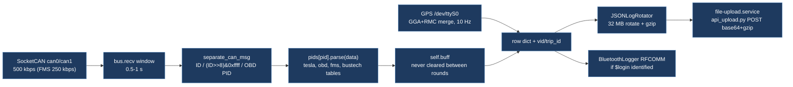
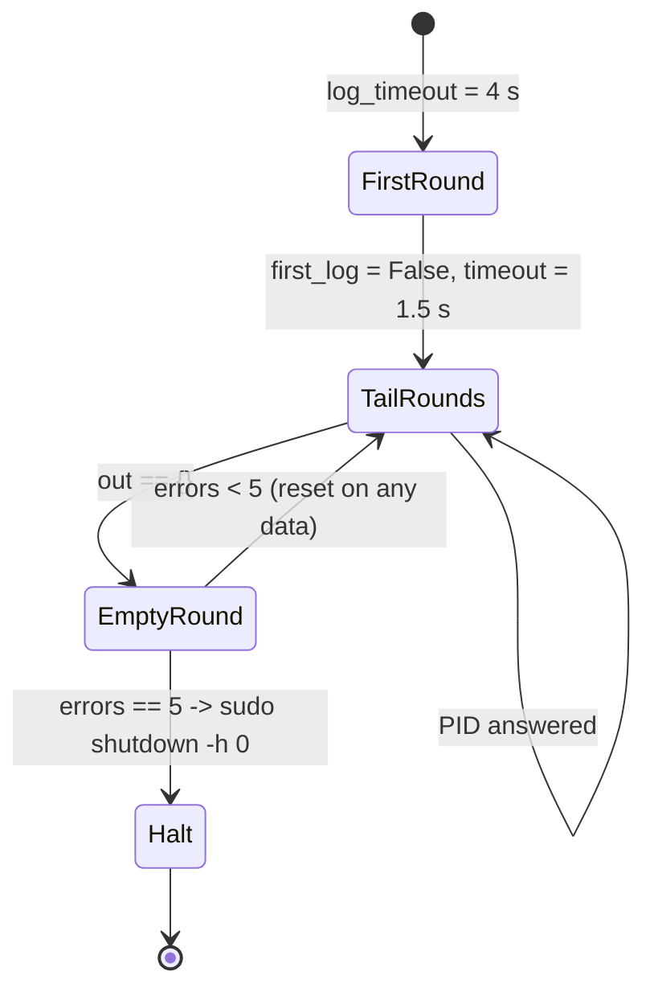
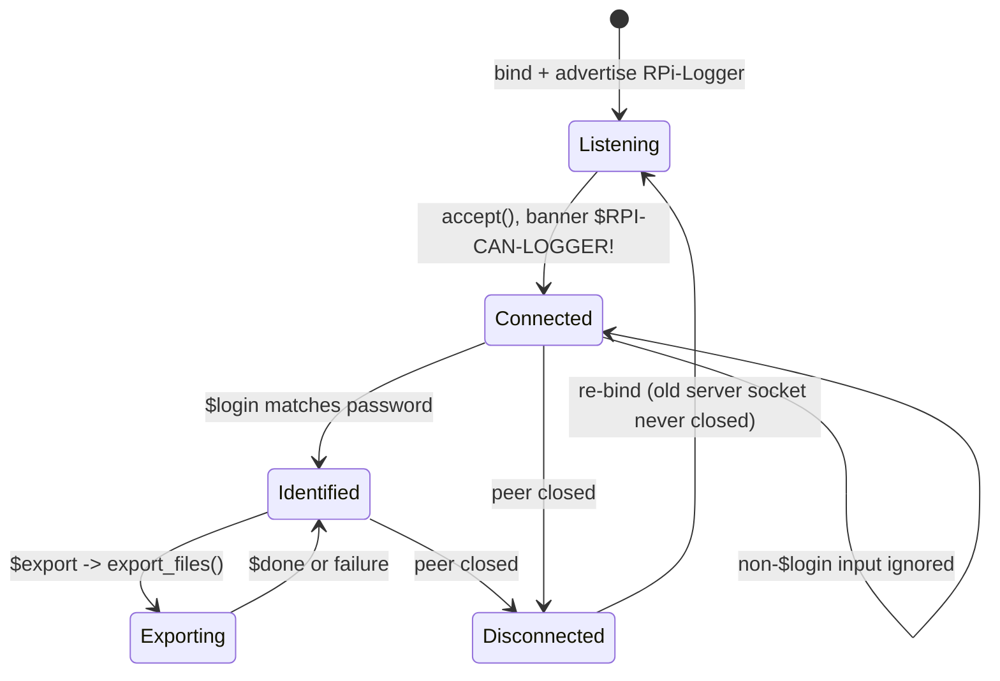
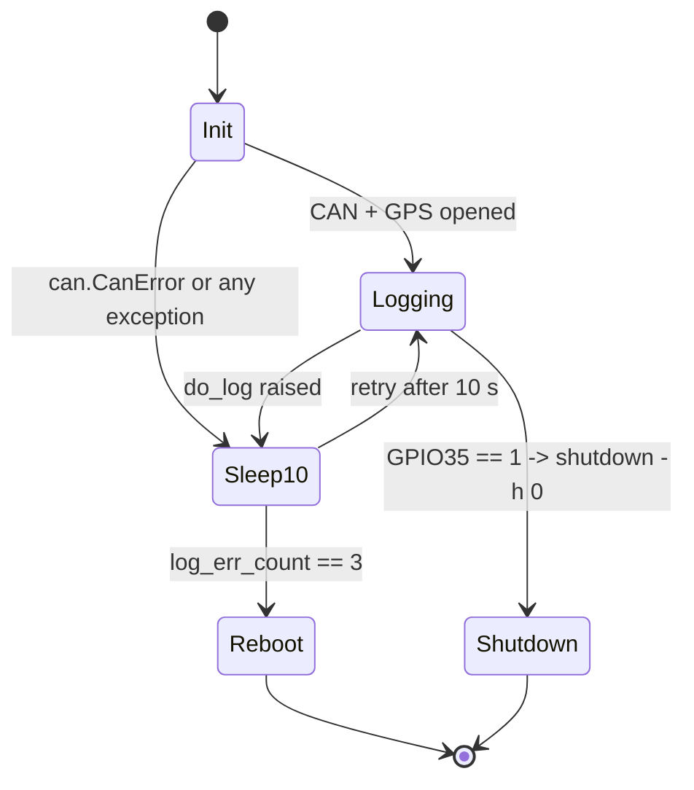
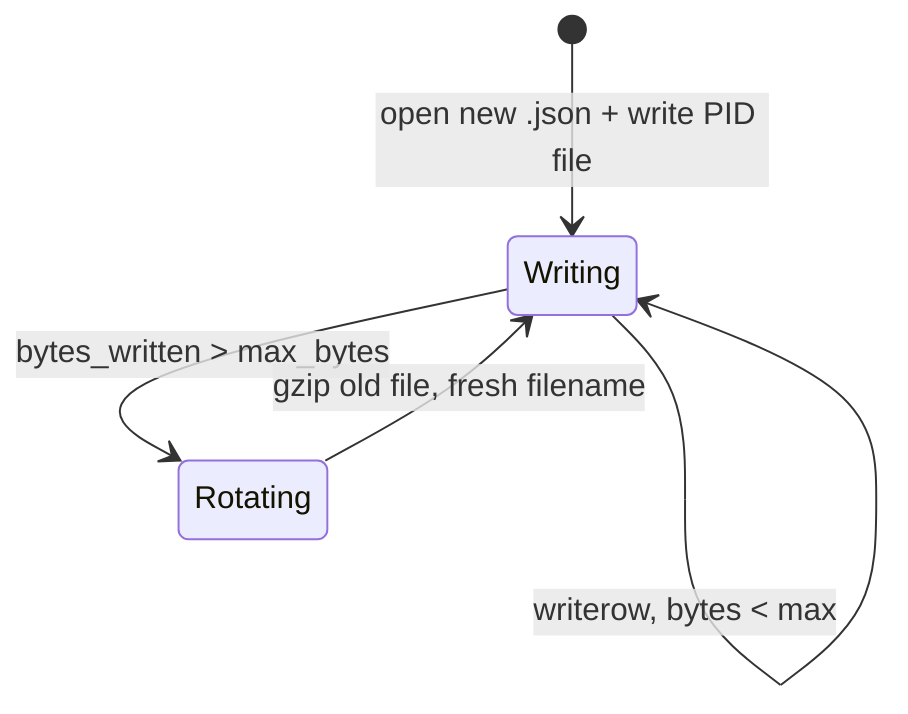

# JonnoFTW-rpi-can-logger

## 1. Provenance

- Submodule path: `legacy/JonnoFTW-rpi-can-logger`
- Pinned gitlink (canonical form from `git ls-files -s`): `160000 4c16a880717740848cd89fcd0af9d3832dc32276 0`
- `git -C legacy/JonnoFTW-rpi-can-logger rev-parse HEAD`: `4c16a880717740848cd89fcd0af9d3832dc32276` (matches gitlink)
- `git -C legacy/JonnoFTW-rpi-can-logger status --porcelain`: empty (clean worktree)
- Last commit: `4c16a88` — `Merge branch 'master' of https://github.com/JonnoFTW/rpi-can-logger` — Jonathan Mackenzie — 2021-03-14T11:35:24+10:30
- Upstream URL: `https://github.com/JonnoFTW/rpi-can-logger`
- License: **none present** — no LICENSE/COPYING file in `git ls-files` (verified with `git -C legacy/JonnoFTW-rpi-can-logger ls-files | grep -iE "licen"` → no output). Unreleased, all-rights-reserved by default; nothing here may be copied into shipping code.
- Repository shape: shallow clone. `git rev-list --count HEAD` → `1`; `rev-parse --is-shallow-repository` → `true`. Local history holds only the pinned merge commit; pre-pin history was never fetched (see sections 15 and 17).
- Analysis date: 2026-11-21
- Mode: **replace**. The pre-replace summary is cited below as `git show HEAD:docs/legacy/JonnoFTW-rpi-can-logger.md#<line>`. The pre-replace blob is `a68e1a21582c997ebe22ceccc23be2d36b06078c` (`git rev-parse HEAD:docs/legacy/JonnoFTW-rpi-can-logger.md`, matches `git hash-object` of the working copy). The pre-replace doc had YAML frontmatter; it is preserved above byte-for-byte — including the description line that ends mid-sentence at `FMS (` with no trailing whitespace (none was present to strip). File line endings were normalized CRLF→LF per output hygiene; the frontmatter text bytes are otherwise unchanged. The pre-replace doc contained **no** `## Upstream (...)` sections (verified with `grep -nE "^## Upstream"` → no matches), so none were preserved or re-placed.

Files read (with line ranges):

| File | Lines read | Coverage label |
| --- | --- | --- |
| `rpi_can_logger/main.py` | 1-434 | FULL-READ |
| `rpi_can_logger/logger/tesla_pids.py` | 1-193 | FULL-READ |
| `rpi_can_logger/logger/loggers.py` | 1-337 | FULL-READ |
| `rpi_can_logger/logger/obd_pids.py` | 1-320 | FULL-READ |
| `rpi_can_logger/logger/fms_pids.py` | 1-296 | FULL-READ |
| `rpi_can_logger/logger/outlander_pids.py` | 1-84 | FULL-READ |
| `rpi_can_logger/logger/bustech_pids.py` | 1-41 | FULL-READ |
| `rpi_can_logger/logger/bluetooth_logger.py` | 1-161 | FULL-READ |
| `rpi_can_logger/logger/jsonlogrotator.py` | 1-77 | FULL-READ |
| `rpi_can_logger/logger/csvrotator.py` | 1-82 | FULL-READ |
| `rpi_can_logger/logger/BaseLogRotator.py` | 1-27 | FULL-READ |
| `rpi_can_logger/logger/__init__.py` | 1-15 | FULL-READ |
| `rpi_can_logger/gps/gps.py` | 1-110 | FULL-READ |
| `rpi_can_logger/gps/__init__.py` | 1-1 | FULL-READ |
| `rpi_can_logger/util/__init__.py` | 1-29 | FULL-READ |
| `rpi_can_logger/stubs/gpio.py` | 1-24 | FULL-READ |
| `rpi_can_logger/stubs/__init__.py` | 1-2 | FULL-READ |
| `rpi_can_logger/uploaders/__init__.py` | 1-14 | FULL-READ |
| `rpi_can_logger/uploaders/api_upload.py` | 1-46 | FULL-READ |
| `rpi_can_logger/uploaders/mongo_upload.py` | 1-91 | FULL-READ |
| `rpi_can_logger/uploaders/onedrive_upload.py` | 1-29 | FULL-READ |
| `setup.py` | 1-52 | FULL-READ |
| `requirements.txt` | 1-13 | FULL-READ |
| `README.md` | 1-280 | FULL-READ (read after code, for comparison) |
| `example_tesla_conf.yaml` | 1-31 | FULL-READ |
| `example_obd_querying_conf.yaml` | 1-27 | FULL-READ |
| `example_obd_sniffing_conf.yaml` | 1-21 | FULL-READ |
| `example_fms_logging.yaml` | 1-20 | FULL-READ |
| `example_bustech_logging.yaml` | 1-20 | FULL-READ |
| `systemd/rpi-logger.service` | 1-19 | FULL-READ |
| `systemd/file-upload.service` | 1-22 | FULL-READ |
| `systemd/pairable.py` | 1-24 | FULL-READ |
| `systemd/var-run-sdp.service` | 1-12 | FULL-READ |
| `systemd/var-run-sdp.path` | 1-9 | FULL-READ |
| `tests/test_loggers.py` | 1-44 | FULL-READ |
| `tests/can_query_test.py` | 1-32 | FULL-READ |
| `tests/detect_test.py` | 1-50 | FULL-READ |
| `tests/test-emulator.py` | 1-79 | FULL-READ |
| `tests/bluetooth_test.py` | 1-40 | FULL-READ |
| `tests/can_sniff_test.py` | 1-15 | FULL-READ |
| `tests/can_spam.py` | 1-21 | FULL-READ |
| `tests/util.py` | 1-21 | FULL-READ |
| `tests/playback_trc.py` | 1-38 | FULL-READ |
| `tests/bustech_sniff.py` | 1-17 | FULL-READ |
| `tests/determine_available_pids.py` | 1-46 | FULL-READ |
| `tests/query_single_pid.py` | 1-35 | FULL-READ |
| `tests/phev_query.py` | 1-46 | FULL-READ |
| `tests/test_ignition.py` | 1-13 | FULL-READ |
| `tests/fms_convert.py` | 1-65 | FULL-READ |
| `tests/can_dump.py` | 1-36 | FULL-READ |
| `tests/gps_test.py` | 1-20 | FULL-READ |
| `tests/list_pid.py` | 1-8 | FULL-READ |
| `tests/gpio_send_test.py` | 1-31 | FULL-READ |
| `tests/gpio_test.py` | 1-27 | FULL-READ |
| `tests/gpio_led_test.py` | 1-36 | FULL-READ |
| `tests/out.csv` | 1-14 and 370-376 only | RANGE-CITED |
| `.gitignore` | 1-78 | FULL-READ |

Files explicitly NOT read:

- `tests/out.csv` lines 15-369 (uniform repeated data rows between the read head and tail; RANGE-CITED as stated above)
- `rpi_can_logger/__init__.py` (0 bytes, empty file)

Hidden directories: none exist. `git ls-files` shows no dot-directories (no `.github/`, no `.firmware/`); the only dotfile is `.gitignore`, read above.

Evidence-grade notes for this repo: **no TEST-READ evidence exists** — `pytest` is listed in `requirements.txt:2` and two files define `test_*` functions, but no file contains a single `assert`; every "test" is a manual bench script or a print-only smoke (see section 10). **one CAPTURE-grade artifact exists** — `tests/out.csv` is decoded output of a real Outlander PHEV battery-health capture (376 rows; see mechanism 13 and the evidence map). Everything else is CODE-READ or SUMMARY-ONLY.

## 2. Executive verdict

A 2017-2021 Raspberry Pi (PiCAN2/MCP2515) fleet logger in Python 3 that passively decodes four vehicle families — Tesla Model S, generic OBD-2, truck/bus FMS, and Mitsubishi Outlander PHEV (plus a Bustech bus variant) — merges NMEA GPS, writes size-rotated gzip JSON logs to SD, streams rows over a password-gated RFCOMM Bluetooth channel, and batch-uploads finished logs to a web API. For TeslaCANModder the Tesla decode table is the headline item and it is **not directly usable**: it is Model S-era (wk057/Jason Hughes 2016, self-cited at `tesla_pids.py:3-9`), its numeric IDs collide with different Model 3/Y signals in our tree (their `0x102` is BMS pack V/I, our `0x102` is VCLEFT_doorStatus), its multi-byte reads are little-endian where our decoders read big-endian, and two of its fifteen decoders are arithmetically broken (`tesla_pids.py:15-16`). The repo is strictly passive on the Tesla bus — zero TX, zero checksum/counter logic anywhere (`grep -rniE "checksum|crc" rpi_can_logger/` → no output) — so it can never contradict our mutation-path safety work; its value is decode cross-checks and bench discipline. The genuinely portable ideas are in the tooling, not the decoders: the offline capture-to-CSV decoder (`tests/fms_convert.py`) and the trace playback script (`tests/playback_trc.py`) map cleanly onto our `recorder` ring buffer as an independent test oracle, and the FMS/Bustech plausibility guards (>200 km/h delete, `_reset_trip` freshness marker) are a small UX-hardening pattern. The destructive failure policy (5 empty query rounds → `shutdown -h 0` at `loggers.py:191-195`; 3 init failures → `reboot` at `main.py:432-434`), the root-shell `sudo()` interpolation (`util/__init__.py:28-29`), and the whole deprecated PyBlueZ stack are anti-patterns to record, never port.

## 3. Evidence map

No CAPTURE evidence exists for the Tesla, OBD, FMS, or Bustech paths; the single CAPTURE artifact covers only the Outlander decoder. No TEST-READ evidence exists anywhere in this repo.

| Source file | Lines | What it proves | Grade |
| --- | --- | --- | --- |
| `rpi_can_logger/util/__init__.py` | 8-9 | Wire contract: OBD_REQUEST `0x07DF`, OBD_RESPONSE `0x07E8` | CODE-READ |
| `rpi_can_logger/util/__init__.py` | 24-25 | `list_log` globs `*.csv` while the live writer produces `.json` — `$list_log` always empty | CODE-READ |
| `rpi_can_logger/util/__init__.py` | 28-29 | `sudo()` interpolates its argument into `bash -c '<cmd>'` with `shell=True` | CODE-READ |
| `rpi_can_logger/main.py` | 28-29, 110-111, 330 | `--interface` default `can0` and `--channel` default `socketcan` are passed as `channel=`/`bustype=` respectively — CLI flag names are semantically swapped vs the YAML path | CODE-READ |
| `rpi_can_logger/main.py` | 324-330 | Bus bitrate: 250000 for FMS, 500000 otherwise; interface bounced with `sudo ifdown/ifup` before open | CODE-READ |
| `rpi_can_logger/main.py` | 143-145 | Unknown PID names in config exit at startup (`exit("Unrecognised CAN PID(s)...")`) | CODE-READ |
| `rpi_can_logger/main.py` | 175-197 | `get_vin` — Mode 09 VIN request over `0x07DF`, flow control `0x30` to `0x07E0`, 3-frame ISO-TP assembly; returns `False` after 128 frames | CODE-READ |
| `rpi_can_logger/main.py` | 288-302 | Full Bluetooth `$` command surface incl. `$reset` (reboot), `$resetwifi`, `$setvid`, `$export`, `$login` lambda returning `IDENTIFIED` | CODE-READ |
| `rpi_can_logger/main.py` | 243-285 | `export_files`: gzip+base64 log push in 900-char chunks; gzip ISIZE trailer `== 0` used as empty-file test (line 267) | CODE-READ |
| `rpi_can_logger/main.py` | 373-404 | Main row loop: decode → GPS merge → `writerow` → optional BT push, gated by `btl.identified` | CODE-READ |
| `rpi_can_logger/main.py` | 377-382 | GPIO pin 35 high → `sudo('shutdown -h 0')` (ignition-off kill switch) | CODE-READ |
| `rpi_can_logger/main.py` | 418, 432-434 | Retry policy: 10 s sleep, reboot after 3 consecutive failed rounds | CODE-READ |
| `rpi_can_logger/logger/tesla_pids.py` | 3-9 | Self-cited provenance of decoders: Jason Hughes (wk057) Model S CAN deciphering, 2016 | CODE-READ |
| `rpi_can_logger/logger/tesla_pids.py` | 12-17 | `0x102` decode; `regenCurrent` mask `0x100000` is always zero for a byte operand; temp grouping is `((d6+(d7&7))<<8)*0.1` | CODE-READ |
| `rpi_can_logger/logger/tesla_pids.py` | 144-185 | All 15 Tesla PID entries with IDs, names, fields | CODE-READ |
| `rpi_can_logger/logger/loggers.py` | 39-56 | Sniffing window: 0.5 s total, `recv(0.5)`, trigger handling commented out at 54-55 | CODE-READ |
| `rpi_can_logger/logger/loggers.py` | 28, 30-31 | `self.buff` initialized once, `_make_buff` never called — rows repeat stale values | CODE-READ |
| `rpi_can_logger/logger/loggers.py` | 83-85, 157-160, 184-198 | Query timeouts 4 s → 1.5 s, 5 send retries, 5 empty rounds → `sudo("shutdown -h 0")` | CODE-READ |
| `rpi_can_logger/logger/loggers.py` | 88-98, 100-132 | OBD support-bitmap parser; `_determine_pids` call commented out at line 80 — discovery disabled | CODE-READ |
| `rpi_can_logger/logger/loggers.py` | 213-260 | Outlander ISO-TP assembly: `0x10` first frame, `0x30` flow control, `data[1]-2` byte count, 1000-iteration cap | CODE-READ |
| `rpi_can_logger/logger/loggers.py` | 263-298 | FMS PGN extraction `(id >> 8) & 0xffff`; >200 km/h CCVS delete at 292-295; trigger honored at 297-298 | CODE-READ |
| `rpi_can_logger/logger/loggers.py` | 301-337 | Bustech logger; `_reset_trip` marker at 335 | CODE-READ |
| `rpi_can_logger/logger/fms_pids.py` | 42-66 | `_fms` gain/offset extractor; 2/4-byte values use little-endian `'<H'`/`'<I'` (line 60-64) | CODE-READ |
| `rpi_can_logger/logger/fms_pids.py` | 146-154 | `bits_from_byte`/`tts`: `int.from_bytes(int)` raises TypeError; `conds[list(...)]` unhashable; `msg[8..15]` out of range — decoder always crashes | CODE-READ |
| `rpi_can_logger/logger/fms_pids.py` | 225-245 | FMS BAM/VIN decoders; `vehicle_id_part` body dead behind early `return` at 234 | CODE-READ |
| `rpi_can_logger/logger/outlander_pids.py` | 5-18, 55-73 | Battery health layout (SOC `(b0/2)-5`, current `-400`, voltage `/10`), request/response pairs `0x761/0x762` etc. | CODE-READ |
| `rpi_can_logger/logger/bustech_pids.py` | 21-25 | Only `BUSTECH_BATTERY`/`BUSTECH_ENGINE` exist; 411 Nm max torque comment | CODE-READ |
| `rpi_can_logger/logger/bluetooth_logger.py` | 16, 18-30 | RFCOMM service UUID, 512-entry queues, `sudo bash -c 'service var-run-sdp start'` at line 30 | CODE-READ |
| `rpi_can_logger/logger/bluetooth_logger.py` | 126-135 | Login gate: `pieces[1] == self.btl.password`; bare `$login` (no `=`) raises IndexError | CODE-READ |
| `rpi_can_logger/logger/jsonlogrotator.py` | 20-38, 63-76 | 32 MB default rotation, gzip compression, PID file records active filename | CODE-READ |
| `rpi_can_logger/logger/csvrotator.py` | 10-12, 70, 79-80 | Class marked deprecated in its own docstring; `writerow` returns `None` into `+=`; spawns `7z` | CODE-READ |
| `rpi_can_logger/gps/gps.py` | 15, 34-45, 75-94 | u-blox config blob incl. CFG-RATE 100 ms (10 Hz); GGA+RMC merged to ISO timestamp; knots→km/h | CODE-READ |
| `rpi_can_logger/uploaders/api_upload.py` | 9-14, 20-45 | Upload loop reads `./mongo_conf.yaml`, POSTs base64 gzip with `keys`, renames `.done` on HTTP 200 | CODE-READ |
| `rpi_can_logger/uploaders/mongo_upload.py` | 4, 27, 81 | Deprecated by own docstring; `w=0` unacknowledged writes; deprecated `remove()` | CODE-READ |
| `rpi_can_logger/uploaders/onedrive_upload.py` | 8-10 | Own docstring: "This doesn't even work" | CODE-READ |
| `setup.py` | 20-44, 45-52 | Installs systemd units (rewrites `{{pwd}}`/`{{conf}}`), enables them, patches `bluetoothd -C` | CODE-READ |
| `tests/out.csv` | 1-14, 370-376 | Real decoded Outlander capture: SOC 73.5→73.0%, 318.1→318.0 V, ~372 rows; header has 5 columns vs 11 in the current decoder | CAPTURE |
| `tests/fms_convert.py` | 24-51 | Offline `.trc` capture → CSV decode using the same PID table (row emission on trigger) | CODE-READ |
| `tests/playback_trc.py` | 21-36 | Replays a PCAN `.trc` capture onto the live bus with original timestamps | CODE-READ |
| `tests/test_loggers.py` | 9-22, 24-44 | Stub `Bus` class (no `set_filters`); three print-only smoke functions, zero asserts | CODE-READ |
| `tests/util.py` | 18-20 | Default bustype `socketcan_native` — stale python-can name | CODE-READ |
| `README.md` | 96-101, 106-121 | 16 MHz MCP2515 overlays, 500 kbps (250 kbps FMS) — agrees with code | SUMMARY-ONLY (corroborated by CODE-READ above) |
| `README.md` | 159 | Claims `log-trigger` "only works in sniffing mode" — contradicted (see section 6) | SUMMARY-ONLY |
| `git show HEAD:docs/legacy/JonnoFTW-rpi-can-logger.md#60` | — | Pre-replace claim that Tesla decoders are "directly useful as a reference for our signal definitions" — contradicted (see section 6) | SUMMARY-ONLY |
| `git show HEAD:docs/legacy/JonnoFTW-rpi-can-logger.md#22` | — | Pre-replace claim "License: None (no LICENSE file present)" — confirmed by `git ls-files` | SUMMARY-ONLY (confirmed) |

## 4. Architecture and build surface

Entry points: `rpi_can_logger/main.py` (service, also directly runnable via its `#!/usr/bin/env python3` shebang), `rpi_can_logger/uploaders/api_upload.py` (second systemd service), `setup.py` (installer, not a packaging setup — the setuptools `setup()` call is commented out at `setup.py:13-18`), `systemd/pairable.py` (fleet hostname provisioning). PID tables are data modules (`tesla_pids.py`, `obd_pids.py`, `fms_pids.py`, `bustech_pids.py`, `outlander_pids.py`) selected at import time by one of four mutually exclusive mode flags (`tesla`, `fms`, `bustech`, `obd-query`; `main.py:90-108`) — no runtime mode switching. Platform boundary: `RPi.GPIO` is optional; `rpi_can_logger/stubs/gpio.py` is a no-op stub so the code runs on non-Pi hosts with LEDs/shutdown pin silently dead (`main.py:18-21`). Build flags: none — configuration is CLI args overridden by an unvalidated YAML file (`main.py:62-80`, with the author's own `# should validate the config here...` at line 66). Dependency boundary: `python-can` pinned to **git master** (`requirements.txt:1`), PyBlueZ (deprecated upstream since 2020), pynmea2, pyyaml, pyserial, pymongo, requests, netifaces; `onedrivesdk` and `matplotlib` are imported by code but absent from requirements.



There is **no frame mutation and no Tesla TX path**: for the Tesla/OBD-sniffing/FMS/Bustech modes the pipeline above is RX-decode-log only. The only TX surfaces in the whole package are OBD Mode-01 queries to `0x07DF` (`loggers.py:200-211`), the Mode-09 VIN request plus `0x7E0` flow control (`main.py:176-191`), and the Outlander request frames `0x761/0x765/0x753/0x755` with `0x30` flow control (`loggers.py:216-220`).

## 5. Mechanism catalogue

### Mechanism 1 — Sniffing-window logger (TeslaSniffingLogger / BaseSnifferLogger)

- **Claim (README / summary):** `git show HEAD:docs/legacy/JonnoFTW-rpi-can-logger.md#48` — "Directly reads Tesla CAN bus in sniffing mode via SocketCAN."
- **Code path:** `loggers.py:39-56` — `BaseSnifferLogger.log()` → `bus.recv(0.5)` → `TeslaSniffingLogger.separate_can_msg()` (`loggers.py:58-61`, returns `(arbitration_id, data)`) → `pids[pid]['parse'](obd_data)` → `self.buff.update(parsed)`.
- **Frame spec:** whatever the selected PID table contains; Tesla table at `tesla_pids.py:144-185` (15 entries, IDs `0x0102`–`0x0562`, all little-endian, no DLC validation).
- **Gates and timing:** one 0.5 s wall-clock window per row (`loggers.py:41-45`); no CAN filters on the sniffing path; no bitrate gate beyond bus bring-up.
- **State machine:** None found — single state; the window loop is stateless.
- **Tests:** `test_tesla` at `tests/test_loggers.py:24-29` — prints the decode of one fabricated `0x0562` frame; asserts nothing.
- **Evidence grade:** CODE-READ.
- **Verdict:** CONFIRMED (as a passive sniffer). Two incidental defects are documented in section 9: the trigger is dead code and `self.buff` is never cleared.
- **Adapt to TeslaCANModder?** already present — our per-frame decode pipeline (`firmware/lib/vehicle/can/handler/bus/vehicle.h`) decodes on arrival with ring-buffer distribution instead of a polling window.

### Mechanism 2 — OBD querying logger (QueryingOBDLogger)

- **Claim (README / summary):** README:137-142 — four logging forms incl. "Querying OBD".
- **Code path:** `loggers.py:134-198` — `log()` → per-PID `bus.set_filters([{'can_id': 0x07e8, 'can_mask': 0xffff}])` (line 146) → `make_msg(m)` (lines 200-211: `data=[2, mode, pid, 0,0,0,0,0]` to `0x07DF`, `mode,pid = divmod(m, 0x100)`) → `bus.send` ×5 retries (line 157-159) → response matched by `BaseOBDLogger.separate_can_msg` (`((data[1]-0x40)*256)+data[2]`, lines 64-70).
- **Frame spec:** request `0x07DF` DLC 8 `[0x02, 0x01, pid, 0×5]`; response `0x07E8` `[len, 0x41, pid, A, B, ...]`; PID space `0x0100+` per `obd_pids.py:234-312`.
- **Gates and timing:** first round timeout 4 s, subsequent 1.5 s (`loggers.py:83-85, 189`); recv timeout 0.4 s (line 160); 5 empty rounds → `sudo("shutdown -h 0")` (lines 191-195).
- **State machine:**



- **Tests:** `test_obd_query` at `tests/test_loggers.py:32-36` — would raise `AttributeError` today: the stub `Bus` (lines 9-22) has no `set_filters`. Print-only regardless.
- **Evidence grade:** CODE-READ.
- **Verdict:** PARTIAL — mechanism works against a real bus, but the shipped smoke test cannot execute against its own stub, and the failure path is destructive.
- **Adapt to TeslaCANModder?** never port — our firmware is Tesla-frame-only, and the 5-strike shutdown policy is a destructive anti-pattern.

### Mechanism 3 — OBD supported-PID discovery

- **Claim (README / summary):** README:134 — "supports nearly all standard OBD-2 PIDs"; no explicit discovery claim.
- **Code path:** `loggers.py:100-132` — `_determine_pids()` sends Mode-01 PID `0x00/0x20/0x40/0x60` (line 106), parses the 4-byte bitmap via `_parse_support_frame` (`pid = 0x0100 + base + idx + 1 + by*8`, lines 88-98), 2 s wait cap (line 110). Call site commented out at `loggers.py:80`.
- **Frame spec:** request `[2,1,0x00,0...0]` to `0x07DF`; response `[6,0x41,0x00,bitmap×4,...]` on `0x07E8`.
- **Gates and timing:** 2 s budget; disabled entirely in the shipping path.
- **State machine:** None found — one-shot scan.
- **Tests:** `tests/determine_available_pids.py:15-46` — a live variant querying `[0, 0x20, 0x40, 0x60, 0x80]`, but it crashes at import: `from .util import get_args` (line 6) is a relative import in a top-level script → `ImportError`. Asserts nothing.
- **Evidence grade:** CODE-READ.
- **Verdict:** CONTRADICTED as a feature — `$respondsto` (surface, section 12) always reports empty because the only population call is commented out.
- **Adapt to TeslaCANModder?** no impact — no OBD query surface exists in our firmware.

### Mechanism 4 — ISO-TP-style multi-frame assembly (VIN + Outlander)

- **Claim (README / summary):** not documented; VIN procedure visible only in code.
- **Code path:** `main.py:175-197` — `get_vin()` → Mode 09 request → on `data[2:4]==[0x49,0x02]` accumulate `data[-3:]`, send flow control `[0x30,0,4,...]` to `0x07E0` (line 190-191) → `0x21`/`0x22` consecutive frames appended (lines 192-196). Outlander: `loggers.py:213-260` — `_log_outlander()` → request `[2,0x21,pid,...]` → on first frame `data[0]==0x10` send `[0x30,0,0,...]` flow control plus a re-send of the request (lines 243-245) → collect `data[4:]` then `data[1:]` until `len(buf) >= data[1]-2` (lines 247-256).
- **Frame spec:** 29-bit-capable but used with `extended_id=0`; Outlander pairs `0x761→0x762`, `0x765→0x766`, `0x753→0x754`, `0x755→0x756` (`outlander_pids.py:55-73`).
- **Gates and timing:** VIN: 128-frame receive cap (`main.py:186`), returns `False` on miss; Outlander: 1000-iteration cap (`loggers.py:232`), 0.5 s recv timeout.
- **State machine:** two states per transfer (await first frame / collect consecutive frames); below the 3-state diagram threshold.
- **Tests:** `tests/phev_query.py:14-46` — live Outlander query, print-only. `tests/test-emulator.py:37-62` — a copy of `get_vin` against a PCAN emulator, print-only.
- **Evidence grade:** CODE-READ.
- **Verdict:** PARTIAL — works for the Outlander battery frame (backed by `tests/out.csv`), but `get_vin` is never called from `main.py` (grep `get_vin` in `main.py` → only the definition at line 175): dead code in the shipping path.
- **Adapt to TeslaCANModder?** no impact — Tesla GTW frames are fixed 8-byte, no multi-frame transport needed.

### Mechanism 5 — FMS PGN extraction and decode (FMSLogger)

- **Claim (README / summary):** README:10 — "Bus and Truck with FMS".
- **Code path:** `loggers.py:263-298` — `separate_can_msg` → `(msg.arbitration_id >> 8) & 0xffff` (lines 264-266) → `fms_pids[pid]['parse'](msg.data)` → `self.buff.update` → CCVS plausibility guard at 292-295 (`> 200` km/h deletes the value so it cannot trigger a row) → trigger honored at 297-298.
- **Frame spec:** 30 PIDs `0xF000`–`0xFEEC` (`fms_pids.py:247-287`) extracted from 29-bit J1939-style addresses; `_fms` gain/offset helper (lines 42-66) with per-PID scales (e.g. EEC1 torque `_fms(msg,1,-125,3)`, RPM `_fms(msg,1,0,4,5)//8` at line 78; CCVS `_fms(msg,1/256.,0,2,3)` at line 158).
- **Gates and timing:** 1 s window (`loggers.py:277`); FMS bus at 250 kbps (`main.py:324-325`).
- **State machine:** None found — stateless window loop.
- **Tests:** `tests/detect_test.py:30-50` — live sniff + decode of `0xF004`, print-only. `tests/fms_convert.py` — offline capture decode, print-only.
- **Evidence grade:** CODE-READ.
- **Verdict:** PARTIAL — the >200 km/h guard shows the author hit garbage decodes (consistent with the `'<H'` little-endian reads at `fms_pids.py:60-64` being wrong for a big-endian FMS/J1939 bus; UNVERIFIED — would need an FMS bench capture; see section 17). The `FMS_TELL_TALE_STATUS` (`0xFD7D`) decoder always raises (see section 9).
- **Adapt to TeslaCANModder?** no impact — different vehicle domain.

### Mechanism 6 — Bustech adaptive window

- **Claim (README / summary):** README features list does not mention Bustech; only the CLI flag `--bustech` (`main.py:57`) and config exist.
- **Code path:** `loggers.py:301-337` — `BustechLogger.log()` → 0.5 s window → decode `0x0109`/`0x0110` (`bustech_pids.py:21-24`) → on `BUSTECH_BATTERY (Ready)` field present: `self.fast_log = (value == 1)` and mark `buff['_reset_trip'] = 1` (lines 332-335).
- **Frame spec:** `0x0109` battery `[SOC×0.01 %, current×0.05−1000 A, voltage×0.02 V, ready]`; `0x0110` engine `[speed×0.1−100 km/h, pedal×0.01 %, torque×0.1−500 %]` (`bustech_pids.py:4-18`).
- **Gates and timing:** 0.5 s window, `recv(0.1)`; Ready toggles flip trip segmentation.
- **State machine:** two states (`fast_log` true/false); below diagram threshold.
- **Tests:** `tests/bustech_sniff.py:11-17` — live decode loop, print-only. `bustech_pids.py:35-41` — `__main__` demo with two fabricated frames, print-only.
- **Evidence grade:** CODE-READ.
- **Verdict:** PARTIAL — mechanism coherent, but the shipped example config cannot start it (section 6, row 3).
- **Adapt to TeslaCANModder?** no impact — but the `_reset_trip` freshness-marker idea feeds candidate 3 in section 13.

### Mechanism 7 — Tesla Model S PID decode table

- **Claim (README / summary):** `git show HEAD:docs/legacy/JonnoFTW-rpi-can-logger.md#60` — "Tesla PID decoding functions are directly useful as a reference for our signal definitions."
- **Code path:** `tesla_pids.py:12-126` (15 decoder functions) + `129-193` (PID wrapper, table, dict).
- **Frame spec:** see section 7 rows T1-T15. All multi-byte fields read little-endian; two decoders are broken (`0x102` regen-current mask and temp precedence, `tesla_pids.py:15-16`); no DLC checks anywhere.
- **Gates and timing:** none — pure decode.
- **State machine:** None found.
- **Tests:** `test_tesla` at `tests/test_loggers.py:24-29` — one fabricated odometer frame, print-only.
- **Evidence grade:** CODE-READ.
- **Verdict:** CONTRADICTED as a reference for our project — Model S frames (wk057 2016, self-cited at `tesla_pids.py:3-9`), with numeric IDs that collide with different Model 3/Y signals in our tree, plus the two arithmetic bugs above.
- **Adapt to TeslaCANModder?** no impact as-is; the one interesting overlap (`0x106` rear motor RPM) is a capture-first row in section 11.

### Mechanism 8 — Bluetooth command channel (BluetoothLogger / BluetoothReceiver)

- **Claim (README / summary):** `git show HEAD:docs/legacy/JonnoFTW-rpi-can-logger.md#15` — "Includes a Bluetooth companion app"; README:16-18.
- **Code path:** `bluetooth_logger.py:15-161` — `BluetoothLogger.run()` → `_accept_and_send()` (bind RFCOMM `PORT_ANY`, advertise `RPi-Logger` with UUID `08be0e96-...`, lines 42-67) → `BluetoothReceiver.run()` (recv 512-byte chunks, line 77; split on `=`; login gate lines 126-135; `$export` exclusive mode lines 136-149; generic dispatch `bt_commands.get(pieces[0].lower().strip())` lines 150-157; 1 s poll at line 158).
- **Frame spec:** line-based ASCII `$`-protocol: `$login=<pass>`, `$ip`, `$serial`, `$list_log`, `$echo`, `$btlog=on|off`, `$err`, `$systime`, `$reset`, `$resetwifi`, `$setvid=<id>`, `$respondsto`, `$export`, `$fields=<csv>` on login success (line 131). Rows pushed to the client are raw JSON log lines (main.py:402-403).
- **Gates and timing:** socket timeout 2.0 s (line 66); send queue deque(512) (line 33); no command reaches dispatch before `$login` matches `args.bluetooth_pass` (YAML `bluetooth-pass`, e.g. `example_tesla_conf.yaml:31`).
- **State machine:**



- **Tests:** `tests/bluetooth_test.py:19-36` — starts a real BluetoothLogger with sine-wave dummy rows; manual, print-only.
- **Evidence grade:** CODE-READ.
- **Verdict:** PARTIAL — auth gate exists and precedes dispatch, but: bare `$login` without `=` crashes the receiver thread (`pieces[1]` IndexError, lines 127-129); `main.py:301` registers a duplicate `$login` lambda that answers `IDENTIFIED` post-auth; the accepted client socket is never closed on disconnect (leak per reconnect, lines 92-94).
- **Adapt to TeslaCANModder?** never port — deprecated PyBlueZ, password-in-plaintext config, remote reboot/wifi-reset over BT.

### Mechanism 9 — Supervision loop (LEDs, ignition kill, 3-strike reboot)

- **Claim (README / summary):** README:15 — power from OBD port; kill switch undocumented.
- **Code path:** `main.py:413-434` — `setup_GPIO()` (pins 7/37 out, 35 in, lines 159-165) → `do_log()` → on `GPIO.input(35) == 1` → `sudo('shutdown -h 0')` (lines 377-382) → any exception: log, sleep 10 s, retry; `log_err_count == 3` → `sudo('reboot')` (lines 421-434). LEDs: led1 activity per row (375, 388), led2 GPS/BT phases (390-404). `atexit` → `GPIO.cleanup()` (lines 407-411).
- **Frame spec:** None found — GPIO side channel.
- **Gates and timing:** 10 s sleep between rounds; reboot on third consecutive failure.
- **State machine:**



- **Tests:** `tests/test_ignition.py:6-13` — live pin-35 watch that really shuts the Pi down; `tests/gpio_led_test.py:20-36` — LED blink. Both manual.
- **Evidence grade:** CODE-READ.
- **Verdict:** CONFIRMED — deliberate ignition-off shutdown + fail-reboot fleet policy.
- **Adapt to TeslaCANModder?** no impact — ESP32 power supervision is a different problem; the destructive reboot is exactly what we do not want.

### Mechanism 10 — JSON log rotation (JSONLogRotator)

- **Claim (README / summary):** `git show HEAD:docs/legacy/JonnoFTW-rpi-can-logger.md#15` — logs to SD; README:151 "maximum size in MB before log file is rotated".
- **Code path:** `jsonlogrotator.py:63-76` — `writerow()` → `json.dumps(row)+"\n"` → flush → `if self._bytes_written > self.max_bytes: close; _compress; _make_writer()`. `_make_writer` (lines 20-38) names files `%Y%m%d_%H%M%S_<6 random chars>.json`, writes the active filename to the PID file (lines 40-42), and gzips leftover `.json` files at startup (lines 36-38).
- **Frame spec:** None found — file storage.
- **Gates and timing:** rotation threshold `2**20 * log_size` MB, default 32 (`main.py:35, 148`); `maxbytes >= 512` enforced (`BaseLogRotator.py:12-13`).
- **State machine:**



- **Tests:** None found.
- **Evidence grade:** CODE-READ.
- **Verdict:** CONFIRMED.
- **Adapt to TeslaCANModder?** no impact — our `firmware/lib/core/can/recorder.h` keeps a 256-entry RAM ring instead of SD files; different resource model.

### Mechanism 11 — GPS NMEA reader

- **Claim (README / summary):** README:12 — "Logs GPS".
- **Code path:** `gps/gps.py:12-110` — `__init__` writes a u-blox config blob (lines 34-45) incl. `$EIGPQ` polls and `B5 62 06 08 06 00 64 00 01 00 01 00 7A 12` = CFG-RATE 100 ms (10 Hz, line 45) → `read()` (lines 54-94): reset input buffer, read `$`-framed lines, strip control chars, parse GGA/RMC via pynmea2, merge datestamp (RMC) + timestamp (GGA) into ISO UTC, convert `spd_over_grnd` × 1.852 to km/h (line 81), emit GeoJSON `pos` for Mongo.
- **Frame spec:** None found — NMEA ASCII.
- **Gates and timing:** per-row timeout `self.timeout` = 0.5 s (init default); requires both GGA and RMC to fill all fields (`while not all(out.values())`, line 58).
- **State machine:** None found — per-row read.
- **Tests:** `tests/gps_test.py:11-20` — live read loop, print-only.
- **Evidence grade:** CODE-READ.
- **Verdict:** PARTIAL — works, but the class constant `KNOTS_PER_KMPH = 1.852` (line 15) is named backwards: 1.852 is km/h per knot, not knots per km/h (the line-81 multiply is nevertheless the correct knots→km/h conversion).
- **Adapt to TeslaCANModder?** no impact — no GPS hardware in our stack.

### Mechanism 12 — Log upload paths

- **Claim (README / summary):** `git show HEAD:docs/legacy/JonnoFTW-rpi-can-logger.md#15` — "can upload to a remote server via WiFi/4G".
- **Code path:** `api_upload.py:20-45` — glob `*.json*`, skip active file (PID file) and `.done`, gzip raw `.json`, base64, `requests.post(api_url, {'keys': ..., 'data': b64})`, rename `.done` on HTTP 200; runs as `file-upload.service` with `RestartSec=30` (`systemd/file-upload.service:14,18`). Legacy: `mongo_upload.py:41-88` (deprecated banner at lines 4-5, `w=0` at 27, file deleted after `insert_many`). Dead: `onedrive_upload.py:9` — "This doesn't even work".
- **Frame spec:** None found — HTTP/Mongo.
- **Gates and timing:** service restarts every 30 s; skipped-while-active via PID file (`api_upload.py:16-23`).
- **State machine:** None found — batch scan.
- **Tests:** None found.
- **Evidence grade:** CODE-READ.
- **Verdict:** PARTIAL — api path coherent; README:130 shows a plaintext `http://` example API URL (no TLS anywhere).
- **Adapt to TeslaCANModder?** no impact — our MQTT bridge (`mqtt:*` commands) is a live-publish model, not batch upload.

### Mechanism 13 — Bench tooling: playback, offline decode, capture

- **Claim (README / summary):** README:270-279 lists the tests folder as utility scripts (one filename is wrong — see section 6).
- **Code path:** `tests/playback_trc.py:21-36` — replays a PCAN `.trc` onto the live bus with original inter-frame timing; `tests/fms_convert.py:24-51` — decodes a captured `.trc` offline through the same `fms_pids` table and emits CSV rows on the configured trigger; `tests/can_spam.py:14-20` — synthetic `0x7E8` generator; `tests/can_dump.py:26-35` — raw bus→CSV dump.
- **Frame spec:** `.trc` rows: skip 17 header lines, whitespace-split, ID at `pieces[3]`, data from `pieces[5:]` (`fms_convert.py:9,32-34`).
- **Gates and timing:** playback preserves capture timestamps (`playback_trc.py:26-30`).
- **State machine:** None found.
- **Tests:** these are the test tools; no asserts.
- **Evidence grade:** CODE-READ (plus one CAPTURE artifact: `tests/out.csv`, 376 decoded Outlander rows).
- **Verdict:** CONFIRMED — the only capture-driven validation discipline in the repo.
- **Adapt to TeslaCANModder?** **candidate for future PR** — two concrete ports: (a) offline decode of our recorder dumps via `packages/protocol` decoder data as an independent test oracle; (b) replaying captured frames through our decode pipeline in a native test. See section 13.

## 6. Summary vs code contradiction table

| # | Claim (with citation) | Code (with citation) | Verdict |
| --- | --- | --- | --- |
| 1 | `git show HEAD:docs/legacy/JonnoFTW-rpi-can-logger.md#60` — "The Tesla PID decoding functions are directly useful as a reference for our signal definitions" (and #65 "bit-level extraction patterns") | Decoders are Model S (wk057 2016, `tesla_pids.py:3-9`); IDs collide with our Model 3/Y signals (their `0x0102` BMS V/I vs our `CAN_ID_VCLEFT_DOOR_STATUS 0x102`, `firmware/lib/vehicle/can/ids.h:31`; their `0x0116` gear/speed vs our `0x118` DI_state); multi-byte reads are little-endian where our decoders read big-endian; and `tesla_pids.py:15-16` contains two arithmetic bugs (section 9) | CONTRADICTED |
| 2 | README:159 — "log-trigger: ... when this PID is seen, return the buffer in current state (only works in sniffing mode)" | Trigger handling is commented out in `BaseSnifferLogger.log` (`loggers.py:54-55`); Tesla/OBD sniffing ignores it entirely; only `FMSLogger` honors it (`loggers.py:297-298`) | CONTRADICTED |
| 3 | `example_bustech_logging.yaml:8-14` lists six PIDs (`BUSTECH_SOC`, `BUSTECH_TORQUE`, `BUSTECH_ACCEL_POS`, `BUSTECH_READY`, `BUSTECH_BATTERY_CURRENT`, `BUSTECH_BATTERY_VOLTAGE`) | `bustech_pids.py:22-23` defines only `BUSTECH_BATTERY` and `BUSTECH_ENGINE`; `main.py:143-144` exits with `Unrecognised CAN PID(s)` — the shipped example config cannot start | CONTRADICTED |
| 4 | `main.py:28-29` CLI help: `--interface` = "CAN Interface to use" (default `can0`), `--channel` = "CAN Channel to use" (default `socketcan`) | `main.py:330` calls `can.interface.Bus(channel=args.channel, bustype=args.interface)` — under the CLI defaults this is `bustype='can0'`, `channel='socketcan'`, inverted; only the YAML path (`interface: socketcan`, `channel: can1`, every `example_*.yaml`) passes correct values | CONTRADICTED (internal; CLI-default invocation broken) |
| 5 | README:276 — "gps_sniff_test.py will dump raw CAN messages" | `tests/gps_sniff_test.py` does not exist in `git ls-files` (closest: `can_sniff_test.py`) | CONTRADICTED (minor) |

Preserved-frontmatter note: the inherited description line (frontmatter above) ends mid-sentence at `FMS (` — a byte-level truncation inherited from the pre-replace doc, kept verbatim per replace-mode policy.

## 7. CAN frame and signal inventory

All upstream Tesla/OBD/FMS/Bustech decodes below are RX-only; the repo never transmits on the Tesla bus. No DLC validation exists anywhere — short frames raise `IndexError` inside decoders. No vendored DBC/JSON catalog exists; every table is hand-rolled code, so rows cite the decoder functions directly. The 76-entry generic OBD table (`obd_pids.py:234-312`, standard SAE J1979 Mode-01 scales in `Unit.*` classes at lines 9-212) is summarized rather than dumped: STRUCTURAL-PARSE-grade, all scales verified against the `Unit` classes; the 9 PIDs exercised by the shipped configs are listed as rows O1-O9.

Tesla (Model S; all little-endian; `tesla_pids.py:144-185`):

| ID (hex/dec) | Bus | Period | DLC | Byte/bit layout | Scale/units | Counter | Checksum | R/W | Grade |
| --- | --- | --- | --- | --- | --- | --- | --- | --- | --- |
| T1 `0x0102` / 258 | CAN1 (Tesla) | n/s | 8 (unchecked) | V = d0 + d1·256; I = broken (d2 only); temp = (d6+(d7&7))·256·0.1 | V /100; temp intended 0.1 °C | none | none | R | CODE-READ |
| T2 `0x0106` / 262 | CAN1 | n/s | 8 | RPM = d4 + d5·256 − 512·(d5&0x80); pedal = d6 | RPM 16-bit LE signed; pedal ×0.4 % | none | none | R | CODE-READ |
| T3 `0x0116` / 278 | CAN1 | n/s | 8 | gear = (d1&0x70)>>4; gearReq = (d3&0x70)>>4; torque = (d0+((d1&0xF)<<8)) − 512·(d1&0x8); speed = (d2+((d3&0xF)<<8)) − 500 | torque /2 Nm; speed /20 then ×1.60934 km/h | none | none | R | CODE-READ |
| T4 `0x0145` / 325 | CAN1 | n/s | 8 | torque = d0+((d1&0xF)<<8) − 512·(d1&0x8) | /2 Nm | none | none | R | CODE-READ |
| T5 `0x0154` / 340 | CAN1 | n/s | 8 | torque = d5+((d6&0x1F)<<8) − 512·(d6&0x10); pedalA = d2; pedalB = d3 | torque /4 Nm; pedals ×0.4 % | none | none | R | CODE-READ |
| T6 `0x01D4` / 468 | CAN1 | n/s | 8 | torque = d5+((d6&0x1F)<<8) − 512·(d6&0x10) | /4 (unitless) | none | none | R | CODE-READ |
| T7 `0x0210` / 528 | CAN1 | n/s | 8 | inletT = (d2−2·(d2&0x80))/2; inputP = d3; outI = d4; outV = d5 | inletT +40 °C; inputP ×16 W; outV /10 V; outP = d4·(d5/10) W | none | none | R | CODE-READ |
| T8 `0x0232` / 562 | CAN1 | n/s | 8 | maxDischarge = d2+d3·256; maxRegen = d0+d1·256 | /100 kW each | none | none | R | CODE-READ |
| T9 `0x0256` / 598 | CAN1 | n/s | 8 | stub — `PID_TESLA_CRUISE_CONTROL` returns `{}` (`tesla_pids.py:106-107`) | — | none | none | R | CODE-READ |
| T10 `0x0266` / 614 | CAN1 | n/s | 8 | inv12V = d0; dissip = d1; driveMax = ((d6&0x3F)<<5)+((d5&0xF0)>>3); mech = d2+((d3&0x7)<<8) − 512·(d3&0x4); statorI = d4+((d5&0x7)<<8); regenMax = d7 | inv12V /10 V; dissip ×125 W; driveMax +1 kW; mech /2 kW; regenMax ×4−200 kW | none | none | R | CODE-READ |
| T11 `0x02E5` / 741 | CAN1 | n/s | 8 | identical to T10 fields 1-5 | same | none | none | R | CODE-READ |
| T12 `0x0302` / 770 | CAN1 | n/s | 8 | socMin = d0+((d1&3)<<8); socUI = (d1>>2)+((d2&0xF)<<6) | /10 % each (10-bit packed) | none | none | R | CODE-READ |
| T13 `0x0382` / 898 | CAN1 | n/s | 8 | six sequential 10-bit fields: nomFull, nomRemain, expectedRemain, idealRemain, energyBuffer, energyToChargeComplete | ×0.1 kWh each (`tesla_pids.py:85-93`) | none | none | R | CODE-READ |
| T14 `0x03D2` / 978 | CAN1 | n/s | 8 | kwhChargeTotal = d4..d7 LE32; kwhDischargeTotal = d0..d3 LE32 | /1000 kWh each | none | none | R | CODE-READ |
| T15 `0x0562` / 1378 | CAN1 | n/s | 8 | odometer = d0..d3 LE32 | /1000 mi ×1.60934 km | none | none | R | CODE-READ |

OBD-2 Mode 01 (request `0x07DF`, response `0x07E8`; full table STRUCTURAL-PARSE at `obd_pids.py:234-312`; the shipped configs use):

| ID (hex/dec) | Bus | Period | DLC | Byte/bit layout | Scale/units | Counter | Checksum | R/W | Grade |
| --- | --- | --- | --- | --- | --- | --- | --- | --- | --- |
| O1 `0x0104` / 260 | OBD CAN | on poll | 8 | A | /2.55 % | none | none | R (poll) | CODE-READ |
| O2 `0x0105` / 261 | OBD CAN | on poll | 8 | A | −40 °C | none | none | R (poll) | CODE-READ |
| O3 `0x010B` / 267 | OBD CAN | on poll | 8 | A | ×1 kPa | none | none | R (poll) | CODE-READ |
| O4 `0x010C` / 268 | OBD CAN | on poll | 8 | A,B | (256A+B)/4 RPM | none | none | R (poll) | CODE-READ |
| O5 `0x010D` / 269 | OBD CAN | on poll | 8 | A | ×1 km/h | none | none | R (poll) | CODE-READ |
| O6 `0x0110` / 272 | OBD CAN | on poll | 8 | A,B | (256A+B)/100 g/s | none | none | R (poll) | CODE-READ |
| O7 `0x0144` / 324 | OBD CAN | on poll | 8 | A,B | (2/65536)·(256A+B) ratio | none | none | R (poll) | CODE-READ |
| O8 `0x015E` / 350 | OBD CAN | on poll | 8 | A,B | (256A+B)/20 L/h | none | none | R (poll) | CODE-READ |
| O9 `0x015B` / 347 | OBD CAN | on poll | 8 | A | /2.55 % (hybrid battery) | none | none | R (poll) | CODE-READ |

FMS (29-bit addresses; PID = `(id >> 8) & 0xffff`, `loggers.py:264-266`; 2/4-byte reads are little-endian `'<H'`/`'<I'` — UNVERIFIED against the FMS spec, see section 17):

| ID (hex) | Bus | Period | DLC | Byte/bit layout | Scale/units | Counter | Checksum | R/W | Grade |
| --- | --- | --- | --- | --- | --- | --- | --- | --- | --- |
| `0xF004` EEC1 | FMS 250k | n/s | 8 | torque byte 3; RPM bytes 4-5 | torque −125 %; RPM /8 | none | none | R | CODE-READ |
| `0xF003` EEC2 | FMS | n/s | 8 | pedal byte 2 | ×0.4 % | none | none | R | CODE-READ |
| `0xFEF1` CCVS | FMS | n/s | 8 | speed bytes 2-3 | ×(1/256) km/h | none | none | R | CODE-READ |
| `0xFEC1` HR distance | FMS | n/s | 8 | bytes 1-4 | ×5 m | none | none | R | CODE-READ |
| `0xFEE5` engine hours | FMS | n/s | 8 | bytes 1-4 | ×0.05 h | none | none | R | CODE-READ |
| `0xFEE9` fuel consumption | FMS | n/s | 8 | bytes 5-8 | ×0.5 L | none | none | R | CODE-READ |
| `0xFEEE` engine temp | FMS | n/s | 8 | byte 1 | −40 °C | none | none | R | CODE-READ |
| `0xFEF5` ambient | FMS | n/s | 8 | bytes 4-5 | ×0.03125 −273 °C | none | none | R | CODE-READ |
| `0xFEF2` fuel economy | FMS | n/s | 8 | bytes 1-2; 3-4 | ×0.05 L/h; ×1/512 km/L | none | none | R | CODE-READ |
| `0xFD09` HR fuel | FMS | n/s | 8 | bytes 5-8 | ×0.001 L | none | none | R | CODE-READ |
| `0xFEEA` vehicle weight | FMS | n/s | 8 | bytes 2-3 | ×0.5 kg | none | none | R | CODE-READ |
| `0xFED5` alternator speed | FMS | n/s | 8 | byte 3 | raw bits as string | none | none | R | CODE-READ |
| `0xFEE6` time/date | FMS | n/s | 8 | y=d5+1985, mo=d3, d=d4//4+1, h=d2, mi=d1, s=d0//4 | ISO-8601 UTC | none | none | R | CODE-READ |
| `0xFEC0` service distance | FMS | n/s | 8 | bytes 2-3 | ×5 −160635 km | none | none | R | CODE-READ |
| `0xF005` ETC2 gears | FMS | n/s | 8 | bytes 1; 4 | −125 each (selected/current) | none | none | R | CODE-READ |
| `0xFE70` combination weight | FMS | n/s | 8 | bytes 3-4 | ×10 kg | none | none | R | CODE-READ |
| `0xFE56` DEF tank | FMS | n/s | 8 | byte 1 | ×0.4 % | none | none | R | CODE-READ |
| `0xFD7D` tell-tale | FMS | n/s | 8 | broken decoder — always raises (section 9) | — | none | none | R | CODE-READ |
| `0xFEEC` vehicle ID | FMS | n/s | 8 | ASCII payload | string | none | none | R | CODE-READ |
| `0xECFF` BAM header | FMS | n/s | 8 | d1 = VIN length, d3 = packet count | — | none | none | R | CODE-READ |
| `0xEBFF` VIN parts | FMS | n/s | 8 | dead decoder — early `return` (`fms_pids.py:234`) | — | none | none | R | CODE-READ |
| `0xFE4E`/`0xFDA5`/`0xF000`/`0xFE58`/`0xFDD1` | FMS | n/s | 8 | door bits; hex dump; retarder −125 %; 8×0.1 % bellows; SW version | misc | none | none | R | CODE-READ |

Outlander PHEV (request/response pairs, multi-frame Mode-21; `outlander_pids.py:55-73`):

| ID (hex) | Bus | Period | DLC | Byte/bit layout | Scale/units | Counter | Checksum | R/W | Grade |
| --- | --- | --- | --- | --- | --- | --- | --- | --- | --- |
| `0x761→0x762` battery health | CAN | on poll | multi | SOC=(b0/2)−5; health=b27..28/10 Ah; chargeAh=b29..30/10; chargeI=b14..15−400 A; V=b8..9/10; maxIn=b31/4 kW; maxOut=b32/4 kW; power=(chargeI·V)/1000 kW | as listed | ISO-TP seq nibble | none | R (poll) | CODE-READ + CAPTURE (`tests/out.csv`: 73.5% SOC, 318.1 V) |
| `0x765→0x766` charges | CAN | on poll | 4 | two LE16 counters | count (100V/200V) | ISO-TP | none | R (poll) | CODE-READ |
| `0x753→0x754` front RPM | CAN | on poll | 4 | b2..3 | −20000 RPM | ISO-TP | none | R (poll) | CODE-READ |
| `0x755→0x756` rear RPM | CAN | on poll | 4 | b2..3 | −20000 RPM | ISO-TP | none | R (poll) | CODE-READ |

Bustech (11-bit IDs; `bustech_pids.py:4-24`):

| ID (hex/dec) | Bus | Period | DLC | Byte/bit layout | Scale/units | Counter | Checksum | R/W | Grade |
| --- | --- | --- | --- | --- | --- | --- | --- | --- | --- |
| `0x0109` / 265 battery | CAN | n/s | 8 | b0..1 SOC; b2..3 current; b4..5 voltage; b6 ready | ×0.01 %; ×0.05−1000 A; ×0.02 V; raw | none | none | R | CODE-READ |
| `0x0110` / 272 engine | CAN | n/s | 8 | b0..1 speed; b2..3 pedal; b4..5 torque | ×0.1−100 km/h; ×0.01 %; ×0.1−500 % (411 Nm ref) | none | none | R | CODE-READ |

## 8. Constants and tuning table

| Constant | Value | File:line | Meaning | Grade |
| --- | --- | --- | --- | --- |
| `OBD_REQUEST` | `0x07DF` | `rpi_can_logger/util/__init__.py:8` | OBD function-addressed request ID | CODE-READ |
| `OBD_RESPONSE` | `0x07E8` | `rpi_can_logger/util/__init__.py:9` | ECU #1 response ID; filter target in query mode | CODE-READ |
| FMS bitrate | `250000` | `rpi_can_logger/main.py:325` | FMS bus speed (else 500000, line 327) | CODE-READ |
| sniff window | `0.5 s` | `rpi_can_logger/logger/loggers.py:41` (also 318) | Tesla/OBD-sniff/Bustech decode window per row | CODE-READ |
| FMS window | `1 s` | `rpi_can_logger/logger/loggers.py:277` | FMS decode window | CODE-READ |
| query first timeout | `4 s` | `rpi_can_logger/logger/loggers.py:83` | First-round per-PID wait | CODE-READ |
| query tail timeout | `1.5 s` | `rpi_can_logger/logger/loggers.py:85` | Subsequent rounds | CODE-READ |
| query retries | `5` | `rpi_can_logger/logger/loggers.py:157` | Sends per PID before giving up | CODE-READ |
| query recv timeout | `0.4 s` | `rpi_can_logger/logger/loggers.py:160` | Per-recv wait | CODE-READ |
| empty-round shutdown | `5` | `rpi_can_logger/logger/loggers.py:192-195` | 5 empty log rounds → `sudo("shutdown -h 0")` — destructive | CODE-READ |
| init-failure reboot | `3` rounds / `10 s` sleep | `rpi_can_logger/main.py:418, 433-434` | Supervision policy | CODE-READ |
| support_check | `[0, 32, 64, 96]` | `rpi_can_logger/logger/loggers.py:106` | Mode-01 bitmap base PIDs (tests variant adds `0x80`, `tests/determine_available_pids.py:28`) | CODE-READ |
| `KM_PER_MILE` | `1.60934` | `rpi_can_logger/logger/tesla_pids.py:10` | Applied to speed (line 32) and odometer (line 67) | CODE-READ |
| regen-current mask | `0x100000` | `rpi_can_logger/logger/tesla_pids.py:15` | Always zero for a byte operand — decoder bug | CODE-READ |
| pedal scale | `0.4 %/LSB` | `rpi_can_logger/logger/tesla_pids.py:23, 113-114` | Rear drive unit pedal positions | CODE-READ |
| speed offset | `−500, /20` | `rpi_can_logger/logger/tesla_pids.py:32` | Model S speed field, then ×1.60934 | CODE-READ |
| DCDC power scale | `×16 W` | `rpi_can_logger/logger/tesla_pids.py:99` | inputPower = d3×16 | CODE-READ |
| DCDC inlet temp | `(d2 signed)/2 + 40` | `rpi_can_logger/logger/tesla_pids.py:98` | 8-bit signed, half-degree | CODE-READ |
| drivePowerMax `+1` | `kW` | `rpi_can_logger/logger/tesla_pids.py:46, 122` | Packed 11-bit field, explicit +1 offset | CODE-READ |
| regenPowerMax | `d7×4 − 200 kW` | `rpi_can_logger/logger/tesla_pids.py:125` | Rear unit only | CODE-READ |
| FMS RPM | `//8` | `rpi_can_logger/logger/fms_pids.py:78` | 0.125 RPM/bit | CODE-READ |
| FMS speed | `×1/256` | `rpi_can_logger/logger/fms_pids.py:158` | CCVS km/h | CODE-READ |
| FMS torque offsets | `−125` | `rpi_can_logger/logger/fms_pids.py:78, 174, 178, 213` | EEC1/ERC1/ETC2 pedal+torque | CODE-READ |
| FMS service offset | `−160635` ×5 | `rpi_can_logger/logger/fms_pids.py:162` | Service distance km | CODE-READ |
| Outlander SOC | `(b0/2) − 5 %` | `rpi_can_logger/logger/outlander_pids.py:7` | Battery health frame | CODE-READ |
| Outlander current | `LE16 − 400 A` | `rpi_can_logger/logger/outlander_pids.py:10` | Charge current | CODE-READ |
| Outlander RPM | `LE16 − 20000` | `rpi_can_logger/logger/outlander_pids.py:30, 36` | Motor RPM | CODE-READ |
| Bustech torque ref | `411 Nm` | `rpi_can_logger/logger/bustech_pids.py:25` | Comment: max reference torque | CODE-READ |
| CCVS plausibility | `> 200 km/h → delete` | `rpi_can_logger/logger/loggers.py:292-295` | Garbage-decode guard | CODE-READ |
| `KNOTS_PER_KMPH` | `1.852` | `rpi_can_logger/gps/gps.py:15` | Misnamed: value is km/h-per-knot; the multiply at line 81 is correct knots→km/h | CODE-READ |
| GPS rate | `100 ms` (10 Hz) | `rpi_can_logger/gps/gps.py:45` | u-blox CFG-RATE blob `B5 62 06 08 06 00 64 ...` | CODE-READ |
| GPS read timeout | `0.5 s` | `rpi_can_logger/gps/gps.py:18` | Per-row NMEA wait; needs both GGA and RMC | CODE-READ |
| BT queues | `512` entries | `rpi_can_logger/logger/bluetooth_logger.py:18, 33-34` | Send/recv deques, old entries dropped | CODE-READ |
| BT socket timeout | `2.0 s` | `rpi_can_logger/logger/bluetooth_logger.py:66` | Client socket | CODE-READ |
| BT recv poll | `1 s` | `rpi_can_logger/logger/bluetooth_logger.py:158` | Command latency floor | CODE-READ |
| export chunk | `900` chars | `rpi_can_logger/main.py:278` | base64 line size during `$export` | CODE-READ |
| VIN frame cap | `128` | `rpi_can_logger/main.py:186` | Receive budget for Mode-09 VIN | CODE-READ |
| log rotation | `32 MB` default (`2**20 × log-size`) | `rpi_can_logger/main.py:35, 148` | JSON row-file size cap | CODE-READ |
| rotator floor | `>= 512` bytes | `rpi_can_logger/logger/BaseLogRotator.py:12-13` | Config validation | CODE-READ |
| gzip empty test | ISIZE trailer `== 0` | `rpi_can_logger/main.py:267` | `struct.unpack('I', bytes[-4:])[0]` — skips "empty" exports | CODE-READ |

## 9. Failure modes and edge cases

| Failure | Handling code path | Tested? | Grade |
| --- | --- | --- | --- |
| CAN bus bring-up failure | `can.CanError` caught at `main.py:337-339`, logged, loop retries after 10 s; 3rd consecutive failure → `sudo('reboot')` (`main.py:432-434`) | no | CODE-READ |
| Ignition off (pin 35 high) | `main.py:377-382` → `sudo('shutdown -h 0')`, BT status message if connected | manual only (`tests/test_ignition.py`) | CODE-READ |
| OBD query dead air | 5 retries/PID, then 5 empty rounds → `sudo("shutdown -h 0")` (`loggers.py:157-195`) — destructive, no cap on reboots after power cycle | no | CODE-READ |
| Stale decoded values | `self.buff` never cleared (`loggers.py:28, 30-31`); rows repeat last-seen values with no freshness marker | no | CODE-READ |
| Short CAN frame | No DLC checks — decoders index blindly, e.g. `tesla_pids.py:12-17` would `IndexError` on DLC < 8 | no | CODE-READ |
| Broken Tesla `0x102` decoders | regen current mask `& 0x100000` always zero → current = d2 only; temp precedence `(d6+(d7&7))<<8` ×0.1 → ×25.6 scale instead of 0.1 (`tesla_pids.py:15-16`) | no | CODE-READ (precedence verified: `python -c "print((1 + (2 & 7) << 8) * 0.1)"` → `76.8`) |
| Broken FMS tell-tale | `int.from_bytes(int)` TypeError + `conds[list(...)]` unhashable + `msg[8..15]` IndexError (`fms_pids.py:146-154`) — `0xFD7D` parse always raises | no | CODE-READ |
| BT receiver crash on bare `$login` | `pieces[1]` IndexError when no `=` in command (`bluetooth_logger.py:127-129`); receiver thread dies silently | no | CODE-READ |
| BT advertise failure | `bt.BluetoothError` → `_thread.interrupt_main()` (`bluetooth_logger.py:57-60`) | no | CODE-READ |
| BT reconnect leak | on disconnect the loop re-binds a fresh server socket without closing the old one (`bluetooth_logger.py:92-94` + `run()` at 37-40) | no | CODE-READ |
| Bus-off / error frames | None found — no bus error-state handling anywhere; `bus.recv()` only | no | CODE-READ |
| Watchdog | None found — supervision is the retry/reboot loop only | no | CODE-READ |
| OTA behavior | n/a — no OTA surface | no | CODE-READ |
| Queue overflow | send/recv deques `maxlen=512` silently drop (`bluetooth_logger.py:33-34`) | no | CODE-READ |
| Reboot state persistence | log PID file + `.json.gz` leftovers recompressed at startup (`jsonlogrotator.py:36-38`); `api_upload` skips the active file via PID file (`api_upload.py:16-23`) | no | CODE-READ |
| Unsafe YAML load | `yaml.load` without Loader (`main.py:65`, `api_upload.py:10`, `mongo_upload.py:21`, `pairable.py:18`) — TypeError on PyYAML ≥5.1 defaults; environment drift risk | no | CODE-READ |
| `sudo()` injection surface | `util/__init__.py:28-29` interpolates into `bash -c '...'` with `shell=True`; `--interface` value reaches it via `reset_can_interface` (`main.py:309-311`) | no | CODE-READ |
| `list_log` glob mismatch | globs `*.csv` while writer produces `.json` (`util/__init__.py:24-25`) → `$list_log` always empty | no | CODE-READ |
| `csvrotator` self-breakage | own docstring "DEPRECATED DO NOT USE" (`csvrotator.py:10-12`); `writerow` returns `None` into `+=` (line 70); spawns `7z` (79-80) | no | CODE-READ |
| dead code | `get_vin` never called (`main.py:175`); `_determine_pids` call commented (`loggers.py:80`) → `$respondsto` always empty; FMS VIN decoder behind early `return` (`fms_pids.py:234`) | no | CODE-READ |
| relative import crash | `tests/determine_available_pids.py:6` `from .util import ...` in a script → ImportError | no | CODE-READ |
| stale bustype in tests | `socketcan_native` (`tests/util.py:20`, `tests/can_dump.py:20`) — removed from python-can years ago | no | CODE-READ |

## 10. Test coverage map

Per test file (all manual bench scripts; none contain a single `assert`):

| File | What it does | Asserts |
| --- | --- | --- |
| `tests/test_loggers.py` | Three smoke functions over a stub `Bus` (no `set_filters`, LIFO `pop()`); prints decodes | none — and `test_obd_query` would crash on the stub's missing `set_filters` |
| `tests/bluetooth_test.py` | Real RFCOMM server + sine-wave dummy rows | none |
| `tests/can_query_test.py`, `tests/query_single_pid.py`, `tests/determine_available_pids.py` | Live OBD polling scripts | none (last crashes at import) |
| `tests/can_sniff_test.py`, `tests/detect_test.py`, `tests/bustech_sniff.py`, `tests/can_dump.py`, `tests/phev_query.py` | Live sniff/decode/dump loops | none |
| `tests/can_spam.py`, `tests/test-emulator.py` | Synthetic frame generators for bench emulation | none |
| `tests/playback_trc.py`, `tests/fms_convert.py` | Capture playback / offline capture decode | none |
| `tests/gps_test.py`, `tests/gpio_test.py`, `tests/gpio_send_test.py`, `tests/gpio_led_test.py`, `tests/test_ignition.py` | Live hardware checks | none |
| `tests/list_pid.py`, `tests/util.py` | Config/config helpers | none |
| `tests/out.csv` | Captured decoder output (Outlander), not a test | — |

Critical paths with **no test** (one-line risk):

- Every Tesla/FMS/OBD decode formula — no oracle exists; two Tesla decoders and one FMS decoder are provably broken and nothing caught it.
- The 5-strike shutdown and 3-strike reboot triggers — a false positive bricks a road trip.
- The Bluetooth auth gate — no test that a wrong password is rejected or that bare `$login` crashes the thread.
- Log rotation/compression and the `.done` upload state machine — silent data-loss paths.
- The YAML config loader — no validation; a typo in a PID name aborts at startup, anything else passes through.

## 11. Parity matrix with TeslaCANModder

Our-side citations are CODE-READ from `firmware/` at the pinned workspace state; upstream citations are CODE-READ from the pinned submodule SHA above.

| Signal/frame | Upstream decode (cite) | Our decode (cite) | Delta | Action |
| --- | --- | --- | --- | --- |
| Rear motor RPM `0x106` | `tesla_pids.py:20-24` — LE `d4+(d5<<8)−512·(d5&0x80)`, plus pedal `d6×0.4` | `powertrain.h:70-73` — BE signed `(d4<<8)|d5`, wired at `handler/bus/vehicle.h:403-408` (`CAN_ID_REAR_MOTOR`, `ids.h:33`) | Same byte slot, opposite byte order; upstream also reads a pedal we do not. Different platforms (Model S vs Model 3/Y) — cannot both describe the same vehicle | capture-first (one bench capture settles byte order; do not align on the upstream LE read) |
| Gear + pedal | `tesla_pids.py:27-33` — `0x116` gear nibbles `(d1&0x70)>>4`, speed `(d2..)−500)/20` | `powertrain.h:29-42` — `0x118` byte 0 bits 3:1 gear, byte 1 pedal (`vehicle.h` handler) | Different frame ID and platform | ignore |
| Vehicle speed | `tesla_pids.py:32` — `0x116` field, mph→km/h | `powertrain.h:18-22` — `0x257` bytes 2-3 BE signed ×0.01 km/h | Different frame, scale, endian | ignore |
| Pack voltage/current | `tesla_pids.py:12-17` — `0x102` V bytes 0-1 LE /100, I broken (mask) | `bms.h:18-33` — `0x132` bytes 0-1 BE ×0.01 V, bytes 2-3 signed BE ×0.1 A | Different frame ID; upstream current decode broken | ignore (upstream); our side already covers |
| SoC | `tesla_pids.py:78-82` — `0x302` two 10-bit fields ×0.1 (socMin/socUI) | `bms.h:50-54` — `0x292` bits 0-9 ×0.1 (plus UI/max/avg at 191-221) | Same 10-bit ×0.1 idiom, different frame | ignore; idiom already present |
| Energy status | `tesla_pids.py:85-93` — `0x382` six sequential 10-bit ×0.1 kWh fields | `bms.h:92-107` — `0x352` mux0 16-bit ×0.02 kWh (nomFull/nomRemain/ideal) | Different frame, packing, scale | ignore; already present |
| Battery power limits | `tesla_pids.py:58-62` — `0x232` two LE16 /100 kW | our `0x2D2 BMS_driveLimit` decode (maxRegen/maxDischarge in `bms` payload) | Different frame/platform | ignore |
| OBD Mode-01 query/response `0x7DF/0x7E8` | full implementation (`loggers.py:200-211`, `util/__init__.py:8-9`) | none — our firmware has no generic OBD surface | no counterpart | no impact (Tesla-only harness; whether the Model 3/Y GTW answers 0x7DF at all is UNVERIFIED, see section 17) |
| Frame recording | SD-card gzip JSON rotation (`jsonlogrotator.py:63-76`) | RAM ring `recorder.h:12` (`CAN_RECORDER_SIZE = 256`), `recorder:*` commands | Different media and access model; ours serves bench retrieval, theirs fleet upload | no impact |
| Capture playback | `tests/playback_trc.py:21-36` replays real captures onto the bus | `can_sim.h:25-29` — synthetic frames, "never transmits on the physical bus" | theirs uses real captures, ours synthetic only | **candidate** — replay recorder dumps through the decode pipeline as an independent oracle |
| Offline capture decode | `tests/fms_convert.py:24-51` decodes capture files via the same PID table | none — our `tools/` has no offline decoder for `recorder` dumps | gap on our side | **candidate** — decode recorder dumps with `packages/protocol` decoder data |
| Decode plausibility guard | `loggers.py:292-295` CCVS >200 km/h delete; `loggers.py:332-335` `_reset_trip` marker | none — decoded state fields are published as-is | gap on our side | **candidate** — freshness/plausibility flags before exposing state fields |
| Telemetry upload | batch gzip POST (`api_upload.py:20-45`) | live MQTT bridge (`mqtt:*` commands, `docs/reference/commands.md`) | different model | no impact |

## 12. Surface inventory and security notes

Transport surfaces:

| Surface | Semantics | Gate |
| --- | --- | --- |
| Bluetooth RFCOMM `RPi-Logger` (UUID `08be0e96-6ab4-11e7-907b-a6006ad3dba0`) | `$`-protocol: row streaming after login; commands `$ip`, `$serial`, `$list_log`, `$echo`, `$btlog`, `$err`, `$systime`, `$reset` (reboot), `$resetwifi`, `$setvid`, `$respondsto`, `$export` (download all logs as base64 gzip) | `$login=<bluetooth-pass>` from YAML config; plaintext password in every `example_*.yaml` |
| CAN RX | sniffing decode (Tesla/OBD/FMS/Bustech) | none — passive |
| CAN TX (query modes only) | `0x7DF` Mode-01/09 polls; `0x7E0` flow control; Outlander `0x761/0x765/0x753/0x755` requests + `0x30` flow control | none |
| HTTP(S) upload | `api_upload.py` POST `{'keys': <csv secrets>, 'data': <b64 gzip>}` to `api_url` from `mongo_conf.yaml`; README:130 shows a plaintext `http://` example | shared keys in request body; no TLS pinning |
| MongoDB (deprecated) | direct `MongoClient(mongo_uri, w=0)` insert + `remove` (`mongo_upload.py:27, 81`) | credentials in `mongo_conf.yaml` (gitignored, `.gitignore:78`) |
| systemd | `rpi-logger.service` (Restart=always), `file-upload.service` (RestartSec=30), `var-run-sdp.path/.service` (chgrp/chmod 662 on `/var/run/sdp`) | root-assumed installer (`setup.py`) |

Security/provenance findings:

- `util/__init__.py:28-29` — `sudo()` builds `/usr/bin/sudo bash -c '<cmd>'` with `shell=True`; CLI-provided strings (`reset_can_interface(args.channel)`, `main.py:309-311`) reach a root shell — command injection surface on a device the user already controls, but a remote path exists because `$reset`/`$resetwifi` are BT commands.
- `bluetooth_logger.py:30` — `subprocess.call("/usr/bin/sudo bash -c 'service var-run-sdp start'", shell=True)` from the logger user.
- `setup.py:47-52` — rewrites the system `bluetoothd` unit to add `-C` (compat SDP), then never verifies the result.
- `pairable.py:8-13` — rewrites `/etc/hosts` and `/etc/hostname` with a straight string replace.
- No hardcoded credentials ship in the repo (the `secret_password_here` values in `example_*.yaml` are placeholders; `mongo_conf.yaml` is gitignored) — but the auth model itself (plaintext shared password over RFCOMM, keys in POST bodies, no TLS example) is weak.
- `tests/out.csv` — benign decoded telemetry (SOC/voltage), no PII beyond vehicle data.
- No dangerous build flags; `requirements.txt:1` pins `python-can` to **git master**, which is a reproducibility risk rather than a security one.

## 13. Adaptation assessment

| Mechanism | Value | Cost | Risk | Evidence grade | Decision |
| --- | --- | --- | --- | --- | --- |
| 1. Sniffing-window logger | low — we already decode per-frame | n/a | none | CODE-READ | already present (`vehicle.h` handlers + ring distribution) |
| 2. OBD querying logger | none for a Tesla harness | high (new transport) | destructive shutdown policy | CODE-READ | never port |
| 3. OBD PID discovery | none | low | none | CODE-READ | no impact |
| 4. ISO-TP assembly | none — Tesla frames are fixed 8-byte | medium | none | CODE-READ | no impact |
| 5. FMS decode | none — wrong domain | n/a | none | CODE-READ | no impact |
| 6. Bustech adaptive window | small — freshness marker idea | low | none | CODE-READ | feeds candidate 3 (plausibility/freshness guards on our state fields) |
| 7. Tesla Model S PID table | negative as a reference (Model S, ID collisions, 2 broken decoders) | — | misleading layouts ported by accident | CODE-READ | never port as-is; `0x106` byte order is a capture-first question only |
| 8. Bluetooth command channel | none | high | deprecated PyBlueZ; remote reboot over BT | CODE-READ | never port |
| 9. Supervision loop | none for ESP32 | low | destructive reboot | CODE-READ | no impact |
| 10. JSON log rotation | none — different storage model | medium | none | CODE-READ | no impact |
| 11. GPS reader | none — no GPS hardware | n/a | none | CODE-READ | no impact |
| 12. Log upload | none — MQTT bridge already live | n/a | none | CODE-READ | no impact |
| 13. Bench tooling (playback + offline capture decode) | high — independent test oracle for our decorders; would have caught our own decode regressions | low (tools/ + native test, no firmware change) | none — read-only paths | CODE-READ + CAPTURE (out.csv discipline) | **candidate for future PR** (three sub-items below) |

Candidate sub-items, each independently shippable and requiring no CAN frame mutation (no `can-review-checklist.md` exposure):

1. **Offline capture decoder** — a `tools/` script feeding `recorder` dumps through `packages/protocol` decoder data, in the spirit of `tests/fms_convert.py:24-51` (derived idea, independent implementation).
2. **Recorder playback oracle** — a native regression test replaying stored captures through the decode pipeline, in the spirit of `tests/playback_trc.py:21-36`, but feeding the internal decode path only (never the physical bus, unlike upstream).
3. **Decode plausibility/freshness guards** — mark stale or out-of-range decoded fields before they reach `status` payloads, in the spirit of `loggers.py:292-295` and the `_reset_trip` marker.

## 14. Do-not-copy list

| Item | File:line | Reason |
| --- | --- | --- |
| `regenCurrent` mask expression | `rpi_can_logger/logger/tesla_pids.py:15` | `(msg[3] & 0x100000)` is always 0 for a byte — broken decode |
| `temp` grouping | `rpi_can_logger/logger/tesla_pids.py:16` | `+` binds tighter than `<<` in Python — ×256 scale bug (verified) |
| `bits_from_byte`/`tts` | `rpi_can_logger/logger/fms_pids.py:146-154` | `int.from_bytes(int)` TypeError; dict indexed by unhashable list; `msg[8..15]` out of range |
| 5-strike shutdown | `rpi_can_logger/logger/loggers.py:191-195` | destructive power-off on decode timeout — never acceptable in our firmware |
| 3-strike reboot | `rpi_can_logger/main.py:432-434` | destructive; also masks the root cause |
| `sudo()` helper | `rpi_can_logger/util/__init__.py:28-29` | root-shell string interpolation, injection surface |
| `subprocess.call(... shell=True)` SDP start | `rpi_can_logger/logger/bluetooth_logger.py:30` | root shell from userland |
| `CSVLogRotator` | `rpi_can_logger/logger/csvrotator.py:10-80` | deprecated by its own docstring; `writerow` returns `None` into `+=`; spawns `7z` via `Popen` |
| `mongo_upload.py` | `rpi_can_logger/uploaders/mongo_upload.py:4, 27, 81` | deprecated, `w=0` unacknowledged writes, deprecated `remove()` |
| `vehicle_id_part` | `rpi_can_logger/logger/fms_pids.py:232-245` | dead body behind early `return` (line 234) |
| `KNOTS_PER_KMPH` naming | `rpi_can_logger/gps/gps.py:15` | if the conversion is ever ported, use the correct name (value 1.852 is km/h per knot) |
| `socketcan_native` bustype | `tests/util.py:20`, `tests/can_dump.py:20` | removed from python-can; breaks the test scripts' default path |
| git-master `python-can` pin | `requirements.txt:1` | unpinned dependency drift (provenance risk, not code) |

## 15. History and evolution

Local history mining is structurally limited: the submodule is a **shallow clone** — `git rev-list --count HEAD` → `1`, `git rev-parse --is-shallow-repository` → `true`. The only locally visible commit is the pinned merge `4c16a88` (`Merge branch 'master' of https://github.com/JonnoFTW/rpi-can-logger`, Jonathan Mackenzie, 2021-03-14), and it has no locally stored parents. Everything before 2021-03-14 is **UNVERIFIED** — reviewing it would require a network fetch, which this analysis did not perform.

What the snapshot itself records about evolution, all CODE-READ:

- `csvrotator.py:10-12` — CSV writer abandoned mid-development ("WARNING: THIS CLASS IS DEPRECATED DO NOT USE IT"), replaced by `JSONLogRotator`; its rotation-compression switched from `7z` (line 79) to gzip.
- `mongo_upload.py:4-5` — direct Mongo upload abandoned in favor of the `api_upload.py` HTTP relay ("PLEASE USE api_upload.py").
- `onedrive_upload.py:8-10` — OneDrive path attempted and given up ("This doesn't even work") — an abandoned approach visible in-tree.
- `loggers.py:54-55, 80` — trigger-on-PID and supported-PID discovery were both disabled after being written (commented out, not deleted) — the author rolled these back without removing the code.
- `fms_pids.py:232-245` — FMS VIN assembly abandoned behind an early `return`, leaving `vehicle_id_bam`/`vehicle_id_part` stubs.
- `tests/out.csv:1` vs `outlander_pids.py:55-68` — the captured CSV has 5 columns and a `Battery Total Voltage (V)` header; the current decoder emits 11 fields named `Battery Voltage (V)`. The capture predates a decoder refactor; **when** the field set changed is UNVERIFIED (would need pre-pin history).
- `main.py:301` vs `bluetooth_logger.py:126-135` — the `$login` command exists in two layers (a no-op lambda and the real gate), a leftover from moving auth into the receiver thread.

## 16. Re-verification recipe

Pinned SHA (canonical form from `git ls-files -s legacy/JonnoFTW-rpi-can-logger`): `160000 4c16a880717740848cd89fcd0af9d3832dc32276 0`.

After an upstream bump:

```bash
OLD=4c16a880717740848cd89fcd0af9d3832dc32276
git -C legacy/JonnoFTW-rpi-can-logger fetch --tags --prune
git -C legacy/JonnoFTW-rpi-can-logger log --oneline $OLD..origin/master
git -C legacy/JonnoFTW-rpi-can-logger diff --stat $OLD..origin/master
git -C legacy/JonnoFTW-rpi-can-logger diff $OLD..origin/master -- rpi_can_logger/ tests/ systemd/
git ls-files -s legacy/JonnoFTW-rpi-can-logger   # compare gitlink to rev-parse HEAD
```

Note: this clone is shallow; the first `fetch` may also pull the missing history. The remote's default branch is `master` (`refs/remotes/origin/master` points at the pin).

Grep anchors (run with GNU `grep -nE`; on this Windows checkout grep lives at `C:\Program Files\Git\usr\bin\grep.exe` — plain `grep` is not on PATH). Every anchor below was executed at write time with the stated expectation; two pwsh footguns to avoid: `grep -nE` here rejects `\<char>`-escaped parens/brackets in patterns, so write patterns without them.

Upstream anchors:

```text
grep -nE "OBD_REQUEST = 0x07DF|OBD_RESPONSE = 0x07E8" rpi_can_logger/util/__init__.py
  -> expect lines 8 and 9

grep -nE "0x100000" rpi_can_logger/logger/tesla_pids.py
  -> expect line 15 (the always-zero regen-current mask)

grep -nE "0x0562|0x0302|0x0382|0x0210" rpi_can_logger/logger/tesla_pids.py
  -> expect lines 168, 171, 173, 179 (PID table entries)

grep -nE "bustype=args.interface" rpi_can_logger/main.py
  -> expect line 330 (the swapped channel/bustype call)

grep -nE "log_err_count == 3" rpi_can_logger/main.py
  -> expect line 433 (3-strike reboot)

grep -nE "KNOTS_PER_KMPH" rpi_can_logger/gps/gps.py
  -> expect lines 15 and 81 (misnamed constant and its use)

grep -nE "BUSTECH_SOC|BUSTECH_TORQUE" example_bustech_logging.yaml
  -> expect lines 8-9 (names that bustech_pids.py does not define)

grep -nE "BUSTECH_BATTERY|BUSTECH_ENGINE" rpi_can_logger/logger/bustech_pids.py
  -> expect lines 22-23 (the only two defined PIDs)

grep -nE "class TeslaSniffingLogger" rpi_can_logger/logger/loggers.py
  -> expect line 58, and no bus.send anywhere in its body (passive sniffer)

grep -nE "fms_ccvs" rpi_can_logger/logger/loggers.py
  -> expect lines 279, 292, 293, 294 (the >200 km/h plausibility guard)

grep -nE "_reset_trip" rpi_can_logger/logger/loggers.py
  -> expect line 335

grep -nE "_determine_pids" rpi_can_logger/logger/loggers.py
  -> expect lines 80 (commented call) and 100 (definition)

grep -nE "get_vin" rpi_can_logger/main.py
  -> expect line 175 only (definition; never called — dead code)

grep -nE "conds|int.from_bytes|1111" rpi_can_logger/logger/fms_pids.py
  -> expect lines 133, 147, 151 (the broken tell-tale decoder)

grep -nE "settimeout" rpi_can_logger/logger/bluetooth_logger.py
  -> expect line 66 (2.0 s client timeout)

grep -nE "06 08 06 00 64" rpi_can_logger/gps/gps.py
  -> expect line 45 (u-blox CFG-RATE 100 ms)
```

Negative anchors:

```text
git -C legacy/JonnoFTW-rpi-can-logger ls-files | grep -iE "licen"
  -> expect no output (no license file; exit code 1)

grep -rniE "checksum|crc" legacy/JonnoFTW-rpi-can-logger/rpi_can_logger/
  -> expect no output (purely passive decode; no frame integrity logic anywhere)

grep -nE "^## Upstream" docs/legacy/JonnoFTW-rpi-can-logger.md
  -> expect no output (pre-replace doc had no Upstream sections to preserve)
```

Our-side drift anchors (the `already present`/parity decisions rest on these files; pin by symbol, not line):

```text
grep -nE "decodeMotorRpm" firmware/lib/vehicle/can/feature/telemetry/powertrain.h
  -> expect line 70 (BE signed bytes 4-5)

grep -nE "decodeVehicleSpeed|decodeGearState|decodeSteeringAngle" firmware/lib/vehicle/can/feature/telemetry/powertrain.h
  -> expect lines 18, 29, 59

grep -nE "decodeBmsVoltage|decodeBmsCurrent|decodeBmsSoc" firmware/lib/vehicle/can/feature/telemetry/bms.h
  -> expect lines 18, 29, 50 (plus power/SocUI/Max/Avg follow-ons at 42, 191, 202, 213)

grep -nE "CAN_RECORDER_SIZE = 256" firmware/lib/core/can/recorder.h
  -> expect line 12

grep -nE "CAN_ID_REAR_MOTOR|CAN_ID_VCLEFT_DOOR_STATUS" firmware/lib/vehicle/can/ids.h
  -> expect lines 33 and 31 (our 0x106 and 0x102 meanings for the ID-collision row)
```

If line numbers drift by more than ~10, re-read the whole function; do not trust this document's numbers.

## 17. Open questions and explicitly not investigated

- **Pre-pin upstream history was NOT reviewed.** The submodule is a shallow clone holding exactly one commit; everything before 2021-03-14 (including the Bustech PID-table refactor implied by `example_bustech_logging.yaml` and the `out.csv` field-set mismatch) is UNVERIFIED. Verifying requires `git fetch --unshallow` (network) and re-reading the diff.
- **FMS multi-byte endianness** — `_fms` reads 2/4-byte values little-endian (`fms_pids.py:60-64`) while FMS/J1939-derived buses conventionally use big-endian. The author's own >200 km/h plausibility guard (`loggers.py:292-295`) suggests garbage decodes were observed. UNVERIFIED: settle with an FMS bench capture decoded both ways.
- **Whether a Model 3/Y gateway answers OBD `0x7DF` Mode-01/09 at all** (the upstream `get_vin`/query path assumes a generic OBD ECU). UNVERIFIED: would need a listen-only capture on our X179 harness with an OBD query injected. Until then the OBD mechanism has no applicability to our platform.
- **`0x106` rear-motor-RPM byte order on our platform** — upstream Model S reads little-endian, our decoder reads big-endian (`powertrain.h:70-73`). One of them is wrong for any given vehicle; a listen-only bench capture on a Model 3/Y settles it. Do not "align" either way without that capture.
- **python-can version semantics at the pin** — `requirements.txt:1` installs from git master (2017-2021 drift), and the code uses since-removed APIs (`can.rc` keys, `advertise_service`, `socketcan_native`). The exact behaviors claimed here (e.g. whether `bustype='can0'` raises) are UNVERIFIED against the unpinned dependency; only the source text was read.
- **`tests/out.csv` provenance** — real captured decode (CAPTURE grade) but produced by an earlier 5-field decoder version; which commit produced it is unknowable without pre-pin history.
- **Sniffing-buffer staleness intent** — whether repeating last-seen values across rows was a deliberate design (fleet telemetry continuity) or an oversight (`loggers.py:28, 30-31`) is unknowable from the snapshot.
- Not investigated: the external companion projects (`OBD-Datalogger` app, `webcan` visualiser — README:16,19), the `mongo_conf.yaml` server side, and the Skie.NET wk057 PDF itself (network resources). The Jason Hughes decode formulas were cross-checked only for internal arithmetic, never against the PDF.
