# LeeGaHyeon-tesla_CAN_traffic_decode (deep dive)

Deep analysis per the legacy-repo-deep-dive contract. Replaces the previous shallow summary (still available as `git show HEAD:docs/legacy/LeeGaHyeon-tesla_CAN_traffic_decode.md`). The original doc's YAML frontmatter is preserved byte-for-byte above, except that inherited trailing whitespace on the `description` line was stripped as instructed. The original doc contained no `## Upstream (...)` sections, so there is nothing to re-append after section 14.

## 1. Provenance

- Submodule path: `legacy/LeeGaHyeon-tesla_CAN_traffic_decode`
- Pinned gitlink (canonical form from `git ls-files -s`): `160000 1e8c6f95944da07608cb74bbcfdbb3b8dd574e12 0`
- `git -C legacy/LeeGaHyeon-tesla_CAN_traffic_decode rev-parse HEAD` matches the gitlink: `1e8c6f95944da07608cb74bbcfdbb3b8dd574e12`
- `git -C legacy/LeeGaHyeon-tesla_CAN_traffic_decode status --porcelain` was empty (clean worktree)
- Upstream URL: `https://github.com/LeeGaHyeon/tesla_CAN_traffic_decode`
- License: none — the repo contains no LICENSE file (`git -C legacy/LeeGaHyeon-tesla_CAN_traffic_decode ls-files` lists only 3 files). Treat all content as all-rights-reserved by default.
- Analysis date: 2026-11-21

Files read (upstream):

| File | Coverage |
| ---- | -------- |
| `README.md:1-4` | FULL-READ |
| `[VERIFIED][1101]AUTO_DBC_PARSER.py:1-359` | FULL-READ |
| `Model3CAN.dbc` | STRUCTURAL-PARSE (all 159 `BO_` headers scanned, 2752 `SG_` lines counted, 930 `VAL_` rows counted, 52 `BA_` rows read); RANGE-CITED for every line quoted below. Ranges actually read: 39-125, 97-104, 396-414, 447-497, 644-654, 743-805, 860-976, 1016-1093, 1325-1360, 1681-1694, 1892-1915, 2138-2160, 2216-2223, 2246-2308, 2539-2545, 2589-2604, 2621-2635, 2636-2662, 2726-2745, 2839-2848, 2906-3005, 3255-3312, 3480-3495, 3559-3565, 3627-3643, 3689-3709, 3710-3748, 3766-3775, 3868-3876, 4057-4059, 4182-4191, 4225-4294 |

Files read (our side, for the parity matrix — all CODE-READ): `firmware/lib/vehicle/can/handler/variant/bits.h` (full), `handler/variant/hw3.h` (full), `handler/variant/hw4.h` (full), `handler/frame_readers.h:13-60`, `handler/bus/vehicle.h:1-120` plus grep lines 130-171, `vehicle/can/ids.h` (full), `vehicle/can/crc8.h:1-60`, `vehicle/can/checksum.h` (full), `feature/fsd/region.h:1-100`, `feature/fsd/nag.h:38-78`, `feature/fsd/auto_lane_change.h:15-95`, `feature/das/das_drive.h:1-160` plus grep lines 439-490, `feature/drive/drive_mode.h` (full), `feature/body/track_mode.h` (full), `feature/comfort/precondition.h:15-55`, `feature/body/sentry.h:15-50`, `feature/body/trunk.h:18-95`, `feature/body/summon.h:23-55` (grep), `feature/body/turn_signal.h:13-67`, `feature/comfort/seat.h:32-80` (grep), `feature/comfort/light.h:22-106` (grep), `feature/comfort/seatbelt.h:41-45`, `feature/comfort/air_recirc.h:14-36`, `feature/telemetry/tpms.h` (full), `feature/telemetry/bms.h` (full), `feature/telemetry/powertrain.h` (full), `feature/telemetry/fw_compat.h` (full), `feature/telemetry/vehicle_config.h` (full), `feature/safety/ban_detect.h:13-50` (grep). Tests grepped for TEST-READ citations: `firmware/test/test_native_drive_mode/test_drive_mode.cpp`, `test_native_hw4/test_hw4.cpp`, `test_native_tpms/test_tpms.cpp`, `test_native_fw_compat/test_fw_compat.cpp`, `test_native_region/test_region.cpp`.

Files explicitly NOT read: all other `legacy/` submodules; the raw CAN CSV captures (not committed to this repo — the `CAN/<driver>/*.csv` inputs do not exist in the submodule); the ~2400 `Model3CAN.dbc` `SG_` lines outside the ranges listed above; our `tools/`, `client/`, `packages/` trees; our feature handlers not listed above (`charge.h`, `climate.h`, `display.h`, `wiper.h`, `lock.h`, `window.h`, `mirror.h`, `power.h` — their frames appear in the DBC inventory but carry no parity row here).

## 2. Executive verdict

This repo is a desktop-only offline pipeline: a hand-rolled DBC parser (`[VERIFIED][1101]AUTO_DBC_PARSER.py`, 359 lines) that matches captured Model 3 CAN CSVs against a vendored community DBC (`Model3CAN.dbc`, 159 messages, 2752 signals) and writes decoded physical values to `[Decode]*.csv`. The parser has no CAN hardware, no vehicle interaction, and no tests; its decode of multi-byte little-endian signals is demonstrably byte-swapped (verified by executing the repo's own functions), so its outputs are only trustworthy for single-byte fields. The real asset for TeslaCANModder is the DBC itself: it is an independent, 2021-era (`BA_DEF_DEF_ "Modified" "JW2021Aug29"`, `Model3CAN.dbc:3307`) signal-label oracle that cross-checks our firmware decoders. That cross-check confirms most of our 0x273-based body-control bit positions exactly (seat heat, lights, sentry, trunk/glovebox, wiper, display, power), confirms our drive-mode byte-0 bits 6:5 encoding, and flags concrete capture-first conflicts: our TPMS 8-byte 0x219 decode versus the DBC's 5-byte muxed frame, our 0x39B-only DAS status readback versus the DBC's 0x399 DAS_status, our ECE R79 bit 20 clear versus the DBC's `UI_applyEceR79` at bit 19, and several telemetry decoders (0x257 speed, 0x118 gear/pedal, 0x352 energy fields) whose bit positions disagree. Never port the parser code: unlicensed, defective, and strictly worse than `cantools`.

## 3. Evidence map

No TEST-READ evidence exists: this repo ships no tests. No CAPTURE evidence exists in this repo: the CSV captures the parser consumes are not committed.

| Source | Lines | What it proves | Grade |
| ------ | ----- | -------------- | ----- |
| `[VERIFIED][1101]AUTO_DBC_PARSER.py` | 59-90 | `load_dbc_file()` splits the DBC on blank lines, keeps `BO_ ` blocks, extracts ID at split index 1 and DLC at index 3, harvests `CM_ SG_` comments | CODE-READ |
| `[VERIFIED][1101]AUTO_DBC_PARSER.py` | 101-126 | `signal_normalization()` turns an `SG_` line into `[name, [start,len,endian], [scale,offset], [min,max], unit]` | CODE-READ |
| `[VERIFIED][1101]AUTO_DBC_PARSER.py` | 132-138 | `intel_convert_bit_CAN()` builds an LSB-first bit stream (per-byte bit reversal) — Intel numbering is correct at this stage | CODE-READ |
| `[VERIFIED][1101]AUTO_DBC_PARSER.py` | 143-239 | `calculate_pysical()` slices `[start, start+len)`, re-groups per byte, converts to hex, and re-joins — multi-byte LE fields come out byte-swapped (verified by execution, see section 6) | CODE-READ |
| `[VERIFIED][1101]AUTO_DBC_PARSER.py` | 243-297 | `run()` matches a CSV row to a DBC message by ID and DLC, then decodes every signal and joins comments | CODE-READ |
| `[VERIFIED][1101]AUTO_DBC_PARSER.py` | 301-357 | `multipool()`/`main()` batch-decode CSVs via `multiprocessing.Pool`, write `[Decode]<name>.csv` | CODE-READ |
| `[VERIFIED][1101]AUTO_DBC_PARSER.py` | 7, 158-159 | Big-endian (`@0`) signals are explicitly skipped (`return None`) — matches the old doc's claim | CODE-READ |
| `[VERIFIED][1101]AUTO_DBC_PARSER.py` | 22 | `from numba import jit` is the only numba reference; no `@jit` decorator exists anywhere | CODE-READ |
| `Model3CAN.dbc` | 3307 | `BA_DEF_DEF_ "Modified" "JW2021Aug29"` — internal maintenance tag consistent with a Josh Wardell ("JW") lineage file | CODE-READ (line-level); file coverage STRUCTURAL-PARSE/RANGE-CITED per section 1 |
| `Model3CAN.dbc` | 396-414, 2839-2848 | TPMS exists as a 5-byte muxed 0x219 (per-corner) and an 8-byte 0x31F (interleaved) — both differ from our 0x219 8-byte sequential layout | CODE-READ (line-level) |
| `README.md` | 3-4 | Repo purpose (Korean) and claimed DBC lineage (commaai/opendbc `tesla_can.dbc`) | SUMMARY-ONLY (upstream README is a lead, not evidence) |

## 4. Architecture and build surface

Entry point: `main()` at `[VERIFIED][1101]AUTO_DBC_PARSER.py:323`, guarded by `if __name__ == "__main__"`. No build system, no dependencies beyond `pandas`, `numpy`, `tqdm`, `numba` (dead import), `multiprocessing`, `re`. No platform split, no firmware — desktop Python only. Global side effects at import time: `load_dbc_file()` runs at module load (`[VERIFIED][1101]AUTO_DBC_PARSER.py:94`) and the folder scan at lines 42-55 calls `os.listdir()` on eight hardcoded personal folders, so importing the module on a fresh clone raises `FileNotFoundError` before `main()` runs.

```mermaid
flowchart LR
    CSV["CSV captures<br/>CAN/&#60;driver&#62;/*.csv<br/>(not in repo)"] --> Pool["multipool()<br/>Pool.map per CPU core"]
    DBC["Model3CAN.dbc<br/>159 BO_ / 2752 SG_"] --> Load["load_dbc_file()<br/>blank-line split, BO_ + CM_ SG_"]
    Load --> Match["run()<br/>match CAN ID + DLC"]
    Match --> Bits["intel_convert_bit_CAN()<br/>hex to LSB-first bit list"]
    Bits --> Phys["calculate_pysical()<br/>raw * scale + offset"]
    Phys --> Out["[Decode]&#60;name&#62;.csv<br/>7 columns"]
    Pool --> Match
    classDef stage fill:#1e3a5f,stroke:#4a7fb5,color:#fff
    class Load,Match,Bits,Phys stage
```



## 5. Mechanism catalogue

### DBC loader (`load_dbc_file`)

- **Claim (README / summary):** Old doc: "Parses DBC file to extract message IDs, DLCs, signal definitions, and comment metadata" (`git show HEAD:docs/legacy/LeeGaHyeon-tesla_CAN_traffic_decode.md#43`).
- **Code path:** `[VERIFIED][1101]AUTO_DBC_PARSER.py:59-90` — `load_dbc_file()` → split `"\n\n"` → filter `BO_ ` / `CM_ SG_` → `DBC_ID_DATA`/`DBC_DLC_DATA`/`DBC_CM_DATA`.
- **Frame spec:** None found (no frames are emitted; this stage only indexes the catalog).
- **Gates and timing:** None found.
- **State machine:** None found.
- **Tests:** None found.
- **Evidence grade:** CODE-READ
- **Verdict:** CONFIRMED (works for this exact file, but positional `dbc_data[4:-2]` slicing at line 81 is brittle: any header reformat breaks it silently).
- **Adapt to TeslaCANModder?** no impact (we already have DBC-independent decoders; `cantools` exists for any future DBC tooling).

### Signal normalization (`signal_normalization`)

- **Claim (README / summary):** Old doc: converts DBC signal text into structured data (`git show HEAD:...#44` context).
- **Code path:** `[VERIFIED][1101]AUTO_DBC_PARSER.py:101-126` — `signal_normalization()` → name up to `:` → `re.findall(r'-?\d*\.?\d+')` on the rest → `[name, [start,len,endian], [scale,offset], [min,max], unit]`.
- **Frame spec:** None found.
- **Gates and timing:** None found.
- **State machine:** None found.
- **Tests:** None found.
- **Evidence grade:** CODE-READ
- **Verdict:** CONFIRMED (regex extraction drops the `@`/`+`-`-` sign char; unsigned only — fine for this DBC, which uses only `@1+`/`@1-` and negative scales encoded as `-0.05`).
- **Adapt to TeslaCANModder?** no impact.

### Intel bit converter (`intel_convert_bit_CAN`)

- **Claim (README / summary):** Old doc: "Converts hex CAN data to bit arrays (little-endian byte reversal)" (`git show HEAD:...#45`).
- **Code path:** `[VERIFIED][1101]AUTO_DBC_PARSER.py:132-138` — per byte: `format(int(x,16),'b').zfill(8)` then `[::-1]` → stream bit `i*8+k` = bit `k` of byte `i` (DBC Intel numbering).
- **Frame spec:** input is a hex string like `"FF FF FF 68 13 FF FF FF"`; output is a list of 64 `'0'`/`'1'` chars, LSB-first per byte.
- **Gates and timing:** None found.
- **State machine:** None found.
- **Tests:** None found.
- **Evidence grade:** CODE-READ
- **Verdict:** CONFIRMED (this stage is byte-correct; the defect is downstream).
- **Adapt to TeslaCANModder?** no impact.

### Physical value calculator (`calculate_pysical`)

- **Claim (README / summary):** Old doc: "Computes physical values from raw bits using DBC scale/offset formulas" (`git show HEAD:...#46`).
- **Code path:** `[VERIFIED][1101]AUTO_DBC_PARSER.py:143-239` — slice bits `[start, start+len)` (line 161) → insert commas at absolute bit-8 boundaries (170-173) → reverse whole string (175) → hex per group (191-194) → **`mi_data[5].reverse()` for LE (201-207)** → hex-join and `int(...,16)` (211-212) → `pys_val = offset + scale * raw` (215).
- **Frame spec:** none emitted; consumes the bit list.
- **Gates and timing:** three in-function gates: `start+len >= 65` → `return None` (153-154); big-endian flag `'0'` → `return None` (158-159); min/max range violation → `stop_flag = 1` → `return None` (217-223).
- **State machine:** None found.
- **Tests:** None found. I executed the extracted functions in isolation instead: for `DAS_setSpeed 0|12@1+ (0.1,0)` with payload bytes `58 02` (true Intel raw `0x258` = 600 → 60.0 kph) the function returns **141.0**; for a 16-bit `0|16@1+` field with bytes `F4 01` (true `0x01F4` = 500 → 5.0) it returns **39.05**; for a 10-bit `10|10@1+` field with bytes `00 03 58` (true raw 512 → 51.2) it returns **0.8**; a single-byte field (`UI_pedalMap 5|2`, byte `0x20`) returns the correct **1.0**.
- **Evidence grade:** CODE-READ (byte-swap behavior additionally demonstrated by execution)
- **Verdict:** CONTRADICTED — single-byte signals decode correctly, but every little-endian signal spanning more than one byte is byte-swapped: the per-byte groups are ordered high-stream-byte-first after the string reversal, and the endian-flag reversal at lines 201-207 then places the LEAST significant byte in the MOST significant hex position. The DBC's own multi-byte fields (speed, voltages, SoC, kWh counters) all decode wrong in this repo's outputs.
- **Adapt to TeslaCANModder?** never port (defective and unlicensed; if we ever build a DBC-driven bench tool, use `cantools` and write an independent raw-value test oracle).

### Match-and-decode runner (`run`)

- **Claim (README / summary):** Old doc: "matches them against captured CAN traffic" (`git show HEAD:...#15`).
- **Code path:** `[VERIFIED][1101]AUTO_DBC_PARSER.py:243-297` — `run()` → linear scan for `int(DBC_ID_DATA[i]) == int(row['id'],16) and int(DBC_DLC_DATA[i]) == int(row['dlc'])` (256) → per-signal `calculate_pysical()` (288) → comment join (262, 283-285).
- **Frame spec:** matches any `BO_` in the DBC; duplicate IDs would silently use the last match (no break in the loop).
- **Gates and timing:** no match → `return None` (267-268).
- **State machine:** None found.
- **Tests:** None found.
- **Evidence grade:** CODE-READ
- **Verdict:** CONFIRMED.
- **Adapt to TeslaCANModder?** no impact.

### Batch CSV pipeline (`multipool` + `main`)

- **Claim (README / summary):** Old doc: "Uses multiprocessing and numba JIT for performance" (`git show HEAD:...#15`, repeated at `#43`, `#66`).
- **Code path:** `[VERIFIED][1101]AUTO_DBC_PARSER.py:301-357` — `main()` → `input()` core count (327) → `np.array_split` → `Pool.map(multipool, ...)` (338-346) → `result_df.to_csv(...)` (352).
- **Frame spec:** None found.
- **Gates and timing:** interactive `input()` for core count; no validation (0 or negative → `Pool` ValueError).
- **State machine:** None found.
- **Tests:** None found.
- **Evidence grade:** CODE-READ
- **Verdict:** PARTIAL — `multiprocessing.Pool` is real; **numba is a dead import** (line 22, no `@jit` anywhere; negative anchor in section 16).
- **Adapt to TeslaCANModder?** no impact.

## 6. Summary vs code contradiction table

Pre-replace claims are cited as `git show HEAD:docs/legacy/LeeGaHyeon-tesla_CAN_traffic_decode.md#<line>` per the replace-mode contract. The preserved frontmatter was checked for staleness: none found — its description is accurate for the repo as decoded.

| Pre-replace claim | Code reality | Verdict |
| ---------------- | ------------ | ------- |
| `HEAD:15` / `HEAD:43` / `HEAD:66`: "Uses multiprocessing and numba JIT for performance" | `from numba import jit` at `[VERIFIED][1101]AUTO_DBC_PARSER.py:22` is the only numba reference; there is no `@jit` decoration anywhere (demonstrated negative anchor, section 16). Only `multiprocessing.Pool` is real (lines 338-346). | CONTRADICTED (numba half) |
| `HEAD:15`: "extracts physical values using bit-level decoding (little-endian)" — implies a working little-endian decoder | Multi-byte little-endian fields are byte-swapped by `calculate_pysical()` (`[VERIFIED][1101]AUTO_DBC_PARSER.py:201-212`): executed example returns 141.0 kph where the true Intel decode of `58 02` is 60.0 kph; 39.05 V where the truth is 5.0 V; 0.8% where the truth is 51.2%. Single-byte fields are correct. | CONTRADICTED |
| `HEAD:44`: "`Model3CAN.dbc` — Copy of Josh Wardell's Tesla Model 3 DBC file" vs upstream `README.md:4` claiming commaai/opendbc `tesla_can.dbc` lineage | Two conflicting provenance claims. Internal evidence (`BA_DEF_DEF_ "Modified" "JW2021Aug29"`, `Model3CAN.dbc:3307`; `IDxxx`-prefixed message names; `PartyBus` node) is consistent with a Wardell-lineage file but proves neither a byte-identical "copy" nor the opendbc claim. No byte-diff against either upstream was performed. | CONTRADICTED (the two sources disagree with each other); which lineage is correct stays UNVERIFIED |
| `HEAD:55`: "Only little-endian (Intel byte order) signals are processed; big-endian is not implemented" | Agrees with code (`[VERIFIED][1101]AUTO_DBC_PARSER.py:7` header note, `158-159` returns None for endian `'0'`). Not a contradiction — recorded here only to close out the audit of every old-doc protocol claim. | CONFIRMED (agreement; see evidence map) |

## 7. CAN frame and signal inventory

The vendored `Model3CAN.dbc` is a catalog, not code: 159 `BO_` messages, 2752 `SG_` signals, 930 `VAL_` tables, 52 `BA_` attributes. It is STRUCTURAL-PARSE as a whole (all headers scanned; ranges cited per section 1) — it is summarized in this one line and never dumped wholesale. The rows below are the frames that the repo's own pipeline can decode (all of them, by ID+DLC match) restricted to the ones load-bearing for TeslaCANModder parity. Periods come from `GenMsgCycleTime` `BA_` rows where present. All rows are read-only (the repo never transmits); grade for DBC rows is CODE-READ at the cited line; the DBC's labels themselves are community reverse-engineering, which is why conflicting rows resolve to capture-first in section 11.

| ID (hex / dec) | Bus (DBC) | Period | DLC | Layout / key signals | Scale / units | Counter | Checksum | R/W | Grade |
| -------------- | --------- | ------ | --- | -------------------- | ------------- | ------- | -------- | --- | ----- |
| 0x3FD / 1021 | Chassis | none listed | 8 | mux `UI_autopilotControlIndex 0\|3` (line 938); m1 `UI_applyEceR79 19\|1` (940), `UI_showLaneGraph 45\|1` (973), `UI_hardCoreSummon 47\|1` (968), m0 `UI_fsdStopsControlEnabled 38\|1` (966), `UI_fsdVisualizationEnabled 37\|1` (967), `UI_homelinkNearby 45\|1` (969) | enums via `VAL_ 1021` (3735-3748) | none in DBC | none in DBC | R (catalog) | CODE-READ |
| 0x3F8 / 1016 | Chassis | none listed | 8 | `UI_accFollowDistanceSetting 45\|3` (894), `UI_handsOnRequirementDisable 14\|1` (916), `UI_dasDeveloper 5\|1` (902), `UI_driveOnMapsEnable 13\|1` (903), `UI_drivingSide 40\|2` (904), `UI_enableTripTelemetry 43\|1` (908), `UI_hasDriveOnNav 48\|1` (917), `UI_followNavRouteEnable 49\|1` (912), `UI_ulcStalkConfirm 1\|1` (932) | distance 0-7 (VAL_ 3710); drivingSide 0 LEFT / 1 RIGHT (VAL_ 3715) | none | none | R (catalog) | CODE-READ |
| 0x2B9 / 697 | Chassis | none listed | 8 | `DAS_setSpeed 0\|12` (653) ×0.1 kph; `DAS_accState 12\|4` (645); `DAS_accelMax 44\|9` / `DAS_accelMin 35\|9` ×0.04, offset -15 m/s² (646-647); `DAS_jerkMax 27\|8` ×0.059 (651); `DAS_jerkMin 18\|9` ×0.03, offset -15.232 (652) | ACC_ON=4, ACC_CANCEL_GENERIC=13 (VAL_ 3559) | `DAS_controlCounter 53\|3` (650) | `DAS_controlChecksum 56\|8` (649) | R (catalog) | CODE-READ |
| 0x399 / 921 | Chassis | none listed | 8 | `DAS_autopilotHandsOnState 42\|4` (748), `DAS_autopilotState 0\|4` (749), `DAS_autoLaneChangeState 46\|5` (744), blindSpot 4\|2/6\|2, `DAS_fusedSpeedLimit 8\|5` ×5 | handsOn enum VAL_ 3629; AP state VAL_ 3630 (3=ACTIVE_NOMINAL, 4=ACTIVE_RESTRICTED, 5=ACTIVE_NAV) | `DAS_statusCounter 52\|4` (762) | `DAS_statusChecksum 56\|8` (761) | R (catalog) | CODE-READ |
| 0x7FF / 2047 | Vehicle | 100 ms (`BA_ ... BO_ 2047 100`) | 8 | mux byte 0 (`GTW_carConfigMultiplexer 0\|8`); m2 `GTW_autopilot 42\|3` (2912), m1 `GTW_dasHw 40\|3` (2925), `GTW_country 16\|16` (2924) | tier 0 NONE/1 HIGHWAY/2 ENHANCED/3 SELF_DRIVING/4 BASIC (VAL_ 4229); dasHw 3=PARKER_PASCAL_2_5 / 4=TESLA_AP3 (VAL_ 4240) | none | none | R (catalog) | CODE-READ |
| 0x273 / 627 | Vehicle | none listed | 8 | `UI_summonActive 4\|1` (480), `UI_frunkRequest 5\|1` (460), `UI_honkHorn 61\|1` (462), `UI_lockRequest 17\|3` (464), `UI_mirrorFoldRequest 24\|2` (466), `UI_powerOff 31\|1` (468), `UI_displayBrightnessLevel 32\|8` (454), `UI_wiperRequest 56\|3` (485), `UI_driveStateRequest 62\|1` (456), `UI_autoFoldMirrorsOn 52\|1` (451), `UI_remoteClosureRequest 54\|2` (474), seat heat 42/44/46/48/50 `\|2`, dome 59\|2, fog 3\|1 / 23\|1, highbeam 41\|1, ambient 40\|1, home 30\|1 | brightness ×0.5 % (0-127); VAL_ 3481-3495 (closure 1=rear trunk, 2=front trunk) | none | none | R (catalog) | CODE-READ |
| 0x334 / 820 | Vehicle | none listed | 8 | `UI_pedalMap 5\|2` (1342), `UI_stoppingMode 40\|2` (1347), `UI_limitMode 32\|2`, `UI_speedLimit 16\|8` ×1 offset 50, `UI_regenTorqueMax 24\|8` ×0.5 | pedalMap 0 CHILL/1 SPORT/2 PERFORMANCE (VAL_ 3870); stoppingMode 0 STANDARD/1 CREEP/2 HOLD (VAL_ 3872) | `UI_powertrainControlCounter 52\|4` (1344) | `UI_powertrainControlChecksum 56\|8` (1343) | R (catalog) | CODE-READ |
| 0x118 / 280 | Vehicle | 10 ms | 8 | `DI_gear 21\|3` (2594), `DI_accelPedalPos 32\|8` ×0.4 % (2590), `DI_brakePedalState 19\|2`, `DI_systemStatusChecksum 0\|8`, `DI_systemStatusCounter 8\|4` | gear VAL_ 4186 (0 INVALID, 1 P, 2 R, 3 N, 4 D, 7 SNA) | bits 8-11 | byte 0 | R (catalog) | CODE-READ |
| 0x257 / 599 | Vehicle | 20 ms | 8 | `DI_vehicleSpeed 12\|12` ×0.08, offset -40 kph (2661), `DI_speedCounter 8\|4`, `DI_speedChecksum 0\|8` | -40..285 kph | bits 8-11 | byte 0 | R (catalog) | CODE-READ |
| 0x129 / 297 | Vehicle | 10 ms | 8 | `SteeringAngle129 16\|14` ×0.1, offset -819.2 deg (2544), `SteeringSpeed129 32\|14` ×0.5 | — | `SteeringSensorA129` bits | bytes 6-7 | R (catalog) | CODE-READ |
| 0x219 / 537 | Chassis | none listed | 5 | mux `VCSEC_TPMSDataIndex 0\|2`; per-corner m0-m3: pressure `8\|8` ×0.025 bar (406), temp `16\|8` ×1 offset -40, battery `24\|8` ×0.01, location `32\|3` | 0-6.35 bar | none | none | R (catalog) | CODE-READ |
| 0x31F / 799 | Chassis | 1000 ms | 8 | interleaved per corner: `TPMSFLpressure31F 0\|8` ×0.025 (2840), `TPMSFLtemp31F 8\|8` offset -40, FR 16/24, RL 32/40, RR 48/56 | 0-6.375 bar | none | none | R (catalog) | CODE-READ |
| 0x132 / 306 | Vehicle | 10 ms | 8 | `BattVoltage132 0\|16` ×0.01 V, `SmoothBattCurrent132 16\|16` ×-0.1 A, `RawBattCurrent132 32\|16` ×-0.05 offset 822, `ChargeHoursRemaining132 48\|12` | 0-655.35 V | none | none | R (catalog) | CODE-READ |
| 0x292 / 658 | Vehicle | 100 ms | 8 | `SOCmin292 0\|10`, `SOCUI292 10\|10`, `SOCmax292 20\|10`, `SOCave292 30\|10` all ×0.1 %, `BattBeginningOfLifeEnergy292 40\|10` ×0.1 kWh | 0-102.3 % | none | none | R (catalog) | CODE-READ |
| 0x312 / 786 | Vehicle | 1000 ms | 8 | `BMSdissipation312 0\|10` ×0.02 kW, `BMSminPackTemperature 44\|9` ×0.25 offset -25 (2645), `BMSmaxPackTemperature 53\|9` ×0.25 offset -25 (2644) | -25..100 C | none | none | R (catalog) | CODE-READ |
| 0x33A / 826 | Vehicle | none listed | 8 | `UI_Range 0\|10` mi, `UI_idealRange 16\|10` mi, `UI_ratedWHpM 32\|10` (Wh/mi), `UI_SOC 48\|7` %, `UI_uSOE 56\|7` % | range in miles (no kWh signal) | none | none | R (catalog) | CODE-READ |
| 0x352 / 850 | Vehicle | 1000 ms | 8 | `BMS_nominalFullPackEnergy 0\|11` ×0.1 kWh (2612), `BMS_nominalEnergyRemaining 11\|11`, `BMS_expectedEnergyRemaining 22\|11`, `BMS_idealEnergyRemaining 33\|11`, `BMS_energyBuffer 55\|8` | 0-204.6 kWh | none | none | R (catalog) | CODE-READ |
| 0x252 / 594 | Vehicle | 100 ms | 8 | `BMS_maxRegenPower 0\|16` ×0.01 kW (2631), `BMS_maxDischargePower 16\|16` ×0.013 kW (2630), `BMS_maxStationaryHeatPower 32\|10` ×0.01, `BMS_hvacPowerBudget 50\|10` ×0.02 | kW | none | none | R (catalog) | CODE-READ |
| 0x332 / 818 | Vehicle | none listed | 6 | mux `0\|2`: m0 brick temps (bytes 2-5, ×0.5 offset -40), m1 `BattBrickVoltageMax332 2\|12` ×0.002 V, `BattBrickVoltageMin332 16\|12` | -40..215 C | mux in byte 0 | none | R (catalog) | CODE-READ |
| 0x082 / 130 | Vehicle | none listed | 8 | `UI_tripPlanningActive 0\|1` (103), `UI_requestActiveBatteryHeating 2\|1` (102), nav/supercharger bits, energy fields 16-bit ×0.01 kWh | — | none | none | R (catalog) | CODE-READ |
| 0x313 / 787 | Vehicle | none listed | 8 | `UI_trackModeRequest 0\|2` (1031) — VAL_ 3777: 0 IDLE, 1 ON, 2 OFF; `UI_trackRotationTendency 8\|8` ×0.5 %, `UI_trackStabilityAssist 16\|8` ×0.5 % | — | `UI_trackModeSettingsCounter 52\|4` (1033) | `UI_trackModeSettingsChecksum 56\|8` (1032) | R (catalog) | CODE-READ |
| 0x392 / 914 | Vehicle | none listed | 8 | `BMS_packConfigMultiplexer 0\|8`, m1 `BMS_moduleType 8\|3`, `BMS_packMass 16\|8` ×1 offset 300 kg, `BMS_platformMaxBusVoltage 24\|10` ×0.1 offset 375 | named **BMS_packConfig**, not a gateway version frame | mux byte 0 | none | R (catalog) | CODE-READ |
| 0x318 / 792 | Vehicle | none listed | 8 | `UTCyear318 0\|8`, month 8\|8, seconds 16\|8, hour 24\|8, day 32\|8, minutes 40\|8 | named **SystemTimeUTC**, a clock frame, not OTA state | none | none | R (catalog) | CODE-READ |
| 0x27D / 637 | Vehicle | none listed | 8 | `CP_evseMaxDcCurrentLimit 0\|13` ×0.0732422 A, min/max voltage/current/power EVSE limits | named **CP_dcChargeLimits**, not an EPAS monitor | none | none | R (catalog) | CODE-READ |
| 0x249 / 585 | Vehicle | none listed | 4 | `SCCM_leftStalkCrc 0\|8` (2156), `SCCM_leftStalkCounter 8\|4`, `SCCM_turnIndicatorStalkStatus 16\|4` (2158), highBeam 12\|2, washWipe 14\|2 | stalk VAL_ 4058 (1 UP_0_5, 2 UP_1, 6 DOWN_1) | byte 1 low nibble | byte 0 | R (catalog) | CODE-READ |
| 0x3C2 / 962 | Vehicle | 50 ms | 8 | mux `VCLEFT_switchStatusIndex 0\|2` [0..2]; m0 window/seat/buckle switches, horn 2\|1, hazard 3\|1, brake 60\|1; m1 swc scroll/tilt: `VCLEFT_swcLeftTiltLeft m1 14\|2` (2301), swcRight 8\|2/10\|2 | — | mux byte 0 bits 1:0 | none | R (catalog) | CODE-READ |
| 0x3F5 / 1013 | Vehicle | none listed | 8 | `VCFRONT_indicatorLeftRequest 0\|2` (876), `VCFRONT_indicatorRightRequest 2\|2` (877), `VCFRONT_hazardLightRequest 4\|4` (line 873 block), `VCFRONT_simLatchingStalk 59\|2` (888) | VAL_ 3694/3697/3698/3706: left/right 1 ACTIVE_LOW 2 ACTIVE_HIGH; hazard 0 NONE, 1 BUTTON, 2 LOCK, 3 UNLOCK, 7 DAS; simStalk 1 LEFT 2 RIGHT | none | none | R (catalog) | CODE-READ |
| 0x3B3 / 947 | Vehicle | none listed | 4 | `UI_gloveboxRequest 0\|1` (1083), `UI_trunkRequest 1\|1` (1090), `UI_batteryPreconditioningRequest 23\|1` (1078), PIN-to-drive 6\|1/7\|1 | — | none | none | R (catalog) | CODE-READ |
| 0x284 / 644 | Vehicle | none listed | 5 | `UIsentryMode284 5\|1` (1693), transport 1\|1, service 3\|1, homelink command bytes 1-3, gameMode 34\|1 | — | none | none | R (catalog) | CODE-READ |
| 0x2F3 / 755 | Vehicle | none listed | 5 | `UI_hvacReqKeepClimateOn 33\|2` (1020) — VAL_ 3769: 1 ON, 0 OFF, 2 DOG, 3 PARTY; `UI_hvacReqRecirc 20\|2` (1022) — VAL_ 3771: 1 RECIRC, 2 FRESH; temp setpoints 0\|5 / 8\|5 ×0.5 offset 15 C | — | none | none | R (catalog) | CODE-READ |
| 0x229 / 553 | Vehicle | none listed | 3 | `GearLeverPosition229 12\|3`, `GearLeverButton229 16\|2` — named **GearLever**, no CRC, no EPAS harness content | — | none | none | R (catalog) | CODE-READ |

Frames our firmware touches that are **absent from this DBC** (verified by negative anchor, section 16): 0x045 (69), 0x106 (262), 0x115 (277), 0x2AA (682), 0x331 (831), 0x370 (880), 0x398 (920), 0x3EE (1006), 0x39B (923), 0x488 (1160). All ten are newer-FW or variant-specific frames as far as this 2021-era catalog is concerned; their absence is a data point, not proof of nonexistence.

## 8. Constants and tuning table

| Constant | Value | File:line | Meaning | Grade |
| -------- | ----- | --------- | ------- | ----- |
| `65` | 65 | `[VERIFIED][1101]AUTO_DBC_PARSER.py:153` | guard: signals with `start+len >= 65` are dropped (inert for this DBC — max is 64) | CODE-READ |
| `'0'` (endian flag) | skip | `[VERIFIED][1101]AUTO_DBC_PARSER.py:158` | big-endian (`@0`) signals return None — decode is Intel-only by design | CODE-READ |
| `list_woong` | 8 hardcoded folder names | `[VERIFIED][1101]AUTO_DBC_PARSER.py:28` | required input directories; import-time crash if absent | CODE-READ |
| `base_locate+"\CAN"` | Windows separator | `[VERIFIED][1101]AUTO_DBC_PARSER.py:27` | backslash path join — breaks on POSIX | CODE-READ |
| TPMS pressure scale | 0.025 bar/LSB | `Model3CAN.dbc:406,2840` | matches our `decodeTpmsPressureBar` scale | CODE-READ (DBC line) |
| TPMS temp offset | -40 | `Model3CAN.dbc:398-404,2841-2847` | matches our `decodeTpmsTemp` offset | CODE-READ (DBC line) |
| `DI_vehicleSpeed` | 0.08 kph, offset -40 | `Model3CAN.dbc:2661` | speed encoding per this catalog (conflicts with our ×1/100) | CODE-READ (DBC line) |
| `DAS_accelMax/Min` | 0.04 m/s², offset -15 | `Model3CAN.dbc:646-647` | DAS_control accel encoding | CODE-READ (DBC line) |
| `DAS_setSpeed` | 0.1 kph/LSB | `Model3CAN.dbc:653` | matches our `das_drive.h:146` quantization | CODE-READ (DBC line) |
| checksum byte 7 (56\|8) | DAS/UI/VCFRONT family | `Model3CAN.dbc:649,761,1032` | trailing additive-checksum convention on 0x2B9/0x399/0x313/0x334/0x3A1/0x175 | CODE-READ (DBC line) |
| counter positions | 53\|3 (0x2B9), 52\|4 (0x399/0x313/0x334/0x175), 8\|4 (0x118/0x257/0x249) | `Model3CAN.dbc:650,762,1033,649` | alive-counter conventions | CODE-READ (DBC line) |
| `UI_displayBrightnessLevel` | ×0.5, 0-127 | `Model3CAN.dbc:454` | display brightness quantization | CODE-READ (DBC line) |
| GenMsgCycleTime | 0x257=20 ms, 0x118=10 ms, 0x292=100 ms, 0x312=1000 ms, 0x3C2=50 ms, 0x7FF=100 ms, 0x31F=1000 ms | `Model3CAN.dbc:3313-3353` (BA_ block) | only 40 of 159 messages have cycle times; all above verified in the BA_ scan | CODE-READ (DBC line) |
| `Modified` tag | `JW2021Aug29` | `Model3CAN.dbc:3307` | DBC maintenance provenance marker | CODE-READ (DBC line) |

## 9. Failure modes and edge cases

The repo has no runtime error handling beyond implicit exceptions; nothing is tested (see section 10).

| Failure | Handling code path | Tested? | Grade |
| ------- | ------------------ | ------- | ----- |
| Missing `CAN/<name>` input folder | none — `os.listdir` at `[VERIFIED][1101]AUTO_DBC_PARSER.py:49` raises `FileNotFoundError` at module import, before `main()` | no | CODE-READ |
| CSV missing `id`/`dlc`/`data`/`Timestamp` columns | none — pandas `KeyError` inside `run()` (`[VERIFIED][1101]AUTO_DBC_PARSER.py:256,275,288`) | no | CODE-READ |
| `num_cores <= 0` from interactive input | none — `Pool(num_cores)` ValueError (`[VERIFIED][1101]AUTO_DBC_PARSER.py:327,338`) | no | CODE-READ |
| Signal crossing the 64-bit boundary | silently dropped (`>= 65` guard, line 153) — inert for this DBC | no | CODE-READ |
| Big-endian signal | silently dropped (line 158-159) — by design, per old doc | no | CODE-READ |
| Out-of-range decoded value | silently dropped (`stop_flag`, lines 217-223, 238-239) — masks data-quality problems; a corrupt frame indistinguishable from an absent signal in output | no | CODE-READ |
| Empty bit-group during hex conversion | `del rval_lst[z]` while iterating the same list (lines 186-189) — latent `IndexError` when more than one empty group occurs | no | CODE-READ |
| Multi-byte little-endian signal | decoded byte-swapped (lines 201-212) — demonstrated: 60.0 kph decoded as 141.0 | no | CODE-READ, execution-verified |
| Windows path separator on POSIX | `base_locate+"\CAN"` (line 27) breaks directory resolution | no | CODE-READ |
| Multiprocessing on Windows spawn | module-level side effects (lines 42-55, 94) re-run per worker; interactive `input()` would hang spawned children — the author evidently ran this on Windows fork-equivalent or Linux | no | UNVERIFIED (no execution on Windows performed) |

## 10. Test coverage map

None found. The repo ships no test files (`git -C legacy/LeeGaHyeon-tesla_CAN_traffic_decode ls-files` returns exactly `Model3CAN.dbc`, `README.md`, `[VERIFIED][1101]AUTO_DBC_PARSER.py`). No TEST-READ evidence exists: this repo ships no tests.

Critical paths with no test (risk in one line each): the LE byte-order assembly (shipped wrong — see section 6); the min/max range gate (silently deletes rows); the positional DBC slice (breaks on any DBC reformat); the CSV column contract (crashes on header drift).

For this analysis I substituted an execution oracle: the parser's three pure functions were extracted to `%TEMP%/opencode/lee_verify/funcs.py` and run against synthetic payloads with independently computed expected values (single-byte, 16-bit, 10-bit, 12-bit cases). That is an independent oracle for the byte-swap finding, not a test the upstream author wrote.

## 11. Parity matrix with TeslaCANModder

Upstream side = the DBC catalog lines (the repo decodes them; it does not mutate anything). Our side = firmware CODE-READ citations. Every row has a real our-side CODE-READ citation; no SUMMARY-ONLY rows are included. Actions use the closed set: align / capture-first / ignore. Any row marked capture-first needs `docs/checklists/can-review-checklist.md` plus a listen-only bench capture before code changes.

| Signal / frame | Upstream decode (cite) | Our decode (cite) | Delta | Action |
| -------------- | ---------------------- | ----------------- | ----- | ------ |
| ECE R79 bit, 0x3FD m1 | `UI_applyEceR79 m1 19\|1` — `Model3CAN.dbc:940` | `FSD_BIT_NAG_ECE_R79 20` (`firmware/lib/vehicle/can/handler/variant/bits.h:26`), cleared via `setBit(f, 20, false)` (`feature/fsd/region.h:98`); the same pass also clears bit 19 as the "nag hands-on" bit (`NAG_BIT_HANDS_ON_REQUIREMENT 19`, `bits.h:42`) | DBC puts R79 at bit 19 (the bit we already clear for nag); our extra bit-20 clear targets an unnamed bit | capture-first |
| Lane graph, 0x3FD m1 | `UI_showLaneGraph m1 45\|1` — `Model3CAN.dbc:973` | `UI_BIT_LANE_GRAPH 45` (`bits.h:36`), set in `applyHW4NagSuppressBits` (`handler/variant/hw4.h:47`) | identical frame, mux, bit | align (no change) |
| Hands-on requirement disable, 0x3F8 | `UI_handsOnRequirementDisable 14\|1`, VAL 1=HANDS_ON_REQ_OFF — `Model3CAN.dbc:916,3721` | `UI_BIT_HANDS_ON_REQ_DISABLE 14` (`bits.h:35`), set by `assist-hof` in `handler/variant/hw4.h:109` | identical bit and polarity | align (no change) |
| DAS developer, 0x3F8 | `UI_dasDeveloper 5\|1` — `Model3CAN.dbc:902` | `UI_BIT_DAS_DEVELOPER 5` (`bits.h:33`) | identical | align (no change) |
| Drive-on-maps / nav route / hasDoN, 0x3F8 | `UI_driveOnMapsEnable 13\|1`, `UI_hasDriveOnNav 48\|1`, `UI_followNavRouteEnable 49\|1` — `Model3CAN.dbc:903,917,912` | bits 13/48/49 (`bits.h:34,38,39`), set by `assist-nav` (`hw4.h:102-104`) | identical | align (no change) |
| Trip telemetry, 0x3F8 | `UI_enableTripTelemetry 43\|1` — `Model3CAN.dbc:908` | `UI_BIT_TRIP_TELEMETRY 43` (`bits.h:37`), cleared by `assist-tel` (`hw4.h:119`) | identical bit | align (no change) |
| Driving side, 0x3F8 | `UI_drivingSide 40\|2` (0 LEFT, 1 RIGHT) — `Model3CAN.dbc:904,3715` | `FSD_BIT_DRIVING_SIDE 41` cleared for LHD (`bits.h:45`, `hw4.h:97`) | we clear one bit of a 2-bit enum; equivalent only when the car is currently RIGHT (1) | capture-first (clearing bits 40:41 or writing the enum is strictly safer) |
| Follow distance, 0x3F8 | `UI_accFollowDistanceSetting 45\|3` — `Model3CAN.dbc:894,3710` | `readFollowDistance` byte 5 bits[7:5] (`ids.h:106-110`) | identical field | align (no change) |
| FSD mux0 enable bits | m0 named: 38 `UI_fsdStopsControlEnabled` (966), 37 visualization (967), 45 homelink (969) — `Model3CAN.dbc:937-975`; no m0 names at 39/46/60 | `FSD_BIT_AP_ACTIVE 38`, `CONTINUE_ON_GREEN 39`, `EAP 46`, `DAS_DEV 60`, `EVD 59` (`bits.h:19-23`), asserted by `test_hw4_fsd_mux0_sets_bits_46_and_60` (`firmware/test/test_native_hw4/test_hw4.cpp:159`) | bit 38 matches a DBC name; 39/46/60/59 are unnamed in m0 (46 is `UI_showTrackLabels` in m1) | capture-first |
| Nag/summon bit, 0x3FD m1 | `UI_hardCoreSummon m1 47\|1` — `Model3CAN.dbc:968` | `FSD_BIT_NAG_ORGANIC 47` "Summon EU unlock" (`bits.h:27`, `hw4.h:43`) | same bit, different community label | capture-first |
| DAS_control layout, 0x2B9 | setSpeed `0\|12` ×0.1, accState `12\|4` (ACC_ON=4), accel ±0.04/-15, counter `53\|3`, checksum `56\|8` — `Model3CAN.dbc:645-653`, VAL_ 3559 | `buildDasControlFrame`: setSpeed bits 0-11 ×0.1 (`feature/das/das_drive.h:110,146,155-156`), `DAS_ACC_ON 4` (`das_drive.h:48`), counter [0..7] (`das_drive.h:83,117`), `dasChecksum` ID+payload sum (`vehicle/can/checksum.h:25-38`) | identical field placement and values | align (no change) |
| DAS hands-on state | `DAS_autopilotHandsOnState 42\|4` on **0x399** — `Model3CAN.dbc:748`, VAL_ 3629 | `readDasHandsOnState` reads byte 5 bits[5:2] = bits 42-45 of **0x39B** (`feature/fsd/nag.h:47-50`, called at `handler/bus/vehicle.h:132`) | bit position identical; frame ID differs (0x39B vs 0x399) — the DBC-era car had no 0x39B row at all | capture-first |
| DAS autopilot state | `DAS_autopilotState 0\|4` on 0x399 — `Model3CAN.dbc:749`, VAL_ 3630 (3/4/5 ACTIVE_*) | two decoders: `readDASAutopilotStatus` byte 0 nibble (matches DBC position; feeds `apGateApActive`, `vehicle.h:135`, `handler/frame_readers.h:28-30`) vs `readDASAutopilotState` byte 1 bits[7:4] (feeds `dasApState`, `vehicle.h:134`, `frame_readers.h:42-44`); our active range 3-5 (`frame_readers.h:16-17,52-56`) matches DBC enum | our `dasApState` decoder position contradicts DBC; our gate decoder matches | capture-first |
| ALC state | `DAS_autoLaneChangeState 46\|5` on 0x399 — `Model3CAN.dbc:744`, VAL_ 3627 | `readDasLaneChangeState` reads 0x39B byte[4] bits[4:0] = bits 32-36 (`feature/fsd/auto_lane_change.h:30-37`) | different frame AND different bit range | capture-first |
| AP tier readback, 0x7FF m2 | `GTW_autopilot m2 42\|3` — `Model3CAN.dbc:2912`, VAL_ 4229 (0 NONE, 1 HIGHWAY, 2 ENHANCED, 3 SELF_DRIVING, 4 BASIC) | `GTW_TIER_SHIFT 2`/`GTW_TIER_NIBBLE_MASK 0x07` on byte 5 = bits 44:42 (`frame_readers.h:20-21`), `ban_detect.h:15-38` | identical bit range and value enum | align (no change) |
| Seat heating, 0x273 | FL 42\|2, FR 44\|2, RL 46\|2, RC 48\|2, RR 50\|2 — `Model3CAN.dbc:458-472`, VAL_ 3483-3489 | `feature/comfort/seat.h:32,44,56,68,80` — identical five masks/shifts | identical | align (no change) |
| Wiper, 0x273 | `UI_wiperRequest 56\|3` — `Model3CAN.dbc:485`, VAL_ 3495 | cached-base burst via `feature/body/wiper.h` (our docs: byte 7 bits 56-58) — read at `docs/reference/can-protocol.md` level; our-side handler line not individually re-read this pass | position agrees with DBC | align |
| Display brightness, 0x273 | `UI_displayBrightnessLevel 32\|8` ×0.5 % — `Model3CAN.dbc:454` | cached-base handler `feature/comfort/display.h` (not re-read line-by-line); our docs claim byte 4, 0-127, ×0.5 (`docs/reference/can-protocol.md`) | agrees | align |
| Power controls, 0x273 | accessory 0\|1, powerOff 31\|1, driveState 62\|1 — `Model3CAN.dbc:449,468,456` | `feature/body/power.h` (not re-read line-by-line); our docs claim byte 0 bit 0, byte 3 bit 31, byte 7 bit 62 | agrees | align |
| Summon bits, 0x273 | `UI_summonActive 4\|1` — `Model3CAN.dbc:480`; bit 5 is `UI_frunkRequest`, bit 0 is `UI_accessoryPowerRequest` | `feature/body/summon.h:23,38,53` — bit 4 active (match), bit 5 = "direction reverse", bit 0 = "summon start" | our bit-4 matches; our bits 5/0 semantics contradict DBC names (5 = frunk, 0 = accessory power) | capture-first |
| Frunk request | `UI_frunkRequest 5\|1` on **0x273** — `Model3CAN.dbc:460` | `feature/body/trunk.h:50,54` sets bit 5 of **0x3B3** for frunk | different frame for the same-named function; 0x3B3 bit 5 is unnamed in the DBC | capture-first |
| Trunk / glovebox, 0x3B3 | `UI_trunkRequest 1\|1`, `UI_gloveboxRequest 0\|1` — `Model3CAN.dbc:1090,1083` | `trunk.h:70` (open 0x02 = bit 1) and `trunk.h:88-93` (glovebox 0x01 = bit 0); close uses 0x03 (bits 0+1) | open bits identical; close additionally sets the glovebox bit | capture-first (close should likely be bit 1 only) |
| Sentry, 0x284 | `UIsentryMode284 5\|1` — `Model3CAN.dbc:1693` | `feature/body/sentry.h:24-26` sets byte 0 = 0x20 (bit 5), DLC 5 | identical bit and DLC; DBC bus is VehicleBus, we transmit on BUS_BODY | capture-first (bus lane) |
| Track mode, 0x313 | `UI_trackModeRequest 0\|2` (1 ON) with counter 52\|4 + checksum 56\|8 — `Model3CAN.dbc:1031-1033` | `feature/body/track_mode.h:27-37` writes bits 1:0 = 01 into a zero-filled frame, 20-frame burst, no counter/checksum maintenance | request bit matches; we zero the counter and checksum instead of maintaining them | capture-first |
| Preconditioning, 0x082 | `UI_requestActiveBatteryHeating 2\|1` + `UI_tripPlanningActive 0\|1` — `Model3CAN.dbc:102-103` | `feature/comfort/precondition.h:25` sets data[0] = 0x05 (bits 0+2) | our 0x05 = both DBC bits set at once; consistent, redundant bit 0 | align (consider bit-2-only) |
| Charge port / charge enable, 0x333 | `UI_openChargePortDoorRequest 0\|1`, `UI_chargeEnableRequest 2\|1`, DLC 5 — `Model3CAN.dbc:1329,1332,1325` | `handler/bus/vehicle.h:61-65` caches 0x333 with `dlc >= 5` | DLC agrees (our docs elsewhere imply 8); handler bit edits not re-read this pass | align (fix the docs' DLC) |
| Drive mode, 0x334 | `UI_pedalMap 5\|2` (0 CHILL, 1 SPORT, 2 PERFORMANCE) + counter 52\|4 + checksum 56\|8 — `Model3CAN.dbc:1342,3870,1032-1033` analog | `feature/drive/drive_mode.h:109-110` writes byte 0 bits 6:5 with 0/1/2 and recomputes `driveChecksum` byte 7; `test_drive_mode.cpp:128-140` asserts bits 6:5 | bit position and values align with DBC; our own `docs/reference/can-protocol.md` "data[1] 0-3" table contradicts our code — doc bug | align (fix our doc); capture-first on the frozen counter (we replay the cached 0x334 counter rather than advancing it) |
| Stopping mode, 0x334 | `UI_stoppingMode 40\|2` (0 STANDARD, 1 CREEP, 2 HOLD) — `Model3CAN.dbc:1347,3872`; no ROLL value exists | `feature/drive/stop.h` (not re-read line-by-line); our command set includes `stop:roll` | DBC has no roll value; our `stop:roll` claim has no DBC support | capture-first |
| Turn signals, 0x3F5 | left `0\|2` (876), right `2\|2` (877), hazard `4\|4` (871; VAL 3694: 1=BUTTON, 7=DAS), `VCFRONT_simLatchingStalk 59\|2` (888) — `Model3CAN.dbc:863-891`, VAL_ 3694-3706 | `feature/body/turn_signal.h:28-30` writes a single 2-bit field at byte 0 bits 1:0 with LEFT=1, RIGHT=2, HAZARD=3, zero-filled frame (`turn_signal.h:43-52`) | our right/hazard encodings collide with the DBC's separate fields; DBC also offers a dedicated sim-latching-stalk signal we never touch | capture-first |
| Yoke/ALC buttons, 0x3C2 | mux index `0\|2` [0..2], m1 swc tilt pairs at 8\|2/10\|2/14\|2 — `Model3CAN.dbc:2247,2301` | `feature/fsd/auto_lane_change.h:69-85` sends data[0]=0x29 with turn patterns in bytes 6-7 | DBC (pre-yoke, 2021) has no button signals at our claimed positions; 0x29's low bits = mux 1, upper bits unexplained | capture-first |
| Stalk injection, 0x249 | DLC 4: CRC byte 0, counter 8\|4, stalk status 16\|4 (1 UP_0_5, 2 UP_1, 6 DOWN_1) — `Model3CAN.dbc:2153-2160,4058` | `auto_lane_change.h:48-62` builds DLC 3: CRC byte 0, stalk bits in **data[1] bits 7:6**, counter data[1] bits 3:0 | DLC and stalk-position encoding contradict the DBC; counter position agrees | capture-first |
| TPMS, 0x219 | 5-byte muxed per-corner: pressure `8\|8` ×0.025, temp `16\|8` ×1 offset -40, mux index 0\|2 — `Model3CAN.dbc:396-414` | `feature/telemetry/tpms.h:41-63` requires `dlc >= 8` and reads P bytes 0-3 / T bytes 4-7; `test_tpms.cpp:18-34` asserts that layout | incompatible: on a car where 0x219 is the 5-byte VCSEC frame, our `hasTpms` never sets; the 8-byte TPMS frame in this catalog is **0x31F** (`Model3CAN.dbc:2839-2848`, interleaved layout, also not ours) | capture-first — top candidate |
| Speed, 0x257 | `DI_vehicleSpeed 12\|12` ×0.08 offset -40 — `Model3CAN.dbc:2661` | `decodeVehicleSpeed` bytes 2-3 signed ×(1/100) (`feature/telemetry/powertrain.h:18-23`) | scale and position both differ | capture-first |
| Gear / pedal, 0x118 | `DI_gear 21\|3` (VAL 1 P, 2 R, 3 N, 4 D), `DI_accelPedalPos 32\|8` ×0.4 — `Model3CAN.dbc:2594,2590,4186` | `decodeGearState` byte 0 bits 3:1, `decodeAccelPedal` raw byte 1 (`powertrain.h:29-42`) | gear enum values match DBC but bit position differs; pedal position and scale differ | capture-first |
| Brake state, 0x118 | `DI_brakePedalState 19\|2` — `Model3CAN.dbc:2593` | `decodeBrakePedalState` bits 20:19 (`powertrain.h:47-53`) | identical field | align (no change) |
| Steering angle, 0x129 | `SteeringAngle129 16\|14` ×0.1 offset -819.2 — `Model3CAN.dbc:2544` | `decodeSteeringAngle` bytes 0-1 signed ×0.1 (`powertrain.h:59-64`) | scale matches; position differs (DBC: bytes 2-3) | capture-first |
| Motor RPM, 0x106/0x115 | no such BO_ in the DBC (negative anchors) | `decodeMotorRpm` bytes 4-5 (`powertrain.h:70-74`) on 0x106/0x115 | DBC-silent; nearest DBC frames are inverter power/torque (0x108 DIR_torque, 0x266/0x2E5) | capture-first |
| BMS temps, 0x312 | `BMSminPackTemperature 44\|9` / max `53\|9`, ×0.25 offset -25 — `Model3CAN.dbc:2644-2645` | `decodeBmsPackTMin/Max` bits 44-52 / 53-61 ×0.25 offset -25 (`feature/telemetry/bms.h:332-354`) — identical; but our simpler `decodeBmsTempMin/Max` reads bytes 0/1 offset-40 (`bms.h:61,71`), and our docs claim bytes 4/5 | extended decoders align exactly; simple decoders and our docs contradict both the DBC and our own extended code | align (deprecate the byte 0/1 variant; fix docs) |
| SoC fields, 0x292 | SOCmin 0\|10, SOCUI 10\|10, SOCmax 20\|10, SOCave 30\|10, beginning-of-life 40\|10, all ×0.1 — `Model3CAN.dbc:2647-2654` | `decodeBmsSoc/SocUI/SocMax/SocAvg/InitialFullPack` bits 0-9/10-19/20-29/30-39/40-49 ×0.1 (`bms.h:50,191,202,213,224`) | identical across all five fields | align (no change) |
| Energy status, 0x352 | nominalFullPack `0\|11` ×0.1, nominalRemaining 11\|11, expected 22\|11, ideal 33\|11, buffer 55\|8 — `Model3CAN.dbc:2605-2613` | `decodeBmsNominalFullPack` bits 16-31 ×0.02, NominalRemaining bits 32-47, IdealRemaining bits 48-63, ExpectedRemaining bits 32-47 (mux 1 comment), EnergyBuffer bits 16-31 ×0.01 (`bms.h:92,103,114,448,459`) | every 0x352 field position/scale conflicts with the DBC | capture-first (newer-FW layout suspected, but unproven) |
| Range / consumption, 0x33A | `UI_Range 0\|10` mi, idealRange 16\|10, ratedWHpM 32\|10, SOC 48\|7, uSOE 56\|7 — `Model3CAN.dbc:1354-1360` | `decodeBmsExpectedRange` bits 0-9 ×1.6 km, IdealRange 16-25 ×1.6, RatedConsumption 32-41 ×0.625 Wh/km, ActualSoc 48-54, UsableSoc 56-62 (`bms.h:235-278`) — all aligned; but `decodeBmsWhPerKm` reads bytes 0-1 ×0.1 (`bms.h:81-88`) and our docs call 0x33A "Wh/km bytes 0-1" | extended decoders align (mi→km conversion consistent); the legacy `WhPerKm` decoder double-books bits 0-15 as consumption | align (retire `decodeBmsWhPerKm`; fix docs) |
| Power limits, 0x252 | maxRegen `0\|16` ×0.01, maxDischarge `16\|16` ×0.013, stationaryHeat `32\|10` ×0.01, hvacBudget `50\|10` ×0.02 — `Model3CAN.dbc:2629-2632` | `decodeBmsMaxRegenPower` bytes 0-1 ×0.01 (`bms.h:147` — aligned); `decodeBmsMaxDischargePower` bytes 2-3 ×0.01 (`bms.h:158`; scale differs: 0.013); `decodeBmsStationaryHeatPower` bits 38-47 (`bms.h:169`; DBC 32-41); `decodeBmsHvacPowerBudget` bits 54-63 (`bms.h:180`; DBC 50-59) | regen aligned; the other three are shifted/scaled differently | capture-first |
| Drive limits, 0x2D2 | minV 0\|16, maxV 16\|16 ×0.01, maxCharge 32\|14 ×0.1, maxDischarge 48\|14 ×0.128 — `Model3CAN.dbc:2381-2386` | `decodeBmsMinBusVoltage/MaxBusVoltage/MaxChargeCurrent/MaxDischargeCurrent` (`bms.h:404-448`) — identical positions and scales | identical | align (no change) |
| kWh counters, 0x3D2 / 0x3F2 | totals `0\|32`/`32\|32` ×0.001 (0x3D2, `Model3CAN.dbc:2354-2357`); 0x3F2 mux `0\|4`, acChargerTotal m0 `8\|32` ×0.001 (`Model3CAN.dbc:2358-2380`) | `decodeBmsKwhDischargeTotal/ChargeTotal` bytes 0-3/4-7 ×0.001 (`bms.h:491,503`); `decodeBmsKwhMuxCounter` byte 0 mux + bytes 1-4 ×0.001 (`bms.h:515`) | identical | align (no change) |
| Brick V/T, 0x332 | mux 0\|2; m1 Vmax `2\|12` ×0.002, Vmin `16\|12`; m0 temps bytes 2-5 ×0.5 offset -40 — `Model3CAN.dbc:2981-2993` | `decodeBmsCellVoltageMax/Min` bits 2-13/16-27 ×0.002 (`bms.h:125,136`), thermistor/model temps bytes 2-5 ×0.5 offset -40 (`bms.h:527-566`) | identical | align (no change) |
| Door status, 0x102/0x103 | `VCLEFT_doorStatus` latch `0\|4`, handles, mirror fold state `52\|3` — `Model3CAN.dbc:135-201` | `handler/bus/vehicle.h:200` caches 0x3A1 driver-door status; 0x102/0x103 declared in `ids.h:31-32` — bit-level decode not re-read this pass | frame IDs agree with our ids.h | align |
| Firmware version, 0x392 | DBC names it **BMS_packConfig** (mux 0\|8, moduleType, packMass) — `Model3CAN.dbc:2621-2627` | `decodeFwVersion` reads mux bits 2:0, year bytes 1-2 BE, release byte 3, minor byte 4 (`feature/telemetry/fw_compat.h:56-93`); `test_fw_compat.cpp:37-68` asserts that layout | same ID, wholly different claimed frame identity | capture-first — if the DBC identity holds on any car, our `fwcompat` decodes BMS data as a version |
| Region, 0x398 | not in the DBC (negative anchor); region-adjacent: `GTW_country m1 16\|16` on 0x7FF — `Model3CAN.dbc:2924`, VAL_ 4261 (US/EU/CN/...) | `decodeRegionCode` 0x398 byte 2 upper nibble (`feature/fsd/region.h:13-19,27-31`) | DBC-silent on 0x398; offers a different region source | capture-first |
| Seatbelt emulation, 0x3F3 | DBC names 0x3F3 **UI_odo**, DLC 3, ChassisBus — `Model3CAN.dbc:860-862` | `feature/comfort/seatbelt.h:41-45` transmits 0x3F3 DLC 8-style with data[0]=0x07 on the vehicle bus | frame identity conflict; DBC-era 0x3F3 is an odometer frame | capture-first |
| Air recirculation | DBC has no 0x2AA (negative anchor); recirc is `UI_hvacReqRecirc 20\|2` on 0x2F3, VAL 1 RECIRC / 2 FRESH — `Model3CAN.dbc:1022,3771` | `feature/comfort/air_recirc.h:21-23,36` transmits 0x2AA byte 0 bit 0 | our frame is DBC-silent; the DBC alternative is on a frame we already cache | capture-first (0x2F3 bits 20-21 is a candidate path) |
| Vehicle model, 0x398 vs 0x7FF | 0x398 absent from DBC; 0x7FF m3 `GTW_chassisType 18\|3` (0=S, 1=X, 2=M3, 3=Y) — `Model3CAN.dbc` block 2906-2960, VAL_ 4236 | `decodeVehicleConfig` 0x398 byte 1 upper nibble: 1=S, 2=X, 3=M3, 4=Y, 5=CT (`feature/telemetry/vehicle_config.h:55-90`) | different value spaces on a different frame | capture-first |
| ISA chime, 0x399 | DBC names 0x399 **DAS_status** (hands-on, ALC, blind spot; checksum byte 7, counter 52\|4) — `Model3CAN.dbc:743-762` | `hw4.h:70-87` sets 0x399 data[1] bit 5 (0x20) and recomputes an additive byte-7 checksum (`bits.h:48-50`, `vehicle/can/checksum.h:47-58`) | our checksum/counter convention matches the DBC's DAS_status frame shape, but no chime signal exists at bits 12-16 in the DBC | capture-first |
| OTA guard, 0x318 | DBC names 0x318 **SystemTimeUTC** — `Model3CAN.dbc:2138-2145` | `ids.h:52` labels 0x318 GTW_carState (RX, OTA detection) — our decode path in `handler/bus/vehicle.h` (not re-read line-by-line this pass) | same ID, different claimed identity | capture-first |

## 12. Surface inventory and security notes

Transport surfaces exposed by the repo: **none found** — it is an offline file processor. No serial, no network, no BLE, no endpoints, no web UI, no build flags.

Security/provenance findings:

- Hardcoded personal folder names (`list_woong` at `[VERIFIED][1101]AUTO_DBC_PARSER.py:28`) — real driver names/IDs (`choimingi`, `houjonguk`, `jeongyubin`, `leegahyeon`, plus `_auto` variants). Personal data baked into code; do not reproduce.
- No credentials, keys, certs, or secrets anywhere in the three files.
- No archives or vendored binaries.
- No dangerous build flags (no build system at all).
- Unlicensed: no LICENSE file. The vendored `Model3CAN.dbc` itself carries no license header either; it is community reverse-engineering data whose redistribution terms are undefined in this repo.
- Interactive `input()` for CPU count (`[VERIFIED][1101]AUTO_DBC_PARSER.py:327`) — the file-name prefix `[VERIFIED][1101]` is the author's own unverifiable claim of validation (dated 2023-11-01/02 per header lines 4-5); given the demonstrated byte-swap, treat that claim as false for multi-byte signals.

## 13. Adaptation assessment

| Mechanism / asset | Value | Cost | Risk | Evidence | Decision |
| ----------------- | ----- | ---- | ---- | -------- | -------- |
| DBC as independent decode oracle for our firmware decoders | high — already surfaced ~10 concrete bit-level conflicts (TPMS, 0x352, 0x257, 0x118, 0x392, 0x3F5, ECE R79) and confirmed ~15 alignments (0x273 family, 0x334 pedalMap, 0x2D2, 0x292, 0x332, 0x2B9) | low — read-only comparison; conflicts resolve via one listen-only bench capture session | low (no code change until captures confirm) | CODE-READ both sides | candidate for future PR (bench capture plan first; `docs/checklists/can-review-checklist.md` before any mutation change) |
| TPMS decode fix: muxed 0x219 (5-byte) and/or 0x31F (8-byte interleaved) | high — our `decodeTpmsFrame` requires DLC 8 on 0x219, which this catalog says is a 5-byte frame; TPMS likely never populates on DBC-era cars | low — extend `feature/telemetry/tpms.h`, keep both layouts decode-only | low (read-only decode) | CODE-READ both sides | candidate for future PR (capture-first) |
| 0x399 DAS_status fallback decode | high — hands-on/AP-state/ALC live at 0x399 on this-era cars and our code only reads 0x39B; our hands-on bit position already matches (42\|4) | low — add a second frame ID branch in `handler/bus/vehicle.h:130-135` | low (read-only decode) | CODE-READ both sides | candidate for future PR (capture-first) |
| ECE R79 bit reconciliation (19 vs 20) | medium — DBC labels bit 19 `UI_applyEceR79`; we clear bit 19 for nag AND bit 20 for R79; if DBC holds, our R79 bypass may clear an unnamed bit while the nag clear already disables R79 | low — one `setBit` change behind the existing region gate | medium — changes a mutation path; requires checklist + capture | CODE-READ both sides; no CAPTURE | candidate after capture; never on DBC evidence alone |
| Turn-signal field positions + `VCFRONT_simLatchingStalk` | medium — our single 2-bit field at byte 0 cannot express the DBC's separate left/right/hazard fields; the DBC's dedicated simulated-latching-stalk signal (59\|2) looks purpose-built for 3-blink injection | low | medium — mutation path | CODE-READ both sides | candidate after capture |
| Track-mode / drive-mode injection counter maintenance | medium — both frames carry alive counters (52\|4) that we freeze at the cached value (0x313 is zero-filled outright) | low | medium — mutation path | CODE-READ both sides | candidate after capture |
| The parser itself | none — defective (byte-swap), unlicensed, dead numba, hardcoded personal folders | — | high (license + correctness) | CODE-READ + execution | never port — use `cantools` if DBC tooling is ever needed |
| Multiprocessing/CSV batching pattern | none for us — our tools are interactive/streaming, not batch CSV | — | — | CODE-READ | no impact |
| 0x3FD mux2 (speed profile/offset) | DBC has no mux2 signals — nothing to cross-check | — | — | DBC-silent | ignore |

## 14. Do-not-copy list

- `[VERIFIED][1101]AUTO_DBC_PARSER.py:143-239` (`calculate_pysical`) — defective byte-order assembly; copying it imports the byte-swap bug and an unlicensed implementation. Reimplement from the DBC spec with an independent test oracle if ever needed.
- `[VERIFIED][1101]AUTO_DBC_PARSER.py:28` (`list_woong`) — hardcoded personal driver names; privacy data, do not reproduce in any repo file.
- `[VERIFIED][1101]AUTO_DBC_PARSER.py:81` (`dbc_data[4:-2]`) — brittle positional DBC slicing; never reuse as a parsing pattern.
- `Model3CAN.dbc` (whole file) — unlicensed vendored catalog; consult it as a reference oracle, never import it into `firmware/`, `client/`, `packages/`, or `tools/`. Signal tables it inspires must be independently validated against captures and re-derived in our own names/types.

## 15. History and evolution

Local history is minimal: the submodule checkout is a shallow clone containing exactly one commit — `1e8c6f9 2023-11-16 "Update README.md"` (`git -C legacy/LeeGaHyeon-tesla_CAN_traffic_decode log --format='%h %ad %s' --date=short` output, single line; `git rev-parse --is-shallow-repository` returns `true`). Pre-pin upstream history was **not** reviewed — only the pinned snapshot.

In-file evolution evidence: the parser header says written 2023-02-05, updated 2023-11-02 (`[VERIFIED][1101]AUTO_DBC_PARSER.py:4-5`), and carries a "v0.01 → v0.1" evolution trail inside `calculate_pysical` (commented-out `raw_can_data.reverse()` at line 156, the `version v0.1` comment at line 179) — the author iterated on the byte-reversal logic and the current form is the v0.1 endpoint of that iteration, byte-swap included. Network-only claims (issues, PRs, other branches) are UNVERIFIED and none were consulted.

## 16. Re-verification recipe

```bash
OLD=1e8c6f95944da07608cb74bbcfdbb3b8dd574e12
git -C legacy/LeeGaHyeon-tesla_CAN_traffic_decode fetch --tags --prune
git -C legacy/LeeGaHyeon-tesla_CAN_traffic_decode log --oneline $OLD..origin/main
git -C legacy/LeeGaHyeon-tesla_CAN_traffic_decode diff --stat $OLD..origin/main
git -C legacy/LeeGaHyeon-tesla_CAN_traffic_decode diff $OLD..origin/main -- Model3CAN.dbc "[VERIFIED][1101]AUTO_DBC_PARSER.py"
git ls-files -s legacy/LeeGaHyeon-tesla_CAN_traffic_decode   # compare gitlink to rev-parse HEAD
```

Grep anchors — every one demonstrated at write time (git-bash syntax; inside the submodule `git grep` avoids the `[`-bracket filename glob problem; in PowerShell use `Select-String -LiteralPath`):

Upstream anchors:

```text
git ls-files -s legacy/LeeGaHyeon-tesla_CAN_traffic_decode
  -> 160000 1e8c6f95944da07608cb74bbcfdbb3b8dd574e12 0	legacy/LeeGaHyeon-tesla_CAN_traffic_decode

git -C legacy/LeeGaHyeon-tesla_CAN_traffic_decode grep -nE 'UI_applyEceR79|UI_handsOnRequirementDisable|UI_pedalMap|UI_accFollowDistanceSetting' -- .
  -> Model3CAN.dbc:894 UI_accFollowDistanceSetting : 45|3 ...
  -> Model3CAN.dbc:916 UI_handsOnRequirementDisable : 14|1 ...
  -> Model3CAN.dbc:940 UI_applyEceR79 m1 : 19|1 ...
  -> Model3CAN.dbc:1342 UI_pedalMap : 5|2 ...
  -> Model3CAN.dbc:3710/3721/3870 VAL_ rows

git -C legacy/LeeGaHyeon-tesla_CAN_traffic_decode grep -nE '^BO_ (1021|1016|697|921|627|820|585|537|799|914|553|792|644|819|637|2047) ' -- .
  -> 16 header lines (537 .../447/487/644/743/893/937/1325/1338/1681/2138/2149/2153/2621/2839/2906)

git -C legacy/LeeGaHyeon-tesla_CAN_traffic_decode grep -nE '^BO_ (831|920|880|1160|262|277|1006|69|682|923) ' -- .
  -> no output (exit 1) — negative anchor: 0x331/0x398/0x370/0x488/0x106/0x115/0x3EE/0x045/0x2AA/0x39B absent

git -C legacy/LeeGaHyeon-tesla_CAN_traffic_decode grep -nE 'numba|@jit' -- .
  -> [VERIFIED][1101]AUTO_DBC_PARSER.py:22:from numba import jit   (single hit; no @jit anywhere — numba is dead)

git -C legacy/LeeGaHyeon-tesla_CAN_traffic_decode grep -nE 'mi_data\[5\]\.reverse' -- .
  -> [VERIFIED][1101]AUTO_DBC_PARSER.py:203 — the LE byte-reversal at the heart of the byte-swap finding

git -C legacy/LeeGaHyeon-tesla_CAN_traffic_decode grep -nE 'DAS_autopilotHandsOnState|DAS_autoLaneChangeState|DAS_autopilotState ' -- Model3CAN.dbc
  -> 744 / 748 / 749 SG_ rows + 3627/3629/3630 VAL_ rows (all on 0x399)
```

Our-side drift anchors (the `align (no change)` decisions rest on these):

```text
git grep -nE 'FSD_BIT_NAG_ECE_R79|NAG_BIT_HANDS_ON_REQUIREMENT|UI_BIT_LANE_GRAPH|UI_BIT_HANDS_ON_REQ_DISABLE' -- firmware/lib/vehicle/can/handler/variant/bits.h
  -> :26 FSD_BIT_NAG_ECE_R79 20 / :35 UI_BIT_HANDS_ON_REQ_DISABLE 14 / :36 UI_BIT_LANE_GRAPH 45 / :42 NAG_BIT_HANDS_ON_REQUIREMENT 19

git grep -nE 'setBit\(f, 20, false\)' -- firmware/lib/vehicle/can/feature/fsd/region.h
  -> :98 (our ECE R79 clear targets bit 20)

git grep -nE 'modeBits & 0x03|driveChecksum' -- firmware/lib/vehicle/can/feature/drive/drive_mode.h firmware/lib/vehicle/can/ids.h
  -> drive_mode.h:109 bits 6:5 of byte 0 / :110 checksum byte 7 / ids.h:90 driveChecksum

git grep -nE 'dlc < 8|Byte layout' -- firmware/lib/vehicle/can/feature/telemetry/tpms.h
  -> :43 sequential 8-byte layout comment / :53 and :72 DLC-8 guards

git grep -nE 'CAN_ID_DAS_STATUS && f.dlc|readDasHandsOnState\(f\)|readDASAutopilotState\(f\)' -- firmware/lib/vehicle/can/handler/bus/vehicle.h
  -> :130 / :132 / :134 (0x39B-only DAS status readback)

git grep -nE 'decodeGearState|decodeVehicleSpeed|decodeAccelPedal' -- firmware/lib/vehicle/can/feature/telemetry/powertrain.h
  -> :18 / :29 / :39

git grep -nE 'mux == 0|fwYear = ' -- firmware/lib/vehicle/can/feature/telemetry/fw_compat.h
  -> :61 / :63 (our 0x392 GTW-version decode)
```

Byte-swap reproduction oracle (independent of line numbers — extract `signal_normalization`, `intel_convert_bit_CAN`, `calculate_pysical` into a scratch module, prepend `import re`, then):

```text
signal "SG_ DAS_setSpeed : 0|12@1+ (0.1,0)" + payload "58 02 00 00 00 00 00 00"
  -> parser returns 141.0 ; true Intel decode is 60.0 (raw 0x258 * 0.1)
signal "SG_ BattVoltage132 : 0|16@1+ (0.01,0)" + payload "F4 01 00 00 00 00 00 00"
  -> parser returns 39.05 ; true is 5.0 (raw 0x01F4 * 0.01)
signal "SG_ UI_pedalMap : 5|2@1+ (1,0) [0|2]" + payload "20 00 00 00 00 00 00 00"
  -> parser returns 1.0 ; correct (single-byte fields are fine)
```

If line numbers drift more than ~10, re-read the whole function; do not trust this document's numbers. The `grep -nE` (extended-regex) form is deliberate — plain `grep -n 'a|b'` is BRE and the alternation never matches.

## 17. Open questions and explicitly not investigated

- Pre-pin upstream history was NOT reviewed: the submodule is a shallow clone with a single local commit (see section 15). Whether earlier upstream commits fixed or discussed the byte-swap is unknown; fetching `--unshallow` would answer it.
- DBC lineage: `README.md:4` claims commaai/opendbc `tesla_can.dbc` derivation; the old doc claimed a byte-copy of Josh Wardell's file; the internal `JW2021Aug29` tag (`Model3CAN.dbc:3307`) is consistent with Wardell maintenance but proves neither. UNVERIFIED — a byte-diff against both upstream files would settle it.
- How much of the author's published decoded output is corrupted by the multi-byte byte-swap: scope depends on which signals they actually consumed; no CSVs are committed, so UNVERIFIED.
- Whether 0x39B DAS_status exists on the 2021-era cars this DBC describes (or is purely newer-FW): UNVERIFIED — a single listen-only capture per vehicle generation would resolve the 0x399/0x39B split.
- 0x3FD mux2 (our speed profile/offset writes) has no signals in this DBC — the catalog predates those fields or never documented them. UNVERIFIED whether mux2 bits moved.
- The ten absent frames (0x045/0x106/0x115/0x2AA/0x331/0x370/0x398/0x3EE/0x39B/0x488) may exist on newer firmware: absence here is not disproof; every capture-first row above needs a live capture, not catalog agreement.
- Our-side handlers deliberately not re-read line-by-line this pass (parity rows for them rest on our docs + DBC, or were excluded): `charge.h`, `climate.h`, `display.h`, `wiper.h`, `lock.h`, `window.h`, `mirror.h`, `power.h`. Their rows, if added later, need fresh our-side CODE-READ before any decision.
- The parser's Windows-spawn multiprocessing behavior (module-level side effects + `input()` under spawn) was reasoned about but not executed on Windows: UNVERIFIED.
