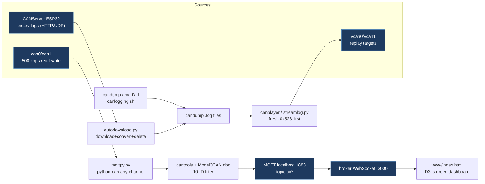
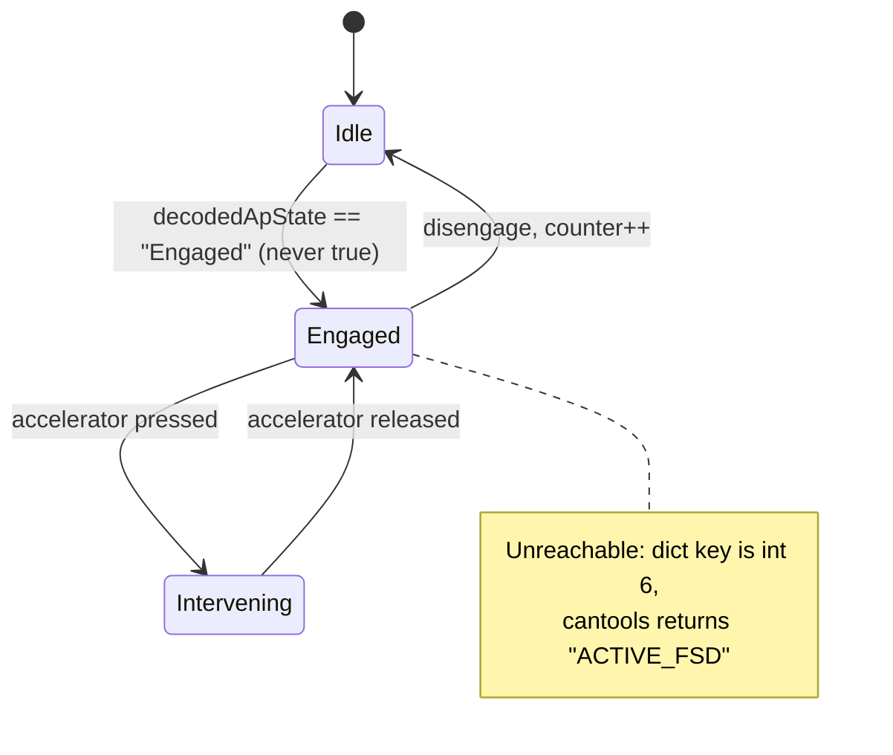

# MatthewDriver-TeslaCAN

Deep code-grounded analysis. Replaces the prior summary (still available via `git show HEAD:docs/legacy/MatthewDriver-TeslaCAN.md`). No `## Upstream (...)` section existed in the pre-replace doc, so none was preserved. The YAML frontmatter above is preserved byte-for-byte from the old doc except that an inherited trailing space on the `description:` line was stripped; the description is itself truncated mid-sentence — see section 6.

## 1. Provenance

- Submodule path: `legacy/MatthewDriver-TeslaCAN`
- Pinned gitlink: `160000 80a82e5344d621e1c3d77397c1324e14840ff567 0` (matches `git -C legacy/MatthewDriver-TeslaCAN rev-parse HEAD`; working tree clean per `git status --porcelain`)
- Upstream URL: `https://github.com/MatthewDriver/TeslaCAN`
- License: MIT, Copyright (c) 2022 Chuck Cook (`LICENSE:1-3`). Repo published by Matthew Driver; code headers credit Chuck Cook (`scripts/mqttpy.py:6`, `www/index.html:263-264`) and the base project k-korn/tm3-can-logger (`www/index.html:263`).
- Upstream history: exactly one local commit — `80a82e5344d621e1c3d77397c1324e14840ff567` 2022-09-05 "new colcour scheme" (message typo verbatim). Not a shallow clone; the repo genuinely ships as a single squashed commit. Pre-pin history was NOT reviewed (does not exist locally).
- Analysis date: 2026-11-21.

Files read in full (FULL-READ):

| File | Lines |
| --- | --- |
| `scripts/can_setup.sh` | 1-30 |
| `scripts/canlogging.sh` | 1-12 |
| `scripts/canplay.sh` | 1-52 |
| `scripts/convert.sh` | 1-16 |
| `scripts/mqttpy.py` | 1-409 |
| `scripts/streamlog.py` | 1-56 |
| `scripts/convertbinary.py` | 1-122 |
| `scripts/convertRawASC.py` | 1-134 |
| `scripts/autodownload.py` | 1-215 |
| `scripts/dbcScratchpad.txt` | 1-34 |
| `scripts/fsdtest.dbc` | 1-209 |
| `www/index.html` | 1-1125 |
| `www/graph.html` | 1-130 |
| `README.md` | 1-1 (single heading, no other content) |
| `LICENSE` | 1-21 |
| pre-replace `docs/legacy/MatthewDriver-TeslaCAN.md` | 1-63 (via `git show HEAD:`) |

STRUCTURAL-PARSE: `scripts/Model3CAN.dbc` (4127 lines — BO_/SG_/VAL_ inventory extracted via grep; ~140 messages; claims limited to structure and to the specific signal lines cited).

RANGE-CITED: `www/fading_tail.html` (1-60 of 345), `scripts/testoutasc.log` (first 5 lines read, plus targeted greps: 0x399/0x528/0x3FD/0x3B6), `www/test_accel_data_short.json` (1-15 of 127).

Grep-sampled only (background-colour check for the "new colcour scheme" commit): `www/index_old.html`, `www/index_july23.html`, `www/index_jul30.bak`, `www/index_Jul31.bak`, `www/indexaug19.html`, `www/index.bak.html`, `www/index.new`.

Files explicitly NOT read: `SteeringDemo.mp4` (binary video), `scripts/testraw.log` (binary CANServer v2 capture), `.DS_Store` (macOS junk), `www/js/*.min.js` (vendored minified d3.v5, jquery 3.4.1, paho-mqtt, underscore), `www/test_accel_data.json` (30558 lines; the 127-line short variant was read instead).

No TEST-READ evidence exists: this repo ships no tests. CAPTURE evidence exists: `scripts/testoutasc.log` is a real ~8-minute two-bus vehicle capture (see sections 7 and 11).

## 2. Executive verdict

This is a 2022-era Tesla Model 3 CAN research kit, not firmware: bash SocketCAN setup/capture, Python CANServer v2 binary-log converters and an HTTP log-sync client for a separate ESP32 "CANServer" device, a cantools DBC-driven MQTT telemetry bridge, and a D3.js "green screen" dashboard. The load-bearing assets are the two DBC catalogs (`Model3CAN.dbc`, `fsdtest.dbc`) and the research fragments for the redundant EPAS steering ECUs (`EPAS3P` 0x373 / `EPAS3S` 0x374) plus the muxed `UI_autopilotControl` (0x3FD) bit map — these directly cross-check our FSD/nag bit tables and expose real deltas (ECE R79 bit 19 vs our bit 20; speed/steering decode layouts that differ from our `powertrain.h`). The runtime Python code is research-grade: the AP intervention counter can never fire (choice-string vs int dict bug), `convertRawASC.py` emits nothing as shipped (`hex()` vs int list), and the dashboard defaults to static test data. Adaptation candidates are offline-only: the CANServer v2 log format parser, the 0x3B6 odometer decode, and the EPAS3P/3S signal map for bench validation of our 0x370 nag echo. Never port: the active (non-listen-only) bus bring-up, the broken dict-key decode pattern, and all vendored/minified web libraries.

## 3. Evidence map

| Source file | Lines | What it proves | Grade |
| --- | --- | --- | --- |
| `scripts/can_setup.sh` | 18-24, 29-30 | vcan0/vcan1 created; can0/can1 brought up at 500 kbps | CODE-READ |
| `scripts/can_setup.sh` | 27-28 | listen-only bring-up exists but is commented out; active lines are read-write | CODE-READ |
| `scripts/canlogging.sh` | 12 | capture is `candump any -D -l` over all interfaces | CODE-READ |
| `scripts/mqttpy.py` | 24, 26-28 | loads `Model3CAN.dbc` via cantools; broker localhost:1883, topic `ui` | CODE-READ |
| `scripts/mqttpy.py` | 43-65 | python-any-channel bus + 10-ID filter list (0x04F commented out) | CODE-READ |
| `scripts/mqttpy.py` | 288-298 | speed published as `DI_vehicleSpeed * .62` (mph) with 80 mph colour threshold | CODE-READ |
| `scripts/mqttpy.py` | 228-236 | accel converted m/s² to G by `* 0.101972` | CODE-READ |
| `scripts/mqttpy.py` | 120-125 | odometer decoded from 0x3B6, software-gated to 1 Hz | CODE-READ |
| `scripts/mqttpy.py` | 117-118 | 0x399 gated to can0/vcan0; "can1 sending short data" comment | CODE-READ |
| `scripts/testoutasc.log` | greps | can1 carries 3-byte `399#000000` stubs while can0 carries full 8-byte DAS_status; verifies the mqttpy comment | CAPTURE |
| `scripts/convertbinary.py` | 19-22, 58-113 | CANServer v2 binary format: 22-byte magic, 0xCD mark, 0xCE timesync, 0xCF frame records | CODE-READ |
| `scripts/autodownload.py` | 134, 141-186 | CANServer HTTP API: `/stats`, `/logs/load`, `/logs/files?offset=`, download, delete | CODE-READ |
| `scripts/autodownload.py` | 111 | corrected integer filter (`frameid in msgIDs`) | CODE-READ |
| `scripts/convertRawASC.py` | 101-103 | filter compares `hex(frameid)` (string) against int list — never matches | CODE-READ |
| `scripts/streamlog.py` | 18, 52-54 | UDP replay injects a fresh 0x528 epoch frame first, then skips 0x528 from the log | CODE-READ |
| `scripts/testoutasc.log` | `can1 528#62090CE7` at t=1644760295.007 | payload equals Unix epoch of the log timestamp exactly (0x62090CE7 = 1644760295) | CAPTURE |
| `scripts/fsdtest.dbc` | 106-158 | full muxed 0x3FD UI_autopilotControl bit map (m0/m1) | FULL-READ |
| `scripts/fsdtest.dbc` | 50-76 | EPAS3S (BO_ 884) and EPAS3P (BO_ 883) signal layouts incl. counter/checksum | FULL-READ |
| `scripts/fsdtest.dbc` | 38-48 | APP_status 0x259: FSD revoke strikeout / suspend state / watchdog | FULL-READ |
| `scripts/dbcScratchpad.txt` | 4-16, 22-34 | EPAS3P/EPAS3S research fragments; scratchpad labels redundant ECU "ID372" (882) — conflicts with fsdtest BO_ 884 | CODE-READ |
| `www/index.html` | 272, 352-358 | `MQTT_enabled = false` shipped default; test-data mode active without hand edit | CODE-READ |
| `www/index.html` | 275-276, 462-477 | dashboard connects MQTT-over-WebSockets on port 3000, subscribes `ui/#` | CODE-READ |
| `www/index.html` | 418-425 | AP colouring keyed on `payload1 == "Engaged"` — same unreachable value mqttpy never publishes | CODE-READ |
| `www/index.html` | 721, 348, 289 | jerk divisor 0.1 s; steering ratio 10; smoothing degree 10 | CODE-READ |
| `LICENSE` | 1-3 | MIT, (c) 2022 Chuck Cook | CODE-READ |
| `git show HEAD:docs/legacy/MatthewDriver-TeslaCAN.md` | 40-50 | old doc's UI_status signal list on 0x00C verified against `Model3CAN.dbc:39-50` | SUMMARY-ONLY confirmed by CODE-READ |

Model3CAN.dbc reading coverage: STRUCTURAL-PARSE (schema-level inventory plus targeted signal extraction at the cited lines). www/js libraries: STRUCTURAL-PARSE only (version-pinned vendored files, not read).

## 4. Architecture and build surface

No build system: plain shell + Python 3 (python-can, cantools, paho-mqtt) + static HTML/JS. Entry points: `can_setup.sh` → `canlogging.sh` (capture) or `mqttpy.py` (live decode) or `autodownload.py` (CANServer sync); `canplay.sh`/`streamlog.py` replay logs; `www/index.html` consumes MQTT. Two hardware families: Raspberry Pi with dual SocketCAN (can0/can1, vcan0/vcan1) and a separate ESP32 CANServer device (HTTP + UDP, binary log format). No build flags. Dependency boundary: everything assumes hardcoded paths under `/home/pi/` (Pi) or `/Users/chuckcook/` (`convert.sh:3-5`) and `teslacan.local` (`streamlog.py:6`).



The repo has no frame-mutation pipeline of its own (RX → decode → display only); the only TX-ish action is replay onto virtual buses plus the fresh 0x528 UDP injection.

## 5. Mechanism catalogue

### CANServer v2 binary log format

- **Claim (README / summary):** Not documented anywhere; the pre-replace doc calls these scripts "Log format conversion utilities" without describing the format.
- **Code path:** `scripts/convertbinary.py:16-122` — `open()` → 22-byte header check → byte-dispatch loop (`0xC` resync, `0xCD` mark, `0xCE` timesync, `0xCF` frame) → ASC text output.
- **Frame spec:** header magic `CANSERVER_v2_CANSERVER` (22 bytes, `convertbinary.py:22`); mark record `0xCD` + 1-byte big-endian length + ASCII string (splits output file, lines 58-74); timesync `0xCE` + 8-byte little-endian epoch µs (lines 76-84); frame `0xCF` + 2-byte LE ms offset + 1-byte ID + 1-byte `len|bus` nibbles (`framelength = b & 0x0F`, `busid = (b >> 4) & 0x0F`, lines 85-104); timestamp = lastSyncTime + offset*1000 µs.
- **Gates and timing:** length clamped to 0..8 (lines 99-102); `'C'` bytes in payload are disambiguated by reading 21 more bytes and seeking back on mismatch (lines 38-57).
- **State machine:** None found.
- **Tests:** None found.
- **Evidence grade:** CODE-READ.
- **Verdict:** CONFIRMED.
- **Adapt to TeslaCANModder?** candidate — a spec-quality parser target for `tools/` log ingestion; offline only, no CAN risk.

### CANServer HTTP log-sync client

- **Claim (README / summary):** Not mentioned in the pre-replace doc.
- **Code path:** `scripts/autodownload.py:129-215` — poll `/stats` → `/logs/load` (active file) → `/logs/files?offset=N` paginated via `'---cont---'` marker carrying the next offset in `s` (lines 148-163) → `/logs/files/download?id=` → `/logs/files/delete` POST (lines 171-186) → convert via the shared binary parser → sleep 60 s (30 s when the server is unreachable, lines 207-213).
- **Frame spec:** Not applicable (HTTP JSON).
- **Gates and timing:** 60/30 s poll loop; active log file is skipped; download-then-delete means a failed conversion loses the source file from the server.
- **State machine:** None found (single polling loop).
- **Tests:** None found.
- **Evidence grade:** CODE-READ.
- **Verdict:** CONFIRMED.
- **Adapt to TeslaCANModder?** candidate — pagination and delete-after-download semantics are useful reference for our recorder export API; independent implementation required.

### DBC-driven MQTT telemetry bridge

- **Claim (README / summary):** pre-replace doc: "MQTT publisher for streaming CAN data" — accurate but shallow.
- **Code path:** `scripts/mqttpy.py:401-409 run()` → `connect_mqtt()` (localhost:1883) → `listenToCan()` (lines 82-135) → per-ID handlers → `publish_mqtt()` (lines 138-153).
- **Frame spec:** filters on 0x101, 0x108, 0x111, 0x118, 0x129, 0x145, 0x257, 0x318, 0x399, 0x3B6 (lines 53-65; 0x04F GPS commented out at 54, 89-90); odometer gated to 1 Hz via `getTimeDelayed` (lines 120-125); 0x399 gated to can0/vcan0 (lines 115-118).
- **Gates and timing:** CAN mask written as 7-hex-digit `0xFFFFFFF` (lines 55-64) — harmless for 11-bit IDs but sloppy; colour-coded payloads `value;#RRGGBB` on `custom_*` topics (e.g. lines 235-236, 277-281, 292-297).
- **State machine:** None found.
- **Tests:** None found.
- **Evidence grade:** CODE-READ.
- **Verdict:** CONFIRMED (mechanism works; see the AP card for the broken sub-feature).
- **Adapt to TeslaCANModder?** already present — our firmware ships an MQTT telemetry bridge (`mqtt:on`, `mqtt:interval:N`); upstream adds nothing but the value;colour display convention, which is a client-side idea, not a port.

### AP engagement / intervention state machine

- **Claim (README / summary):** the file's own TODO says "Calculate interventions when AP is engaged and accelerator is pressed" (`mqttpy.py:1-3`).
- **Code path:** `scripts/mqttpy.py:310-356 DAS_statusclient()` → `translateResponse(localDict, decoded['DAS_autopilotState'])` → compare `decodedApState == "Engaged"` (line 327) → increment `ApInterveneCounter` when the accelerator is pressed while engaged (lines 328-330); `DriveSystemStatus()` (lines 168-190) sets `DriverAcceleratorPressed`.
- **Frame spec:** 0x399 DAS_status, `DAS_autopilotState 0|4@1+` with `VAL_ ... 6 "ACTIVE_FSD"` (`Model3CAN.dbc:749`, `:3630`).
- **Gates and timing:** intervention latched once per engagement via `ApInterveneActive` (lines 179-182, 328-330).
- **State machine:** intended machine diagrammed below — but the `"Engaged"` state is unreachable, because cantools returns VAL_ choice strings and the dict key that maps to `Engaged` is the integer `6` (`mqttpy.py:313`), which never equals any decoded string. All transitions through `"Engaged"` are dead; the counters stay 0 forever.



- **Tests:** None found.
- **Evidence grade:** CODE-READ.
- **Verdict:** CONTRADICTED (intended behavior cannot occur; the dashboard's matching check `index.html:418-425` inherits the same dead value).
- **Adapt to TeslaCANModder?** candidate (concept only, never the implementation) — disengage/intervention counters are a cheap read-only metric; our side already decodes the state correctly as a raw nibble (`readDASAutopilotState`, `firmware/lib/vehicle/can/handler/frame_readers.h:42-45`), so the corrected feature is a small state latch on `dasApState`.

### UDP log replay with fresh time-frame injection

- **Claim (README / summary):** Not mentioned in the pre-replace doc.
- **Code path:** `scripts/streamlog.py:10-18, 23-56` — reads `savvydump.log` (candump format), skips the first 500000 lines (lines 26-27), sends one fresh `0x528` frame packed with the current epoch first (line 18), then replays every logged frame as UDP `<int32 LE id><int8 len><payload>` to `teslacan.local:1883` (lines 10-12), skipping 0x528 from the log (lines 52-54).
- **Frame spec:** 0x528 UnixTime, DLC 4, big-endian epoch seconds (`Model3CAN.dbc:2146-2147` `UnixTimeSeconds528 7|32@0+`); capture-verified: `testoutasc.log` line `can1 528#62090CE7` at timestamp 1644760295.007 — 0x62090CE7 is exactly 1644760295.
- **Gates and timing:** inter-frame sleep 0.001 s constant; if the timestamp delta exceeds 100000 the script sleeps 0.5 s assuming a time resync in the capture (lines 35-42).
- **State machine:** None found.
- **Tests:** None found.
- **Evidence grade:** CODE-READ + CAPTURE (0x528 payload semantics).
- **Verdict:** CONFIRMED.
- **Adapt to TeslaCANModder?** candidate — replay-with-current-clock is a neat bench trick for our `simu:`/recorder tooling; frame layout needs independent capture on a 2026 vehicle before any injection (capture-first).

### SocketCAN setup and capture

- **Claim (README / summary):** pre-replace doc: "Configures SocketCAN interfaces (can0, can1 at 500kbps) and virtual CAN (vcan0, vcan1)" — CONFIRMED.
- **Code path:** `scripts/can_setup.sh:16-30` — `modprobe vcan`, create/up vcan0/vcan1, `ip link set canN up type can bitrate 500000` (lines 29-30); commented systemd unit at lines 3-12; capture via `candump any -D -l` (`canlogging.sh:12`).
- **Frame spec:** Not applicable.
- **Gates and timing:** listen-only variant exists ONLY as comments (lines 27-28); shipped lines bring the bus up read-write.
- **State machine:** None found.
- **Tests:** None found.
- **Evidence grade:** CODE-READ.
- **Verdict:** CONFIRMED (with the safety caveat above).
- **Adapt to TeslaCANModder?** never port the active read-write default for vehicle benches; our MCP2515 stack already runs passive sniffing by default.

### Web dashboard (green D3 dashboard)

- **Claim (README / summary):** pre-replace doc: "MQTT-connected web dashboard using D3.js for real-time vehicle data visualization" — PARTIAL: shipped default is static test mode.
- **Code path:** `www/index.html:352-358` — `MQTT_enabled=false` → `TESTING_get_test_data()` + synthetic steering/speed sines; live path is `MQTTconnect()` (lines 465-478) → subscribe `ui/#` (line 462) → `showValue()` dispatch (lines 393-438).
- **Frame spec:** Not applicable (consumes MQTT topics: `custom_accel` `lat;long;vert;color`, `custom_cur-speed`, `custom_ap-state`, `steering-angle`, `gear-posn`, `date_time`, `disengage-count`, `intervene-count`).
- **Gates and timing:** redraw loops 20-100 ms (`steering_redraw_time_ms=20`, `speed_plot_redraw_time_ms=50`, `accelerometer_redraw_time_ms=100`); smoothing `smooth_degree=10`; jerk divisor 0.1 s (line 721); `mysin(value, cap)` sine compression for G plots (lines 1117-1123); Model 3 steering ratio 10:1 (line 348, used at line 1028).
- **State machine:** AP colouring binary on `ap_engaged` (lines 417-426, 884-893) — inherits the unreachable `"Engaged"` value; in test mode it is flipped every 4 s (lines 1004-1017).
- **Tests:** None found.
- **Evidence grade:** CODE-READ.
- **Verdict:** PARTIAL (works only after hand-editing `MQTT_enabled` and standing up a WebSocket broker on :3000 — no broker config ships in the repo).
- **Adapt to TeslaCANModder?** no impact — our client has its own monitor architecture; only the sine-compressed G-plot idea is worth remembering as a visualization note.

### DBC catalogs (Model3CAN.dbc, fsdtest.dbc) and EPAS research fragments

- **Claim (README / summary):** pre-replace doc lists both DBC files and the 0x00C UI_status signals — CONFIRMED (`Model3CAN.dbc:39-50`).
- **Code path:** `scripts/mqttpy.py:24` loads `Model3CAN.dbc`; `fsdtest.dbc` is not loaded by any runtime code (research artifact).
- **Frame spec:** see sections 7 and 11. Highlights: `fsdtest.dbc:64-76` EPAS3P 0x373 (`torsionBarTorque 19|12@0+ (0.01,-20.5) Nm`, `handsOnLevel 38|2`, counter `48|4`, checksum `56|8`); `fsdtest.dbc:50-62` EPAS3S as BO_ 884 (0x374) — while `dbcScratchpad.txt:22` labels the redundant ECU `ID372` (882) with identical signals; `fsdtest.dbc:106-158` full 0x3FD mux map.
- **Gates and timing:** None found.
- **State machine:** None found.
- **Tests:** None found.
- **Evidence grade:** STRUCTURAL-PARSE (Model3CAN.dbc), FULL-READ (fsdtest.dbc), CODE-READ (dbcScratchpad.txt).
- **Verdict:** CONFIRMED as catalogs; the EPAS3S frame ID is CONTRADICTED within the repo (882 vs 884).
- **Adapt to TeslaCANModder?** candidate (as a bench cross-check for our 0x370 nag echo, see parity rows 8-11); never copy DBC text wholesale — extract the few signals we act on.

## 6. Summary vs code contradiction table

Pre-replace claims cited as `git show HEAD:docs/legacy/MatthewDriver-TeslaCAN.md#<line>`.

| # | Claim (source) | Code says | Grade |
| --- | --- | --- | --- |
| 1 | "www/index.html — MQTT-connected web dashboard … real-time vehicle data visualization" (`HEAD:…md#44`) | `www/index.html:272` ships `MQTT_enabled = false` → static `test_accel_data.json` + synthetic sines (`:352-358, 480-541`); live mode also needs an undocumented WebSocket broker on :3000 (`:276`) while `mqttpy.py` publishes to :1883 (`mqttpy.py:26-27`) | CODE-READ |
| 2 | "A Tesla Model 3 CAN bus logging and visualization toolkit built around a Raspberry Pi with SocketCAN" (`HEAD:…md#15`) — scope misdescription | 4 of 9 scripts target a separate ESP32 CANServer device: binary format (`convertbinary.py:22`), HTTP sync (`autodownload.py:134-186`), UDP replay (`streamlog.py:6-12`), ASC conversion (`convertRawASC.py:14`) | CODE-READ |
| 3 | "convertbinary.py, convertRawASC.py — Log format conversion utilities" (`HEAD:…md#43`) | `convertRawASC.py:103` compares `hex(frameid)` (string) against an int list — filter never matches, converter emits nothing as shipped; `autodownload.py:111` shows the corrected form | CODE-READ |
| 4 | Frontmatter `description:` ends mid-sentence ("It includes shell ") — truncated with inherited trailing space | kept per preservation policy (trailing space stripped only); staleness recorded here instead of editing the frontmatter | SUMMARY-ONLY |
| 5 | Intra-repo: redundant EPAS ECU frame ID | `dbcScratchpad.txt:22` says `BO_ 882 ID372EPAS3S` with identical signal layout to `fsdtest.dbc:50-62` `BO_ 884 EPAS3S_sysStatus` — the repo's own two files disagree (0x372 vs 0x374) | CODE-READ |

Everything else the old doc claimed checked out (license, 500 kbps dual bus, vcan support, 0x00C signal list, script inventory) — those agreements live in the evidence map, not here.

## 7. CAN frame and signal inventory

Frames the runtime code decodes, injects, or gates. Periods are not stated anywhere upstream except the software gates noted; DLC and layouts are from the DBC the code loads (CODE-READ of the DBC lines). Counter/checksum columns reflect DBC-defined fields only — the runtime code never validates them.

| ID (hex+dec) | Bus | Period | DLC | Byte/bit layout | Scale/units | Counter | Checksum | R/W | Grade |
| --- | --- | --- | --- | --- | --- | --- | --- | --- | --- |
| 0x101 (257) RCM_inertial1 | Chassis | not stated | 8 | pitchRate 16\|15, rollRate 31\|15, yawRate 0\|16 (LE signed) | 0.00025 / 0.00025 / 0.0001 rad/s | none defined | none defined | read (`mqttpy.py:193-204`) | CODE-READ |
| 0x108 (264) DIR_torque | Vehicle | not stated | 8 | torqueActual 27\|13, axleSpeed 40\|16 (LE signed) | 2 Nm / 0.1 RPM | none defined | none defined | read (`mqttpy.py:207-219`) | CODE-READ |
| 0x111 (273) RCM_inertial2 | Chassis | not stated | 8 | lateral 16\|16, longitudinal 0\|16, vertical 32\|16 (LE signed) | 0.00125 m/s² | none defined | none defined | read (`mqttpy.py:222-252`) | CODE-READ |
| 0x118 (280) DriveSystemStatus | Vehicle | not stated | 8 | accelPedalPos 32\|8 (0.4,0) %, gear 21\|3 VAL_ 1P/2R/3N/4D | — | none defined | none defined | read (`mqttpy.py:168-190`) | CODE-READ |
| 0x129 (297) SteeringAngle | Vehicle | not stated | 8 | SteeringAngle129 16\|14@1+ LE | 0.1 deg, offset −819.2 | none defined | none defined | read (`mqttpy.py:255-264`) | CODE-READ |
| 0x145 (325) ESP_status | Chassis | not stated | 8 | driverBrakeApply 29\|2 VAL_ | — | none defined | none defined | read (`mqttpy.py:267-282`) | CODE-READ |
| 0x257 (599) DIspeed | Vehicle | not stated | 8 | DI_vehicleSpeed 12\|12@1+ LE | 0.08 kph, offset −40 | none defined | none defined | read (`mqttpy.py:285-298`) | CODE-READ |
| 0x318 (792) SystemTimeUTC | Vehicle | not stated | 8 | month 8\|8, seconds 16\|8, hour 24\|8, day 32\|8, minutes 40\|8 | — | none defined | none defined | read (`mqttpy.py:301-307`) | CODE-READ |
| 0x399 (921) DAS_status | Chassis | not stated | 8 (can0) / 3-byte stub on can1 | autopilotState 0\|4, handsOnState 42\|4, statusChecksum 56\|8, statusCounter 52\|4 | — | DAS_statusCounter 52\|4 | DAS_statusChecksum 56\|8 | read, can0-gated (`mqttpy.py:115-118`) | CODE-READ + CAPTURE (`testoutasc.log`: can1 `399#000000` stubs, can0 full frames) |
| 0x3B6 (950) odometer | Vehicle | software-gated 1 Hz (`mqttpy.py:123`) | 4 | Odometer3B6 0\|32@1+ LE | 0.001 km (1 m) | none defined | none defined | read (`mqttpy.py:359-367`) | CODE-READ |
| 0x528 (1320) UnixTime | Vehicle | ~1 s in capture (476 frames ≈ 476 s) | 4 | UnixTimeSeconds528 7\|32@0+ BE | 1 s epoch | none | none | INJECTED fresh at replay start (`streamlog.py:18`), skipped from replayed logs (`:52-54`) | CODE-READ + CAPTURE (payload 0x62090CE7 == log timestamp 1644760295) |
| 0x04F (79) GPSLatLong | Chassis | not stated | 8 | GPSLatitude04F / GPSLongitude04F | — | none defined | none defined | decoder present (`mqttpy.py:156-165`) but filter disabled (`:54, 89-90`) | CODE-READ |

Catalog-only rows (DBC/research artifacts; no runtime decode):

| ID | Name | Key fields | Grade |
| --- | --- | --- | --- |
| 0x3FD (1021) UI_autopilotControl | muxed, m0/m1 mapped in full in `fsdtest.dbc:106-158`; capture sample exists (`testoutasc.log` can0 mux0/mux1 frames) | see parity rows 7-9 | FULL-READ + CAPTURE presence |
| 0x373 (883) EPAS3P_sysStatus | torsionBarTorque 19\|12@0+ (0.01,−20.5) Nm, handsOnLevel 38\|2, steeringRackForce 1\|10@0+ (50,−25575) N, counter 48\|4, checksum 56\|8 | `fsdtest.dbc:64-76`, `dbcScratchpad.txt:4-16` | CODE-READ |
| 0x374 (884) EPAS3S_sysStatus | identical layout; scratchpad calls the redundant ECU 0x372/882 instead (`dbcScratchpad.txt:22`) | `fsdtest.dbc:50-62` | CODE-READ |
| 0x259 (601) APP_status | fsdRevokeStrikeoutCount 21\|3, fsdSuspendState 19\|2 VAL_ NOT_SUSPENDED/SUSPENDED, watchdogState 0\|3, checksum 56\|8, counter 52\|4 | `fsdtest.dbc:38-48, 160-166` | FULL-READ |

`Model3CAN.dbc` as a whole: STRUCTURAL-PARSE, ~140 BO_ messages (ChassisBus/VehicleBus), VAL_ tables for the decoded enums, plus per-message checksum/counter fields for 0x399, 0x175, and others — summarized here, not dumped.

## 8. Constants and tuning table

| Constant | Value | File:line | Meaning | Grade |
| --- | --- | --- | --- | --- |
| kph→mph factor | 0.62 | `scripts/mqttpy.py:291` | speed display conversion (true factor 0.621371; ~0.2% low) | CODE-READ |
| m/s²→G factor | 0.101972 | `scripts/mqttpy.py:228-233` | 1/9.80665 — correct | CODE-READ |
| odometer gate | 1 s | `scripts/mqttpy.py:123` | rate limit for 0x3B6 decode/publish | CODE-READ |
| speed colour threshold | 80 (mph) | `scripts/mqttpy.py:292` | switches `custom_cur-speed` payload colour to orange | CODE-READ |
| CANServer magic | `CANSERVER_v2_CANSERVER`, 22 B | `scripts/convertbinary.py:19-22` | binary log header; mid-file copies resync via `'C'`+21 bytes | CODE-READ |
| record markers | 0xCD mark / 0xCE timesync / 0xCF frame | `scripts/convertbinary.py:58, 76, 85` | record type dispatch bytes | CODE-READ |
| replay line skip | 500000 | `scripts/streamlog.py:26-27` | drops the first 500k log lines before replay | CODE-READ |
| timesync-gap heuristic | >100000 → sleep 0.5 s; else sleep 0.001 s | `scripts/streamlog.py:38-42` | replay pacing; the true delta is NOT used | CODE-READ |
| poll cadence | 60 s up / 30 s down | `scripts/autodownload.py:129, 207-213` | CANServer discovery/conversion loop | CODE-READ |
| bitrate | 500000 | `scripts/can_setup.sh:29-30` | both physical buses; listen-only variant commented at 27-28 | CODE-READ |
| MQTT ports | 1883 (client) / 3000 (dashboard WS) | `scripts/mqttpy.py:27`, `www/index.html:276` | broker must bridge both — undocumented | CODE-READ |
| steering ratio | 10 | `www/index.html:348` | tyre rotates wheel angle / 10 (Model 3 assumption) | CODE-READ |
| jerk divisor | 0.1 s | `www/index.html:721` | assumes 10 Hz accel samples for jerk derivation | CODE-READ |
| smoothing degree | 10 | `www/index.html:289` | Gaussian window smoothing of accel trio | CODE-READ |
| G caps | 0.4 G plot / 0.8 jerk cap / 75..−10 mph speed plot | `www/index.html:331-332, 325, 317` | sine-compression display limits | CODE-READ |
| AP test flip | 4000 ms | `www/index.html:1016` | test-mode AP engage/disengage toggle | CODE-READ |

## 9. Failure modes and edge cases

| Failure | Handling code path | Tested? | Grade |
| --- | --- | --- | --- |
| `convertRawASC.py` filter never matches (`hex()` string vs int list) | `scripts/convertRawASC.py:103` — output file stays empty | no | CODE-READ |
| `autodownload.py` converted-output path contains literal `%b%d` (never strftime-formatted) | `scripts/autodownload.py:196` — `open()` fails unless a directory literally named `%b%d` exists; swallowed by bare `except` at 202-205, so each file logs "Error" and the source was already deleted from the server at 184-186 | no | CODE-READ (filesystem-dependent outcome) |
| mqttpy bus creation fails (OSError) | `scripts/mqttpy.py:42-51` prints, then falls through to `bus.set_filters` at 53 → NameError on unbound `bus` | no | CODE-READ |
| AP intervention counters frozen (dict key int 6 vs cantools choice strings) | `scripts/mqttpy.py:313, 327-344` — `decodedApState == "Engaged"` unreachable; dashboard inherits it (`www/index.html:418-425`) | no | CODE-READ |
| canplayer kill-prompt syntax error | `scripts/canplay.sh:48` — `if [[ $killmqtt = "Y"]]` is missing a space before `]]`; branch errors out at runtime | no | CODE-READ |
| streamlog malformed/missing `savvydump.log` | no handling — traceback (`scripts/streamlog.py:23, 31-50`) | no | CODE-READ |
| broad exception swallowing in decode loop | `scripts/mqttpy.py:129-132, 248-251, 352-355` — prints and continues; a persistently bad frame spams the console silently forever | no | CODE-READ |
| undefined accel records crash the tail renderer | guarded at `www/index.html:846-847` (comment says it "breaks the system" — patched from experience), plus per-row try/catch in `smooth_trio` at 1092-1098 | no | CODE-READ |
| bus-off / watchdog / brownout / queue overflow | None found — userland Python + candump; no bus health handling anywhere | — | CODE-READ (absence) |
| 0x399 can1 stub frames polluting decode | gated by channel check (`scripts/mqttpy.py:117`) — the only failure-aware decode in the repo; verified by capture | no | CODE-READ + CAPTURE |

## 10. Test coverage map

No TEST-READ evidence exists: this repo ships no tests (no test files, no `def test_`, no asserts; demonstrated negative anchor in section 16).

Critical paths with NO test:

- CANServer v2 parser: any corrupt/truncated record — risk: silent wrong timestamps or empty output (already realized in `convertRawASC.py`).
- AP state machine: the unreachable `"Engaged"` mapping went unnoticed — risk: any derived feature silently dead.
- MQTT bridge: unbound-`bus` crash after failed bus open — risk: bridge dies at startup on a misconfigured Pi.
- Dashboard: colour/ID mismatches (`$("#accel")` targets a nonexistent element, `www/index.html:405`) — risk: features silently no-op.

## 11. Parity matrix with TeslaCANModder

Our-side citations are CODE-READ from the shipping tree. Upstream decode cites the DBC lines the upstream code actually loads.

| # | Signal/frame | Upstream decode (cite) | Our decode (cite) | Delta | Action |
| --- | --- | --- | --- | --- | --- |
| 1 | 0x257 DI_vehicleSpeed | 12\|12@1+ LE, (0.08, −40) kph (`Model3CAN.dbc:2661`) | bytes[2..3] big-endian signed ÷100 km/h (`firmware/lib/vehicle/can/feature/telemetry/powertrain.h:18-22`, fed at `firmware/lib/vehicle/can/handler/bus/vehicle.h:381-383`) | position, endianness, scale, offset ALL differ — cannot both describe the same vehicle generation | capture-first (2022 DBC vs 2026 firmware; a single bench capture settles it) |
| 2 | 0x129 SteeringAngle | 16\|14@1+ LE, (0.1, −819.2) deg (`Model3CAN.dbc:2544`) | bytes[0..1] big-endian signed ÷10 deg (`powertrain.h:59-63`) | same ID, incompatible layout | capture-first |
| 3 | 0x118 DI_gear | 21\|3@1+ VAL_ 1P/2R/3N/4D (`Model3CAN.dbc:2594`, `:4186`) | byte0 bits[3:1], codes 1=P..4=D (`powertrain.h:29-32`, `:80-95`) | value codes match; bit position differs | capture-first |
| 4 | 0x118 DI_accelPedalPos | 32\|8 (0.4, 0) % (`Model3CAN.dbc:2590`) | byte[1] raw percent (`powertrain.h:39-42`) | position and scale differ | capture-first |
| 5 | 0x175 wheel speeds | 0/13/26/39\|13@1+ 0.04 kph, counter 52\|4, checksum 56\|8 (`Model3CAN.dbc:2216-2222`) | identical layout + 8191-SNA guard (`firmware/lib/vehicle/can/feature/telemetry/wheel_speeds.h:16-61`) | match; ours additionally treats 8191 as SNA | ignore (align confirmed) |
| 6 | DAS_status hands-on/AP state | 0x399: autopilotState 0\|4, handsOnState 42\|4, laneChangeState 46\|5, checksum 56\|8, counter 52\|4 (`Model3CAN.dbc:743-762`; `fsdtest.dbc:78-104`); can1 emits 3-byte stubs (CAPTURE) | 0x39B: status byte0[3:0], state byte1[7:4] (`firmware/lib/vehicle/can/handler/frame_readers.h:28-45`), handsOn byte5[5:2] (`firmware/lib/vehicle/can/feature/fsd/nag.h:47-50`, wired at `vehicle.h:130-136`), laneChange byte4[4:0] (`firmware/lib/vehicle/can/feature/fsd/auto_lane_change.h:16-27`); our `chassis.h:72-73` already acknowledges 0x399=DAS_status on HW3 chassis | signal positions match the upstream 0x399 layout exactly, but the ID (0x39B vs 0x399) and laneChange position (our byte4[4:0] vs upstream 46\|5) differ; we do not verify the checksum/counter upstream documents; note: `nag.h:43` comment says "from 0x370" though the function is fed 0x39B frames at `vehicle.h:132` — stale comment, behavior correct | capture-first for laneChange; small gap: consider checksum verification; fix the stale comment (no behavior change) |
| 7 | 0x3FD mux0 FSD bits | enableFullSelfDriving 46, fsdStopsControlEnabled 38, fsdContinueOnGreenWithCIPV 39 (`fsdtest.dbc:118-124`) | set bits 38/39/46/60 (+59 when EVD on) (`firmware/lib/vehicle/can/handler/variant/hw4.h:136-144`; `bits.h:18-23`) | 38/39/46 coincide (upstream names differ from ours for 38/46); 59/60 unlabeled upstream | ignore for 38/39/46; capture-first to confirm 59/60 |
| 8 | 0x3FD mux1 nag/ECE bits | UI_applyEceR79 at m1 bit 19, UI_showLaneGraph 45 (`fsdtest.dbc:131, 149`) | clear bit 19 as hands-on + clear bit 20 as ECE R79, set bit 45 (`hw4.h:42-43`, `:47`; `bits.h:26, 42`) | 45 matches; ECE R79 is upstream bit 19 vs our bit 20 — one-bit conflict on a frame we mutate | capture-first (EU-market capture with R79 active) before touching our clear |
| 9 | 0x3FD speed offset | upstream places smartSetSpeedOffset at m0 25\|6 (1, −30) % (`fsdtest.dbc:116`); no mux2 offset defined | our HW4 offset written into mux2 byte1 bits[5:0] preserving 0xC0 (`hw4.h:157-164`; `bits.h:52-54`) | no upstream corroboration for our field at all | capture-first (validation gap, not necessarily an error) |
| 10 | 0x318 frame identity | SystemTimeUTC: month/day/hour/min/sec (`Model3CAN.dbc:2138-2144`) | defined as `CAN_ID_GTW_CAR_STATE 0x318` with no handler anywhere (`firmware/lib/vehicle/can/ids.h:52`; `git grep` shows no other reference) | frame-identity conflict upstream-vs-ours, and our docs claim an OTA guard that has no code path | capture-first + internal follow-up on the dangling constant |
| 11 | EPAS status frame | EPAS3P 0x373 / EPAS3S 0x374 (scratchpad says 0x372): torsionBarTorque 19\|12 (0.01, −20.5) Nm, handsOnLevel 38\|2, counter 48\|4, checksum 56\|8 (`fsdtest.dbc:50-76`; `dbcScratchpad.txt:4-16`) | our nag echo targets 0x370 with CRC-8 magic table (`ids.h:59`, `firmware/lib/vehicle/can/crc8.h:56-57`, `checksum.h:59-61`) | upstream research never covers 0x370; our `ids.h:59` comment names 0x370 "EPAS3P_sysStatus", which upstream places at 0x373 — naming inconsistency worth resolving | capture-first: which EPAS ID 2026 cars actually expose, and whether 0x373/0x374 frames also need echo coverage in nag modes |
| 12 | 0x3B6 odometer | Odometer3B6 0\|32@1+ (0.001, 0) km, DLC 4, 1 Hz gate (`Model3CAN.dbc:2749-2750`; `mqttpy.py:120-125`) | no decode — no 0x3B6 reference in `firmware/lib/` (grep-verified) | gap on our side | candidate: read-only odometer telemetry add |
| 13 | 0x528 UnixTime | UnixTimeSeconds528 7\|32@0+ BE sec, injected fresh at replay (`Model3CAN.dbc:2146-2147`; `streamlog.py:18, 52-54`); CAPTURE-verified payload==timestamp | no 0x528 reference in `firmware/lib/` (grep-verified) | gap, but only relevant to bench replay tooling | candidate: replay-time fresh-clock trick in `tools/`, after independent capture |

## 12. Surface inventory and security notes

| Surface | Semantics | Notes |
| --- | --- | --- |
| Shell (root) | `can_setup.sh`, `canlogging.sh`, `canplay.sh` self-escalate via `sudo bash "$0"` (`can_setup.sh:16`, `canlogging.sh:4`) | root by design; `canplay.sh` interactive prompts, `pgrep`-based kills |
| HTTP client → CANServer | `/stats`, `/logs/load`, `/logs/files?offset=`, `/logs/files/download?id=`, `/logs/files/delete` POST (`autodownload.py:134-186`) | plain HTTP, hardcoded IP `192.168.1.48` (`:1`); DELETE-after-download is destructive on conversion failure |
| MQTT publish | `ui/<field>` on localhost:1883 (`mqttpy.py:26-28, 138-153`) | no auth, no TLS — LAN research only |
| MQTT-over-WebSockets subscribe | `ui/#` on `:3000` (`www/index.html:465-478`) | no auth; requires an undocumented broker bridge |
| UDP frames → CANServer | `<int32 LE id><int8 len><payload>` to `teslacan.local:1883` (`streamlog.py:10-12`) | spoofable datagram format; port 1883 doubles as UDP here |
| Filesystem | logs under `/home/pi/logs/`, scripts under `/home/pi/scripts/`, Chuck Cook's macOS paths in `convert.sh:3-5` and `autodownload.py:175` | hardcoded personal paths shipped in repo |

Security/provenance findings: no credentials, keys, or certs found. Untrusted-archives risk: none (no archives). Dangerous defaults: buses brought up read-write (listen-only commented out, `can_setup.sh:27-30`) on a live vehicle bench; `SteeringDemo.mp4` and `.DS_Store` are committed binaries (repo hygiene, not a vulnerability). Vendored minified JS pinned to old versions (jquery 3.4.1) — never import into our client.

## 13. Adaptation assessment

| Mechanism | Value | Cost | Risk | Evidence | Decision |
| --- | --- | --- | --- | --- | --- |
| CANServer v2 binary log parser | interop with a widely-cloned community log format; feeds our bench tooling | small standalone parser in `tools/` | none — offline parsing | CODE-READ | candidate for future PR (independent implementation + independent test oracle) |
| CANServer HTTP log-sync semantics | pagination + delete-after-download patterns for our recorder export | read-only reference | none | CODE-READ | candidate (reference only; do not copy client) |
| 0x3B6 odometer decode | read-only client telemetry (km, 1 m resolution) | tiny decoder + state field | none — RX-only decode | CODE-READ (DBC) | candidate for future PR |
| 0x528 fresh-clock replay trick | bench replays keep the IC clock current | small addition to replay tooling | needs 2026-capture validation of 0x528 first | CODE-READ + CAPTURE | candidate (capture-first) |
| EPAS3P/3S signal map (0x373/0x374) | independent cross-check for our 0x370 nag echo; documents handsOnLevel/torsion/counter/checksum for the redundant ECU | bench capture session | any nag change requires `docs/checklists/can-review-checklist.md` and listen-only capture first | CODE-READ (catalog, no runtime decode) | candidate — capture-first, never port without bench evidence |
| 0x3FD mux map cross-check | validates/contradicts our bit tables (bit 19-vs-20 conflict is actionable) | re-read of two enums | none until a mutation changes | FULL-READ + CODE-READ | already present (our handlers); gap = validation, track the two conflicts in parity rows 8-9 |
| AP disengage/intervention counters | driver-behavior metric for the client | small latch on our existing `dasApState` decode | none — read-only | upstream CONTRADICTED; our decode CODE-READ | candidate for future PR (concept only; upstream implementation is the anti-pattern to avoid) |
| DBC→MQTT bridge | telemetry transport | — | — | CODE-READ | already present (our MQTT bridge) |
| Dashboard visuals | UI ideas only | — | — | CODE-READ | no impact |
| Active read-write bus bring-up | none for us | — | bus disturbance on live vehicle | CODE-READ | never port |

## 14. Do-not-copy list

| Item | File:line | Reason |
| --- | --- | --- |
| `translateResponse` DBC-choice-string dict pattern with int key `6: 'Engaged'` | `scripts/mqttpy.py:313, 370-374` | broken pattern — if adapting, decode raw values (`decode_choices=False`) or map the actual VAL_ strings |
| `hex(frameid) in msgIDs` filter | `scripts/convertRawASC.py:103` | never matches; copy `autodownload.py:111` form instead — but write it independently |
| non-listen-only `ip link` bring-up | `scripts/can_setup.sh:29-30` | read-write default on a live vehicle; the commented listen-only lines at 27-28 are the only safe form |
| vendored minified libraries | `www/js/*.min.js` | third-party blobs (jquery 3.4.1, d3.v5, paho, underscore); never import into `client/` |
| Chuck Cook's personal absolute paths | `scripts/convert.sh:3-5`, `scripts/autodownload.py:175-176` | machine-specific; replace with parameters |
| literal `%b%d` converted-path component | `scripts/autodownload.py:196` | bug, not a pattern |
| `SteeringDemo.mp4`, `.DS_Store` | repo root | committed binaries; no content value |

All ports (if any are taken) must be behavior/constant ports with `derived idea, independent implementation` attribution, our names and style, and an independent checksum/expected-value oracle in tests. Upstream is MIT-licensed; that permits reuse but does not excuse line-copying.

## 15. History and evolution

Local `git log` for the submodule contains exactly one commit:

```text
80a82e5344d621e1c3d77397c1324e14840ff567 | 2022-09-05 | Matthew Driver | new colcour scheme
```

There is no parent to diff against, so what "new colcour scheme" actually changed is UNVERIFIED. All eight shipped `www/index*` variants already use the green `#009933` background, so the commit's visible delta cannot be isolated from the snapshot. The repo's internal evolution survives as working-tree artifacts:

- Seven dashboard snapshots dated by filename (`index_jul30.bak`, `index_Jul31.bak`, `index_july23.html`, `indexaug19.html`, `index_old.html`, `index.bak.html`, `index.new`) — grep-sampled only; they all share the green scheme and "Chucks Tesla Can" title, so the evolution is UI-internal.
- `mqttpy.py:1-3` TODO list: interventions when AP engaged + blinker data — partially attempted (lines 168-190, 310-356), never completed and never functional (section 5 card).
- Dead code showing abandoned approaches: GPS decode disabled (`mqttpy.py:54, 89-90`), explicit can0/can1 channels abandoned for the any-channel bus (`:20-21` vs `:43`), listen-only bring-up abandoned in favor of read-write (`can_setup.sh:27-28` vs `:29-30`), pedal-position publish commented out (`mqttpy.py:216-217`), vertical-accel display commented out (`index.html:238-242`).
- `convertRawASC.py` vs `autodownload.py` shows the filter fix in progress: the broken `hex()` form (103) and the working int form (`autodownload.py:111`) coexist in the tree.

Lineage (Chuck Cook's original project, k-korn base) is inferred from code comments and paths only (`mqttpy.py:6`, `index.html:263-264`, `convert.sh:3-5`); network claims about those upstreams were not checked and stay UNVERIFIED.

## 16. Re-verification recipe

Pin: gitlink `160000 80a82e5344d621e1c3d77397c1324e14840ff567 0` from `git ls-files -s legacy/MatthewDriver-TeslaCAN`; must equal `git -C legacy/MatthewDriver-TeslaCAN rev-parse HEAD`.

After an upstream bump:

```bash
OLD=80a82e5344d621e1c3d77397c1324e14840ff567
git -C legacy/MatthewDriver-TeslaCAN fetch --tags --prune
git -C legacy/MatthewDriver-TeslaCAN log --oneline $OLD..origin/main
git -C legacy/MatthewDriver-TeslaCAN diff --stat $OLD..origin/main
git -C legacy/MatthewDriver-TeslaCAN diff $OLD..origin/main -- scripts/ www/
git ls-files -s legacy/MatthewDriver-TeslaCAN   # compare gitlink to rev-parse HEAD
```

Anchors below were demonstrated at write time with `Select-String` (pwsh; equivalent ERE semantics) because `grep.exe` is not on this shell's PATH — the `grep -nE` forms are what to run under Git Bash. Every expected hit was confirmed; negative anchors confirmed empty.

```text
grep -nE 'MQTT_enabled' www/index.html
  -> 272: var MQTT_enabled = false; //Set this to True for running MQTT CAN Data, False for Testing static json data
  -> 352: if (MQTT_enabled)
grep -nE 'hex\(frameid\) in msgIDs' scripts/convertRawASC.py
  -> 103: if hex(frameid) in msgIDs:
grep -nE 'Engaged' scripts/mqttpy.py
  -> 313: 'UNAVAILABLE': 'Unavail', 'AVAILABLE': 'Avail', 6: 'Engaged'}
  -> 327: if ((ApEngaged) and (decodedApState == "Engaged")):
grep -nE 'UI_applyEceR79' scripts/fsdtest.dbc
  -> 131: SG_ UI_applyEceR79 m1 : 19|1@1+ (1,0) [0|1] "" ETH
grep -nE 'CANSERVER_v2_CANSERVER' scripts/convertbinary.py
  -> 22: if (headerData == b'CANSERVER_v2_CANSERVER'):
grep -nE '0x528' scripts/streamlog.py
  -> 18: sendFrame(0x528, pack('>I', int(time.time())))
  -> 52: if (frameId == 0x528):
grep -nE 'listen-only' scripts/can_setup.sh
  -> 27: #ip link set can0 up type can bitrate 500000 listen-only on
  -> 28: #ip link set can1 up type can bitrate 500000 listen-only on
grep -nE ' 399#' scripts/testoutasc.log | head -4
  -> includes "(1644760294.234198) can1 399#000000" (3-byte stub) and
     "(1644760294.482198) can0 399#F106FFE0B048C02A" (full frame)
grep -nE ' 528#' scripts/testoutasc.log | head -2
  -> "(1644760295.007198) can1 528#62090CE7"   (0x62090CE7 == 1644760295)
```

Negative anchors (absence claims):

```text
grep -nE '0x370|0x373|EPAS' scripts/mqttpy.py        -> no output (bridge never touches EPAS)
grep -rnE 'def test_|assert ' scripts/*.py           -> no output (no tests)
```

Our-side drift anchors (the `already present` / parity decisions rest on these):

```text
git grep -n 'FSD_BIT_NAG_ECE_R79' -- firmware/lib
  -> firmware/lib/vehicle/can/handler/variant/bits.h:26:#define FSD_BIT_NAG_ECE_R79            20
git grep -n 'decodeVehicleSpeed' -- firmware/lib
  -> firmware/lib/vehicle/can/feature/telemetry/powertrain.h:18: inline float decodeVehicleSpeed(...)
  -> firmware/lib/vehicle/can/handler/bus/vehicle.h:383: s.vehicleSpeed = decodeVehicleSpeed(f.data);
git grep -n 'CAN_ID_DAS_STATUS' -- firmware/lib
  -> firmware/lib/vehicle/can/handler/bus/vehicle.h:130: if (f.id == CAN_ID_DAS_STATUS && f.dlc >= 6)
  -> firmware/lib/vehicle/can/ids.h:64: #define CAN_ID_DAS_STATUS        0x39B // 923
git grep -n 'CAN_ID_GTW_CAR_STATE' -- firmware/lib
  -> firmware/lib/vehicle/can/ids.h:52: #define CAN_ID_GTW_CAR_STATE     0x318 // 792 — GTW_carState (RX)   [only hit]
git grep -n '0.04' -- firmware/lib/vehicle/can/feature/telemetry/wheel_speeds.h
  -> lines 22/35/48/61: raw * 0.04f with 8191-SNA guard
```

If line numbers drift more than ~10, re-read the whole function; do not trust this document's numbers.

## 17. Open questions and explicitly not investigated

Pre-pin upstream history was NOT reviewed — the submodule has a single commit and no parent exists locally; lineage beyond it is inferred from code comments only.

UNVERIFIED items (each names what would settle it):

- What the "new colcour scheme" commit actually changed — no parent to diff; would need the upstream GitHub history (network, not checked).
- python-can `channel=''` exact semantics in `mqttpy.py:43` — needs a runtime test with python-can on Linux; the NameError-on-OSError path at line 53 is objective regardless.
- Whether a WebSocket broker bridging :1883→:3000 was ever deployed — no broker config ships in the repo; would be settled by finding the author's deployment notes (network).
- `0x528` behavior on 2026 vehicles — one 2022 capture proves the 2022 layout; our side has no decode; needs a fresh bench capture before any replay tooling uses it.
- The 0x3FD mux1 ECE R79 bit (19 vs our 20) — the shipped capture sample `0100020020184B80` has neither bit set (likely a NA car); needs an EU-market capture with R79 active.
- `convertRawASC.py:120` would raise NameError when imported as a module (`original_stdout` is only bound in `__main__`) — not exercised by any shipped flow; would settle by running it as an import.
- `autodownload.py:196` `%b%d` literal — whether the author pre-created that directory manually; would settle by inspecting their filesystem (impossible now) or running the tool against a CANServer.
- The intra-repo EPAS3S frame-ID conflict (0x372 scratchpad vs 0x374 fsdtest) — would settle with a capture that shows the redundant ECU frame; matters if we ever extend nag coverage beyond 0x370.

Explicitly not investigated: `SteeringDemo.mp4` contents, `testraw.log` binary payload structure (format-verified only via the documented parser, not byte-diffed), the seven `www/index*` backup snapshots beyond the colour grep, `www/test_accel_data.json` full contents, and anything on the upstream GitHub host (issues, PRs, later commits).
