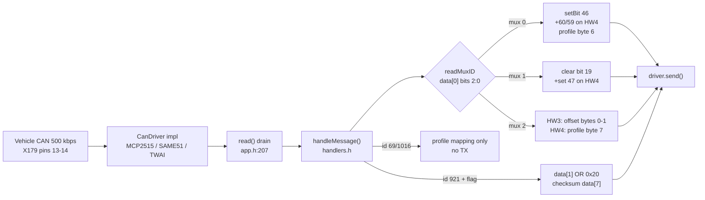
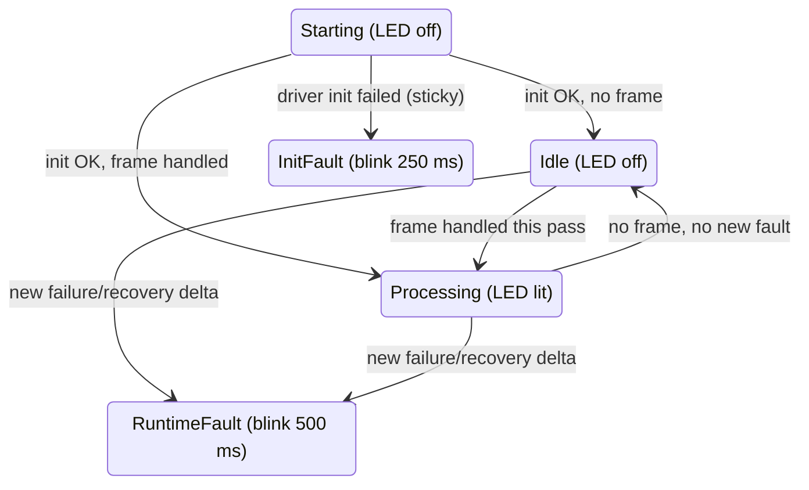

# MrStarTraveller-tesla-fsd-can-mod

Deep-dive replacement of the former shallow summary (replace mode per `legacy-repo-deep-dive` skill). The pre-replace summary remains in git history; its claims are cited below as `git show HEAD:docs/legacy/MrStarTraveller-tesla-fsd-can-mod.md#<line>`. The former doc contained no `## Upstream (...)` sections, so the preservation list was the YAML frontmatter only (kept verbatim; the original file was CRLF, this file is LF per repo standard — frontmatter characters are unchanged).

## 1. Provenance

- Submodule path: `legacy/MrStarTraveller-tesla-fsd-can-mod`
- Pinned gitlink (canonical form from `git ls-files -s`): `160000 66bb855caee52f99b4f2654533540db3a7bf2ff7 0`
- `git -C legacy/MrStarTraveller-tesla-fsd-can-mod rev-parse HEAD` matches the gitlink; `status --porcelain` empty.
- Upstream URL: `https://github.com/MrStarTraveller/tesla-fsd-can-mod` (remote origin). Original project credit: `https://gitlab.com/Starmixcraft/tesla-fsd-can-mod` (README.en.md line 11) — network-only claim, UNVERIFIED.
- License: GPL-3.0 (LICENSE lines 1-2, RANGE-CITED). Third-party: MIT (autowp/arduino-mcp2515, Adafruit_CAN), Apache-2.0 (ESP-IDF TWAI) — THIRD_PARTY_LICENSES, FULL-READ.
- Analysis date: 2026-11-20. Local history: the submodule is a **shallow clone with exactly one commit** — `66bb855 2026-03-31 完善运行状态机与故障指示` ("improve runtime state machine and fault indication") — which adds all 29 tracked files at once (squashed snapshot import).
- Files read, FULL-READ (every line): `RP2040CAN.ino` (62), `src/main.cpp` (45), `include/app.h` (223), `include/handlers.h` (237), `include/can_helpers.h` (34), `include/can_frame_types.h` (10), `include/drivers/can_driver.h` (86), `include/drivers/mcp2515_driver.h` (90), `include/drivers/mock_driver.h` (69), `include/drivers/same51_driver.h` (82), `include/drivers/twai_driver.h` (129), `platformio.ini` (33), `scripts/native_toolchain.py` (42), `scripts/pio-local.ps1` (13), `README.md` (437), `README.en.md` (434), `guides/FSD_SUBSCRIPTION_GUIDE.md` (36), `guides/INSTALLATION_GUIDE_M4_CAN.md` (82), `guides/WIRING_GUIDE.md` (66), `THIRD_PARTY_LICENSES` (62), `.gitignore` (5), `lib/README` (37), `test/README` (11), and all 7 test files: `test_native_app_state/test_app_state.cpp` (92), `test_native_driver_diagnostics/test_driver_diagnostics.cpp` (84), `test_native_helpers/test_helpers.cpp` (174), `test_native_hw3/test_hw3_handler.cpp` (167), `test_native_hw4/test_hw4_handler.cpp` (269), `test_native_legacy/test_legacy_handler.cpp` (139), `test_native_twai/test_twai_filter.cpp` (185).
- Files explicitly NOT read: `guides/images/connected-setup.png`, `guides/images/pinout-labeled.png`, `guides/images/x179-connector.png` (binary wiring photos); `LICENSE` beyond lines 1-5 (standard GPL-3.0 text, RANGE-CITED).
- Our-side files read for parity (section 11): `firmware/lib/vehicle/can/handler/variant/{hw4,hw3,legacy,bits}.h`, `handler/helpers.h`, `handler/frame_readers.h`, `handler/filters.h`, `feature/fsd/{profile,offsets,isa_chime}.h`, `firmware/lib/vehicle/can/checksum.h`, `firmware/lib/vehicle/can/ids.h` (all FULL-READ), `firmware/lib/core/types.h` (RANGE-CITED, lines 40-69).

## 2. Executive verdict

This repo is the cleanest minimal reference implementation of the exact FSD-enable trick our firmware already ships: intercept the UI autopilot-control mux frames (0x3EE legacy / 0x3FD HW3+HW4), set FSD bit 46 (+60/59 on HW4), clear nag bit 19 (+set 47 on HW4), and derive speed profile/offset from follow-distance and scroll-wheel offset — all confirmed by 98 host-side Unity tests including an independently recomputed ISA checksum oracle. Every frame-level mechanism is already present in our `firmware/lib/vehicle/can/` with identical bit positions and formulas, usually with more gating (AP gate, DLC guards, feature toggles) than upstream. The genuinely valuable deltas are operational, not protocol: (a) per-operation driver-failure counters feeding a 5-state runtime machine with LED fault indication — a candidate for our bench UX; (b) upstream's *ungated* HW4 mux-2 profile re-write and *always-on* EVD bit 59, which are capture-first behavioral deltas, not ports; and (c) the TWAI bus-off auto-recovery pattern, relevant only if we ever ship a TWAI target. Nothing here may be copied verbatim (GPL, unguarded setBit, hardcoded 16 MHz crystal assumption); the do-not-copy list is in section 14.

## 3. Evidence map

| Source file | Lines | What it proves | Grade |
| ----------- | ----- | -------------- | ----- |
| include/handlers.h | 13-14 | EVD is a compile-time constant `true`; ISA chime suppress defaults to `false` | CODE-READ |
| include/handlers.h | 17-27 | CAN IDs 69/1006/1016/1021/921 and bit constants 19/46/47/59/60 | CODE-READ |
| include/handlers.h | 29-53 | Stalk and follow-distance → profile maps (HW3 3-level, HW4 5-level incl. 5→4) | CODE-READ |
| include/handlers.h | 55-79 | `profileFromOffset`; offset source `(data[3] >> 1) & 0x3F`, bias −30, scale ×5, clamp 0-100 | CODE-READ |
| include/handlers.h | 81-88 | ISA checksum: `sum(data[0..6]) + (id & 0xFF) + (id >> 8)` into `data[7]` | CODE-READ |
| test/test_native_hw4/test_hw4_handler.cpp | 196-212 | ISA checksum recomputed by hand in test comments (0xD1 oracle) | TEST-READ |
| include/handlers.h | 101-135 | LegacyHandler: stalk read, mux0 FSD+profile inject, mux1 bit19 clear | CODE-READ |
| test/test_native_legacy/test_legacy_handler.cpp | 21-117 | 12 tests: stalk mapping, FSD gating, bit46, profile write, bit19 | TEST-READ |
| include/handlers.h | 137-182 | HW3Handler: offset+profile on mux0, bit19 on mux1, offset bytes on mux2 | CODE-READ |
| include/handlers.h | 184-237 | HW4Handler: ISA early-return, 46/60/59 on mux0, 19/47 on mux1, profile byte7 mux2 (ungated) | CODE-READ |
| test/test_native_hw3/test_hw3_handler.cpp | 52-84 | "FSD shadowing fix" regression: FSDEnabled latched from mux0 only | TEST-READ |
| test/test_native_hw4/test_hw4_handler.cpp | 58-72, 157-162 | Same latch for HW4; mux2 sends regardless of FSD state | TEST-READ |
| include/can_helpers.h | 5-34 | Mux mask 0x07, UI bit `data[4]&0x40`, profile mask 0x06; `setBit` has NO DLC guard | CODE-READ |
| include/app.h | 24-59 | 5-state AppRuntimeState; fault-delta rule excludes noMessageReads | CODE-READ |
| test/test_native_app_state/test_app_state.cpp | 8-79 | All state transitions asserted, incl. recovery → RuntimeFault | TEST-READ |
| include/app.h | 82-139 | LED: Processing → lit; InitFault blink 250 ms; RuntimeFault blink 500 ms; diag-delta serial print | CODE-READ |
| include/app.h | 141-223 | setup: 1500 ms delay + Serial 115200; loop: ISR-gated (MCP2515) drain → handleMessage | CODE-READ |
| include/drivers/can_driver.h | 6-26 | 8-value error enum + 7 diagnostics counters (init/filter/irq/read/noMsg/send/recoveries) | CODE-READ |
| test/test_native_driver_diagnostics/test_driver_diagnostics.cpp | 13-70 | Counters and lastError asserted via MockDriver | TEST-READ |
| include/drivers/mcp2515_driver.h | 16-55 | 500 kbps @ `MCP_16MHZ`; 6 RXF + 2 masks 0x7FF; unused slots filled with `ids[0]`; ISR attach | CODE-READ |
| include/drivers/twai_driver.h | 35-65 | differ-XOR combined acceptance code/mask; reinstall-on-filter | CODE-READ |
| test/test_native_twai/test_twai_filter.cpp | 35-158 | 17 tests: accept/reject oracle per variant set; HW4 differ mask = 0x065 | TEST-READ |
| include/drivers/twai_driver.h | 73-122 | Bus-off detect → `stop/uninstall/install/start` + `recordRecovery()` | CODE-READ |
| include/drivers/same51_driver.h | 26-47 | Single-filter combined mask; polling rationale comment | CODE-READ |
| platformio.ini | 1-33 | 5 envs; every hardware env bakes `-DLEGACY`; m5stack pins 22/19, LED 27 | CODE-READ |
| RP2040CAN.ino | 16-26, 54 | Manual `#define` board+variant selection; `optimize("O3")` on loop | CODE-READ |

No CAPTURE evidence exists in this repo — it ships no frame captures or decode tools. No vendored DBC/JSON catalogs exist; the only data files are 3 PNG wiring images (not read). All 7 test suites are host-native (`pio test -e native`); TEST-READ evidence is therefore available for every pure-logic mechanism and absent for all real driver code paths.

## 4. Architecture and build surface

Entry points: `RP2040CAN.ino` (Arduino IDE, manual `#define DRIVER_*` + `HW4/HW3/LEGACY` at RP2040CAN.ino:18-26) and `src/main.cpp` (PlatformIO, variant comes from `build_flags` only). Shared core: `include/app.h` (setup/loop, state machine, LED) → `include/handlers.h` (per-variant `CarManagerBase` subclass) → `include/drivers/*` (`CanDriver` interface with MCP2515 / SAME51 / TWAI / mock implementations). `NATIVE_BUILD` strips every Arduino-dependent block (Serial, LED, pinMode) so handlers and pure logic compile on the host.

Build flags: `DRIVER_MCP2515`, `DRIVER_SAME51`, `DRIVER_TWAI`, `HW4`, `HW3`, `LEGACY`, `NATIVE_BUILD`, `TWAI_TX_PIN` (default GPIO5), `TWAI_RX_PIN` (default GPIO4), `PIN_LED` (m5stack: 27). Dependency boundaries: autowp/arduino-mcp2515 pinned `#v1.3.1` (platformio.ini:6); Adafruit CAN and the espressif32/atmelsam platforms unpinned; the RP2040 platform is pinned to a fork URL (`maxgerhardt/platform-raspberrypi`, platformio.ini:2).



## 5. Mechanism catalogue

### 5.1 Legacy variant handler (stalk → profile, 0x3EE FSD mux)

- **Claim (README / summary):** README.en.md:116-118 — 69 read-only stalk source; 1006 mux0 sets bit 46 + profile byte 6 bits 1-2; mux1 clears bit 19.
- **Code path:** `include/handlers.h:108-134` — `LegacyHandler::handleMessage()` → `readMuxID`/`isFSDSelectedInUI`/`setBit`/`setSpeedProfileV12V13` → `driver.send()`.
- **Frame spec:** 69/0x045 read-only, stalk pos = `data[1] >> 5` (byte[1] position codes 0x00/0x21/0x42/0x64/0x85/0xA6/0xC8 documented at handlers.h:109-110). 1006/0x3EE DLC 8: mux in `data[0] & 0x07`; UI FSD flag `data[4] & 0x40`; inject bit 46 (byte5 bit6); profile into `data[6]` bits [2:1] (mask 0x06, `<< 1`); mux1 clears bit 19 (byte2 bit3). Counter/checksum: none handled on this frame.
- **Gates and timing:** `FSDEnabled` latched from mux0 UI bit only; mux0 injection requires `FSDEnabled`; mux1 always sends. Purely reactive — no interval, jitter, or state timing constants anywhere in the repo.
- **State machine:** None found — a single `FSDEnabled` bool latch; no multi-state machine.
- **Tests:** `test_native_legacy/test_legacy_handler.cpp:21-117` — 12 tests: stalk pos 0-3 → profiles 2/2/1/0 (lines 21-48), FSD gate (52-68), bit46 (70-77), profile write (79-86), bit19 clear (90-97), filter IDs (109-117).
- **Evidence grade:** CODE-READ + TEST-READ.
- **Verdict:** CONFIRMED.
- **Adapt to TeslaCANModder?** already present — our `firmware/lib/vehicle/can/handler/variant/legacy.h:38-84` implements identical bit positions; ours adds AP gate + offset-steps→profile (legacy.h:65-67) which upstream Legacy lacks.

### 5.2 HW3 variant handler (offset + profile + nag on 0x3FD)

- **Claim (README / summary):** README.en.md:124-127 — 1016 read-only; 1021 mux0 reads FSD + computes offset + bit46 + profile byte 6; mux1 bit19; mux2 offset bytes 0-1.
- **Code path:** `include/handlers.h:146-181` — `HW3Handler::handleMessage()` → `readFollowDistance`/`readSpeedOffsetSource`/`clampSpeedOffset`/`profileFromOffset` → `setBit`/`setSpeedProfileV12V13` → `driver.send()`.
- **Frame spec:** 1016/0x3F8 read-only, follow distance = `data[5]` bits [7:5]. 1021/0x3FD: mux0 — offset source `data[3]` bits [6:1] (`(x >> 1) & 0x3F`), offset = `(src − 30) × 5` clamped 0-100, profile from signed steps (0/1/2 → same profile), set bit 46, profile byte 6 bits [2:1]; mux1 — clear bit 19; mux2 — offset into `data[0]` bits [7:6] (`(off & 0x03) << 6`) + `data[1]` bits [5:0] (`off >> 2`), gated on `FSDEnabled` (handlers.h:168).
- **Gates and timing:** `FSDEnabled` latched on mux0; mux0 and mux2 gated on it, mux1 ungated. No timing constants.
- **State machine:** None found — bool latch only.
- **Tests:** `test_native_hw3/test_hw3_handler.cpp:21-143` — 13 tests: follow-distance map (21-48), FSD latch regression incl. mux2 gated send (52-84), bit46 (88-95), bit19 (99-106), mux2 send counts (118-131), filter IDs (135-143).
- **Evidence grade:** CODE-READ + TEST-READ.
- **Verdict:** CONFIRMED.
- **Adapt to TeslaCANModder?** already present — our `hw3.h:65-155`; ours additionally sets bits 38/39 and gates on `apGateOpen`, and clamps identically via `calculateHW3SpeedOffset` (offsets.h:42-50).

### 5.3 HW4 variant handler (ISA chime, EVD, 5-level profile, bit 47)

- **Claim (README / summary):** README.en.md:133-137 — 921 ISA suppress optional/default-off; 1021 mux0 sets 46/60/59; mux1 clears 19 sets 47; mux2 profile byte 7 bits 4-6.
- **Code path:** `include/handlers.h:197-236` — `HW4Handler::handleMessage()` → ISA early-return (198-203) or mux dispatch → `setBit`/bit-ops → `driver.send()`.
- **Frame spec:** 921/0x399: `data[1] |= 0x20`, then checksum `sum(data[0..6]) + (921 & 0xFF) + (921 >> 8)` into `data[7]` (handlers.h:81-88). 1021/0x3FD: mux0 — set bits 46, 60, and 59 (via `constexpr true`, handlers.h:13); no bits 38/39; mux1 — clear 19, set 47; mux2 — profile into `data[7]` bits [6:4] (`(p & 0x07) << 4`), **not gated on FSDEnabled** (handlers.h:225 vs HW3's gate at 168).
- **Gates and timing:** ISA path gated only on `isaSpeedChimeSuppress` (default false, handlers.h:14,185); no AP-state gate of any kind. Mux0 requires FSDEnabled; mux1 and mux2 always send.
- **State machine:** None found — bool latch only.
- **Tests:** `test_native_hw4/test_hw4_handler.cpp:21-233` — 23 tests: 5-level map incl. fd5→profile4 (21-54), FSD latch (58-72), bits 46+60 (76-84), bit 59 (86-93), no-send when FSD off (95-102), bit19+47 (106-114), mux2 profile inject + old-bits clear (118-138), ISA disabled/enabled/preserve/checksum/early-return (172-220), filter IDs (224-233).
- **Evidence grade:** CODE-READ + TEST-READ.
- **Verdict:** CONFIRMED (including the two intentional asymmetries: EVD always-on; mux2 ungated).
- **Adapt to TeslaCANModder?** already present — our `hw4.h:65-169`; behavioral deltas (EVD default, mux2 gating) are capture-first decisions, see sections 11-13.

### 5.4 CanDriver abstraction + diagnostics counters

- **Claim (README / summary):** README.en.md:362-374 — "lightweight set of diagnostic counters… not printed automatically by default".
- **Code path:** `include/drivers/can_driver.h:28-86` — `CanDriver` interface + protected `record*()` helpers → `CanDriverDiagnostics` consumed by `app.h:32-58` fault-delta logic.
- **Frame spec:** None found (not a frame-level mechanism).
- **Gates and timing:** counters monotonic; `hasDriverFaultDelta` (app.h:32-39) triggers RuntimeFault on any increase of init/filter/irq/read/send failures or recoveries; `noMessageReads` deliberately excluded (tested at test_app_state.cpp:41-53).
- **State machine:** None found — counters only.
- **Tests:** `test_native_driver_diagnostics/test_driver_diagnostics.cpp:13-70` — 7 tests asserting lastError and each counter via MockDriver.
- **Evidence grade:** CODE-READ + TEST-READ.
- **Verdict:** CONFIRMED.
- **Adapt to TeslaCANModder?** candidate for future PR — extend our `State.canDiag` (helpers.h:42-62 has frame-rate stats only) with per-op failure counters and the fault-delta rule.

### 5.5 MCP2515 driver (6-filter bank, ISR flag)

- **Claim (README / summary):** README.en.md:145 — MCP2515 over SPI, autowp library.
- **Code path:** `include/drivers/mcp2515_driver.h:16-86` — `init()` (`setBitrate(CAN_500KBPS, MCP_16MHZ)`), `setFilters()` (2 masks 0x7FF + 6 RXF, unused slots filled with `ids[0]`), `enableInterrupt()` (attachInterrupt FALLING), `read()`/`send()`.
- **Frame spec:** None found (transport only); dlc clamped to 8 on send (line 78).
- **Gates and timing:** none; `setFilters` re-enters config mode each call.
- **State machine:** None found.
- **Tests:** None found — no test touches MCP2515Driver; only MockDriver is tested.
- **Evidence grade:** CODE-READ.
- **Verdict:** CONFIRMED (code path); hardware behavior UNVERIFIED (README itself says "hardware testing pending", README.en.md:145).
- **Adapt to TeslaCANModder?** already present conceptually — our `handler/filters.h:34-158` builds a feature-gated per-bus ID set; upstream's static per-handler `filterIds()` is strictly weaker. Do not copy the hardcoded `MCP_16MHZ`.

### 5.6 TWAI driver (combined acceptance filter math, bus-off auto-recovery)

- **Claim (README / summary):** README.en.md:147 — ESP32 TWAI with external transceiver; comment at twai_driver.h:67-70 explains polling choice.
- **Code path:** `include/drivers/twai_driver.h:35-122` — `setFilters()` computes `differ |= ids[0] ^ ids[i]`, `acceptance_code = (ids[0] & ~differ) << 21`, `acceptance_mask = (differ << 21) | 0x001FFFFF`, then reinstalls the driver; `read()`/`send()` detect `TWAI_STATE_BUS_OFF` and call `recover()` (stop/uninstall/install/start + `recordRecovery()`).
- **Frame spec:** None found (transport only); rx queue 32, tx queue 16, tx timeout 10 ms.
- **Gates and timing:** `enableInterrupt()` returns false — pure polling.
- **State machine:** None found (bus-off recovery is a one-shot repair, not a state machine).
- **Tests:** `test_native_twai/test_twai_filter.cpp:11-158` — 17 tests on an extracted pure copy of the filter math (accept/reject per variant, mask-bit oracle 0x065). The recovery path itself is untested.
- **Evidence grade:** CODE-READ + TEST-READ (filter math only).
- **Verdict:** CONFIRMED (math), UNVERIFIED (on-hardware recovery).
- **Adapt to TeslaCANModder?** no impact — we ship MCP2515; keep as reference if a TWAI target ever lands.

### 5.7 SAME51 driver (single-filter combined mask)

- **Claim (README / summary):** README.en.md:146 — native MCAN via Adafruit CAN (`CANSAME5x`).
- **Code path:** `include/drivers/same51_driver.h:11-78` — standby/boost pin setup, `can_.begin(500000)`, single `filter(base, mask)` with the same differ-XOR math, polling `parsePacket()`.
- **Frame spec:** None found (transport only).
- **Gates and timing:** polling only; comment at same51_driver.h:44-47 explains why the library ISR is incompatible with the flag+drain pattern.
- **State machine:** None found.
- **Tests:** None found.
- **Evidence grade:** CODE-READ.
- **Verdict:** CONFIRMED (code path); hardware behavior UNVERIFIED.
- **Adapt to TeslaCANModder?** no impact.

### 5.8 AppRuntimeState machine + LED fault indication

- **Claim (README / summary):** README.en.md:99-106 — LED steady-on = idle, briefly-off = processing, 250 ms blink = init fault, 500 ms blink = runtime fault. (Claim partially inverted vs code — see section 6.)
- **Code path:** `include/app.h:24-59` — `nextRuntimeState()` pure function; `include/app.h:82-116` — `renderRuntimeState()`/`signalBlinkFault()` LED mapping.
- **Frame spec:** None found (not a frame-level mechanism).
- **Gates and timing:** fault-delta precedence: `!ready` → InitFault/Starting; new failure/recovery → RuntimeFault; processed frame → Processing; else Idle. Blink windows 250 ms (InitFault) and 500 ms (RuntimeFault).
- **State machine:** 5 states, re-evaluated every `loop()` pass:



- **Tests:** `test_native_app_state/test_app_state.cpp:8-79` — 6 tests covering Starting, InitFault, Processing, Idle (noMessageReads delta excluded), RuntimeFault on send-failure and on recovery.
- **Evidence grade:** CODE-READ + TEST-READ (transitions); LED rendering itself untested.
- **Verdict:** CONFIRMED (transitions), PARTIAL (README's LED-on/idle semantics contradicted — section 6 row 4).
- **Adapt to TeslaCANModder?** candidate for future PR (bench-indication value; low priority — our serial/BLE/WiFi surfaces already report richer state).

### 5.9 appSetup/appLoop drain pipeline

- **Claim (README / summary):** README.en.md:57-60 — intercept and re-transmit.
- **Code path:** `include/app.h:141-186` — `appSetup()`: LED init, 1500 ms delay, Serial 115200, `driver->init()`, `setFilters()`, optional ISR; `include/app.h:188-223` — `appLoop()`: early-return on `!appReady` (InitFault sticky), ISR flag gate for `kSupportsISR` drivers (198-203), drain `while (appDriver->read(frame))` → `handleMessage`, then diagnostics delta → state update.
- **Frame spec:** None found (pipeline, not frame).
- **Gates and timing:** single `volatile bool frameReady` set by `canISR()` (app.h:78-79); no queue, no ring buffer — frames can pile up in the driver FIFO between passes.
- **State machine:** None found — delegates to mechanism 5.8.
- **Tests:** None found — no test exercises `appLoop`'s drain (only the pure `nextRuntimeState` is tested).
- **Evidence grade:** CODE-READ.
- **Verdict:** CONFIRMED.
- **Adapt to TeslaCANModder?** no impact — our lock-free ring buffer + consumer model (`core/can/`) supersedes the flag pattern.

## 6. Summary vs code contradiction table

| # | Claim (source) | Code reality (citation) | Verdict |
| - | -------------- | ---------------------- | ------- |
| 1 | "Emergency vehicle detection support (configurable)" — `git show HEAD:docs/legacy/MrStarTraveller-tesla-fsd-can-mod.md#L71` | `constexpr bool enableEmergencyVehicleDetection = true` — compile-time constant, not configurable (handlers.h:13); no command toggles it | CONTRADICTED |
| 2 | "Speed offset: Calculated from `(frame.data[3] >> 1) & 0x3F`, clamped to 0-100" — same doc `#L69` | Extraction site correct but the claim omits the load-bearing transform: `(src − 30) × 5` before the 0-100 clamp (handlers.h:72-75); a reader would infer raw 0-63 clamps to 0-100 | PARTIAL (material omission) |
| 3 | "FSD v14 vs v13 versioning logic (firmware 2026.2.9+ = v14, 2026.8.X = v13)" — same doc `#L85` | No version-comparison code exists anywhere (negative anchor N2, section 16); the v13/v14 note is README build-guidance prose (README.en.md:84), and "2026.2.9+ = v14" misquotes even that (README says 2026.8.X, a *later* branch, is still v13) | CONTRADICTED |
| 4 | "Steady on: … firmware is idle and waiting / Briefly off: a received CAN frame is currently being processed" — README.en.md:101-102 (README.md:107-108 same) | `renderRuntimeState()`: Processing → `writeStatusLed(true)` (LED lit), Idle → LED off (app.h:100-115, 82-86) — the README's mapping is inverted | CONTRADICTED |
| 5 | "`PIN_CAN_INTERRUPT` — interrupt pin (unused; polling mode)" — README.en.md:159 (README.md:165 same) | MCP2515 builds attach the ISR (mcp2515_driver.h:50-55) and gate the drain on the flag (app.h:78-79, 198-203); polling-only is true just for TWAI/SAME51 | CONTRADICTED (for MCP2515 builds) |
| 6 | "Select your vehicle by editing the define near the top of `src/main.cpp`" — README.en.md:260-263 (README.md:266-269 same) | `src/main.cpp` contains no variant `#define`; the variant comes only from `build_flags`, and every PlatformIO env hardcodes `-DLEGACY` (platformio.ini:7,14,21) — HW3/HW4 via PlatformIO requires editing platformio.ini | CONTRADICTED |
| 7 | "`#define HW_TARGET TARGET_HW3`" — guides/INSTALLATION_GUIDE_M4_CAN.md:29 | Code macros are `HW4`/`HW3`/`LEGACY` (RP2040CAN.ino:24-26, app.h:61-69); `HW_TARGET`/`TARGET_*` do not exist anywhere | CONTRADICTED (stale guide from an older macro scheme) |
| 8 | "you should see `CANSAME5x ready @ 500k`" — guides/INSTALLATION_GUIDE_M4_CAN.md:33 | Code prints `"SAME51 CAN ready @ 500k"` (src/main.cpp:31) | CONTRADICTED |
| 9 | "ASS (Actually Smart Summon) is no longer restricted by EU regulations" — README.en.md:27 (README.md:29 same) | No summon/ASS code exists (negative anchor N1); nearest mechanism is the unnamed bit-47 set on mux1 (handlers.h:222); identifying bit 47 as the ASS unlock is UNVERIFIED inference (our bits.h:27 comment names it "Summon EU unlock", which is our side's label, not upstream evidence) | UNVERIFIED (claim without a code symbol) |
| 10 | Preserved frontmatter description ends mid-sentence: "…Supports three h" (docs frontmatter line 3) | Truncation defect inherited from the original doc; kept byte-for-byte per replace-mode rules instead of silently rewriting | Recorded, not fixed |

## 7. CAN frame and signal inventory

The repo has no bus multiplexing — a single CAN lane (README wiring: X179 pins 13-14; see section 17 for the guides' conflicting "Body Bus" label). No frame periods are encoded anywhere: every action is reactive per received frame.

| ID (hex+dec) | Bus | Period | DLC | Byte/bit layout | Scale/units | Counter | Checksum | R/W | Grade |
| ------------ | --- | ------ | --- | --------------- | ----------- | ------- | -------- | --- | ----- |
| 0x045 / 69 | single | — (reactive) | 8 | stalk pos `data[1]` bits [7:5] (`data[1] >> 5`) | positions 1-7 coded 0x21/0x42/… | none | none | read-only (Legacy) | CODE-READ |
| 0x3EE / 1006 mux0 | single | — | 8 | mux `data[0]` [2:0]; UI FSD `data[4]` bit6; set bit46 (`data[5]` bit6); profile `data[6]` bits [2:1] mask 0x06 | profile 0-2 | mux only, never validated/incremented | none | read+mutate+TX (Legacy) | CODE-READ |
| 0x3EE / 1006 mux1 | single | — | 8 | clear bit19 (`data[2]` bit3) | — | none | none | read+mutate+TX (Legacy) | CODE-READ |
| 0x3F8 / 1016 | single | — | 8 | follow distance `data[5]` bits [7:5] (`& 0b11100000 >> 5`) | HW3 fd 1-3; HW4 fd 1-5 | none | none | read-only (HW3/HW4) | CODE-READ |
| 0x3FD / 1021 mux0 (HW3) | single | — | 8 | UI FSD `data[4]` bit6; offset source `data[3]` bits [6:1]; set bit46; profile `data[6]` bits [2:1] | offset `(src−30)×5` clamp 0-100 km/h-class steps | none | none | read+mutate+TX | CODE-READ |
| 0x3FD / 1021 mux1 (HW3) | single | — | 8 | clear bit19 | — | none | none | read+mutate+TX | CODE-READ |
| 0x3FD / 1021 mux2 (HW3) | single | — | 8 | offset: `data[0]` bits [7:6] = low 2 bits, `data[1]` bits [5:0] = high 6 bits | offset 0-100 | none | none | read+mutate+TX, gated on FSDEnabled | CODE-READ |
| 0x3FD / 1021 mux0 (HW4) | single | — | 8 | set bit46, bit60, bit59 (`data[7]` bits 4/3) | — | none | none | read+mutate+TX | CODE-READ |
| 0x3FD / 1021 mux1 (HW4) | single | — | 8 | clear bit19, set bit47 (`data[5]` bit7) | — | none | none | read+mutate+TX, ungated | CODE-READ |
| 0x3FD / 1021 mux2 (HW4) | single | — | 8 | profile `data[7]` bits [6:4] (`(p & 0x07) << 4`) | profile 0-4 | none | none | read+mutate+TX, **ungated** | CODE-READ |
| 0x399 / 921 | single | — | 8 | ISA suppress: `data[1] \|= 0x20`; checksum `data[7]` | — | none handled | additive: `sum(data[0..6]) + (id&0xFF) + (id>>8)` | read+mutate+TX (HW4, flag-gated) | CODE-READ + TEST-READ (checksum oracle test_hw4_handler.cpp:196-212) |

Notable: no CRC-8/OPENSAFETY handling anywhere — upstream never touches 0x229/0x249/0x370, so the counter/checksum machinery our repo needs is absent here.

## 8. Constants and tuning table

| Constant | Value | File:line | Meaning | Grade |
| -------- | ----- | -------- | ------- | ----- |
| `kLegacyStwActnRqId` | 69 (0x045) | handlers.h:17 | Legacy stalk frame | CODE-READ |
| `kLegacyAutopilotId` | 1006 (0x3EE) | handlers.h:18 | Legacy FSD mux frame | CODE-READ |
| `kUiDriverAssistControlId` | 1016 (0x3F8) | handlers.h:19 | Follow-distance source | CODE-READ |
| `kUiAutopilotControlId` | 1021 (0x3FD) | handlers.h:20 | HW3/HW4 FSD mux frame | CODE-READ |
| `kDasStatusId` | 921 (0x399) | handlers.h:21 | ISA speed chime frame (upstream name "DAS_status") | CODE-READ |
| `kNagBit` | 19 | handlers.h:23 | Hands-on nag bit cleared on mux1 (all variants) | CODE-READ |
| `kFsdEnableBit` | 46 | handlers.h:24 | FSD enable bit set on mux0 (all variants) | CODE-READ |
| `kHw4NagAcknowledgeBit` | 47 | handlers.h:25 | Set on HW4 mux1 (our side labels this "Summon EU unlock") | CODE-READ |
| `kEmergencyVehicleBit` | 59 | handlers.h:26 | EVD bit, always set on HW4 mux0 (constexpr true, handlers.h:13) | CODE-READ |
| `kFsdV14Bit` | 60 | handlers.h:27 | "FSD v14" indicator set on HW4 mux0 | CODE-READ |
| `kMuxMask` | 0x07 | can_helpers.h:5 | Mux selector `data[0]` bits [2:0] | CODE-READ |
| `kFsdUiMask` | 0x40 | can_helpers.h:6 | UI FSD-selected bit `data[4]` bit6 | CODE-READ |
| `kHw3ProfileMask` | 0x06 | can_helpers.h:7 | HW3/Legacy profile field `data[6]` bits [2:1] | CODE-READ |
| offset bias | −30 | handlers.h:73,78 | Centers the 6-bit offset source at zero | CODE-READ |
| offset scale | ×5 | handlers.h:73 | Steps → offset units | CODE-READ |
| offset clamp | 0..100 | handlers.h:74 | HW3 offset range | CODE-READ |
| follow-distance field | `data[5]` bits [7:5] | handlers.h:65 | 3-bit stalk/dial value | CODE-READ |
| ISA suppress mask | 0x20 | handlers.h:199 | `data[1]` bit5 chime-suppress | CODE-READ |
| ISA checksum id terms | `(id & 0xFF) + (id >> 8)` | handlers.h:86 | 921 → 0x99 + 0x03 | CODE-READ |
| HW4 profile encoding | `(p & 0x07) << 4` in `data[7]` | handlers.h:226-227 | 5-level (0-4) profile field | CODE-READ |
| HW3 offset encoding | `(off & 0x03) << 6`, `off >> 2` | handlers.h:169-172 | 8-bit offset split across bytes 0-1 | CODE-READ |
| TWAI acceptance mask base | 0x001FFFFF | twai_driver.h:54 | Lower 21 bits don't-care (RTR + data) | CODE-READ |
| TWAI queues | rx 32 / tx 16 | twai_driver.h:17-18 | FIFO depths; overflow unmonitored | CODE-READ |
| TWAI tx timeout | 10 ms | twai_driver.h:98 | `twai_transmit` blocking budget | CODE-READ |
| MCP2515 clock assumption | `MCP_16MHZ` | mcp2515_driver.h:19 | Hardcoded crystal profile at 500 kbps | CODE-READ |
| MCP2515 filter masks | 0x7FF (exact) | mcp2515_driver.h:38,41 | No don't-care bits | CODE-READ |
| LED blink windows | 250 / 500 ms | app.h:105,108 | InitFault / RuntimeFault cadence | CODE-READ |
| Serial baud | 115200 | app.h:154 | Debug output rate | CODE-READ |
| boot delay | 1500 ms | app.h:153 | Pre-Serial settle delay in setup | CODE-READ |

## 9. Failure modes and edge cases

| Failure | Handling code path | Tested? | Grade |
| ------- | ------------------ | ------- | ----- |
| CAN init failure | `appReady=false` → InitFault, LED blink 250 ms, "CAN init failed" (app.h:160-171) | state transition tested (test_app_state.cpp:19-28); LED rendering untested | CODE-READ + TEST-READ |
| InitFault recovery | None — sticky until power cycle; `appLoop` early-returns (app.h:190-196) | untested | CODE-READ |
| TWAI bus-off | `read()`/`send()` detect `TWAI_STATE_BUS_OFF` → `recover()` stop/uninstall/install/start + `recordRecovery()` (twai_driver.h:73-82, 98-104, 110-122) | only the counter→RuntimeFault transition tested (test_app_state.cpp:68-79); driver path untested | CODE-READ |
| Send failure | `recordSendFailure()` → next pass RuntimeFault + serial delta line (can_driver.h:63-66, app.h:51-53, 118-138) | counters via mock (test_driver_diagnostics.cpp:53-61) | TEST-READ |
| Filter config failure / zero IDs | `recordFilterFailure()` guard (can_driver.h:43-46; all 3 drivers) | untested | CODE-READ |
| `enableInterrupt()` return ignored | `appSetup` calls it without checking the bool (app.h:174-176) — TWAI/SAME51 return false, silently polling | untested; silent degradation | CODE-READ |
| TWAI RX queue overflow | No alert monitoring at all (queues at twai_driver.h:17-18; no `twai_reconfigure_alerts`/alert reads anywhere) — silent frame loss | untested | CODE-READ |
| Idle (no frames) | `recordNoMessageRead()`; deliberately excluded from the fault delta (app.h:32-39) | tested (test_app_state.cpp:41-53) | TEST-READ |
| Short-DLC frames | Handlers index fixed byte offsets without DLC checks (e.g. 921 path writes `data[1]`/`data[7]` at handlers.h:199-200; `readFollowDistance` reads `data[5]` at handlers.h:64-66). Safe from overflow only because `CanFrame` always carries 8 zeroed bytes (can_frame_types.h:6-9); a real DLC<8 frame would still be sent with its original DLC, so the `data[7]` checksum write could be a wire no-op | untested | CODE-READ |
| No watchdog | Absence — no `esp_task_wdt` or watchdog code (negative anchor N1) | — | CODE-READ (absence) |
| No OTA guard | Absence — 0x318/OTA never referenced (negative anchor N3); our firmware pauses TX during OTA, upstream keeps injecting | — | CODE-READ (absence) |
| No persistence | Absence — no NVS/Preferences (negative anchor N1); all settings are compile-time or RAM | — | CODE-READ (absence) |

## 10. Test coverage map

Seven native Unity suites, 98 `RUN_TEST` invocations total, run host-side via `pio test -e native`:

| Test file | What it asserts |
| --------- | --------------- |
| test_native_helpers/test_helpers.cpp (20 tests) | `setBit` incl. negative/out-of-range no-ops, `readMuxID` masking, `isFSDSelectedInUI` bit6, `setSpeedProfileV12V13` field isolation |
| test_native_legacy/test_legacy_handler.cpp (12) | Stalk pos→profile, mux0 FSD gate + bit46 + profile write, mux1 bit19, filter IDs, no-send on unrelated IDs |
| test_native_hw3/test_hw3_handler.cpp (13) | Follow-distance map, FSD latch regression ("shadowing fix"), bit46, bit19, gated mux2, send counts, filter IDs |
| test_native_hw4/test_hw4_handler.cpp (23) | 5-level map incl. fd5→4, latch regression, bits 46/60/59, bit19+47, mux2 profile inject/clear, ISA suppress on/off/preserve/checksum/early-return, filter IDs |
| test_native_app_state/test_app_state.cpp (6) | All AppRuntimeState transitions incl. noMessageReads-excluded and recovery→RuntimeFault |
| test_native_driver_diagnostics/test_driver_diagnostics.cpp (7) | MockDriver counters and lastError for init/read/send failure paths |
| test_native_twai/test_twai_filter.cpp (17) | Extracted filter math: accept/reject per variant ID set, exact mask bits (0x065), empty-input guard |

Critical paths with NO test: all three real drivers (MCP2515Driver, TWAIDriver, SAME51Driver) — risk: filter setup, ISR wiring, and bus-off recovery are unverifiable from this repo; `appLoop` drain and ISR flag (app.h:78-79, 188-223); LED rendering (app.h:82-139, compiled out under NATIVE_BUILD); the "FSD shadowing" latch exists only as regression tests — with a single squashed commit, the bug it fixed is not otherwise documented.

## 11. Parity matrix with TeslaCANModder

All rows cite our side from code read in this session (CODE-READ), so every row can drive a decision.

| Signal / frame | Upstream decode (cite) | Our decode (cite) | Delta | Action |
| -------------- | ---------------------- | ----------------- | ----- | ------ |
| 0x045/69 stalk pos `data[1]>>5` → profile {≤1→2, 2→1, else 0} | handlers.h:29-33, 111-114 | legacy.h:43-52 identical mapping | none | already present |
| 0x3EE/1006 mux0: UI bit `data[4]`.6; set bit46; profile `data[6]` [2:1] | handlers.h:116-123, can_helpers.h:13-20 | legacy.h:60-73 + profile.h:17-23 + ids.h:119-122 | ours adds `apGateOpen` + `fsdEnabled` gates and offset-steps→profile (legacy.h:65-67) | already present (ours richer) |
| 0x3EE/1006 mux1: clear bit19 | handlers.h:124-127 | legacy.h:75-82 | ours gates on nag mode + AP gate | already present |
| 0x3F8/1016 follow distance `data[5]` [7:5] | handlers.h:64-66 | ids.h:106-108 | ours DLC-guarded | already present |
| HW3 fd→profile {1→2, 2→1, 3→0} | handlers.h:35-42 | profile.h:43-47 | none (ours returns −1 for fd 0/invalid) | already present |
| HW4 fd→profile {1→3, 2→2, 3→1, 4→0, 5→4} | handlers.h:44-53 | profile.h:54-58 | none | already present |
| 0x3FD/1021 mux0 HW3: offset `(src−30)×5` clamp 0-100; set bit46; profile byte6 | handlers.h:152-163, 55-79 | hw3.h:123-138 + offsets.h:31-50 | ours also sets bits 38/39 (upstream never touches 38/39 on any frame) | keep ours; note the extra bits |
| 0x3FD/1021 mux1 HW3: clear bit19 | handlers.h:164-167 | hw3.h:140-145 + hw3.h:40-53 | ours also sets bit47 + optional EAP/lane-graph/ECE-R79 bit20 | already present (ours richer) |
| 0x3FD/1021 mux2 HW3: offset `data[0]` [7:6] + `data[1]` [5:0], FSDEnabled-gated | handlers.h:168-174 | offsets.h:17-24 + hw3.h:147-153 | identical encoding; ours adds AP gate | already present |
| 0x3FD/1021 mux0 HW4: set 46, 60, 59 (always) | handlers.h:209-218 | hw4.h:136-148 + bits.h:21-23 | ours sets 38/39/46/60 and gates EVD59 on `s.evdEnabled` | already present; EVD default is capture-first (section 13) |
| 0x3FD/1021 mux1 HW4: clear 19, set 47 | handlers.h:220-224 | hw4.h:150-155 + bits.h:27 | identical positions | already present |
| 0x3FD/1021 mux2 HW4: profile `data[7]` [6:4]; upstream UNGATED | handlers.h:225-229 | profile.h:30-36 + hw4.h:157-167 | ours gates on `s.fsdEnabled && apGateOpen` and also writes HW4 offset `data[1]` [5:0] | capture-first: does ungated profile re-write keep the car honest, or just add bus noise? |
| 0x399/921 ISA: `data[1] \|= 0x20`; checksum → `data[7]` | handlers.h:81-88, 198-203 | hw4.h:70-81 + bits.h:48-50 + checksum.h:47-56 | identical additive formula; ours DLC≥8-guarded (hw4.h:72) and AP-gated; upstream ungated by AP state | already present (ours safer) |
| `isFSDSelectedInUI` `data[4]` bit6 | can_helpers.h:13-15 | ids.h:119-122 | none | already present |
| `readMuxID` `data[0]` & 0x07 | can_helpers.h:9-11 | core/types.h:63-66 | ours DLC-guarded; upstream setBit also lacks our `byteIdx >= f.dlc` guard (types.h:49) | already present (ours safer) |

## 12. Surface inventory and security notes

| Surface | Semantics | Citation |
| ------- | --------- | -------- |
| USB serial debug output | TX-only at 115200: ready message, per-mux0 handler lines, diagnostics-delta lines. No RX parser — there is no command interface of any kind | app.h:127-137, 154-156, 182; handlers.h:129-132 |
| Status LED | Activity + fault indication (see mechanism 5.8 for the corrected semantics) | app.h:82-116 |
| CAN | 500 kbps single lane, TX = mutated echo of RX | drivers/* |

No WiFi/BLE/mqtt surface exists (negative anchor N2). No credentials, keys, or certificates exist anywhere in the tree. Supply-chain notes: RP2040 platform pinned to a third-party fork URL (platformio.ini:2) rather than the registry; `espressif32` and `atmelsam` platforms and Adafruit CAN are unpinned (drift risk); autowp/arduino-mcp2515 correctly pinned to `#v1.3.1`. `scripts/native_toolchain.py` reuses the RP2040 toolchain's `ar.exe` for native tests on Windows — dev-only hack, no firmware impact.

## 13. Adaptation assessment

| Mechanism | Value | Cost | Risk | Evidence | Decision |
| --------- | ----- | ---- | ---- | -------- | -------- |
| 5.1 Legacy handler | none — we ship identical logic with more gates | — | — | CODE-READ + TEST-READ both sides | already present |
| 5.2 HW3 handler | none — identical; our extra bits 38/39 are a superset | — | — | CODE-READ both sides | already present |
| 5.3 HW4 handler | two open behavioral deltas: EVD always-on vs our toggle; ungated mux2 profile | one bench capture each | low — both are single-bit/gating questions | CODE-READ + TEST-READ | already present; deltas are capture-first backlog, not ports |
| 5.4 Diagnostics counters + fault delta | high for bench debugging — per-op failure counts with a tested state rule | small: extend `State.canDiag` (helpers.h:42-62) with init/filter/irq/read/send/recovery counters | low | CODE-READ + TEST-READ | candidate for future PR |
| 5.5 MCP2515 filter bank | low — our feature-gated `applyFilters` (filters.h:34-158) is strictly richer | — | — | CODE-READ both sides | already present (ours better) |
| 5.6 TWAI filter + bus-off recovery | reference only | medium if we added a TWAI target | medium — recovery reinstalls inline without checking reinstall success (twai_driver.h:116-122) | CODE-READ + TEST-READ (math) | no impact today |
| 5.7 SAME51 driver | none — we do not target ATSAME51 | — | — | CODE-READ | no impact |
| 5.8 AppRuntimeState LED machine | medium for headless bench (no laptop) fault visibility | small: a render pass over our existing state | low; must NOT inherit upstream's contradicted LED semantics (section 6 row 4) | CODE-READ + TEST-READ | candidate for future PR (low priority) |
| 5.9 Drain loop | none — our ring buffer + consumers supersedes the ISR flag | — | — | CODE-READ both sides | no impact |

Top 3 adaptation candidates: (1) driver-failure diagnostics counters + fault-delta rule (5.4); (2) LED fault-indication state machine with corrected semantics (5.8); (3) the two HW4 capture-first deltas — EVD default and mux2 gating (5.3) — which cost one bench session each and would settle real disagreement between us and upstream.

## 14. Do-not-copy list

| Item | File:line | Reason |
| ---- | -------- | ------ |
| `setBit` without DLC guard | can_helpers.h:22-34 | Our `setBit` (core/types.h:45-56) already guards `byteIdx >= f.dlc`; the upstream form would silently index beyond real frames' DLC |
| Hardcoded `MCP_16MHZ` | mcp2515_driver.h:19 | Our can-clock profiles (8/16/20 MHz with fallback) exist precisely because crystal assumption bricked builds |
| `Serial.printf` inside handlers behind `#ifndef NATIVE_BUILD` | handlers.h:128-132, 175-179, 230-234 | Mixed transport concern in vehicle logic; our `ONCE_LOG` pattern is the shipping form |
| TWAI `recover()` inline reinstall | twai_driver.h:116-122 | Stops/uninstalls/reinstalls inside the read/send path without checking reinstall success; if ever needed, implement as a checked restart with logging |
| Global `volatile bool frameReady` ISR flag | app.h:78-79 | Our lock-free ring buffer + consumer model is the designed replacement; porting the flag pattern would be a regression |
| `__attribute__((optimize("O3")))` on `loop()` | RP2040CAN.ino:54 | Cargo cult — meaningless for a polling drain loop, hides real timing bugs |

## 15. History and evolution

The submodule's local history contains exactly **one commit**: `66bb855 2026-03-31 完善运行状态机与故障指示` ("improve runtime state machine and fault indication"), a squashed import that adds all 29 files at once (`git log --numstat` shows every path as pure addition). The clone is shallow (`git rev-parse --is-shallow-repository` → true), so no earlier history is locally reviewable.

What the snapshot still records about evolution:

- The regression-test names `test_hw3_fsd_enabled_only_set_on_mux0` / `test_hw4_fsd_enabled_only_set_on_mux0` (test_hw3_handler.cpp:52-84, test_hw4_handler.cpp:58-72) document a fixed "FSD shadowing" bug — `FSDEnabled` was previously overwritten from every mux frame's `data[4]`, breaking mux2 gating. The fix (latch on mux0 only) is the only surviving trace of the bug.
- The commit subject matches the newest layer in the code: the AppRuntimeState machine, LED fault cadence, and driver diagnostics are the most recent additions, layered over an unchanged handler core.
- Upstream credits `gitlab.com/Starmixcraft/tesla-fsd-can-mod` as the original repo (README.en.md:11) and frames the GitHub repo as an anti-paywall publication of a €500 community mod (README.en.md:9) — network-only context, UNVERIFIED.
- All network claims (Discord, board-testing status, Starmixcraft lineage) remain UNVERIFIED; only the pinned snapshot was reviewed.

## 16. Re-verification recipe

Pinned SHA (canonical gitlink form): `160000 66bb855caee52f99b4f2654533540db3a7bf2ff7 0`.

```bash
OLD=66bb855caee52f99b4f2654533540db3a7bf2ff7
# The submodule is currently a SHALLOW clone — fetch first (add --unshallow once) or the range log fails:
git -C legacy/MrStarTraveller-tesla-fsd-can-mod fetch --tags --prune
git -C legacy/MrStarTraveller-tesla-fsd-can-mod log --oneline $OLD..origin/main
git -C legacy/MrStarTraveller-tesla-fsd-can-mod diff --stat $OLD..origin/main
git -C legacy/MrStarTraveller-tesla-fsd-can-mod diff $OLD..origin/main -- include/ src/ test/
git ls-files -s legacy/MrStarTraveller-tesla-fsd-can-mod   # expect: 160000 66bb855caee52f99b4f2654533540db3a7bf2ff7 0
```

Grep anchors (all demonstrated at write time; run from `legacy/MrStarTraveller-tesla-fsd-can-mod/`):

```text
grep -nE 'kFsdEnableBit = 46|kNagBit = 19|kHw4NagAcknowledgeBit = 47|kEmergencyVehicleBit = 59|kFsdV14Bit = 60' include/handlers.h   -> expect lines 23-27
grep -nE 'frame.data\[3\] >> 1\) & 0x3F' include/handlers.h   -> expect line 69
grep -nE 'offsetSource\) - 30' include/handlers.h   -> expect lines 73, 78
grep -nE 'frame.data\[1\] \|= 0x20' include/handlers.h   -> expect line 199
grep -nE 'kDasStatusId & 0xFF' include/handlers.h   -> expect line 86
grep -nE 'enableEmergencyVehicleDetection = true' include/handlers.h   -> expect line 13
grep -nE 'stalkPosition <= 1\) return 2' include/handlers.h   -> expect line 30
grep -nE '0b11100000' include/handlers.h   -> expect line 65
grep -nE 'speedProfile & 0x07\) << 4' include/handlers.h   -> expect line 227
grep -nE 'frame.data\[0\] \|= \(speedOffset & 0x03\) << 6' include/handlers.h   -> expect line 171
grep -nE 'isaSpeedChimeSuppress && frame.id == handler_detail::kDasStatusId' include/handlers.h   -> expect line 198
grep -nE 'MCP_16MHZ' include/drivers/mcp2515_driver.h   -> expect line 19
grep -nE 'attachInterrupt' include/drivers/mcp2515_driver.h   -> expect line 52
grep -nE 'acceptance_mask = \(differ << 21\)' include/drivers/twai_driver.h   -> expect line 54
grep -nE 'TWAI_STATE_BUS_OFF' include/drivers/twai_driver.h   -> expect line 113
grep -nE 'AppRuntimeState::(InitFault|RuntimeFault)' include/app.h   -> expect lines 49, 52, 104, 107
grep -nE 'signalBlinkFault\((250|500)\)' include/app.h   -> expect lines 105, 108
grep -nE 'HW_TARGET|TARGET_HW3' guides/INSTALLATION_GUIDE_M4_CAN.md   -> expect line 29 (the stale-macro evidence itself)
```

Negative anchors (absence claims):

```text
grep -rnE '0x370|EPAS|summon|Summon|watchdog|esp_task_wdt|Preferences|NVS' include src RP2040CAN.ino   -> no output
grep -rnE 'WiFi|wifi|BLE|Bluetooth|bluetooth|WebServer|mqtt|2026\.' include src RP2040CAN.ino   -> no output
grep -rnE '0x318|OTA' include src RP2040CAN.ino   -> no output
```

Our-side drift anchors (run from repo root; the `already present` decisions rest on these):

```text
grep -nE '#define FSD_BIT_EAP|#define NAG_BIT_HANDS_ON_REQUIREMENT|#define FSD_BIT_EVD|#define FSD_BIT_DAS_DEV|#define FSD_BIT_NAG_ORGANIC|#define ISA_CHIME_SUPPRESS_MASK' firmware/lib/vehicle/can/handler/variant/bits.h   -> expect lines 21, 22, 23, 27, 42, 50
grep -nE 'sum \+= \(f.id & 0xFF\) \+ \(f.id >> 8\)' firmware/lib/vehicle/can/checksum.h   -> expect line 54
grep -nE 'data\[7\] = \(f.data\[7\] & ~0x70\)' firmware/lib/vehicle/can/feature/fsd/profile.h   -> expect line 35
grep -nE 'static const int8_t map\[\] = \{-1, 3, 2, 1, 0, 4\}' firmware/lib/vehicle/can/feature/fsd/profile.h   -> expect line 56
grep -nE 'mapHW4FollowDistToProfile|readFollowDistance\(f\)' firmware/lib/vehicle/can/handler/variant/hw4.h   -> expect line 88
grep -nE 'f.dlc >= 6 \? \(\(f.data\[5\] & 0xE0\) >> 5\)' firmware/lib/vehicle/can/ids.h   -> expect line 108
grep -nE 'if \(f.dlc >= 8\)' firmware/lib/vehicle/can/handler/variant/hw4.h   -> expect line 72
grep -nE 'if \(byteIdx >= f.dlc\)' firmware/lib/core/types.h   -> expect line 49
grep -nE 'f.data\[0\] = \(f.data\[0\] & ~0xC0\)' firmware/lib/vehicle/can/feature/fsd/offsets.h   -> expect line 22
grep -nE 'if \(mux == 2 && s.fsdEnabled && apGateOpen\)' firmware/lib/vehicle/can/handler/variant/hw4.h   -> expect line 157
grep -nE 'readHW3UiOffsetSteps' firmware/lib/vehicle/can/handler/variant/legacy.h   -> expect line 65
```

If line numbers drift more than ~10, re-read the whole function; do not trust this document's numbers.

## 17. Open questions and explicitly not investigated

- Pre-pin upstream history was NOT reviewed: the submodule is a shallow single-commit clone, so "what was tried and rolled back" before 2026-03-31 is unknowable locally. Fetching `--unshallow` plus `git log` would settle it.
- ASS claim (section 6 row 9): whether bit 47 on mux1 is actually the "Summon EU unlock" is UNVERIFIED — would need a bench capture during an ASS attempt, or a tesla-can-explorer DBC name for bit 47 of 0x3FD mux1.
- The pre-replace summary's claim that "our project's firmware/ directory is derived from this codebase" (`git show HEAD:docs/legacy/MrStarTraveller-tesla-fsd-can-mod.md#L76`) is plausible (identical constants and handler naming) but was not verifiable from either tree; it is a history question, not a code question.
- README.en.md:84's version guidance is internally odd (2026.8.X is *later* than 2026.2.9 yet described as "still v13"); no code can arbitrate this — vehicle-capture territory.
- The wiring guides label the Enhance Auto cable CAN pair "Body Bus" (WIRING_GUIDE.md:37-38, INSTALLATION_GUIDE_M4_CAN.md:45-46) while the README wires X179 pins 13-14 without naming a bus (README.en.md:309-316); our docs call X179 13-14 the chassis bus. Which physical bus the cable actually breaks out was not investigated.
- HW4 capture-first deltas: does upstream's always-on EVD bit 59 and ungated mux2 profile re-write behave differently from our gated versions on a real HW4 car? One listen-only bench capture each would settle sections 11-13.
- HW4 5-level profile values 3 and 4 (upstream README's "Hurry"/"Sloth" labels, README.en.md:336-342) — no code validates the car accepts them; CAPTURE needed.
- LICENSE body beyond line 5 not read (standard GPL-3.0 text); PNG wiring images not read.
