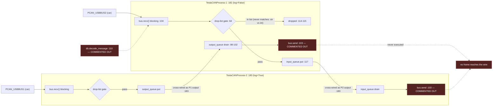
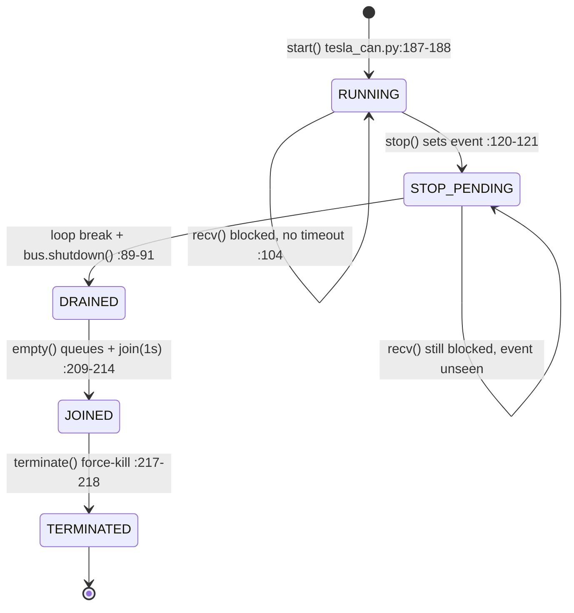

# RuairidhScott-Brown-TeslaCAN

Deep code-grounded analysis (replace mode). The prior summary still exists in git history; pre-replace claims are cited below as `git show HEAD:docs/legacy/RuairidhScott-Brown-TeslaCAN.md#<line>`.

## 1. Provenance

- Submodule path: `legacy/RuairidhScott-Brown-TeslaCAN`
- Pinned gitlink (canonical form from `git ls-files -s`): `160000 daefe8ee614cb0975005bf9593a2461ae8539653 0`
- `git -C legacy/RuairidhScott-Brown-TeslaCAN rev-parse HEAD` matches: `daefe8ee614cb0975005bf9593a2461ae8539653` (last commit: `daefe8e 2024-10-09 "update"`)
- Working tree clean (`status --porcelain` empty at analysis time)
- Upstream URL: `https://github.com/RuairidhScott-Brown/TeslaCAN`
- License: **None found** — no LICENSE file, no `license` field in `pyproject.toml`, no license header in any source file. Unlicensed means all rights reserved; nothing here may be copied into shipping code.
- Analysis date: 2026-11-21
- Mode: **replace**. The YAML frontmatter above is preserved byte-for-byte in content (including the inherited mid-word truncation of the description line, recorded in section 6). The replaced file was CRLF; this document is written with LF line endings per repo hygiene, which strips only the CR of each preserved frontmatter line. No other frontmatter change.
- The replaced document contained **no `## Upstream (...)` sections**, so there is nothing to preserve after section 14 beyond the frontmatter.

Files read (upstream, via `git -C legacy/RuairidhScott-Brown-TeslaCAN ls-files` — complete inventory, 10 files, no hidden directories exist):

| File | Coverage |
| --- | --- |
| `src/tesla_can/tesla_can.py` | FULL-READ, lines 1-220 (whole file) |
| `src/tesla_can/__init__.py` | FULL-READ (empty file) |
| `tests/test_tesla_can.py` | FULL-READ, lines 1-188 (whole file) |
| `README.md` | FULL-READ (single line: `# TeslaCAN`) |
| `pyproject.toml` | FULL-READ, lines 1-66 |
| `setup.ps1` / `setup.sh` | FULL-READ, lines 1-14 each |
| `.gitignore` | FULL-READ, lines 1-10 |
| `data/messages.csv` | FULL-READ (single header line `IDs`, no data rows) |
| `data/tesla.dbc` | STRUCTURAL-PARSE overall + RANGE-CITED blocks: lines 1-12 (header), 526-557 (BO_ 568), 644-654 (BO_ 697), 743-750 (BO_ 921), 893-976 (BO_ 1016 and BO_ 1021), 3710-3734 (VAL_ 1016), 3629 (VAL_ 921). Remaining ~3900 lines NOT read |

Files explicitly NOT read: `data/tesla.dbc` outside the cited ranges above. Nothing else was skipped; the inventory has no unread directories.

Our-side files read for parity (all CODE-READ, cited per row in section 11): `firmware/lib/vehicle/can/handler/variant/bits.h`, `handler/variant/hw4.h`, `handler/frame_readers.h`, `handler/bus/vehicle.h`, `ids.h`, `feature/fsd/profile.h`, `feature/fsd/region.h`, `feature/fsd/isa_chime.h`, `feature/fsd/nag.h`, `feature/fsd/auto_lane_change.h`, `feature/das/das_drive.h`, `vehicle/can/checksum.h`, plus `tools/lib/canExport.js` and `tools/commands/export.js` (existing DBC export tooling).

## 2. Executive verdict

This is an early-stage, PC-side dual-bus CAN logger skeleton, not a working tool: a `multiprocessing.Process` subclass wraps one `python-can` bus per process, and two processes are wired with swapped queues so each bus's received frames *would* be forwarded to the other bus — but both the DBC decode call and the actual `bus.send()` are commented out in the pinned snapshot, and the CSV ID filter is doubly broken (IDs loaded as strings and compared against ints, and the CSV contains only a header row). The one shipped test only proves single-process RX pass-through on a UDP multicast transport. The real asset is `data/tesla.dbc`, a 159-message community Tesla catalog with 930 value enumerations: its `UI_autopilotControl`/`UI_driverAssistControl`/`DAS_control`/`DAS_status` definitions independently cross-confirm most of our HW4 handler bit positions (including the hands-on-request gating enum), while surfacing three capture-first discrepancies (0x2B9 jerk scale factors, the 0x3FD mux1 bit19/bit20 naming, and the 0x399-vs-0x39B container for `DAS_autopilotHandsOnState`). Adaptation value is research-only: use the catalog as an offline cross-check oracle against our own decoder data, never as code. Nothing may be copied: the repo is unlicensed and the DBC's origin is unstated.

## 3. Evidence map

No CAPTURE evidence exists in this repo. TEST-READ evidence exists for exactly one behavior (single-process RX pass-through); every other claim below is CODE-READ. The DBC catalog is STRUCTURAL-PARSE with RANGE-CITED blocks as listed in section 1.

| Source file | Lines | What it proves | Grade |
| --- | --- | --- | --- |
| `src/tesla_can/tesla_can.py` | 42-61 | `TeslaCANProcess(mp.Process)` constructor: interface/channel/db/two queues/filter list/stop event/log flag | CODE-READ |
| `src/tesla_can/tesla_can.py` | 64-69 | `__filter_can_message` returns True when ID is in `filtered_messages` (drop-list membership test on `arbitration_id`) | CODE-READ |
| `src/tesla_can/tesla_can.py` | 96-118 | `process_can_message`: drains output queue, flips `is_rx=False`, **`bus.send` commented out at 103**, `bus.recv()` at 104 with no timeout, **`decode_message` commented out at 110**, filtered frames dropped at 114-115, survivors put on input queue at 117 | CODE-READ |
| `src/tesla_can/tesla_can.py` | 21-26 | `read_in_ids_to_filter` converts hex strings via `int(id, 16)`; `read_in_csv` uses `dtype=str` | CODE-READ |
| `src/tesla_can/tesla_can.py` | 172-219 | `__main__`: two processes on `pcan` `PCAN_USBBUS2`/`PCAN_USBBUS1` with swapped queues; filter list loaded at 180 **without** int conversion; KeyboardInterrupt shutdown sequence 203-218 | CODE-READ |
| `src/tesla_can/tesla_can.py` | 29-39 | `load_dbc_file` guarded loader exists but is **unused** by `__main__` (which calls `cantools.database.load_file` directly at 179) | CODE-READ |
| `data/messages.csv` | 1 | Only the header `IDs` — the filter list is empty | CODE-READ |
| `data/tesla.dbc` | 1-12, 526-557, 644-654, 743-750, 893-976, 3629, 3710-3734 | 159 `BO_` messages (135 VehicleBus + 24 ChassisBus), 930 `VAL_`, 144 `CM_`, 52 `BA_`; read blocks define 0x238, 0x2B9, 0x399, 0x3F8, 0x3FD signal layouts | CODE-READ (blocks) / STRUCTURAL-PARSE (catalog) |
| `tests/test_tesla_can.py` | 19-49 | Active test asserts FIFO RX pass-through of 10 frames on `udp_multicast`; filter list `[0xaaaaa, 0xbbbbb, 0xbbbbb]` never matches sent ID `0xabcde` | TEST-READ |
| `tests/test_tesla_can.py` | 52-91, 94-102, 105-131, 134-182 | Filter-drop, CSV-parse, TX, and two-process bridge tests exist only as commented-out code | CODE-READ |
| `pyproject.toml` | 12-19 | Declares `uptime~=3.0` and `msgpack==1.0`; neither symbol appears anywhere in `src/` or `tests/` (dead dependencies) | CODE-READ |
| `README.md` | 1 | Contains only the title — makes no protocol claims | CODE-READ |

## 4. Architecture and build surface

- Entry point: `python src/tesla_can/tesla_can.py` (`if __name__ == "__main__"` block, `tesla_can.py:172-219`). No CLI arguments, no env vars; PCAN channels are hardcoded.
- Build: standard setuptools (`pyproject.toml:1-3`), package `teslaCAN` 0.1.0, Python >= 3.10. Ruff config only; no CI, no packaging beyond `pip install -e .[test]` via `setup.sh`/`setup.ps1`.
- Dependency boundary: `python-can` (bus abstraction), `cantools` (DBC load only — decode never called), `pandas` (CSV/Excel helpers). `uptime` and `msgpack` are declared but unused. There is no shared-core-vs-port split: one module, one test file, one data directory.
- Data flow (as wired, with dead ends marked):



Key point: the queue cross-wiring would form a two-bus bridge, but the final `bus.send` is commented out, so in the pinned snapshot the program is a pair of independent bus loggers (only P2 prints, `log=True` at `tesla_can.py:183`).

## 5. Mechanism catalogue

### 5.1 Dual-process two-bus CAN bridge (queue cross-wiring)

- **Claim (README / summary):** `git show HEAD:docs/legacy/RuairidhScott-Brown-TeslaCAN.md#49` — "messages received on bus 2 are put into a shared queue, and bus 1 reads from it (and vice versa), effectively acting as a CAN bridge/proxy".
- **Code path:** `tesla_can.py:182-183` — `TeslaCANProcess("pcan","PCAN_USBBUS2",db,input_queue,output_queue,...)` and `TeslaCANProcess("pcan","PCAN_USBBUS1",db,output_queue,input_queue,...)` → each `run()` at `tesla_can.py:86-94` loops `process_can_message()` → RX at `tesla_can.py:104`, queue put at `tesla_can.py:117`, peer drain at `tesla_can.py:98-102`, **TX at `tesla_can.py:103` is commented out**.
- **Frame spec:** None found — no frame is built, mutated, or checksummed; the only payload touch is `output_message.is_rx = False` at `tesla_can.py:100`.
- **Gates and timing:** no intervals or jitter; the only gate is the drop-list filter (see 5.2). TX drain is piggybacked on the RX polling call (`tesla_can.py:98-104`): a frame queued for a silent bus is never drained until the next RX on that bus.
- **State machine:** None found (each process is a flat recv loop; no states).
- **Tests:** `test_tesla_can_process_recieves_messages` at `tests/test_tesla_can.py:19-49` asserts single-process RX FIFO pass-through only; the two-process bridge test exists only commented out at `tests/test_tesla_can.py:134-182`.
- **Evidence grade:** CODE-READ
- **Verdict:** CONTRADICTED — the queue wiring is real, but with `bus.send` commented out the snapshot does not bridge anything; frames terminate in the peer's queue.
- **Adapt to TeslaCANModder?** no impact — our MCP2515 ring-buffer + dispatch pipeline (`firmware/lib/core/can/`) already routes RX frames across buses, and the upstream mechanism is non-functional in its own snapshot.

### 5.2 CSV blocklist filter

- **Claim (README / summary):** `git show HEAD:docs/legacy/RuairidhScott-Brown-TeslaCAN.md#53` — "The filtering system allows selective forwarding of specific CAN IDs between two bus interfaces".
- **Code path:** `tesla_can.py:180` — `read_in_csv(messages_path)["IDs"].to_list()` (raw strings, no int conversion) → constructor at `tesla_can.py:50` → `__filter_can_message` at `tesla_can.py:64-69` compares `message.arbitration_id` (int) against the string list → membership at `tesla_can.py:66` → drop at `tesla_can.py:114-115` (`return False` before the queue put).
- **Frame spec:** None found — operates on `arbitration_id` only, no payload awareness.
- **Gates and timing:** evaluated once per received frame, before queue put. Semantics are a **drop-list**, not a pass-list: listed IDs are discarded, everything else flows.
- **State machine:** None found.
- **Tests:** None found active — the filter-drop test is commented out at `tests/test_tesla_can.py:52-91`; the CSV parse test for `read_in_ids_to_filter` is commented out at `tests/test_tesla_can.py:94-102`.
- **Evidence grade:** CODE-READ
- **Verdict:** CONTRADICTED — three independent defects: (a) `__main__` loads IDs as strings while `arbitration_id` is an int, so `tesla_can.py:66` never matches (the converting helper `read_in_ids_to_filter` at `tesla_can.py:21-22` is never called); (b) `data/messages.csv` contains only the header row, so even a fixed loader would drop nothing; (c) even when working, the semantics are the inverse of "selective forwarding" — it is a blocklist.
- **Adapt to TeslaCANModder?** no impact — our filtering is MCP2515 mask-based with variant-aware ID sets (`firmware/lib/vehicle/can/handler/filters.h`, `firmware/lib/vehicle/can/ids.h`); a CSV blocklist adds nothing and the upstream implementation is broken.

### 5.3 Vendored Tesla DBC catalog

- **Claim (README / summary):** `git show HEAD:docs/legacy/RuairidhScott-Brown-TeslaCAN.md#62` — "Tesla DBC file (`data/tesla.dbc`) is a valuable reference for signal definitions".
- **Code path:** loaded by `cantools.database.load_file` at `tesla_can.py:179` (and in the active test at `tests/test_tesla_can.py:26`) — but `decode_message` is commented out at `tesla_can.py:110`, so at runtime the catalog is dead weight.
- **Frame spec:** catalog, not a frame: 159 messages (135 `VehicleBus`, 24 `ChassisBus`), 930 `VAL_` enumerations, 144 `CM_` comments, 52 `BA_` attributes, one 29-bit extended ID (`BO_ 1834 ID72ABMS_serialNumber`), `VERSION ""` (no provenance string). Blocks read in full: `BO_ 568` (dbc:526), `BO_ 697` (dbc:644), `BO_ 921` (dbc:743), `BO_ 1016` (dbc:893), `BO_ 1021` (dbc:937).
- **Gates and timing:** None found — static data.
- **State machine:** None found.
- **Tests:** `test_tesla_can_process_recieves_messages` loads the DBC at `tests/test_tesla_can.py:26`, proving it parses with cantools; no signal-level decode is asserted anywhere.
- **Evidence grade:** CODE-READ (read blocks) — catalog overall is STRUCTURAL-PARSE per section 1; do not treat unread messages as verified.
- **Verdict:** CONFIRMED as a loadable signal catalog with independent bit layouts that mostly match our handlers (see section 11).
- **Adapt to TeslaCANModder?** candidate for future PR — as an offline cross-check oracle only (diff our decoder data against the catalog; see section 13). Never import the file into shipping directories.

### 5.4 Multiprocessing lifecycle and shutdown

- **Claim (README / summary):** none — the replaced doc says nothing about shutdown; mechanism derived from code.
- **Code path:** `tesla_can.py:60` stop event → `run()` loop checks it at `tesla_can.py:88-91` → `stop()` at `tesla_can.py:120-121` → `empty()` drains both queues at `tesla_can.py:166-168` via `__empty_inptut_queue`/`__empty_output_queue` (151-163) → `join(timeout=1)` at `tesla_can.py:213-214` → `terminate()` at `tesla_can.py:217-218`.
- **Frame spec:** None found.
- **Gates and timing:** `bus.recv()` at `tesla_can.py:104` has no timeout, so a stop request can starve until the next frame arrives; `join(timeout=1)` gives one second before `terminate()` force-kills.
- **State machine:** yes — shutdown sequence, 3+ states:



- **Tests:** TEST-READ partial — the active test exercises `stop()`/`empty()`/`join()` on `udp_multicast` (`tests/test_tesla_can.py:40-42`), where traffic is guaranteed; the blocked-recv starvation path has no test.
- **Evidence grade:** CODE-READ
- **Verdict:** PARTIAL — works on non-blocking transports; stop starvation on a silent PCAN bus is unhandled.
- **Adapt to TeslaCANModder?** no impact — different domain (ESP32 FreeRTOS, single image); nothing to reuse.

## 6. Summary vs code contradiction table

Pre-replace claims cited as `git show HEAD:docs/legacy/RuairidhScott-Brown-TeslaCAN.md#<line>` (the summary is no longer live at those lines).

| # | Summary claim | Code reality | Citations | Verdict |
| --- | --- | --- | --- | --- |
| 1 | "implements a multiprocessing architecture to read/write CAN messages" / "supports both receiving and sending" | Sending is dead code: `bus.send(output_message)` is commented out; only a `SEND` log line remains | `git show HEAD:docs/legacy/RuairidhScott-Brown-TeslaCAN.md#15`, `#40`, `#53` vs `tesla_can.py:100-103` | CONTRADICTED |
| 2 | "effectively acting as a CAN bridge/proxy" | Queue cross-wiring exists (`tesla_can.py:182-183`) but with TX commented out no frame ever crosses buses; frames end in the peer queue | `git show ...#49` vs `tesla_can.py:103` | CONTRADICTED |
| 3 | "DBC file-based message decoding" / "Uses a Tesla DBC file for message decoding with cantools" | DBC is loaded but decode is commented out; the catalog is never applied to any frame | `git show ...#15`, `#53` vs `tesla_can.py:110` | CONTRADICTED |
| 4 | "The filtering system allows selective forwarding of specific CAN IDs" | Filter is a drop-list (inverse semantics), compares int IDs against string list entries (never matches), and the CSV has zero IDs | `git show ...#53` vs `tesla_can.py:64-69`, `:114-115`, `:180`, `data/messages.csv:1` | CONTRADICTED |
| 5 | "`data/messages.csv` — CSV list of CAN message IDs to filter" | File contains only the `IDs` header; there is no list | `git show ...#44` vs `data/messages.csv:1` | PARTIAL (structure exists, content empty) |
| 6 | Frontmatter `description` ends mid-sentence at "It imp" | Inherited truncation defect in the replaced doc's frontmatter; preserved byte-for-byte per replace-mode rules, recorded here instead of editing | `git show HEAD:docs/legacy/RuairidhScott-Brown-TeslaCAN.md#3` | STALE (preserved) |
| 7 | Frontmatter `author: RuairidhScott` + `repo: Brown-TeslaCAN` | The upstream owner name `RuairidhScott-Brown` was split at the wrong hyphen; the real repo is `RuairidhScott-Brown/TeslaCAN`. Bytes kept, staleness recorded | `git show HEAD:docs/legacy/RuairidhScott-Brown-TeslaCAN.md#7-8` vs `git -C legacy/RuairidhScott-Brown-TeslaCAN remote -v` | STALE (preserved) |

The old doc's claims "License: None" (`#35`) and "Tesla DBC file is a valuable reference" (`#62`) are confirmed and appear in the evidence map, not here.

## 7. CAN frame and signal inventory

Runtime code decodes, mutates, or injects: **None found** — no frame is built, modified, or decoded by `src/tesla_can/*.py` in the pinned snapshot (decode and send both commented out; the only payload write is the `is_rx` flag flip at `tesla_can.py:100`). The rows below are the DBC catalog blocks that were read in full (RANGE-CITED, section 1); the catalog itself is STRUCTURAL-PARSE: 159 messages, 930 enumerations, nodes `VehicleBus`/`ChassisBus`, one 29-bit ID (1834/0x72A).

| ID (hex+dec) | Bus (DBC node) | Period | DLC | Byte/bit layout (as defined in catalog) | Scale/units | Counter | Checksum | Read or write | Grade |
| --- | --- | --- | --- | --- | --- | --- | --- | --- | --- |
| 0x3FD / 1021 | ChassisBus | None found | 8 | mux `UI_autopilotControlIndex` byte0 bits[2:0]; m0: bit37 fsdVisualization, bit38 fsdStopsControlEnabled, bit45 homelinkNearby; m1: bit17 driverMonitorConfirmation, bit19 applyEceR79, bit20 enableMapStops, bit36 ulcSnooze, bits 23-31 camera/radar disables, bit39 factorySummonEnable, bits 40-48 branch/telemetry, bit45 showLaneGraph, bit46 showTrackLabels, bit47 hardCoreSummon | boolean flags, factor 1 | None found | None found | catalog-read (dbc:937-975) | CODE-READ |
| 0x3F8 / 1016 | ChassisBus | None found | 8 | bit0 autopilotControlRequest, bit1 ulcStalkConfirm, bit2-3 summonHeartbeat, bit5 dasDeveloper, bit6 enableVinAssociation, bit7/8 lssLka/Ldw, bit10 autoSummonEnable, bit13 driveOnMapsEnable, bit14 handsOnRequirementDisable, bits 24-33 summon types, bits 32-37 summonReverseDist, bit38 undertakeAssistEnable, bit39 adaptiveSetSpeedEnable, bits 40-41 drivingSide (2-bit enum), bit43 enableTripTelemetry, bit42 enableClipTelemetry, bit44 enableRoadSegmentTelemetry, bits 45-47 accFollowDistanceSetting, bit48 hasDriveOnNav, bit49 followNavRouteEnable, bits 50-53 ulc configs, bit56 alcOffHighwayEnable, bits 58-59 smartSummonType, bit60 enableVisionOnlyStops, bits 61-62 source3D, bit63 enableBrakeLightPulse | booleans factor 1; followDistance 3-bit enum DISTANCE_SETTING_1..7 (VAL_ dbc:3710) | None found | None found | catalog-read (dbc:893-935) | CODE-READ |
| 0x2B9 / 697 | ChassisBus | None found | 8 | bits 0-11 DAS_setSpeed; bits 12-15 DAS_accState; bits 16-17 DAS_aebEvent; bits 18-26 DAS_jerkMin; bits 27-34 DAS_jerkMax; bits 35-43 DAS_accelMin; bits 44-52 DAS_accelMax; bits 53-55 DAS_controlCounter; bits 56-63 DAS_controlChecksum | setSpeed 0.1 kph; jerkMin (0.03, -15.232) m/s^3; jerkMax 0.059 m/s^3; accel (0.04, -15) m/s^2 (dbc:645-653) | byte 6 bits[7:5] (bits 53-55), mod 8 | byte 7 (bits 56-63), formula not in DBC | catalog-read (dbc:644-653) | CODE-READ |
| 0x399 / 921 | ChassisBus | None found | 8 | bits 0-3 DAS_autopilotState; bits 4-5 blindSpotRearLeft; bit24/25/26 autopark flags; bits 42-45 DAS_autopilotHandsOnState; bits 46-50 DAS_autoLaneChangeState; full enum tables at VAL_ (dbc:3629) | states enumerated: handsOnState 0..15 (`LC_HANDS_ON_*`), autopilotState 0..15, laneChangeState 0..31 (`ALC_*`) | None found | None found | catalog-read (dbc:743-749) | CODE-READ |
| 0x238 / 568 | ChassisBus | None found | 8 | bits 0-2 mapSpeedLimitDependency; bits 3-5 roadClass; bits 8-12 mapSpeedLimit; bits 16-25 countryCode; bit28 gpsRoadMatch; bits 29-31 nav/autopark flags; bits 37-39 controlledAccess/nextBranch; bits 40-47 reject* flags incl. bit46 rejectAutosteer, bit47 rejectHandsOn; bits 48-51 acceptBottsDots/autosteerRestricted/pmmEnabled/scaEnabled | booleans; mapSpeedLimit factor 1; nextBranchDist (10,0) m | bits 52-55 UI_mapDataCounter mod 16 | byte 7 UI_mapDataChecksum (dbc:533) | catalog-read (dbc:526-556) | CODE-READ |

Catalog frames NOT defined (negative anchors, section 16): `0x370` EPAS_sysStatus, `0x39B` DAS_status, `0x488` DAS_steeringControl — our three most safety-critical decode/injection frames have **no counterpart in this catalog**, so it cannot cross-check them.

## 8. Constants and tuning table

| Constant | Value | File:line | Meaning | Grade |
| --- | --- | --- | --- | --- |
| `dtype=str` in `read_in_csv` | str | `tesla_can.py:26` | CSV IDs stay strings — root cause of the filter type mismatch | CODE-READ |
| `int(id, 16)` | 16 | `tesla_can.py:22` | Hex parse in `read_in_ids_to_filter` — exists but never called from `__main__` | CODE-READ |
| `filtered_messages: list = list()` | mutable default | `tesla_can.py:50` | Shared-list Python trap; benign here (never mutated) | CODE-READ |
| `bus.recv()` timeout | none (blocking) | `tesla_can.py:104` | Blocks the loop; stop-event starvation window | CODE-READ |
| `__input_get` timeout | 0.1 s | `tesla_can.py:137` | Only queue read with a timeout (unused in the run loop) | CODE-READ |
| `join(timeout=1)` | 1 s | `tesla_can.py:213-214` | Grace period before `terminate()` | CODE-READ |
| `DAS_setSpeed` | 0|12, (0.1, 0) kph | `data/tesla.dbc:653` | ACC set-speed encoding | CODE-READ |
| `DAS_jerkMin` | 18|9, (0.03, -15.232) m/s^3 | `data/tesla.dbc:652` | Catalog jerk-min scale — **differs from ours** (0.018, -9.1) | CODE-READ |
| `DAS_jerkMax` | 27|8, (0.059, 0) m/s^3 | `data/tesla.dbc:651` | Catalog jerk-max scale — **differs from ours** (0.034) | CODE-READ |
| `DAS_accelMin/Max` | 35|9 / 44|9, (0.04, -15) m/s^2 | `data/tesla.dbc:646-647` | Catalog accel scales — match ours | CODE-READ |
| `DAS_controlCounter` | bits 53-55, mod 8 | `data/tesla.dbc:650` | Rolling counter position for 0x2B9 | CODE-READ |
| `DAS_controlChecksum` | bits 56-63 | `data/tesla.dbc:649` | Checksum byte position (formula absent from DBC) | CODE-READ |
| `UI_applyEceR79` | m1 bit 19 | `data/tesla.dbc:940` | Catalog names mux1 bit19 the ECE-R79 flag — conflicts with our bit naming | CODE-READ |
| `UI_enableMapStops` | m1 bit 20 | `data/tesla.dbc:964` | Catalog names mux1 bit20 "map stops" — our code clears bit20 as ECE R79 | CODE-READ |
| `UI_fsdStopsControlEnabled` | m0 bit 38 | `data/tesla.dbc:966` | Catalog FSD-active bit — matches our `FSD_BIT_AP_ACTIVE` | CODE-READ |
| `UI_handsOnRequirementDisable` | bit 14, VAL_ 1=OFF 0=ON | `data/tesla.dbc:916`, `:3721` | Hands-on-request disable flag in 0x3F8 | CODE-READ |
| `DAS_autopilotHandsOnState` | bits 42-45, VAL_ 0..15 `LC_HANDS_ON_*` | `data/tesla.dbc:748`, `:3629` | Hands-on state enum incl. 0 NOT_REQD, 8 SUSPENDED, 15 SNA | CODE-READ |

## 9. Failure modes and edge cases

No bus-off, watchdog, OTA, brownout, or error-frame handling exists anywhere in this code — those concerns are delegated to the PCAN driver and python-can, which the repo never configures. The rows below are the actual failure branches found.

| Failure | Handling code path | Tested? | Grade |
| --- | --- | --- | --- |
| DBC file missing at startup | None — `__main__` bypasses the guarded `load_dbc_file` (`tesla_can.py:29-39`) and calls `cantools.database.load_file` directly (`tesla_can.py:179`) → unhandled exception, process dies | No | CODE-READ |
| Stop request while bus silent | `bus.recv()` blocks with no timeout (`tesla_can.py:104`); stop event only checked between iterations (`tesla_can.py:88-91`) → stop starvation until next frame | No (test runs on a busy UDP transport) | CODE-READ |
| Filter silently no-ops | int-vs-str comparison (`tesla_can.py:180` vs `:66`) + empty CSV (`data/messages.csv:1`) → nothing is ever dropped, no error raised | No (filter test commented out, `tests:52-91`) | CODE-READ |
| TX never executes | `bus.send` commented (`tesla_can.py:103`); queued frames accumulate in the peer's output queue | No (sending test commented out, `tests:105-131`) | CODE-READ |
| `queue.Empty` race | `empty()` check at `tesla_can.py:98` then `get(wait=False)` at `:99` via `:145-149` — a frame consumed between check and get raises `queue.Empty`, killing the process | No | CODE-READ |
| Return-contract violation | `process_can_message` annotated `-> bool` but falls through returning None (`tesla_can.py:96-118`) — benign (falsy → `continue`) | No | CODE-READ |
| Unbounded queues | `mp.Queue` with no size checks anywhere (`tesla_can.py:127-163`) → memory growth if consumer stalls | No | CODE-READ |
| KeyboardInterrupt mid-run | stop → empty → join(1s) → terminate (`tesla_can.py:203-218`); `terminate()` can kill with undelivered frames if recv was blocked | No | CODE-READ |

## 10. Test coverage map

Active tests:

- `test_tesla_can_process_recieves_messages` (`tests/test_tesla_can.py:19-49`): starts one `TeslaCANProcess` on `udp_multicast`, sends 10 frames (ID `0xabcde`), asserts FIFO pass-through into `input_queue` (lines 46-49). Filter list `[0xaaaaa, 0xbbbbb, 0xbbbbb]` (line 27) never matches the sent ID (line 33), so the filter branch is not exercised. Also lightly drives `stop()`/`empty()`/`join()` (lines 40-42). Requires the DBC to load (line 26).

Commented-out tests (intent preserved, no coverage):

- `test_tesla_can_process_filters_messages` (`tests:52-91`) — would assert the drop of `0xbbbbb` and pass-through of others.
- `test_read_in_ids_to_be_filtered` (`tests:94-102`) — would assert hex-string→int CSV parsing.
- `test_sending_messages` (`tests:105-131`) — would assert a queued frame reaches the bus.
- `test_two_processes` (`tests:134-182`) — would assert cross-bus forwarding; its final assertions are themselves commented out (178-182).

Critical paths with NO test: the filter drop branch (risk: the core "feature" is unverified and, per section 5.2, broken); the TX path (risk: dead code believed working); the two-process queue wiring (risk: the bridge claim is unverified); `__main__` startup incl. DBC path resolution (risk: crashes on missing file); every failure branch in section 9.

## 11. Parity matrix with TeslaCANModder

Scope note: upstream is a catalog plus skeleton code, so "both sides touch" reduces to frames our firmware handles that the DBC also defines. Deep rows below cover the five read blocks; the other ~154 catalog messages were not row-checked (STRUCTURAL-PARSE). Every our-side citation is a CODE-READ of the listed file:line. Rows 1-15 can drive decisions only together with a bench capture (action column).

| Signal/frame | Upstream (DBC) | Ours | Delta | Action |
| --- | --- | --- | --- | --- |
| 0x3FD m0 bit38 FSD-active | `UI_fsdStopsControlEnabled m0:38` (dbc:966) | `FSD_BIT_AP_ACTIVE 38` (`bits.h:19`) set at `hw4.h:138` | Same position; DBC name implies "stops control" semantics | align (position confirmed; semantics need capture) |
| 0x3FD m0 bits 39/46/60 | No m0 signals at 39/46/60 in block (dbc:941-975) | We set bits 39, 46, 60 (`hw4.h:139-141`, `bits.h:20-23`) | Catalog has no counterpart | capture-first |
| 0x3FD m1 bit19 | `UI_applyEceR79 m1:19` (dbc:940) | `NAG_BIT_HANDS_ON_REQUIREMENT 19` cleared (`bits.h:42`, `hw4.h:42`) | **Naming conflict**: catalog calls bit19 the ECE-R79 flag; our code treats it as hands-on-requirement | capture-first (review backlog) |
| 0x3FD m1 bit20 | `UI_enableMapStops m1:20` (dbc:964) | `FSD_BIT_NAG_ECE_R79 20` cleared in `applyEceR79Bypass` (`bits.h:26`, `region.h:94-100`) | Same conflict pair inverted: we clear bit20 as ECE R79; catalog names it map-stops | capture-first (review backlog) |
| 0x3FD m1 bit45 lane graph | `UI_showLaneGraph m1:45` (dbc:973) | `UI_BIT_LANE_GRAPH 45` (`bits.h:36`) set at `hw4.h:47` | Exact match | align |
| 0x3FD m1 bit47 | `UI_hardCoreSummon m1:47` (dbc:968) | `FSD_BIT_NAG_ORGANIC 47` "Summon EU unlock" (`bits.h:27`) set at `hw4.h:43` | Same position; both names are summon-related | align (naming cross-reference) |
| 0x3FD m2 speed profile | No mux2 signals in block (dbc:941-975) | `writeHW4SpeedProfile` byte7 bits[6:4], 0-7 (`profile.h:30-36`) | Catalog lacks mux2 entirely | capture-first |
| 0x3F8 bit14 hands-on-req disable | `UI_handsOnRequirementDisable 14|1` + VAL_ 1=OFF (dbc:916, :3721) | `UI_BIT_HANDS_ON_REQ_DISABLE 14` set for `assist-hof` (`bits.h:35`, `hw4.h:109`) | Exact match incl. polarity | align |
| 0x3F8 bits 5/13/43/48/49 assist toggles | `UI_dasDeveloper 5`, `UI_driveOnMapsEnable 13`, `UI_enableTripTelemetry 43`, `UI_hasDriveOnNav 48`, `UI_followNavRouteEnable 49` (dbc:902-917) | Set/cleared at `hw4.h:102-104,112-119` (`bits.h:33-39`) | All five match | align |
| 0x3F8 follow distance | `UI_accFollowDistanceSetting 45|3` (dbc:894) | `readFollowDistance` byte5 bits[7:5] (`ids.h:106-109`) | Same bits (45-47 = byte5 [7:5]) | align |
| 0x3F8 driving side | `UI_drivingSide 40|2` enum 0=LHD,1=RHD,2=UNK (dbc:904, :3715) | Single-bit clear of bit41 for LHD (`bits.h:45`, `hw4.h:97`) | **Partial write**: DBC enum value 0 (LEFT) requires clearing bits 40 *and* 41; we clear only 41 | capture-first (possible one-bit short) |
| 0x2B9 DAS_control layout | bits 0-11 setSpeed@0.1kph, 12-15 accState, 16-17 aeb, 18-26 jerkMin, 27-34 jerkMax, 35-43/44-52 accel@0.04,-15, 53-55 counter, 56-63 checksum (dbc:644-653) | `buildDasControlFrame` identical placement (`das_drive.h:107-168`) | Placement matches; **scale delta**: jerkMin catalog (0.03, -15.232) vs ours (0.018, -9.1) (`das_drive.h:149`); jerkMax catalog 0.059 vs ours 0.034 (`das_drive.h:150`) | capture-first (physical jerk value differs) |
| 0x399 content naming | `ID399DAS_status`: handsOnState 42|4, autoLaneChangeState 46|5, autopilotState 0|4 (dbc:743-749) | HW4: ISA chime suppress byte1 bit5 + additive checksum byte7 (`bits.h:48-50`, `hw4.h:70-81`, `checksum.h:47-56`); our `ids.h:63` labels 0x399 `DAS_blindSpotMonitor` (HW3 view) | Same ID carries different named content per scheme | capture-first |
| `DAS_autopilotHandsOnState` | In message 921 (0x399), bits 42-45, VAL_ enum (dbc:748, :3629) | In message 0x39B (923) byte5 bits[5:2] = same bits 42-45 (`ids.h:64`, `vehicle.h:130-132`, `nag.h:47-49`) | **Bit position identical, container ID differs** (0x399 vs 0x39B); catalog enum 0/8/15 = NOT_REQD/SUSPENDED/SNA cross-confirms our no-request gating at `nag.h:151` | capture-first (which container on target firmware) |
| `DAS_autoLaneChangeState` | In 921 (0x399) bits 46-50 (dbc:744) | In 0x39B byte[4] bits[4:0] (`auto_lane_change.h:30-34`) | Different message **and** different bit position | capture-first |
| 0x238 bit47 `UI_rejectHandsOn` | In `BO_ 568` (dbc:548) | No handler for 0x238 anywhere in our firmware (negative anchor, section 16) | We do not touch it; catalog treats it as a UI rejection-reason flag | ignore (informational) |

Coverage row: `0x370` (EPAS_sysStatus), `0x39B`, `0x488` (DAS_steeringControl) — our nag-killer and steering-injection frames are **absent from the catalog** (negative anchors), so upstream cannot cross-check them at all.

## 12. Surface inventory and security notes

- Transport surfaces: **None found** beyond a PC CLI. No serial protocol, no web endpoints, no BLE. Entry: `python src/tesla_can/tesla_can.py` with hardcoded `pcan` channels `PCAN_USBBUS2`/`PCAN_USBBUS1` (`tesla_can.py:182-183`); no argument parsing.
- Config inputs: `data/tesla.dbc` (read at `tesla_can.py:176-179`), `data/messages.csv` (read at `:177,180`). Both read-only; the CSV is attacker-editable only in the sense that any value there is currently ignored (strings never match ints).
- Security findings: no hardcoded credentials, tokens, keys, or secrets in any of the 10 files (negative anchor demonstrated, section 16); no dangerous build flags; `setup.sh`/`setup.ps1` are standard venv boilerplate.
- Provenance findings: **no license** (see section 1) — the single largest reuse blocker; **vendored DBC with unstated origin** (`VERSION ""`, no attribution comments) — treat as untrusted third-party data until its source is identified; `.gitignore:4` lists `240415_1538_Alpha_CANTesting_Drive1.csv`, evidencing a real-vehicle capture that is **not** committed — the author's bench data is lost to this snapshot (content UNVERIFIED, see section 17).

## 13. Adaptation assessment

| Mechanism | Value | Cost | Risk | Evidence | Decision |
| --- | --- | --- | --- | --- | --- |
| 5.1 dual-process bridge | None — non-functional in its own snapshot; our ring-buffer dispatch already routes across buses | Reading time only | Porting dead code | CODE-READ | no impact |
| 5.2 CSV blocklist filter | None — broken and empty; our MCP2515 mask filters supersede it | Low | None if ignored | CODE-READ | no impact |
| 5.3 vendored DBC catalog | Independent third-party bit-layout oracle for our HW4/HW3 decoders; already surfaced 3 capture-first deltas (rows 12, 3-4, 14-15 of section 11) | A comparator script in `tools/` (offline only) | Zero runtime risk if kept out of shipping dirs; catalog itself unlicensed+unattributed, so never import the file | CODE-READ | **candidate for future PR**: extend the existing DBC export (`tools/lib/canExport.js:25` `toDbcString`, `tools/commands/export.js:76-77`) with a diff mode that compares our generated DBC / protocol decoder data against this catalog's overlapping frames as an independent verification oracle (derived idea, independent implementation) |
| 5.4 multiprocessing lifecycle | None — PC/Python domain | — | — | CODE-READ | no impact |

Safety gate: nothing above changes firmware frame mutation, routing, checksums, or transport shape. If the capture-first backlog items (jerk factors, bit19/20 semantics, 0x399/0x39B container) are ever acted on, `docs/checklists/can-review-checklist.md` and a listen-only bench capture are required first.

## 14. Do-not-copy list

| Item | File:line | Reason |
| --- | --- | --- |
| All Python source (`tesla_can.py`, tests, setup scripts) | `src/tesla_can/tesla_can.py:1-220` etc. | Repo is **unlicensed**; copying any line into our GPL-3.0 tree would import unknown-licensed text |
| `data/tesla.dbc` | `data/tesla.dbc:1-4258` | Unlicensed **and** unattributed vendored catalog; never import into `firmware/`, `client/`, `packages/`, `tools/`. Use only as an offline comparison oracle, re-deriving values from our own captures |
| The queue-swap bridge wiring as a design | `tesla_can.py:182-183` | Even ignoring license, it is a dead pattern here (TX commented out) and duplicates our ring-buffer dispatch |
| `read_in_ids_to_filter` hex parsing behavior | `tesla_can.py:21-22` | Trivial and, as wired in `__main__` (`:180`), a type-confusion bug — not a pattern to preserve |

## 15. History and evolution

- Local history contains **exactly one commit**: `daefe8e 2024-10-09 "update"` (`git -C legacy/RuairidhScott-Brown-TeslaCAN log`). `git rev-list --all --count` = 1; no tags, no branches, no changelog.
- There is no pre-pin history locally to mine, so nothing can be said from this snapshot about what was tried and rolled back before 2024-10-09. The commented-out code (decode at `tesla_can.py:110`, send at `:103`, four disabled tests at `tests:52-182`) is the only visible trace of intent: the author had decode, TX, filtering, and bridging working or planned, then disabled them — the single "update" commit shipped the skeleton with them commented out. Why is UNVERIFIED and would require the upstream GitHub history (network).
- `.gitignore:4` shows a capture CSV (`240415_1538_Alpha_CANTesting_Drive1.csv`, naming pattern suggests 2024-04-15) that was once on disk but never committed — the author's original validation data is absent.
- Network-only claims (issues, PRs, README badges): none exist — README is one line.

## 16. Re-verification recipe

Pinned gitlink: `160000 daefe8ee614cb0975005bf9593a2461ae8539653 0` (submodule `legacy/RuairidhScott-Brown-TeslaCAN`). After an upstream bump:

```bash
OLD=daefe8ee614cb0975005bf9593a2461ae8539653
git -C legacy/RuairidhScott-Brown-TeslaCAN fetch --tags --prune
git -C legacy/RuairidhScott-Brown-TeslaCAN log --oneline $OLD..origin/main
git -C legacy/RuairidhScott-Brown-TeslaCAN diff --stat $OLD..origin/main
git -C legacy/RuairidhScott-Brown-TeslaCAN diff $OLD..origin/main -- src/ tests/ data/
git ls-files -s legacy/RuairidhScott-Brown-TeslaCAN   # gitlink must equal rev-parse HEAD
```

Every anchor below was executed at write time (from the repo root, `grep -nE`); expected hits are from that run. Use `grep -nE` (extended regex) — plain `grep -n` with `|` is BRE and will not match. If line numbers drift by more than ~10, re-read the whole function; do not trust this document's numbers.

Upstream anchors:

```text
grep -nE 'bus\.send' legacy/RuairidhScott-Brown-TeslaCAN/src/tesla_can/tesla_can.py
  -> exactly one hit, line 103, commented: '# bus.send(output_message)'
grep -nE 'decode_message' legacy/RuairidhScott-Brown-TeslaCAN/src/tesla_can/tesla_can.py
  -> exactly one hit, line 110, commented out
grep -nE 'int\(id, 16\)' legacy/RuairidhScott-Brown-TeslaCAN/src/tesla_can/tesla_can.py
  -> line 22 (hex conversion exists but is unused by __main__)
grep -nE '\["IDs"\]\.to_list\(\)' legacy/RuairidhScott-Brown-TeslaCAN/src/tesla_can/tesla_can.py
  -> line 180 (raw strings, no int conversion — the filter bug)
grep -nE 'def __filter_can_message|can_id in self\.__filtered_messages' legacy/RuairidhScott-Brown-TeslaCAN/src/tesla_can/tesla_can.py
  -> lines 64 and 66
grep -nE 'msgpack|uptime' legacy/RuairidhScott-Brown-TeslaCAN/src/tesla_can/tesla_can.py
  -> no output (declared deps pyproject.toml:16-17 are dead)
grep -nE 'licen[cs]e' legacy/RuairidhScott-Brown-TeslaCAN/README.md legacy/RuairidhScott-Brown-TeslaCAN/pyproject.toml legacy/RuairidhScott-Brown-TeslaCAN/src/tesla_can/tesla_can.py
  -> no output (repo is unlicensed)
grep -nE '^BO_ (1021|697|1016|921|568) ' legacy/RuairidhScott-Brown-TeslaCAN/data/tesla.dbc
  -> five hits: 526 (568 ID238UI_driverAssistMapData), 644 (697 ID2B9DAS_control),
     743 (921 ID399DAS_status), 893 (1016 ID3F8UI_driverAssistControl), 937 (1021 ID3FDUI_autopilotControl)
grep -nE 'UI_applyEceR79|UI_hardCoreSummon|UI_fsdStopsControlEnabled|UI_showLaneGraph' legacy/RuairidhScott-Brown-TeslaCAN/data/tesla.dbc
  -> 940 (UI_applyEceR79 m1 : 19|1), 966 (UI_fsdStopsControlEnabled m0 : 38|1),
     968 (UI_hardCoreSummon m1 : 47|1), 973 (UI_showLaneGraph m1 : 45|1)
grep -nE 'VAL_ 921 DAS_autopilotHandsOnState' legacy/RuairidhScott-Brown-TeslaCAN/data/tesla.dbc
  -> line 3629, enum starts 0 "LC_HANDS_ON_NOT_REQD" ... 15 "LC_HANDS_ON_SNA"
grep -nE '^BO_ (880|923|1160) ' legacy/RuairidhScott-Brown-TeslaCAN/data/tesla.dbc
  -> no output (0x370, 0x39B, 0x488 absent from catalog)
grep -nE 'password|passwd|secret|token|api[_-]?key|credential' legacy/RuairidhScott-Brown-TeslaCAN/src/tesla_can/tesla_can.py legacy/RuairidhScott-Brown-TeslaCAN/tests/test_tesla_can.py legacy/RuairidhScott-Brown-TeslaCAN/pyproject.toml
  -> no output (no credentials)
```

Our-side drift anchors (the `align`/`already present` decisions rest on these files; pinned by symbol, not line alone):

```text
grep -nE 'NAG_BIT_HANDS_ON_REQUIREMENT|FSD_BIT_NAG_ECE_R79|FSD_BIT_NAG_ORGANIC|FSD_BIT_AP_ACTIVE|UI_BIT_HANDS_ON_REQ_DISABLE|FSD_BIT_DRIVING_SIDE' firmware/lib/vehicle/can/handler/variant/bits.h
  -> lines 19 (AP_ACTIVE 38), 26 (NAG_ECE_R79 20), 27 (NAG_ORGANIC 47), 35 (HANDS_ON_REQ_DISABLE 14), 42 (HANDS_ON_REQUIREMENT 19), 45 (DRIVING_SIDE 41)
grep -nE 'readDasHandsOnState' firmware/lib/vehicle/can/feature/fsd/nag.h
  -> line 47 (definition, byte 5 bits[5:2]); call site firmware/lib/vehicle/can/handler/bus/vehicle.h:132
grep -nE 'CAN_ID_DAS_STATUS' firmware/lib/vehicle/can/handler/bus/vehicle.h
  -> line 130 (0x39B decode branch, dlc >= 6)
grep -nE 'readFollowDistance|CAN_ID_FSD_MUX|CAN_ID_DAS_STATUS ' firmware/lib/vehicle/can/ids.h
  -> line 25 (CAN_ID_FSD_MUX 0x3FD), line 64 (CAN_ID_DAS_STATUS 0x39B), line 106 (readFollowDistance, byte5 bits[7:5])
grep -nE 'jerkMinRaw|jerkMaxRaw' firmware/lib/vehicle/can/feature/das/das_drive.h
  -> lines 149 (0.018, -9.1) and 150 (0.034) — the scale delta vs dbc:651-652
grep -nE 'setBit\(f, 20, false\)' firmware/lib/vehicle/can/feature/fsd/region.h
  -> line 98 (applyEceR79Bypass clears bit 20)
grep -nE '0x238|568' firmware/lib/vehicle/can/ids.h
  -> no output (we never touch 0x238)
grep -nE 'computeHW4IsaChecksum' firmware/lib/vehicle/can/checksum.h
  -> line 47 (additive checksum, bytes 0-6 + both ID bytes, stored byte 7)
grep -nE 'toDbcString' tools/lib/canExport.js tools/commands/export.js
  -> canExport.js:25 (definition), export.js:14/77 (DBC export exists — the cross-check-oracle candidate builds on it)
```

## 17. Open questions and explicitly not investigated

- **Pre-pin upstream history was NOT reviewed** — not by choice but because none exists locally (single commit, `rev-list --all --count` = 1). Fetching `origin` would answer why decode/TX/filter were all disabled in the one shipped commit.
- `data/tesla.dbc` origin UNVERIFIED: no attribution inside (`VERSION ""`); naming style (`ID3FDUI_autopilotControl`, `VCLEFT_*`, `LC_HANDS_ON_*`) matches circulating community Model 3 catalogs. Verify by hashing against known public DBCs before relying on any single value from it.
- 0x2B9 jerk scale delta (catalog 0.03/-15.232 and 0.059 vs ours 0.018/-9.1 and 0.034, section 11 row 12) UNVERIFIED — a bench capture injecting both encodings and observing ACC response would settle which is correct on target firmware. Until then both are hypotheses.
- 0x3FD mux1 bit19/bit20 semantics (catalog `UI_applyEceR79`/`UI_enableMapStops` vs our hands-on/ECE-R79 naming) UNVERIFIED — needs a listen-only capture of mux1 frames on an EU vehicle with ECE R79 active.
- `DAS_autopilotHandsOnState` container (catalog 0x399 vs our 0x39B, identical bits 42-45) UNVERIFIED — one capture on the target vehicle firmware decides; the enum values themselves cross-confirm.
- The `.gitignore`d capture CSV `240415_1538_Alpha_CANTesting_Drive1.csv` — existence inferred from `.gitignore:4`, content unknown; it may be the original validation data for the DBC and would be the best available CAPTURE evidence if the author still has it.
- Whether `read_in_excel` (`tesla_can.py:17-18`) ever had a caller — no reference exists in the pinned snapshot (dead helper, presumed leftover).
- Not investigated: running the test suite (no Python env was installed for this analysis; the test requires `udp_multicast` plus a 322 KB DBC load); the DBC's remaining ~154 unread messages; any GitHub issues/PRs (no network calls made).
