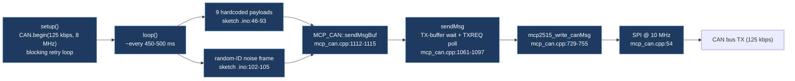
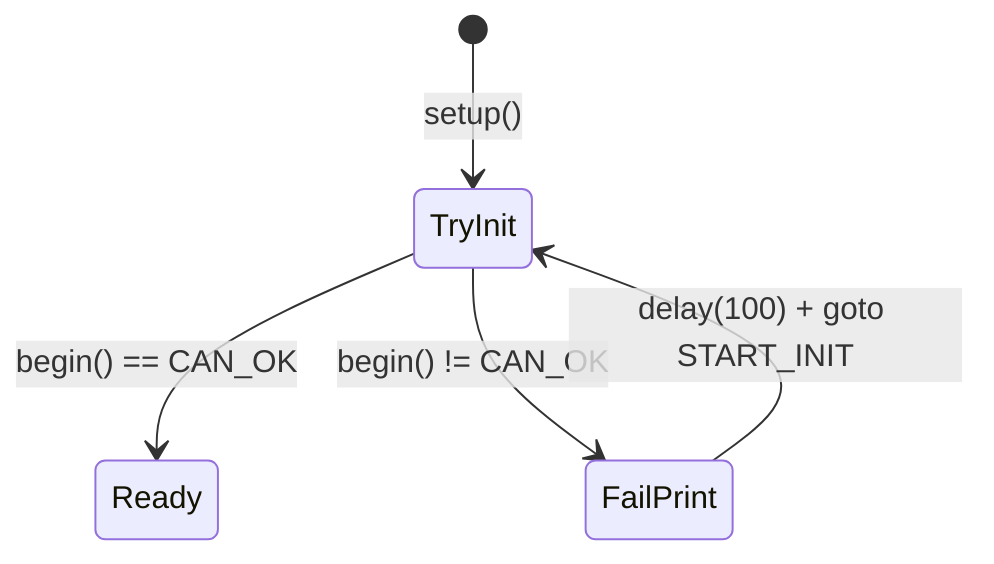

# SergeyStaroletov-Tesla-CAN-packets-generator

Deep code-grounded analysis (replace mode). The pre-replace summary still exists in git history; claims from it are cited below as `git show HEAD:docs/legacy/SergeyStaroletov-Tesla-CAN-packets-generator.md` with line numbers (L nn). The frontmatter above is preserved byte-for-byte; no `## Upstream (...)` sections existed in the replaced doc (verified: `git show HEAD:docs/legacy/SergeyStaroletov-Tesla-CAN-packets-generator.md | Select-String '## Upstream'` returns no output), so none are re-appended.

## 1. Provenance

- Submodule path: `legacy/SergeyStaroletov-Tesla-CAN-packets-generator`
- Pinned gitlink: `160000 1c451da629dc168d4ff51cce2b4f111110e7c086 0` (`git ls-files -s`); matches `git -C legacy/SergeyStaroletov-Tesla-CAN-packets-generator rev-parse HEAD` and `git submodule status` (clean, `heads/master`)
- Upstream URL: https://github.com/SergeyStaroletov/Tesla-CAN-packets-generator (`.gitmodules` L203-205; `git remote -v`)
- License: sketch + README carry no license (no LICENSE file in the tree — default all-rights-reserved); the vendored `mcp_can.cpp` / `mcp_can.h` / `mcp_can_dfs.h` are MIT, Copyright (c) 2013 Seeed Technology Inc. (`mcp_can.h:25-27`)
- Analysis date: 2026-11-21
- Files read (FULL-READ, every line): `sketch_tesla_can_gen.ino` (L1-117), `README.md` (L1-3), `mcp_can.h` (L1-157), `mcp_can_dfs.h` (L1-451), `mcp_can.cpp` (L1-1292)
- Files explicitly NOT read: None found — `git ls-files` lists exactly these 5 files; no hidden or platform subdirectories exist; `git status --porcelain` is empty
- Our-side files read for parity: `firmware/lib/vehicle/can/feature/misc/can_sim.h` (full), `firmware/lib/vehicle/can/ids.h` (cited defines), `firmware/lib/vehicle/can/feature/telemetry/powertrain.h` (L10-99), `firmware/lib/vehicle/can/feature/telemetry/bms.h` (L483-512), `firmware/lib/core/driver/esp32/board.h` (L36-146), `firmware/lib/vehicle/can/handler/frame_readers.h` (L14-43), `firmware/lib/client/command/dispatch.h` (L778-782), `firmware/lib/core/types.h` (cited define)
- No DBC/JSON catalogs are vendored, so no STRUCTURAL-PARSE or RANGE-CITED items appear in this analysis

## 2. Executive verdict

A 117-line Arduino TX-only packet generator: `loop()` puts nine hardcoded Tesla CAN frames (RPM 0x106, speed 0x256, inverter temp 0x306, battery temp 0x102, SoC 0x302, estimated energy 0x382, lifetime energy 0x3D2, gear 0x116, odometer 0x562) plus one random-ID noise frame on a single MCP2515 bus at 125 kbps (500 kbps line commented out), paced by `delay(50)`. What matters for TeslaCANModder is what it does NOT have: no counters, no checksums, no decode, no RX path, no error handling — every frame is a frozen 2018-era snapshot, and the vendored Seeed library even masks a rate-config failure as success. The mechanisms that matter are (a) the physical-bus stimulus concept our safer decode-pipeline `can_sim` lacks, and (b) the negative examples: `char`-truncated noise IDs, the 0x382 DLC-3/declared-8 mismatch, and IDs that collide with our decoders under different semantics (0x102, 0x7FF). Adaptation is limited to bench-only stimulus and test fixtures; nothing here should be ported into vehicle-adjacent firmware, and the vendored library itself must never be imported.

## 3. Evidence map

| source file | lines | what it proves | grade |
| --- | --- | --- | --- |
| `sketch_tesla_can_gen.ino` | 26-37 | active `CAN.begin(CAN_125KBPS, MCP_8MHz)`; infinite `goto START_INIT` retry with no backoff | CODE-READ |
| `sketch_tesla_can_gen.ino` | 46-93 | nine hardcoded frames: IDs, DLCs, exact payload bytes (§7) | CODE-READ |
| `sketch_tesla_can_gen.ino` | 77-78 | 0x382 array is 8 bytes but `sendMsgBuf(0x382, 0, 3, ee)` sends DLC 3 | CODE-READ |
| `sketch_tesla_can_gen.ino` | 14, 102-105 | noise frame: `char num = random(10000)` truncates the ID; 8-byte ASCII payload | CODE-READ |
| `sketch_tesla_can_gen.ino` | 107-109 | post-send byte increment is dead code: local array re-initialized each loop; `> 255` unreachable on `unsigned char` | CODE-READ |
| `mcp_can.cpp` | 1061-1097 | `sendMsg`: blocking TX-buffer wait (50 × 10 µs) then TXREQ poll; return codes ignored by sketch | CODE-READ |
| `mcp_can.cpp` | 589-661, 610-617 | `mcp2515_init` mode/rate/buffer config; rate-failure branch returns stale `res` (== OK) so `begin()` reports success | CODE-READ |
| `mcp_can.cpp` | 631-642 | `DEBUG_RXANY` used but never defined → `#if` false → RXB0/1 left in STDEXT + rollover | CODE-READ |
| `mcp_can.cpp` | 1265-1268 | `checkError()` exists (EFLG mask 0xF8) but is never called by the sketch (anchor A7) | CODE-READ |
| `mcp_can_dfs.h` | 350-352 | active CNF triplet for 125 kbps @ 8 MHz: CFG1 0x01, CFG2 0xB1, CFG3 0x05 | CODE-READ |
| `README.md` | 3 | "correct Tesla CAN packets" — no capture or decode evidence anywhere in the repo | SUMMARY-ONLY |

No TEST-READ evidence exists: this repo ships no tests. No CAPTURE evidence exists in this repo: every payload-semantics label ("RPM", "gear", "odo") is a code comment or README claim; whether any frame is a faithful real-vehicle capture is UNVERIFIED.

## 4. Architecture and build surface

Single Arduino sketch (`sketch_tesla_can_gen.ino`) plus a vendored Seeed MCP_CAN library (`mcp_can.cpp/.h/_dfs.h`, MIT). Entry points: `setup()` (bus init with blocking retry), `loop()` (frame TX). No build flags beyond `#define DEBUG_MODE 1` (dead) and the library's `DEBUG_EN` (serial chatter); no platform ports; dependency boundary is SPI + Arduino core only. No RX → decode → mutate pipeline exists — the sketch is TX-only (negative anchor A7).



## 5. Mechanism catalogue

### M1: Bus bring-up with blocking retry

- **Claim (README / summary):** old summary L40 says "`setup()` initializes the CAN bus" — accurate but omits the infinite retry; README is silent.
- **Code path:** `sketch_tesla_can_gen.ino:21-38` `setup()` → `MCP_CAN::begin` (`mcp_can.cpp:882-886`) → `mcp2515_init` (`mcp_can.cpp:589-661`) → `mcp2515_configRate` (`mcp_can.cpp:341-560`) → CNF registers (`mcp_can_dfs.h:350-352`)
- **Frame spec:** None found (no frames in this mechanism)
- **Gates and timing:** init failure → serial print + `delay(100)` + `goto START_INIT` (`sketch_tesla_can_gen.ino:32-37`); no backoff; blocks forever if the shield is absent
- **State machine:**



- **Tests:** None found
- **Evidence grade:** CODE-READ
- **Verdict:** CONFIRMED (the old summary's "CAN-BUS Shield v1.1" hardware attribution is contradicted — §6 row 3)
- **Adapt to TeslaCANModder?** no impact — ours already has non-blocking reinit: `driverReinit` (`firmware/lib/core/driver/esp32/board.h:133-146`) and `CAN_REINIT_INTERVAL 5000` (`firmware/lib/core/types.h:163`)

### M2: Hardcoded Tesla frame TX loop

- **Claim (README / summary):** old summary L15 and L46-56 enumerate the nine frames and their purposes.
- **Code path:** `loop()` `sketch_tesla_can_gen.ino:40-94` → `CAN.sendMsgBuf(id, 0, len, arr)` (`mcp_can.cpp:1112-1115`) → `sendMsg` (`mcp_can.cpp:1061-1097`) → `mcp2515_write_canMsg` (`mcp_can.cpp:729-755`) → SPI → MCP2515 TX buffers
- **Frame spec:** nine IDs listed in §7; all standard 11-bit (ext=0); DLC as listed; static payload bytes; no counter nibble maintained; no checksum computed — if these IDs carry live counter/checksum fields on a real bus, they go stale immediately
- **Gates and timing:** nine `delay(50)` per loop → ~450-500 ms per-ID period; speed (0x256) and 0x102 randomly pick one of two hardcoded variants via `random(2)` (`sketch_tesla_can_gen.ino:54-55, 67-68`); 0x306 → 0x102 are sent back-to-back with no delay between them
- **State machine:** None found
- **Tests:** None found
- **Evidence grade:** CODE-READ (IDs, DLCs, bytes); payload semantics SUMMARY-ONLY (labels only)
- **Verdict:** CONFIRMED for ID/DLC/payload; semantics UNVERIFIED
- **Adapt to TeslaCANModder?** candidate — physical-bus bench stimulus only (see §13 M2)

### M3: Random-ID noise generator (with truncation defect)

- **Claim (README / summary):** old summary L58: "random CAN messages with random IDs (0–9999)".
- **Code path:** `loop()` `sketch_tesla_can_gen.ino:101-109` → `random(10000)` assigned to `char num` (`sketch_tesla_can_gen.ino:14, 102`) → `sendMsgBuf(num, 0, 8, stmp)` (`sketch_tesla_can_gen.ino:105`)
- **Frame spec:** standard frame, ext=0, DLC 8, payload `48 65 00 01 02 20 73 65` (`'H','e',0x00,0x01,0x02,' ','s','e'`, `sketch_tesla_can_gen.ino:103`). Wire ID: `num` is a signed 8-bit char, so `random(10000)` truncates to -128..127; negative values sign-extend, and `mcp2515_id_to_buf` (`mcp_can.cpp:667-686`: `canid=(uint16_t)(id&0xFFFF)`, `SIDH=(byte)(canid>>3)`, `SIDL=(canid&7)<<5`) maps them to 0x780..0x7FF. Wire IDs therefore land in {0..127} ∪ {0x780..0x7FF} — never a 4-digit ID
- **Gates and timing:** one noise frame per loop (~450-500 ms); values ≡ 255 (mod 256) — 39 of the 10000 possible draws (~0.4%) — land exactly on 0x7FF, which our firmware decodes as GTW_carConfig AP-tier readback (`firmware/lib/vehicle/can/ids.h:72`, `firmware/lib/vehicle/can/handler/frame_readers.h:19-21`)
- **State machine:** None found
- **Tests:** None found
- **Evidence grade:** CODE-READ (truncation math); on-wire distribution UNVERIFIED (no bench capture)
- **Verdict:** CONTRADICTED vs "0–9999"
- **Adapt to TeslaCANModder?** never port the char-ID bug; the noise-load concept itself is a low-value candidate (§13 M3)

### M4: Blocking TX-buffer acquisition and send wait

- **Claim (README / summary):** None found — neither the README nor the old summary describes the TX transport path.
- **Code path:** `sendMsg` (`mcp_can.cpp:1061-1097`) → `mcp2515_getNextFreeTXBuf` (`mcp_can.cpp:836-856`) polling up to `TIMEOUTVALUE 50` × 10 µs → `mcp2515_write_canMsg` (`mcp_can.cpp:729-755`) → `mcp2515_start_transmit` (`mcp_can.cpp:799-810`); `wait_sent` then polls the TXREQ bit 50 × 10 µs (`mcp_can.cpp:1081-1094`)
- **Frame spec:** None found (transport only)
- **Gates and timing:** returns `CAN_GETTXBFTIMEOUT` / `CAN_SENDMSGTIMEOUT`; the sketch ignores the return code at all ten call sites
- **State machine:** 2 states (wait-free-buffer, wait-sent) — below the 3-state diagram threshold
- **Tests:** None found
- **Evidence grade:** CODE-READ
- **Verdict:** CONFIRMED
- **Adapt to TeslaCANModder?** no impact — ours uses the autowall MCP2515 driver (`firmware/lib/core/driver/esp32/board.h:108-127`)

### M5: Dormant RX / filter / error API

- **Claim (README / summary):** the sketch's own header comment claims a "receive data with check mode" demo (`sketch_tesla_can_gen.ino:1-2`); the old summary correctly describes a generator.
- **Code path:** None found — `readMsgBuf`, `checkReceive`, `checkError`, `init_Filt`, `init_Mask` (`mcp_can.h:126-136`) are never called by the sketch (anchor A7)
- **Frame spec:** None found
- **Gates and timing:** `mcp2515_init` leaves RXB0/1 in STDEXT + rollover (`mcp_can.cpp:637-642`) because `DEBUG_RXANY` is referenced (`mcp_can.cpp:631`) but never defined
- **State machine:** None found
- **Tests:** None found
- **Evidence grade:** CODE-READ (absence demonstrated by grep)
- **Verdict:** CONTRADICTED (inherited comment vs code)
- **Adapt to TeslaCANModder?** no impact

## 6. Summary vs code contradiction table

Pre-replace claims cited from `git show HEAD:docs/legacy/SergeyStaroletov-Tesla-CAN-packets-generator.md`.

| # | pre-replace claim | code evidence | verdict |
| --- | --- | --- | --- |
| 1 | L53: "0x382 \| Estimated energy \| 8 bytes" | `sketch_tesla_can_gen.ino:78`: `CAN.sendMsgBuf(0x382, 0, 3, ee)` — 8-byte array declared but DLC 3 goes on the wire (anchor A2) | CONTRADICTED |
| 2 | L58: "random IDs (0–9999)" | `sketch_tesla_can_gen.ino:14, 102`: `char num = random(10000)` truncates to -128..127; sign extension maps negatives to 0x780..0x7FF via `mcp_can.cpp:667-686` | CONTRADICTED |
| 3 | L32: "CAN-BUS Shield v1.1" | `sketch_tesla_can_gen.ino:10-12`: comment states v1.1+ default CS is D9, v0.9b/v1.0 is D10; code pins `SPI_CS_PIN = 10` (anchor A4) | CONTRADICTED |
| 4 | L33: "License: None" | `mcp_can.h:25-27`: vendored library files carry the MIT license, Copyright (c) 2013 Seeed Technology Inc.; only the sketch and README are unlicensed | PARTIAL |
| 5 | L40: "sends ... with 50ms delays between each" | `sketch_tesla_can_gen.ino:61` (0x306) then `:67-68` (0x102) with no delay between them; only eight of the nine gaps carry `delay(50)` | PARTIAL |
| 6 | L15 (Overview): frames are "pre-defined" and by implication valid | `sketch_tesla_can_gen.ino:1-2`: inherited header claims a "receive data" demo that does not exist (anchor A7); `README.md:3` claims "correct" packets with no capture evidence; no counter/checksum is ever maintained | CONTRADICTED |
| 7 | Frontmatter L3 (description) ends mid-sentence: "It transm" | inherited truncation in the preserved frontmatter; bytes kept per replace-mode rules; flagged here instead of editing | STALE (frontmatter preserved) |

## 7. CAN frame and signal inventory

All frames are writes on a single unlabeled MCP2515 bus at 125 kbps. Each ID appears once per `loop()` pass → ~450-500 ms period.

| ID (hex+dec) | bus | period | DLC | byte/bit layout | scale/units | counter position | checksum | read or write | grade |
| --- | --- | --- | --- | --- | --- | --- | --- | --- | --- |
| 0x106 (262) | single | ~450-500 ms | 8 | `31 FF 2D 7F A3 14 0E A8` static | unknown (comment: "RPM") | none maintained | none | write | CODE-READ |
| 0x256 (598) | single | ~450-500 ms | 8 | two variants `84 19 40 31 00 F2 20 78` / `84 28 C0 31 5A 52 2D CE`, random pick | unknown (comment: "speed") | none | none | write | CODE-READ |
| 0x306 (774) | single | ~450-500 ms | 8 | `32` × 8 (decimal 50 per byte) | unknown (comment: "inventor temp state") | none | none | write | CODE-READ |
| 0x102 (258) | single | ~450-500 ms | 8 or 6 | `66 97 F8 A6 F2 4D 28 01` (8B) / `5C 99 9F 83 3C 07` (6B), random pick | unknown (comment: "battery temp state") | none | none | write | CODE-READ |
| 0x302 (770) | single | ~450-500 ms | 3 | `82 DF 0D` | unknown (comment: "battery state of change" [sic]) | none | none | write | CODE-READ |
| 0x382 (898) | single | ~450-500 ms | 3 on wire | first 3 bytes of `FC 9A EA 69 A9 00 A0 00` (8-byte array declared) | unknown (comment: "estimated energy") | none | none | write | CODE-READ |
| 0x3D2 (978) | single | ~450-500 ms | 8 | `25 AE 86 00 07 DC 8F 00` | unknown (comment: "Battery Lifetime Energy Stats") | none | none | write | CODE-READ |
| 0x116 (278) | single | ~450-500 ms | 6 | `5A 44 75 44 8E FC` | unknown (comment: "gear") | none | none | write | CODE-READ |
| 0x562 (1378) | single | ~450-500 ms | 4 | `3C 27 2C 01` | unknown (comment: "odo") | none | none | write | CODE-READ |
| random: 0..127 ∪ 0x780..0x7FF | single | ~450-500 ms | 8 | `48 65 00 01 02 20 73 65` (`'H','e',0,1,2,' ','s','e'`) | noise payload, constant | none | none | write | CODE-READ |

No frame in this repo is decoded, mutated, or built from a cached real frame — every payload is a frozen snapshot, so counter and checksum columns are structurally empty. This is the defining limitation of a "packets generator" made of static arrays.

## 8. Constants and tuning table

| constant | value | file:line | meaning | grade |
| --- | --- | --- | --- | --- |
| `SPI_CS_PIN` | 10 (D10) | `sketch_tesla_can_gen.ino:12` | chip-select pin; contradicts the v1.1+ D9 comment at lines 10-11 | CODE-READ |
| `CAN_125KBPS`, `MCP_8MHz` | 13, 2 | `sketch_tesla_can_gen.ino:28` | active bus rate (125 kbps @ 8 MHz crystal) | CODE-READ |
| `MCP_8MHz_125kBPS_CFG1..3` | 0x01, 0xB1, 0x05 | `mcp_can_dfs.h:350-352` | CNF register triplet for the active rate | CODE-READ |
| `MCP_8MHz_500kBPS_CFG1..3` | 0x00, 0x90, 0x02 | `mcp_can_dfs.h:338-340` | commented-out 500 kbps alternative (`sketch_tesla_can_gen.ino:27`) | CODE-READ |
| `delay(50)` × 9 per loop | 50 ms | `sketch_tesla_can_gen.ino:48-106` | inter-frame pacing → ~450-500 ms per-ID period | CODE-READ |
| `TIMEOUTVALUE` | 50 | `mcp_can_dfs.h:61` | TX-buffer-free retries (× 10 µs) in `sendMsg` (`mcp_can.cpp:1070-1088`) | CODE-READ |
| `CANSENDTIMEOUT` | 200 ms | `mcp_can_dfs.h:404` | dead constant: defined, never referenced (anchor A10) | CODE-READ |
| `DEBUG_MODE` | 1 | `sketch_tesla_can_gen.ino:8` | dead define: never referenced anywhere (anchor A8) | CODE-READ |
| `DEBUG_EN` | 1 | `mcp_can_dfs.h:57` | gates serial debug prints in library init paths | CODE-READ |
| SPI clock | 10 MHz | `mcp_can.cpp:54` | `SPISettings(10000000, MSBFIRST, SPI_MODE0)` | CODE-READ |
| `random(2)` / `random(10000)` | — | `sketch_tesla_can_gen.ino:54, 67, 102` | variant pick for 0x256/0x102; noise ID source (see §6 row 2) | CODE-READ |
| noise payload | `48 65 00 01 02 20 73 65` | `sketch_tesla_can_gen.ino:103` | constant ASCII bytes; the trailing increment (`:107-109`) is dead | CODE-READ |

## 9. Failure modes and edge cases

| failure | handling code path | tested? | grade |
| --- | --- | --- | --- |
| `begin()` masks a config-rate failure | `mcp_can.cpp:610-617`: the `configRate` failure branch `return res;` returns the stale `res` (== `MCP2515_OK` from the earlier mode-set) → `begin()` reports `CAN_OK` | untested | CODE-READ |
| init failure blocks forever | `sketch_tesla_can_gen.ino:24-37`: `goto START_INIT` + `delay(100)`, no backoff, no escape | untested | CODE-READ |
| TX buffer exhaustion | `sendMsg` waits 50 × 10 µs then returns `CAN_GETTXBFTIMEOUT` (`mcp_can.cpp:1070-1078`); return value ignored at all ten call sites | untested | CODE-READ |
| send-poll timeout | `CAN_SENDMSGTIMEOUT` after 50 TXREQ polls (`mcp_can.cpp:1081-1093`); ignored by the sketch | untested | CODE-READ |
| bus-off / error registers | `checkError()` exists (`mcp_can.cpp:1265-1268`, EFLG mask 0xF8) but is never called (anchor A7) → TXBO / TEC overflow invisible | untested | CODE-READ |
| noise frames land on 0x780..0x7FF | `char` truncation (M3): ~0.4% of noise sends are ID 0x7FF, which our firmware decodes as GTW_carConfig AP-tier (`firmware/lib/vehicle/can/ids.h:72`, `frame_readers.h:19-21`) — bench cross-talk hazard | untested, no capture | CODE-READ (math), UNVERIFIED (on-wire) |
| dead increment logic | `sketch_tesla_can_gen.ino:107-109`: `stmp` is a fresh local each loop pass; `> 255` unreachable on `unsigned char` | untested | CODE-READ |
| unused RX surface | RXB0/1 left in STDEXT + rollover defaults (`mcp_can.cpp:637-642`) because `DEBUG_RXANY` is undefined; all receive APIs uncalled | untested | CODE-READ |

## 10. Test coverage map

None found.

No TEST-READ evidence exists: this repo ships no tests. Every critical path is untested: the frame TX loop, the char-truncation noise path, the 0x382 DLC mismatch, and the library's rate-failure masking would each be exposed by a single unit test — the risk is that any of these defects could be copied into a bench tool under the assumption the upstream code was exercised.

## 11. Parity matrix with TeslaCANModder

| signal/frame | upstream (cite) | our decode (cite) | delta | action |
| --- | --- | --- | --- | --- |
| rear motor RPM 0x106 | writes static 8B, no decode (`sketch_tesla_can_gen.ino:46-47`) | `CAN_ID_REAR_MOTOR 0x106` (`firmware/lib/vehicle/can/ids.h:33`); `decodeMotorRpm` bytes 4-5 BE signed (`powertrain.h:70-73`) | same ID; upstream bytes `A3 14` would decode as −23788 RPM if replayed into our pipeline | ignore (stimulus only; decode hazard noted) |
| vehicle speed | 0x256, two static variants (`sketch_tesla_can_gen.ino:51-55`) | `CAN_ID_VEHICLE_SPEED 0x257` (`ids.h:42`); bytes 2-3 BE signed ×100 (`powertrain.h:18-22`) | different ID (−1); likely platform-generation mismatch | ignore |
| 0x102 semantics | "battery temp state", static (`sketch_tesla_can_gen.ino:63-68`) | `CAN_ID_VCLEFT_DOOR_STATUS 0x102` (`ids.h:31`) | same ID, opposite claimed semantics | ignore + bench hazard: replayed frames would feed our door decoder garbage |
| 0x3D2 energy counters | "Battery Lifetime Energy Stats", static (`sketch_tesla_can_gen.ino:81-83`) | `CAN_ID_BMS_KWH_CNT 0x3D2` (`ids.h:67`); lifetime charge/discharge kWh from bytes 0-3 / 4-7 BE ×0.001 (`bms.h:491-508`) | same ID, compatible semantics; upstream payload unverified | ignore (already decoded) |
| gear | 0x116, 6B static (`sketch_tesla_can_gen.ino:86-88`) | `CAN_ID_DI_STATE 0x118`, gear bits 3:1 (`ids.h:35`; `powertrain.h:29-32`) | different ID and width | ignore |
| battery SoC | 0x302, 3B static (`sketch_tesla_can_gen.ino:71-73`) | `CAN_ID_BMS_SOC 0x292` (`ids.h:44`; `bms.h` SoC decoders) | different ID | ignore |
| simulation / stimulus | physical-bus hardcoded generator (`sketch_tesla_can_gen.ino:40-113`) | `canSimTick` feeds only the decode pipeline, never the physical bus (`can_sim.h:33-92`; negative anchor OUR-5) | ours is safer by design but has no physical-bus bench mode | candidate: bench-only stimulus mode (§13 M2) |
| MCP2515 bring-up | `begin()` + `goto` retry, no clock fallback (`sketch_tesla_can_gen.ino:26-37`) | `driverInit`/`initMcpBus` + `configureBitrateWithFallback` (`board.h:66-100`; `common.h:39`), periodic reinit `CAN_REINIT_INTERVAL 5000` (`types.h:163`) | ours has clock fallback + timed reinit; upstream has neither | already present |

Every our-side citation above is CODE-READ from `firmware/` sources, not from memory or docs summaries.

## 12. Surface inventory and security notes

- Serial UART @ 115200 (`sketch_tesla_can_gen.ino:22`): debug prints only ("CAN BUS Shield init ok!" / fail + retry lines); there is no parser and no runtime input — no `Serial.read`/`Serial.available` anywhere in the sketch.
- CAN TX: the only real output surface — single MCP2515 bus, standard frames, IDs in §7.
- No RX surface is consumed; the vendored library's receive path is dormant (M5).
- Security: no credentials, keys, or certs; no archives or downloads; no dangerous build flags. `DEBUG_EN 1` (`mcp_can_dfs.h:57`) only adds serial chatter during init. Nothing here reaches a vehicle in our stack — the hazard is confined to bench misuse (0x102/0x7FF cross-talk, §9).

## 13. Adaptation assessment

| mechanism | value | cost | risk | evidence | decision |
| --- | --- | --- | --- | --- | ---|
| M1 bus bring-up | none — ours is strictly better (fallback + timed reinit) | — | — | CODE-READ both sides | already present; never port the `goto` retry |
| M2 hardcoded frame loop | medium: a physical-bus stimulus mode would let bench setups exercise external receivers and our client dashboard over real wire traffic | medium: extend `can_sim.h` with a bench-gated physical TX path + `can-review-checklist.md` walk + listen-only bench capture first | high if ever run in-vehicle: raw injection of static frames onto a live bus | CODE-READ | candidate for future PR (bench/tools builds only, never shipping ESP32 envs) |
| M3 noise generator | low: bus-load saturation for ring-buffer / health-count testing in native tests | low | must fix the ID truncation; keep noise away from our decoded IDs (0x7FF!) | CODE-READ + UNVERIFIED on-wire | candidate (native test fixture only), after fixing the ID generation |
| M4 blocking send wait | none — our driver layer already handles TX | — | — | CODE-READ | no impact |
| M5 dormant RX API | none | — | — | CODE-READ | no impact |

## 14. Do-not-copy list

- `mcp_can.cpp` / `mcp_can.h` / `mcp_can_dfs.h` wholesale (`mcp_can.cpp:1-1292`) — vendored MIT Seeed library, superseded by our driver stack (`firmware/lib/core/driver/esp32/board.h`); never import legacy library files into `firmware/`
- `goto START_INIT` blocking retry (`sketch_tesla_can_gen.ino:24-37`) — anti-pattern vs our timed reinit; blocks boot forever on absent hardware
- `char num` as a CAN ID variable (`sketch_tesla_can_gen.ino:14, 102`) — reproduces the truncation/sign-extension bug (§6 row 2)
- Hardcoded payload bytes as protocol truth (`sketch_tesla_can_gen.ino:46-93`) — provenance unknown, unverified captures; if reused at all, treat as opaque fixtures with an independently recomputed expected value
- 125 kbps `begin()` config (`sketch_tesla_can_gen.ino:28`) — Tesla powertrain buses run 500 kbps; do not copy even for parity with this repo's bench setup

## 15. History and evolution

The submodule has exactly one commit: `1c451da` "Create README.md", 2021-04-29 (+0700), author SergeyStaroletov, adding all five files at once (numstat: README.md +3, mcp_can.cpp +1292, mcp_can.h +157, mcp_can_dfs.h +451, sketch_tesla_can_gen.ino +117). No tags, no branches beyond `master`, no rollbacks visible. The sketch header carries a "sergey, 2018" comment (`sketch_tesla_can_gen.ino:4`), suggesting the code predates its 2021 publication — the gap is an inference, not repo history. Network-only context (GitHub issues, stars, author blog mentions of these frames) was not reviewed and stays UNVERIFIED.

## 16. Re-verification recipe

Pinned snapshot: `160000 1c451da629dc168d4ff51cce2b4f111110e7c086 0`.

```bash
OLD=1c451da629dc168d4ff51cce2b4f111110e7c086
git -C legacy/SergeyStaroletov-Tesla-CAN-packets-generator fetch --tags --prune
git -C legacy/SergeyStaroletov-Tesla-CAN-packets-generator log --oneline $OLD..origin/master
git -C legacy/SergeyStaroletov-Tesla-CAN-packets-generator diff --stat $OLD..origin/master
git ls-files -s legacy/SergeyStaroletov-Tesla-CAN-packets-generator   # compare gitlink to rev-parse HEAD
```

Grep anchors below were demonstrated at write time with `git grep -nE` from the repo root (pwsh has no GNU grep; output shape matches `grep -nE`). Run from inside `legacy/SergeyStaroletov-Tesla-CAN-packets-generator` for upstream anchors.

```text
grep -nE 'CAN_125KBPS, MCP_8MHz' sketch_tesla_can_gen.ino
  -> 1 hit: L28 'CAN.begin(CAN_125KBPS, MCP_8MHz))  // init can bus : baudrate = 500k'
grep -nE '^[ \t]*CAN.begin\(CAN_500KBPS' sketch_tesla_can_gen.ino
  -> no output (negative: 500 kbps is commented out at L27, never active)
grep -nE 'sendMsgBuf\(0x382, 0, 3' sketch_tesla_can_gen.ino
  -> 1 hit: L78 (0x382 goes on the wire with DLC 3)
grep -nE 'char num = 0|random\(10000\)' sketch_tesla_can_gen.ino
  -> 2 hits: L14, L102
grep -nE 'SPI_CS_PIN = 10' sketch_tesla_can_gen.ino
  -> 1 hit: L12
grep -nE 'checkError|readMsgBuf|checkReceive|init_Filt|init_Mask' sketch_tesla_can_gen.ino
  -> no output (negative: no RX, no error checks, no filters in the sketch)
grep -nE 'if \(mcp2515_configRate\(canSpeed, clock\)\)' mcp_can.cpp
  -> 1 hit: L610 (failure branch that returns stale OK)
grep -nE 'DEBUG_RXANY' mcp_can.cpp mcp_can.h mcp_can_dfs.h
  -> 1 hit: mcp_can.cpp:631 (used, never defined)
grep -nE 'CANSENDTIMEOUT' mcp_can.cpp
  -> no output (negative: dead constant, defined only at mcp_can_dfs.h:404)
grep -nE 'unsigned char stmp\[8\]|sendMsgBuf\(num, 0, 8, stmp\)' sketch_tesla_can_gen.ino
  -> 2 hits: L103, L105
```

Our-side drift anchors (run from the repo root):

```text
grep -nE 'define CAN_ID_VEHICLE_SPEED' firmware/lib/vehicle/can/ids.h
  -> 1 hit: L42 '0x257'
grep -nE 'define CAN_ID_REAR_MOTOR|define CAN_ID_VCLEFT_DOOR_STATUS|define CAN_ID_DI_STATE|define CAN_ID_BMS_KWH_CNT' firmware/lib/vehicle/can/ids.h
  -> 4 hits: L31 (0x102), L33 (0x106), L35 (0x118), L67 (0x3D2)
grep -nE 'simu:start' firmware/lib/vehicle/can/feature/misc/can_sim.h
  -> 1 hit: L102
grep -nE 'handleMessage\(f, BUS_VEHICLE, s\)' firmware/lib/vehicle/can/feature/misc/can_sim.h
  -> 5 hits: L53, L60, L75, L84, L91 (decode-pipeline-only injection)
grep -nE 'driverSend|sendFrame|txFrame|busSend' firmware/lib/vehicle/can/feature/misc/can_sim.h
  -> no output (negative: our sim never transmits physically)
grep -nE 'configureBitrateWithFallback' firmware/lib/core/driver/esp32/board.h firmware/lib/core/driver/common.h
  -> 3 hits: board.h:69, common.h:39, common.h:216
```

If line numbers drift by more than ~10, re-read the whole function; do not trust this document's numbers. Upstream history before the pinned SHA was not reviewed — there is none locally to review (single-commit repo); any earlier GitHub history would be network-only and UNVERIFIED.

## 17. Open questions and explicitly not investigated

- Are the nine payloads real captures from a real vehicle? No capture or decode evidence exists in-repo; `README.md:3` claims "correct" packets, which stays UNVERIFIED. Author contact or a listen-only bench capture against a real vehicle would settle it.
- Which vehicle platform do these IDs belong to? 0x256 (speed), 0x302 (SoC), 0x562 (odometer), 0x116 (gear) match neither our HW3/HW4 table nor each other's neighbors (our 0x257 / 0x292 / 0x118); the set smells like a 2018-era Model S/X frame list, but that is UNVERIFIED — cross-checking `docs/legacy/` Model S DBC repos was not done.
- Actual on-wire noise-ID distribution: the {0..127} ∪ {0x780..0x7FF} math assumes avr-gcc signed `char`; on cores where `char` is unsigned the range becomes 0..255. A bench capture of the shield would settle it.
- Upstream GitHub context (issues, PRs, fork usage, author notes on frame provenance) — network-only, not reviewed, UNVERIFIED.
- Pre-pin upstream history: only the pinned snapshot was reviewed; the submodule contains a single commit, so nothing earlier exists locally.
- Not investigated: whether the vendored `mcp_can.cpp` matches a specific upstream Seeed release (diffing against Seeed-Studio/CAN_BUS_Shield tags), and whether the config-rate-failure bug exists upstream too.
