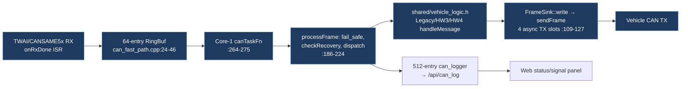
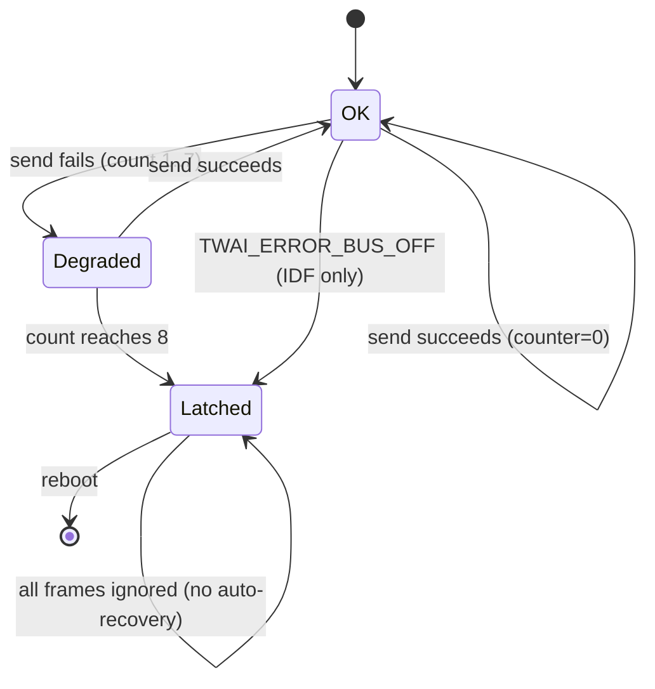
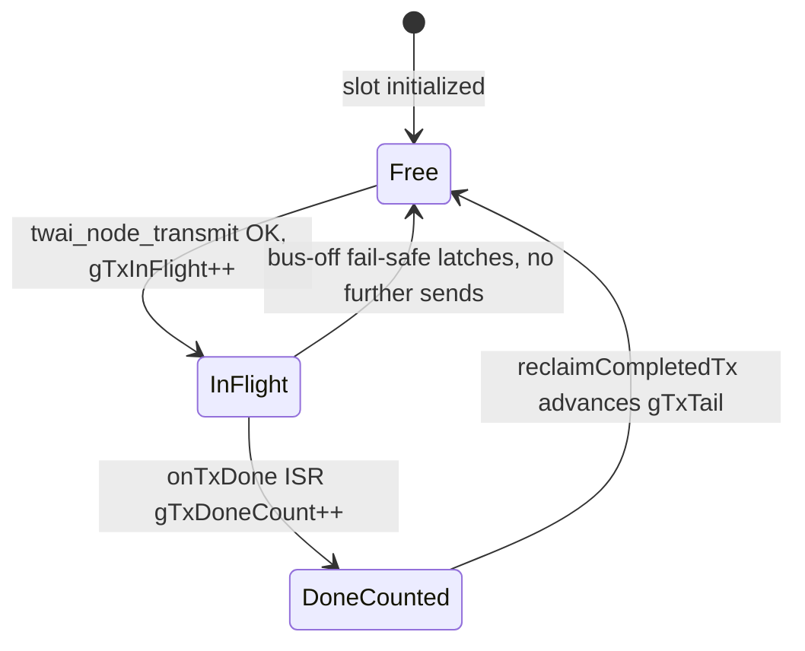
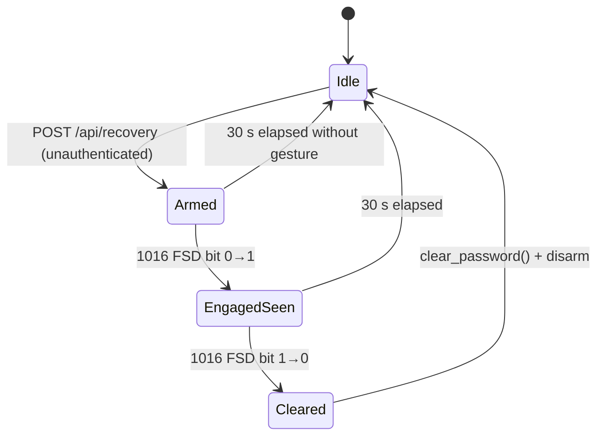
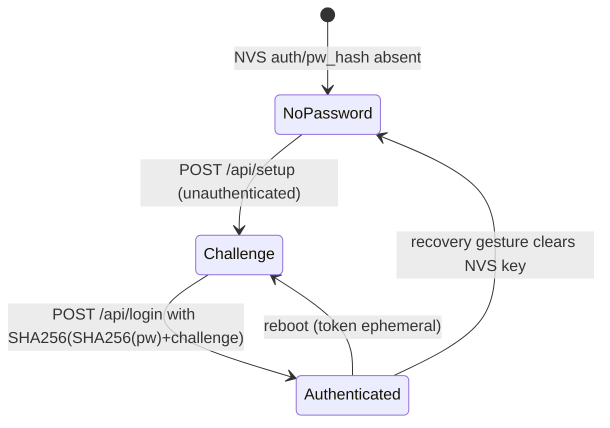
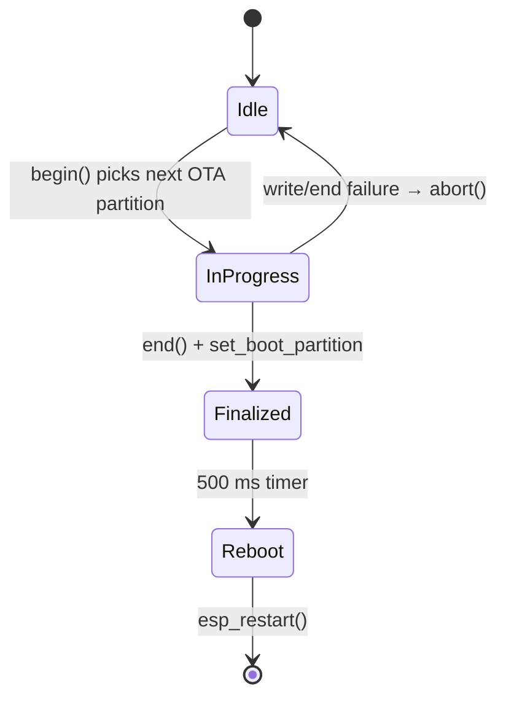

# Shayennn-FUCKYOU-TESLA-FSD

**Source:** [github.com/Shayennn/FUCKYOU-TESLA-FSD](https://github.com/Shayennn/FUCKYOU-TESLA-FSD)
**License:** GPL-3.0 (feather/) / MIT (esp32/)
**Platform:** Feather M4, ESP32, ESP32-IDF v6.0

## 1. Provenance

- **Folder:** `legacy/Shayennn-FUCKYOU-TESLA-FSD`. **CONVERTED FOLDER — no active submodule entry.** `git ls-files -s legacy/Shayennn-FUCKYOU-TESLA-FSD` returns normal blobs (`100644 … 0`), not a `160000` gitlink; `git -C legacy/Shayennn-FUCKYOU-TESLA-FSD rev-parse HEAD` resolves to the parent repo `7d90b9a32fb07b7cb9fa07538d06d3c87936112b`, not an upstream HEAD. No upstream fetch was performed, per instruction.
- **Pinned SHA (historical gitlink, canonical form):** `160000 9af2eeb3ab902a628a9afcec19300aaa265e5199 0`. Recovered from `git ls-tree 7f4d2d9dcd2b65e47c60bbc8597f8494cf8ecabd legacy/Shayennn-FUCKYOU-TESLA-FSD` (the pre-conversion tree) and confirmed identical in `0a103a6^`. Upstream URL from `git show 7f4d2d9:.gitmodules`: `https://github.com/Shayennn/FUCKYOU-TESLA-FSD`.
- **Conversion:** added as submodule in `7f4d2d9` (2026-04-20), converted to a tracked folder in `0a103a6` (2026-06-13, "fix: remove stale submodule refs…"). Working-tree files are the conversion snapshot; `git status --porcelain` on the folder reports nothing — the many `M docs/legacy/*` entries are parent-repo working-tree changes, not upstream dirt.
- **Analysis date:** 2026-11-21.
- **License actually observed:** GPL-3.0 headers in `feather/feather.ino:1-14`, `esp32/esp32.ino:1-14`, `README.md:184`. The only MIT file is `esp32/example.ino:1-2`, a third-party Sandeep Mistry OBD2 printer example unrelated to the FSD build. No `LICENSE` file is tracked in the folder.
- **Frontmatter / Upstream sections:** the HEAD document has **no YAML frontmatter and no `## Upstream (...)` section** (`git show HEAD:docs/legacy/Shayennn-FUCKYOU-TESLA-FSD.md`, lines 1-58). Nothing was preserved byte-for-byte because nothing of that shape exists; no frontmatter was invented. The old summary survives in git history and is cited in section 6 as `git show HEAD:docs/legacy/Shayennn-FUCKYOU-TESLA-FSD.md#L…`.
- **Files read (full, with line ranges):** `shared/vehicle_logic.h:1-264`; `feather/vehicle_logic.h` (symlink → shared, 1-line git blob); `feather/feather.ino:1-230`; `esp32/esp32.ino:1-117`; `esp32/example.ino:1-30` (partial, license check only); `esp32-idf/main/can_fast_path.{h:1-32,cpp:1-331}`; `esp32-idf/main/esp32_app.cpp:1-63`; `esp32-idf/main/auth.{h:1-23,cpp:1-113}`; `esp32-idf/main/web_server.cpp:1-613`; `esp32-idf/main/wifi_ap.{h:1-7,cpp:1-65}`; `esp32-idf/main/ota.{h:1-15,cpp:1-98}`; `esp32-idf/main/can_logger.{h:1-24,cpp:1-65}`; `test/test_handlers.cpp:1-504`; `test/Makefile:1-31`; `README.md:1-184`; `esp32-idf/README.md:1-184`; `esp32-idf/HARDWARE_VALIDATION.md:1-427`; `docs/HOW_IT_WORKS.md:1-371`; all five `.github/workflows/*.yml`, both `CMakeLists.txt`, three `sdkconfig*.defaults`, both `partitions*.csv`, `.gitignore` (partial).
- **Files NOT read:** none of the 39 tracked files were skipped for the load-bearing analysis; `esp32/example.ino` was read only through line 30 (license provenance), and `docs/can_meaning.dbc` was **STRUCTURAL-PARSE**, not FULL-READ (4294 lines: 159 `BO_`, 2894 `SG_`; only the six signal definitions cited in section 8 were RANGE-CITED at lines 910, 940, 966, 968, 974, 2912). No file under `legacy/` was modified. No upstream history before the pinned SHA was reviewed.
- **Our-side files read (CODE-READ for parity):** `firmware/lib/vehicle/can/feature/fsd/{fsd.h:1-58,profile.h:1-111,offsets.h:1-95,nag.h:1-524,region.h:1-186}`; `firmware/lib/vehicle/can/handler/variant/{bits.h:1-58,hw3.h:1-155,hw4.h:120-169,legacy.h:55-84}`; `firmware/lib/vehicle/can/handler/frame_readers.h:1-72`; `firmware/lib/core/types.h:315` (via anchor); `firmware/lib/vehicle/can/ids.h:23-25` (via anchor).

## 2. Executive verdict

Three firmware targets (Feather M4, legacy ESP32 Arduino, ESP32-IDF v6.0) mutate the same four Tesla CAN IDs (1006, 1016, 1021, 2047) through one header-only, no-virtual, `FrameSink`-callback pipeline; a host test binary compiles that same header with ASan/UBSan. The mechanisms that matter are the byte-exact profile/offset encodings and follow-distance maps, the 8-strike TX fail-safe latch, the ISR→64-entry ring→Core-1 task fast path, and the 0x7FF autopilot-tier spoof. Most frame encodings are **already present** in our firmware byte-for-byte (`profile.h`, `offsets.h`, `hw3.h`, `hw4.h`) and must not be re-ported. The genuinely new idea is the **FSD on→off gesture as a physical password-recovery token** (30 s window, `can_fast_path.cpp:162-184` → `auth::clear_password`), plus the unauthenticated `/api/recovery` arm endpoint and the no-gateway/no-DNS open-AP hardening. Never copy: the unconditional FSD bit writes (no `fsdEnabled`/AP gate), the open AP, the unauthenticated recovery arm, the `sscanf`/`strstr` JSON parser, or the "bit 19 = nag" semantic (our side treats 19 as hands-on-requirement and 20 as ECE R79). CAPTURE evidence does not exist in this repo; HARDWARE_VALIDATION.md is a plan, not a run log.

## 3. Evidence map

| Source file | Lines | What it proves | Grade |
| --- | --- | --- | --- |
| `shared/vehicle_logic.h` | 7-20 | `can_frame` struct + `FrameSink` callback abstraction, no virtual dispatch | CODE-READ |
| `shared/vehicle_logic.h` | 35-37, 65-71 | CAN IDs 1016/1021 constants; mux = `data[0]&7`; FSD UI bit = `data[4] bit 6` (= bit 38) | CODE-READ |
| `shared/vehicle_logic.h` | 73-75, 105-113 | Profile encode `data[6] bits[2:1]`; offset clamp `×5` to `[0,100]`; tier write `data[5] bits[4:2]` | CODE-READ |
| `shared/vehicle_logic.h` | 115-150 | Legacy: 1006 mux0 bit46 + profile, mux1 clear bit19; 2047 mux2 tier 3 | CODE-READ |
| `shared/vehicle_logic.h` | 152-206 | HW3: 1016 follow-distance + 5 UI bits; 1021 mux0/1/2; 2047 tier 3 | CODE-READ |
| `shared/vehicle_logic.h` | 208-260 | HW4: 5-level map; mux0 bits 38/46/60; mux1 19/45/47; mux2 `data[7] bits[6:4]`; tier 4 | CODE-READ |
| `feather/vehicle_logic.h` | 1 (blob) | Symlink `../shared/vehicle_logic.h` — one source of truth on Feather | CODE-READ |
| `feather/feather.ino` | 26, 42-46, 189 | Compile-time HW select, `NAV_STOPS_ENABLED=false`, `CAN.begin(500E3)` | CODE-READ |
| `feather/feather.ino` | 52-106, 112, 148-155, 203-230 | DLC sanitize, RX drain, TX begin/write/end checks, 8-strike fail-safe, O3 loop | CODE-READ |
| `esp32/esp32.ino` | 35-50, 54-63, 99-117 | TWAI 500 kbit/s, HW3 hardwired, same 8-strike latch, reset-reason log | CODE-READ |
| `esp32-idf/main/can_fast_path.cpp` | 16-22, 24-46, 59-62 | 64-entry ring, 4 TX slots, Core-1 pinned task, default handler type 1 (HW3) | CODE-READ |
| `esp32-idf/main/can_fast_path.cpp` | 95-136, 186-224 | Async TX reclaim, handler dispatch, latency counters, fail-safe + bus-off latch | CODE-READ |
| `esp32-idf/main/can_fast_path.cpp` | 162-184, 324-329 | 30 s FSD on→off recovery state machine and arm API | CODE-READ |
| `esp32-idf/main/esp32_app.cpp` | 28-63 | NVS init, TWAI node (GPIO27/26, 500000, tx_queue_depth 1), recovery callback wiring | CODE-READ |
| `esp32-idf/main/auth.{h,cpp}` | 8-10; 19-32, 38-111 | SHA-256 password hash, 16-byte random challenge, constant-time compare, NVS `auth/pw_hash` | CODE-READ |
| `esp32-idf/main/web_server.cpp` | 153-179, 379-491, 584-599 | 9 endpoints; bearer auth; only handler/log/OTA protected; recovery unprotected | CODE-READ |
| `esp32-idf/main/web_server.cpp` | 97-151, 343-377 | Signal view from 128-entry log snapshot; decoded status fields | CODE-READ |
| `esp32-idf/main/wifi_ap.cpp` | 14-16, 22-63 | Open AP `TeslaFSD`, ch 6, max 4, `192.168.4.1`, no router/DNS offer | CODE-READ |
| `esp32-idf/main/ota.cpp` | 39-94 | Dual-slot OTA, sequential writes, boot-partition swap, 500 ms delayed reboot | CODE-READ |
| `esp32-idf/main/can_logger.{h,cpp}` | 17; 26-56 | 512-entry ring, drops oldest on overflow, `lost` counter, `snapshot()` | CODE-READ |
| `test/test_handlers.cpp` | 103-452, 454-504 | 33 host tests over the shared header; assertion-level frame/bit checks | TEST-READ |
| `test/Makefile` | 1-31 | `-fsanitize=address,undefined`; CI runs both plain and sanitized builds | TEST-READ |
| `.github/workflows/{test,codeql,secret-scan,dependency-review,workflow-lint}.yml` | all | Test+sanitize on push/PR, CodeQL cpp+actions, gitleaks, dep-review, actionlint | CODE-READ |
| `docs/can_meaning.dbc` | STRUCTURAL-PARSE; RANGE-CITED 910, 940, 966, 968, 974, 2912 | Vendored catalog: bit-19 is `UI_applyEceR79`, bit-46 `UI_showTrackLabels`, bit-47 `UI_hardCoreSummon`, 0x7FF tier `GTW_autopilot m2 : 42|3` | STRUCTURAL-PARSE |
| `README.md` / `docs/HOW_IT_WORKS.md` / `esp32-idf/HARDWARE_VALIDATION.md` | 1-184 / 1-371 / 1-427 | Intent, stale pseudocode, validation *plan* (no captured results) | SUMMARY-ONLY |
| `docs/legacy/Shayennn-FUCKYOU-TESLA-FSD.md` (pre-replace) | 1-58 | Prior shallow summary; claims tested in section 6 | SUMMARY-ONLY |

No CAPTURE evidence exists in this repo: there is no captured frame dump or completed validation log. `docs/HOW_IT_WORKS.md` and the old `docs/legacy/` summary are SUMMARY-ONLY and are not used as adaptation evidence.

## 4. Architecture and build surface

- **Entry points:** `feather/feather.ino:160` `setup()`/`203` `loop()`; `esp32/esp32.ino:79`/`99`; `esp32-idf/main/esp32_app.cpp:28` `app_main()`; `test/test_handlers.cpp:454` `main()`.
- **Shared core vs platform port:** `shared/vehicle_logic.h` is the only mutation logic; Feather reaches it through the symlink `feather/vehicle_logic.h`, ESP32 Arduino by `../shared/vehicle_logic.h` include, ESP-IDF via `main/CMakeLists.txt` `target_include_directories(.../../../shared)`, tests by direct include. Platform files own only transport, LED, and fail-safe.
- **Build flags:** compile-time `#define HW LEGACY|HW3|HW4` in `feather/feather.ino:42-46` (default `HW3`); `NAV_STOPS_ENABLED` at `:26` (default `false`); ESP32 Arduino hardwires `HW3Handler` at `esp32/esp32.ino:54`; ESP-IDF runtime handler type 0/1/2 default 1 via `can_fast_path.cpp:49,56,81`. ESP-IDF flags: `-O3` (`main/CMakeLists.txt`), `-O1 -g -fsanitize=address,undefined` (test `Makefile:4`). sdkconfig enables flash coredump, task/int WDT, strong stack check (`sdkconfig.defaults`).
- **Dependency boundaries:** IDF `REQUIRES nvs_flash esp_driver_gpio esp_driver_twai esp_wifi esp_netif esp_http_server mbedtls app_update esp_timer esp_event`; Feather needs `CANSAME5x` + `Adafruit_NeoPixel`; tests need only libc++. No dynamic allocation, virtual dispatch, HTTP/Wi-Fi/OTA work inside the fast path (claim in `esp32-idf/README.md:107-112`, corroborated by `can_fast_path.cpp` code read).



## 5. Mechanism catalogue

### 5.1 Shared FSD mux mutation pipeline

- **Claim (README / summary):** "Portable FSD enabler with a shared `vehicle_logic.h` header … reused across Feather, ESP32, ESP32-IDF, and desktop test builds" (`git show HEAD:docs/legacy/Shayennn-FUCKYOU-TESLA-FSD.md#L9`).
- **Code path:** `shared/vehicle_logic.h:118` `handleMessage()` → variant switch → `setBit()`/`setSpeedProfileV12V13()` → `makeHandledResult(true, sink.write(frame))`; platform sinks at `feather/feather.ino:119`, `esp32/esp32.ino:65`, `esp32-idf/main/can_fast_path.cpp:109`.
- **Frame spec:** IDs 1006 (0x3EE), 1016 (0x3F8), 1021 (0x3FD), 2047 (0x7FF); DLC assumed 8, no DLC guard in shared header; mux `data[0]&0x07`; no checksum or counter recompute anywhere.
- **Gates and timing:** none in the header — every matching RX frame is mutated and re-sent immediately; the only precondition is `frame.data[0]==2` for 2047 (`shared/vehicle_logic.h:142,198,252`). Feather/ESP32 loop gate on fail-safe latch only.
- **State machine:** per-handler `speedProfile`, `speedOffset`, `navStopsEnabled` are mutable fields; no frame-driven mode state.
- **Tests:** `test_legacy_*`, `test_hw3_*`, `test_hw4_*` at `test/test_handlers.cpp:174-394` — assert one frame emitted and exact bits/fields.
- **Evidence grade:** CODE-READ
- **Verdict:** CONFIRMED (the "shared single source" claim); CONTRADICTED as "FSD trigger on UI selection" — see 5.2.
- **Adapt to TeslaCANModder?** already present — our `hw3.h`/`hw4.h`/`legacy.h` do the same dispatch with extra gates.

### 5.2 UI-selection bit read but never used as an injection gate

- **Claim (README / summary):** trigger is "Traffic Light and Stop Sign Control" enabled in UI (`README.md:21,49`; `docs/HOW_IT_WORKS.md:121,167,205,245,275,370`).
- **Code path:** `shared/vehicle_logic.h:69-71` `isFSDSelectedInUI()` defined; called **only** by `esp32-idf/main/can_fast_path.cpp:166` (recovery gesture) and `esp32-idf/main/web_server.cpp:349` (display). No `handleMessage` path consults it.
- **Frame spec:** bit 38 (`data[4] bit 6`) on 1016/1021; 1 bit, read-only.
- **Gates and timing:** none for injection; `test_hw3_1021_mux0_runs_without_fsd_gate` (`test/test_handlers.cpp:272-280`) explicitly asserts mutation with the bit clear.
- **State machine:** None found.
- **Tests:** `test_isFSDSelectedInUI_reads_bit38` at `test/test_handlers.cpp:139-144` (read semantics only); `test_hw3_1021_mux0_runs_without_fsd_gate` at `:272-280`.
- **Evidence grade:** CODE-READ
- **Verdict:** CONTRADICTED
- **Adapt to TeslaCANModder?** never — our `fsdAllowed = s.fsdEnabled && (s.fsdForceEnabled || fsdUI)` (`hw3.h:121`, `legacy.h:61`) is the correct gate shape; do not weaken it.

### 5.3 Speed-profile mapping and byte encoding

- **Claim (README / summary):** "Speed Profiles (5 levels HW4, 3 levels HW3/Legacy)" (`git show HEAD:…md#L29`); tables at `README.md:146-172`.
- **Code path:** `shared/vehicle_logic.h:73-75` `setSpeedProfileV12V13()`; HW3 follow map `:160-166`; HW4 follow map `:215-223`; HW4 mux2 encode `:246`; Legacy offset-derived map `:124-130`.
- **Frame spec:** HW3/Legacy profile = `data[6] bits[2:1]` mask `0x06`, 2 bits; HW4 profile = `data[7] bits[6:4]` mask `0x70`, 3 bits; follow distance = `data[5] bits[7:5]` on 1016.
- **Gates and timing:** profile latched on each 1016 frame; pinned/override concept absent upstream.
- **State machine:** None found (single `int speedProfile`).
- **Tests:** `test_setSpeedProfileV12V13_writes_bits_1_2` `:146-154`; `test_hw3_1016_follow_distance_1/3` `:237-249`; `test_hw4_1016_follow_distance_mapping` `:339-351`; `test_hw4_1021_mux2_writes_speed_profile` `:378-386`.
- **Evidence grade:** CODE-READ
- **Verdict:** CONFIRMED (encoding + level counts); README stalk numbers off by one — see section 6.
- **Adapt to TeslaCANModder?** already present — identical maps/encoders at `profile.h:17-58`; our side adds `profileOverride` (`profile.h:82-107`).

### 5.4 HW3 speed-offset clamp and two-byte encode

- **Claim (README / summary):** "Speed offset" configured from scroll-wheel; no formula published.
- **Code path:** `shared/vehicle_logic.h:105-109` `clampSpeedOffset()` → `:178-179` → `:191-192` mux2 encode.
- **Frame spec:** read 6-bit biased field `((data[3]>>1)&0x3F)-30` on 1021 mux0; write low 2 bits into `data[0] bits[7:6]` (mask `0xC0`) and high 6 bits into `data[1] bits[5:0]` (mask `0x3F`); clamp `<=0→0`, `>=20→100`, else `raw*5`.
- **Gates and timing:** every 1021 mux2 frame; no NVS persistence in the shared header.
- **State machine:** None found.
- **Tests:** `test_hw3_1021_mux2_writes_speed_offset` at `test/test_handlers.cpp:295-305` (25 round-trip); no direct clamp-boundary test.
- **Evidence grade:** CODE-READ
- **Verdict:** CONFIRMED
- **Adapt to TeslaCANModder?** already present — `offsets.h:17-50` is the same math/encoding; our `executeOffsetCmd` adds HW4 0-63 cap (`offsets.h:83-94`).

### 5.5 AP-tier spoof on 0x7FF mux 2

- **Claim (README / summary):** not mentioned in either summary; only the DBC names `GTW_autopilot`.
- **Code path:** `shared/vehicle_logic.h:111-113` `setAutopilotMode()` → called at `:144` (Legacy), `:200` (HW3), `:254` (HW4).
- **Frame spec:** ID 2047 (0x7FF), requires `data[0]==2` (mux 2); write `data[5] bits[4:2]` (mask `0x1C`, shift 2) with value 3 (SELF_DRIVING) for Legacy/HW3 and 4 (BASIC) for HW4. DBC `GTW_autopilot m2 : 42|3@1+` line 2912.
- **Gates and timing:** on matching RX frame only; no OTA/AP gate.
- **State machine:** None found.
- **Tests:** `test_legacy_2047_sets_autopilot_to_3` `:204-211`; `test_hw3_2047_sets_autopilot_to_3` `:307-313`; `test_hw4_2047_sets_autopilot_to_4` `:388-394`.
- **Evidence grade:** CODE-READ
- **Verdict:** CONFIRMED
- **Adapt to TeslaCANModder?** candidate (read-only side) — our `frame_readers.h:65-72` decodes the same bits but never writes them; frame mutation would require `can-review-checklist.md` + capture.

### 5.6 TX fail-safe latch (all three targets)

- **Claim (README / summary):** summary says "CI with sanitizer-backed tests"; fail-safe only documented in `esp32-idf/README.md:112` and validated as a *plan* in `HARDWARE_VALIDATION.md:342-355`.
- **Code path:** Feather `feather/feather.ino:218-224,148-155`; ESP32 `esp32/esp32.ino:113-116,69-75`; IDF `can_fast_path.cpp:213-222` + `onStateChange :255-262`.
- **Frame spec:** none — transport-level latch; IDF counts TX done via `onTxDone` ISR `:247-253` and reclaims 4 slots `:95-107`.
- **Gates and timing:** 8 consecutive failed sends → permanent latch until reboot; IDF also latches immediately on `TWAI_ERROR_BUS_OFF`.
- **State machine:**



- **Tests:** None found — no test exercises a sink returning false except `test_handle_result_tracks_send_failure` (`test/test_handlers.cpp:443-452`), which checks the result struct, not the 8-strike latch.
- **Evidence grade:** CODE-READ
- **Verdict:** CONFIRMED
- **Adapt to TeslaCANModder?** candidate — latch/auto-recovery semantics differ from our bus-health model; worth a design note, not a copy.

### 5.7 ESP-IDF ISR→ring→Core-1 fast path

- **Claim (README / summary):** "Core 1 CAN fast-path processing … RX ISR -> ring buffer -> Core 1 CAN processing task" (`README.md:71`; `esp32-idf/README.md:11,101-105`).
- **Code path:** `onRxDone :226-245` → `RingBuf::push :30-37` → `vTaskNotifyGiveFromISR` → `canTaskFn :264-275` → `applyRequestedHandlerType :138-160` → `processFrame :186-224` → `sendFrame :109-127`.
- **Frame spec:** 64-entry ring (mask 63), 4 async TX slots, `twai_frame_t` with `buffer_len = dlc`; DLC clamped to 8 at `:114`; `tx_queue_depth=1` (`esp32_app.cpp:50`).
- **Gates and timing:** task priority `configMAX_PRIORITIES-2`, stack 4096, pinned core 1 (`:20-22`); handler switch applied under `portMUX`, notification-driven.
- **State machine:**



- **Tests:** None found — no host or hardware test covers the ring/task/slot machinery.
- **Evidence grade:** CODE-READ
- **Verdict:** CONFIRMED
- **Adapt to TeslaCANModder?** no impact — our `lib/core/can/` ring and bus health already cover this; upstream has no multi-bus routing.

### 5.8 FSD on→off gesture as password recovery token

- **Claim (README / summary):** "Password recovery arm flow from the web UI" (`esp32-idf/README.md:18`); gesture detail only in `HARDWARE_VALIDATION.md:302`.
- **Code path:** `handlerRecovery :493-498` → `can_fast::arm_recovery :324-329` → `checkRecovery :162-184` reads `isFSDSelectedInUI` on 1016 → `gRecoveryFn()` → `auth::clear_password :60-71` (wired at `esp32_app.cpp:55`).
- **Frame spec:** 1016 `data[4] bit 6` (bit 38); no other CAN payload; no checksum/counter.
- **Gates and timing:** 30 000 000 µs (30 s) arm window; requires first a false→true transition then true→false; absent transitions or timeout disarm without clearing.
- **State machine:**



- **Tests:** None found.
- **Evidence grade:** CODE-READ
- **Verdict:** CONFIRMED
- **Adapt to TeslaCANModder?** candidate — the *idea* (physical gesture as recovery factor) is novel; any port must add authentication to the arm step and must not reuse our FSD frames on a live bus without a capture.

### 5.9 Open AP + challenge-response auth + bearer session

- **Claim (README / summary):** "open AP setup at `192.168.4.1`, web UI, auth" (`README.md:72-73`); endpoint split documented at `esp32-idf/README.md:126-138`.
- **Code path:** `wifi_ap.cpp:22-63`; `auth.cpp:47-58` `set_password`, `:73-78` `get_challenge`, `:80-106` `verify_response`, `:108-111` `verify_session_token`; `web_server.cpp:153-179` `isAuthenticated`/`requireAuth`; routes `:584-599`.
- **Frame spec:** None found (HTTP/JSON surface).
- **Gates and timing:** password min 4 / max 63 chars (`web_server.cpp:476-487`); 16-byte random challenge, 32-byte SHA-256 hash, constant-time compare; bearer token is the response hash itself, valid until reboot or password change; AP is `WIFI_AUTH_OPEN` with router/DNS offers suppressed.
- **State machine:**



- **Tests:** None found — auth is untested on host; only a curl walkthrough exists (`HARDWARE_VALIDATION.md:178-224`).
- **Evidence grade:** CODE-READ
- **Verdict:** CONFIRMED (mechanism); PARTIAL (security — see section 12).
- **Adapt to TeslaCANModder?** no impact — our WiFi REST API uses its own auth model; do not import this parser or scheme.

### 5.10 Dual-slot OTA with delayed reboot

- **Claim (README / summary):** "dual OTA slots and flash coredumps" (`git show HEAD:…md#L9`); partition table at `esp32-idf/README.md:157-163`.
- **Code path:** `handlerOTA :553-582` → `ota_update::begin/write/end :39-81` → `schedule_reboot(500) :83-87` → `rebootTimerCb :18-20`; partitions `partitions_release.csv`.
- **Frame spec:** None found (firmware image, raw bytes).
- **Gates and timing:** `requireAuth`, single `gInProgress` guard, 4096-byte read chunks, 500 ms post-response reboot delay; `esp_ota_set_boot_partition` before reboot.
- **State machine:**



- **Tests:** None found.
- **Evidence grade:** CODE-READ
- **Verdict:** CONFIRMED
- **Adapt to TeslaCANModder?** already present in principle (our release pipeline + flasher); upstream adds raw HTTP upload, not a candidate given our signed-release flow.

### 5.11 Bounded CAN log + decoded signal view

- **Claim (README / summary):** "bounded CAN log viewer" (`esp32-idf/README.md:19,123`).
- **Code path:** `can_logger::push :26-39` from `processFrame :191,212`; `snapshot :41-56`; `buildSignalView :97-151`; `handlerCanLog :519-551`; `handlerStatus :343-377`.
- **Frame spec:** logs RX and post-mutation TX with `uint32_t timestamp_us`, `Dir` enum (0 RX / 1 TX); 512 entries, oldest dropped and `gLost++` on overflow.
- **Gates and timing:** endpoint returns at most 100 entries; UI polls `/api/status` every 2000 ms (`web_server.cpp:334`); signal view from 128-entry snapshot.
- **State machine:** None found.
- **Tests:** None found.
- **Evidence grade:** CODE-READ
- **Verdict:** CONFIRMED
- **Adapt to TeslaCANModder?** no impact — our recorder/status stream already cover it; note the 512→100 truncation if benchmarking.

### 5.12 Compile-time variant selection + sanitizer host tests

- **Claim (README / summary):** "Desktop unit tests with sanitizers (ASan/UBSan)" and "CI pipeline: CodeQL, test.yml, secret-scan, dependency-review" (`git show HEAD:…md#L31-32`).
- **Code path:** `feather/vehicle_logic.h` symlink; `test/test_handlers.cpp:11` direct include; `test/Makefile:4,18-25`; `.github/workflows/test.yml`, `codeql.yml`, `secret-scan.yml`, `dependency-review.yml`, `workflow-lint.yml`.
- **Frame spec:** None found.
- **Gates and timing:** `make -C test test` and `make -C test sanitize` on push/PR; CodeQL builds only `test_handlers` (cpp) plus actions matrix.
- **State machine:** None found.
- **Tests:** 33 named tests in `test/test_handlers.cpp:454-504` — see section 10.
- **Evidence grade:** TEST-READ
- **Verdict:** CONFIRMED
- **Adapt to TeslaCANModder?** already present in spirit (native Unity suites); the **pattern** "compile the production header unchanged on x86" is a candidate for a future host-test harness, but our DLC guards/state types would need abstraction first.

## 6. Summary vs code contradiction table

| # | Prior claim (`git show HEAD:docs/legacy/Shayennn-FUCKYOU-TESLA-FSD.md#L…` or upstream doc) | Code reality (cite) | Verdict |
| --- | --- | --- | --- |
| 1 | `#L4` "License: GPL-3.0 (feather/) / MIT (esp32/)" | `esp32/esp32.ino:1-14` is GPL-3.0; only `esp32/example.ino:1-2` is MIT, and it is an unrelated OBD2 printer. No `LICENSE` file tracked. | CONTRADICTED |
| 2 | `#L28` "Nag Killer (bit19 clear)" | DBC `docs/can_meaning.dbc:940` names bit 19 `UI_applyEceR79`; upstream's own `shared/vehicle_logic.h:136,187,241` comments say ECE R79. Our side uses bit 19 for hands-on-requirement and bit 20 for ECE R79 (`bits.h:26,42`). | CONTRADICTED (semantic) |
| 3 | `#L35-41` CAN ID table lists only 1006/1016/1021 | `shared/vehicle_logic.h:141-145,197-201,251-255` mutates 2047 (0x7FF) on all three variants; 2047 is absent from the summary table. | CONTRADICTED (omission) |
| 4 | `#L27` "FSD Activation (HW3/HW4/Legacy via shared logic)" with no gate noted | `handleMessage` mutates unconditionally; `isFSDSelectedInUI` is unused for injection (`test/test_handlers.cpp:272-280`). Our side gates on `fsdEnabled && (fsdForceEnabled || fsdUI)` (`hw3.h:121`). | CONTRADICTED (safety-relevant) |
| 5 | `README.md:146-151` Legacy offset 28→Chill, 29→Normal, 30→Hurry | `shared/vehicle_logic.h:124-129` computes `off = raw-30` and matches `off` 0/1/2 → raw 30/31/32, i.e. shifted by +2 vs README. | CONTRADICTED |
| 6 | `README.md:156-160` HW3 follow 2→Hurry, 3→Normal, 4→Chill | `shared/vehicle_logic.h:160-165` maps raw 1→2, 2→1, 3→0; README raw values are one higher. | CONTRADICTED |
| 7 | `README.md:166-172` HW4 follow 2→Max … 6→Sloth | `shared/vehicle_logic.h:215-222` maps raw 1→3, 2→2, 3→1, 4→0, 5→4; README raw values are one higher. | CONTRADICTED |
| 8 | `docs/HOW_IT_WORKS.md:26-35,68-73,184-227` describes `std::make_unique`, `CarManagerBase` virtual `handelMessage`, MCP2515 driver, `mcp->sendMessage` | Actual code uses stack `ActiveHandler handler`, no virtual, `FrameSink` callback, `CANSAME5x`, `CAN.write` (`feather/feather.ino:28,79-106,110-115,212`). | CONTRADICTED |
| 9 | `docs/HOW_IT_WORKS.md:205,218,245,275` says mux0/mux2 fire only "FSD เปิดใน UI" | No such gate in `shared/vehicle_logic.h:175-196,232-250`; explicit test at `test/test_handlers.cpp:272-280`. | CONTRADICTED |
| 10 | `README.md:21,49` / `docs/HOW_IT_WORKS.md:121` "Traffic Light and Stop Sign Control" is the trigger | Only reader is recovery/status display (`can_fast_path.cpp:166`, `web_server.cpp:349`); bit 38 is DBC `UI_fsdStopsControlEnabled` (`:966`), not a UI-selection trigger for mutation. | CONTRADICTED |
| 11 | `docs/HOW_IT_WORKS.md:301-304` "Bit 46 = FSD Enable", "Bit 60 = FSDV14", "Bit 47 = HW4 extra" | DBC names them `UI_showTrackLabels` (`:974`), `UI_enableVisionOnlyStops` (`:910`), `UI_hardCoreSummon` (`:968`). Our side names them `FSD_BIT_EAP`, `FSD_BIT_DAS_DEV`, `FSD_BIT_NAG_ORGANIC` (`bits.h:21,23,27`). | CONTRADICTED (labels) |
| 12 | `git show HEAD:…md#L9` "dual OTA slots, and flash coredumps" | Confirmed by `partitions_release.csv` and `sdkconfig.defaults`; frontmatter-free summary itself has no stale field, but the `License` line at `#L4` is stale as in row 1. | AGREEMENT (kept out of table except as context) |
| 13 | `README.md:56-62` pins `PIN_CAN_CS`, `PIN_CAN_INTERRUPT`, `PIN_CAN_RESET` | `feather/feather.ino` uses `CANSAME5x`, `PIN_CAN_STANDBY`, `PIN_CAN_BOOSTEN`, `PIN_NEOPIXEL` (`:28-29,184-187`); none of the three README pins appear in code. | CONTRADICTED |

Agreements (shared header reuse, 3 variants, 500 kbit/s, 3-level HW3 / 5-level HW4 counts, CI names, OTA/coredump) live in the evidence map, not here.

## 7. CAN frame and signal inventory

| ID (hex+dec) | Bus | Period | DLC | Byte/bit layout | Scale/units | Counter position | Checksum | Read or write | Grade |
| --- | --- | --- | --- | --- | --- | --- | --- | --- | --- |
| 0x3F8 / 1016 | Chassis (`docs/can_meaning.dbc` BO_ 1016) | Per-RX frame, no scheduler; UNVERIFIED on-car | Assumed 8, no guard | `data[5] bits[7:5]` follow distance; `data[4] bit 6` FSD UI; `data[5] bits[1:0]` driving side; bits 5/13/14/48/49 UI overrides | Raw stalk steps 1-3 (HW3) / 1-5 (HW4), not scaled | None found | None found | Read + mutate + retransmit | CODE-READ |
| 0x3FD / 1021 | Chassis (BO_ 1021) | Per-RX frame; UNVERIFIED on-car | Assumed 8, no guard | mux `data[0] bits[2:0]`; mux0 bits 38/46/(60 HW4); mux1 bits 19/45/(47 HW4); mux2 HW3 `data[0:1]` offset or HW4 `data[7] bits[6:4]` profile | Offset `raw*5` clamped 0-100; profile index 0-4 | None found | None found | Read + mutate + retransmit | CODE-READ |
| 0x3EE / 1006 | Chassis (Legacy-only; not in DBC per `shared/vehicle_logic.h:121`) | Per-RX frame; UNVERIFIED | Assumed 8, no guard | mux0: `((data[3]>>1)&0x3F)-30` → profile via bits 1:2 of `data[6]`; bit 46 set; mux1: bit 19 clear | Offset steps, no scaling for profile | None found | None found | Read + mutate + retransmit | CODE-READ |
| 0x7FF / 2047 | Vehicle (BO_ 2047 `ID7FFcarConfig`) | Per-RX frame; UNVERIFIED | Assumed 8, no guard | Require `data[0]==2`; `data[5] bits[4:2]` = tier (DBC `GTW_autopilot m2 : 42|3@1+`, 0=NONE…4=BASIC) | Enum 0-4 | None found | None found | Read + mutate + retransmit | CODE-READ |

Vendored catalog `docs/can_meaning.dbc` is STRUCTURAL-PARSE only (4294 lines, 159 frames, 2894 signals); it is not enumerated here wholesale. No CAPTURE evidence exists for period, DLC, or on-car frame shape.

## 8. Constants and tuning table

| Constant | Value | File:line | Meaning | Grade |
| --- | --- | --- | --- | --- |
| `UI_DRIVER_ASSIST_CONTROL_ID` | 1016 (0x3F8) | `shared/vehicle_logic.h:35` | Follow-distance / UI driver assist frame | CODE-READ |
| `UI_AUTOPILOT_CONTROL_ID` | 1021 (0x3FD) | `shared/vehicle_logic.h:37` | FSD mux frame | CODE-READ |
| `UI_DRIVING_SIDE_OVERRIDE` | 0 (LEFT) | `shared/vehicle_logic.h:44,47` | Forced LHD value on 1016 | CODE-READ |
| `UI_APMV3_BRANCH_OVERRIDE` | 2 (DEV) | `shared/vehicle_logic.h:51,55` | Forced APMv3 branch on 1021 mux1 | CODE-READ |
| `clampSpeedOffset` | `<=0→0`, `>=20→100`, else `raw*5` | `shared/vehicle_logic.h:105-109` | HW3 offset scale/clamp | CODE-READ |
| HW3 follow map | 1→2, 2→1, 3→0 | `shared/vehicle_logic.h:161-165` | Follow distance → profile | CODE-READ |
| HW4 follow map | 1→3, 2→2, 3→1, 4→0, 5→4 | `shared/vehicle_logic.h:216-222` | 5-level profile map | CODE-READ |
| Legacy offset map | raw−30 = 2/1/0 → profile 2/1/0 | `shared/vehicle_logic.h:124-129` | Retrofit profile selection | CODE-READ |
| `setAutopilotMode` | 3 (Legacy/HW3), 4 (HW4) | `shared/vehicle_logic.h:144,200,254` | 0x7FF tier spoof value | CODE-READ |
| `kTxFailureLimit` | 8 | `feather/feather.ino:112`, `esp32/esp32.ino:56`, `can_fast_path.cpp:16` | Consecutive TX failures before latch | CODE-READ |
| CAN bitrate | 500000 | `feather/feather.ino:189` (`500E3`), `esp32/esp32.ino:28`, `esp32_app.cpp:49` | Tesla bus speed | CODE-READ |
| `kRingBufSize` / `kTxSlotCount` | 64 / 4 | `can_fast_path.cpp:17,19` | RX ring and async TX slot count | CODE-READ |
| `kCanTaskPriority` / stack / core | `configMAX_PRIORITIES-2` / 4096 / 1 | `can_fast_path.cpp:20-22` | Core-1 task placement | CODE-READ |
| `gRecoveryArmedTime` timeout | 30 000 000 µs (30 s) | `can_fast_path.cpp:179` | Password-recovery window | CODE-READ |
| `kLogCapacity` | 512 | `can_logger.h:17` | CAN log ring, oldest dropped | CODE-READ |
| `kSsid` / channel / max conn | `TeslaFSD` / 6 / 4 | `wifi_ap.cpp:14-16` | Open AP identity | CODE-READ |
| AP IP / mask | 192.168.4.1 / 255.255.255.0, no router/DNS | `wifi_ap.cpp:50-58` | Captive AP without uplink | CODE-READ |
| `kChallengeLen` / `kHashLen` / `kPasswordMaxLen` | 16 / 32 / 63 | `auth.h:8-10` | Challenge-response sizes | CODE-READ |
| OTA reboot delay | 500 ms | `web_server.cpp:580` | Post-response reboot timer | CODE-READ |
| DLC guards | `sanitizeDlc` clamp 0-8; `dlc > sizeof(slot.data) ? 8 : dlc` | `feather/feather.ino:52-56`, `can_fast_path.cpp:114` | Only platform-side DLC safety | CODE-READ |

## 9. Failure modes and edge cases

| Failure | Handling code path | Tested? | Grade |
| --- | --- | --- | --- |
| Repeated TX failure | 8-strike latch: `feather/feather.ino:218-224`, `esp32/esp32.ino:113-116`, `can_fast_path.cpp:213-222` | No (only `HandleResult.sent` at `test/test_handlers.cpp:443-452`) | CODE-READ |
| Bus-off | `can_fast_path.cpp:255-262` sets `fail_safe` immediately, LED on | No | CODE-READ |
| TX slot exhaustion | `sendFrame` returns false when `gTxInFlight>=4` (`:111`), counted as TX failure by `processFrame` | No | CODE-READ |
| RX ring overflow | `RingBuf::push` drops newest frame silently (`can_fast_path.cpp:31-32`); contrast log ring which drops oldest | No | CODE-READ |
| Log ring overflow | `can_logger.cpp:29-32` advances tail and increments `gLost` | No | CODE-READ |
| Missing/unmatched frame | no timeout; handler simply does nothing, `filtered_count++` (`can_fast_path.cpp:199-201`) | Partial (unhandled-ID tests `test/test_handlers.cpp:174-181,213-220,315-322`) | CODE-READ |
| OTA during CAN activity | none — no OTA guard; `ota.cpp` and `can_fast_path.cpp` are independent | No | CODE-READ |
| Brownout / reboot state | reset reason logged (`esp32_app.cpp:30`, `esp32/esp32.ino:89`); NVS recovered on `NO_FREE_PAGES`/`NEW_VERSION_FOUND` (`:32-37`); handler defaults to HW3 after reboot | No | CODE-READ |
| CAN init failure | infinite `while(true) delay(1000)` (`feather/feather.ino:189-195`, `esp32/esp32.ino:91-94`); IDF uses `ESP_ERROR_CHECK` (`esp32_app.cpp:52`) | No | CODE-READ |
| Short DLC frame | shared header has no guard — reads `data[7]` regardless; only platform RX clamps read length | No | CODE-READ |
| Recovery timeout / wrong gesture | disarm without clearing (`can_fast_path.cpp:178-183`) | No | CODE-READ |
| Auth setup replay | `/api/setup` refuses once password exists (`web_server.cpp:464-469`); recovery arm is unauthenticated (`:493-498`) | No | CODE-READ |

## 10. Test coverage map

- **Single test file:** `test/test_handlers.cpp` — 33 `RUN(...)` invocations at `:454-504`, all asserting against the shared header with a recording `FrameSink` (`:30-40`) and hand-derived bit getters (`:72-78`).
- **Utility (8):** `setBit` set/clear/cross-byte `:103-128`; `readMuxID` `:130-137`; `isFSDSelectedInUI` `:139-144`; speed-profile encode `:146-154`; driving-side/APMv3 extract `:156-172`.
- **Legacy (4):** unhandled ID, 1006 mux0 bit46+profile, mux1 bit19 clear, 2047 tier 3 `:174-211`.
- **HW3 (9):** unhandled, 1016 nav bits, follow 1/3, 1021 mux0 bits, profile preservation across frames, ungated mux0, mux1 branch/lane, mux2 offset, 2047 tier `:213-313`.
- **HW4 (7):** unhandled, 1016 nav bits, 5-level mapping, mux0 bits 38/46/60, mux1 19/45/47, mux2 profile write, 2047 tier 4 `:315-394`.
- **Toggle/result (5):** navStops disabled HW3/HW4 `:396-441`, send-failure result `:443-452`.
- **CI:** `test.yml` runs `make -C test test` + `make -C test sanitize`; ASan/UBSan flags at `test/Makefile:4,18-25`.
- **Critical paths with NO test (risk):**
    - 8-strike fail-safe and bus-off latch — a TX regression could leave injection live indefinitely.
    - ISR/ring/task/TX-slot machinery — dropped or double-sent frames would be invisible to all 33 tests.
    - Auth, recovery gesture, OTA, AP/DHCP config — no host harness; only a manual plan (`HARDWARE_VALIDATION.md`).
    - `clampSpeedOffset` boundaries (`0`, `>=20`) — off-by-one scale error would pass every current test.
    - Checksum/counter behavior — upstream never recomputes either; untested by design.
    - `docs/can_meaning.dbc` signal positions are trusted as comments, not asserted against code.

## 11. Parity matrix with TeslaCANModder

| Signal/frame | Upstream decode (cite) | Our decode/mutation (cite) | Delta | Action |
| --- | --- | --- | --- | --- |
| 0x3F8 / 1016 follow distance | `shared/vehicle_logic.h:160-165`, `:215-222` (`data[5]>>5 & 7`) | `profile.h:43-58` `mapHW3FollowDistToProfile` / `mapHW4FollowDistToProfile`; `hw3.h:69-77` | Identical maps; ours adds `profileOverride` | already present |
| HW3/Legacy profile encode | `shared/vehicle_logic.h:73-75` (`data[6] & ~0x06`) | `profile.h:17-23` `setSpeedProfileV12V13` (identical mask/shift, adds DLC guard) | Ours guards `dlc<7` | already present |
| HW4 profile encode | `shared/vehicle_logic.h:246` (`data[7] & ~0x70`) | `profile.h:30-36` `writeHW4SpeedProfile` (identical, adds DLC guard) | Ours guards `dlc<8` | already present |
| HW3 offset read | `shared/vehicle_logic.h:178` (`((data[3]>>1)&0x3F)-30`) | `offsets.h:31-35` `readHW3UiOffsetSteps` | Identical, ours DLC-guarded | already present |
| HW3 offset clamp | `shared/vehicle_logic.h:105-109` | `offsets.h:42-50` `calculateHW3SpeedOffset` | Functionally identical (`*5`, clamp 0-100); ours caps negative before multiply | already present |
| HW3 offset write | `shared/vehicle_logic.h:191-192` (`0xC0` / `0x3F`) | `offsets.h:17-24` `writeHW3SpeedOffset` | Identical, ours DLC-guarded | already present |
| 0x3FD / 1021 mux0 bits | `shared/vehicle_logic.h:180-182,235-237` bits 38/46/60 | `hw3.h:131-135`, `hw4.h:138-145`; `bits.h:19,21,23` | Ours gated (`fsdAllowed`, `apGateOpen`, `apFirstEnabled`) and adds bit 39/EVD | already present (ours stricter) |
| 0x3FD mux1 bit 19 | `shared/vehicle_logic.h:136,187,241` clear bit 19, labelled ECE R79 by DBC `:940` | `bits.h:42` `NAG_BIT_HANDS_ON_REQUIREMENT=19`; `hw3.h:42`, `legacy.h:77` clear it; `bits.h:26` ECE R79 = bit 20, `region.h:94-100` | Same bit, different semantic label; ours additionally clears bit 20 only for EU market | align (documentation) |
| 0x3FD mux1 bit 47 | `shared/vehicle_logic.h:243` set bit 47 (`UI_hardCoreSummon`) | `hw3.h:43`, `hw4.h:43` set `FSD_BIT_NAG_ORGANIC=47` | Same bit, different label; ours also gates on `nagModeUsesBit19` | ignore |
| 0x3FD mux1 APMv3 branch | `shared/vehicle_logic.h:186,240` set branch=2 (DEV) | None found in FSD handlers (no APMv3 branch write) | Upstream-only field | capture-first (no on-car evidence) |
| 0x3FD mux2 HW4 offset | None found (HW4 uses mux2 for profile only) | `hw4.h:160-164` writes `data[1] bits[5:0]` when `speedOffset>0` | Our extension beyond upstream | ignore |
| 0x3EE / 1006 Legacy mux0 | `shared/vehicle_logic.h:124-132` | `legacy.h:56-72` (`readHW3UiOffsetSteps`, `setSpeedProfileV12V13`, bit 46) | Same frame/encodings; ours gated | already present |
| 0x7FF / 2047 tier | `shared/vehicle_logic.h:111-113,144,200,254` writes tier 3/4 | `frame_readers.h:65-72` `readGtwAutopilotTier` reads bits 42-44 only; no write found | Upstream writes, ours only reads | capture-first (mutation needs checklist) |
| 0x370 EPAS torque echo | None found — upstream never touches 0x370 | `nag.h:126-160,412-449,457-487` full state machine + checksum | Our mechanism far richer | ignore |
| UI bit 5/13/14/48/49 | `shared/vehicle_logic.h:167-172,224-229` always set | `hw3.h:86-102`, `hw4.h:100-114` gated by `assist*` flags | Same bits; ours user-configurable | already present (ours better) |
| Fail-safe after 8 TX fails | `feather/feather.ino:112,218-224`; `can_fast_path.cpp:16,213-222` | None found in `lib/core/can/` via named symbol search | Transport-level concept absent from our host-testable layer | no impact (bus health differs) |
| Recovery via FSD on→off | `can_fast_path.cpp:162-184` → `auth.cpp:60-71` | None found | Novel upstream-only mechanism | candidate (idea only, re-authenticate arm) |
| Open AP + challenge-response | `wifi_ap.cpp:14-32`; `auth.cpp:19-111` | Our WiFi REST API uses separate auth model | Different surface | no impact |

Rows without our-side CODE-READ citations are SUMMARY-ONLY and cannot drive a decision; every row above cites a concrete our-side file and symbol.

## 12. Surface inventory and security notes

**HTTP endpoints (`web_server.cpp:584-599`) — all on open AP 192.168.4.1, port 80 (`web_server.cpp:604-607`):**

| Endpoint | Method | Auth | Semantics | Cite |
| --- | --- | --- | --- | --- |
| `/` | GET | none | Single-page UI, inline HTML/JS | `:181-335,586` |
| `/api/status` | GET | none | Stats + decoded signals + `has_password` + `recovery_armed` | `:343-377,587` |
| `/api/challenge` | GET | none | 16-byte random challenge, base64 | `:379-391,588` |
| `/api/login` | POST | none | Hex SHA256(hash+challenge) → bearer token | `:429-462,589` |
| `/api/setup` | POST | none (only if no password) | Set first password | `:464-491,590` |
| `/api/recovery` | POST | **none** | Arm 30 s password-clear gesture | `:493-498,591` |
| `/api/handler` | POST | bearer | Switch Legacy/HW3/HW4 at runtime | `:500-517,592` |
| `/api/can_log` | GET | bearer | ≤100 log entries + `lost` | `:519-551,593` |
| `/api/ota` | POST | bearer | Raw firmware image, dual-slot write, reboot | `:553-582,594` |

**Other surfaces:** serial debug at 115200 baud (`feather/feather.ino:179`, `esp32/esp32.ino:83`); CAN RX/TX on GPIO27/26 (IDF) or CANSAME5x (Feather); NeoPixel/LED status (`feather/feather.ino:37-40`, `can_fast_path.cpp:15`).

**Security / provenance findings:**

- **Unauthenticated password reset:** `/api/recovery` has no `requireAuth` call (`web_server.cpp:493-498`) but clears the stored password after a CAN gesture (`:55` wiring in `esp32_app.cpp`). Any client on the open AP can arm it. Do-not-copy.
- **Open AP:** `WIFI_AUTH_OPEN`, SSID broadcast `TeslaFSD`, no WPA (`wifi_ap.cpp:14-32`). Mitigated only by no router/DNS offers (`:38-58`) and app-level auth.
- **Bearer token = login response hash:** `web_server.cpp:449-456` returns the same value used as `Authorization` token; valid until reboot or password change (`auth.cpp:16-17,56,69`). Low entropy against a captured login response; replay within session is trivial.
- **Ad-hoc JSON parsing:** `findJsonString`/`findJsonInt` use `strstr` + `sscanf("%02x")` (`web_server.cpp:393-427`); a crafted body can match a key inside another value. `handlerOTA` streams to flash with no size limit or image validity check before `end()` (`:553-582`).
- **No checksums/counters in CAN mutations:** frames are mutated in place and retransmitted without updating any CRC/counter (`shared/vehicle_logic.h` entire). On real HW4 this risks duplicate-frame detection — upstream itself removed a flood variant for this reason (`README.md:35-39`).
- **Hardcoded path leak:** `HARDWARE_VALIDATION.md:35` contains an author-local absolute path `/Users/phichawat.luk/tesla-fsd-can-mod/esp32-idf`.
- **Dangerous build flags:** none found. `-O3`, ASan/UBSan, WDT, stack-protection are normal; no `-fno-stack-protector` or disabled WDT.
- **No hardcoded credentials/certs/keys** found in tracked files: password is user-set at first boot and stored as unsalted SHA-256 in NVS (`auth.cpp:47-58`), not source-controlled.

## 13. Adaptation assessment

| Mechanism | Value | Cost | Risk | Evidence grade | Decision |
| --- | --- | --- | --- | --- | --- |
| 5.1 Shared mux mutation pipeline | Medium | Low (we have it) | Low | CODE-READ | already present |
| 5.2 UI bit ignored as gate | Negative example | None | High if copied | CODE-READ | never port |
| 5.3 Profile maps/encoders | Low | None | Low | CODE-READ | already present |
| 5.4 Offset clamp/encode | Low | None | Low | CODE-READ | already present |
| 5.5 0x7FF tier spoof write | Medium | Medium | High (tier mutation needs capture + checklist) | CODE-READ | candidate for future PR (read-only decode first) |
| 5.6 TX fail-safe latch | Medium | Medium | Medium (permanent latch behavior differs) | CODE-READ | candidate for future PR (design note only) |
| 5.7 ISR→ring→Core-1 fast path | Low | None | Low | CODE-READ | no impact |
| 5.8 FSD on→off recovery gesture | High (novel UX) | Medium | High (unauthenticated arm; live-bus gesture) | CODE-READ | candidate for future PR (idea only, add auth) |
| 5.9 Open AP + challenge-response | Low | None | High (open AP, token reuse) | CODE-READ | no impact |
| 5.10 Dual-slot OTA | Low | None | Medium (raw unvalidated image) | CODE-READ | already present (our signed release flow) |
| 5.11 Bounded log + signal view | Low | Low | Low | CODE-READ | no impact |
| 5.12 Compile shared header on x86 + sanitizers | Medium | Medium (abstract DLC/state first) | Low | TEST-READ | candidate for future PR (pattern only) |

Top three adaptation candidates: (1) 5.8 recovery gesture idea with authenticated arm, (2) 5.5 0x7FF tier decode/possible write after capture, (3) 5.6 fail-safe latch semantics as a design comparison. No frame mutation may land without `docs/checklists/can-review-checklist.md` and a listen-only bench capture.

## 14. Do-not-copy list

| Item | File:line | Reason |
| --- | --- | --- |
| Unconditional FSD bit writes | `shared/vehicle_logic.h:180-182,235-237,142-145` | Ignores UI selection and AP gate; our `fsdAllowed`/`apGateOpen` (`hw3.h:121-123`) is the safety boundary. |
| `"bit 19 = nag"` semantics | `shared/vehicle_logic.h:136,187,241`; `README.md:51` | DBC names it ECE R79 (`:940`); our side separates bit 19 hands-on and bit 20 ECE R79 (`bits.h:26,42`). |
| APMv3 branch forced to DEV | `shared/vehicle_logic.h:186,240` | Undocumented, untested on-car, no our-side equivalent. |
| 0x7FF tier forced to 3/4 | `shared/vehicle_logic.h:144,200,254` | Frame mutation with no gate or capture; requires checklist + capture first. |
| Open AP config | `wifi_ap.cpp:14-32` | `WIFI_AUTH_OPEN` on a device that can inject CAN frames. |
| `/api/recovery` without auth | `web_server.cpp:493-498,591` | Unauthenticated path to password removal. |
| `findJsonString`/`findJsonInt`/`sscanf` parsing | `web_server.cpp:393-427` | `strstr` key matching can be spoofed; no schema validation. |
| Unvalidated OTA image stream | `web_server.cpp:553-582` | No signature/size check before `esp_ota_set_boot_partition`. |
| Unsalted SHA-256 password storage | `auth.cpp:47-58` | No salt/KDF; unsuitable for our auth model. |
| `kTxFailureLimit` permanent latch with no auto-recovery | `feather/feather.ino:148-155`, `can_fast_path.cpp:216-222` | Different safety contract from our bus-health model; adopt semantics only after review. |
| `docs/HOW_IT_WORKS.md` pseudocode | whole file | Describes a removed architecture (`make_unique`, virtual handlers, MCP2515) — copy would resurrect dead code. |
| Any legacy file into shipping dirs | whole folder | Repo rule: research only; port behavior/constants, never source text. |

## 15. History and evolution

Only the parent repo's local history is available (converted folder, no submodule log). `git log --oneline -- legacy/Shayennn-FUCKYOU-TESLA-FSD` shows two commits: `7f4d2d9` (2026-04-20, "Add new legacy submodules for Tesla FSD modifications", gitlink `9af2eeb3…`) and `0a103a6` (2026-06-13, "fix: remove stale submodule refs…", gitlink deleted, files added as normal blobs). No upstream commit messages, issues, or PRs are present locally.

Documented evolution from the snapshot's own docs: `README.md:35-39` records an experimental `feather-flood` variant that learned message cadence and re-injected at higher rate; real-car testing showed Tesla duplicate-frame detection and the variant was removed. `esp32-idf/README.md:5-7` says the pure IDF build supersedes `esp32/esp32.ino`. `feather/feather.ino:44` comment records HW4-since-2026.2.3/FSDV14 rationale; `README.md:33` says compile as HW3 for older HW4 firmware. `auth.cpp:60-71` and `web_server.cpp:493-498` show the recovery flow was added to the IDF build. Which approaches were tried and rolled back before the pinned SHA, and whether any network-only claims (issues/PRs) are accurate, stay UNVERIFIED.

## 16. Re-verification recipe

Because this is a converted folder, there is no `origin/main` to fetch. Re-anchor on the recorded SHA and hashes instead:

```bash
cd <repo-root>
git ls-files -s legacy/Shayennn-FUCKYOU-TESLA-FSD | Select-Object -First 1   # expect 100644 blobs, NOT 160000
git ls-tree 7f4d2d9dcd2b65e47c60bbc8597f8494cf8ecabd legacy/Shayennn-FUCKYOU-TESLA-FSD
# expect: 160000 commit 9af2eeb3ab902a628a9afcec19300aaa265e5199  legacy/Shayennn-FUCKYOU-TESLA-FSD
git show 7f4d2d9dcd2b65e47c60bbc8597f8494cf8ecabd:.gitmodules | Select-String Shayennn
# expect url = https://github.com/Shayennn/FUCKYOU-TESLA-FSD
```

If upstream later gets re-added as a submodule, use the standard form and compare the gitlink to `rev-parse HEAD` before trusting any line number:

```bash
OLD=9af2eeb3ab902a628a9afcec19300aaa265e5199
git -C legacy/Shayennn-FUCKYOU-TESLA-FSD fetch --tags --prune
git -C legacy/Shayennn-FUCKYOU-TESLA-FSD log --oneline $OLD..origin/main
git -C legacy/Shayennn-FUCKYOU-TESLA-FSD diff --stat $OLD..origin/main
git ls-files -s legacy/Shayennn-FUCKYOU-TESLA-FSD
```

**Demonstrated grep anchors** (run from repo root on 2026-11-21 with `git grep -nE`; expected hits shown):

```text
git grep -nE 'UI_DRIVER_ASSIST_CONTROL_ID = 1016|UI_AUTOPILOT_CONTROL_ID = 1021' -- legacy/Shayennn-FUCKYOU-TESLA-FSD/shared/vehicle_logic.h
  -> shared/vehicle_logic.h:35, :37
git grep -nE 'setBit\(frame, 46, true\)|setBit\(frame, 19, false\)|setBit\(frame, 60, navStopsEnabled\)|setBit\(frame, 47, true\)' -- legacy/Shayennn-FUCKYOU-TESLA-FSD/shared/vehicle_logic.h
  -> :131, :136, :181, :187, :236, :237, :241, :243
git grep -nE 'setAutopilotMode\(frame, [34]\)' -- legacy/Shayennn-FUCKYOU-TESLA-FSD/shared/vehicle_logic.h
  -> :144 (3), :200 (3), :254 (4)
git grep -nE 'rawOffset >= 20|rawOffset \* 5|rawOffset <= 0' -- legacy/Shayennn-FUCKYOU-TESLA-FSD/shared/vehicle_logic.h
  -> :106, :107, :108
git grep -nE 'kTxFailureLimit = 8' -- legacy/Shayennn-FUCKYOU-TESLA-FSD/feather/feather.ino legacy/Shayennn-FUCKYOU-TESLA-FSD/esp32/esp32.ino legacy/Shayennn-FUCKYOU-TESLA-FSD/esp32-idf/main/can_fast_path.cpp
  -> feather.ino:112, esp32.ino:56, can_fast_path.cpp:16
git grep -nE 'elapsed > 30000000|gRecoveryArmed = false' -- legacy/Shayennn-FUCKYOU-TESLA-FSD/esp32-idf/main/can_fast_path.cpp
  -> :84, :171, :179, :180
git grep -nE 'kSsid\[\] = "TeslaFSD"|WIFI_AUTH_OPEN|192, 168, 4, 1' -- legacy/Shayennn-FUCKYOU-TESLA-FSD/esp32-idf/main/wifi_ap.cpp
  -> :14, :32, :50
git grep -nE '0xAA|XOR' -- legacy/Shayennn-FUCKYOU-TESLA-FSD/esp32-idf/main/
  -> NO OUTPUT (negative anchor: no binary framing)
git grep -nE 'isFSDSelectedInUI' -- legacy/Shayennn-FUCKYOU-TESLA-FSD/esp32-idf/main/can_fast_path.cpp legacy/Shayennn-FUCKYOU-TESLA-FSD/esp32-idf/main/web_server.cpp
  -> can_fast_path.cpp:166, web_server.cpp:349 (display/recovery only, NOT injection)
git grep -nE 'UI_applyEceR79 m1 : 19|UI_showTrackLabels m1 : 46|GTW_autopilot m2 : 42|UI_fsdStopsControlEnabled m0 : 38|UI_hardCoreSummon m1 : 47|UI_enableVisionOnlyStops : 60' -- legacy/Shayennn-FUCKYOU-TESLA-FSD/docs/can_meaning.dbc
  -> :910, :940, :966, :968, :974, :2912
git grep -nE 'handlerRecovery|arm_recovery|requireAuth\(req\)' -- legacy/Shayennn-FUCKYOU-TESLA-FSD/esp32-idf/main/web_server.cpp
  -> :493, :494, :501, :520, :554, :591
git grep -nE 'SHA2_256|constantTimeEq|kChallengeLen = 16' -- legacy/Shayennn-FUCKYOU-TESLA-FSD/esp32-idf/main/auth.cpp legacy/Shayennn-FUCKYOU-TESLA-FSD/esp32-idf/main/auth.h
  -> auth.cpp:20, :26, :100, :110; auth.h:8
git grep -nE 'setSpeedProfileV12V13|writeHW4SpeedProfile|mapHW3FollowDistToProfile|mapHW4FollowDistToProfile' -- firmware/lib/vehicle/can/feature/fsd/profile.h
  -> profile.h:17, :30, :43, :54
git grep -nE 'writeHW3SpeedOffset|readHW3UiOffsetSteps|calculateHW3SpeedOffset' -- firmware/lib/vehicle/can/feature/fsd/offsets.h
  -> offsets.h:17, :31, :42
git grep -nE 'fsdAllowed = s.fsdEnabled && \(s.fsdForceEnabled \|\| fsdUI\)' -- firmware/lib/vehicle/can/handler/variant/
  -> hw3.h:121, legacy.h:61
git grep -nE 'readGtwAutopilotTier|GTW_TIER_SHIFT' -- firmware/lib/vehicle/can/handler/frame_readers.h
  -> :20, :65, :71
git grep -nE 'CAN_ID_FSD_MUX|CAN_ID_FOLLOW_DIST|CAN_ID_LEGACY_FSD_MUX' -- firmware/lib/vehicle/can/ids.h
  -> :23, :24, :25
```

**SHA-256 pins (2026-11-21, verify before reuse):**

```text
f69825a5f6903fd12c7ce60341a1bb0f427eafcc27cf6b3a4cb5507bd5bbb98c  legacy/Shayennn-FUCKYOU-TESLA-FSD/shared/vehicle_logic.h
7862de80daa772f3e40880e6175333518415d163890adac9ed94255673e3e32d  legacy/Shayennn-FUCKYOU-TESLA-FSD/feather/feather.ino
4a9378bbc5e8417cba57c02388e70fb2215645276de7997e85d278cbaa712683  legacy/Shayennn-FUCKYOU-TESLA-FSD/esp32-idf/main/can_fast_path.cpp
07eb702befbb87c1ed336b78bde1ac44b72fce909f68fbf48e0f4a28b152cd49  legacy/Shayennn-FUCKYOU-TESLA-FSD/esp32-idf/main/web_server.cpp
c918e40ed78edb235a15075865159a3f7a788b23fffebe91abe2417999f07b4e  legacy/Shayennn-FUCKYOU-TESLA-FSD/esp32-idf/main/auth.cpp
b1cf1c69911299194a0b9b1f5b124c833450cc5439b6a909beac48477f829f80  legacy/Shayennn-FUCKYOU-TESLA-FSD/esp32-idf/main/wifi_ap.cpp
9dfef335dbc5c2ae51cc17f287da65b23e4ccef461e3d24de5048f5c6661b0fc  legacy/Shayennn-FUCKYOU-TESLA-FSD/esp32-idf/main/ota.cpp
3c910cf100cadde72420e204ec6176c9c9ed0be86e7532e9f1703923a01d72e1  legacy/Shayennn-FUCKYOU-TESLA-FSD/test/test_handlers.cpp
533f4cfe76718a54fe3963b6bf447c0005d696dd5f2a4135c42bb02c007bdfdd  legacy/Shayennn-FUCKYOU-TESLA-FSD/docs/can_meaning.dbc
daa9509acbcd6dc127e50bd2ae4d3180f397d564fb8ef7422416042607f6fa19  firmware/lib/vehicle/can/feature/fsd/profile.h
a8a14c974ad6bb7d789d8c7f5436c6992ed60c5fb1ca1eb4dc4689be6c348423  firmware/lib/vehicle/can/feature/fsd/offsets.h
0389ab9acd089b1aa24a93949a89e1d49de4044a372621a164f0021c1d4d059e  firmware/lib/vehicle/can/handler/variant/hw3.h
73a7e44dff6f5c8a447c271252ce6ad035413d5541b914c760a5ecd4814b0aea  firmware/lib/vehicle/can/handler/frame_readers.h
```

If line numbers drift more than ~10, re-read the whole function; do not trust this document's numbers. Pre-pin upstream history was **not** reviewed — only the pinned/converted snapshot.

## 17. Open questions and explicitly not investigated

- **No CAPTURE evidence.** No real-bus trace confirms 1016/1021/1006/2047 frame shape, DLC, periodicity, or whether bit 38 is truly a UI-selection trigger. All frame-shape claims are CODE-READ only; a listen-only bench capture is required before any mutation lands.
- **Semantic label conflict unresolved.** Bit 19 is ECE R79 in the vendored DBC but "nag" in upstream docs and "hands-on-requirement" in our `bits.h:42`. Which label matches the vehicle cannot be settled from source alone.
- **0x7FF tier write vs read.** Upstream writes tier 3/4; our side only reads. Whether writing is safe on modern gateways is UNVERIFIED — needs capture + `can-review-checklist.md`.
- **APMv3 branch forced to DEV** (`shared/vehicle_logic.h:186,240`) — purpose and on-car effect UNVERIFIED; no test, no capture.
- **Recovery gesture on a live bus** — whether toggling FSD from the steering wheel is safe/feasible without an entitlement, and whether an unauthenticated arm is acceptable, UNVERIFIED.
- **Pre-pin upstream history not reviewed** — no submodule log exists; only two parent commits (`7f4d2d9`, `0a103a6`) were inspected. Network-only claims (issues, PRs, the removed `feather-flood` rationale beyond `README.md:35-39`) stay UNVERIFIED.
- **Auth/OTA/AP paths untested** — `HARDWARE_VALIDATION.md` is a plan, not results; no completed sign-off exists in the snapshot.
- **ESP-IDF v6.0 build not compiled here** — API compatibility of `esp_twai_onchip.h`, `twai_node_*`, and the CMock/CMSIS-style headers with the installed IDF version UNVERIFIED.
- **Full DBC not audited** — only six signal rows were RANGE-CITED; the remaining 4288 lines and 158 frames were not verified against code (STRUCTURAL-PARSE only).
- **License ambiguity** — README says whole project GPL-3.0; only `esp32/example.ino` carries MIT. No tracked `LICENSE` file resolves this; treat the whole folder as GPL-3.0 for adaptation purposes.
