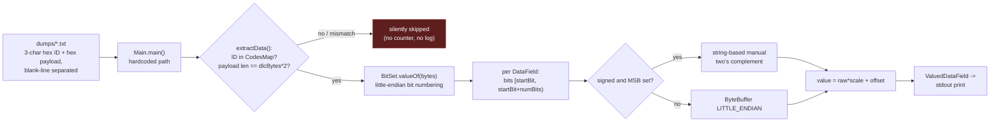
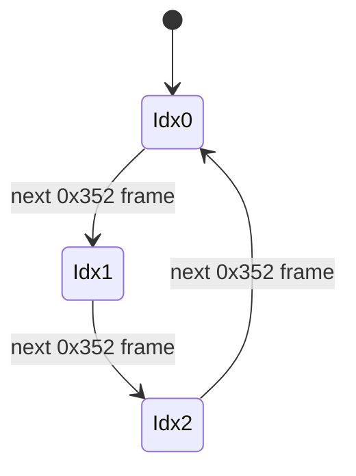

# SlipknotTN-Tesla_CanBus_Reader

## 1. Provenance

- Submodule path: `legacy/SlipknotTN-Tesla_CanBus_Reader`
- Pinned gitlink (canonical form from `git ls-files -s`): `160000 511c2b75d374700c6f028435f616544c58a2b63d 0`
- `git -C legacy/SlipknotTN-Tesla_CanBus_Reader rev-parse HEAD` → `511c2b75d374700c6f028435f616544c58a2b63d` (matches gitlink; `status --porcelain` empty)
- Upstream URL: `https://github.com/SlipknotTN/Tesla_CanBus_Reader`
- License: MIT (`LICENSE:1-3`, "Copyright (c) 2022 Michele Toni")
- Analysis date: 2026-11-21
- Replace mode: this doc replaces the prior summary in place. The YAML frontmatter above is preserved byte-for-byte (index blob is LF, `git ls-files --eol` → `i/lf`; the description line ends mid-sentence at "text log fi" in the original and is kept as-is — it carries no trailing whitespace, so nothing was stripped). The prior doc contained no `## Upstream (...)` sections, so there was nothing else to preserve; the replaced text remains in git history and is cited below as `git show HEAD:docs/legacy/SlipknotTN-Tesla_CanBus_Reader.md#<line>`.

Files read, FULL-READ (every line):

- `src/com/slipi/Main.java:1-51` — entry point, hardcoded input path
- `src/com/slipi/core/Code.java:1-19` — CAN message record
- `src/com/slipi/core/CodesMap.java:1-115` — the signal map (7 frames, plus commented 0x273 DBC)
- `src/com/slipi/core/DataDecodingUtils.java:1-152` — parser and bit-field decoder
- `src/com/slipi/core/DataField.java:1-53` — signal definition record
- `src/com/slipi/core/DataKeyEnumOBD.java:1-69` — 64 signal-name enum constants
- `src/com/slipi/core/ValuedDataField.java:1-21` — decoded-value record
- `LICENSE:1-21`, `.gitignore:1-9`, `ReadCanBus.iml:1-11`

Files read, STRUCTURAL-PARSE (census over every line programmatically; byte-level claims limited to the samples cited in sections 5, 7, 11): the 10 `dumps/*.txt` files, 823,335 frames total (per-file counts in section 3). The dumps are the repo's own captures and are the CAPTURE evidence used throughout this document.

Files explicitly NOT read: `.idea/.gitignore`, `.idea/codeStyles/codeStyleConfig.xml`, `.idea/misc.xml`, `.idea/modules.xml`, `.idea/uiDesigner.xml`, `.idea/vcs.xml` (IDE metadata, no protocol content).

No TEST-READ evidence exists: this repo ships no tests (negative anchor in section 16). CAPTURE evidence exists: the repo ships its own vehicle logs, re-decoded for this analysis with the same little-endian bit arithmetic the upstream code uses (`DataDecodingUtils.java:55-84`).

## 2. Executive verdict

An offline Java notebook — not firmware: it reads hardcoded text dumps (`Main.java:24-29`) of 3-char-hex-ID + hex-payload lines, looks up 7 CAN IDs in a hand-written signal map, and prints little-endian bit-field decodes to stdout. No build system (IntelliJ `.iml` only), no tests, no README, no live CAN, no checksum handling, no mutation or injection anywhere. Its value is twofold: the byte-level signal definitions in `CodesMap.java` (with the author's key discovery that the UI SOC moved from 0x292 to 0x352 mux index 2 after firmware 2024.20), and the 823,335-frame capture corpus spanning 2022→2025 that allows capture-grade arbitration. Re-decoding that corpus against both upstream's layouts and ours produces the headline finding: upstream's 0x118 gear/drive-state/pedal and 0x352 energy layouts hold up under capture, while our shipping decoders for the same frames (`decodeGearState`, `decodeAccelPedal` read counter bytes; 0x352 decodes are byte-order-inverted) do not, and our `decodeVehicleSpeed` reads nonzero at standstill. Adaptation candidates (capture-first, per `docs/checklists/can-review-checklist.md`): the 0x118 bit relocation, the 0x352 LE byte order plus missing mux-2 UI SOC branch, and the 0x257 speed relocation to bits 24-32. Never port: the string-manipulation decode helpers; nothing here touches live buses, so there is no injection or bus-management machinery to evaluate.

## 3. Evidence map

| source file | lines | what it proves | grade |
| --- | --- | --- | --- |
| `src/com/slipi/Main.java` | 18-50 | entry point; hardcoded dump path; per-line decode loop; stdout printing; IOException → printStackTrace | CODE-READ |
| `src/com/slipi/Main.java` | 3 | signal definitions trace to an external Google Docs sheet (content unverifiable) | CODE-READ |
| `src/com/slipi/core/CodesMap.java` | 13-17 | 0x1D8: torque request bits 8-20, torque bits 21-33, signed, scale 0.222 | CODE-READ |
| `src/com/slipi/core/CodesMap.java` | 19-27 | 0x118: driveState bits 16-18, brake bits 19-20, gear bits 21-23, pedal bits 32-39 scale 0.4 | CODE-READ |
| `src/com/slipi/core/CodesMap.java` | 29-33 | 0x257: signedSpeed bits 12-23 scale 0.08 offset −40, uiSpeed bits 24-32, mph flag bit 33 | CODE-READ |
| `src/com/slipi/core/CodesMap.java` | 35-42 | 0x292: five 10-bit SoC fields at bits 0/10/20/30/40, scale 0.1 | CODE-READ |
| `src/com/slipi/core/CodesMap.java` | 44-49 | 0x293: steering mode bits 0-1, traction mode bits 2-4 (declared, never captured) | CODE-READ |
| `src/com/slipi/core/CodesMap.java` | 51-65 | 0x352: 2-bit index at bits 0-1; energy fields at bits 16/32/48 scale 0.02; fullyCharged bit 15; UI SOC bits 53-62 scale 0.1 (index 2, "after 2024.20") | CODE-READ |
| `src/com/slipi/core/CodesMap.java` | 67-69 | 0x3B6: DLC 4, odometer bits 0-31 LE, scale 0.001 km | CODE-READ |
| `src/com/slipi/core/CodesMap.java` | 74-113 | commented DBC for 0x273 UI_vehicleControl, 39 `SG_` entries (structure only, never parsed) | CODE-READ |
| `src/com/slipi/core/DataDecodingUtils.java` | 44-52 | line format = 3-char ID + hex data; unknown IDs and DLC mismatches silently skipped | CODE-READ |
| `src/com/slipi/core/DataDecodingUtils.java` | 55-84 | `BitSet.valueOf` little-endian numbering; field bits `[startBit, startBit+numBits)`; LE ByteBuffer decode; padding to 4 bytes | CODE-READ |
| `src/com/slipi/core/DataDecodingUtils.java` | 90-114 | signed handling: string-based manual two's complement; `signed` flag is used here, contradicting its own field comment | CODE-READ |
| `src/com/slipi/core/DataDecodingUtils.java` | 24-42 | `hexToBin` defined but never called (dead code) | CODE-READ |
| `src/com/slipi/core/DataField.java` | 9-10 | field comment says `signed` "Not used currently" — stale, contradicted by `DataDecodingUtils.java:90` | CODE-READ |
| `src/com/slipi/core/DataKeyEnumOBD.java` | 5-68 | 64 enum constants; only 23 are wired into `CodesMap` | CODE-READ |
| `dumps/RawLog 2025-03-03 00-08-58 - long drive with beams.txt` | 283,774 frames / 88 IDs | 0x257 uiSpeed bits 24-32 reads 0-78 with 1,737 zero-speed frames; our BE speed formula reads nonzero at all 1,737; 0x118 gear bits 21-23 constant 4 while b0/b1 behave as rolling counters | CAPTURE |
| `dumps/RawLog 2023-06-17 12-38-16 - OLD - accel - slowdown.txt` | 11,643 frames / 39 IDs | pedal bits 32-39 scale 0.4 oscillates 0-50.4% matching the accel-slowdown scenario; brake bits 19-20 constant 2 | CAPTURE |
| `dumps/RawLog 2025-02-22 12-59-12 - battery - charging - 36.txt` (+ 4 sibling battery logs) | 1,376-14,735 frames each | 0x352 index 2 UI SOC = 35.6/42.3/78.9/80.0/79.8 matching filenames "...- 36/- 42/charging 78/to 80/drive - 80"; index 0 nominal full pack = 72.98/72.82 kWh in LE byte order | CAPTURE |
| `dumps/RawLog 2022-03-19 18-59-28 - OLD.txt` | 386,674 frames / 89 IDs | 2022-era frames: 0x3B6 was 4-byte DLC; 0x292 bits 0-9 unstable across adjacent frames (b0 low bits flip as a counter); odometer LE ×0.001 = 3,867.4 km | CAPTURE |
| `dumps/*` (all 10) | 823,335 frames total | 0x293 appears in zero frames; 0x257 signedSpeed bits 12-23 never yields a plausible speed in any era; 2025-era 0x3B6 frames are 8-byte and are dropped by the shipped DLC-4 gate | CAPTURE |

Reading-coverage labels: all Java sources, LICENSE, `.gitignore`, `ReadCanBus.iml` are FULL-READ; all 10 dumps are STRUCTURAL-PARSE (every line censused by script, byte-level claims only from the samples cited); `.idea/*` are unread. Our-side files read for the parity matrix are cited per-row in section 11.

## 4. Architecture and build surface

- Entry point: `Main.main()` (`Main.java:18-51`). No CLI arguments — the input file is a hardcoded literal with four commented-out alternatives (`Main.java:24-29`); "selecting an input" means editing source.
- Build surface: none. No Maven/Gradle/pom; it is an IntelliJ module (`ReadCanBus.iml:1-11`, `.idea/`). No build flags, no feature gating, no platform port, no dependency beyond the JDK.
- Shared core vs port: single-process desktop tool; `core/` holds the map+decode records, `Main.java` is the only consumer.
- No frame mutation, no TX, no checksum or counter validation anywhere (negative anchors in section 16). The pipeline is read-decode-print:



## 5. Mechanism catalogue

### M1 — Offline log-frame ingestion and DLC gate

- **Claim (README / summary):** prior doc: "reads log files line by line and decodes them" (`git show HEAD:docs/legacy/SlipknotTN-Tesla_CanBus_Reader.md#37`) — accurate but omits the hardcoded path and the silent drops.
- **Code path:** `Main.java:30-45` — `reader.readLine()` → `DataDecodingUtils.extractData()` (`DataDecodingUtils.java:44`) → prefix split (`line.substring(0,3)` at `DataDecodingUtils.java:47`) → `codesMap.containsKey` + DLC gate (`DataDecodingUtils.java:49-52`).
- **Frame spec:** line = 3 uppercase hex chars of CAN ID + `2*DLC` hex chars; blank lines separate frames (skipped by `line.length() > 3` at `DataDecodingUtils.java:46`). IDs ≤ 0x7FF fit the 3-char prefix.
- **Gates and timing:** DLC must equal `codeObj.dlcBytes * 2` (`DataDecodingUtils.java:52`); any mismatch or unknown ID is silently dropped. No timing — offline.
- **State machine:** None found (stateless per-line decode).
- **Tests:** None found — repo ships no tests.
- **Evidence grade:** CODE-READ, plus CAPTURE for the drop behavior (2025-era 0x3B6: 255 of 262 frames in the long-drive dump have 16-char payloads and are all dropped by the DLC-4 gate).
- **Verdict:** CONFIRMED.
- **Adapt to TeslaCANModder?** no impact — we have our own live pipeline (`firmware/lib/core/can/`, `firmware/lib/vehicle/can/handler/`); the silent-drop pattern itself is a do-not-copy (section 14).

### M2 — Little-endian bit-field extraction with manual two's complement

- **Claim (README / summary):** prior doc: "hex-to-bytes, bit extraction via BitSet, two's complement for signed values, scale/offset application" (`git show HEAD:docs/legacy/SlipknotTN-Tesla_CanBus_Reader.md#39`) — confirmed.
- **Code path:** `DataDecodingUtils.java:53-84` — `hexStringToByteArray` → `BitSet.valueOf` (LE numbering) → `bitsMsg.get(startBit, startBit+numBits)` → `Arrays.copyOf(..., Integer.BYTES)` + `ByteBuffer LITTLE_ENDIAN.getInt` → signed branch `DataDecodingUtils.java:90-114`.
- **Frame spec:** bit 0 = byte 0 LSB; field value is LSB-first. Signed fields: MSB set → subtract 1, flip bits via string ops, negate (`DataDecodingUtils.java:93-109`); else plain LE int.
- **Gates and timing:** `BufferUnderflowException` catch at `DataDecodingUtils.java:139-141` is effectively unreachable because of the 4-byte pad at `DataDecodingUtils.java:80`.
- **State machine:** None found.
- **Tests:** None found.
- **Evidence grade:** CODE-READ; the LE convention is also CAPTURE-corroborated (my re-decode of the dumps reproduces plausible values only in LE).
- **Verdict:** CONFIRMED (behavior correct; implementation style is do-not-copy).
- **Adapt to TeslaCANModder?** no impact — our decode helpers already extract LE fields correctly where they choose the right bits (e.g. `decodeBmsSoc`).

### M3 — 0x118 DI_state: drive state, brake, gear, pedal

- **Claim (README / summary):** prior doc: "Drive state, brake press, gear (P/R/N/D), accelerator pedal %" (`git show HEAD:docs/legacy/SlipknotTN-Tesla_CanBus_Reader.md#52`).
- **Code path:** `CodesMap.java:19-27` → `DataDecodingUtils.extractData` per-field extract.
- **Frame spec:** DLC 8. driveState bits 16-18 (values per `CodesMap.java:20`: 0-idle, 1-charge, 2-park, 5-driving); brake bits 19-20; gear bits 21-23 (per `CodesMap.java:24`: 1-park, 2-reverse, 3-neutral, 4-drive, 7-idle); pedal bits 32-39, scale 0.4, unit %.
- **Gates and timing:** none — offline.
- **State machine:** None found.
- **Tests:** None found.
- **Evidence grade:** CODE-READ + CAPTURE. In the 2023 accel dump (1,126 frames) and the 2025 long-drive dump (25,960 frames), gear bits 21-23 read 4 and driveState 5 in every sampled moving frame, while byte 0 and byte 1 increment as rolling counters; pedal bits 32-39 ×0.4 oscillate 0-50.4% matching the accel-slowdown scenario; brake reads a constant 2, matching the author's own note "Always 2.0, not useful" (`CodesMap.java:22-23`).
- **Verdict:** CONFIRMED (capture confirms upstream; it also contradicts our shipping decode — see section 11 rows 2-4).
- **Adapt to TeslaCANModder?** candidate for future PR (top priority) — see section 13.

### M4 — 0x257 speedometer family

- **Claim (README / summary):** prior doc: "Signed speed (km/h), UI speed, mph/kph flag" (`git show HEAD:docs/legacy/SlipknotTN-Tesla_CanBus_Reader.md#54`); author comment "Tested: UI speed is the same of the tablet" (`CodesMap.java:28`).
- **Code path:** `CodesMap.java:29-33`.
- **Frame spec:** DLC 8. signedSpeed bits 12-23, 12-bit, scale 0.08, offset −40 km/h; uiSpeed bits 24-32, 9-bit; mph/kph flag bit 33 (1 = km/h).
- **Gates and timing:** none.
- **State machine:** None found.
- **Tests:** None found.
- **Evidence grade:** CODE-READ + CAPTURE, split by field: uiSpeed bits 24-32 is CAPTURE-CONFIRMED (range 0-78 km/h across 12,766 long-drive frames; exactly 0 in 1,737 frames where the car is stationary; flag bit = 1, i.e. km/h). signedSpeed bits 12-23 ×0.08−40 is CAPTURE-CONTRADICTED: it reads −20.5 to −40 in both the 2022 and 2025 dumps, in motion and at rest.
- **Verdict:** PARTIAL — uiSpeed confirmed, signedSpeed contradicted (stale layout or different generation; the author's own comment on the line, "Different formula for mph and kph", hints it was never settled).
- **Adapt to TeslaCANModder?** candidate for future PR — port the uiSpeed layout, never the signedSpeed formula.

### M5 — 0x292 / 0x352 SoC and energy (the 2024.20 migration)

- **Claim (README / summary):** prior doc: "SOC calculation changed after firmware 2024.20 (from 0x292 to 0x352 index 2)" (`git show HEAD:docs/legacy/SlipknotTN-Tesla_CanBus_Reader.md#74`); code comments: "Correct SOC level before 2024.20" (`CodesMap.java:36`) and "Valid only with index 2, this is the correct SOC level after 2024.20" (`CodesMap.java:63`).
- **Code path:** `CodesMap.java:35-42` (0x292) and `CodesMap.java:51-65` (0x352) → per-field extract.
- **Frame spec:** 0x292 DLC 8: uiSoc bits 0-9, min bits 10-19, max bits 20-29, avg bits 30-39, fullPackWhenNew bits 40-49, all scale 0.1. 0x352 DLC 8: index bits 0-1 (mux); nominal-or-double-buffer bits 16-31 and nominalRemaining bits 32-47 and idealRemaining bits 48-63, scale 0.02 kWh (index-dependent per `CodesMap.java:53-60`); fullyCharged bit 15 (index 1); uiSoc bits 53-62, scale 0.1 % (index 2).
- **Gates and timing:** the repo never branches on the index — TODO at `CodesMap.java:50` ("Manage the ENERGY_STATUS_INDEX before returning the value"); it decodes the overlapping fields unconditionally.
- **State machine:** None found in the repo. The sender-side mux rotation is visible in capture and reconstructed here (0→1→2 per frame period):



- **Tests:** None found.
- **Evidence grade:** CODE-READ + CAPTURE. The post-2024.20 half is CAPTURE-CONFIRMED: 0x352 index-2 uiSoc decodes to 35.6 / 42.3 / 78.9 / 80.0 / 79.8 in the five 2025 logs whose filenames read "- 36", "- 42", "charging 78", "charging to 80 until stop", "drive - 80". Index-0 nominal full pack decodes to 72.98 / 72.82 kWh (LE), and remaining/ideal to 28.0-34.24 kWh at those SoCs — all plausible. The pre-2024.20 half ("292 was correct before") is UNVERIFIED: in the 2022 dump, bits 0-9 of 0x292 jump 90.3 → 64.7 between adjacent frames whose byte 0 differs only in its low bits — byte 0's low nibble behaves as a counter, so bits 0-9 are not a stable field even in 2022.
- **Verdict:** PARTIAL — migration target confirmed; migration source unverified.
- **Adapt to TeslaCANModder?** candidate for future PR (top priority) — see section 13.

### M6 — 0x1D8 torque, 0x3B6 odometer, 0x293 steering/traction

- **Claim (README / summary):** prior doc: rear torque (`git show HEAD:docs/legacy/SlipknotTN-Tesla_CanBus_Reader.md#53`), odometer (`#58`), steering/traction (`#56`).
- **Code path:** `CodesMap.java:13-17` (0x1D8), `CodesMap.java:67-69` (0x3B6), `CodesMap.java:44-49` (0x293).
- **Frame spec:** 0x1D8 DLC 8: torqueRequest bits 8-20 signed, rearTorque bits 21-33 signed, both scale 0.222 Nm. 0x3B6 DLC 4 per the map: odometer bits 0-31 LE, scale 0.001 km. 0x293 DLC 8: steeringMode bits 0-1 (0-comfort, 1-standard, 2-sport), tractionMode bits 2-4 (0-normal, 1-slippery).
- **Gates and timing:** none.
- **State machine:** None found.
- **Tests:** None found.
- **Evidence grade:** mixed. 0x1D8 torqueRequest: CODE-READ + CAPTURE-PLAUSIBLE (max 113.4 Nm over 25,544 long-drive frames; 0 at rest) — rearTorque bits 21-33 UNVERIFIED (reads 0 in the 2025 samples and 0x7FF-pattern filler 454.4 Nm in 2022, i.e. all-ones). 0x3B6: CODE-READ + CAPTURE (odometer 3,867.4 km in 2022 4-byte frames; 52,225.3 km in 2025 8-byte frames, LE ×0.001 — but the shipped DLC-4 gate drops every 2025 frame). 0x293: CODE-READ only — zero 0x293 frames exist in all 823,335 captured frames.
- **Verdict:** 0x1D8 request PARTIAL; 0x1D8 rear UNVERIFIED; 0x3B6 CONFIRMED with a generation-dependent DLC bug; 0x293 UNVERIFIED.
- **Adapt to TeslaCANModder?** 0x3B6 and 0x1D8-request are low-cost telemetry candidates; 0x293 ignore (no capture backing).

## 6. Summary vs code contradiction table

Only disagreements are listed; agreements (MIT license, offline reader, the 7-frame table, two's complement usage, dumps provenance) are recorded in section 3 instead. Pre-replace citations use `git show HEAD:docs/legacy/SlipknotTN-Tesla_CanBus_Reader.md#<line>`.

| prior-doc claim | code/capture evidence | contradiction |
| --- | --- | --- |
| "decodes specific signals (speed, SOC, torque, gear, pedal position, energy stats, temperatures, etc.)" (`git show HEAD:docs/legacy/SlipknotTN-Tesla_CanBus_Reader.md#15`) | No temperature signal is wired anywhere: `CodesMap.java:9-114` defines 23 fields, none thermal; `COOLANT_TEMP_*`/`AMBIENT_*` exist only as unwired enum names (`DataKeyEnumOBD.java:41-44`) | CONTRADICTED — "temperatures" is not decoded by this repo |
| "Enum of all decoded signal names (65+ signals)" (`git show HEAD:...md#41`) | `DataKeyEnumOBD.java:5-68` declares exactly 64 constants; only 23 are referenced by `CodesMap.java` | CONTRADICTED — count is 64, and 41 of them are never decoded |
| "commented DBC-style signal definitions ... with 40+ signals" for 0x273 (`git show HEAD:...md#60`) | The comment block `CodesMap.java:75-113` contains exactly 39 `SG_` entries | CONTRADICTED — 39, not "40+" |
| "SOC calculation changed after firmware 2024.20 (from 0x292 to 0x352 index 2)" (`git show HEAD:...md#74`) | Post-half CONFIRMED by capture (section 5, M5); but "from 0x292 bits 0-9" is undermined: even in the 2022 dump, adjacent frames flip that field via byte-0 counter bits (90.3 → 64.7) | PARTIAL — target confirmed, source field UNVERIFIED |
| frontmatter description truncated mid-sentence ("...from text log fi", frontmatter line 3) | inherited defect of the replaced doc; preserved byte-for-byte per replace-mode rules | recorded, not corrected |
| in-code: `DataField.signed` — "Not used currently" (`DataField.java:9-10`) | `DataDecodingUtils.java:90` branches on `dataField.signed` for both 0x1D8 fields | stale comment contradicted by its own consumer |
| prior doc implies 0x293 is decoded and available (`git show HEAD:...md#56`) | `CodesMap.java:44-49` declares it, but 0 frames of 0x293 exist in any of the 10 dumps (823,335 frames) | overstatement — never exercised by the author's own captures |

## 7. CAN frame and signal inventory

One row per frame the repo decodes. Bus is not recorded anywhere in the logs; periods cannot be derived (dumps carry no timestamps). Counter/checksum columns describe what the repo models. Read/write: every row is read-only — this repo never mutates or injects frames.

| ID (hex+dec) | bus | period | DLC | byte/bit layout (little-endian bit numbering) | scale/units | counter | checksum | R/W | grade |
| --- | --- | --- | --- | --- | --- | --- | --- | --- | --- |
| 0x1D8 (472) | not recorded | None found | 8 | torqueReq bits 8-20 (13b signed); rearTorque bits 21-33 (13b signed) | ×0.222 Nm | not modeled | not validated | R | CODE-READ + CAPTURE (request: max 113.4 Nm in 25,544 frames; rear: filler-dominated) |
| 0x118 (280) | not recorded | None found | 8 | driveState bits 16-18; brake bits 19-20; gear bits 21-23; pedal bits 32-39 | pedal ×0.4 %; others enum | b0/b1 behave as rolling counters (capture) — not modeled by repo | not validated | R | CODE-READ + CAPTURE (gear=4, driveState=5 constant in 27,086 moving frames across 2023+2025) |
| 0x257 (599) | not recorded | None found | 8 | signedSpeed bits 12-23 (12b); uiSpeed bits 24-32 (9b); mphFlag bit 33 | signed ×0.08 −40 km/h; uiSpeed km/h or mph per flag; flag 1=km/h | not modeled | not validated | R | CODE-READ + CAPTURE (uiSpeed 0-78, zero at 1,737 stationary frames; signedSpeed contradicted) |
| 0x292 (658) | not recorded | None found | 8 | uiSoc bits 0-9; min bits 10-19; max bits 20-29; avg bits 30-39; fullPack bits 40-49 | ×0.1 %, kWh | b0 low nibble behaves as counter (capture) — not modeled | not validated | R | CODE-READ + CAPTURE (bits 0-9 unstable in 2022, implausible in 2025; bits 10-19 stable and SOC-like) |
| 0x293 (659) | not recorded | None found | 8 | steeringMode bits 0-1; tractionMode bits 2-4 | enum (0/1/2; 0/1) | not modeled | not validated | R | CODE-READ (0 frames in all captures) |
| 0x352 (850) | not recorded | None found | 8 | index bits 0-1 (mux); nominalOrBuffer bits 16-31; nominalRemaining bits 32-47; idealRemaining bits 48-63; fullyCharged bit 15 (idx 1); uiSoc bits 53-62 (idx 2) | energy ×0.02 kWh; uiSoc ×0.1 % | sender cycles index 0→1→2 (capture) | not validated | R | CODE-READ + CAPTURE (idx-2 uiSoc matches five filenames; idx-0 nominal 72.98/72.82 kWh LE) |
| 0x3B6 (950) | not recorded | None found | 4 (map) — actual 2025 frames are 8 | odometer bits 0-31 (32b LE) | ×0.001 km | 2025 8-byte variant carries a bytes 4-7 tail (suspected counter/checksum, UNVERIFIED) | not validated | R | CODE-READ + CAPTURE (3,867.4 km @2022 4-byte; 52,225.3 km @2025 8-byte; 2025 frames dropped by the DLC-4 gate) |
| 0x273 (627) | n/a | n/a | 8 | 39 `SG_` definitions inside a `/* */` comment — `UI_vehicleControl` bit layout (accessory bit 0, lockRequest bits 17-19, powerOff bit 31, displayBrightness bits 32-39 ×0.5, seatHeat bits 42-51, wiperRequest bits 56-58, driveStateRequest bit 62, ...) | mixed | n/a | n/a | n/a (comment only, never parsed) | CODE-READ (STRUCTURAL-PARSE of the comment block; never executed) |

## 8. Constants and tuning table

| constant | value | file:line | meaning | grade |
| --- | --- | --- | --- | --- |
| torque scale | 0.222 | `CodesMap.java:14,16` | Nm per bit for both 0x1D8 torque fields | CODE-READ; CAPTURE-plausible (request max 113.4 Nm) |
| speed scale/offset | 0.08 / −40 | `CodesMap.java:30` | signedSpeed bits 12-23 formula | CODE-READ; CAPTURE-CONTRADICTED (reads −20..−40 in motion, both eras) |
| pedal scale | 0.4 | `CodesMap.java:26` | 8-bit pedal field → percent (0-102) | CODE-READ + CAPTURE (0-50.4% during accel-slowdown) |
| SoC scale | 0.1 | `CodesMap.java:37-41,64` | all 10-bit SoC/energy-count fields | CODE-READ + CAPTURE (idx-2 UI SOC confirmed) |
| energy scale | 0.02 | `CodesMap.java:56-60` | 16-bit kWh fields on 0x352 | CODE-READ + CAPTURE (nominal full pack 72.98/72.82 kWh in LE) |
| odometer scale | 0.001 | `CodesMap.java:68` | km per raw unit | CODE-READ + CAPTURE (both eras) |
| 0x3B6 dlcBytes | 4 | `CodesMap.java:67` | expected payload hex chars = 8 | CODE-READ; CAPTURE-CONTRADICTED for 2025 frames (16 chars → silent drop of 255/262 frames) |
| DLC gate | `msgHexStr.length() == codeObj.dlcBytes * 2` | `DataDecodingUtils.java:52` | the only frame-acceptance test | CODE-READ |
| minimum line length | `line.length() > 3` | `DataDecodingUtils.java:46` | silently skips short/blank lines | CODE-READ |
| gear bit position | 21 (3 bits) | `CodesMap.java:25` | gear field on 0x118 | CODE-READ + CAPTURE (constant 4 in motion) |
| driveState bit position | 16 (3 bits) | `CodesMap.java:21` | 0-idle, 1-charge, 2-park, 5-driving | CODE-READ + CAPTURE (5 in motion) |
| pedal bit position | 32 (8 bits) | `CodesMap.java:26` | pedal field on 0x118 | CODE-READ + CAPTURE |
| uiSoc-352 bit position | 53 (10 bits) | `CodesMap.java:64` | post-2024.20 UI SOC, index 2 | CODE-READ + CAPTURE |
| energy index bits | 0-1 | `CodesMap.java:52` | 0x352 mux selector, observed values 0/1/2 | CODE-READ + CAPTURE |
| field padding | `Integer.BYTES` | `DataDecodingUtils.java:80` | pads field bytes to 4 before ByteBuffer decode | CODE-READ |

Trivial constants (print widths, enum ordering) are omitted per the skill.

## 9. Failure modes and edge cases

There is no live bus in this repo, so bus-off, watchdog, OTA, queue-overflow and brownout paths do not exist by design. The actual failure surface is parser robustness, and none of it is tested.

| failure | handling code path | tested? | grade |
| --- | --- | --- | --- |
| DLC mismatch → frame silently dropped, no counter or log | `DataDecodingUtils.java:49-52` | no | CODE-READ + CAPTURE (drops all 255 8-byte 0x3B6 frames in the 2025 long-drive dump; the shipped map never sees a 2025 odometer) |
| Odd-length hex payload → last nibble dropped silently, then DLC reject | `hexStringToByteArray` `DataDecodingUtils.java:14-22` + gate at :52 | no | CODE-READ + CAPTURE (4,279 odd-length lines in the 2022 dump; 2,347 in the 2025 long-drive dump) |
| Unknown CAN ID → silently ignored | `DataDecodingUtils.java:49` | no | CODE-READ (73-82 distinct uncaptured/undecoded IDs per dump era) |
| Line ≤ 3 chars / blank → silently skipped | `DataDecodingUtils.java:46` | no | CODE-READ |
| Top-level IOException → `printStackTrace`, process continues with no summary | `Main.java:47-49` | no | CODE-READ |
| Per-field `BufferUnderflowException` catch | `DataDecodingUtils.java:139-141` | no | CODE-READ; unreachable given the 4-byte pad at :80 — defensive dead branch |
| `hexToBin` string-expansion helper | `DataDecodingUtils.java:24-42` | no | CODE-READ; dead code (definition-only anchor) — the sequential `replaceAll` chain is functionally correct but O(n) string churn; never call it from anything ported |
| Debug bit-string leading zero | `DataDecodingUtils.java:58-61` | no | CODE-READ; `BitSet.length()` is the index past the highest set bit, so `msgBinStr` gains one extra leading "0" — debug output only |

## 10. Test coverage map

None found: this repo ships no tests (no JUnit, no test sources; negative anchor in section 16). Critical paths with no test, and the risk in one line each:

- DLC gate — risk: exactly the shipped 0x3B6 regression (2025 frames silently vanish).
- Signed two's-complement branch — risk: the only signed fields (0x1D8) rely on string arithmetic that was never asserted once.
- Hex parsing edge cases — risk: malformed logger lines exist in every dump and the tool gives no visibility into how many were dropped.
- Signal maps — risk: formula errors ship silently, which is precisely what the capture corpus shows happened to `signedSpeed` and rearTorque.

## 11. Parity matrix with TeslaCANModder

Every row has a our-side CODE-READ citation (our-side files read in full or in the cited ranges: `firmware/lib/vehicle/can/feature/telemetry/powertrain.h:1-111`, `.../telemetry/bms.h:1-585`, `firmware/lib/vehicle/can/handler/bus/vehicle.h:190-393`, `firmware/lib/vehicle/can/feature/misc/can_sim.h:70-109`, `firmware/lib/vehicle/can/feature/comfort/seat.h:20-74`, `firmware/test/test_native_powertrain/test_powertrain.cpp` grep lines 21-81, plus grep anchors for `ids.h`, `das_drive.h`, `dispatch.h`, `routes.h`). "Ours contradicted by capture" below means: re-decoding the upstream dumps with our shipped formulas yields impossible values.

| signal/frame | upstream decode (cite) | our decode (cite) | delta | action |
| --- | --- | --- | --- | --- |
| 0x257 speed | uiSpeed bits 24-32, CAPTURE-CONFIRMED 0-78 km/h; signedSpeed bits 12-23 ×0.08−40 CONTRADICTED (`CodesMap.java:30-32`) | `(data[2]<<8)\|data[3]` signed ×0.01 (`powertrain.h:18-22`), dispatched at `vehicle.h:381-386`, fed by `can_sim.h:78-84`, consumed by `das_drive.h:453` | ours reads nonzero at 1,737/1,737 zero-speed frames and repeats raw 0x1F00 for 1,682 frames — capture-contradicted | capture-first (bench listen-only), then fix; DAS-drive speed governor depends on it |
| 0x118 gear | bits 21-23, value 4 = D constant in 27,086 moving frames (`CodesMap.java:25`) | `(data[0]>>1)&7` (`powertrain.h:29-32`) | ours reads byte 0, which increments as a rolling counter in captures — gear flaps 0-7 | fix; re-point `apGateParked` (`vehicle.h:393`) after capture |
| 0x118 pedal | bits 32-39 ×0.4, oscillates 0-50.4% in accel dump (`CodesMap.java:26`) | `data[1]` raw 0-100 (`powertrain.h:39-42`) | ours reads byte 1, also a counter byte in captures | fix after capture |
| 0x118 brake | bits 19-20 (`CodesMap.java:23`) | bits 19-20 (`powertrain.h:49-52`) | identical layout; capture reads constant 2 (author: "not useful") | ignore |
| 0x118 driveState | bits 16-18, 5 = driving (`CodesMap.java:21`) | not decoded | gap; cheap diagnostic | candidate (low value) |
| 0x292 SoC bits 0-9 | "correct SOC before 2024.20" (`CodesMap.java:37`) | same bits ×0.1 (`bms.h:50-54`, dispatched `vehicle.h:87`) | both share the field; capture: counter-corrupted in 2022, implausible in 2025 (77.7/9.7 vs true 35.6/42.3) | capture-first; prefer 0x352 idx-2 on modern firmware |
| 0x292 bits 10-19 | MIN_SOC (`CodesMap.java:38`) | labeled "UI SoC" (`bms.h:191-195`) | label conflict; capture: stable and SOC-like (92.9 in 2022; 38.6/47.2 vs true 35.6/42.3 in 2025) | capture-first; relabel or switch source |
| 0x352 mux index | bits 0-1, values 0/1/2, sender cycles 0→1→2 (`CodesMap.java:52`) | `f.data[0] & 0x0F` with branches for mux 0 and 1 only (`vehicle.h:207-226`; anchor `mux == 2` → no hits) | missing mux-2 branch = we never read the post-2024.20 UI SOC | fix (top candidate) |
| 0x352 nominal full pack | bits 16-31 LE ×0.02, 72.98/72.82 kWh (`CodesMap.java:56`) | `(data[2]<<8)\|data[3]` BE ×0.02 (`bms.h:92-96`) | byte order inverted; ours reads 333.08/292.12 kWh on the same frames — capture-contradicted | fix (top candidate); same inversion applies to `bms.h:103-107,114-118` |
| 0x352 UI SOC (post-2024.20) | idx 2, bits 53-62 ×0.1, matches all five filenames (`CodesMap.java:63-64`) | not decoded | gap on the modern-SOC source | fix (top candidate) |
| 0x1D8 torque request | bits 8-20 signed ×0.222, max 113.4 Nm (`CodesMap.java:14`) | not decoded (`0x1D8` absent from `firmware/lib` — negative anchor) | gap; telemetry only, read-only | candidate |
| 0x3B6 odometer | bits 0-31 LE ×0.001, 3,867.4 km @2022 and 52,225.3 km @2025 (`CodesMap.java:67-68`) | not decoded (absent — negative anchor) | gap; note DLC grew 4→8 across generations | candidate |
| 0x273 UI_vehicleControl bits | 39 `SG_` entries in a comment (`CodesMap.java:74-113`) | our builders agree bit-for-bit: seat heat bits 42-51 via masks 0x0C/0x30/0xC0 (`seat.h:28-68`), summon/power/mirror/wiper in `summon.h:14-44`, `power.h`, `mirror.h`, `wiper.h` | layouts agree — independent corroboration of our command bit positions | ignore (validation only; nothing to port) |
| 0x293 steering/traction | bits 0-1 / 2-4 (`CodesMap.java:46-48`) | not decoded | gap, but upstream itself has zero captured 0x293 frames | ignore (no capture backing on either side) |

Note on our-side test coverage: `test_powertrain.cpp:21-81` asserts our gear/pedal/speed decodes against synthetic frames written in our own layout, and `can_sim.h:78-91` generates 0x257/0x118 in that same layout — the oracle validates our assumption, not the vehicle. TEST-READ of those lines is what elevates this from suspicion to documented self-feed.

## 12. Surface inventory and security notes

Transport surfaces:

- File input: one hardcoded path per run (`Main.java:24-29`); no globbing, no CLI.
- Output: stdout print per decoded field (`Main.java:34-38`); the `logOutputStream` parameter of `extractData` (`DataDecodingUtils.java:44,135-137`) is dead — `Main.java:32` always passes `null`.
- No serial, BLE, network, or any other surface exists in this repo.

Provenance/security findings:

- No credentials, keys, certificates, archives, or dangerous build flags — None found.
- Signal definitions are attributed to an external Google Docs document (`Main.java:3`) — content not archived in the repo and not verifiable (UNVERIFIED, listed in section 17).
- `.idea/` IDE metadata and `ReadCanBus.iml` are committed — hygiene note only.
- The dumps contain no VINs, tokens, or location data (bare hex lines; only filenames reveal dates/scenarios).

## 13. Adaptation assessment

| mechanism | value | cost | risk | evidence | decision |
| --- | --- | --- | --- | --- | --- |
| 0x118 gear/pedal bit relocation (M3) | high — fixes `gearState`/`accelPedal` feeding `powertrain` JSON (`dispatch.h:754-756`, `routes.h:131-133`) and the AP injection gate (`vehicle.h:393`) | low — two bit masks in `powertrain.h` | medium — touches `apGateParked` semantics; requires `docs/checklists/can-review-checklist.md` and a listen-only bench capture first | CAPTURE + CODE-READ + our-side TEST-READ of the self-feed | candidate for future PR (top) |
| 0x352 LE byte order + mux-2 UI SOC (M5) | high — fixes absurd kWh readouts on modern cars and adds the post-2024.20 UI SOC | low — swap byte order in `bms.h:92-118`, add an idx-2 branch in `vehicle.h:207-226` | medium — enhanced-BMS consumers in status JSON; capture-first | CAPTURE + CODE-READ | candidate for future PR (top) |
| 0x257 speed relocation to bits 24-32 (M4) | high — `vehicleSpeed` feeds the DAS drive governor (`das_drive.h:453`) | low | high — safety-adjacent consumer; must be arbitrated on our own bench hardware, not only on this repo's one-vehicle corpus | CAPTURE (corpus) — our-vehicle confirmation missing | candidate for future PR — capture-first, port uiSpeed layout, never the signedSpeed formula |
| 0x1D8 torque request (M6) | medium — richer drive telemetry (read-only) | low — one decoder + one `types.h` field | low | CAPTURE-PLAUSIBLE (max 113.4 Nm) + CODE-READ | candidate |
| 0x3B6 odometer (M6) | medium — read-only odometer telemetry | low | low — must handle DLC 4 and 8 variants | CAPTURE (both eras) + CODE-READ | candidate |
| 0x118 driveState (M3) | low — diagnostic only | low | low | CAPTURE | candidate (low) |
| 0x293 steering/traction (M6) | low | low | low | CODE-READ only — zero frames in upstream's own captures | ignore |
| 0x273 commented DBC (M1/M3 context) | validation of our existing command builders | none | none | CODE-READ of the comment + our CODE-READ | already present (no port; keep as cross-reference) |
| parser/bit-utils (M1, M2) | none for us — we have a live pipeline and clean decoders | n/a | n/a | CODE-READ | no impact |

Any accepted row above is a behavior port with independent implementation and an independent test oracle (recompute from captures, not from our own generator), per the no-copy rules in section 14.

## 14. Do-not-copy list

- `DataDecodingUtils.java:24-42` — `hexToBin`: dead code; per-digit sequential `replaceAll` string churn. Reimplement bit rendering with arithmetic if ever needed.
- `DataDecodingUtils.java:93-109` — manual two's complement via `Integer.parseUnsignedInt`/`toBinaryString`/string flipping. Port the behavior (subtract-and-invert on integers), never this implementation.
- `DataDecodingUtils.java:58-61` — `msgBigEndianBits` builder starts at `bitsMsg.length()` (one past the highest set bit), producing a debug string with one extra leading zero and non-constant width.
- `Main.java:24-29` — hardcoded input path with commented-out alternatives as the "CLI" pattern.
- `DataDecodingUtils.java:49-52` combined with the DLC table — the silent-drop parser pattern: no dropped-frame counter, no log. Our live pipeline must count and report, never silently skip.
- `.idea/` and `ReadCanBus.iml` — committing IDE metadata to a research repo.
- Never import any file from `legacy/` into `firmware/`, `client/`, `packages/`, or `tools/`. Any port writes `derived idea, independent implementation` and attributes the upstream symbol (e.g. "layout after CodesMap UI_SOC_352").

## 15. History and evolution

- The submodule checkout is a shallow clone: `git rev-parse --is-shallow-repository` → `true`, and the local log contains exactly one commit: `511c2b7 New signals to test` (2025-03-03) on `main` (gitlink-pinned). Pre-pin history was NOT reviewed — only the pinned snapshot.
- No README and no changelog exist upstream, so the only in-repo history is structural: dump filenames span 2022-03-19 → 2025-03-03 (the two "OLD" files predate the 2024.20 firmware era), and the 2025-03-03 dumps share their date with the sole commit — the "New signals to test" commit is the author packaging the long-drive captures alongside freshly added map entries.
- What was tried and abandoned, readable from code comments: `signedSpeed` carries the hedge "Different formula for mph and kph" and was never settled (`CodesMap.java:30`); brake is annotated "Always 2.0, not useful" (`CodesMap.java:22-23`); `CodesMap.java:70-72` leave TODOs for 0x382, 0x3E2 and a beams re-test of 0x273 — declared intent, never landed; the ENERGY_STATUS_INDEX handling is a TODO at `CodesMap.java:50`.
- The DLC-4 odometer entry against 2025-era 8-byte frames (`CodesMap.java:67` vs the 2025 captures) is an accidental rollback-by-freeze: the map was correct for the 2022 logs it was written against and was never bumped when the frame grew.
- Network-only claims (GitHub issues/PRs, the commit's upstream ancestry) were not fetched; everything above comes from the local git object and the tree.

## 16. Re-verification recipe

Pinned SHA: `511c2b75d374700c6f028435f616544c58a2b63d` (gitlink `160000 511c2b75d374700c6f028435f616544c58a2b63d 0`). This recipe was written against a shallow clone containing only that commit.

```bash
OLD=511c2b75d374700c6f028435f616544c58a2b63d
git -C legacy/SlipknotTN-Tesla_CanBus_Reader fetch --tags --prune
git -C legacy/SlipknotTN-Tesla_CanBus_Reader log --oneline $OLD..origin/main
git -C legacy/SlipknotTN-Tesla_CanBus_Reader diff --stat $OLD..origin/main
git ls-files -s legacy/SlipknotTN-Tesla_CanBus_Reader   # compare gitlink to rev-parse HEAD
```

Anchor commands below were all run at write time with `grep -nE` semantics (demonstrated via `git grep -n -E`, same ERE); expected hits are pasted. If line numbers drift more than ~10, re-read the whole function; do not trust this document's numbers.

Upstream anchors:

```text
grep -nE '"1D8"|"118"|"257"|"292"|"293"|"352"|"3B6"' src/com/slipi/core/CodesMap.java
  -> 7 hits: lines 13, 19, 29, 35, 44, 51, 67 (this.put entries)
grep -nE '0\.222' src/com/slipi/core/CodesMap.java
  -> 2 hits: lines 14, 16 (torque fields)
grep -nE 'UI_SOC_352\.name\(\), "%", 53, 10' src/com/slipi/core/CodesMap.java
  -> 1 hit: line 64 (post-2024.20 UI SOC layout)
grep -nE 'line\.substring\(0, 3\)' src/com/slipi/core/DataDecodingUtils.java
  -> 1 hit: line 47 (3-char ID prefix)
grep -nE 'msgHexStr\.length\(\) == codeObj\.dlcBytes \* 2' src/com/slipi/core/DataDecodingUtils.java
  -> 1 hit: line 52 (DLC gate)
grep -nE 'new Code\("Odometer", 4' src/com/slipi/core/CodesMap.java
  -> 1 hit: line 67 (DLC-4 odometer — the 2025 silent-drop bug anchor)
grep -nE '2024\.20' src/com/slipi/core/CodesMap.java
  -> 2 hits: lines 36, 63 (SOC migration comments)
grep -nE 'docs\.google\.com' src/com/slipi/Main.java
  -> 1 hit: line 3 (external signal reference)
grep -nE 'BufferUnderflowException' src/com/slipi/core/DataDecodingUtils.java
  -> 2 hits: lines 5, 139
grep -nE 'hexToBin\(' src/com/slipi/core/DataDecodingUtils.java
  -> exactly 1 hit: line 24 (definition only — dead code)
```

Upstream negative anchors (absence claims):

```text
grep -rnE 'TEST|assertEquals|junit|org\.junit' src/          -> no output (no tests exist)
grep -rniE 'checksum|CRC' src/                              -> no output (no checksum validation anywhere)
grep -rnE '0xAA|XOR' src/                                   -> no output (no binary framing; pure hex text)
git -C legacy/SlipknotTN-Tesla_CanBus_Reader ls-files        -> no README in the listing
```

Our-side drift anchors (the `fix`/`candidate` decisions above rest on these symbols):

```text
grep -nE 'decodeVehicleSpeed' firmware/lib/vehicle/can/feature/telemetry/powertrain.h
  -> line 18 (definition)
grep -nE 'data\[2\] << 8' firmware/lib/vehicle/can/feature/telemetry/powertrain.h
  -> lines 20, 61 (BE speed bytes 2-3; BE steering)
grep -nE 'decodeGearState|decodeAccelPedal' firmware/lib/vehicle/can/feature/telemetry/powertrain.h
  -> lines 29, 39 (byte-0 gear, byte-1 pedal — the counter-byte reads)
grep -nE 'f\.data\[0\] & 0x0F' firmware/lib/vehicle/can/handler/bus/vehicle.h
  -> lines 209, 231 (0x352/0x332 mux gates)
grep -nE 'mux == 2' firmware/lib/vehicle/can/handler/bus/vehicle.h
  -> no output (0x352 idx-2 branch missing — the post-2024.20 UI SOC gap)
grep -nE 'TEST_ASSERT_FLOAT_WITHIN\(0\.01, 60\.0' firmware/test/test_native_powertrain/test_powertrain.cpp
  -> line 29 (test asserts our own synthetic speed layout)
grep -nE 'big-endian speed' firmware/lib/vehicle/can/feature/misc/can_sim.h
  -> line 82 (simulator feeds our layout — the self-feed loop)
grep -nE 'fabsf\(s\.vehicleSpeed\)' firmware/lib/vehicle/can/feature/das/das_drive.h
  -> line 453 (DAS drive speed governor — safety-relevant consumer)
grep -nE 'apGateParked' firmware/lib/vehicle/can/handler/bus/vehicle.h
  -> line 393 (AP gate keyed on gearState)
grep -nE 'decodeBmsSoc\(|decodeBmsNominalFullPack' firmware/lib/vehicle/can/feature/telemetry/bms.h
  -> lines 50, 92 (0x292 bits 0-9; BE nominal full pack)
grep -nE 'setSeatHeatFL' firmware/lib/vehicle/can/feature/comfort/seat.h
  -> lines 28, 94 (0x273 bits 42-43 builder — agrees with upstream commented DBC)
grep -nE '0x1D8|0x3B6|0x293' firmware/lib
  -> no output (our side decodes none of the three)
```

Capture re-check (arbitration formulas, runnable against any dump): 0x257 uiSpeed = `data[3] | ((data[4] & 1) << 8)`; 0x118 gear = `(data[2] >> 5) & 7`; 0x118 pedal = `data[4] * 0.4`; 0x352 idx = `data[0] & 3`, idx-2 UI SOC = `((data[6] >> 5) | ((data[7] & 0x7F) << 3)) * 0.1`; 0x3B6 odometer = `data[0] | data[1]<<8 | data[2]<<16 | data[3]<<24`, ×0.001. Expected on the shipped 2025 logs: uiSpeed 0-78, gear 4, idx-2 SOC matching the filename numbers (35.6 / 42.3 / 78.9 / 80.0 / 79.8).

## 17. Open questions and explicitly not investigated

- Pre-pin upstream history was NOT reviewed: the submodule is a shallow clone with a single visible commit (`511c2b7`, 2025-03-03). Verify with `git -C legacy/SlipknotTN-Tesla_CanBus_Reader fetch --tags --prune` then `log --oneline $OLD..origin/main` after any bump.
- Single-vehicle scope: every capture conclusion comes from one vehicle (km/h flag suggests an EU market car; no model/VIN recorded). All `fix` rows in section 11 must be confirmed against our own bench capture before landing — that is the "capture-first" action, not a formality.
- UNVERIFIED — 0x292 bits 0-9 as the pre-2024.20 UI SOC: counter-corrupted even in the 2022 dump; would need a controlled SOC sweep on pre-2024.20 firmware.
- UNVERIFIED — 0x292 bits 10-19 identity (our "UI SoC" vs upstream "MIN_SOC"): stable and SOC-like in both eras but never equal to the idx-2 UI SOC; would need a discharge-then-charge capture with known displayed SOC.
- UNVERIFIED — 0x257 signedSpeed bits 12-23: formula reads negative in motion in both eras; its real meaning (if any) is unknown.
- UNVERIFIED — 0x1D8 rearTorque bits 21-33: reads zero or 0x7FF filler; the request field works, the actual-torque field does not.
- UNVERIFIED — 0x293 layout: zero frames in 823,335 captures; no evidence beyond the code declaration.
- UNVERIFIED — 0x3B6 2025-era bytes 4-7 tail: pattern suggests counter/checksum; role not determined.
- UNVERIFIED — the Google Docs signal reference (`Main.java:3`): external, not archived; would verify by fetching the document.
- Not investigated: the `7E8` frames in four dumps (OBD-II responder traffic; out of scope for TeslaCANModder), and whether our firmware's 0x257/0x118 layouts were ever validated on a physical vehicle (our tests feed our own layout — flagged in section 11, resolution belongs to our repo, not this analysis).
- Filename-based corroboration ("...- 36", "charging 78") is author-authored labeling, not independent instrumentation; it corroborates but does not prove.
