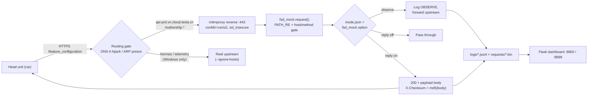
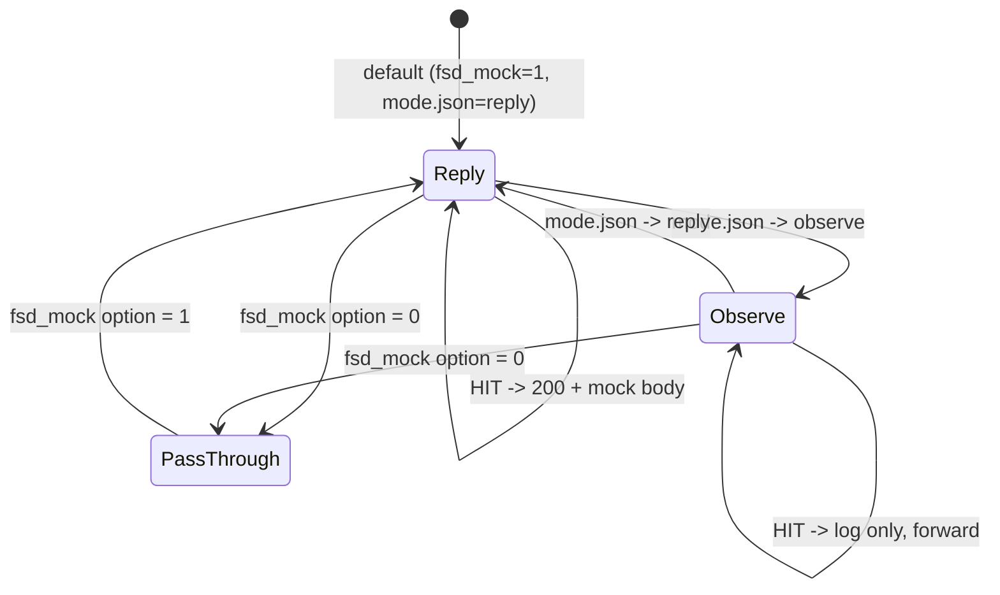
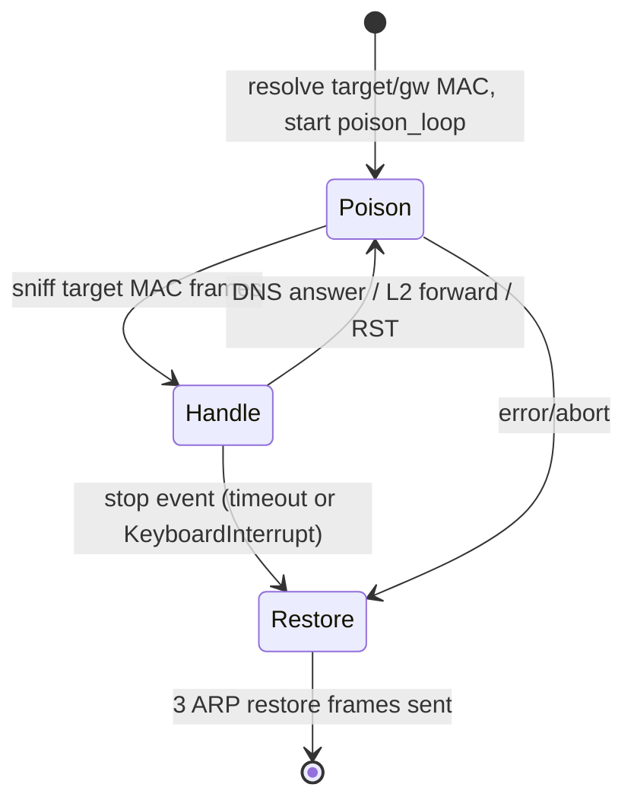

# ThinkHao-Tesla-drug

## 1. Provenance

- Submodule: `legacy/ThinkHao-Tesla-drug`; parent gitlink `160000 274d4e812ea2245feceaff149471214a51ce50e5 0`.
- `git -C legacy/ThinkHao-Tesla-drug rev-parse HEAD` returns `274d4e812ea2245feceaff149471214a51ce50e5` and `status --porcelain` is empty. Snapshot matches the gitlink.
- Upstream: `https://github.com/ThinkHao/Tesla-drug` (origin fetch/push, recorded from the local clone). Derived from the deleted/private `zeratulhx/Tesla-drug` (HTTP 404 on 2026-11-20 per `docs/legacy/tesla-drug-forks-2026-11-20.md`). That 404 does not prove deletion vs. privatization.
- Lineage: local history shows `ca02db4` ("Initial commit", the Arispex pin) and `05d2b26` ("Fix PowerShell 5.1 ANSI parsing", the jdgbv2 pin) are both ancestors of the pinned HEAD. ThinkHao is a superset of those two snapshots.
- License: **no LICENSE / COPYING file is tracked**. Upstream license is UNVERIFIED; the parent project's GPL-3.0 does not grant rights to this code.
- Analysis date: 2026-11-21. Safety/legal context: research-only, unverified FSD-unlock material. No payload, archive, certificate, key, or script was executed; no vehicle interaction occurred.
- No prior `docs/legacy/ThinkHao-Tesla-drug.md` existed. The frontmatter above is newly authored, not preserved; there were no `## Upstream (...)` sections to keep.
- Files read (line ranges; all FULL-READ unless noted): `README.md:1-237`, `PLATFORMS.md:1-52`, `fsd-mitm:1-29`, `app/mode.json:1`, `app/fsd_mock.py:1-334`, `app/dns_sink.py:1-182`, `app/cli.py:1-321`, `app/svc/stack.py:1-225`, `app/web/fsd_panel.py:1-810`, `app/web/server.py:1-635`, `app/tools/arp_mitm.py:1-332`, `app/tools/supervise_all.py:1-107`, `app/tests/platform_smoke.py:1-113`, `app/payload.json:1`, `app/payload-16f.json:1`, `app/payload-282b.json:1` (single-line catalogs, FULL-READ), `app/requirements.txt:1-44`, `.github/workflows/platform-smoke.yml:1-50`, `.github/workflows/release-packages.yml:1-44`, `scripts/package_release.py:1-111`, `install.ps1:1-484`, `install.sh:1-27`. Also read via raw dump (no line numbers captured; cited by symbol): `app/start_hotspot.ps1`, `app/start_all.ps1`, `app/hotspot.ps1`, `app/route-b.ps1`, `app/stop_hotspot.ps1`, `app/stop_api_intercept.ps1`, `app/stop_fsd_all.ps1`, `app/Clear-FSD-Records.ps1`, `app/tools/keep_hotspot.ps1`, `app/web/hotspot_probe.ps1`, `app/svc/stack_start.cmd`, `app/svc/stop_stack.ps1`, the three `.cmd` wrappers, and `一键安装.cmd`.
- Files explicitly NOT read: `app/web/static/index.html` (18,614 B, contents not inspected); the binary PKCS#12 stores `app/certs2/mitmproxy-ca.p12`, `app/certs2/mitmproxy-ca-cert.p12`; `app/certs2/mitmproxy-ca-cert.cer`; full PEM bodies (only `BEGIN`/`END` markers grepped); `.gitignore` and `.gitattributes`. `fsd-mitm` was STRUCTURAL-PARSE only before being identified as a 682-byte POSIX shell script, then FULL-READ; it was never executed.
- No CAPTURE evidence exists in this repo (no frame captures, no recorded car HIT log). No TEST-READ evidence covers the mock response itself; the only test is a service-lifecycle smoke test.

## 2. Executive verdict

This is not a CAN or firmware project. It is a Python/PowerShell MITM lab stack that redirects a Tesla head unit's HTTPS config request for `/feature_configuration` to a local mitmproxy instance and replies with a canned JSON payload whose FSD-related booleans are all true; a DNS sink or ARP poisoning performs the redirection, and two Flask dashboards let an operator edit the payload live. The mechanisms that matter are: path/method/host gated response substitution plus `X-Checksum: md5(body)` (`app/fsd_mock.py`), local-IP-aware DNS A-record hijack (`app/dns_sink.py`), ARP poisoning with L2 forwarding and TCP RST injection (`app/tools/arp_mitm.py`), and process supervision with an 8 s/30 s watchdog (`app/svc/stack.py`, `app/tools/supervise_all.py`). None is a candidate for shipping TeslaCANModder code: TeslaCANModder already implements FSD/nag behavior at the CAN layer (`firmware/lib/vehicle/can/handler/variant/hw4.h:134`) and has no cloud-config interception surface. The bundled MITM CA private key, cert stores, hardcoded Wi-Fi PSK, `ssl_insecure=true`/`--emudhra` flags, autostart persistence, and the unverified payload must never be ported. At most, three *derived ideas* are worth noting for research tooling: observe-before-reply dry-run gating, an independent checksum/fingerprint oracle, and bounded rolling logs with a state-file supervisor.

## 3. Evidence map

| Source file | Lines | What it proves | Grade |
| --- | --- | --- | --- |
| `app/fsd_mock.py` | 34-44, 46-47 | Default 9-field fallback payload and `PATH_RE = /feature_configuration/?($\|[?#])` path gate | CODE-READ |
| `app/fsd_mock.py` | 50-51, 68, 225 | Body is compact JSON; `X-Checksum` is `md5(body).hexdigest()`, recomputed after reload | CODE-READ |
| `app/fsd_mock.py` | 140-149, 265-291 | Hit gate (option/path/host/method) and short-circuit 200 response with `Content-Type`, `X-Checksum`, `Cache-Control` | CODE-READ |
| `app/fsd_mock.py` | 152-173, 204-226 | `reply`/`observe` mode file and payload mtime hot-reload; invalid files silently ignored | CODE-READ |
| `app/fsd_mock.py` | 175-202, 307-332 | Request capture to `logs/requests/*.bin`, VIN regex, TLS handshake logging | CODE-READ |
| `app/dns_sink.py` | 27-42, 45-66 | `local_ip_for()` reverse-route trick; DNS A answer builder with TTL 60 | CODE-READ |
| `app/dns_sink.py` | 115-159 | Per-query redirect vs. forward dispatch, AAAA→empty, four handler threads, `SO_EXCLUSIVEADDRUSE` | CODE-READ |
| `app/cli.py` | 200-210 | POSIX services: mitmdump reverse to `api-prd.vn.cloud.tesla.cn@443`, DNS redirect, panel; no `--ignore-hosts` | CODE-READ |
| `app/cli.py` | 21-25, 63-72, 104-121, 142-160 | Service markers, PID+cmdline ownership check, detached spawn, SIGTERM→SIGKILL stop | CODE-READ |
| `app/tests/platform_smoke.py` | 41-53, 73-108 | Asserts DNS A redirect returns `127.0.0.1`, three service ports open, dashboard `/api/state` shape, and stop cleanup | TEST-READ |
| `app/svc/stack.py` | 33-34, 41, 45-55; 158-191 | Randomized DNS health name, ignore-hosts regex, single-instance lock port 45799, 8 s supervision loop | CODE-READ |
| `app/tools/arp_mitm.py` | 39-41, 145-168 | Redirect domain set, `mothership.` prefix rule, 1 s ARP poison frame and 3×0.3 s restore | CODE-READ |
| `app/tools/arp_mitm.py` | 219-275, 277-296 | DNS interception, L2 forward, TCP RST injection, TLS SNI parse, `sniff()` loop | CODE-READ |
| `app/web/fsd_panel.py` | 64-65, 153-249, 773-777 | Canonical 282 B / md5 fingerprint and unauthenticated config/payload edit routes on 8900 | CODE-READ |
| `app/web/server.py` | 37, 230-243, 321-371, 528-616 | Ignore-hosts regex, mitmdump arg builder, self-test probe, process/payload/mode control endpoints on 8899 | CODE-READ |
| `scripts/package_release.py` | 14-29 | `app/certs2` excluded from every platform archive; ZIP/TAR.GZ built from `git archive HEAD` | CODE-READ |
| `install.ps1` | 269, 412-448 | `robocopy app/` copies `certs2` into `C:\fsd-mitm`; desktop shortcuts and `HKCU\Run\fsd-mitm-supervisor` persistence | CODE-READ |
| `README.md` | 3-6, 51-56, 132-136 | Claims car fetches config 5-10 min after reboot then every 12 h ±2 h; success = HIT with payload.json byte count | SUMMARY-ONLY |
| `docs/legacy/tesla-drug-forks-2026-11-20.md` | pinned-snapshots table | Provenance of this pin and the upstream 404 | SUMMARY-ONLY |

## 4. Architecture and build surface

- Entry points: Windows `一键安装.cmd` → `install.ps1`; `start_hotspot.cmd` → `start_hotspot.ps1` (default); `start_all.cmd` → `start_all.ps1` (router mode). POSIX `install.sh` + `fsd-mitm` → `app/cli.py start|status|stop`.
- Shared core: `app/fsd_mock.py` is the mitmproxy addon used by every launcher. Platform ports: PowerShell scripts (Windows), `app/cli.py` (macOS/Linux). `app/svc/stack.py` is the Windows-only resident supervisor; `app/tools/supervise_all.py` is its outer watchdog.
- Build/compile flags: none. All behavior is runtime flags and env vars: mitmdump `-s fsd_mock.py`, `--set confdir=<root>/certs2`, `ssl_insecure=true`, `connection_strategy=lazy`, `block_global=false`, `--emudhra`, `--mode reverse:https://api-prd.vn.cloud.tesla.cn@443` (or `reverse:http://192.0.2.1:4567` / `regular@8080`), `--ignore-hosts` (Windows only). Env: `FSD_MOCK_JSON`, `FSD_MOCK_LOG_DIR`, `FSD_MOCK_MODE_FILE`, `FSD_MOCK_HOSTS`, `FSD_MOCK_METHOD`, `FSD_MOCK_LOG_ALL`, `FSD_LOCAL_IPS`, `FSD_DNS_HEALTH_NAME`, `FSD_CAR_IP`, `FSD_CAR_MAC`.
- Dependency boundary: `app/requirements.txt` pins mitmproxy 12.3.1, scapy 2.8.0, Flask 3.1.3, cryptography 50.0.2 plus Windows-only `pydivert`/`mitmproxy-windows`. No CAN, serial, or embedded dependency.



## 5. Mechanism catalogue

### Feature-configuration response mock

- **Claim (README / summary):** README:3, 36-56 — the PC answers the car's config fetch with an "all FSD switches on" config; success is a `HIT` from the car IP with a byte count matching `payload.json`.
- **Code path:** `app/fsd_mock.py:228` `request()` → `_maybe_reload()` (204) → `_load_mode()` (152) → `_hit()` (140) → `_capture()` (175) → `http.Response.make(...)` (276) → TX to car. `addons = [FsdMock()]` at :334.
- **Frame spec:** not CAN. HTTP 200; body = compact JSON of the active payload; headers `Content-Type: application/json`, `X-Checksum: md5(body).hexdigest()`, `Cache-Control: no-store` (:276-284). Fallback default is 9 fields / 282 B (`fsd_mock.py:34-44`); shipped `app/payload.json` is 20 fields / 602 B with compact md5 `241cb01b81a2b9c8b9f389a471bcbc94`.
- **Gates and timing:** path regex `/feature_configuration/?($|[?#])` (:46); optional `FSD_MOCK_HOSTS` / `FSD_MOCK_METHOD` sets (:69-70); `fsd_mock` bool option default on (:97-103); mtime-based reload of payload and mode file (:152-226). No DAS/AP state or CAN timing gate.
- **State machine:** three effective states — option off, observe, reply.



- **Tests:** None found. `app/tests/platform_smoke.py:73-108` never sends a `feature_configuration` request and never asserts `X-Checksum`.
- **Evidence grade:** CODE-READ
- **Verdict:** CONFIRMED as implemented code; the claimed vehicle acceptance is UNVERIFIED (no capture).
- **Adapt to TeslaCANModder?** never. Our FSD behavior is CAN-layer (`firmware/lib/vehicle/can/handler/variant/hw4.h:134`), not cloud-config spoofing.

### DNS A-record hijack with upstream fallback

- **Claim (README / summary):** README:30, 114-116 — car gets `192.168.137.x` with DNS `192.168.137.1`; a local DNS sink answers the intercepted domain.
- **Code path:** `app/dns_sink.py:115` `handle()` → `qname_of()` (45) → `local_ip_for()` (27) → `build_answer()` (61) / `build_empty()` (69) → `sendto()`. `DnsSink.run()` (152) starts four UDP handler threads.
- **Frame spec:** not CAN. DNS over UDP; query ID echoed; answer flags `0x8180`, one answer A record TTL 60, compressed name `\xc0\x0c`; AAAA answered with an empty answer section to force A.
- **Gates and timing:** redirect set defaults to `mothership.vn.teslamotors.com` (:175); `cli.py:205-207` instead redirects `api-prd.vn.cloud.tesla.cn`; optional loopback health name `FSD_DNS_HEALTH_NAME` (:127-129); upstream forward with 2 s timeout to `223.5.5.5,1.1.1.1` (:102-113, 176). Bind default `0.0.0.0:53`.
- **State machine:** per-query three outcomes: REDIRECT (A), REDIRECT-EMPTY (AAAA/other), FORWARD (unknown name). No persistent state machine.
- **Tests:** `query_redirect()` at `app/tests/platform_smoke.py:41-53` asserts an A answer of `127.0.0.1` for `api-prd.vn.cloud.tesla.cn`; `main()` asserts stop leaves the port silent (:100-107).
- **Evidence grade:** TEST-READ
- **Verdict:** CONFIRMED for redirect behavior; that a real head unit uses this DNS path is UNVERIFIED.
- **Adapt to TeslaCANModder?** never. We ship no DNS server; negative anchor verified in section 16.

### ARP poisoning, L2 forwarding, and RST injection (router mode)

- **Claim (README / summary):** README:159-191 — router mode uses ARP redirection to pull car traffic to the PC; FAQ Q7 admits brief network interruption.
- **Code path:** `app/tools/arp_mitm.py:145` `poison_loop()` → `sendp()`; `handle()` (219) → `_answer_a()` (178) / `_forward_dns()` (192) / `_forward_l2()` (207) / RST branch (248-259); `run()` (277) → `restore()` (158) in `finally`.
- **Frame spec:** Ethernet + ARP reply (`op=2`, `psrc=gateway`, `hwsrc=our MAC`) every 1.0 s (:145-156), restore 3 frames at 0.3 s (:158-168); redirected A answer TTL 60 (:178-185); RST is `TCP(flags="R", seq=t.ack)` to `--rst-dst` (:248-259). TLS SNI parsed read-only from `ClientHello` bytes `0x16`/`0x01` (:71-100).
- **Gates and timing:** redirect set includes `mothership.vn.teslamotors.com`, `mothership.vn.cloud.tesla.cn`, `api-prd.vn.cloud.tesla.cn` plus any `mothership.*` (:39-40); `--duration 7200` in `start_all.ps1:92-95`; `--rst-dst 52.81.9.181`; `--no-api` drops api-prd from the set (:313-315).
- **State machine:** poison/forward loop → `KeyboardInterrupt` or timeout → stop event → restore → exit. Three phases.



- **Tests:** None found. No test exercises `sniff()`, `restore()`, or RST behavior.
- **Evidence grade:** CODE-READ
- **Verdict:** CONFIRMED as implemented; safety and reliability on a real network UNVERIFIED.
- **Adapt to TeslaCANModder?** never. Off-network L2 spoofing is outside the X179 CAN project and unsafe.

### MITM TLS interception and CA material

- **Claim (README / summary):** README:106-108 — non-mocked interfaces need a client cert and fail; PLATFORMS.md:44 — release packages do not carry the pre-generated CA key.
- **Code path:** mitmdump invoked from `app/cli.py:200-204`, `app/start_hotspot.ps1:98-102`, `app/start_all.ps1:101-105`, `app/tools/supervise_all.py:84-94`, `app/web/server.py:230-243`; CA directory `app/certs2` (`fsd_mock.py:84-89` reads `mitmproxy-ca.pem` subject).
- **Frame spec:** not applicable. Key material: `app/certs2/mitmproxy-ca.pem:1` `BEGIN RSA PRIVATE KEY` followed by a certificate; `mitmproxy-ca.p12` and `mitmproxy-ca-cert.p12` are binary PKCS#12 stores; `mitmproxy-dhparam.pem:2` `BEGIN DH PARAMETERS`.
- **Gates and timing:** `ssl_insecure=true`, `--emudhra`, `block_global=false`, `connection_strategy=lazy`; Windows paths pass `--ignore-hosts ^(hermes-prd|hermes-stream-prd|telemetry-prd)\.vn\.cloud\.tesla\.cn(?::\d+)?$` (`stack.py:34`, `server.py:37`), POSIX `cli.py` does not.
- **State machine:** None found.
- **Tests:** None found. `platform_smoke.py` checks only that a TCP port opens.
- **Evidence grade:** CODE-READ
- **Verdict:** PARTIAL — code confirmed; claim that no release carries the CA key is true only for `package_release.py` archives, not for `install.ps1` deployments (contradiction C2).
- **Adapt to TeslaCANModder?** never.

### Process supervision and state-file lifecycle

- **Claim (README / summary):** README:38, 195 — three components come up and a watchdog keeps them alive; PLATFORMS.md:33, 42 — `cli.py` manages services and `stop` only kills recorded, matching processes.
- **Code path:** POSIX `app/cli.py:104-160` `_spawn()` / `_stop_process()` and `start/status/stop` (:162-290); Windows `app/svc/stack.py:158-225` 8 s loop, `app/tools/supervise_all.py:60-103` 30 s loop; state files `app/logs/platform_services.json` (`cli.py:20`), `app/web/state.json` (`server.py:30`), `app/logs/stack_state.json` (`stack.py:211`).
- **Frame spec:** not applicable. Readiness: TCP connect with 0.3 s timeout (`cli.py:85-101`), DNS health query with randomized qname (`stack.py:124-143`), ARP log freshness threshold 120 s (`supervise_all.py:70-79`).
- **Gates and timing:** single-instance bind of `127.0.0.1:45799` (`stack.py:41-55`); SIGTERM then 5 s wait then SIGKILL (`cli.py:142-160`); watchdog intervals 8 s and 30 s.
- **State machine:** per service: absent → spawn → ready / failed → (on config-change) stop → re-spawn; supervisor re-enters on port/log liveness failure. Not documented as an explicit state enum.
- **Tests:** `app/tests/platform_smoke.py:87-107` asserts start/status/stop for the three POSIX services and cleanup of ports and DNS.
- **Evidence grade:** TEST-READ
- **Verdict:** CONFIRMED for the POSIX path; Windows watchdog UNVERIFIED (no CI coverage).
- **Adapt to TeslaCANModder?** no impact. Our tools use their own process model; only the "kill only PIDs whose cmdline still matches a marker" guard is a derived idea worth remembering.

### Hotspot and network setup

- **Claim (README / summary):** README:19-32 — phone USB tethering feeds the PC, PC opens `FSD-PC`, car joins with key `fsd2026!!` and gets `192.168.137.x`.
- **Code path:** `app/route-b.ps1` wraps `app/hotspot.ps1` `start|stop|status` via WinRT `NetworkOperatorTetheringManager`; `app/tools/keep_hotspot.ps1` re-checks `192.168.137.1` every 90 s for up to 240 min; `app/web/hotspot_probe.ps1` emits JSON client list consumed by `server.py:181-210`.
- **Frame spec:** not applicable. Defaults: SSID `FSD-PC` (`route-b.ps1`), `FSD-SCORE` (`hotspot.ps1`), PSK `fsd2026!!`, gateway/DNS `192.168.137.1`.
- **Gates and timing:** WinRT 20 s task waits; keep-alive 90 s; dashboard hotspot probe re-runs every 5 s (`server.py:204-210`).
- **State machine:** None found.
- **Tests:** None found. CI runs on Linux/macOS and explicitly does not configure a hotspot (PLATFORMS.md:17, 42).
- **Evidence grade:** CODE-READ
- **Verdict:** CONFIRMED as script behavior; real head-unit association UNVERIFIED.
- **Adapt to TeslaCANModder?** never.

### Payload hot-reload and browser editors

- **Claim (README / summary):** README:120-136 — payload can be edited via form, JSON, or file; saved changes take effect without restart; `observe` logs only.
- **Code path:** `app/fsd_panel.py:85-107` `_save_payload()` (`.bak` + config history) and routes `/config` (153), `/payload` (215); `app/web/server.py:572-603` `/api/payload`, `/api/payload/reset`, `/api/mode`; reload at `fsd_mock.py:204-226`.
- **Frame spec:** not applicable. Canonical fingerprint `CANON_BYTES = 282`, `CANON_MD5 = c212a75ca858750ac302093c138991f2` (`fsd_panel.py:64-65`); write size cap 8192 B (:173, :225); rolling car-request cache cap `CAR_CAP = 999` (:37).
- **Gates and timing:** mtime comparison; stale-page warning when submitted `_rev` differs from current md5 (:175-181); dashboard auto-refresh every 2 s (:717).
- **State machine:** None found.
- **Tests:** None found.
- **Evidence grade:** CODE-READ
- **Verdict:** CONFIRMED as implemented; that the vehicle accepts edited payloads UNVERIFIED.
- **Adapt to TeslaCANModder?** no impact. The independent md5/fingerprint oracle is the only reusable research idea.

## 6. Summary vs code contradiction table

| ID | Doc claim (with citation) | Code reality (with citation) | Grade / note |
| --- | --- | --- | --- |
| C1 | `README.md:54` says success means a HIT whose byte count matches `payload.json`, while `README.md:132` calls `payload-282b.json` the "official original" | `app/fsd_mock.py:33-44` 9-field/282 B is only the *fallback default* the code comment says the car expects; shipped `app/payload.json:1` is 20 fields / 602 B (compact md5 `241cb01b81a2b9c8b9f389a471bcbc94`). `app/web/fsd_panel.py:64-65,195` badges only 282 B / `c212a75ca858750ac302093c138991f2` as "official", so the two success definitions disagree | CODE-READ |
| C2 | `PLATFORMS.md:44` says release packages do not carry the pre-generated CA private key and generate one on first start | True only for `scripts/package_release.py:25` archives. `install.ps1:269` copies `app/` including `certs2/mitmproxy-ca.pem` (RSA PRIVATE KEY at line 1) into `C:\fsd-mitm`; `app/cli.py:202` and `start_hotspot.ps1:99` explicitly set `confdir=<root>/certs2`. A repo checkout or installer deployment *does* carry the key | CODE-READ |
| C3 | `README.md:195` describes autostart as pointing at `start_hotspot.ps1` | `install.ps1:441-444` writes `HKCU\Run\fsd-mitm-supervisor` → `start_hotspot.ps1`, but `start_all.ps1:124-126` overwrites the same value → `tools\supervise_all.py`. Autostart target is mode-dependent and last-writer-wins | CODE-READ |
| C4 | `PLATFORMS.md:3, 29-31` presents `app/cli.py` as managing the same three services with configurable ports | `app/cli.py:201-210` proxies `api-prd.vn.cloud.tesla.cn@443` and omits `--ignore-hosts`; Windows `stack.py:181-183` proxies a dead `192.0.2.1:4567`, `supervise_all.py:84-94` handles the separate 443 instance, and `stack.py:34` / `server.py:37` do pass `--ignore-hosts`. Same nominal services, different interception behavior | CODE-READ |
C1-C4 mean the README/PLATFORMS narrative should be treated as SUMMARY-ONLY until a capture settles which payload and which launcher were actually used.

## 7. CAN frame and signal inventory

None found: no CAN frame decode, mutation, injection, DBC, or CAN ID appears in this repo. The three `app/payload*.json` single-line files are HTTP configuration catalogs (FULL-READ; STRUCTURAL-PARSE of their schema: a flat object of boolean/string feature flags), not frame definitions, so they are not enumerated here. Grades: no CAPTURE and no CAN CODE-READ rows exist.

## 8. Constants and tuning table

| Constant | Value | File:line | Meaning | Grade |
| --- | --- | --- | --- | --- |
| `DEFAULT_PAYLOAD` | 9 flags incl. `full_self_driving`, `enable_eu_fsd_behavior`, `lab_diagnostic_marker: "cn-region-http-probe"` | `app/fsd_mock.py:34-44` | Fallback mock body ("official" 282 B variant) | CODE-READ |
| `X-Checksum` | `md5(compact_body).hexdigest()` | `app/fsd_mock.py:68, 225, 281` | Response integrity header | CODE-READ |
| `PATH_RE` | `/feature_configuration/?($\|[?#])` | `app/fsd_mock.py:46` | Interception path gate | CODE-READ |
| `CANON_BYTES` / `CANON_MD5` | `282` / `c212a75ca858750ac302093c138991f2` | `app/web/fsd_panel.py:64-65` | "Official payload" fingerprint shown in dashboards | CODE-READ |
| shipped payload | 602 B / 20 fields / md5 `241cb01b81a2b9c8b9f389a471bcbc94` | `app/payload.json:1` | Active response body | CODE-READ |
| rollback payloads | 476 B / 16 fields (`b61035d9dea38e737fbf8195ccb39f2c`); 282 B / 9 fields (`c212a75ca858750ac302093c138991f2`) | `app/payload-16f.json:1`, `app/payload-282b.json:1` | Operator rollback samples | CODE-READ |
| DNS default redirect / upstream | `mothership.vn.teslamotors.com`; `223.5.5.5,1.1.1.1` | `app/dns_sink.py:175-176` | Sink defaults | CODE-READ |
| DNS answer TTL | `60` | `app/dns_sink.py:61, 65`; `app/tools/arp_mitm.py:181` | A-record TTL | CODE-READ |
| DNS health qtype | `1` (A) | `app/dns_sink.py:127`; `app/svc/stack.py:138-141` | Loopback health query | CODE-READ |
| `REDIRECT` / `REDIRECT_PREFIX` | 3 Tesla domains / `("mothership.",)` | `app/tools/arp_mitm.py:39-40` | ARP-mode hijack set | CODE-READ |
| ARP poison interval / restore | `1.0 s` / 3 frames at `0.3 s` | `app/tools/arp_mitm.py:156, 162-167` | Poison cadence and exit cleanup | CODE-READ |
| `--duration` / `--rst-dst` | `7200 s` / `52.81.9.181` | `app/start_all.ps1:92-95`, `app/tools/supervise_all.py:76-79` | Router-mode lifetime and RST victim | CODE-READ |
| `LOCK_PORT` | `45799` | `app/svc/stack.py:41` | Single-instance TCP lock | CODE-READ |
| watchdog intervals | `8 s` / `30 s`; ARP freshness `120 s` | `app/svc/stack.py:221`, `app/tools/supervise_all.py:27, 71` | Restart polling | CODE-READ |
| Ports | TCP `443/4567/8080/8899/8900`, UDP `53`, TCP `45799` | `app/start_all.ps1:59-65`, `app/cli.py:301-303`, `app/svc/stack.py:41` | All listening surfaces | CODE-READ |
| Hotspot SSID / key / gateway | `FSD-PC` / `fsd2026!!` / `192.168.137.1` | `app/route-b.ps1`, `app/start_hotspot.ps1:15, 88` | Default wireless parameters | CODE-READ |
| Router-mode IPs | target `192.168.199.95`, gateway `192.168.199.1`, PC `192.168.199.148` | `app/start_all.ps1:92-95`, `README.md:175-182` | Hardcoded network layout | CODE-READ |
| Write size cap / rolling cap | `8192 B` / `999` records | `app/web/fsd_panel.py:37, 173, 225` | Payload editor limit and recent-request cache | CODE-READ |
| TLS parse markers | `0x16` record, `0x01` handshake | `app/tools/arp_mitm.py:74, 78` | Read-only SNI extraction | CODE-READ |
| mitmproxy flags | `ssl_insecure=true`, `--emudhra`, `block_global=false`, `connection_strategy=lazy` | `app/cli.py:202-203`, `app/start_hotspot.ps1:99-101` | TLS verification bypass and proxy behavior | CODE-READ |
| `IGNORE_HOSTS` | `^(hermes-prd\|hermes-stream-prd\|telemetry-prd)\.vn\.cloud\.tesla\.cn(?::\d+)?$` | `app/svc/stack.py:34`, `app/web/server.py:37` | Telemetry hosts excluded from interception (Windows) | CODE-READ |

## 9. Failure modes and edge cases

| Failure | Handling code path | Tested? | Grade |
| --- | --- | --- | --- |
| Car does not trust MITM CA / TLS handshake fails | `fsd_mock.py:321-332` logs `handshake_failed`; README Q6 says non-mocked APIs return 400 | No | CODE-READ |
| UDP 53 already bound by Windows hotspot DNS proxy | `dns_sink.py:152-156` uses `SO_EXCLUSIVEADDRUSE`; README Q8 instructs manual `netstat` + restart | Manual only | SUMMARY-ONLY |
| ARP poisoning interrupts car connectivity | `arp_mitm.py:158-168` `restore()` sends 3 real-MAC ARP replies on exit; README Q7 acknowledges the interruption | No | CODE-READ |
| Child process dies | `stack.py:158-162` polls `child.poll()` and re-spawns; `supervise_all.py:60-103` restarts by port/log liveness | POSIX lifecycle partly tested; Windows watchdog not | TEST-READ |
| Local IP / WiFi segment changes | `stack.py:165-176` restarts the DNS sink; `dns_sink.py:27-42` derives answer IP per peer | No | CODE-READ |
| Two launchers start concurrently | `stack.py:41-55` single-instance lock on `127.0.0.1:45799` | No | CODE-READ |
| Edited payload is invalid JSON or non-dict | `fsd_mock.py:215-221` keeps the previous payload; dashboard shows save error (`fsd_panel.py:229-230`) | No | CODE-READ |
| `mode.json` invalid or unknown value | `fsd_mock.py:162-173` ignores it and keeps current mode | No | CODE-READ |
| Concurrent payload edits from stale dashboard page | `fsd_panel.py:175-181` warns and logs `config-stale`; previous file kept as `.bak` | No | CODE-READ |
| Car goes silent | `fsd_panel.py:409-437` marks online only within 180 s (`car_state`) and caches ping for 10 s | No | CODE-READ |
| Unbounded log growth | Only dashboard read caps exist (`fsd_panel.py:253-267`, `server.py:69-92`); writers append without rotation. `Clear-FSD-Records.ps1` is a manual purge | No | CODE-READ |
| OTA guard / brownout / CAN bus-off / reboot state | None found — this repo has no CAN bus or OTA logic | N/A | CODE-READ |
| License / redistribution status | No LICENSE file tracked | No | UNVERIFIED |

## 10. Test coverage map

- `app/tests/platform_smoke.py:41-53` `query_redirect()` — builds a DNS query for `api-prd.vn.cloud.tesla.cn` and asserts one A answer equal to `127.0.0.1`.
- `app/tests/platform_smoke.py:56-70` `check_dashboard()` — asserts `/api/state` returns HTTP 200 with `car_status` and `car_conns` keys and that the loopback ping check reports `l2`.
- `app/tests/platform_smoke.py:73-108` `main()` — asserts all three services start, their ports listen, `status` names mitm/dns/panel, and `stop` leaves no TCP listener or DNS responder.
- CI: `.github/workflows/platform-smoke.yml:29-50` runs only that script on `ubuntu-latest` and `macos-latest`, Python 3.12; no Windows job exists.

Critical paths with NO test:

- `/feature_configuration` hit, mode gate, 200 body, and `X-Checksum` value — risk: the core claim of the repo is untested.
- payload/mode hot-reload on mtime change — risk: live edits could silently not apply.
- TLS interception and CA generation/trust — risk: release packaging claim (C2) can regress unnoticed.
- ARP poison/restore and RST injection — risk: no network-safety guard is verified.
- `server.py` control endpoints (`start/stop`, `payload`, `mode`, `logs/clear`) and `fsd_panel.py` edit routes — risk: unauthenticated surface changes untested.
- Every Windows PowerShell script, the installer, and the watchdog — risk: mode-dependent autostart (C3) can drift with no CI signal.

## 11. Parity matrix with TeslaCANModder

| Signal/frame/surface | Upstream decode (cite) | Our decode (cite) | Delta | Action |
| --- | --- | --- | --- | --- |
| `feature_configuration` HTTP interception | `app/fsd_mock.py:46, 276-285` | None found — our WiFi server only exposes local routes `firmware/lib/client/api/init.h:54-148` (CODE-READ negative anchors in §16) | Different layer entirely: upstream spoofs cloud config; we never proxy car traffic | ignore |
| DNS A hijack for Tesla domains | `app/dns_sink.py:131-143`; `app/tools/arp_mitm.py:178-185` | None found — no DNS server symbol in `firmware/lib` (negative anchor in §16) | We do not redirect client DNS | ignore |
| ARP/L2 spoofing or TCP RST injection | `app/tools/arp_mitm.py:145-168, 248-259` | None found — no `sniff`/promiscuous code in `firmware/lib` (negative anchor in §16) | Off-network MITM has no counterpart | ignore |
| Local HTTP control surface | `app/web/server.py:528-616`; `app/web/fsd_panel.py:153, 215, 773` | `firmware/lib/client/api/init.h:86-90` (`/api/status`, `/api/command`, `/api/disable`) with auth in `firmware/lib/client/api/auth.h` | Both are loopback/local REST, but ours is command dispatch with `X-API-Key`; theirs is unauthenticated process/payload control | capture-first only if hardening review is wanted; no code port |
| FSD enable feature semantics | `app/fsd_mock.py:38` `full_self_driving: true`; `app/payload.json:1` | `firmware/lib/vehicle/can/feature/fsd/fsd.h:25` and `firmware/lib/vehicle/can/handler/variant/hw4.h:134` (`fsdEnabled` + UI gate on 0x3FD mux) | Same *goal*, opposite mechanism and trust boundary; upstream is unverified cloud JSON, ours is gated CAN mutation with AP gate and can-review checklist | ignore — do not let upstream influence CAN frame shape |

Every row has a our-side CODE-READ citation (positive route/config citation or an executed negative anchor), so none is merely SUMMARY-ONLY.

## 12. Surface inventory and security notes

| Surface | Semantics | Provenance / security note |
| --- | --- | --- |
| mitmproxy reverse `0.0.0.0:443` → `api-prd.vn.cloud.tesla.cn` | Intercepts car HTTPS config fetch; addon short-circuits | `start_hotspot.ps1:98-102`, `supervise_all.py:84-94`; `ssl_insecure=true` + `--emudhra` disable normal TLS verification |
| mitmproxy reverse `0.0.0.0:4567` → dead `192.0.2.1:4567` | Router-mode legacy HTTP path | `stack.py:181-183`; `keep_host_header=true` |
| mitmproxy regular `@8080` | Generic CONNECT proxy, used by self-test | `stack.py:185-186`, `server.py:343-369` |
| DNS UDP `53` (`--bind` default `0.0.0.0`) | Redirect Tesla domains to local IP, forward others | `dns_sink.py:164-176`; upstream `223.5.5.5,1.1.1.1` |
| ARP + L2 + RST (raw Ethernet via scapy) | Poison car's gateway ARP, forward frames, RST selected IP | `arp_mitm.py:145-168, 207-259`; `--rst-dst 52.81.9.181` |
| Flask `:8900` (`fsd_panel.py`, bind `127.0.0.1`) | `/`, `/api/state`, `/config` GET+POST, `/payload` GET+POST | No authentication; POST rewrites `payload.json` and logs history |
| Flask `:8899` (`server.py`, bind `127.0.0.1`) | `/api/state`, `/api/proxy/<mode>/start\|stop`, `/api/hotspot/<action>`, `/api/payload`, `/api/payload/reset`, `/api/mode`, `/api/selftest`, `/api/logs/clear` | No authentication; starts/stops processes and invokes PowerShell with `-ExecutionPolicy Bypass` (`server.py:189-191, 561-563`) |
| Windows firewall rules | Inbound allow TCP 443/4567/8080/8899, UDP 53 | `start_all.ps1:59-70`, `start_hotspot.ps1:63-77`; UAC self-elevation |
| `HKCU\Run\fsd-mitm-supervisor` | Logon persistence of hotspot or watchdog | `install.ps1:433-449`, `start_all.ps1:123-127` |
| POSIX CLI `fsd-mitm start\|status\|stop` | Runs services via `sudo` | `fsd-mitm:21-29`, `PLATFORMS.md:21-31` |

Security findings: bundled MITM CA **private key** at `app/certs2/mitmproxy-ca.pem:1` plus two PKCS#12 stores and DH params; hardcoded Wi-Fi PSK `fsd2026!!` in `hotspot.ps1`, `route-b.ps1`, `start_hotspot.ps1:88`, `keep_hotspot.ps1`; TLS verification bypass flags; telemetry ignore hosts; kill-by-cmdline-pattern scripts (`stop_fsd_all.ps1`, `stop_api_intercept.ps1`) that can terminate any process whose command line matches `python*`/`@443`; hardcoded IPs and an external RST target; no LICENSE file; no code signing; no auth on either dashboard (mitigated only by loopback bind). All are untrusted, unverified research artifacts.

## 13. Adaptation assessment

| Mechanism | Value | Cost | Risk | Evidence grade | Decision |
| --- | --- | --- | --- | --- | --- |
| Feature-config mock | None for shipping product | High (new MITM layer) | Safety-critical unverified FSD claims | CODE-READ | never port |
| DNS redirect | None | Medium | Network hijack | TEST-READ | never port |
| ARP poison / RST | None | High | Active network attack | CODE-READ | never port |
| TLS interception + CA | None | High | Private key + TLS bypass | CODE-READ | never port |
| Process supervision | Low (derived idea: kill only pid whose cmdline still matches marker) | Low | Restart loops | TEST-READ | no impact — do not port code |
| Hotspot scripts | None | Medium | Hardcoded credentials | CODE-READ | never port |
| Payload editors / hot reload | Low (derived idea: independent md5 + canonical fingerprint oracle in tests) | Low | Unauthenticated writes | CODE-READ | candidate for future PR *as a test-oracle idea only*, not as code |

Top 3 adaptation candidates, all derived ideas with independent implementation: (1) recompute expected checksum in a test instead of snapshotting our own output, mirroring `md5(body)` at `fsd_mock.py:68`; (2) an observe/dry-run gate before any shipping mutation, mirroring `mode.json` at `fsd_mock.py:152-173`; (3) bounded rolling evidence logs plus a PID+cmdline ownership check, mirroring `fsd_panel.py:253-267` and `cli.py:63-72`. None justifies importing upstream files.

## 14. Do-not-copy list

| Item (file:line) | Reason |
| --- | --- |
| `app/certs2/mitmproxy-ca.pem:1` (`BEGIN RSA PRIVATE KEY`), `app/certs2/mitmproxy-ca.p12`, `app/certs2/mitmproxy-ca-cert.p12`, `app/certs2/mitmproxy-dhparam.pem` | Untrusted MITM CA private key and cert stores; must never ship or redistribute |
| `app/certs2/mitmproxy-ca-cert.cer`, `app/certs2/mitmproxy-ca-cert.pem` | Untrusted certificates from a deleted upstream; no provenance |
| `app/payload.json:1`, `app/payload-16f.json:1`, `app/payload-282b.json:1` | Unverified FSD-unlock configuration; safety-critical driver-assistance claims |
| `app/fsd_mock.py:34-44, 276-285` | Response-substitution logic and FSD flags; unverified and unsafe |
| `app/dns_sink.py:115-159` | DNS hijack of Tesla domains |
| `app/tools/arp_mitm.py:145-168, 178-185, 248-259` | ARP poisoning, fake DNS answers, TCP RST injection |
| `app/cli.py:202-204`, `app/start_hotspot.ps1:99-101`, `app/start_all.ps1:102-104`, `app/tools/supervise_all.py:84-94`, `app/web/server.py:230-243` | `ssl_insecure=true`, `--emudhra`, `block_global=false` proxy flags |
| `app/svc/stack.py:181-186`, `app/tools/supervise_all.py:76-79` | Hardcoded dead upstream and external `--rst-dst 52.81.9.181` |
| `install.ps1:433-449`, `app/start_all.ps1:123-127` | HKCU logon persistence |
| `app/hotspot.ps1`, `app/route-b.ps1`, `app/start_hotspot.ps1:88`, `app/tools/keep_hotspot.ps1` | Hardcoded SSID/PSK `fsd2026!!` |
| `app/stop_fsd_all.ps1`, `app/stop_api_intercept.ps1` | Broad process termination by regex on command line |
| `app/requirements.txt:1-44` | Do not wholesale-copy pinned dependency set or Windows-only interceptors; choose per our own threat model |
| Any file in this repo | No LICENSE file exists; legal right to copy is UNVERIFIED |

## 15. History and evolution

Local `git log` (14 commits, oldest first):

- `ca02db4` "Initial commit" — also the Arispex pin; ancestor of HEAD.
- `f91529c` "Add AU adaptation probe tool (probe_au)" — added `app/probe_au.ps1` (167 lines), `app/tools/probe_au.py` (393 lines) and two start/stop edits (+562/-2).
- `f0c41c6` "Keep AU probe tool local only" — deleted both probe files (-560). An approach was tried and deliberately rolled back; only the start/stop edits remained.
- `05d2b26` "Fix PowerShell 5.1 ANSI parsing: ensure UTF-8 BOM on all .ps1" — also the jdgbv2 pin; ancestor of HEAD.
- Cross-platform series: `793d0af` smoke tests, `fb4f33e` diagnostics, `91a28a1` non-blocking hostname lookup, `53ec878` slower startup allowance, `c7c5c5a` listener detail reporting, `128e138` macOS dashboard hang diagnosis, `1d8fb14` skip loopback reverse lookup.
- `85aa6f0` "Add cross-platform release packages"; `274d4e8` "Build release packages on main pushes" (pinned HEAD).

Both other pinned fork commits are ancestors of this HEAD (verified by `git merge-base --is-ancestor`), so this snapshot is a superset of the jdgbv2 and Arispex references. Network-only claims (issues, PRs, original repo history) are UNVERIFIED; only commit subjects in the local clone were reviewed, not the file contents of pre-pin commits.

## 16. Re-verification recipe

```bash
OLD=274d4e812ea2245feceaff149471214a51ce50e5
git ls-files -s legacy/ThinkHao-Tesla-drug   # expect: 160000 274d4e812ea2245feceaff149471214a51ce50e5 0
git -C legacy/ThinkHao-Tesla-drug rev-parse HEAD
git -C legacy/ThinkHao-Tesla-drug status --porcelain
git -C legacy/ThinkHao-Tesla-drug fetch --tags --prune
git -C legacy/ThinkHao-Tesla-drug log --oneline $OLD..origin/main
git -C legacy/ThinkHao-Tesla-drug diff --stat $OLD..origin/main
git -C legacy/ThinkHao-Tesla-drug diff $OLD..origin/main -- app scripts install.ps1
```

Note: upstream `zeratulhx/Tesla-drug` returns 404; `origin` here is `ThinkHao/Tesla-drug`. If the fetch fails, record the failure and analyze the pinned snapshot only.

Demonstrated `grep -nE` anchors (all run on 2026-11-21 with Git-for-Windows `grep -nE`; expected hits shown):

```text
grep -nE 'DEFAULT_PAYLOAD|PATH_RE|hashlib\.md5' legacy/ThinkHao-Tesla-drug/app/fsd_mock.py
  -> 34:DEFAULT_PAYLOAD = { ; 46:PATH_RE = ... ; 68/185/225: hashlib.md5(...)
grep -nE 'api-prd\.vn\.cloud\.tesla\.cn|ssl_insecure|--emudhra' legacy/ThinkHao-Tesla-drug/app/cli.py
  -> 202-204 (confdir/ssl_insecure/--emudhra/reverse mode), 207 (DNS redirect domain)
grep -nE 'CANON_BYTES|CANON_MD5' legacy/ThinkHao-Tesla-drug/app/web/fsd_panel.py
  -> 64:282 ; 65:c212a75ca858750ac302093c138991f2 ; 195/234 comparisons
grep -nE 'REDIRECT =|REDIRECT_PREFIX|poison_loop|def restore' legacy/ThinkHao-Tesla-drug/app/tools/arp_mitm.py
  -> 39:REDIRECT = {...} ; 40:REDIRECT_PREFIX ; 145:poison_loop ; 158:restore
grep -nE 'LOCK_PORT|DNS_HEALTH_NAME|IGNORE =' legacy/ThinkHao-Tesla-drug/app/svc/stack.py
  -> 33:DNS_HEALTH_NAME ; 34:IGNORE = ... ; 41:LOCK_PORT = 45799 ; 49 bind
grep -nE 'SERVICE_MARKERS|platform_services\.json|start_new_session' legacy/ThinkHao-Tesla-drug/app/cli.py
  -> 20:STATE_FILE ; 21:SERVICE_MARKERS ; 72,116,276 dependents
# negatives (absence claims — no output expected)
grep -nE 'MCP2515|0x3FD|DAS_control|CANFRAME|zipfile' legacy/ThinkHao-Tesla-drug/app/fsd_mock.py legacy/ThinkHao-Tesla-drug/app/cli.py legacy/ThinkHao-Tesla-drug/app/dns_sink.py
  -> no output (no CAN pipeline, no archive handling in these files)
grep -rnE 'feature_configuration|X-Checksum|mothership|api-prd|dns_sink|arp_mitm|mitmproxy|ssl_insecure' firmware/lib client/src packages/protocol/src tools/lib
  -> no output (our shipping code has no cloud-config interception)
grep -rnE 'DNSServer|promiscuous|sniff' firmware/lib
  -> no output (our firmware is not a DNS server or L2 sniffer)
# our-side positive anchors for the parity rows
grep -nE 'server\.on\("/api/(status|command)"' firmware/lib/client/api/init.h
  -> 86:/api/status ; 87-88:/api/command ; 89:/api/status OPTIONS
grep -nE 'fsdEnabled|fsdForceEnabled' firmware/lib/vehicle/can/feature/fsd/fsd.h firmware/lib/vehicle/can/handler/variant/hw4.h
  -> fsd.h:25/51 ; hw4.h:134/157
```

If line numbers drift more than ~10, re-read the whole function; do not trust this document's numbers. Pre-pin upstream history was **not** reviewed file-by-file — only the pinned snapshot and local commit subjects.

## 17. Open questions and explicitly not investigated

- Was any real `HIT` ever logged? README:54 describes success, but no `logs/hits.jsonl`, capture, or recorded request is tracked. UNVERIFIED; verify with a listen-only bench capture, never by running this stack against a vehicle.
- Is the 282 B payload actually required/accepted by the car, or is the 602 B shipped payload the working one? C1 leaves two contradictory "correct" answers. UNVERIFIED.
- Is `X-Checksum: md5(body)` the real integrity algorithm for `/feature_configuration`? Only code self-consistency, no capture. UNVERIFIED.
- Does the vehicle actually re-fetch config every 12 h ±2 h after reboot (README:51-56, 104)? No code or test. UNVERIFIED.
- Must the car trust the bundled CA for interception, and did any vehicle ever do so? UNVERIFIED.
- What is the upstream license? No LICENSE file; original repo 404. UNVERIFIED; blocks any code reuse.
- What is inside the two PKCS#12 stores and the `.cer` file? Only file headers were inspected; binary contents were not parsed. UNVERIFIED.
- Contents of `app/web/static/index.html`; full PEM bodies; `.gitignore`; `.gitattributes` — not read.
- Pre-pin upstream history file contents (other than the 14 commit subjects locally visible) — not reviewed.
- Windows behavior (installer, firewall, watchdog, autostart, ARP mode) has no CI coverage; no verification beyond code read.
- Whether `install.ps1` deployments that carry the CA key (C2) are intentional or a packaging regression — UNVERIFIED.
- Any relationship to the 148 other cataloged forks beyond the two ancestor pins — not investigated beyond `docs/legacy/tesla-drug-forks-2026-11-20.md`.
