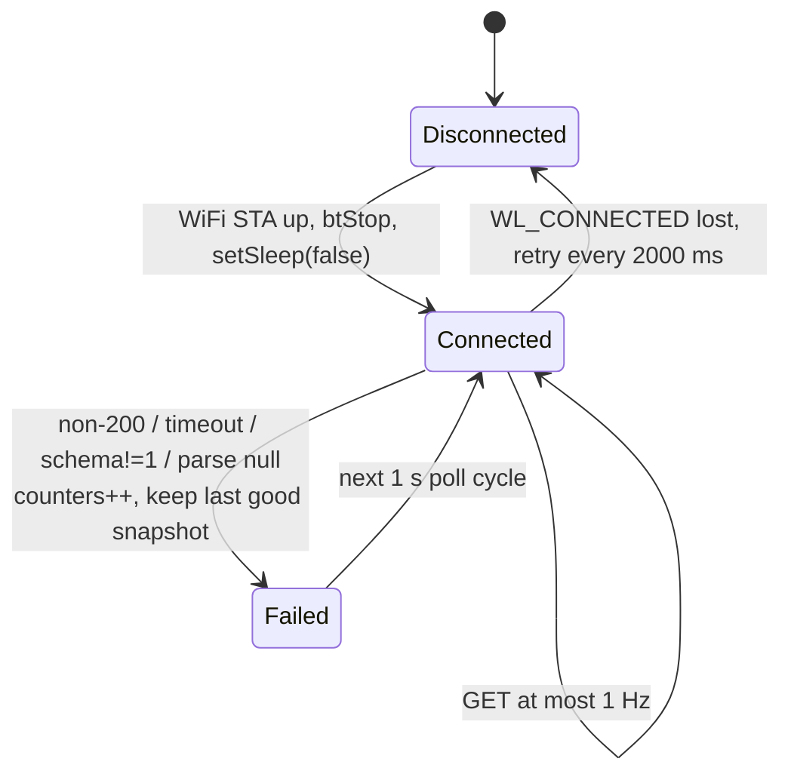
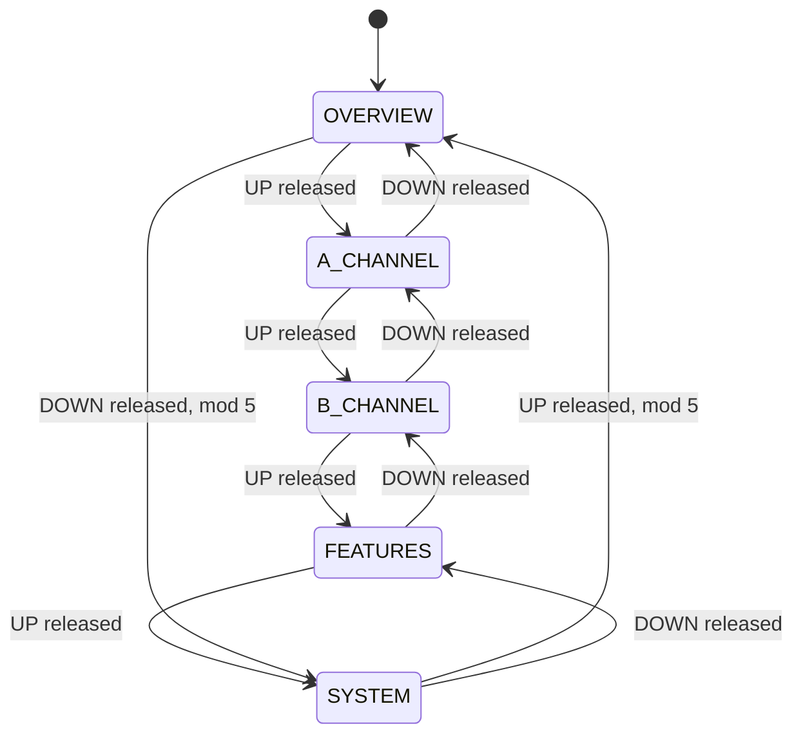
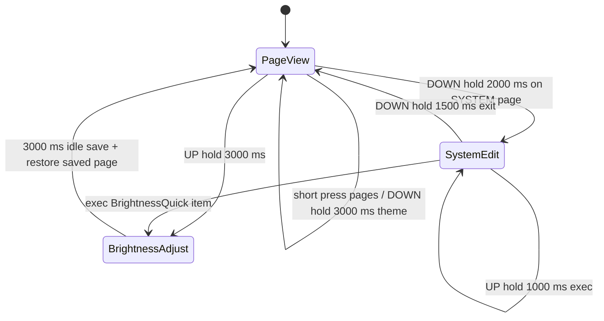

# alzza/tesla-can-moniter

> Deep-dive addendum. Read this before trusting the older overview prose elsewhere in
> `docs/legacy/`. Paths like `src/main.cpp` below are relative to
> `legacy/alzza-tesla-can-moniter/`. Paths starting `firmware/`, `client/`, or `docs/checklists/`
> are in the TeslaCANModder parent repo.

## 1. Provenance

| Item | Value |
| --- | --- |
| Submodule path | `legacy/alzza-tesla-can-moniter` |
| Pinned gitlink SHA | `d3b426853625b70dc7f4d6c997c51a04c67bfae4` |
| `git rev-parse HEAD` at analysis time | `d3b426853625b70dc7f4d6c997c51a04c67bfae4` — MATCHES gitlink |
| Worktree status | clean (`git status --porcelain` empty) |
| HEAD commit | `d3b4268 Merge pull request #1 from alzza/alzza/화면구성-디자인` |
| Upstream | `https://github.com/alzza/tesla-can-moniter.git` (fetch + push) |
| License | **None declared.** No `LICENSE`/`COPYING` in `git ls-files`; no license section in README/CHANGELOG. Treat as research-only. |
| Analysis date | 2026-11-20 |

Files read in full (all 11 tracked files):

| File | Lines | Note |
| --- | --- | --- |
| `src/main.cpp` | 1-840 | Transport, JSON parser, button FSM, NVS, loop |
| `src/ui.h` | 1-120 | `UiState`, `UiRenderContext`, `UiTheme` |
| `src/ui.cpp` | 1-342 | 5-page renderer, palette, dirty check |
| `docs/monitor-api.md` | 1-26 | Wire contract for `GET /api/monitor` (Korean) |
| `README.md` | 1-154 | Upstream self-description |
| `CHANGELOG.md` | 1-65 | Version history: ESP-NOW → HTTP migration |
| `platformio.ini` | 1-25 | Single env `lilygo-t-display-s3`, TFT_eSPI only |
| `preview/index.html` | 1-933 | Browser mock + firmware SYNC matrix |
| `.github/copilot-instructions.md` | 1-63 | Pin map / bring-up guidance (not code) |
| `.gitignore` | 1-5 | Build artifacts only |
| `.vscode/extensions.json` | 1-10 | PlatformIO IDE recommendation |

Historical source read for contradiction analysis: `8278746:src/main.cpp`
(`esp_now.h`, packed `struct_message`, `sizeof == 60`, `52`/`22` compat, WiFi channel 1).

Files explicitly NOT read: none among tracked files. Untracked/generated files: none present.
No build, flash, or hardware capture was performed.

## 2. Executive verdict

At the pinned SHA this repo is a **read-only LILYGO T-Display-S3 status screen**, not a CAN
interface and not an ESP-NOW receiver. It is a WiFi STA that polls a *separate* device
(the "T2-CAN" board, outside this repo) at `GET http://192.168.4.1/api/monitor` once per
second, validates `schema == 1`, parses JSON with cJSON into an immutable `UiState`
snapshot, and renders five pages (OVERVIEW / A CHANNEL / B CHANNEL / FEATURES / SYSTEM) to a
320x170 ST7789 sprite. The load-bearing Ideas worth studying are: a small versioned,
additive-only read-only diagnostics contract; an explicit response-age link-liveness
watchdog; a debounced three-mode button FSM; and a firmware-synced HTML preview with an
honest SYNC/PREVIEW-ONLY matrix. **Central finding:** the existing `docs/legacy/` summary
describes the pre-migration v1.0.0/v1.1.0 ESP-NOW design (60-byte packed struct, 4 pages,
torque fields, per-ID frame counters) that HEAD explicitly replaced in commit `2ebc4d2`.
Almost every CAN-specific claim in that summary is stale. Nothing here mutates CAN
frames, so nothing here requires the CAN review checklist; most mechanisms are already
present in our firmware (`CanDiag`) or inapplicable to our hardware stack.

## 3. Evidence map

| Source file | Lines | What it proves | Grade |
| --- | --- | --- | --- |
| `src/main.cpp` | 42-47 | SSID/password/URL constants, `kMonitorSchema = 1`, `kMonitorPollMs = 1000`, `kWifiReconnectMs = 2000` | CODE-READ |
| `src/main.cpp` | 573-646 | `parseMonitorPayload()` — cJSON, rejects `schema != 1`, fills `UiState` from `a`/`b`/`features`/`gate`/`user_mark` groups | CODE-READ |
| `src/main.cpp` | 648-714 | `initMonitorWifi()` / `serviceMonitorClient()` — WiFi STA, `btStop()`, `setSleep(false)`, 500/700 ms timeouts, reconnect | CODE-READ |
| `src/main.cpp` | 797-820 | `responseAgeMs`, `kLinkTimeoutMs = 3200` link state + Serial `[LINK]` log | CODE-READ |
| `src/main.cpp` | 279-304, 787-839 | `buildUiRenderContext()` snapshot; render only on change via `uiNeedsRender()` | CODE-READ |
| `src/main.cpp` | 306-540 | `handlePageButtons()` debounce/hold/repeat/three-mode FSM | CODE-READ |
| `src/main.cpp` | 118-239, 255-277 | Brightness clamp, 16-level backlight pulses, CPU 80/160 profile, Preferences NVS | CODE-READ |
| `src/ui.h` | 9-71 | `UiState` actual field set (no `torqueNm`, no `aFrames1021`, no `eap`) | CODE-READ |
| `src/ui.h` | 81-120 | `UiRenderContext`, `UiTheme`, `uiRender()` / `uiNeedsRender()` signatures | CODE-READ |
| `src/ui.cpp` | 8-13, 101-233, 298-311 | `levelColor`, 5 page renderers and exact titles, page dispatch | CODE-READ |
| `src/ui.cpp` | 313-333, 338-342 | Blinking `NO SIGNAL` overlay, theme toast, `memcmp` dirty check | CODE-READ |
| `docs/monitor-api.md` | 1-26 | Contract: AP, URL, 1 s poll, 3.2 s loss, schema 1, additive-only field policy | CODE-READ (contract doc) |
| `CHANGELOG.md` | 9-12, 31-65 | Explicit "replaced ESP-NOW payload receive with HTTP polling"; 4-page was v1.1.0 | CODE-READ (history) |
| `preview/index.html` | 756-787 | `MATRIX` — 17 SYNC rows, 2 PREVIEW-ONLY rows | CODE-READ |
| `8278746:src/main.cpp` | — | Historical ESP-NOW / `struct_message` 60 B / 52-22 compat / channel 1 | CODE-READ (git object) |
| `git ls-files` | — | No `LICENSE`; 11 tracked files total | CODE-READ |
| `platformio.ini` | 24-25 | Only `bodmer/TFT_eSPI` dependency at HEAD | CODE-READ |
| No test files in repo | — | No automated tests; correctness rests on code + preview matrix | CODE-READ |
| No captures present | — | No `.log`/`.csv`/frame dumps tracked | None found |

## 4. Architecture and build surface

- **Entry points:** `src/main.cpp:716` `setup()` and `src/main.cpp:772` `loop()`. No `main.cpp`
  CAN ISR, no `Twai` driver, no `MCP2515` class in the repo.
- **Shared core vs platform port:** single PlatformIO environment. `platformio.ini:1-25`
  `lilygo-t-display-s3`, `espressif32` / Arduino, `TFT_eSPI @ ^2.5.31`,
  `Setup206_LilyGo_T_Display_S3.h`, `BOARD_HAS_PSRAM`, `UI_CPU_MHZ=80`,
  `ENABLE_WIFI_RADIO=1`. Build flags are UI/radio only — **no CAN bus flags**.
- **`src/` split:** `main.cpp` owns transport, NVS, input FSM, loop; `ui.h`/`ui.cpp` own a
  pure render function over two value structs. `main.cpp:279-304` builds an immutable
  `UiRenderContext` each frame explicitly to decouple renderer from runtime globals.
- **Dependency boundary:** firmware depends on a strictly *external* HTTP producer.
  `docs/monitor-api.md:10` — "제어·CAN 송신·POST 요청은 사용하지 않는다" (no control, no CAN
  TX, no POST). `CHANGELOG.md:24-27` repeats this as a safety property.
- **Data path:** T2-CAN board (`/api/monitor` JSON) → WiFi AP `TeslaCAN` →
  `HTTPClient::GET()` → `parseMonitorPayload()` → `gLatestState` under `portMUX` →
  `uiNeedsRender()` → `uiRender()` → `TFT_eSprite::pushSprite()`.
- **Hardware baseline:** `.github/copilot-instructions.md:19-31` documents ST7789 pins,
  GPIO 15 power-enable, GPIO 14/0 buttons, GPIO 38 backlight. README `91-103` matches.
  This is guidance, not evidence that every pin was validated on real hardware.

```mermaid
flowchart LR
    T2["T2-CAN board (external producer)"] -->|"GET /api/monitor JSON schema 1"| AP["WiFi AP TeslaCAN 192.168.4.1"]
    AP --> STA["T-Display-S3 WiFi STA<br/>initMonitorWifi main.cpp:648-667"]
    STA --> GET["serviceMonitorClient main.cpp:669-714<br/>1 Hz poll, 500/700 ms timeouts"]
    GET -->|"HTTP 200 + schema==1"| PARSE["parseMonitorPayload cJSON<br/>main.cpp:573-646"]
    PARSE -->|"typed fallbacks, portMUX swap main.cpp:708-712"| STATE["gLatestState immutable UiState"]
    STATE --> CTX["buildUiRenderContext main.cpp:787-839"]
    CTX --> DIRTY{"uiNeedsRender memcmp<br/>ui.cpp:338-342"}
    DIRTY -->|"changed / button / toast / !linked"| RENDER["uiRender 5 pages<br/>ui.cpp:298-336"]
    DIRTY -->|"unchanged"| SKIP["skip frame"]
    RENDER --> TFT["TFT_eSprite pushSprite 320x170"]
```



No CAN mutate/gate/TX stage exists; the pipeline terminates at the display (see section 7).

## 5. Mechanism catalogue

### M1 — Versioned read-only HTTP diagnostics polling

- **Claim (README / summary):** README `3-5`, `9-19` — WiFi STA connects to `TeslaCAN`, reads
  `GET /api/monitor` every 1 s; read-only, no CAN TX. The existing `docs/legacy/` summary
  instead claims ESP-NOW 60-byte struct receive.
- **Code path:** `src/main.cpp:648` `initMonitorWifi()` → `src/main.cpp:669`
  `serviceMonitorClient()` → `HTTPClient::GET()` at `693` → `parseMonitorPayload()` at
  `573` → guarded write to `gLatestState` at `708-712`.
- **Frame spec:** not a CAN frame. HTTP/1.1 JSON object; root keys from
  `src/main.cpp:577-643`: `schema`, `uptime_s`, `ota_state`, `firmware`, `build`, plus groups
  `a{level,state,hz,age_ms,busoff,eflg,tec,rec,rx_overrun,tx_q,tx_busy,tx_hard,tx_guard}`,
  `b{level,state,hz,age_ms,busoff,twai,tec,rec,recovery_quiet_ms,arb_lost,bus_error,tx_failed,echo}`,
  `features{ece_r79,summon,tsllc,nag,nag_mode,nag_ap_only,nag_ready}`,
  `gate{open,reason,ap,ap_state,ap_stable_ms,parked,summoning,tx_ok,tx_fail,blocked}`,
  `user_mark{active,count}`. `schema` must equal `1` (`main.cpp:45`, `577-581`).
  Missing keys use typed fallbacks; strings fall back to `"--"`/`"INIT"`/`"UNKNOWN"`.
- **Gates and timing:** poll interval `kMonitorPollMs = 1000` (`main.cpp:46`, `682`);
  reconnect `kWifiReconnectMs = 2000` (`47`, `673-680`); connect timeout 500 ms, response
  timeout 700 ms (`687-688`); WiFi `setSleep(false)` (`250`); `btStop()` in `654-656`.
- **State machine:** WiFi disconnected → retry every 2 s; connected → GET at most 1 Hz;
  on non-200 or parse failure increment `gRequestFailCount` / `gParseFailCount` and keep
  previous `gLatestState` (no partial state committed).
- **Tests:** none in repo. Preview marks data source `PREVIEW-ONLY`
  (`preview/index.html:774`).
- **Evidence grade:** CODE-READ (implementation + contract doc).
- **Verdict:** CONFIRMED at pinned SHA; CONTRADICTED by the older `docs/legacy/` summary.
- **Adapt to TeslaCANModder?** candidate for future PR — schema-versioned additive-only
  read-only endpoint. Our firmware exposes `/api/status` via `handleGetStatus()`
  (`firmware/lib/client/api/routes.h:287-295`) and already builds the `can` object in
  `firmware/lib/client/command/messages.h:228-267`; no code copying needed.



### M2 — Response-age link-liveness watchdog ("NO SIGNAL")

- **Claim (README / summary):** README `19`, `31`, CHANGELOG `19` — show `NO SIGNAL` when
  last good response is older than 3.2 s. Older summary says `linked` was a received flag
  in the packet.
- **Code path:** `src/main.cpp:797-804` computes `responseAgeMs = now - gLastRxMs` and
  `linked = hasData && schemaOk && responseAgeMs <= kLinkTimeoutMs`; `src/ui.cpp:313-323`
  draws the blinking overlay.
- **Frame spec:** N/A. Constants: `kLinkTimeoutMs = 3200` (`main.cpp:49`),
  `kNoSignalBlinkMs = 450` (`50`), blink condition `(millis()/450) % 2 == 0` (`ui.cpp:314`),
  overlay rect `(72,70,176,34)` (`ui.cpp:316-321`).
- **Gates and timing:** `gLastRxMs` only updated on successful schema-valid parse
  (`main.cpp:708-712`). Before first data `gHasData = false` → not linked. Link transitions
  are logged once via `gPrevLinked` edge detection (`main.cpp:805-820`).
- **State machine:** unlinked → linked on first good parse; linked → unlinked when age
  exceeds 3200 ms; no separate recovery state — next good poll flips it back.
- **Tests:** none. Preview mirrors blink/rect at `preview/index.html:419`, `721-725`, `773`.
- **Evidence grade:** CODE-READ.
- **Verdict:** CONFIRMED. `linked` is *computed locally*, not transmitted — contradicts
  older summary's "linked — ESP-NOW link alive" field.
- **Adapt to TeslaCANModder?** candidate for future PR. Our client has transport-level
  state (`client/src/components/transport/ConnectionStatusBar.tsx:24`) and HTTP timeouts
  (`client/src/hardware/transport.ts:86-140`) but no explicit last-good-response age
  watchdog; borrow the idea (not the code) if a stale-data indicator is wanted.

### M3 — Immutable snapshot + dirty-check rendering

- **Claim (README / summary):** not described in older summary; README `52-61` describes
  preview/firmware sync, not the render architecture.
- **Code path:** `src/main.cpp:787-839` copies `gLatestState` into local `next` under
  `portENTER_CRITICAL`, derives `localUptime`/`responseAgeMs`/counters, compares via
  `uiNeedsRender()` (`ui.cpp:338-342`), then `uiRender()` (`ui.cpp:298`).
- **Frame spec:** N/A. `UiState` is a value struct (`ui.h:9-71`); `UiRenderContext` carries
  only render rules (`ui.h:81-106`). Dirty check is `std::memcmp(&a, &b, sizeof(UiState))`.
- **Gates and timing:** render interval `kRenderIntervalMs = 100` normally, 33 ms in
  brightness mode (`main.cpp:48`, `781`). Render also forced by `buttonChanged`,
  `gPageDirty`, theme toast, `!next.linked`.
- **State machine:** N/A (pure function of snapshot + context).
- **Tests:** none. Preview says `sync source src/ui.cpp` (`preview/index.html:222-227`).
- **Evidence grade:** CODE-READ.
- **Verdict:** CONFIRMED.
- **Adapt to TeslaCANModder?** no impact — our client is React with its own render model.
  Useful as a design note only.

### M4 — Five-page diagnostics UI with health-level colour coding

- **Claim (README / summary):** README `33-38` lists 5 pages; older summary says 4 pages.
- **Code path:** `kPageCount = 5` (`main.cpp:65`); titles array at `ui.cpp:304`;
  dispatch `ui.cpp:306-310` → `drawMainPage` (`101`), `drawAChannelPage` (`118`),
  `drawBChannelPage` (`139`), `drawFeaturePage` (`160`), `drawSystemPage` (`181`).
  `levelColor()` at `ui.cpp:8-13`: level >= 2 → off/red, 1 → hz/amber, 0 → on/green.
  `drawHealthCard()` at `57-84`; `drawFeatureChip()` at `86-99`.
- **Frame spec:** 320x170 sprite (`main.cpp:759`), rotation 1 (`756`). Page 0: two health
  cards at x=8/x=164, chips at y=103/133. Pages 1-3: six rows at y=34..134 step 20.
  Page 4: eight rows at y=32..151 step 17 plus footer at y=161 (`ui.cpp:224-232`).
- **Gates and timing:** no CAN data on screen — all values come from parsed JSON fields.
- **State machine:** page index `0..4` wraps modulo `kPageCount` (`main.cpp:520`, `525`).
- **Tests:** none. Preview mirrors coordinates and format strings; 17/19 matrix rows SYNC
  (`preview/index.html:756-787`).
- **Evidence grade:** CODE-READ.
- **Verdict:** CONFIRMED for 5 pages; CONTRADICTED for "4 pages" and for all torque
  claims in the older summary.
- **Adapt to TeslaCANModder?** no impact — different hardware/UI stack. Field grouping
  (bus health vs feature/gate vs system) is a mild inspiration for our dashboard `can`
  object, which already exposes the equivalent data.



### M5 — Debounced three-mode button FSM

- **Claim (README / summary):** README `68-89` — UP/DOWN short press pages, UP 3 s brightness,
  DOWN 3 s theme (outside SYSTEM), SYSTEM DOWN 2 s edit, UP 1 s execute, DOWN 1.5 s exit.
- **Code path:** `src/main.cpp:306-540` `handlePageButtons()`; raw → stable edge via
  `kButtonDebounceMs = 30` (`60`, `329-347`); modes `UiMode::PageView / BrightnessAdjust /
  SystemEdit` (`67-71`).
- **Frame spec:** N/A. Key constants `main.cpp:51-63`, `79-82`:
  `kPageButtonMinIntervalMs=140`, `kBrightnessEnterHoldMs=3000`,
  `kBrightnessRepeatStartMs=400`, `kBrightnessRepeatIntervalMs=120`,
  `kBrightnessIdleSaveMs=3000`, `kThemeToggleHoldMs=3000`,
  `kSystemEditEnterHoldMs=2000`, `kSystemEditExecHoldMs=1000`,
  `kSystemEditExitHoldMs=1500`, `kButtonUpPin=14`, `kButtonDownPin=0`.
- **Gates and timing:** hold-consumed flags (`gLongPressConsumed`, `gThemeHoldConsumed`,
  `gSystemUpExecConsumed`, ...) prevent a hold-release from also paging. Brightness mode
  requires a release before accepting new input (`gBrightnessWaitRelease`, `353-359`).
  SYSTEM page takes edit over theme shortcut (`473-481`).
- **State machine:** PageView ↔ BrightnessAdjust ↔ SystemEdit; tap changes page, hold
  enters/executes/exits; 3 s idle in brightness saves and returns to saved page
  (`415-422`).
- **Tests:** none. Preview simulates keys/buttons with T/B/E (`preview/index.html:908-927`).
- **Evidence grade:** CODE-READ (README matches code; strong cross-check).
- **Verdict:** CONFIRMED.
- **Adapt to TeslaCANModder?** no impact — T-Display GPIO hardware not in our stack.



### M6 — NVS persistence and radio coexistence policy

- **Claim (README / summary):** README `39-43`, `142-150` — brightness, CPU, theme persist;
  old `wifi_on`/`bt_on` ignored; WiFi always on, BT always off.
- **Code path:** `loadRuntimeSettings()` (`main.cpp:206-231`),
  `saveBrightnessPercent()` (`177-183`), `saveCpuProfile()` (`233-239`),
  `saveTheme()` (`190-196`), `initMonitorWifi()` (`648-667`).
- **Frame spec:** NVS namespace `settings`, keys `bright`, `cpu_mhz`, `theme`.
  `sanitizeCpuProfile()` (`124-128`) clamps to 80 or 160; `sanitizeTheme()` (`185-188`)
  clamps to Dark/Light.
- **Gates and timing:** WiFi forced on by `(ENABLE_WIFI_RADIO != 0)` regardless of stored
  toggles (`218-220` comment: monitor must auto-connect); BT forced false; `btStop()` at
  `655` when BT stack compiled. WiFi modem sleep disabled at `250` to reduce 1 Hz HTTP
  reconnect latency.
- **State machine:** N/A.
- **Tests:** none.
- **Evidence grade:** CODE-READ.
- **Verdict:** CONFIRMED.
- **Adapt to TeslaCANModder?** no impact — our firmware has its own NVS namespaces and
  radio policy. Note the deliberate "ignore stale keys" idea if we ever retire a setting.

### M7 — GPIO-pulse backlight and CPU profile control

- **Claim (README / summary):** README `39`, `101` — 10%-step brightness, low-heat 80 MHz
  default.
- **Code path:** `clampBrightnessPercent()` (`main.cpp:118-122`),
  `brightnessPercentToLevel()` (`130-135`), `setBacklightLevel()` (`137-158`),
  `applyCpuProfile()` (`255-267`), `cycleCpuProfile()` (`269-277`).
- **Frame spec:** brightness quantised in 10% steps; level `round(percent*16/100)` clamped
  to 1..16; backlight driven by a pulse count on GPIO 38 (`152-155`), not LEDC/analogWrite.
- **Gates and timing:** `delayMicroseconds(30)` after initial backlight enable (`145`).
  CPU fallback to 80 MHz if `setCpuFrequencyMhz()` fails (`259-263`).
- **State machine:** N/A.
- **Tests:** none.
- **Evidence grade:** CODE-READ.
- **Verdict:** CONFIRMED.
- **Adapt to TeslaCANModder?** no impact — no T-Display backlight in our hardware.

### M8 — Firmware-synced HTML preview with SYNC matrix

- **Claim (README / summary):** README `44`, `46-66` — 320x170 browser preview, flash-free
  page/theme validation, per-feature sync matrix. Older summary does not mention it.
- **Code path:** `preview/index.html:1-933`; JS "FIRMWARE MIRROR" block at `388-486`
  (THEMES, PAGE_TITLES, Fmt/Color helpers copied from `ui.cpp`); `MATRIX` at `756-776`;
  `renderMatrix()` at `778-787`.
- **Frame spec:** DOM mock of 320x170 screen; 17 rows marked `SYNC`, 2 marked
  `PREVIEW-ONLY` (data source `774`, button input `775`). The matrix explicitly admits
  what is not covered — do not treat it as proof of firmware behaviour.
- **Gates and timing:** N/A.
- **State machine:** preview-only page/mode/theme controls (`856-927`).
- **Tests:** none, but the matrix is a manual verification oracle against `src/ui.cpp`.
- **Evidence grade:** CODE-READ (preview is a mirror, not independent evidence).
- **Verdict:** CONFIRMED as a preview artefact; NOT evidence of CAN behaviour.
- **Adapt to TeslaCANModder?** candidate for future PR — adopt the deliberate
  SYNC/PREVIEW-ONLY matrix idea for our client visual-regression workflow
  (`docs/checklists/testing-plan.md` visual-regression section is still an implementation
  plan). Independent implementation required; do not import the HTML.

### M9 — Historical ESP-NOW packed telemetry (superseded at HEAD)

- **Claim (README / summary):** the *existing* `docs/legacy/alzza-tesla-can-moniter.md`
  claims this is the live design: `struct_message` 60 bytes, compat 52/22, ESP-NOW WiFi
  channel 1, `aFrames1021`, `bFrames880`, torque fields, 4-page UI.
- **Code path:** **absent at HEAD.** Only in git object `8278746:src/main.cpp`:
  `esp_now.h`, `struct __attribute__((packed)) struct_message`,
  `static_assert(sizeof(struct_message) == 60)`, `legacy_message == 22`,
  `kTelemetryPacketCompatSize = 52`, `kWifiChannel = 1`, `decodeTelemetryPacket(...len)`,
  `esp_now_register_recv_cb`. HEAD has none of these; `git grep` over `src/ docs/ README.md
  CHANGELOG.md` for `esp_now|struct_message|0x3FD|0x370|0x399|torque|aFrames` → no matches.
- **Frame spec (historical only):** 60-byte packed struct, prefix-compatible with 56- and
  52-byte payloads and a 22-byte legacy message; channel pinned to 1 with drift correction
  every 3 s. No checksum/counter scheme found for the transport.
- **Gates and timing:** `kChannelCheckIntervalMs = 3000` in historical source.
- **State machine:** historical receive callback → decode → `gLatestMsg`.
- **Tests:** none.
- **Evidence grade:** CODE-READ (git object `8278746`) + CONTRADICTED at pinned HEAD.
- **Verdict:** CONTRADICTED as a current claim; CONFIRMED as history. `CHANGELOG.md:9`
  says it was replaced; commit `2ebc4d2` (2026-08-05) did the replacement.
- **Adapt to TeslaCANModder?** never port — superseded upstream, wrong transport for our
  stack, and no capture proving the payload semantics. Also no license grant.

## 6. Summary vs code contradiction table

All citations from the existing `docs/legacy/alzza-tesla-can-moniter.md` (the "summary"),
checked against pinned-HEAD code.

| # | Summary claim (line) | Code at pinned SHA | Verdict |
| --- | --- | --- | --- |
| 1 | "ESP-NOW receiver", "receives ... over ESP-NOW WiFi (channel 1)" (3, 15, 21) | `main.cpp:648-714` WiFi STA + `HTTPClient::GET()`; no `esp_now` include; `platformio.ini:24-25` only TFT_eSPI | CONTRADICTED (true only at `8278746`) |
| 2 | "packed 60-byte telemetry struct", "compat >=52, legacy >=22" (22, 54-78) | No `struct_message` at HEAD; `UiState` is an in-memory snapshot (`ui.h:9-71`) filled by cJSON | CONTRADICTED (true only at `8278746`) |
| 3 | JSON-RPC-free plain binary framing implied by "packed struct" | `parseMonitorPayload()` `main.cpp:573-646` parses JSON text via cJSON, rejects `schema != 1` | CONTRADICTED |
| 4 | "4-page touchscreen UI" (15, "Page 0..3") | `kPageCount = 5` (`main.cpp:65`), 5 titles (`ui.cpp:304`), two GPIO buttons (`main.cpp:52-53,743-750`); no touch driver | CONTRADICTED (4 pages was v1.1.0, `CHANGELOG.md:34`) |
| 5 | `UiState` fields `uptime`, `eap`, `twaiState`, `echoCount`, `txFailCount`, `aFramesTotal`, `aFrames1021`, `aEapModified`, `bFramesTotal`, `bFrames880`, `bFrames921`, `torqueNm`, `stealthTorqueNm` (39-47) | None exist in `ui.h:9-71`; actual fields include `t2Uptime`, `bTwaiState`, `bEchoCount`, `aBusoffCount`, `aEflg`, `aTec`, `bRecoveryQuietMs`, `requestOk`, `requestFail`, `parseFail`, `otaState`, `gateOpen` etc. | CONTRADICTED |
| 6 | Page 0 shows "EPAS torque, stealth torque" (49) | `drawMainPage()` `ui.cpp:101-116` draws A/B health cards + ECE/SUMMON/NAG/USER MARK chips; no torque string anywhere in `ui.cpp` | CONTRADICTED |
| 7 | CAN ID table 0x3FD / 0x370 / 0x399 with per-ID counters (80-88) | No CAN ID literals or frame decode in repo (grep no matches); fields are JSON group members, not decoded frames | CONTRADICTED |
| 8 | "`linked` — ESP-NOW link alive" (46) | `main.cpp:803` computes `linked` locally from age/schema, not received | CONTRADICTED |
| 9 | "Libraries: `espressif/esp_now`" (23) | `platformio.ini:24-25` lists only `bodmer/TFT_eSPI @ ^2.5.31` | CONTRADICTED |
| 10 | "Relevance ... `canNagEchoCount`, `canEapModCount`, `canTxFailCount`, `canBusOffCount`, `canFrames[3]`, `canFrameRateHz[3]` wired into our firmware" (94-99) | Our symbols are `State.canDiag.nagEchoCount`, `.eapModCount`, `.txFailCount`, `.busOffCount`, `.bus[i].frames`, `.bus[i].hz` (`firmware/lib/core/types.h:343-365`, `firmware/lib/vehicle/can/handler/helpers.h:42-61`) — idea present, names wrong, and ours adds `hzMin`/`hzMax` | CONTRADICTED (names) / idea CONFIRMED |
| 11 | "All counters exposed in `can` object of `sendBoot` and `sendStatus`" (101) | Confirmed: `firmware/lib/client/command/messages.h:228-267` builds `can` with those counters | CONFIRMED — not a contradiction; recorded for completeness |
| 12 | "License: Not specified" (24) | No LICENSE file tracked; no licence text in README/CHANGELOG | CONFIRMED — not a contradiction |

Numbering note: rows 11-12 are included to show the check was performed; the summary is
contradicted on all ten substantive CAN/transport claims. Consequence: treat the whole
"Overview/Technical Details/Telemetry Packet Format/CAN Bus Integration/Relevance" block
as SUMMARY-ONLY until re-verified against the pinned SHA. The preserved `## Upstream
(2026-11-20)` section below is consistent with HEAD (commit `2ebc4d2`).

## 7. CAN frame and signal inventory

None found. At the pinned SHA this repo decodes, mutates, or injects **no CAN frames**. It is a read-only display client: all vehicle data arrives pre-decoded as HTTP JSON from the external T2-CAN board, and the README states the device never connects to vehicle CAN and never transmits frames (`README.md:5`). No CAN controller driver, ID dispatch, counter, or checksum code path exists in `src/`; no vendored DBC/JSON frame catalog is tracked (`git ls-files` = 11 files). The `a` (MCP2515) and `b` (TWAI) JSON groups carry controller-health diagnostics *about* the producer's buses (`docs/monitor-api.md:15-16`) — bus metadata, not decoded frames. The superseded ESP-NOW payload (`8278746`) was a packed transport struct (60/56/52/22-byte prefix-compat), not a CAN frame, and carried no counter or checksum scheme.

Demonstrated negative anchors (run 2026-11-20; paths inside the submodule):

```text
grep -rnE '0x3FD|0x2B9|0x370|0x488|0x27D|0x399|0x39B|0x7FF|0x3EE|0x334|0x273|0x1FD' src/ docs/ README.md CHANGELOG.md
  -> no output (no Tesla CAN ID literal anywhere in the repo)
grep -rnE '0x[0-9A-Fa-f]{3,}' src/
  -> no output; the only hex literals in src/ are the 2-digit RGB565 masks 0xF8/0xFC at src/ui.cpp:270
grep -nE 'MCP2515|TWAI|twai' src/main.cpp src/ui.h docs/monitor-api.md
  -> src/main.cpp:611 (JSON field name bTwaiState); docs/monitor-api.md:15-16 (contract labels)
```

Consequence: no per-frame table applies, and no change sourced from this repo can trigger `docs/checklists/can-review-checklist.md`.

## 8. Constants and tuning table

All values read from the constants block `src/main.cpp:42-96` plus the cited use sites; every row is CODE-READ.

| Constant | Value | Location | Meaning | Grade |
| --- | --- | --- | --- | --- |
| `kT2CanSsid` / `kT2CanPassword` | `TeslaCAN` / `asdf1234` | `src/main.cpp:42-43` | Hard-coded WPA2 credentials for the producer AP (security-sensitive; see section 12) | CODE-READ |
| `kMonitorUrl` | `http://192.168.4.1/api/monitor` | `src/main.cpp:44`, used `689` | Sole data source; plain HTTP, no TLS | CODE-READ |
| `kMonitorSchema` | `1` | `src/main.cpp:45`, checked `577-581` | Additive-only contract version; whole payload rejected on mismatch | CODE-READ |
| `kMonitorPollMs` | `1000` | `src/main.cpp:46`, gate `682` | Poll ceiling: at most 1 GET/s | CODE-READ |
| `kWifiReconnectMs` | `2000` | `src/main.cpp:47`, gate `673-680` | WiFi reconnect retry window | CODE-READ |
| `kRenderIntervalMs` | `100` (33 in brightness mode) | `src/main.cpp:48`, `781` | Frame pacing; 33 ms keeps hold-repeat visually live | CODE-READ |
| `kLinkTimeoutMs` | `3200` | `src/main.cpp:49`, compared `803` | Stale-response threshold that drops `linked` → `NO SIGNAL` | CODE-READ |
| `kNoSignalBlinkMs` | `450` | `src/main.cpp:50`, blink `src/ui.cpp:314` | Blink cadence `(millis()/450) % 2` | CODE-READ |
| `kPageButtonMinIntervalMs` | `140` | `src/main.cpp:51`, gate `513` | Minimum spacing between page changes | CODE-READ |
| `kBrightnessStepPercent` | `10` | `src/main.cpp:55`, `121` | Brightness quantisation step | CODE-READ |
| `kBrightnessEnterHoldMs` | `3000` | `src/main.cpp:56`, `495` | Hold to enter brightness mode | CODE-READ |
| `kThemeToggleHoldMs` | `3000` | `src/main.cpp:57`, `484` | Hold for the theme shortcut (non-SYSTEM pages) | CODE-READ |
| `kThemeToastMs` | `800` | `src/main.cpp:58`, `202` | Theme confirmation toast window | CODE-READ |
| `kBrightnessIdleSaveMs` | `3000` | `src/main.cpp:59`, `415-422` | Idle-save to NVS and auto-return to the saved page | CODE-READ |
| `kButtonDebounceMs` | `30` | `src/main.cpp:60`, `329`/`339` | Raw → stable edge confirmation | CODE-READ |
| `kBrightnessRepeatStartMs` / `kBrightnessRepeatIntervalMs` | `400` / `120` | `src/main.cpp:61-62`, `371-388` | Hold-repeat ramp for ±10% steps | CODE-READ |
| `kBacklightLevelMax` / `kBacklightLevelMin` | `16` / `1` | `src/main.cpp:63-64`, `130-140` | Pulse-count backlight range | CODE-READ |
| `kPageCount` | `5` | `src/main.cpp:65`, `520`/`525` | Page FSM modulo | CODE-READ |
| `kSystemItemCount` | `3` | `src/main.cpp:79`, `430-435` | SYSTEM edit item cycle | CODE-READ |
| `kSystemEditEnterHoldMs` / `kSystemEditExecHoldMs` / `kSystemEditExitHoldMs` | `2000` / `1000` / `1500` | `src/main.cpp:80-82`, used `473` / `440` / `460` | SYSTEM edit-mode FSM timings | CODE-READ |
| HTTP connect / response timeouts | `500` / `700` ms | `src/main.cpp:687-688` | Stall guard so a rebooting producer cannot freeze the screen (`CHANGELOG.md:27`) | CODE-READ |
| `UI_CPU_MHZ` | `80` | `src/main.cpp:17-19`, `platformio.ini:15` | Low-heat default CPU profile; sanitized to 80 or 160 (`124-128`) | CODE-READ |
| Sprite geometry | `320 x 170` | `src/main.cpp:759` | Canvas size the whole layout is tuned against | CODE-READ |

Demonstrated anchor:

```text
grep -nE 'kMonitorUrl|kMonitorSchema|kMonitorPollMs|kWifiReconnectMs|kLinkTimeoutMs|kRenderIntervalMs' src/main.cpp
  -> declarations at 44-49; use sites 578, 674, 682, 689, 781, 803 (run 2026-11-20)
```

## 9. Failure modes and edge cases

| Failure | Handling code path | Tested? | Grade |
| --- | --- | --- | --- |
| WiFi AP unreachable or lost | retry `WiFi.begin()` every `kWifiReconnectMs` (`src/main.cpp:673-680`) | No | CODE-READ |
| `http.begin()` fails | `gRequestFailCount++`, return; screen keeps last good snapshot (`src/main.cpp:689-692`) | No | CODE-READ |
| HTTP status != 200 | fail counter, `http.end()` cleanup, no partial state (`src/main.cpp:694-698`) | No | CODE-READ |
| Connect / response stall | `500`/`700` ms timeouts bound the freeze (`src/main.cpp:687-688`) | No | CODE-READ |
| Malformed JSON | `cJSON_ParseWithLength` null → `gParseFailCount++` (`src/main.cpp:575-576`, `702-704`) | No | CODE-READ |
| Schema mismatch | whole payload rejected; previous `gLatestState` kept (`src/main.cpp:577-581`, commit only after full parse `708-712`) | No | CODE-READ |
| Missing / renamed JSON keys | typed fallbacks `0` / `0.0` / `false` / `"--"` / `"INIT"` / `"UNKNOWN"` (`src/main.cpp:542-571`, `587-592`, `631`) | No | CODE-READ |
| Producer silent (stale data) | age > `kLinkTimeoutMs` → `linked=false` (`src/main.cpp:803`), blinking `NO SIGNAL` (`src/ui.cpp:313-323`), one-shot `[LINK]` edge log (`src/main.cpp:805-820`) | No | CODE-READ |
| No data since boot | `gHasData=false`; boot frame rendered unlinked (`src/main.cpp:764-767`) | No | CODE-READ |
| Sprite (PSRAM) allocation failure | fallback `fillScreen(TFT_BLACK)` + log (`src/main.cpp:759-762`) | No | CODE-READ |
| CPU frequency set fails | fallback to 80 MHz + log (`src/main.cpp:259-263`) | No | CODE-READ |
| NVS missing or unreadable | typed defaults via early return (`src/main.cpp:209-215`); failed saves silently skipped (`180`, `193`, `236`) | No | CODE-READ |
| Button still held across a mode entry | wait-release guard ignores the held finger (`src/main.cpp:353-359`, `450`, `501`) | No | CODE-READ |
| Concurrent snapshot swap | `gLatestState` copies under a `portMUX` critical section (`src/main.cpp:708-712`, `791-795`) | No | CODE-READ |

None found for: bus-off handling (no CAN stack in this repo), watchdog configuration, OTA handling (the producer's `ota_state` is displayed only, `src/main.cpp:586`), and brownout behaviour beyond the v1.1.0 history note (`CHANGELOG.md:51`). Every path above is untested — see section 10.

## 10. Test coverage map

None found. This repo ships no automated tests: no `test/` directory, no PlatformIO `native` test environment, and no CI workflows (`.github/` contains only `copilot-instructions.md`). No TEST-READ evidence exists: this repo ships no tests.

Demonstrated anchors:

```text
git -C legacy/alzza-tesla-can-moniter ls-files | grep -iE 'test|spec|unity'
  -> no output (run 2026-11-20)
grep -nE 'test|native' platformio.ini
  -> no output (no test_dir, no native env)
```

Critical paths with no test, one risk line each:

- Schema-reject-keeps-old-state (section 5, M1): a regression blanks the screen on any producer contract bump; the preview matrix cannot catch it (data source is PREVIEW-ONLY, `preview/index.html:774`).
- JSON fallback typing: a producer type change silently renders fallback text; nothing asserts the rendered string.
- Link-age math: unsigned `millis()` subtraction is rollover-safe by construction but unproven; a bug strands `NO SIGNAL` after ~49.7 days.
- Backlight pulse-count math (`src/main.cpp:148-150`): a wrong count lands on a wrong one of 16 levels; verification is eyeball-only.
- Brightness idle-save writes NVS every 3 s idle (`src/main.cpp:415-422`): a stuck condition would burn flash writes; nothing bounds it in test.

Note on evidence: `preview/index.html` citations in this doc are inherited from the prior analysis (lines 419, 721-725, 756-787); the file was not re-read during this update.

## 11. Parity matrix with TeslaCANModder

Upstream touches no CAN frames, so parity is contract-level: what the T2-CAN producer exposes to an external display vs what our firmware exposes on `/api/status` (built by `buildStateJson()` / `sendStatus()` in `firmware/lib/client/command/messages.h`, served by `handleGetStatus()` at `firmware/lib/client/api/routes.h:287-295`). Every upstream citation was read this pass; every our-side citation is CODE-READ this pass or a demonstrated absence anchor. No CAPTURE or TEST-READ evidence exists on either side of this matrix.

| Signal / contract field | Upstream (cite) | TeslaCANModder (cite) | Delta | Action |
| --- | --- | --- | --- | --- |
| `a.hz` / `b.hz` bus frame rate | `src/main.cpp:593`, `608` | `firmware/lib/client/command/messages.h:249-254` (`can.hz.<bus>` from `canDiag.bus[i].hz`, `firmware/lib/core/types.h:346`, metered in `firmware/lib/vehicle/can/handler/helpers.h:42-61`) | ours is Hz×10 fixed-point per 1 s window plus `hzMin`/`hzMax` (`messages.h:255-267`); upstream consumer expects float Hz | align — document the ×10 scale in any external-monitor contract |
| `a.tec` / `a.rec` per channel | `src/main.cpp:597-598`, `612-613` | None found: no TEC/REC keys in `messages.h` (grep hits for `tec|rec|eflg|overrun` are only `detectedHW`/`variantAutoDetect`/`banDetectCount`/`precondition` substrings, demonstrated 2026-11-20) | ours exposes detection only (`can.health.<bus>.on/det`, `messages.h:230-238`) | capture-first |
| `a.eflg` / `a.rx_overrun` / `a.busoff` per channel | `src/main.cpp:595-599` | ours: cross-bus aggregate `can.busOffCount` only (`messages.h:242`, `firmware/lib/core/types.h:363`) | no per-bus EFLG or RX-overrun | capture-first |
| `a.tx_q` / `a.tx_busy` / `a.tx_hard` / `a.tx_guard` | `src/main.cpp:600-603` | None found | MCP2515 driver-internal queue state our driver does not model | ignore |
| `b.twai` / `b.recovery_quiet_ms` / `b.arb_lost` / `b.bus_error` | `src/main.cpp:611`, `614-616` | None found — our stack is MCP2515-only, no TWAI controller | inapplicable transport | ignore |
| `b.echo` | `src/main.cpp:618`, drawn `src/ui.cpp:151-153` | ours: `can.nagEchoCount` (`messages.h:239`, `firmware/lib/core/types.h:360`) | different semantics: TWAI RX echo vs our injected 0x370 echo count | ignore |
| `features.nag_mode` | numeric enum, `src/main.cpp:625` | string enum `nagModeName(s.nagMode)` (`messages.h:106`, `356`; helpers `firmware/lib/core/types.h:304-338`) | numeric vs string; ours has 8 modes | align — name mapping if ever consumed |
| `features.nag_ap_only` / `nag_ready` | `src/main.cpp:626-627` | no user-visible flag; DAS gating is mode-intrinsic (`nagModeNeedsDasGate`, `firmware/lib/core/types.h:335-338`) | conceptual overlap only | ignore |
| `features.ece_r79` | `src/main.cpp:621` | `"eceR79": s.eceR79Bypass` (`messages.h:138`, `388`) | same concept and name | align — already present |
| `features.tsllc` | `src/main.cpp:623`, `src/ui.h:53` | `"tlssc": s.tlsscRestore` (`messages.h:281`, `531`) | upstream spelling likely a typo (section 17) | ignore — do not propagate the typo |
| `features.summon` | `src/main.cpp:622` | `"summon": f.summon` (`messages.h:278`, `528`) | same | align — already present |
| `gate.open` / `gate.reason` | `src/main.cpp:630-631` | `"apGateOpen": s.apGateOpen()` (`messages.h:115`, `365`; condition `firmware/lib/core/types.h:837-841`), `"apGateReason"` (`messages.h:17-27`) | same open condition (AP/park/summon) and string reason — independent convergence | align — already present |
| `gate.ap_state` / `gate.ap_stable_ms` | `src/main.cpp:633-634` | ours exposes booleans `apGateApActive/Parked/Summoning` only (`firmware/lib/core/types.h:564-566`) | upstream richer: state number + stability window | capture-first |
| `gate.tx_ok` / `gate.tx_fail` / `gate.blocked` | `src/main.cpp:637-639` | ours: global `can.txFailCount` only (`messages.h:241`) | no per-burst summon TX counters | capture-first |
| `uptime_s` (seconds) | `src/main.cpp:585` | `"up": now` in milliseconds (`messages.h:314`, `558`, `650`) | scale and key name differ | align — document scale in the contract |
| `ota_state` | `src/main.cpp:586` | None found: no OTA state key in `messages.h` (demonstrated: `grep -nE 'uptime|otaActive|otaGuard' firmware/lib/client/command/messages.h` → no output); `CAN_ID_GTW_CAR_STATE` (0x318) is defined at `firmware/lib/vehicle/can/ids.h:52` but no consumer was located in this pass | ours does not surface OTA state; our docs' OTA-pause claim was not code-verified here | ignore — our-side wiring UNVERIFIED |
| `user_mark.active` / `count` | `src/main.cpp:641-643` | None found | producer-specific bench feature | ignore |
| `schema` versioning (additive-only) | `src/main.cpp:45`, `577-581`; policy `docs/monitor-api.md:21-26` | `/api/status` is unversioned (`firmware/lib/client/api/routes.h:287-295`) | ours has no schema key | align — candidate M1 |
| Last-good-response age indicator | `src/main.cpp:797-820` | client has a 5000 ms HTTP timeout (`client/src/hardware/transport.ts:86-114`) and ready/busy labels (`client/src/components/transport/ConnectionStatusBar.tsx:23-24`) but no stale-data age display | ours lacks the honest-staleness signal | align — candidate M2 |

## 12. Surface inventory and security notes

Transport surfaces exposed by this device:

| Surface | Direction | Semantics | Cite |
| --- | --- | --- | --- |
| USB CDC Serial 115200 | output only | `[SYS]` / `[MON]` / `[LINK]` diagnostic logs; no input parser exists (demonstrated: `grep -nE 'Serial[.]read|Serial[.]available|Serial[.]parseInt' src/main.cpp src/ui.cpp` → no output) | `src/main.cpp:719`; emitters `203`, `251-252`, `262`, `264`, `651`, `664`, `678`, `738`, `757`, `760`, `807-817` |
| WiFi STA | outbound only | joins `TeslaCAN`, GETs `kMonitorUrl` at most 1 Hz; no inbound server (demonstrated: `grep -nE 'WebServer|BLEServer|NimBLE|esp_http_server|server[.]begin' src/main.cpp src/ui.cpp src/ui.h` → no output) | `src/main.cpp:648-714` |
| Bluetooth | none | compiled-in case force-stopped; radio policy "BT always off" | `src/main.cpp:654-657`, `96` |
| NVS namespace `settings` | local | keys `bright`, `cpu_mhz`, `theme`; retired `wifi_on`/`bt_on` deliberately unread | `src/main.cpp:170-181`, `217-221` |
| OTA / POST / vehicle control | none | contract forbids them and no code path exists | `docs/monitor-api.md:10`, `CHANGELOG.md:26` |

Security notes:

- **Hard-coded WPA2 credential** `asdf1234` in three tracked files (`src/main.cpp:43`, `docs/monitor-api.md:4`, `README.md:14`) — anyone holding the public repo can join the AP. Never import (section 14).
- **Cleartext, unauthenticated source**: `http://192.168.4.1/api/monitor` over plain HTTP; a rogue AP with the same SSID/password can feed the display arbitrary JSON. Blast radius is display-only — the parse target is a fixed-size value struct and no control path leads back to any vehicle (`README.md:5`, `docs/monitor-api.md:10`).
- **Untrusted-input handling is defensive**: length-bounded `cJSON_ParseWithLength` (`src/main.cpp:575`), null-root and schema rejection (`576-581`), typed accessors with fallbacks (`542-571`), `strlcpy` into fixed-size fields (`570`; `src/ui.h:12-26`, `60`); all `snprintf` format strings in `src/ui.cpp` are literals — no format-string sink.
- **Keys / certs / untrusted archives / dangerous build flags**: None found (`git ls-files` = 11 files; `platformio.ini:10-22` flags are USB CDC, CPU, PSRAM, TFT setup only).
- `preview/index.html` is a local design artifact, never served by the device (`README.md:48-50`) and embeds no secrets.

## 13. Adaptation assessment

| Mechanism | Value | Cost | Risk | Evidence grade | Decision |
| --- | --- | --- | --- | --- | --- |
| M1 versioned read-only HTTP endpoint | Medium — external displays get a stable additive-only contract | Low — reuse `buildStateJson()` / `messages.h` `can` object; optionally alias `/api/status` | Low — read-only; must match existing `/api/status` auth behaviour; no CAN mutation | CODE-READ | **candidate for future PR** |
| M2 response-age link watchdog | Low-Medium — honest stale-data indicator | Low — client-side derivation from last successful poll | Low — display only | CODE-READ | **candidate for future PR** (client `ConnectionStatusBar.tsx`) |
| M3 snapshot + dirty check | Low | Low | Low | CODE-READ | no impact (React handles this) |
| M4 5-page UI / health colour | Low | n/a | n/a | CODE-READ | no impact (different hardware) |
| M5 button FSM | None for us | n/a | n/a | CODE-READ | no impact |
| M6 NVS + radio policy | Low — "ignore retired keys" idea only | n/a | n/a | CODE-READ | no impact |
| M7 backlight/CPU | None for us | n/a | n/a | CODE-READ | no impact |
| M8 preview + SYNC matrix | Medium — our client visual-regression workflow is still a plan | Medium — build fixture + golden images | Low — no device behaviour change | CODE-READ | **candidate for future PR** (independent implementation) |
| M9 ESP-NOW packed telemetry | None | n/a | High — obsolete transport, no capture, no licence | CODE-READ (historical) | **never port** |
| Our `CanDiag` counter taxonomy | High — already shipped | n/a | n/a | CODE-READ (our firmware) | **already present** — do not re-port; look only for freshness/fault-guard gaps |

Top 3 adaptation candidates: **M1**, **M8**, **M2** (in that order of value/cost). None touch
CAN frame shape, so `docs/checklists/can-review-checklist.md` is not triggered by these
candidates. Any future HTTP route change should still be reviewed under
`docs/checklists/deprecation-checklist.md` if it changes workspace/CI/raw-doc boundaries.

## 14. Do-not-copy list

| Item | Location | Reason |
| --- | --- | --- |
| Any verbatim C++ source | `src/main.cpp`, `src/ui.cpp`, `src/ui.h` | No declared licence — research-only upstream. Port behaviour/constants, never text. |
| `kT2CanSsid` / `kT2CanPassword` literals | `src/main.cpp:42-43` | Hard-coded credentials; never import into shipping config. |
| Hard-coded AP IP `192.168.4.1` | `src/main.cpp:44` | Environment-specific; our WiFi config lives elsewhere. |
| ESP-NOW receive path / packed `struct_message` | `8278746:src/main.cpp` only | Superseded upstream, wrong transport, no capture, unlicensed. |
| Historical torque fields `torqueNm` / `stealthTorqueNm` | older summary only; absent at HEAD | Do not reintroduce phantom fields into our `State` based on a stale summary. |
| `memcmp(&a,&b,sizeof(UiState))` dirty check | `src/ui.cpp:338-342` | Fragile across padding/ABI; our client uses React. Borrow the *idea* only. |
| GPIO backlight pulse loop | `src/main.cpp:137-158` | Hardware-specific; our board has no such pin. |
| `preview/index.html` markup/JS | `preview/index.html:1-933` | Independent implementation required; matrix idea only. |
| Korean-only comments / identifiers | throughout | Follow our .clang-format / naming conventions; attribute ideas in comments, not upstream names. |

## 15. History and evolution

Mined from the submodule's local `git log` and `CHANGELOG.md`; the full history is six commits (2026-04-22 → 2026-08-15), so pre-pin history was reviewed in full — no network sources were used.

| Commit | Date | What happened |
| --- | --- | --- |
| `3fc6dd6` | 2026-04-22 | Initial ESP-NOW T-Display-S3 monitor: 552-line `main.cpp`, no `ui.*` split, 3-page UI, 52/22-byte payload support (v1.0.0, `CHANGELOG.md:57-65`) |
| `153b850` | 2026-04-22 | README + CHANGELOG added for the v1.0.0 release |
| `6fffe34` | 2026-04-22 | "기능안정화" stabilization: `ui.h`/`ui.cpp` split, NVS persistence, auto WiFi recovery, 16-level backlight, 80 MHz default. v1.1.0 fixes: WiFi+BT simultaneous power draw caused an "infinite reboot" (`CHANGELOG.md:51`), `NO SIGNAL` over-sensitivity tuned (`52`), brightness flicker fixed (`53`); the 4-page design landed here (`34`) |
| `8278746` | 2026-04-25 | Receiver widened: len-based packet copy, prefix-compatible 52/56/60-byte payloads plus 22-byte legacy — the compat family reached three live sizes within a month |
| `2ebc4d2` | 2026-08-05 | The pivot: ESP-NOW receive deleted, replaced by read-only `GET /api/monitor` polling with schema 1 (`CHANGELOG.md:9`); 5-page redesign (`12`); Light/Dark theme; `preview/index.html` (933 lines) and `docs/monitor-api.md` added; +1707/−821 across 8 files |
| `d3b4268` | 2026-08-15 | Merge PR #1 `화면구성-디자인` (screen layout & design) — pinned HEAD, merge only |

Abandoned and rolled back:

1. **ESP-NOW packed telemetry family** (channel pinning, 22/52/56/60-byte prefix compat) — deleted wholesale in `2ebc4d2`. The stated replacement rationale is in `CHANGELOG.md:9` and the safety block `24-27`. That the struct-compat family's growth (`8278746` commit message) was the maintenance pressure the additive-only JSON schema (`docs/monitor-api.md:24-25`) answers is interpretation of the ordering, not a recorded reason.
2. **WiFi/BT runtime NVS toggles** — shipped as a v1.1.0 persistence feature (`CHANGELOG.md:37`), retired at HEAD: `wifi_on`/`bt_on` are deliberately ignored, WiFi forced on, BT forced off (`src/main.cpp:218-220`; `README.md:41-43`, `150`). The keys stay in place unread — the forward-compatible "ignore retired keys" pattern.
3. **4-page UI → 5-page** (`CHANGELOG.md:34` vs `12`); BT kept compilable but force-stopped (`src/main.cpp:654-657`).
4. No revert commits exist (`git log --oneline -i --grep=revert` → no output, demonstrated 2026-11-20); the pivot was a forward rewrite, not a rollback.

Network-only claims (GitHub issues or PR discussion beyond the local merge commit) were not investigated — UNVERIFIED.

## 16. Re-verification recipe

Run after any upstream bump. Pin first, then diff; line numbers drift.

```bash
OLD=d3b426853625b70dc7f4d6c997c51a04c67bfae4
git -C legacy/alzza-tesla-can-moniter fetch --tags --prune
git -C legacy/alzza-tesla-can-moniter log --oneline $OLD..origin/main
git -C legacy/alzza-tesla-can-moniter diff --stat $OLD..origin/main
git -C legacy/alzza-tesla-can-moniter diff $OLD..origin/main -- src/ docs/ README.md CHANGELOG.md platformio.ini
git ls-files -s legacy/alzza-tesla-can-moniter          # gitlink must still match rev-parse HEAD
git -C legacy/alzza-tesla-can-moniter rev-parse HEAD
git -C legacy/alzza-tesla-can-moniter status --porcelain # must be empty
```

Grep anchors with expected hits at pinned SHA (paths inside the submodule):

```text
grep -n 'kMonitorUrl\|kMonitorSchema\|kMonitorPollMs' src/main.cpp
  -> "http://192.168.4.1/api/monitor"; kMonitorSchema = 1; kMonitorPollMs = 1000
grep -n 'schema' src/main.cpp
  -> kMonitorSchema declaration; parseMonitorPayload rejects schema != 1
grep -rn 'esp_now\|struct_message\|ESP-NOW' src/ docs/ README.md
  -> only CHANGELOG.md history lines; NO hits in src/ (if src hits appear, doc is stale)
grep -n 'kPageCount\|PAGE_TITLES' src/main.cpp src/ui.cpp
  -> kPageCount = 5; titles OVERVIEW/A CHANNEL/B CHANNEL/FEATURES/SYSTEM
grep -n 'kLinkTimeoutMs\|kNoSignalBlinkMs' src/main.cpp
  -> 3200 and 450
grep -n 'kButtonDebounceMs\|kBrightnessEnterHoldMs\|kThemeToggleHoldMs' src/main.cpp
  -> 30, 3000, 3000
grep -n 'struct UiState' src/ui.h
  -> fields t2Uptime, bTwaiState, bEchoCount, gateOpen; NO torqueNm/aFrames1021
grep -n 'PREVIEW-ONLY' preview/index.html
  -> 2 rows only (data source, button input)
git -C legacy/alzza-tesla-can-moniter ls-files
  -> 11 files; no LICENSE
```

If line numbers drift more than ~10, re-read the whole function — do not trust this
document's numbers. If `esp_now`/`struct_message` reappear in `src/`, the HTTP-monitor
verdict is stale and must be rewritten before any adaptation decision.

## 17. Open questions and explicitly not investigated

- **UNVERIFIED:** actual `/api/monitor` server JSON shape. Only the client parser and the
  upstream contract doc were read; the transmitter firmware (`/Users/akanus/t2-can-board`,
  per README `23-24`) is outside this repo. Verify by capturing a real response.
- **UNVERIFIED:** whether the historical 60/56/52/22-byte prefix-compat payload is still
  emitted by any other device. `git show 8278746:src/main.cpp` proves the receiver once
  supported it; nothing proves current producers.
- **UNVERIFIED:** pin map and 320x170 geometry on real hardware. `.github/copilot-instructions.md`
  and `preview/index.html` are self-consistent but no bench capture/build was run.
- **UNVERIFIED:** no automated tests exist in this repo; no PlatformIO build was executed
  (`pio run -e lilygo-t-display-s3` would be the check).
- **UNVERIFIED:** "TSLLC" feature name — `ui.h:53` / `main.cpp:623` use `tsllc`; our docs
  use `tlssc`. Likely upstream typo; do not propagate without checking the producer.
- **UNVERIFIED:** licence provenance. Absence of a LICENSE file is confirmed; whether
  upstream granted reuse in an issue/commit was not investigated.
- **Not investigated:** the separate transmitter repo; any BLE/CAN paths (none exist here);
  client golden-image workflow implementation; effect of an upstream bump after
  2026-11-20.
- **Not investigated:** whether our `/api/status` is the right surface for an external
  read-only display, or whether a new `/api/monitor` route is warranted — needs an explicit
  product decision and auth review before code.

## Upstream (2026-11-20)

- v1.0.0-2 -> v1.0.0-4: T-2CAN WiFi monitor UI with light/dark theme (`2ebc4d2`). No CAN decode change; reusability unchanged.
- Full list: `docs/legacy/upstream-review-2026-11-20.md`.
