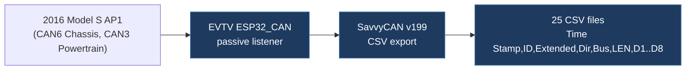

# amzoo-TMS_2016_LOGS

Deep-dive analysis of the 2016 Tesla Model S (AP1) CAN capture corpus. This is a data-only repository: every claim below comes from the captured CSV frames themselves (CAPTURE grade), cross-checked against TeslaCANModder firmware sources. Frame-specific citations use `file @ts <Time Stamp>` — the microsecond capture clock value is a unique per-frame key and survives upstream bumps better than CSV line numbers.

## 1. Provenance

- **Submodule path:** `legacy/amzoo-TMS_2016_LOGS`
- **Pinned gitlink:** `160000 13a6a9dcce7b0f758712c4fbb5acd9272259bbe8 0` (matches `git -C legacy/amzoo-TMS_2016_LOGS rev-parse HEAD`)
- **Upstream:** https://github.com/amzoo/TMS_2016_LOGS — single local commit `13a6a9dc` "Rest of file upload" (2021-01-31)
- **License:** None found — no LICENSE file in `git ls-files` (2 non-CSV files only: `README.md`, `.gitattributes`)
- **Analysis date:** 2026-11-21; mode: **replace** (this file replaces the prior summary; pre-replace claims cited as `git show HEAD:docs/legacy/amzoo-TMS_2016_LOGS.md`)
- **Preservation notes:** the YAML frontmatter above is preserved byte-for-byte from the pre-replace doc, including its CRLF line endings (the rest of this body is LF). The description line carries no trailing whitespace (verified 133 bytes ending `…normal driv`), so nothing was stripped; it is truncated mid-word by the original author and left untouched per replace rules — recorded as a contradiction row in section 6. The pre-replace doc contained **no `## Upstream (...)` sections**, so none are preserved.
- **Vehicle:** 2016 Model S, AP1, single motor, VIN prefix `5YJSA1E18GF1XXXXX` (rest redacted upstream, `README.md:7`)
- **Capture setup:** SavvyCAN v199 on macOS via EVTV ESP32_CAN; Bus 0 = CAN6 Chassis, Bus 1 = CAN3 Powertrain (`README.md:36-43`); timestamps are microseconds since logger boot

| File                               | Coverage label                      | What was actually read                                                                                                                                                                        |
| ---------------------------------- | ----------------------------------- | --------------------------------------------------------------------------------------------------------------------------------------------------------------------------------------------- |
| `README.md`                        | FULL-READ (79 lines)                | all of it                                                                                                                                                                                     |
| `.gitattributes`                   | FULL-READ (1 line)                  | LFS filter for `*.csv`                                                                                                                                                                        |
| `drive/drive1_dirty.csv`           | STRUCTURAL-PARSE                    | ID/bus counts, timestamp monotonicity only; no payload decode                                                                                                                                 |
| `drive/drive2_warnings.csv`        | STRUCTURAL-PARSE + RANGE-CITED      | ID census; all 2,190 `0x257` payloads decoded; 6 `0x106` payload samples                                                                                                                      |
| `drive/drive3_highway.csv`         | STRUCTURAL-PARSE                    | ID census only                                                                                                                                                                                |
| `drive/drive4_highway.csv`         | STRUCTURAL-PARSE                    | ID census, bus split (bus 0 only), span (727.1 s); no payload decode                                                                                                                          |
| `drive/drive5_stopandgo.csv`       | STRUCTURAL-PARSE + RANGE-CITED      | ID census; all 1,142 `0x257` payloads decoded (min/max)                                                                                                                                       |
| `drive/drive6_stopanggo_clean.csv` | STRUCTURAL-PARSE + per-ID FULL-READ | ID census; every `0x118` (99,811) and `0x370` (25,289) payload decoded; mid-file raw samples for `0x118`/`0x115`/`0x3EE`; span 1,119.8 s                                                      |
| 19 `summon/*.csv`                  | STRUCTURAL-PARSE                    | ID census each                                                                                                                                                                                |
| `summon/summon1_fwd_short_car.csv` | + per-ID FULL-READ                  | per-bus period census of every ID; every `0x118` (3,444) and `0x257` (109) payload decoded; raw frame samples for `0x370`, `0x488`, `0x2B9`, `0x219`, `0x273`, `0x3EE`, `0x045`; span ~55.9 s |

- **Files explicitly NOT read:** none exist beyond the 27 listed by `git ls-files`. All 25 CSVs were scanned at the byte level for structure; payload-level decode was limited to the IDs named above — no other payload bytes were interpreted.
- **Caveat:** CSVs are Git-LFS objects (`.gitattributes:1`); analysis assumed the smudged working copies present locally. No TEST-READ evidence exists: this repo ships no tests. No CODE-READ evidence exists: this repo ships no code.

## 2. Executive verdict

This repo is a ~503 MB corpus of 25 SavvyCAN CSV captures from a 2016 Model S (AP1): 6 driving sessions and 19 summon runs (fob- and car-initiated, plus abort/warning cases), logged passively on two buses — no code, no decode tables, no checksums, single upload commit. Its value to TeslaCANModder is narrow but real: it is the only legacy repo in our tree carrying **large-volume genuine AP1 chassis frames**, and it settles one live decoder question — the `0x370` EPAS checksum formula and byte-6 rolling counter we use in the nag echo match this real vehicle generation to 25,288/25,289 frames. It equally **refutes** any temptation to reuse our Model 3/Y `0x118`/`0x219`/`0x273`/`0x257` decoders on AP1-era data: the same numeric IDs carry different DLCs, different buses, and counter-pair payloads there. The upstream "CAN control of iBooster" goal has no supporting decode in the repo. Adaptation candidates are limited to offline replay fixtures and pattern insights; nothing should be ported into shipping firmware from these logs directly.

## 3. Evidence map

| Source file                        | Lines/frames              | What it proves                                                                                                                               | Grade                       |
| ---------------------------------- | ------------------------- | -------------------------------------------------------------------------------------------------------------------------------------------- | --------------------------- |
| `README.md`                        | 1-31                      | vehicle identity, AP1 features, capture buses                                                                                                | SUMMARY-ONLY (upstream doc) |
| `README.md`                        | 33-43                     | SavvyCAN v199 + EVTV ESP32_CAN, Bus0=CAN6 Chassis, Bus1=CAN3 Powertrain                                                                      | SUMMARY-ONLY                |
| `README.md`                        | 45-78                     | summon/drive scenario labels (short/long/max, fwd/bck, fob/car, warnings/aborted)                                                            | SUMMARY-ONLY                |
| `summon/summon1_fwd_short_car.csv` | all lines (structural)    | Bus 0 carries `0x118`/`0x108`/`0x488`/`0x2B9`/`0x370`/`0x273`/`0x3EE`; Bus 1 carries `0x102`/`0x106`/`0x257`; per-ID periods (see section 7) | CAPTURE                     |
| `summon/summon1_fwd_short_car.csv` | all 3,444 `0x118` frames  | `0x118` on AP1: DLC 6, bus 0, byte0=0xFF at rest, bytes 4-5 rolling values — not gear/pedal fields                                           | CAPTURE                     |
| `summon/summon1_fwd_short_car.csv` | all 109 `0x257` frames    | `0x257` on AP1: 462 ms period on bus 1, values ±2.5 km/h under our speed formula                                                             | CAPTURE                     |
| `summon/summon1_fwd_short_car.csv` | `@ts 10262617`+5          | `0x370` payload `61 FF 37 FC 20 1F 2C 71`, byte6 low nibble counts, byte7 = sum+0x73                                                         | CAPTURE                     |
| `summon/summon1_fwd_short_car.csv` | `@ts 10236594`+5          | `0x488` DLC 4, `40 1E 0E F8`, byte3 = byte2+0xEA, exact 50 Hz                                                                                | CAPTURE                     |
| `summon/summon1_fwd_short_car.csv` | `@ts 10259647`+5          | `0x2B9` 8 bytes, byte6 steps +0x20, ~25 Hz                                                                                                   | CAPTURE                     |
| `summon/summon1_fwd_short_car.csv` | `@ts 10260527`+5          | `0x219` DLC 3 counter frame on AP1 — not 8-byte TPMS                                                                                         | CAPTURE                     |
| `summon/summon1_fwd_short_car.csv` | `@ts 10303912`+5          | `0x273` DLC 6 all-zero, bus 0, 500 ms                                                                                                        | CAPTURE                     |
| `summon/summon1_fwd_short_car.csv` | `@ts 10895717`+5          | `0x3EE` emits mux0/mux1 frame pairs (`00…3C…` / `01…02…`)                                                                                    | CAPTURE                     |
| `summon/summon1_fwd_short_car.csv` | `@ts 10273269`+5          | `0x045` DLC 8, byte6 steps +0x10, byte7 varies, 100 ms                                                                                       | CAPTURE                     |
| `drive/drive6_stopanggo_clean.csv` | all 25,289 `0x370` frames | checksum formula holds 25,288/25,289; byte6 counter +1 in 25,287/25,288 pairs                                                                | CAPTURE                     |
| `drive/drive6_stopanggo_clean.csv` | all 99,811 `0x118` frames | DLC 6 everywhere; byte4 +1 counter (92,710/99,810); byte5=byte4+0x3A only 3,095 (rest coincidence); byte0 spread (0xFF/0x00/0x0C…) ≠ gear    | CAPTURE                     |
| `drive/drive6_stopanggo_clean.csv` | `@ts 4945094636`+7        | moving `0x118`: byte0 live signal (7F,7E,7D,80…), byte5 live (14,15,19,1D…)                                                                  | CAPTURE                     |
| `drive/drive6_stopanggo_clean.csv` | `@ts 4945100906`+3        | `0x115` DLC 6, byte4 +0x10 steps, byte5 = byte4+0x16 — not RPM                                                                               | CAPTURE                     |
| `drive/drive4_highway.csv`         | all lines (structural)    | chassis-bus-only capture (1,185,442 bus-0, 0 bus-1, 0 Tx); zero `0x257` in 727 s of highway driving                                          | CAPTURE                     |
| `drive/drive1_dirty.csv`           | all lines (structural)    | non-monotonic timestamps (span computes −514 s — logger reset); no `0x118`/`0x175`/`0x370`; unusable fragment                                | CAPTURE                     |
| all 25 CSVs                        | all lines (structural)    | zero `0x132`, zero `0x292`, zero `0x27D` frames repo-wide; zero Tx frames repo-wide; 54 extended-ID frames scattered across 12 files         | CAPTURE                     |
| `drive/drive2_warnings.csv`        | first 6 `0x106` payloads  | `0x106` at file start: bytes4-5 = 0x0000 while byte1 counter cycles — RPM hypothesis untested at speed                                       | CAPTURE (partial)           |

## 4. Architecture and build surface

None found: no frame pipeline in this repo — it is a passive capture corpus. No entry points, no build flags, no shared core, no dependency boundaries. The only "architecture" is the capture path:



CSV schema: `Time Stamp` (µs, logger clock), `ID` (8-hex-digit zero-padded), `Extended`, `Dir` (all `Rx` — zero `Tx` lines repo-wide), `Bus` (0/1), `LEN` (DLC), `D1..D8` (hex bytes). Timestamps wrap/reset occasionally (see section 9).

## 5. Mechanism catalogue

### 5.1 EPAS_sysStatus 0x370 frame integrity (checksum + rolling counter)

- **Claim (README / summary):** upstream says nothing; our `docs/reference/can-protocol.md` claims counter at `data[1] & 0x0F` and checksum `sum(bytes 0-6) + 0x70 + 0x03`.
- **Code path:** None found — no code in this repo. Capture path: `summon/summon1_fwd_short_car.csv @ts 10262617`, `drive/drive6_stopanggo_clean.csv` (all 25,289 frames).
- **Frame spec:** ID `0x370` (888), bus 0, DLC 8, ~44-53 ms. Observed: byte1 = live signal (0xFF at rest, varying while driving), byte6 low nibble = rolling counter (+1 per frame), byte7 = `(sum(data[0..6]) + 0x70 + 0x03) & 0xFF`.
- **Gates and timing:** None found (passive capture).
- **State machine:** None found.
- **Tests:** None found — repo ships no tests.
- **Evidence grade:** CAPTURE (25,288/25,289 checksum matches; 25,287/25,288 counter steps in drive6).
- **Verdict:** CONFIRMED — the checksum formula matches our `nagChecksum` (`firmware/lib/vehicle/can/checksum.h:67-74`) exactly, and the byte-6 low-nibble counter matches our organic/feifan `counterByte=6` config (`firmware/lib/vehicle/can/feature/fsd/nag.h:111,462-465`). The docs' byte-1 counter claim is contradicted for AP1 (byte1 low nibble varies 0-15 while driving in drive6).
- **Adapt to TeslaCANModder?** already present — no port needed; this capture is independent validation of our existing 0x370 mutation logic for the AP1-era generation.

### 5.2 DAS command pair 0x488 / 0x2B9 rates and counter-pair encoding

- **Claim (README / summary):** upstream silent; our `docs/reference/commands.md` DAS Drive section claims `0x2B9 @25 Hz`, `0x488 @50 Hz`, `0x27D @10 Hz` injection cadence.
- **Code path:** None found (capture only). `summon/summon1_fwd_short_car.csv @ts 10236594` (`0x488`), `@ts 10259647` (`0x2B9`).
- **Frame spec:** `0x488` (1160): bus 0, DLC **4**, byte0=0x40, byte1 live, byte2 low nibble counter, byte3 = byte2+0xEA; exact 20.0 ms period (50.0 Hz) in summon1 and drive6. `0x2B9` (697): bus 0, DLC 8, byte6 steps +0x20, byte7 mirrors byte6−0x20; 39.8-40.0 ms (~25 Hz).
- **Gates and timing:** rates match our injection cadence claims exactly; drive4_highway shows 24.7/49.4 ms variants (rate changes with drive state or logger loss — UNVERIFIED which).
- **State machine:** None found.
- **Tests:** None found.
- **Evidence grade:** CAPTURE (2,796+1,405 frames sampled in summon1; 55,989/28,012 in drive6).
- **Verdict:** PARTIAL — 50/25 Hz cadence confirmed on real AP1 hardware; payload shape differs from our HW3/HW4 assumptions (AP1 `0x488` is DLC 4, ours injects 8-byte frames per `firmware/lib/vehicle/can/handler/bus/chassis.h:35` expectations). `0x27D` (APS_eacMonitor, `ids.h:18`) is absent repo-wide (0 frames) — it is not an AP1 chassis frame.
- **Adapt to TeslaCANModder?** no impact — cadence already matches; shapes are platform-specific and our target is HW3/HW4.

### 5.3 DI_state 0x118 — AP1 chassis variant

- **Claim (README / summary):** upstream silent; our `docs/reference/can-protocol.md` maps `0x118` to DI_state (gear/pedal/brake) on the Model 3/Y vehicle bus.
- **Code path:** None found (capture only). `summon/summon1_fwd_short_car.csv @ts 10244345`+13; `drive/drive6_stopanggo_clean.csv @ts 4945094636`+7.
- **Frame spec:** ID `0x118` (280), **bus 0** (chassis), DLC **6**, ~11-15 ms. At rest: `FF 1F F4 11 <ctr> <ctr+0x3A>`. Moving: byte0 = continuously varying signal (7F,7E,7D,80,83,84,86…), byte1 = 0x40-ish/live, byte4 = +1 rolling counter (92,710/99,810 steps in drive6), byte5 = live signal (counter-coupled only at rest: byte5=byte4+0x3A in 3,095/99,811 drive6 frames).
- **Gates and timing:** None found.
- **State machine:** None found.
- **Tests:** None found.
- **Evidence grade:** CAPTURE (all 3,444 summon1 + all 99,811 drive6 frames decoded).
- **Verdict:** CONTRADICTED for AP1 — our `decodeGearState` (byte0 bits 3:1, `firmware/lib/vehicle/can/feature/telemetry/powertrain.h:29-32`), `decodeAccelPedal` (byte1, `:39-42`) and `decodeBrakePedalState` (byte2 bits 4:3, `:49-52`) all read fields that are status/counter/live-signal positions on this vehicle (byte0 rest value 0xFF alone drives a "gear=7" reading; the byte1 histogram in a 100k-frame human-driving file has only 15 distinct values — counter-like, not a pedal trace). The conflict with our decoders remains **unsettled for HW3/HW4** — AP1 is a different platform and these logs predate our target firmware.
- **Adapt to TeslaCANModder?** never port the AP1 layout; our HW3/HW4 decoders need their own bench capture before any change (capture-first).

### 5.4 Delta-encoded counter-pair idiom

- **Claim (README / summary):** none — pattern discovered in the captures.
- **Code path:** None found. Frames: `0x118` (byte5=byte4+0x3A at rest), `0x488` (byte3=byte2+0xEA), `0x115` (byte5=byte4+0x16), `0x219` (byte2=byte0+0x1B) — `summon/summon1_fwd_short_car.csv @ts 10244345 / 10236594`; `drive/drive6_stopanggo_clean.csv @ts 4945100906`.
- **Frame spec:** AP1 sends several small frames as `<counter> <counter + constant-delta>` byte pairs; the second byte tracks the first with a fixed offset (rest-state invariant for 0x118; structural invariant for 0x488/0x115/0x219).
- **Gates and timing:** None found.
- **State machine:** None found.
- **Tests:** None found.
- **Evidence grade:** CAPTURE (pair deltas verified on 6 consecutive frames each; 0x118 pair delta at scale: 3,095/99,811 while moving, constant at rest).
- **Verdict:** CONFIRMED as an AP1 idiom. Relevance to our GTW-shield-style foreign-frame detection: a stale/replayed frame breaks the pair coupling. Whether HW3/HW4 frames share this idiom is unknown.
- **Adapt to TeslaCANModder?** candidate (idea only, capture-first) — a freshness heuristic for injected-frame authenticity; UNVERIFIED on our target platform.

### 5.5 Legacy stalk 0x045

- **Claim (README / summary):** upstream silent; our `docs/reference/can-protocol.md` maps `0x045` to "Legacy stalk position" on the chassis bus.
- **Code path:** None found. `summon/summon1_fwd_short_car.csv @ts 10273269`+5.
- **Frame spec:** ID `0x045` (69), bus 0, DLC 8, 100 ms. Observed: `40 C8 00 00 00 00 <ctr> <varies>`, byte6 steps +0x10 (high-nibble counter), byte7 varies — checksum-like. Total 39,783 frames repo-wide.
- **Gates and timing:** None found.
- **State machine:** None found.
- **Tests:** None found.
- **Evidence grade:** CAPTURE (presence, period, structure only).
- **Verdict:** CONFIRMED present on AP1 chassis at 10 Hz; stalk-position semantics UNVERIFIED (payload values constant during these scenarios).
- **Adapt to TeslaCANModder?** no impact — our Legacy handler targets this ID nominally, but semantics must come from a real HW-legacy bench session, not these parked/idle captures.

### 5.6 Legacy FSD mux 0x3EE

- **Claim (README / summary):** our `docs/reference/can-protocol.md` Legacy handler section uses `0x3EE` mux 0 (bit 46 + profile) / mux 1 (bit 19 nag clear); `firmware/lib/vehicle/can/handler/bus/chassis.h:82-88` infers `variant = LEGACY` from the mere presence of `0x3EE`.
- **Code path:** None found. `summon/summon1_fwd_short_car.csv @ts 10895717`; `drive/drive6_stopanggo_clean.csv @ts 4945337624`.
- **Frame spec:** ID `0x3EE` (1006), bus 0, DLC 8, repeating pairs ~1 s apart: `00 00 00 3C 00 00 00 00` then `01 00 02 00 00 00 00 00` — byte0 mux ∈ {0,1}, payload otherwise static across all sampled scenarios. 8,014 frames repo-wide.
- **Gates and timing:** None found.
- **State machine:** None found (mux pair alternation observed, not a state machine).
- **Tests:** None found.
- **Evidence grade:** CAPTURE (structure); semantic mapping SUMMARY-ONLY (our docs).
- **Verdict:** PARTIAL — the frame exists on AP1 with a 2-mux byte0 structure compatible with our legacy mux handler, but with byte-for-byte identical payloads in every scenario, so no signal semantics can be validated. Note: feeding AP1 frames into our firmware would trigger the `LEGACY` variant inference at `chassis.h:82` on presence alone — correct by luck for this platform, but the inference is unfalsifiable from these logs.
- **Adapt to TeslaCANModder?** no impact now; capture-first if the Legacy decode path is ever exercised against real AP1 hardware.

### 5.7 Summon scenario captures (fob / car / abort / warnings)

- **Claim (README / summary):** README describes short/long/max-distance summon runs, fob vs car initiation, one aborted run, two warning runs (`README.md:45-66,71-78`).
- **Code path:** None found. 19 CSVs under `summon/`; `0x273` observed as bus-0 DLC-6 all-zero 500 ms frames (e.g. `summon/summon1_fwd_short_car.csv @ts 10303912`).
- **Frame spec:** no summon-actuation frame could be identified in this pass; `0x273` on AP1 is a periodic chassis keep-alive, not our Model 3/Y vehicle-bus cached summon base (`firmware/lib/vehicle/can/fwd.h:16-26` assumes an 8-byte cached frame).
- **Gates and timing:** None found.
- **State machine:** None found.
- **Tests:** None found.
- **Evidence grade:** CAPTURE for scenario existence; UNVERIFIED for actuation semantics.
- **Verdict:** UNVERIFIED — the logs prove the scenarios ran (speed-like `0x257` creep values ±2.5 km/h appear during motion windows) but no candidate actuation frame was isolated; a diff-pairs analysis (fob vs car, abort vs normal) remains undone.
- **Adapt to TeslaCANModder?** no impact — our summon targets Model 3/Y `0x273` mutation on the vehicle bus, a different mechanism generation entirely.

## 6. Summary vs code contradiction table

Pre-replace claims are cited from `git show HEAD:docs/legacy/amzoo-TMS_2016_LOGS.md` (the replaced summary exists in git history, not as a live link). "Code" here means the capture data, since the repo ships no code.

| #   | Pre-replace claim (HEAD line)                                                                   | Capture evidence                                                                                                                                                                        | Verdict                                                                 |
| --- | ----------------------------------------------------------------------------------------------- | --------------------------------------------------------------------------------------------------------------------------------------------------------------------------------------- | ----------------------------------------------------------------------- |
| 1   | Frontmatter description is a complete sentence                                                  | `docs/legacy/amzoo-TMS_2016_LOGS.md:3` — truncated mid-word (`…The logs cover normal driv`, 133 bytes, no trailing whitespace)                                                          | Inherited defect; kept byte-for-byte per replace-mode rules             |
| 2   | "Bus 0: CAN6 Chassis / Bus 1: CAN3 Powertrain" presented as uniform coverage (HEAD lines 60-63) | `drive/drive4_highway.csv` contains **only** bus 0 (1,185,442 frames, zero bus-1) — per-file bus coverage varies                                                                        | PARTIAL — blanket claim hides per-file capture configs                  |
| 3   | All six drive logs presented as equivalent usable captures (HEAD lines 65-66)                   | `drive/drive1_dirty.csv` has non-monotonic timestamps (span computes −514 s; logger reset mid-file) and contains no `0x118`/`0x175`/`0x370` — a broken parked-fragment, not a drive log | CONTRADICTED for drive1; other five confirmed                           |
| 4   | Upstream README "Goal: CAN control of iBooster" (`README.md:2`)                                 | Repo contains only raw logs — no decode, no iBooster frame identification, no tooling                                                                                                   | Goal status UNVERIFIED; nothing in-repo demonstrates progress toward it |

Agreements that are not contradictions: 19 summon CSVs (HEAD line 47-48) — count is exactly right; SavvyCAN CSV format claim (HEAD line 76) — confirmed, with the LFS caveat not mentioned there; "CAN structure may differ from Model 3/Y HW3/HW4" (HEAD line 76) — confirmed emphatically by sections 5.3 and 7.

## 7. CAN frame and signal inventory

All frames below are **read-only** (zero `Tx` frames repo-wide; the logger is passive). "Grade" reflects what the capture alone can prove. Periods measured on `summon/summon1_fwd_short_car.csv` (~56 s) and `drive/drive6_stopanggo_clean.csv` (1,119.8 s).

| ID (hex+dec)  | Bus | Period                | DLC | Observed byte behavior                                                                    | Read/write | Grade               |
| ------------- | --- | --------------------- | --- | ----------------------------------------------------------------------------------------- | ---------- | ------------------- |
| 0x003 (3)     | 0   | 10 ms                 | 8   | constant core frame                                                                       | read       | CAPTURE (structure) |
| 0x00E (14)    | 0   | 10 ms                 | 8   | constant core frame                                                                       | read       | CAPTURE (structure) |
| 0x06D (109)   | 0   | 10 ms                 | 4   | constant core frame                                                                       | read       | CAPTURE (structure) |
| 0x108 (264)   | 0   | 14.7 ms               | 8   | frame-count/period twin of 0x118 (different DLC)                                          | read       | CAPTURE (structure) |
| 0x118 (280)   | 0   | 11.2-14.7 ms          | 6   | byte0 live signal (0xFF at rest), byte4 +1 counter, byte5 counter-coupled at rest (+0x3A) | read       | CAPTURE             |
| 0x175 (373)   | 0   | 11.1-14.5 ms          | 8   | high-rate wheel/motion frame; payload undecoded                                           | read       | CAPTURE (structure) |
| 0x045 (69)    | 0   | 100 ms                | 8   | byte6 high-nibble counter (+0x10 steps), byte7 varies                                     | read       | CAPTURE (structure) |
| 0x249 (585)   | 0   | 100 ms                | 8   | periodic; undecoded                                                                       | read       | CAPTURE (structure) |
| 0x318 (792)   | 0   | 100 ms                | 8   | periodic; undecoded                                                                       | read       | CAPTURE (structure) |
| 0x488 (1160)  | 0   | 20.0 ms (50 Hz)       | 4   | byte2 low-nibble counter, byte3 = byte2+0xEA                                              | read       | CAPTURE             |
| 0x2B9 (697)   | 0   | 39.8-40.0 ms (~25 Hz) | 8   | byte6 steps +0x20, byte7 mirrors −0x20                                                    | read       | CAPTURE             |
| 0x219 (537)   | 0   | 40 ms                 | 3   | byte0 counter, byte2 = byte0+0x1B; **not** our 8-byte TPMS layout                         | read       | CAPTURE             |
| 0x399 (921)   | 0   | ~469 ms               | 8   | periodic; on AP1 this is not our HW4 ISA-chime claim                                      | read       | CAPTURE (structure) |
| 0x370 (880)   | 0   | 44.3-52.9 ms          | 8   | byte6 low-nibble counter, byte7 = sum(b0..6)+0x73; byte1 live                             | read       | CAPTURE             |
| 0x273 (627)   | 0   | 500 ms                | 6   | all-zero payload in every sampled scenario                                                | read       | CAPTURE             |
| 0x3EE (1006)  | 0   | mux pair ~1 s         | 8   | byte0 mux ∈ {0,1}, payload static                                                         | read       | CAPTURE             |
| 0x3F8 (1016)  | 0   | 112-145 ms            | 8   | periodic; undecoded                                                                       | read       | CAPTURE (structure) |
| 0x334 (820)   | 0   | ~1 s                  | 8   | periodic; undecoded                                                                       | read       | CAPTURE (structure) |
| 0x398 (920)   | 0   | ~1 s                  | 8   | periodic; undecoded                                                                       | read       | CAPTURE (structure) |
| 0x313 (787)   | 0/1 | 1-3 frames per file   | 8   | rare event frame, not periodic                                                            | read       | CAPTURE (structure) |
| 0x102 (258)   | 1   | 21.3 ms               | 8   | undecoded                                                                                 | read       | CAPTURE (structure) |
| 0x106 (262)   | 1   | 20.4 ms               | 8   | byte1 counter-like cycle; bytes4-5 zero at file start                                     | read       | CAPTURE (partial)   |
| 0x115 (277)   | 0   | 22.3-29 ms            | 6   | byte4 +0x10 steps, byte5 = byte4+0x16                                                     | read       | CAPTURE             |
| 0x257 (599)   | 1   | 462 ms                | 8   | our speed formula yields ±2.5 km/h during summon motion; absent during highway cruise     | read       | CAPTURE             |
| 0x2AA (682)   | 1   | 119.7 ms              | 8   | undecoded                                                                                 | read       | CAPTURE (structure) |
| 0x076C (1900) | 1   | ~1.5 s                | 8   | unknown AP1 ID, 1,271 frames repo-wide                                                    | read       | CAPTURE (structure) |

Vendored catalog note: none — this repo has no DBC/JSON catalog. Frame semantics beyond the byte behavior above are UNVERIFIED.

## 8. Constants and tuning table

| Constant               | Value                            | Location                                                                       | Meaning                                                                          | Grade   |
| ---------------------- | -------------------------------- | ------------------------------------------------------------------------------ | -------------------------------------------------------------------------------- | ------- |
| 0x370 checksum adder   | 0x73 (= 0x70+0x03, the ID split) | `drive6` all 0x370 frames; matches `firmware/lib/vehicle/can/checksum.h:72-73` | `data[7] = (sum(data[0..6]) + 0x73) & 0xFF`                                      | CAPTURE |
| 0x370 counter position | byte6, low nibble                | `drive6` all 0x370 frames; matches `nag.h:111,462`                             | +1 per frame                                                                     | CAPTURE |
| 0x118 counter position | byte4, full byte                 | `drive6` all 0x118 frames                                                      | +1 mod 256, 92,710/99,810 steps                                                  | CAPTURE |
| 0x118 rest pair delta  | 0x3A                             | `summon1 @ts 10244345`+13                                                      | byte5 = byte4+0x3A while parked; not a moving invariant (3,095/99,811 in drive6) | CAPTURE |
| 0x488 pair delta       | 0xEA                             | `summon1 @ts 10236594`+5                                                       | byte3 = byte2+0xEA                                                               | CAPTURE |
| 0x115 pair delta       | 0x16                             | `drive6 @ts 4945100906`+3                                                      | byte5 = byte4+0x16, byte4 steps +0x10                                            | CAPTURE |
| 0x219 pair delta       | 0x1B                             | `summon1 @ts 10260527`+5                                                       | byte2 = byte0+0x1B                                                               | CAPTURE |
| DAS steering rate      | 50.0 Hz                          | `summon1`/`drive6` 0x488                                                       | matches our claimed injection cadence                                            | CAPTURE |
| DAS control rate       | ~25 Hz                           | `summon1`/`drive6` 0x2B9                                                       | matches our claimed injection cadence                                            | CAPTURE |
| Stalk rate             | 10 Hz                            | `summon1`/`drive6` 0x045                                                       | periodic keep-alive                                                              | CAPTURE |
| 0x273 rate             | 500 ms, bus 0, DLC 6             | `summon1`/`drive6`                                                             | AP1 keep-alive shape                                                             | CAPTURE |
| Core chassis trio      | 10 ms (0x003/0x00E/0x06D)        | `summon1` census                                                               | highest-rate frames on bus 0                                                     | CAPTURE |

## 9. Failure modes and edge cases

No firmware exists here, so "handling code path" is not applicable; these are capture-level anomalies an agent replaying this corpus must know.

| Failure                            | Evidence                                                                                                        | Handling                                          | Tested? | Grade                                            |
| ---------------------------------- | --------------------------------------------------------------------------------------------------------------- | ------------------------------------------------- | ------- | ------------------------------------------------ |
| Logger clock reset mid-file        | `drive/drive1_dirty.csv` timestamps non-monotonic; span computes −514 s                                         | none (data defect)                                | no      | CAPTURE                                          |
| Frame loss under load              | `drive6` 0x118 byte4 counter skips in 7,100/99,810 transitions; drive4 0x488 period stretches to 24.7 ms        | none — replay tools must tolerate gaps            | no      | CAPTURE                                          |
| Single-bus capture config          | `drive/drive4_highway.csv` has zero bus-1 frames — powertrain IDs absent from an otherwise ideal highway sample | none; do not treat missing IDs as vehicle absence | no      | CAPTURE                                          |
| Vehicle warning/shutdown scenarios | `drive2_warnings.csv`, `summon8_return_short_fob_warnings.csv` (README labels)                                  | frames captured but undecoded                     | no      | SUMMARY-ONLY (scenario) + CAPTURE (frames exist) |
| Aborted summon                     | `summon7_bck_long_fob_aborted.csv` (README label)                                                               | frames captured; abort signature not isolated     | no      | SUMMARY-ONLY + CAPTURE (frames exist)            |
| Extended-ID frames                 | 54 lines across 12 files carry `Extended=true`                                                                  | not decoded in this pass                          | no      | CAPTURE (presence)                               |

## 10. Test coverage map

None found — the repository contains no tests and no code. Critical paths with no verification: every byte-level claim in this document is directly evidenced by the captures, but every semantic claim (gear, pedal, speed, TPMS, stalk, mux meaning on AP1) has no independent oracle. Risk in one line: a future agent could misread AP1 counter bytes as signals (exactly the failure mode section 5.3 documents for our own 0x118 decoder) unless DLC/bus/counter positions are checked first.

## 11. Parity matrix with TeslaCANModder

Every row cites our-side code read during this analysis. Platform caveat applies to all rows: upstream side is AP1 Model S (2016, CAN6/CAN3); our side targets Model 3/Y HW3/HW4 (X179 chassis/vehicle buses). Conflicts our decoders cannot settle from this corpus remain explicitly unsettled.

| Signal/frame             | Upstream (capture) evidence                                                            | Our decode (cite)                                          | Delta                                                                                      | Action                                                                     |
| ------------------------ | -------------------------------------------------------------------------------------- | ---------------------------------------------------------- | ------------------------------------------------------------------------------------------ | -------------------------------------------------------------------------- |
| 0x370 EPAS checksum      | byte7 = sum(b0..6)+0x73, 25,288/25,289 in drive6                                       | `checksum.h:67-74` `nagChecksum` — identical formula       | none                                                                                       | align (already identical; capture confirms)                                |
| 0x370 EPAS counter       | byte6 low nibble, +1/frame (25,287/25,288)                                             | `nag.h:111` counterByte ∈ {1,6}; `:462-465` writes it      | AP1 = byte6; our byte-1 variant untested by these logs                                     | keep both; capture-first for HW3/HW4 byte-1 validation                     |
| 0x370 docs counter claim | byte1 low nibble varies 0-15 while driving                                             | `docs/reference/can-protocol.md` "counter in data[1]&0x0F" | contradicted for AP1                                                                       | doc-level caution; capture-first before trusting byte-1 on target hardware |
| 0x118 gear               | bus 0, DLC 6, byte0 live/status (0xFF at rest) — not gear bits 3:1                     | `powertrain.h:29-32` byte0 bits 3:1                        | cross-platform contradiction; our HW3/HW4 layout unvalidated here                          | ignore (AP1 ≠ target); capture-first on HW3/HW4                            |
| 0x118 pedal              | byte1 counter-like (15 distinct values in 100k driving frames)                         | `powertrain.h:39-42` byte1 = percent                       | cross-platform contradiction                                                               | ignore; capture-first on HW3/HW4                                           |
| 0x118 brake              | byte2 bits 4:3 spread across all 4 values at rest and moving                           | `powertrain.h:49-52` bits 20:19 → 0/1/2                    | cross-platform contradiction                                                               | ignore; capture-first on HW3/HW4                                           |
| 0x257 speed              | bus 1, 462 ms, ±2.5 km/h under our formula during summon; zero frames in 727 s highway | `powertrain.h:18-22` bytes 2-3 signed ×100 → km/h          | not the road-speed source on AP1; formula coincidentally yields creep-plausible values     | unsettled for HW3/HW4; capture-first                                       |
| 0x132 BMS voltage        | absent repo-wide (0 frames)                                                            | `bms.h:18-22` bytes 0-1 ×0.01 V                            | no arbitration possible                                                                    | unsettled; needs HW3/HW4 capture                                           |
| 0x292 BMS SoC            | absent repo-wide (0 frames)                                                            | `bms.h:50-54` 10-bit ×0.1 %                                | no arbitration possible                                                                    | unsettled; needs HW3/HW4 capture                                           |
| 0x219 TPMS               | bus 0, DLC 3, counter-pair frame                                                       | `tpms.h:51-58` requires dlc ≥ 8; gate `vehicle.h:348`      | our decoder safely no-ops on AP1 frames                                                    | ignore (platform); dlc gate already protects us                            |
| 0x488/0x2B9 DAS cadence  | 50.0 Hz / 25 Hz exactly                                                                | `ids.h:19,26`; docs DAS Drive @25/50 Hz                    | cadence confirmed; AP1 0x488 is DLC 4 vs our 8-byte shape (`chassis.h:35` expects dlc ≥ 2) | keep our HW3/HW4 shapes; capture-first                                     |
| 0x27D APS_eacMonitor     | absent repo-wide (0 frames)                                                            | `ids.h:18` TX DAS gate frame                               | not an AP1 chassis frame                                                                   | ignore (platform)                                                          |
| 0x273 summon base        | bus 0, DLC 6, all-zero, 500 ms                                                         | `fwd.h:16-26` cached 8-byte vehicle-bus base               | different bus, DLC, and role                                                               | ignore (platform); our summon targets Model 3/Y                            |
| 0x3EE legacy mux         | bus 0, mux 0/1 pairs, static payloads                                                  | `chassis.h:82-88` infers LEGACY variant on 0x3EE presence  | presence-inference would fire on AP1; semantics unproven                                   | capture-first before exercising Legacy path                                |
| 0x118 sim shape          | AP1 real frame is DLC 6                                                                | `can_sim.h:78-86` simulates 8-byte 0x118                   | sim encodes our HW3/HW4 assumption — fine for target, never an AP1 oracle                  | note only                                                                  |
| 0x39B DAS hands-on       | absent repo-wide (0 frames)                                                            | `ids.h:64`; `vehicle.h:130` dlc ≥ 6 decode                 | AP1 predates this frame — our nag gating cannot be arbitrated here                         | capture-first on HW3/HW4                                                   |

## 12. Surface inventory and security notes

Transport surfaces: None found — no serial/BLE/web endpoints; the repo exposes nothing runnable. The only interface is the CSV schema documented in section 4.

- **VIN handling:** upstream README redacts the VIN tail (`5YJSA1E18GF1XXXXX`, `README.md:7`); the CSVs contain only CAN frames, no PII. Good practice worth mirroring if we ever publish captures.
- **Untrusted archive:** the CSVs are unlicensed third-party data (~503 MB, Git-LFS). LFS pointer stubs will appear in clones without `git-lfs`; do not treat a stubbed submodule as "empty upstream".
- **Credentials/keys:** none found.
- **Dangerous build flags:** none — no build system exists.
- **Data-quality traps for replay tooling:** logger clock resets (drive1), per-file bus coverage (drive4 is chassis-only), 54 extended-ID frames mixed into otherwise standard-11-bit captures.

## 13. Adaptation assessment

| Mechanism                                                                                             | Value                                                                                | Cost                                                                                   | Risk                                                                 | Evidence                                     | Decision                                                                                       |
| ----------------------------------------------------------------------------------------------------- | ------------------------------------------------------------------------------------ | -------------------------------------------------------------------------------------- | -------------------------------------------------------------------- | -------------------------------------------- | ---------------------------------------------------------------------------------------------- |
| 0x370 checksum + byte-6 counter                                                                       | validates our nag echo against a real Tesla generation                               | zero — already shipped (`checksum.h:67-74`, `nag.h:462-465`)                           | none (read-only evidence)                                            | CAPTURE (25,288/25,289)                      | **already present** — record as validation evidence, no code change                            |
| DAS 50/25 Hz cadence                                                                                  | corroborates our DAS Drive injection rates                                           | zero                                                                                   | none                                                                 | CAPTURE                                      | **already present** — no change                                                                |
| AP1 corpus as offline replay fixtures for `tools/` (tcm-debug / GVRET bridge bench decode regression) | real-vehicle frame streams for replay testing                                        | medium — needs LFS smudge + unlicensed-data handling (local use only, never committed) | license/PII hygiene only                                             | CAPTURE                                      | **candidate for future PR** (fixture generation, not raw-data vendoring)                       |
| Counter-pair freshness heuristic                                                                      | possible stale/foreign-frame detector for GTW-shield-style guards                    | low                                                                                    | UNVERIFIED on HW3/HW4 — pattern is AP1-observed                      | CAPTURE (AP1) / UNVERIFIED (target)          | **candidate (capture-first)** — do not build before a HW3/HW4 bench capture confirms the idiom |
| AP1 0x118/0x219/0x273/0x257 decodes                                                                   | none for our target platform                                                         | —                                                                                      | cross-platform misdecode if reused                                   | CAPTURE                                      | **never port** these AP1 layouts into our decoders                                             |
| Legacy (AP1) variant decode support (0x3EE/0x045)                                                     | hypothetical Legacy-profile enrichment                                               | high — no bench AP1 vehicle                                                            | variant-inference on presence alone is unfalsifiable from these logs | CAPTURE (structure) / UNVERIFIED (semantics) | **no impact now** — revisit only with real AP1 hardware sessions                               |
| Summon actuation research                                                                             | AP1 summon is a different mechanism generation from our 0x273-based Model 3/Y summon | high                                                                                   | none to shipping code                                                | UNVERIFIED                                   | **no impact**                                                                                  |

## 14. Do-not-copy list

| Item                                        | Location                      | Reason                                                                                                                                                       |
| ------------------------------------------- | ----------------------------- | ------------------------------------------------------------------------------------------------------------------------------------------------------------ |
| The 25 CSVs (~503 MB)                       | `drive/*.csv`, `summon/*.csv` | unlicensed third-party data, LFS-backed; never vendor into `firmware/`, `client/`, `packages/`, `tools/` or committed test fixtures — see `.gitattributes:1` |
| Raw capture bytes as committed test vectors | any `*/test/`                 | unlicensed; recompute synthetic frames with our own checksum code instead (independent oracle rule)                                                          |
| VIN-derived claims                          | `README.md:7`                 | redacted upstream; do not propagate VIN content into shipping docs or code comments                                                                          |
| "Goal: CAN control of iBooster" framing     | `README.md:2`                 | nothing in-repo demonstrates iBooster decode or control; citing it as a proven capability would launder an unverified claim                                  |

## 15. History and evolution

The submodule's local history is a single commit: `13a6a9dcce7b0f758712c4fbb5acd9272259bbe8` "Rest of file upload" (2021-01-31). The clone is not shallow (`no .git/shallow`), so this is the entire locally-available history — no earlier iterations, no abandoned approaches, no rollbacks visible. No tags, no branches beyond HEAD. What the single-commit history implies: the corpus was uploaded in (at least) two parts ("Rest of file upload" implies a first batch that is not in our tree's history) and never iterated after upload. Network-only history (issues, PRs, the pre-upload repo state) was not consulted: UNVERIFIED. Pre-pin upstream history was not reviewed (nothing before the pin exists locally).

## 16. Re-verification recipe

```bash
OLD=13a6a9dcce7b0f758712c4fbb5acd9272259bbe8
git ls-files -s legacy/amzoo-TMS_2016_LOGS        # -> 160000 13a6a9dcce7b0f758712c4fbb5acd9272259bbe8 0
git -C legacy/amzoo-TMS_2016_LOGS rev-parse HEAD  # -> same SHA (must match the gitlink)
git -C legacy/amzoo-TMS_2016_LOGS status --porcelain  # -> empty
git -C legacy/amzoo-TMS_2016_LOGS log --oneline   # -> only 'Rest of file upload'
# after an upstream bump:
git -C legacy/amzoo-TMS_2016_LOGS fetch --tags --prune
git -C legacy/amzoo-TMS_2016_LOGS log --oneline $OLD..origin/main
git -C legacy/amzoo-TMS_2016_LOGS diff --stat $OLD..origin/main
```

Upstream anchors (run from `legacy/amzoo-TMS_2016_LOGS/`; demonstrated at write time with the PowerShell equivalents `Select-String`/.NET regex over the same files, literal patterns so BRE/ERE differences do not apply):

```text
grep -cE ',00000370,false' drive/drive6_stopanggo_clean.csv      -> expect 25289
grep -cE ',00000118,false' drive/drive6_stopanggo_clean.csv      -> expect 99811
grep -cE ',00000118,false' summon/summon1_fwd_short_car.csv      -> expect 3444
grep -cE ',00000257,false' summon/summon1_fwd_short_car.csv     -> expect 109
grep -cE ',00000257,false' drive/drive4_highway.csv              -> expect 0        (absence anchor)
grep -rcE ',00000(132|292|27D),false' .                          -> expect 0 in every file (absence anchors)
grep -rcE ',false,Tx,' .                                         -> expect 0 in every file (passive-capture anchor)
grep -nE '^10262617,00000370' summon/summon1_fwd_short_car.csv   -> expect '61,FF,37,FC,20,1F,2C,71' payload
grep -nE '^10236594,00000488' summon/summon1_fwd_short_car.csv   -> expect '40,1E,0E,F8' payload (DLC 4)
grep -nE '^10244345,00000118' summon/summon1_fwd_short_car.csv   -> expect 'FF,1F,F4,11,8F,C9' payload (DLC 6)
```

Our-side drift anchors (run from the repo root; these pin the `already present` decisions):

```text
grep -nE 'nagChecksum' firmware/lib/vehicle/can/checksum.h            -> expect :67 inline definition
grep -nE 'counterByte' firmware/lib/vehicle/can/feature/fsd/nag.h    -> expect :111, :462, :464, :465
grep -nE 'decodeGearState|decodeAccelPedal|decodeBrakePedalState|decodeVehicleSpeed' firmware/lib/vehicle/can/feature/telemetry/powertrain.h -> expect :29, :39, :49, :18
grep -nE 'decodeBmsVoltage|decodeBmsCurrent|decodeBmsSoc' firmware/lib/vehicle/can/feature/telemetry/bms.h -> expect :18, :29, :50
grep -nE 'CAN_ID_LEGACY_FSD_MUX' firmware/lib/vehicle/can/handler/bus/chassis.h -> expect :82 (LEGACY variant inference)
grep -nE 'decodeTpmsPressureBar' firmware/lib/vehicle/can/feature/telemetry/tpms.h -> expect :22
```

If line numbers drift by more than ~10, re-read the whole function; do not trust this document's numbers. Upstream history before the pinned SHA was not reviewed — only the pinned snapshot (and there is nothing earlier locally anyway).

## 17. Open questions and explicitly not investigated

- **UNVERIFIED — iBooster decode:** the upstream goal ("CAN control of iBooster", `README.md:2`) has no supporting analysis anywhere in the repo; which AP1 IDs carry iBooster braking actuation is unknown. Would verify: brake-event diff analysis on `drive5_stopandgo.csv` (README claims verified regen + iBooster braking on that run).
- **UNVERIFIED — summon actuation frames:** no candidate frame isolated. Would verify: paired diff of `summon1_fwd_short_car.csv` vs `summon7_bck_long_fob_aborted.csv` around motion onset.
- **UNVERIFIED — 0x257 semantics on AP1:** absent during sustained highway cruise, so it is not road speed there; the ±2.5 km/h summon-window values may be a different slow signal that merely scales plausibly. Would verify: correlate `0x175` payload rate with `0x257` values across drive3.
- **UNSETTLED for our target — 0x118/0x132/0x292/0x257/0x219 on HW3/HW4:** these 2016-era AP1 logs predate our target firmware/hardware; they refute cross-platform reuse but cannot confirm or deny our Model 3/Y decoders. Only a HW3/HW4 bench capture settles these.
- **UNVERIFIED — 0x3EE/0x045/0x399 AP1 semantics:** presence and structure captured; meaning (FSD mux? stalk? chime?) unproven.
- **Not investigated:** the 54 extended-ID frames (which file lines, what IDs — located only per-file counts); the ~140 bus-1 powertrain IDs beyond the census (undecoded); drive2/summon8 "warnings" payload forensics; upstream network history (issues/PRs); pre-pin history (moot — single local commit).
