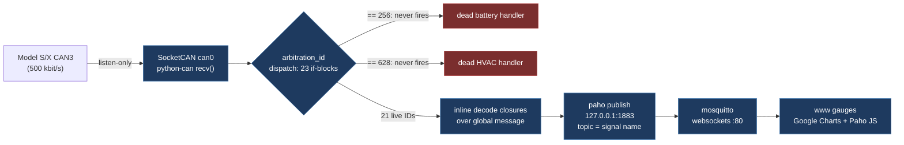
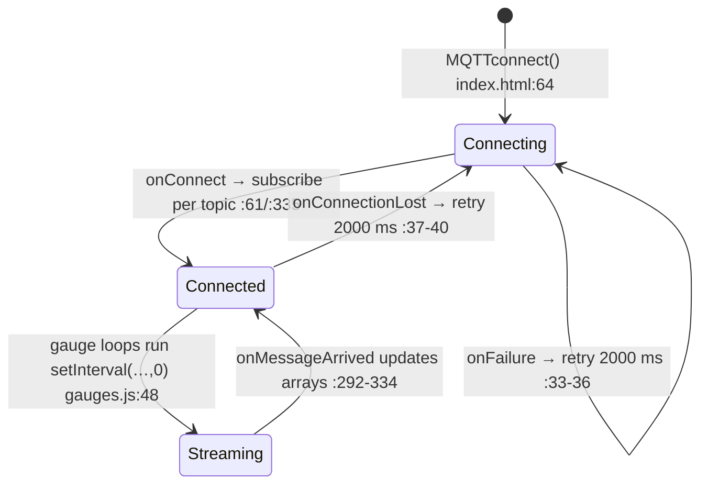

# automotive-stuff-Tesla_canbus (deep dive)

## 1. Provenance

- Submodule: `legacy/automotive-stuff-Tesla_canbus`, gitlink `160000 74ac6359a7fc88e87e037af22026e94798c1b442 0` (matches `git -C legacy/automotive-stuff-Tesla_canbus rev-parse HEAD`; worktree clean per `git -C legacy/automotive-stuff-Tesla_canbus status --porcelain` → no output).
- Pinned commit: `74ac6359a7fc88e87e037af22026e94798c1b442` — `changed some stuff`, dated 2021-05-01. This is the **only** commit in the submodule's local history (`git rev-list --all --count` → 1).
- Upstream: `https://github.com/automotive-stuff/Tesla_canbus` (fetch/push, `git -C legacy/automotive-stuff-Tesla_canbus remote -v`). README image links point at `github.com/ekenit/Tesla_canbus` (README.md:9-14), so `ekenit` is the original author handle and `automotive-stuff` the mirroring org.
- License: **No license file found** (`git -C legacy/automotive-stuff-Tesla_canbus ls-files` has no LICENSE/COPYING; README is silent). The pre-replace doc's `License: None` (git show HEAD:docs/legacy/automotive-stuff-Tesla_canbus.md#L22) agrees. Reuse requires caution; nothing here may be copied into shipping code.
- Analysis date: 2026-11-21. Mode: **replace** — the pre-replace summary still exists in git history and is cited below as `git show HEAD:docs/legacy/automotive-stuff-Tesla_canbus.md#<line>`.
- Frontmatter: preserved byte-for-byte (9 lines, LF). The `description:` line is truncated mid-word (`decodes doze`) with no trailing whitespace; the truncation is preserved verbatim and recorded as a contradiction row in section 6.
- `## Upstream (...)` sections: **none existed in the pre-replace doc** (verified: `git show HEAD:docs/legacy/automotive-stuff-Tesla_canbus.md | Select-String '## Upstream'` → no output). Nothing to preserve beyond frontmatter.

Files read (upstream, FULL-READ):

| File | Lines read |
| --- | --- |
| `canlogger2.1.py` | 1-475 (whole file) |
| `utils/tester.py` | 1-631 (whole file) |
| `utils/slurper.py` | 1-209 (whole file) |
| `utils/logg_to_csv.py` | 1-95 (whole file) |
| `README.md` | 1-27 (whole file) |
| `mosquitto/mosquitto.conf` | 1-5 (whole file) |
| `www/index.html` | 1-211 (whole file) |
| `www/js/google.gauges.js` | 1-362 (whole file) |

Files read (upstream, RANGE-CITED — only the cited ranges were read, plus full-file `arbitration_id` greps): `old/canlogger1.1` (1-60), `old/canlogger1.2.py` (1-80, 60-63), `old/canlogger1.3.py` (1-50), `old/www/index.html` (1-40).

Files read (STRUCTURAL-PARSE — vendored minified libraries, claims limited to provenance/role): `www/js/loader.js` (Google Charts loader), `www/js/paho-mqtt-min.js`, `www/js/mqttws31.js`, `old/www/js/paho-mqtt-min.js`, `old/www/js/jquery-3.4.1.min.js`, `old/www/css/mat.css`.

Files explicitly NOT read: `images/*` (binary photos/pinouts), all `.DS_Store` files (macOS Finder metadata), `www/js/jquery.min.js` (verified empty: `git cat-file -s e69de29bb2d1d6434b8b29ae775ad8c2e48c5391` → 0).

Our-side files read for the parity matrix (section 11):

| File | Lines read | Coverage |
| --- | --- | --- |
| `firmware/lib/vehicle/can/feature/telemetry/powertrain.h` | 1-111 | FULL-READ |
| `firmware/lib/vehicle/can/ids.h` | 1-122 | FULL-READ |
| `firmware/lib/vehicle/can/feature/telemetry/bms.h` | 1-175, 440-514 | RANGE-CITED |
| `firmware/lib/vehicle/can/feature/comfort/air_recirc.h` | 1-60 | RANGE-CITED |
| `firmware/lib/vehicle/can/feature/misc/mqtt_bridge.h` | symbol grep (5-87) | RANGE-CITED |

Reading-coverage caveat: no file in this repo exceeds 700 lines; no DBC/JSON catalog exists; no data file was skimmed.

## 2. Executive verdict

A 2021 Raspberry Pi + PICAN2 SocketCAN **listen-only sniffer** for Tesla Model S/X "CAN3" that decodes ~23 arbitration IDs (battery, motors, steering, HVAC, DC-DC, inverter, energy counters) and republishes each signal as an unauthenticated local MQTT topic, rendered by a Google-Charts gauge page served by Mosquitto's websocket listener for use in the car's center-console browser. The value for TeslaCANModder is the Model S CAN3 byte layouts (backed by real captured frames in `utils/tester.py`) and the topic-per-signal MQTT pattern — both are platform-adjacent to us (Model 3/Y, MCP2515, already-shipped MQTT bridge). The value is sharply discounted by code quality: the shipped 2.1 logger contains two dispatcher typos that silently kill the battery (checks 256, comment says 258) and HVAC (checks 628, comment says 682) paths, a dead-mask battery-current formula, swapped 0x3D2 charge/discharge halves relative to its own predecessor, un-parenthesized function publishes, and multiple always-dead "efficiency"/"bias" branches. Adaptation verdicts: RPM/speed/limits/kWh/energy decodes are already present on our side with different (Model 3) IDs and endianness; the only real actions are a capture-first cross-check of our 0x3D2 half-assignment (upstream's two versions disagree, and our comment matches the *older* one), an odometer decode backlog item pending a Model 3 capture, and an optional per-signal topic granularity for our existing MQTT bridge. Never port: the broken formulas, the global-closure decode pattern, the slurper file handling, and anything touching 0x2AA (numeric collision with our TX frame).

## 3. Evidence map

No TEST-READ evidence exists: this repo ships no tests and no assertion of any kind. No CAPTURE evidence exists on the live data path; the only CAPTURE evidence is the hand-picked static sample frames embedded in `utils/tester.py` (author comment: "debugging and testing actual values from my car", tester.py:2).

| Source | Lines | What it proves | Grade |
| --- | --- | --- | --- |
| `canlogger2.1.py` | 22-23 | `miles_to_km = 1.609344`, `kw_to_hp = 1.34102209` — matches doc's "Conversion constants" claim (git show HEAD:...#L79) | CODE-READ |
| `canlogger2.1.py` | 14-19, 33 | MQTT broker `127.0.0.1:1883`, keepalive 60, `bustype='socketcan_native'` | CODE-READ |
| `canlogger2.1.py` | 30 | `ip link set can0 up type can bitrate 500000 listen-only on` | CODE-READ |
| `canlogger2.1.py` | 340-469 | 23 `if message.arbitration_id ==` dispatchers, ~116 `publisher.publish` calls, topic = signal name | CODE-READ |
| `canlogger2.1.py` | 342, 389 | Dead dispatchers: battery checks **256** (comment :40 says 258), HVAC checks **628** (comment :145 says 682) | CODE-READ |
| `canlogger2.1.py` | 45 | `batterycurrent()` mask `0x100000` on a byte — always 0, output is raw `data[2]` | CODE-READ |
| `canlogger2.1.py` | 465-467 | `payload=floorventr)` etc. — function objects published instead of values | CODE-READ |
| `utils/tester.py` | 28-604 | Real captured frames per ID (two samples each, hex), incl. 0x2AA samples at :240-244 | CAPTURE |
| `utils/slurper.py` | 36-201 | Author's full "known IDs" list (28 IDs, incl. 360, 680, 682, 824, 1778 absent from 2.1 dispatchers) | CODE-READ |
| `utils/slurper.py` | 36-39 | `file.write` outside the `if` → NameError/ValueError on frame 1-2 | CODE-READ |
| `utils/logg_to_csv.py` | 26, 47-57 | CSV script brings can0 up **without** listen-only; 770/258/1778 decodes; signed pack current with `-10000` offset | CODE-READ |
| `www/index.html` | 23-83 | MQTT-over-websockets client (port 80), `subscribe("#")`, 2000 ms reconnect, FPS counter, watchdog commented out | CODE-READ |
| `www/js/google.gauges.js` | 14-17, 284-362 | Duplicate `MQTTname7` declaration clobbers the currents list with the temps list; `setInterval(...,0)` redraw loops | CODE-READ |
| `mosquitto/mosquitto.conf` | 1-5 | Broker: MQTT `:1883` + websockets `:80` with `http_dir /etc/mosquitto/html/`; no auth config | CODE-READ |
| `README.md` | 2, 6 | Goal (center-console display), hardware (Pi 4 + PICAN2), bus ("Can3") | SUMMARY-ONLY |
| `old/canlogger1.2.py` | 44-66 | Predecessor checks `== 258` correctly; 0x3D2 halves opposite to 2.1 (charge = bytes 4-7) | CODE-READ |
| `old/canlogger1.3.py` | 26-30 | `listen-only on`, `ifconfig lo add 42.42.42.42` first appears here | CODE-READ |

## 4. Architecture and build surface

- **Entry points**: `canlogger2.1.py` (long-running MQTT logger, meant "as service" per old/canlogger1.3.py:2), `utils/slurper.py` (per-ID raw dump to text files), `utils/logg_to_csv.py` (CSV logger, self-declared broken, logg_to_csv.py:3), `utils/tester.py` (offline decode harness over pasted captures), `www/index.html` (dashboard client served by Mosquitto's `http_dir`).
- **Build system**: none. Plain Python 3 scripts; implicit runtime deps are `python-can` and `paho-mqtt` (canlogger2.1.py:5,11) plus a system Mosquitto broker. No requirements file, no CI, no dangerous build flags.
- **Shared core vs port**: no shared core — every script re-implements the bring-up and decode inline; `old/` holds three earlier monoliths.
- **Dependency boundaries**: `canlogger2.1.py` → local Mosquitto (1883) → `www/` JS clients (websockets :80). No other coupling; the Python side never reads anything back from MQTT.



There is **no TX anywhere** in the shipped logger: the bus is brought up listen-only and no script ever calls a CAN send. `utils/logg_to_csv.py:26` is the one script that omits `listen-only on` (still never transmits).

## 5. Mechanism catalogue

### M1 — SocketCAN listen-only RX loop

- **Claim (README / summary):** Pi 4 + PICAN2 on CAN3, listen-only (README.md:6; git show HEAD:...#L21).
- **Code path:** `canlogger2.1.py:30-33` — `os.system(ip link … listen-only on)` → `can.interface.Bus(channel='can0', bustype='socketcan_native')` → `dev.recv()` loop :35-36; teardown on Ctrl-C :474.
- **Frame spec:** none (RX only).
- **Gates and timing:** `time.sleep(0.1)` after link-up; no other timing.
- **State machine:** None found (single blocking loop; no states).
- **Tests:** None found.
- **Evidence grade:** CODE-READ.
- **Verdict:** CONFIRMED for 2.1/slurper/1.2/1.3; CONTRADICTED as a blanket claim because `logg_to_csv.py:26` omits listen-only (see section 6 row 4). Hardware/Can3 attribution remains SUMMARY-ONLY.
- **Adapt to TeslaCANModder?** no impact (we have an MCP2515 pipeline).

### M2 — Global-closure decode pattern

- **Claim (README / summary):** "Decodes frames into vehicle parameters using inline decode functions" (git show HEAD:...#L53) — accurate but hides the hazard.
- **Code path:** all decode functions are re-defined **inside** the `while True` loop and read the global `message` (canlogger2.1.py:37-337). Cross-frame calls therefore read the *current* frame's bytes: `consumption()` at :65-66 calls `batterypower()` while `message` is the 0x116 frame; `fourhundredvoltsystem()` :103-104 does the same from the 0x210 frame; `reardriveratio()` :143 reads `rrmotorrpm()` from the 0x288 frame.
- **Frame spec:** n/a (pattern, not a frame).
- **Gates and timing:** none.
- **State machine:** None found.
- **Tests:** None found.
- **Evidence grade:** CODE-READ.
- **Verdict:** CONFIRMED; produces garbage for every cross-frame composite (`consumption`, `batterypower` as published from 0x116/0x210 handlers, `fourhundredvoltsystem`).
- **Adapt to TeslaCANModder?** never port (our decoders take an explicit `const uint8_t *data` — bms.h:18, powertrain.h:59 — keep it that way).

### M3 — Battery V/I/P (0x102, dec 258)

- **Claim (README / summary):** "258 (0x102) — Battery voltage, current, power" (git show HEAD:...#L63).
- **Code path:** `canlogger2.1.py:42-47` decode, dispatcher at :342 `if message.arbitration_id == 256:` → publishes `batteryvoltage/batterycurrent/batterypower` :343-345. Comment block :40-41 says 258; predecessor 1.2 uses `== 258` (old/canlogger1.2.py:44); slurper logs 258 (utils/slurper.py:41-45); captures are labeled 258 (utils/tester.py:36-43).
- **Frame spec:** 0x102, DLC 8 (capture `09 85 ba ff c0 ff fc 1f`, tester.py:40). Voltage = `(d1*256 + d0)/100` V (little-endian). Current = `(d3 & 0x100000)*d3*256 + d2` — the mask is always 0 on a byte, so this returns raw unsigned `d2` (broken). The sane variant exists only in `logg_to_csv.py:53`: `(((d2 + ((d3 & 0x3F)<<8)) - ((d3 & 0x40)<<8)) - 10000)/10` A (14-bit magnitude, sign bit 0x40, −10000 offset). Power = V×I/1000 kW :47.
- **Gates and timing:** none; handler never fires in 2.1 because 256 ≠ 258.
- **State machine:** None found.
- **Tests:** tester.py:42-51 prints the three values from the pasted capture (no assert).
- **Evidence grade:** CODE-READ (formula defects), CAPTURE (frame bytes).
- **Verdict:** CONTRADICTED — the shipped dispatcher makes the whole topic set dead, and the current formula is defective even when reached.
- **Adapt to TeslaCANModder?** never port as code; keep the byte-order lesson (Model S CAN3 is little-endian; our 0x132 is big-endian — bms.h:20,31).

### M4 — Steering angle (0x00E, dec 14)

- **Claim (README / summary):** doc table lists "Steering angle" with no ID (git show HEAD:...#L75).
- **Code path:** `canlogger2.1.py:37-38` `((d0<<8)+d1-8200.0)/10.0` degrees → dispatcher :340-341 `== 14`.
- **Frame spec:** 0x00E, DLC 8 (samples `20 40 20 00 04 ff 60 27`, `14 93 20 2f 04 ff 90 eb`, tester.py:25-26; chosen array `fjorton` = `00 40 20 00 04 ff c0 86`, tester.py:28). Counter: None found. Checksum: None found.
- **Gates and timing:** none.
- **State machine:** None found.
- **Tests:** tester.py:30-33 prints the value (no assert). Note the three captures disagree: `20 40…` → +5.6° (plausible), `14 93…` → −281.3°, `fjorton` → −813.6° (both far outside the dashboard gauge range ±425°, google.gauges.js:161) — the formula is mux/sample-sensitive and the author never resolved it.
- **Evidence grade:** CODE-READ + CAPTURE.
- **Verdict:** PARTIAL (works for one sample; three captures are mutually inconsistent).
- **Adapt to TeslaCANModder?** no impact (we decode steering from 0x129, signed, no offset — powertrain.h:59-63).

### M5 — Motor RPM (0x106 rear / 0x115 front)

- **Claim (README / summary):** doc rows "262 (0x106) Rear motor RPM", "277 (0x115) Front motor RPM" (git show HEAD:...#L64-65).
- **Code path:** `canlogger2.1.py:51-52, 56-57` `(d4 + (d5<<8)) - 512*(d5 & 0x80)` → dispatchers :346-349.
- **Frame spec:** 0x106/0x115, bytes 4-5 little-endian, sign via subtracting 65536 when bit 15 set. DLC 8 for 0x106 (tester.py:55), 7 for 0x115 (tester.py:67-70). Counter/checksum: None found.
- **Gates and timing:** none.
- **State machine:** None found.
- **Tests:** tester.py:60-75 prints both (no assert).
- **Evidence grade:** CODE-READ + CAPTURE.
- **Verdict:** CONFIRMED (dispatchers match comments and captures).
- **Adapt to TeslaCANModder?** already present — our `decodeMotorRpm` reads the same byte pair 4-5 but big-endian two's complement (powertrain.h:70-73); delta is endianness only.

### M6 — Speed + torque estimate + consumption (0x116, dec 278)

- **Claim (README / summary):** "278 (0x116) Rear torque estimate, vehicle speed" (git show HEAD:...#L66); doc omits that consumption divides by speed.
- **Code path:** `canlogger2.1.py:61-66` → dispatcher :350-353 (`rrtorqueestimate`, `speed`, `consumption`).
- **Frame spec:** 0x116, DLC 6 (tester.py:79-82). Torque estimate: `(d0 + (d1&0xF)<<8) - 512*(d1&0x8)` /2 Nm. Speed: `(d2 + (d3&0xF)<<8) - 500)/20 * miles_to_km` km/h (i.e. 0.05 mph per LSB with −500 offset). Consumption: `batterypower()/speed()*1000` Wh/km — reads the 0x116 frame via the global (M2) and raises ZeroDivisionError at standstill.
- **Gates and timing:** none.
- **State machine:** None found.
- **Tests:** tester.py:84-93 prints (no assert).
- **Evidence grade:** CODE-READ + CAPTURE.
- **Verdict:** CONFIRMED for decode; the published `consumption` value is garbage (wrong frame) and crashes at speed 0.
- **Adapt to TeslaCANModder?** no impact (we decode speed from 0x257 signed ×0.01 — powertrain.h:18-22; our decodes never divide).

### M7 — Torque measured, pedal, torque bias (0x154 / 0x1D4)

- **Claim (README / summary):** "340 (0x154) Rear torque measured, accelerator pedal position", "468 (0x1D4) Front torque measured, torque bias" (git show HEAD:...#L67-68).
- **Code path:** `canlogger2.1.py:75-78, 82-85` → dispatchers :356-361.
- **Frame spec:** 0x154/0x1D4, DLC 8 (tester.py:108-127). Torque measured: `(d5 + (d6&0x1F)<<8 - 512*(d6&0x10)) * 0.25` Nm. Pedal: `d3 * 0.4` % (canlogger2.1.py:77-78) — but `logg_to_csv.py:68` uses `d2 * 0.4` (internal inconsistency, unresolved). Bias :84-85: guard is `frtorquemeasured() or (rrtorquemeasured() < 1)` → returns 1 whenever front torque is nonzero; else `fr/(rr+rr)*100` — denominator double-counts rear torque.
- **Gates and timing:** none.
- **State machine:** None found.
- **Tests:** tester.py:114-134 prints (no assert).
- **Evidence grade:** CODE-READ + CAPTURE.
- **Verdict:** CONFIRMED for torque measured; PARTIAL for pedal (byte position disputed between upstream's own files); CONTRADICTED for bias (dead guard + wrong denominator).
- **Adapt to TeslaCANModder?** no impact (our pedal comes from 0x118 byte 1 — powertrain.h:39-42).

### M8 — Inverter power family (0x266 rear / 0x2E5 front)

- **Claim (README / summary):** "614 (0x266) Rear inverter: 12V rail, mechanical power, dissipation, stator current, regen/drive power max" (git show HEAD:...#L72); doc's table never lists 741/0x2E5.
- **Code path:** `canlogger2.1.py:115-134` (0x266) and :181-204 (0x2E5) → dispatchers :374-384, :398-410.
- **Frame spec:** 0x266/0x2E5, DLC 8 (tester.py:183-187, 288-292). 12V = `d0/10` V. Mech power = `(d2 + (d3&0x7)<<8) - 512*(d3&0x4)` /2 kW. Dissipation = `d1*125/1000 - 0.5` kW. Stator current = `d4 + (d5&0x7)<<8` A. Regen max = `d7*4 - 200` kW. Drive max = `((d6&0x3F)<<5 + (d5&0xF0)>>3) + 1` kW. "Efficiency" :133-134/:199-200 has a dead guard (`rrmechpower()/rrmechpower()` ≡ 1) → output is `(1 + dissipation + 0.5)*100`, meaningless.
- **Gates and timing:** none.
- **State machine:** None found.
- **Tests:** tester.py:188-219, 294-331 print (no assert).
- **Evidence grade:** CODE-READ + CAPTURE.
- **Verdict:** CONFIRMED for power/current decodes; CONTRADICTED for the two "efficiency" publishes.
- **Adapt to TeslaCANModder?** no impact (we decode inverter temps, not power — ids.h:51,61; power IDs on Model 3 are unknown → capture-first if ever wanted).

### M9 — BMS limits, energy, counters, odometer (0x232 / 0x302 / 0x382 / 0x3D2 / 0x562)

- **Claim (README / summary):** doc lists "562 (0x232) BMS max discharge/charge limits" (git show HEAD:...#L71); it never mentions 0x302/0x382/0x3D2/0x562.
- **Code path:** `canlogger2.1.py:108-111` (0x232), :208-217 (0x302), :272-289 (0x382), :308-321 (0x3D2), :336-337 (0x562) → dispatchers :371-373, :411-415, :438-447, :455-462, :468-469.
- **Frame spec:**
  - 0x232 (562), DLC 4 (tester.py:170-173): max charge = bytes 0-1 LE /100 kW; max discharge = bytes 2-3 LE /100 kW.
  - 0x302 (770), DLC 8: `socmin` = `(d0 + (d1&0x3)<<8)/10` %; `socui` = `((d1>>2) + (d2&0xF)<<6)/10` %; `chargecalc` = `d2>>4` selects DC (0) vs AC (1) totals; totals = bytes 4-7 LE /1000 kWh.
  - 0x382 (898), DLC 8: bit-packed ×0.1 kWh fields (`nominalfullpack` `(d0 + (d1&0x03)<<8)*0.1`, `energybuffer` `((d6>>2) + (d7&0x03)*64)*0.1`, …) and derived `soc` :284-285.
  - 0x3D2 (978), DLC 8: 2.1 says charge = bytes 0-3 LE /1000, discharge = bytes 4-7 (canlogger2.1.py:308-311); predecessor 1.2 says the opposite (charge = bytes 4-7, old/canlogger1.2.py:60-63). See section 6 row 9 and section 11.
  - 0x562 (1378), DLC 4 (tester.py:581-584): odometer = bytes 0-3 LE /1000 × miles_to_km.
- **Gates and timing:** none; `regen()` :316-317 divides by `dischargetotal()` → ZeroDivisionError when zero.
- **State machine:** None found.
- **Tests:** tester.py:174-180, 339-357, 455-486, 526-552, 585-590 print all of these (no assert).
- **Evidence grade:** CODE-READ + CAPTURE.
- **Verdict:** CONFIRMED except the 0x3D2 half-assignment, which is CONTRADICTED within upstream itself.
- **Adapt to TeslaCANModder?** mostly already present (0x252 limits, 0x352 energy, 0x3D2 counters, 0x292 SoC — bms.h:147-162, 92-118, 491-508, 50-54); capture-first for our own 0x3D2 halves; odometer = candidate pending Model 3 capture.

### M10 — HVAC status decode (0x2AA, dec 682)

- **Claim (README / summary):** "682 (0x2AA) HVAC recycle status" (git show HEAD:...#L74).
- **Code path:** `canlogger2.1.py:147-177` decode; dispatcher :389 `if message.arbitration_id == 628:` — never fires for 682. Comment :145 `###-682-2AA-hvac`; slurper logs 682 (utils/slurper.py:119-123); captures labeled 682 exist (tester.py:239-244).
- **Frame spec:** 0x2AA, DLC 8 (`2e 2e 52 41 01 00 00 00`, tester.py:244). Recycle = `(d3 & 0x10)>>4`; AC = `d4 & 0x01`; fan speed = `(d2 & 0xf0)>>4`; cabin temps = `d0/2`, `d1/2`; floor mode = `d2 & 0x07` mapped 1-7 to strings :164-177.
- **Gates and timing:** none.
- **State machine:** None found.
- **Tests:** tester.py:245-283 prints (no assert).
- **Evidence grade:** CODE-READ + CAPTURE.
- **Verdict:** CONTRADICTED — decode exists, dispatcher typo (628, hex 0x274) kills it in the shipped script.
- **Adapt to TeslaCANModder?** never port: 0x2AA on Model 3 is our TX recirc-control frame (`CAN_ID_AIR_RECIRC`, ids.h:45; burst logic air_recirc.h:31-42) — an RX decode at that ID on a shared profile would fight our own injection.

### M11 — MQTT publisher bridge (Python side)

- **Claim (README / summary):** "Publishes them over MQTT" / "proven pattern" (git show HEAD:...#L15, #L88).
- **Code path:** `canlogger2.1.py:14-19` connect (127.0.0.1:1883, keepalive 60) → per-signal `publisher.publish(topic='<signal>', payload=value)` at :341-469. Return codes are stored in `mqtt0..mqtt11` but never inspected → silent loss at QoS 0.
- **Frame spec:** n/a.
- **Gates and timing:** publish-per-received-frame (no interval, no batching).
- **State machine:** None found (no reconnect logic; a dead broker kills the script).
- **Tests:** None found.
- **Evidence grade:** CODE-READ.
- **Verdict:** CONFIRMED as described; resilience absent.
- **Adapt to TeslaCANModder?** already present — our bridge is `executeMqttCmd` / `mqttShouldPublish` (mqtt_bridge.h:26, 81) with persisted host/port/interval (State fields, types.h:711-717). Upstream's topic-per-signal granularity is the one idea worth considering (section 13).

### M12 — Web dashboard (gauges over MQTT-websockets)

- **Claim (README / summary):** "Web dashboard … accessible from the vehicle's center console browser" (git show HEAD:...#L15; README.md:2).
- **Code path:** `mosquitto.conf:1-5` (websockets :80, `http_dir /etc/mosquitto/html/`) → `www/index.html:64-78` `MQTTconnect()` → `google.gauges.js:284-361` Paho client + per-topic subscription and array update → gauge redraw loops `setInterval(...,0)` (google.gauges.js:48-54 etc.).
- **Frame spec:** n/a.
- **Gates and timing:** reconnect timeout 2000 ms (www/index.html:25); FPS window 2000 ms (:46); watchdog code present but commented out (:52-53).
- **State machine:**



- **Tests:** None found.
- **Evidence grade:** CODE-READ.
- **Verdict:** CONFIRMED as a demo; PARTIAL as a product — duplicate `MQTTname7` declaration (google.gauges.js:14,16) silently replaces the currents list with the temps list, so the "current" gauge shows coolant temps; `jquery.min.js` is an empty file loaded twice (www/index.html:15-16; blob size 0); `detailed.html` link target does not exist in `www/` (:185); `blueFrom/blueTo` is not a Google-Charts gauge option (:159).
- **Adapt to TeslaCANModder?** no impact (our Expo client renders telemetry natively).

## 6. Summary vs code contradiction table

Pre-replace doc citations are `git show HEAD:docs/legacy/automotive-stuff-Tesla_canbus.md#<line>`; "internal" rows are upstream code-vs-code.

| # | Claim | Reality in code | Both citations |
| --- | --- | --- | --- |
| 1 | Doc: "258 (0x102) … Battery voltage, current, power" | Shipped dispatcher checks **256** → battery topics never publish; comment, predecessor (1.2 :44), slurper (:42), and captures (tester.py:40) all use 258 | git show HEAD:...#L63 vs canlogger2.1.py:342 |
| 2 | Doc: "682 (0x2AA) HVAC recycle status" | Shipped dispatcher checks **628** → HVAC topics never publish; comment :145, slurper :120, captures tester.py:244 all say 682 | git show HEAD:...#L74 vs canlogger2.1.py:389 |
| 3 | Doc: "Most comprehensive CAN ID decode table … (12+ IDs)"; table has 12 rows | 2.1 dispatches 23 IDs (14, 256, 262, 277, 278, 325, 340, 468, 528, 562, 614, 628, 648, 741, 770, 774, 776, 792, 898, 904, 978, 1016, 1378); doc table omits 0x00E, 0x2E5, 0x302, 0x306, 0x308, 0x318, 0x382, 0x388, 0x3D2, 0x3F8, 0x562 | git show HEAD:...#L87 vs `git -C legacy/automotive-stuff-Tesla_canbus grep -cE 'if message\.arbitration_id == ' -- canlogger2.1.py` → 23 |
| 4 | Doc: "Passive read-only (listen-only mode) — does not transmit" as a repo-wide property | True for canlogger2.1.py:30, slurper.py:19, 1.2, 1.3; **false** for utils/logg_to_csv.py:26 (no `listen-only on`) | git show HEAD:...#L77 vs utils/logg_to_csv.py:26 |
| 5 | Doc: "decodes dozens of vehicle parameters (battery, motors, steering, HVAC, DC-DC converter)" | Four published composites are defective (batterycurrent raw d2 :45; torque-bias dead guard :85; both "efficiency" formulas :134, :200; reardriveratio dead branch :143), and three 0x3F8 publishes ship function objects :465-467 | git show HEAD:...#L15 vs canlogger2.1.py:44-45, 85, 134, 143, 200, 465-467 |
| 6 | Frontmatter description ends mid-word "decodes doze" (likely "dozens") | Truncated YAML description; preserved byte-for-byte per replace-mode rules, staleness recorded here | frontmatter line 3 of this file (unchanged bytes) |
| 7 | Internal: comment "###-258-102-batteryvoltage" | Dispatcher `== 256` in the same file | canlogger2.1.py:40 vs :342 |
| 8 | Internal: comment "###-682-2AA-hvac" | Dispatcher `== 628` in the same file | canlogger2.1.py:145 vs :389 |
| 9 | Internal: 2.1 "chargetotal" reads bytes 0-3, "dischargetotal" bytes 4-7 | 1.2 assigns the halves the other way (`kwhchargetotal` = bytes 4-7, `kwhdischargetotal` = bytes 0-3); 2.1 swapped them during the "rearrange" | canlogger2.1.py:308-311 vs old/canlogger1.2.py:60-63 |
| 10 | Internal: steering captures | `20 40…` decodes to +5.6°, but the author's chosen `fjorton` array decodes to −813.6° and the second raw sample to −281.3° — formula/mux unresolved | tester.py:25-26 vs tester.py:28, 31 |
| 11 | Internal: pedal position byte | 2.1 uses `data[3] * 0.4`; logg_to_csv uses `data[2] * 0.4` — byte position disputed between upstream's own files | canlogger2.1.py:77-78 vs utils/logg_to_csv.py:68 |

## 7. CAN frame and signal inventory

All rows are RX decodes on the single SocketCAN interface (`can0`); the bus is RPi-attached and README-claimed "CAN3" (SUMMARY-ONLY for the bus name). **No frame is ever transmitted, and no period, counter, or checksum decode exists anywhere in this repo** — those columns read `—` for every row. "Dead" means the shipped 2.1 dispatcher checks an ID that contradicts the file's own comment (see section 6 rows 7-8). DLC comes from the pasted captures in `utils/tester.py` (`unknown` where no capture exists).

| ID (hex / dec) | Bus | DLC | Byte/bit layout → signal (scale/units) | Dir | Capture | Grade |
| --- | --- | --- | --- | --- | --- | --- |
| 0x00E / 14 | can0 | 8 | b0-1 → ((d0<<8)+d1−8200)/10 → steering angle ° | RX | tester.py:25-28 | CODE-READ |
| 0x100 / 256 (dead: comment says 0x102/258) | can0 | 8 | b0-1 LE ×0.01 → pack V; b2-3 → broken current (raw d2); V×I/1000 → kW | RX | tester.py:37-40 (as 258) | CODE-READ |
| 0x106 / 262 | can0 | 8 | b4-5 LE, sign −65536 → rear motor RPM | RX | tester.py:55-58 | CODE-READ |
| 0x115 / 277 | can0 | 7 | b4-5 LE, sign −65536 → front motor RPM | RX | tester.py:67-70 | CODE-READ |
| 0x116 / 278 | can0 | 6 | b0 + (b1&0xF)<<8, sign → /2 → torque est Nm; b2 + (b3&0xF)<<8 −500 → /20 ×1.609344 → km/h | RX | tester.py:79-82 | CODE-READ |
| 0x145 / 325 | can0 | 3 | b0 + (b1&0xF)<<8, sign → /2 → front torque est Nm | RX | tester.py:97-100 | CODE-READ |
| 0x154 / 340 | can0 | 8 | b5 + (b6&0x1F)<<8, sign → ×0.25 → rear torque meas Nm; b3 ×0.4 → pedal % (logg_to_csv says b2) | RX | tester.py:108-112 | CODE-READ |
| 0x1D4 / 468 | can0 | 8 | b5 + (b6&0x1F)<<8, sign → ×0.25 → front torque meas Nm; derived bias (defective) | RX | tester.py:123-127 | CODE-READ |
| 0x210 / 528 | can0 | 7 | b4 → DC-DC current A; b5/10 → 12V V; b2 sign ×0.5 +40 → coolant °C; b3 ×16 → input W; b4×b5/10 → output W | RX | tester.py:137-141 | CODE-READ |
| 0x232 / 562 | can0 | 4 | b0-1 LE /100 → max charge kW; b2-3 LE /100 → max discharge kW | RX | tester.py:170-173 | CODE-READ |
| 0x266 / 614 | can0 | 8 | b0/10 → inverter 12V; b1×0.125−0.5 → dissipation kW; b2 + (b3&0x7)<<8 sign → /2 → mech kW; b4 + (b5&0x7)<<8 → stator A; b7×4−200 → regen max kW; b6/b5 bits → drive max kW; "efficiency" defective | RX | tester.py:183-187 | CODE-READ |
| 0x274 / 628 (dead: comment says 0x2AA/682) | can0 | 8 | b3&0x10 → recycle; b3&0x08 → recycle2; b4&0x01 → AC; b2 hi-nib → fan speed; b0/2, b1/2 → cabin temp °C; b2&0x07 → floor mode 1-7 | RX | tester.py:239-244 (as 682) | CODE-READ |
| 0x288 / 648 | can0 | 5 | b4 + b3<<8 ×0.7371875/9.73 → rear-left wheel RPM; b7 + b6<<8 → rear-right (author: "Does not work on my car", :141); ratio dead branch :143 | RX | tester.py:222-225 | CODE-READ |
| 0x2E5 / 741 | can0 | 8 | mirror of 0x266 layout for front inverter + combined power/HP | RX | tester.py:288-292 | CODE-READ |
| 0x302 / 770 | can0 | 8 | b0 + (b1&0x3)<<8 /10 → socmin %; (b1>>2)+(b2&0xF)<<6 /10 → socui %; b2>>4 → AC/DC selector; b4-7 LE /1000 → charge totals kWh | RX | tester.py:335-340 | CODE-READ |
| 0x306 / 774 | can0 | 8 | b5−40 (0 stays 0) → coolant °C; b0,b2,b3,b4,b1 −40 → inverter PCB/stator/DC-cap/heatsink/inverter °C | RX | tester.py:360-364 | CODE-READ |
| 0x308 / 776 | can0 | 8 | b0-2 /4 −40 → louver temps 1-3 °C; b3-7 /2 −40 → louver temps 4-8 °C | RX | tester.py:391-395 | CODE-READ |
| 0x318 / 792 | can0 | 8 | b0/2−40, b1/2−40, b2/2−40 → outside/filtered/inside °C; b4/2−40 → A/C air °C | RX | tester.py:423-427 | CODE-READ |
| 0x382 / 898 | can0 | 8 | bit-packed ×0.1 kWh: nominal full, nominal/expected/ideal remaining, to-charge-complete, energy buffer; derived soc/usable | RX | tester.py:451-455 | CODE-READ |
| 0x388 / 904 | can0 | 8 | b0-5 /2 −20 → heater floor L/R + 4 other temps °C | RX | tester.py:492-496 | CODE-READ |
| 0x3D2 / 978 | can0 | 8 | b0-3 LE /1000 → charge total kWh (2.1) / discharge total (1.2) — halves contested; b4-7 LE /1000 → the other counter; derived regen %, cycles | RX | tester.py:521-527 | CODE-READ |
| 0x3F8 / 1016 | can0 | 8 | b0-1, b2-3, b4-5, b6-7 LE /10 −40 → mid/floor vent L/R temps °C; three publishes ship function objects :465-467 | RX | tester.py:559-563 | CODE-READ |
| 0x562 / 1378 | can0 | 4 | b0-3 LE /1000 ×1.609344 → odometer km | RX | tester.py:581-584 | CODE-READ |
| 0x31A / 794 | can0 | 8 | comment-only "FUTURE FUNCTION" — no decode exists (canlogger2.1.py:266-268) | RX | tester.py:445-448 | CODE-READ |
| 0x6F2 / 1778 | can0 | 8 | mux-gated (d0>23): b1 + (b2&0x3F)<<8 ×0.0122 → pack temp (utils/logg_to_csv.py:55-57); 31 mux captures; author: "needs to be fixed" (tester.py:626) | RX | tester.py:596-624 | CODE-READ |
| 0x168/360, 0x2A8/680, 0x338/824 | can0 | unknown | logged raw by slurper only (utils/slurper.py:77-117, 161-165); no decode anywhere | RX | none | CODE-READ |

## 8. Constants and tuning table

| Constant | Value | File:line | Meaning | Grade |
| --- | --- | --- | --- | --- |
| `miles_to_km` | 1.609344 | canlogger2.1.py:22 | mph→km/h for speed and odometer | CODE-READ |
| `kw_to_hp` | 1.34102209 | canlogger2.1.py:23 | kW→HP for gauge labels | CODE-READ |
| bitrate / listen-only | 500000 / on | canlogger2.1.py:30 | CAN3 bus speed; RX-only safety | CODE-READ |
| broker / port / keepalive | 127.0.0.1 / 1883 / 60 | canlogger2.1.py:14-19 | local Mosquitto, no auth | CODE-READ |
| steering offset / scale | 8200.0 / ÷10 | canlogger2.1.py:38 | raw-center → degrees | CODE-READ |
| speed offset / scale | 500 / ÷20 | canlogger2.1.py:64 | 0.05 mph per LSB, −500 zero | CODE-READ |
| rpm sign term | `512*(d5 & 0x80)` | canlogger2.1.py:52 | == −65536 when bit15 set (LE signed) | CODE-READ |
| torque scale | 0.25 Nm/LSB | canlogger2.1.py:76, 83 | measured torque quantization | CODE-READ |
| torque est scale | ÷2 | canlogger2.1.py:62, 71 | estimate quantization | CODE-READ |
| pedal scale | 0.4 %/LSB | canlogger2.1.py:78 | byte position disputed (see section 6 row 11) | CODE-READ |
| dead current mask | `0x100000` | canlogger2.1.py:45 | always 0 on a byte → current broken | CODE-READ |
| pack current (sane variant) | −10000 offset, sign bit 0x40, ÷10 | utils/logg_to_csv.py:53 | the working formula the author dropped in 2.1 | CODE-READ |
| dissipation scale | ×125/1000 − 0.5 kW | canlogger2.1.py:120, 184 | inverter loss quantization | CODE-READ |
| regen max | `d7*4 − 200` kW | canlogger2.1.py:128 | regen power limit offset/scale | CODE-READ |
| drive max | `((d6&0x3F)<<5 + (d5&0xF0)>>3) + 1` kW | canlogger2.1.py:130, 192 | split-field drive power limit | CODE-READ |
| wheel speed factor | `0.7371875 / 9.73` | canlogger2.1.py:139-141 | raw→wheel RPM; author marks rear-right dead | CODE-READ |
| pack temp scale | ×0.0122, mux gate `d0>23` | utils/logg_to_csv.py:55-57 | 0x6F2 average cell temp | CODE-READ |
| AC/DC selector | `d2>>4` (0=DC, 1=AC) | canlogger2.1.py:213 | chooses which charge total is valid | CODE-READ |
| odometer scale | ÷1000 × 1.609344 | canlogger2.1.py:337 | 0.001 mi per LSB → km | CODE-READ |
| listeners | 1883 (MQTT), 80 (websockets), `http_dir /etc/mosquitto/html/` | mosquitto.conf:1-5 | broker + dashboard serving, no auth stanza | CODE-READ |
| reconnect timeout | 2000 ms | www/index.html:25 | client retry window | CODE-READ |
| FPS window | 2000 ms (msgs/2) | www/index.html:46-51 | rate display only | CODE-READ |
| gauge redlines | RPM 16000-20000; speed max 250; steering ±425 | google.gauges.js:34-36, 130, 161 | display ranges (documented tuning) | CODE-READ |
| HVAC floor map | 1-7 → seat/feet/windows strings | canlogger2.1.py:164-177 | display mapping | CODE-READ |
| `socketcan_native` | bustype literal | canlogger2.1.py:33 | deprecated/removed in newer python-can (UNVERIFIED exact version) | CODE-READ |
| loopback fake IP | 42.42.42.42 | canlogger2.1.py:32; origin old/canlogger1.3.py:29 | purpose UNVERIFIED (see section 17) | CODE-READ |

## 9. Failure modes and edge cases

No automated tests exist, so every row below is untested by upstream. `tested?` is therefore uniformly "No (no tests exist)" and is stated once here rather than per row; grade column carries the evidence for the *code path* itself.

| Failure | Handling code path | Grade |
| --- | --- | --- |
| can0 missing / ip link fails | none — `os.system` exit code ignored; `can.interface.Bus` then raises, uncaught → crash (canlogger2.1.py:30-33) | CODE-READ |
| Mosquitto not running | `publisher.connect` raises before the loop, uncaught → crash (canlogger2.1.py:18-19) | CODE-READ |
| Broker drops mid-run | none — no reconnect on the Python side (only KeyboardInterrupt is caught, :472-474) | CODE-READ |
| MQTT publish rejected (QoS 0) | none — return codes stored (`mqtt0..mqtt11`) and never checked (:341-469) | CODE-READ |
| Zero speed / zero discharge | ZeroDivisionError in `consumption` :66, `regen` :317, `dcdcefficiency` :102, `soc` :285, `dischargecycles`/`chargecycles` :319-321 — uncaught, kills the loop, bus stays up (listen-only, so no bus harm) | CODE-READ |
| slurper file lifecycle | `file.write` runs outside the matching `if` (utils/slurper.py:37-38) → NameError on first non-14 frame, ValueError on writing a closed file — crashes within 1-2 frames | CODE-READ |
| logg_to_csv uninitialized vars | row write at frame 2 uses `soc_ui` etc. before any matching frame → NameError; also 13 values vs 12 header columns (utils/logg_to_csv.py:85-87); author self-declares "does not work as intended" (:3) | CODE-READ |
| Ctrl-C (only handled failure) | brings can0 down cleanly (canlogger2.1.py:472-474) | CODE-READ |
| Dashboard broker loss | reconnect every 2000 ms via `onFailure`/`onConnectionLost` (www/index.html:33-40); in-flight watchdog commented out (:52-53) | CODE-READ |
| Dashboard CPU burn | gauge redraw `setInterval(...,0)` (google.gauges.js:48-54, 81-87, …) — busy redraw loop on the Pi | CODE-READ |
| Bus-off / OTA / watchdog on the CAN side | None found: the repo never transmits and never monitors bus health | CODE-READ |

## 10. Test coverage map

- `utils/tester.py` (1-631): the only test-shaped artifact. It pastes captured frames as byte arrays and **prints** decoded values with expected units (e.g. :62-63 RPM, :491-493 steering, :545-552 kWh). It asserts nothing and exits 0 regardless of output — a manual eyeball harness, not a regression test.
- `utils/logg_to_csv.py`: self-declared broken ("does not work as intended... Keeping for future fix", :3).
- No CI, no runner, no assertion anywhere in the inventory.

Critical paths with NO test (risk in one line each):

- Every decode formula's correctness — including the four defective ones — ships unverified; nothing would catch the 256/628 typos or the 0x3D2 half swap.
- Dispatcher IDs are never cross-checked against the comment headers; a single-digit typo silently kills a topic set (exactly what happened twice in 2.1).
- The MQTT failure paths (broker down, publish rejected) have no coverage; the logger dies silently in a moving car.
- slurper/logg_to_csv crash paths have no coverage; both die on the bench within seconds.
- No capture-replay exists: nothing replays tester.py's frames through the live logger to compare outputs.

## 11. Parity matrix with TeslaCANModder

Our-side citations are CODE-READ from the files listed in section 1. Rows without a live our-side decoder cite the verified negative grep (`Get-ChildItem -Recurse firmware/lib | Select-String 'dcdc|0x210|odometer|0x6F2'` → no output), not memory.

| Signal/frame | Upstream decode (cite) | Our decode (cite) | Delta | Action |
| --- | --- | --- | --- | --- |
| Pack voltage | 0x102 b0-1 LE ÷100 V (canlogger2.1.py:43) | 0x132 b0-1 BE ×0.01 V (`decodeBmsVoltage`, bms.h:18-22) | different ID + endianness | ignore (platform) |
| Pack current | 2.1 broken mask → raw d2 (:44-45); logg_to_csv 14-bit+sign−10000 ÷10 (logg_to_csv.py:53) | 0x132 b2-3 signed BE ×0.1 A (`decodeBmsCurrent`, bms.h:29-33) | upstream 2.1 defective; Model S uses sign-bit+offset, we use two's complement | ignore; never port the 2.1 formula |
| Pack power | V×I/1000 (canlogger2.1.py:46-47) | ×0.001 kW (`decodeBmsPower`, bms.h:40-43) | same concept | align (already equivalent) |
| Motor RPM | 0x106/0x115 b4-5 LE, sign −65536 (:51-52, 56-57) | same byte pair, BE int16 (`decodeMotorRpm`, powertrain.h:70-73; ids.h:33-34) | endianness only; byte position identical | align (no change; capture note for any Model S profile) |
| Vehicle speed | 0x116 b2-3, −500, ÷20, mph→km/h (:63-64) | 0x257 b2-3 signed BE ÷100 km/h (`decodeVehicleSpeed`, powertrain.h:18-22) | different ID/packing/units | ignore (platform) |
| Steering angle | 0x00E ((d0<<8)+d1−8200)÷10 ° (:37-38); captures inconsistent | 0x129 b0-1 signed BE ÷10°, no offset (`decodeSteeringAngle`, powertrain.h:59-63) | different ID + 8200 offset | ignore; capture-first only under a Model S profile |
| Accelerator pedal | 0x154 b3×0.4 (:77-78; logg_to_csv says b2) | 0x118 b1, 0-100 (`decodeAccelPedal`, powertrain.h:39-42) | different ID/byte/scale; upstream byte disputed | ignore |
| Max charge/regen power | 0x232 b0-1 ÷100 kW, b2-3 ÷100 kW (:108-111) | 0x252 b0-1 ×0.01 kW regen, b2-3 ×0.01 kW discharge (`decodeBmsMaxRegenPower`/`…DischargePower`, bms.h:147-162) | ID only; layout and scale match | align (already equivalent naming/semantics) |
| Nominal full pack / remaining / ideal | 0x382 bit-packed ×0.1 kWh (:272-289) | 0x352 mux0 b2-3/b4-5/b6-7 ×0.02 kWh (`decodeBmsNominalFullPack`/`…Remaining`/`…IdealRemaining`, bms.h:92-118) | different ID/packing/scale | ignore (platform) |
| Energy buffer / to-charge-complete | 0x382 bit-packed ×0.1 (:280-283) | 0x352 mux1 b2-3 ×0.01, b6-7 ×0.02 (`decodeBmsEnergyBuffer`/`…ToChargeComplete`, bms.h:459-474) | different ID/packing/scale | ignore (platform) |
| Lifetime kWh counters | 0x3D2 LE; 2.1 charge=b0-3 (:308-311); 1.2 charge=b4-7 (old/canlogger1.2.py:60-63) — upstream self-contradicts | 0x3D2 BE; discharge=b0-3, charge=b4-7 (`decodeBmsKwhDischargeTotal`/`…ChargeTotal`, bms.h:491-508) | endianness + contested half-assignment; our comment matches 1.2, contradicts 2.1 | **capture-first**: bench-listen 0x3D2 and compare the two counters against the app's lifetime charge vs consumption screen |
| SoC (UI) | 0x302 `((d1>>2)+(d2&0xF)<<6)÷10` % (:210-211) | 0x292 10-bit ×0.1 % (`decodeBmsSoc`/`decodeBmsSocUI`, bms.h:50-54, 191) | different ID/packing | ignore (platform) |
| Odometer | 0x562 b0-3 LE ÷1000 mi→km (:336-337) | **no our-side decode** (negative grep verified, section preamble) | gap | candidate for future PR — needs a Model 3 ID capture first (UNVERIFIED which M3 frame carries it) |
| Pack (cell) temp | 0x6F2 mux d0>23 ×0.0122 (logg_to_csv.py:55-57); author: "needs fixing" (tester.py:626) | 0x312 b0/b1 −40 °C (`decodeBmsTempMin`/`…Max`, bms.h:61-74) | different ID/scale | ignore (platform) |
| DC-DC converter telemetry | 0x210 b4/b5/b2/b3 (canlogger2.1.py:89-104) | **no our-side decode** (negative grep) | gap (Model 3 DC-DC frame unknown) | capture-first backlog; never port layout as-is |
| 0x2AA frame | upstream: RX HVAC status decode (never fires; :147-177) | ours: **TX** recirc control burst 20×20 ms (`CAN_ID_AIR_RECIRC`, ids.h:45; `controlAirRecirc`, air_recirc.h:31-42) | same numeric ID, opposite direction/platform | never port (TX collision; a Model S profile would need an ID remap layer) |
| 0x3F8 frame | upstream: HVAC vent temps (:325-332) | ours: RX follow-distance b5 bits 7:5 (`CAN_ID_FOLLOW_DIST`, ids.h:24; `readFollowDistance`, ids.h:106-109) | same numeric ID, different meaning | ignore; note for any future Model S profile |
| 0x102 frame | upstream: battery V/I/P | ours: RX VCLEFT door status (`CAN_ID_VCLEFT_DOOR_STATUS`, ids.h:31) | same numeric ID, different meaning | ignore; same remap-layer note |
| MQTT telemetry bridge | paho, topic-per-signal, no reconnect (canlogger2.1.py:14-19, 341-469) | `executeMqttCmd`/`mqttShouldPublish` + persisted host/port/interval (mqtt_bridge.h:26, 81; types.h:711-717) | we publish interval snapshots, upstream publishes per-signal topics | already present; per-signal granularity = optional backlog (no CAN risk) |
| Web dashboard | www/ gauges, websockets :80 (M12) | Expo client (client/) | different tier entirely | no impact |

## 12. Surface inventory and security notes

Transport surfaces exposed by the repo as deployed on the Pi:

| Surface | Semantics | Provenance/security finding | Grade |
| --- | --- | --- | --- |
| Mosquitto TCP :1883 | unauthenticated MQTT broker (no `allow_anonymous false`, no `password_file` in mosquitto.conf:1-5) | anyone on the car's network can read all telemetry topics and publish arbitrary topics; no TLS | CODE-READ |
| Mosquitto websockets :80 + `http_dir /etc/mosquitto/html/` | serves the dashboard HTML/JS (mosquitto.conf:3-4) | static content only; no auth | CODE-READ |
| Dashboard subscriptions | `mqtt.subscribe("#")` — every topic (www/index.html:61); gauges subscribe per-topic (google.gauges.js:335-361) | wildcard read amplifies the broker exposure | CODE-READ |
| Dashboard DOM writes | `$('#' + msg.destinationName).html(msg.payloadString)` (www/index.html:45) | innerHTML from MQTT payload = XSS vector if an attacker can publish to the broker | CODE-READ |
| Root shell-outs | `os.system("sudo /sbin/ip link …")`, `sudo /sbin/ifconfig lo add 42.42.42.42` (canlogger2.1.py:30, 32) | static strings (no injection), but scripts expect passwordless sudo; the 42.42.42.42 loopback IP's purpose is UNVERIFIED | CODE-READ |
| Credentials | `ACCESS_TOKEN=''` defined, never used (canlogger2.1.py:16) | none present; no keys/certs in inventory | CODE-READ |
| Untrusted archives / dangerous build flags | none — no build system, no vendored archives beyond minified JS libs | — | CODE-READ |

No serial/USB/BLE command surface exists upstream; the only ingestion is the CAN RX path.

## 13. Adaptation assessment

| Mechanism | Value | Cost | Risk | Evidence | Decision |
| --- | --- | --- | --- | --- | --- |
| M1 RX loop | none (we have MCP2515 + ring buffer) | — | — | CODE-READ | no impact |
| M2 global-closure pattern | negative example only | — | — | CODE-READ | never port (anti-pattern; our `data`-param decoders are safer) |
| M3 battery V/I/P | Model S 0x102 layout (LE) as reference data | low | wrong-endianness copies if rushed | CODE-READ + CAPTURE | never port code; keep layout note for a future Model S profile |
| M4 steering 0x00E | Model S offset 8200 note | low | formula unresolved (three captures disagree) | CODE-READ + CAPTURE | no impact now; backlog under a Model S profile |
| M5 motor RPM | confirms byte pair 4-5 across platforms | none | none | CODE-READ + CAPTURE | already present (powertrain.h:70-73) |
| M6 speed/consumption | negative example (division hazards) | — | — | CODE-READ | no impact (our decodes are total functions) |
| M7 torque/pedal | Model S torque layout reference | low | pedal byte disputed upstream | CODE-READ + CAPTURE | no impact |
| M8 inverter power | would enrich client telemetry | needs M3-platform capture first | unknown M3 IDs | CODE-READ + CAPTURE | no impact now; capture-first if ever wanted |
| M9 BMS energy family | cross-check trigger for our own 0x3D2 halves | one bench session | none (listen-only) | CODE-READ + CAPTURE vs CODE-READ ours | already present + capture-first action (top candidate #1); odometer = candidate #2 |
| M10 HVAC 0x2AA | none (dead handler) | — | TX collision with our `CAN_ID_AIR_RECIRC` | CODE-READ | never port |
| M11 MQTT bridge | topic-per-signal granularity idea | small extension of mqtt_bridge.h | none (no CAN path) | CODE-READ both sides | already present; granularity = optional backlog (candidate #3) |
| M12 dashboard | none (Expo client exists) | — | — | CODE-READ | no impact |

Top adaptation candidates, in order: (1) bench capture to settle our 0x3D2 charge/discharge half-assignment (upstream's versions disagree and our comment matches the *older* one); (2) odometer telemetry once a Model 3 source frame is identified; (3) per-signal MQTT topics on our existing bridge. None involves frame mutation, so `docs/checklists/can-review-checklist.md` is not triggered by any of them; the 0x3D2 check must still be done listen-only on the bench per repo policy.

## 14. Do-not-copy list

| Item | File:line | Reason |
| --- | --- | --- |
| `batterycurrent()` dead-mask formula | canlogger2.1.py:44-45 | `& 0x100000` on a byte is always 0; output is raw d2, unsigned |
| Dispatcher literals 256 / 628 | canlogger2.1.py:342, 389 | typos that silently kill two topic sets; contradicts same-file comments :40, :145 |
| Chained-comparison dead branches (`x > y == 0`, self-recursion guards) | canlogger2.1.py:85, 131, 134, 143, 200 (mirrored tester.py:131, 207, 232, 313) | condition is always False / would recurse; the "efficiency"/"bias"/"ratio" outputs are junk |
| Un-parenthesized payload publishes | canlogger2.1.py:465-467 | ships function objects, not values |
| Global-closure decode pattern | canlogger2.1.py:35-337 | cross-frame reads produce garbage composites (M2) |
| slurper write-outside-if | utils/slurper.py:37-38 | NameError/ValueError within two frames |
| logg_to_csv bus bring-up | utils/logg_to_csv.py:26 | omits `listen-only on` — the only safety regression in the repo |
| `$('#'+topic).html(payload)` | www/index.html:45 | innerHTML from unauthenticated MQTT = XSS vector |
| `setInterval(...,0)` redraw loops | www/js/google.gauges.js:48-54 (and 81-87, 112-118, …) | busy-loop CPU burn on the target device |
| Duplicate `MQTTname7` declaration | www/js/google.gauges.js:14-16 | silently replaces the currents list; gauges mislabeled |
| Double `<script>` for an empty jquery.min.js | www/index.html:15-16 (blob size 0) | dead load; page works only by accident |

If any upstream idea is ever ported, it must be an independent implementation in our style (`Frame`, `State`, tab/Allman C++), with an attribution comment naming the upstream symbol, and a test oracle that recomputes expected values rather than snapshotting our own output. Never import legacy files into `firmware/`, `client/`, `packages/`, or `tools/`.

## 15. History and evolution

Local history is a **single commit**: `74ac635 2021-05-01 "changed some stuff"` (`git log --all` shows nothing else). There is no pre-pin history to mine, and no network history was consulted (see section 17). The only evolution record is the `old/` tree inside the pinned snapshot:

- `old/canlogger1.1` — "print all data for debug purpose" (:2), 13 dispatcher IDs, **no** listen-only (:26), no MQTT. Battery correctly checks 258.
- `old/canlogger1.2.py` — adds paho MQTT publishing and `listen-only on`; battery still 258; 0x3D2 halves: charge = bytes 4-7, discharge = bytes 0-3 (:60-63); has `regencurrent`/`bmstemp` topics later dropped.
- `old/canlogger1.3.py` — "running as service on raspberry pi" (:2); adds the `42.42.42.42` loopback hack (:29); 14 IDs.
- `canlogger2.1.py` — header says "patch1 moved around code for easier overview" (:2). In that rearrange: dispatchers grew to 23; battery became `== 256` and HVAC `== 628` (both regressions — every predecessor/capture disagrees); 0x3D2 halves swapped relative to 1.2; `regencurrent`/`bmstemp` topics dropped; three 0x3F8 publishes lost their parentheses.
- `old/www/` — pre-Google-Charts dashboard (Material CSS + jQuery 3.4.1, old/www/index.html:4-8) replaced by `www/` gauges.
- Author-marked dead ends, verbatim: "Does not work on my car" (canlogger2.1.py:141), "Neither this one." (:143), "FUTURE FUNCTION" for 0x31A (:268), "Cell values needs to be fixed." (tester.py:626), "does not work as intended... Keeping for future fix" (logg_to_csv.py:3).

What was abandoned and why (as far as the snapshot shows): the CSV logger (superseded by MQTT), the per-ID slurper (superseded by in-script decode), the Material dashboard (superseded by Google gauges), pack temp from 0x6F2 (unfixed), and rear-right wheel speed / drive ratio (gave wrong values on the author's car).

## 16. Re-verification recipe

Pinned snapshot: gitlink `160000 74ac6359a7fc88e87e037af22026e94798c1b442 0`. Pre-pin upstream history was **not** reviewed (only one commit exists locally).

```bash
OLD=74ac6359a7fc88e87e037af22026e94798c1b442
git -C legacy/automotive-stuff-Tesla_canbus fetch --tags --prune
git -C legacy/automotive-stuff-Tesla_canbus log --oneline $OLD..origin/main
git -C legacy/automotive-stuff-Tesla_canbus diff --stat $OLD..origin/main
git ls-files -s legacy/automotive-stuff-Tesla_canbus   # compare gitlink to rev-parse HEAD
```

Upstream anchors (all run 2026-11-21 against the pinned SHA; `git -C legacy/automotive-stuff-Tesla_canbus grep -nE …`):

```text
grep -nE 'arbitration_id == 628' canlogger2.1.py            -> canlogger2.1.py:389 (dead HVAC dispatcher)
grep -nE 'arbitration_id == 256' canlogger2.1.py            -> canlogger2.1.py:342 (dead battery dispatcher)
grep -nE '682-2AA-hvac' canlogger2.1.py                     -> canlogger2.1.py:145 (comment proving intended ID)
grep -nE '0x100000' canlogger2.1.py                         -> canlogger2.1.py:45 (dead current mask)
grep -nE 'payload=(floorventr|midventl|midventr)\)' canlogger2.1.py -> :465, :466, :467 (function-object payloads)
grep -cE 'if message\.arbitration_id == ' canlogger2.1.py   -> 23 (dispatcher count)
grep -nE '8200' canlogger2.1.py utils/tester.py             -> canlogger2.1.py:38; utils/tester.py:31 (steering offset)
grep -nE 'def chargetotal|def dischargetotal' canlogger2.1.py -> :308, :310 (2.1 halves)
grep -nE 'kwhchargetotal|kwhdischargetotal' old/canlogger1.2.py -> :60, :62, :65-66 (opposite halves)
grep -nE '42\.42\.42\.42' canlogger2.1.py utils/slurper.py old/canlogger1.3.py -> :32 / :21 / :29 (loopback hack)
grep -nE 'socketcan_native' canlogger2.1.py utils/slurper.py old/canlogger1.3.py -> :33 / :22 / :30
grep -nE 'MQTTname7 =' www/js/google.gauges.js              -> :14 and :16 (duplicate declaration)
grep -nE 'subscribe\("#"\)' www/index.html                  -> :61 (wildcard subscription)
grep -nE 'jquery\.min\.js' www/index.html                   -> :15, :16 (empty file loaded twice)
grep -nE 'detailed\.html' www/index.html                    -> :185 (link target absent from www/)
grep -nE 'blueFrom' www/js/google.gauges.js                 -> :159 (invalid gauge option)
grep -nE 'Does not work on my car|Neither this one|FUTURE FUNCTION|needs to be fixed' canlogger2.1.py utils/tester.py
                                                            -> :141, :143, :268; tester.py:230, :232, :626
```

Negative anchors (absence claims — expect **no output**):

```text
grep -nE 'listen-only' utils/logg_to_csv.py                 -> no output (only script without listen-only)
grep -nE 'LICENSE|COPYING' <output of git ls-files>         -> no license file in the inventory
grep -nE '## Upstream' <git show HEAD:docs/legacy/automotive-stuff-Tesla_canbus.md> -> no output (nothing to preserve)
```

Our-side drift anchors (run from repo root; the `already present` decisions rest on these):

```text
grep -nE 'decodeBmsKwhDischargeTotal|decodeBmsKwhChargeTotal' firmware/lib/vehicle/can/feature/telemetry/bms.h
                                                            -> bms.h:491, bms.h:503 (0x3D2 halves, our claim)
grep -nE 'decodeBmsMaxRegenPower|decodeBmsMaxDischargePower' firmware/lib/vehicle/can/feature/telemetry/bms.h
                                                            -> bms.h:147, bms.h:158 (0x252 limits)
grep -nE 'decodeSteeringAngle|decodeMotorRpm|decodeVehicleSpeed|decodeAccelPedal' firmware/lib/vehicle/can/feature/telemetry/powertrain.h
                                                            -> :59, :70, :18, :39
grep -nE 'CAN_ID_AIR_RECIRC|CAN_ID_FOLLOW_DIST|CAN_ID_VCLEFT_DOOR_STATUS|CAN_ID_BMS_KWH_CNT' firmware/lib/vehicle/can/ids.h
                                                            -> :45, :24, :31, :67 (numeric-ID collision rows)
grep -nE 'executeMqttCmd|mqttShouldPublish' firmware/lib/vehicle/can/feature/misc/mqtt_bridge.h
                                                            -> :26, :81 (MQTT bridge already present)
Get-ChildItem -Recurse firmware/lib -Include *.h,*.cpp | Select-String 'dcdc|0x210|odometer|0x6F2'
                                                            -> no output (no our-side DC-DC/odometer/0x6F2 decode)
```

If line numbers drift more than ~10 after an upstream bump, re-read the whole function; do not trust this document's numbers.

## 17. Open questions and explicitly not investigated

- Pre-pin upstream history was **not** reviewed — only the pinned snapshot exists locally (single commit). Whether `github.com/automotive-stuff/Tesla_canbus` has newer commits, branches, or issue discussion was not checked (network access avoided): UNVERIFIED. Verify with the fetch/log commands in section 16.
- `bustype='socketcan_native'` was deprecated and later removed in python-can (4.x renamed/removed bus types): UNVERIFIED for the exact version that breaks this script. Verify by running `python -c "import can; can.interface.Bus(channel='can0', bustype='socketcan_native')"` against python-can 4.x.
- Purpose of `ifconfig lo add 42.42.42.42` (canlogger2.1.py:32, inherited from old/canlogger1.3.py:29): UNVERIFIED — plausibly a leftover diagnostic; it is not referenced elsewhere.
- Whether IDs 256 and 628 ever appear on a real Model S CAN3 (i.e. whether the typos could accidentally fire on other cars): UNVERIFIED; a slurper capture listing actually-seen IDs would settle it.
- Which 0x3D2 half is charge on Model S: upstream's 1.2 and 2.1 disagree (section 6 row 9); no in-repo capture resolves it. A listen-only bench capture plus comparison to the vehicle's own energy screen would settle both upstream's contradiction and our half-assignment (section 11).
- Steering 0x00E mux behavior: three pasted captures produce mutually inconsistent angles (section 6 row 10): UNVERIFIED — likely a muxed frame where only one mux value carries the angle.
- Pedal byte on 0x154 (d2 vs d3, section 6 row 11): UNVERIFIED; a capture with pedal held at a known % would settle it.
- Model 3 equivalents for odometer, DC-DC status, and pack-average-temp frames (upstream 0x562 / 0x210 / 0x6F2): UNVERIFIED — none of our files decode them; identifying the M3 frames requires a bench capture (candidate #2 in section 13).
- Mosquitto default anonymous-access behavior for the version the author ran: UNVERIFIED (mosquitto.conf has no auth stanza; modern mosquitto ≥ 2.0 refuses anonymous by default, which would break the dashboard).
- Whether `blueFrom/blueTo` silently no-ops in Google Charts gauges: cosmetic, UNVERIFIED, no decision depends on it.
- `images/` photos and pinout diagrams: not read (binary); the wiring claims (PICAN2 pinout, CAN3 tap point) therefore remain SUMMARY-ONLY from README.md:9-18.
