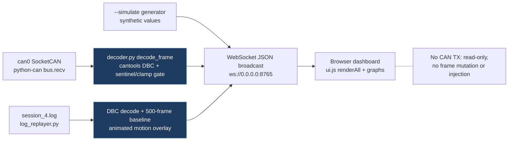
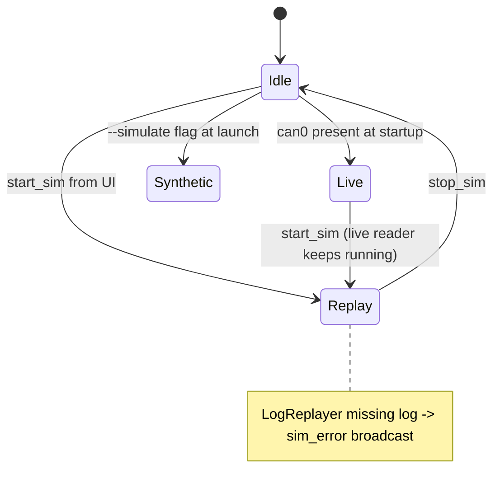
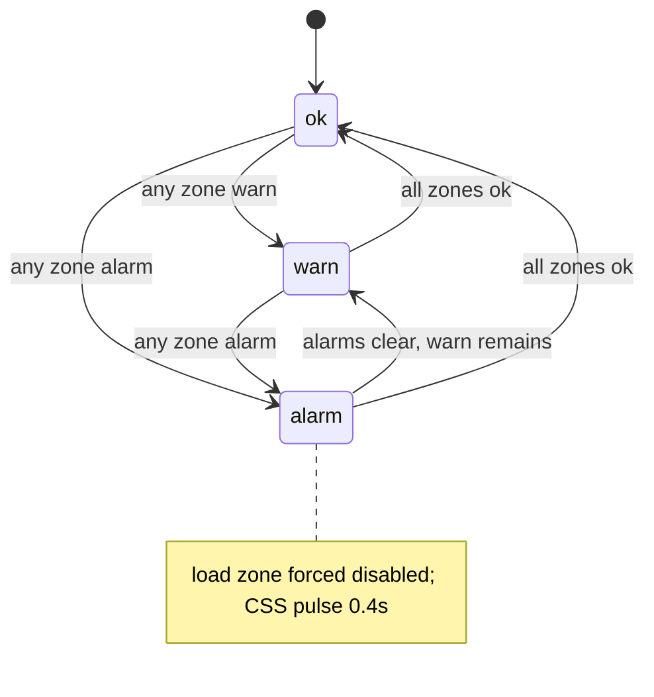
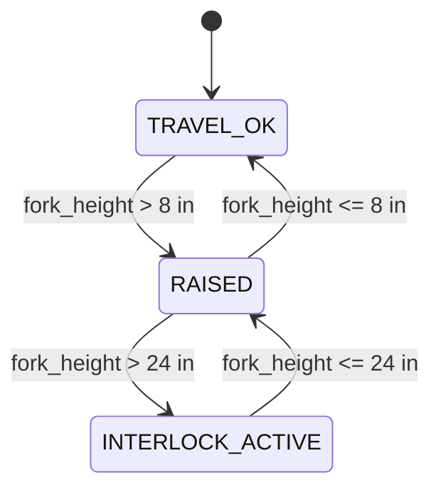

# bbrightwell-forklift-dash

Deep-dive of the pinned snapshot. Existing frontmatter preserved byte-for-byte; no `## Upstream (...)` sections existed in the pre-replace doc, so none were preserved. Pre-replace claims are cited as `git show HEAD:docs/legacy/bbrightwell-forklift-dash.md#L<n>`.

## 1. Provenance

- Submodule path: `legacy/bbrightwell-forklift-dash`.
- Pinned gitlink: `160000 a4d1be1ebb879a79a2e64707fbbf05dabef7c56b 0` (canonical `git ls-files -s` form). `git -C legacy/bbrightwell-forklift-dash rev-parse HEAD` returns the same SHA; `git -C legacy/bbrightwell-forklift-dash status --porcelain` is empty. Snapshot anchor valid.
- Upstream URL (`remote -v`): `origin https://github.com/bbrightwell/forklift-dash` (fetch + push). Network-only history was **not** consulted.
- License: no `LICENSE`/`COPYING` file in `git ls-files`. Pre-replace doc says `License: None` (`git show HEAD:docs/legacy/bbrightwell-forklift-dash.md#L22`). `forklift-dash-spec.md:122-125,383-390` demands CC BY 4.0 attribution for a Sketchfab `forklift.glb` that is **not** in the pinned tree (`.gitignore:5` ignores it) and was removed from the code (`js/scene.js:1-2`). Treat shipping source as **noGrant**: no reuse permission, no line-copying.
- Analysis date: 2026-11-21.

Files read in full (all via `git ls-files` inventory, hidden dirs included):

- `can-bridge/bridge.py:1-246`, `can-bridge/decoder.py:1-190`, `can-bridge/log_replayer.py:1-261`, `can-bridge/signals.json:1-111` (FULL-READ; 111-line catalog).
- `js/can-client.js:1-80`, `js/main.js:1-55`, `js/safety-bar.js:1-53`, `js/ui.js:1-235`, `js/gauges.js:1-119`, `js/power-graph.js:1-160`, `js/energy-graph.js:1-114`, `js/battery.js:1-30`, `js/scene.js:1-24`, `js/forklift-model.js:1-26`.
- `index.html:1-285`, `forklift-model-viewer.html:1-119`, `forklift_dash_concept_v2.html:1-424`, `start.sh:1-56`, `.gitignore:1-5`, `.gitmodules:1-3`.
- `README.md:1-169`, `CLAUDE.md:1-69`, `CONTEXT.md:1-70`, `forklift-dash-spec.md:1-415`.
- Pre-replace doc: `git show HEAD:docs/legacy/bbrightwell-forklift-dash.md` (54 lines, read before replacement).

Files NOT read / partial:

- `canbus-definitions/` — **uninitialized nested gitlink** `-362c82b57a2dfe9e5de73396a0071989740dd53e` (leading `-` from `git -C legacy/bbrightwell-forklift-dash submodule status`). DBC files `CAN0_346_02.dbc` and `battery_cb_24_10_2022.dbc` (`can-bridge/decoder.py:13`) are absent locally. All byte-level frame layouts that live in those DBCs are therefore UNVERIFIED.
- `e20.webp` — binary reference image, not decoded.
- `style.css` — RANGE-CITED only: design-token lines 6, 24, 70-72, 93, 152-153, 166, 188, 232-234, 269, 272, 324, 353, 366, 385-387, 394, 427, 431-432, 462, 475-476, 539, 565 via `grep -nE`. Not a FULL-READ.
- `../canbus-analysis-application/logs/session_4.log` — outside the repo, absent; replay code path read, data not.

Our-side files read for parity CODE-READ: `tools/serial-http-bridge.js:1-222`, `tools/commands/replay.js:1-84`, `packages/protocol/src/decoder.ts:1-99`, `firmware/lib/core/can/recorder.h:1-199`, `firmware/lib/vehicle/can/feature/misc/can_sim.h:1-115`, `client/src/state/frameIngestion.ts:1-229`, `client/src/state/useSocDisplay.ts:1-93`, `client/src/components/TelemetryPanel.tsx:94,151`, `client/src/hardware/transport.ts:210-249`.

## 2. Executive verdict

A Raspberry Pi 5 Chromium kiosk dashboard for a **Linde E20 forklift** — read-only, no CAN TX, no frame mutation, no Tesla content. Four mechanisms matter and are CODE-READ confirmed: (1) cantools DBC decode with unit conversion and sentinel/clamp filtering (`can-bridge/decoder.py`), (2) 20 Hz batched WebSocket JSON broadcast with three sources — live SocketCAN, DBC-decoded log replay, synthetic generator (`can-bridge/bridge.py`), (3) "real electrical baseline + animated motion overlay" replay (`can-bridge/log_replayer.py`), and (4) worst-state-wins safety bar plus rolling power/energy ring-buffer graphs (`js/safety-bar.js`, `js/power-graph.js`, `js/energy-graph.js`). Candidates for future PR: the replay baseline-overlay pattern, the sentinel-filter + conversion map shape, and the independent rolling-graph rendering — each needs a listen-only capture first because no DBC or trace is present locally. Already present: synthetic CAN injection into a decode pipeline (`firmware/lib/vehicle/can/feature/misc/can_sim.h:33-92`), frame ring buffers (`firmware/lib/core/can/recorder.h`, `client/src/state/frameIngestion.ts`), device-to-HTTP bridge (`tools/serial-http-bridge.js`), replay driver (`tools/commands/replay.js`). Never port: Linde CAN IDs and the dead `signals.json` catalog, the hardcoded cross-repo log path, the `0.0.0.0` unencrypted WebSocket bind, the stubbed control buttons, and any source text from this unlicensed repo.

## 3. Evidence map

No TEST-READ evidence exists: `git ls-files` contains no test file, no `test/` dir, no `*.test.*`, no pytest config. No CAPTURE evidence exists: no captured frames or `.log` trace ship with the repo; `session_4.log` is referenced but external. CAPTURE-grade claims are therefore impossible for every frame-layout statement.

| Source file | Lines | What it proves | Grade |
| --- | --- | --- | --- |
| `can-bridge/bridge.py` | 27, 56-63, 223-224 | WS server binds `0.0.0.0:8765`; broadcast via `asyncio.gather`, `return_exceptions=True` | CODE-READ |
| `can-bridge/bridge.py` | 37-53, 8-10 | JSON command channel accepts only `start_sim` / `stop_sim`; sends `sim_status` on connect | CODE-READ |
| `can-bridge/bridge.py` | 126-158 | Live path: `bus.recv(1.0)` in executor → `decode_frame` → `pending` dict → 20 Hz snapshot broadcast | CODE-READ |
| `can-bridge/bridge.py` | 68-96, 99-121 | Replay loop 20 Hz; start/stop state machine; 2 s wait then `cancel()` | CODE-READ |
| `can-bridge/bridge.py` | 163-217 | Separate synthetic simulator (`--simulate`), 15 broadcast keys, 0.1 s tick | CODE-READ |
| `can-bridge/decoder.py` | 12-13 | DBC dir `../canbus-definitions`, two DBC filenames | CODE-READ |
| `can-bridge/decoder.py` | 16-28 | `RELEVANT_IDS` = 11 Linde CAN IDs, entirely different from README `signals.json` table | CODE-READ |
| `can-bridge/decoder.py` | 34-47 | DBC load builds `{frame_id: Message}`; missing file → warning + skip | CODE-READ |
| `can-bridge/decoder.py` | 50-164 | `_map_to_dashboard()` conversions, gates, sentinel filters | CODE-READ |
| `can-bridge/decoder.py` | 167-186 | Short frames zero-padded to DBC length; decode exceptions swallowed | CODE-READ |
| `can-bridge/log_replayer.py` | 21-29 | Hardcoded external `session_4.log` path; `LINE_RE` text format | CODE-READ |
| `can-bridge/log_replayer.py` | 45-71 | Parser filters `bus == "can0"` and `RELEVANT_IDS`, converts `H:MM:SS.sss` | CODE-READ |
| `can-bridge/log_replayer.py` | 74-123 | Baseline from first 500 frames; animated mode loops every 60 s | CODE-READ |
| `can-bridge/log_replayer.py` | 128-225 | Animated overlay: 30 s speed / 45 s fork cycles, derived throttle/brake/current | CODE-READ |
| `js/can-client.js` | 3-4, 23-69 | `ws://<host>:8765`, 2 s fixed reconnect, no backoff cap; `sim_status` split from `can-data` | CODE-READ |
| `js/main.js` | 9-37 | Boot order; SIM toggle sends `start_sim`/`stop_sim`; SIM ALARM 3000 ms | CODE-READ |
| `js/safety-bar.js` | 3-53 | 4 zones, `load` forced `disabled`; worst state wins (`alarm` > `warn` > clear) | CODE-READ |
| `js/ui.js` | 11-63 | `state` object, 17 `can-data` keys, `renderAll()` on every message | CODE-READ |
| `js/ui.js` | 190-213, 215-232 | Tilt/hyd/deadman thresholds; fork badge 8/24 in thresholds | CODE-READ |
| `js/power-graph.js` | 9-34, 59-144 | 120-sample `Float32Array` ring, ±400 A full-scale, red draw / green regen | CODE-READ |
| `js/energy-graph.js` | 8-33, 54-113 | 300-sample ring, 10 kWh/h full-scale, amber fill | CODE-READ |
| `js/gauges.js` | 6-65, 68-119 | 180° canvas arcs, 12 mph / 30 Nm full scale | CODE-READ |
| `js/battery.js` | 3-18 | SOC bar, `<20` red / `<50` amber | CODE-READ |
| `js/forklift-model.js` | 1-26 | Looks up `model-viewer-frame`; cross-origin errors swallowed | CODE-READ |
| `index.html` | 12-70, 157-171, 264-283 | Safety bar, center panel = energy graph, bottom-bar buttons, module script | CODE-READ |
| `forklift-model-viewer.html` | 73-116 | Standalone `window.LindeModel.setForkHeight`, 240 in / 180 SVG units | CODE-READ |
| `forklift_dash_concept_v2.html` | 332-421 | Self-contained inline JS state machine, no bridge dependency | CODE-READ |
| `start.sh` | 7-19, 21-56 | `can0`/`can1` at 500000 bit/s, port 8080/8765 cleanup, process lifecycle | CODE-READ |
| `README.md` | 118-131 | `signals.json`-style CAN map that the code never reads | SUMMARY-ONLY |
| `forklift-dash-spec.md` | 26, 37, 122-125, 273-320, 349-358 | Three.js/GLB/250 kbps/3000/3000-port/localhost design that code contradicts | SUMMARY-ONLY |
| `CONTEXT.md` | 14, 30, 36-39, 42, 62-67 | Author's own "known issues" and DBC-rewrite claim | SUMMARY-ONLY |

## 4. Architecture and build surface

- Entry points: `start.sh:23-46` starts `can-bridge/bridge.py`, `python3 -m http.server 8080`, and Chromium; browser loads `index.html:283` → `js/main.js`. Alternative: `python3 can-bridge/bridge.py --simulate` (`bridge.py:243-246`) for synthetic data with no server; `forklift_dash_concept_v2.html` opens standalone.
- Shared core vs platform port: one flat tree, no build step, no npm, no build flags. Platform boundary is the Python `can.interface.Bus(channel="can0", interface="socketcan")` (`bridge.py:130`); UI boundary is `ws://${location.hostname}:8765` (`js/can-client.js:3`). `canbus-definitions` is an external submodule providing the DBC "core" that the pinned snapshot cannot build without.
- Dependency boundaries: Python `python-can`, `websockets`, `cantools`; browser ES modules + canvas/SVG only. `js/scene.js` and `js/forklift-model.js` are imports-only stubs retained after Three.js removal.
- Gates/timing: live reader 1 s `recv` timeout, 20 Hz batched broadcast; replay 20 Hz + 2 s stop timeout; WS reconnect fixed 2 s; safety bar CSS pulse 0.4 s alarm / 1 s warn (`style.css:71-72`).



## 5. Mechanism catalogue

### 1. SocketCAN live reader with 20 Hz batched broadcast

- **Claim (README / summary):** "Live CAN bus: connects to SocketCAN (`can0`) when available, falls back to idle" (`README.md:17`, `git show HEAD:docs/legacy/bbrightwell-forklift-dash.md#L34`).
- **Code path:** `can-bridge/bridge.py:126-158` — `can_reader()` → `reader_loop()` (`bus.recv(1.0)` in executor → `decode_frame`) → `pending` dict under `asyncio.Lock` → `broadcast_loop()` 0.05 s snapshot → `broadcast()`.
- **Frame spec:** no frame built; consumes Linde IDs listed in `decoder.py:16-28`; byte layouts live in absent DBC files.
- **Gates and timing:** 1 s recv timeout, `None` messages skipped; 20 Hz broadcast; `pending.clear()` after snapshot (latest-value-wins, no queue).
- **State machine:** not applicable — continuous loop.
- **Tests:** None found.
- **Evidence grade:** CODE-READ.
- **Verdict:** CONFIRMED.
- **Adapt to TeslaCANModder?** no impact — our firmware streams frames natively over serial/WiFi/BLE; a Pi-side SocketCAN reader is out of scope.

### 2. DBC-based decode with unit conversion and sentinel filtering

- **Claim (README / summary):** "DBC-based frame decoder using cantools" (`git show HEAD:docs/legacy/bbrightwell-forklift-dash.md#L35`); "all signal decoding now via Linde DBC files" (`CONTEXT.md:30`).
- **Code path:** `can-bridge/decoder.py:12-47` — `_load_dbc()` builds `{frame_id: Message}`; `decode_frame():167-186` zero-pads short frames, `msg_def.decode(..., decode_choices=False)`, exceptions → `{}`; `_map_to_dashboard():50-164` maps DBC signal names to dashboard keys.
- **Frame spec:** 11 IDs (`0x181,0x182,0x21E,0x281,0x282,0x304,0x413,0x481,0x484,0x48D,0x513`); no counters or checksums handled in code; DBC supplies byte/bit layout (absent).
- **Gates and timing:** speed `abs()*0.621371` km/h→mph and `<50` gate (`:55-58`); fork mm→in `/25.4` and `0..10000` else `0.0` (`:67-72`); tilt `-25..25` with `12.7°` sentinel excluded (`:74-79`); battery V `0<v<100`; motor temp `-40..200` → `°F = C*9/5+32`; SOC `0..100`; throttle clamp `0..100`; EConsum `0..50`; RemWorkTime `0..2047`.
- **State machine:** not applicable — stateless mapping.
- **Tests:** None found.
- **Evidence grade:** CODE-READ (mapping + gates); UNVERIFIED for DBC byte layouts (DBC files absent).
- **Verdict:** PARTIAL — conversion/filter layer confirmed; frame-layout claims cannot be checked.
- **Adapt to TeslaCANModder?** candidate — reuse the *shape* of `_map_to_dashboard()` (single conversion+gate map with explicit sentinel rejection) when extending our decode layer; independent implementation required.

### 3. WebSocket command channel and reconnecting client

- **Claim (README / summary):** "WebSocket bridge (Python backend on port 8765 → browser frontend on port 8080)" (`CONTEXT.md:18`).
- **Code path:** `can-bridge/bridge.py:37-53` — `handler()` adds client, sends `sim_status`, accepts only `start_sim`/`stop_sim`; `js/can-client.js:23-69` — `connect()` → `onmessage` splits `sim_status` events from `can-data` events → `scheduleReconnect()` 2 s.
- **Frame spec:** wire messages are one-line JSON objects (e.g. `{"cmd":"start_sim"}`, `{"sim_status":true}`, `{"vehicle_speed":4.7}`); no binary framing, no CRC.
- **Gates and timing:** WS bind `0.0.0.0:8765` (`bridge.py:223`); fixed 2 s reconnect (`can-client.js:4`), no circuit breaker; malformed JSON ignored both sides.
- **State machine:** connection states CONNECTING → OPEN → CLOSED → reconnect timer; sim control states below (mechanism 4).
- **Tests:** None found.
- **Evidence grade:** CODE-READ.
- **Verdict:** CONFIRMED.
- **Adapt to TeslaCANModder?** no impact / never — our client has no WebSocket transport (all `WebSocket` hits in `client/src` are inside `_generated-docs.ts` legacy summaries); our device boundary already uses JSON-RPC over serial/WiFi/BLE with `tools/serial-http-bridge.js:106-193`.

### 4. Three-source bridge mode selector and log replay

- **Claim (README / summary):** "SIM toggle: replay a real CAN trace log through the DBC decoder" (`README.md:12,57-61`); `--simulate` synthetic mode (`forklift-dash-spec.md:371-379`).
- **Code path:** `can-bridge/bridge.py:99-121` — `start_replay()`/`stop_replay()`; `:68-96` `replay_loop()` → `LogReplayer.get_next_batch()`; `:163-217` synthetic `simulator()` (only via `--simulate`); `log_replayer.py:45-71` `parse_log()`, `:74-261` `LogReplayer` (baseline `:94-110`, animated `:128-225`).
- **Frame spec:** log text regex `LINE_RE` at `log_replayer.py:27-29` (`[H:MM:SS.sss] bus 0xID ... hexbytes`); `can1` frames and non-`RELEVANT_IDS` frames skipped (`:55-59`). No frames injected.
- **Gates and timing:** baseline from first 500 frames; animated loop 60 s; speed 30 s cycle, fork 45 s cycle; 20 Hz batch; 2 s stop timeout then `cancel()`.
- **State machine:** see state diagram below.
- **Tests:** None found.
- **Evidence grade:** CODE-READ (replay logic); UNVERIFIED (log file itself absent).
- **Verdict:** PARTIAL — control flow confirmed, replay data cannot be validated.
- **Adapt to TeslaCANModder?** candidate — the "real baseline from first N frames + animated overlay for dynamic channels" pattern maps onto our `tools/commands/replay.js:8-72` and `firmware/lib/vehicle/can/feature/misc/can_sim.h:33-92`; capture-first required.



### 5. Synthetic signal generator

- **Claim (README / summary):** "--simulate flag generates synthetic data" (`bridge.py:14`, `CONTEXT.md:32`).
- **Code path:** `can-bridge/bridge.py:163-217` — `simulator()` broadcasts 15 keys (`vehicle_speed`, `battery_soc`, `motor_current`, `energy_consumption`, `remaining_work_time`, `truck_hours`, ...) every 0.1 s.
- **Frame spec:** none — emits dashboard values directly, not CAN frames.
- **Gates and timing:** 30 s speed triangle, 60 s fork sine, 45 s tilt sine; `battery_soc` starts 72.0 and drains 0.001/tick; `motor_temp` starts 142.0, caps 220.
- **State machine:** `_sim_active` boolean toggled by start/stop; not a 3+ state machine.
- **Tests:** None found.
- **Evidence grade:** CODE-READ.
- **Verdict:** CONFIRMED.
- **Adapt to TeslaCANModder?** already present (stronger): our `can_sim.h:33-92` injects synthetic *frames* into the real decode pipeline at 200 ms without physical TX.

### 6. Worst-state-wins safety bar

- **Claim (README / summary):** "Safety bar: deadman switch, mast tilt, hydraulic pressure, load sensor status — alarm state pulses" (`README.md:10`).
- **Code path:** `js/safety-bar.js:3-53` — `zoneStates` 4 zones, `setSafetyZone()` early-returns for `load`, `updateBarBackground()` picks `alarm` > `warn` > clear; `js/ui.js:190-213` sets tilt/hyd/deadman states each render.
- **Frame spec:** none — UI only.
- **Gates and timing:** tilt `>8°` alarm, `>5°` warn; hyd torque `>25 Nm` alarm, `>20 Nm` warn; seat 0 → alarm; CSS pulse 0.4 s alarm / 1 s warn.
- **State machine:** see state diagram below. `triggerSimAlarm()` forces `deadman=alarm` for 3000 ms then back to `ok` (`safety-bar.js:44-49`, `main.js:16-18`).
- **Tests:** None found.
- **Evidence grade:** CODE-READ.
- **Verdict:** CONFIRMED.
- **Adapt to TeslaCANModder?** candidate — severity aggregation with a forced-disabled zone is a useful pattern for a consolidated status banner; no our-side CODE-READ counterpart found (SUMMARY-ONLY), so backlog only.



### 7. Rolling power / regen graph

- **Claim (README / summary):** "Tesla-style power graph: rolling 30-second waveform showing draw (red) and regen (green)" (`README.md:13`).
- **Code path:** `js/power-graph.js:9-35` — 120-entry `Float32Array` ring, `pushCurrentSample()`; `:37-160` draws red positive fill / green negative fill above/below mid-line.
- **Frame spec:** none — fed by `motor_current` from decoded `T_BatCurr` (`decoder.py:95-97`) or simulated signals.
- **Gates and timing:** ±400 A full-scale (clip at 1.0); claim of "30 s" assumes ~4 Hz input but actual input rate is per `renderAll()` (20 Hz live → ~6 s history), so the 30 s label is UNVERIFIED against real cadence.
- **State machine:** not applicable — ring buffer.
- **Tests:** None found.
- **Evidence grade:** CODE-READ for buffer/draw; UNVERIFIED for the 30 s wall-clock label.
- **Verdict:** PARTIAL.
- **Adapt to TeslaCANModder?** candidate — independent ring-buffer rendering with separate draw/regen halves; our `TelemetryPanel.tsx:94,151` shows power as scalar rows only.

### 8. Rolling energy-consumption graph

- **Claim (README / summary):** "rolling 60-second kWh/h display with amber fill" (`README.md:14`).
- **Code path:** `js/energy-graph.js:8-33` — 300-entry ring; `:35-114` amber gradient fill, zero line at bottom, latest value label.
- **Frame spec:** none — fed by `energy_consumption` from DBC `EConsum` (`decoder.py:146-150`) or simulator.
- **Gates and timing:** 10 kWh/h full-scale; `Math.max(val,0)` clamps negatives to zero; "60 s" assumes 5 Hz effective input, also UNVERIFIED vs 20 Hz live path.
- **State machine:** not applicable.
- **Tests:** None found.
- **Evidence grade:** CODE-READ for buffer/draw; UNVERIFIED for wall-clock window.
- **Verdict:** PARTIAL.
- **Adapt to TeslaCANModder?** candidate (same as mechanism 7) — low cost if unified with existing telemetry rendering.

### 9. Tilt SVG animation and fork visualization

- **Claim (README / summary):** "Tilt animation: SVG fork visualization that rotates to match the live tilt angle" (`README.md:15`).
- **Code path:** `js/ui.js:158-197` — `tilt-fork-group` rotation + arc path; `index.html:223-250` SVG; `js/forklift-model.js:16-26` → `forklift-model-viewer.html:86-115` `LindeModel.setForkHeight()` (dormant in production — see contradiction C8).
- **Frame spec:** none.
- **Gates and timing:** visual rotation clamped to ±15° and scaled ×1.5 (`ui.js:169`); viewer fork travel 0–240 in mapped to 180 SVG units (`forklift-model-viewer.html:75-77,86-108`).
- **State machine:** fork badge has 3 states — see diagram below.
- **Tests:** None found.
- **Evidence grade:** CODE-READ.
- **Verdict:** CONFIRMED for inline SVG; PARTIAL for iframe fork API (no iframe element).
- **Adapt to TeslaCANModder?** no impact — vehicle-specific SVG; the ±15° readability clamp idea is a minor UX note.



### 10. Battery display with color thresholds

- **Claim (README / summary):** "Battery display (SoC, voltage, temp, health status)" (`CONTEXT.md:25`).
- **Code path:** `js/battery.js:3-18` — `updateBattery()` sets SOC, voltage, bar width, temp; `js/ui.js:151-152,114-131` hours/PM.
- **Frame spec:** none — fed by DBC `LiIoBMS_SOCwithSOH`, `T_BatVolt`, `battery_temperature`.
- **Gates and timing:** bar `<20` red, `<50` amber, else green; PM interval 500 h with countdown (`ui.js:32,116-131`).
- **State machine:** 3 color states (green/amber/red) — simple threshold, diagram omitted (no transitions beyond threshold bands).
- **Tests:** None found.
- **Evidence grade:** CODE-READ.
- **Verdict:** CONFIRMED.
- **Adapt to TeslaCANModder?** already present (different thresholds): our `client/src/state/useSocDisplay.ts:41-45` derives `critical<15 / warning<25 / ok`; no reason to port numbers.

### 11. Standalone concept dashboard

- **Claim (README / summary):** "Standalone concept (no server) — fully self-contained" (`README.md:51-53`).
- **Code path:** `forklift_dash_concept_v2.html:332-421` — inline `toggleSeat/cycleTilt/cycleHyd/setDir/setMode/toggleChem/updFH/simulateAlarm`, hardcoded demo values, `setTimeout` alarm 3000 ms.
- **Frame spec:** none — no bridge, no WebSocket, static demo data.
- **Gates and timing:** 3-state tilt/hyd cycles, 3.5 s tooltip, 3 s alarm.
- **State machine:** local UI toggles only, no CAN states.
- **Tests:** None found.
- **Evidence grade:** CODE-READ.
- **Verdict:** CONFIRMED.
- **Adapt to TeslaCANModder?** no impact — design mock only.

### 12. Launcher and process lifecycle

- **Claim (README / summary):** "This starts the CAN bridge, HTTP server, and Chromium" (`README.md:33-37`).
- **Code path:** `start.sh:7-19` — `sudo ip link set can0/can1 up type can bitrate 500000`; kill holders of 8080/8765; `:21-28` start bridge + `http.server 8080`; `:33-40` `trap cleanup EXIT`; `:42-56` Chromium + wait logic.
- **Frame spec:** none.
- **Gates and timing:** 0.3 s kill settle, 1 s server warmup, 2 s Chromium handoff check.
- **State machine:** not applicable.
- **Tests:** None found.
- **Evidence grade:** CODE-READ.
- **Verdict:** CONFIRMED.
- **Adapt to TeslaCANModder?** never — `sudo ip link` mutation plus `kill $(lsof -t ...)` is a host-wide side effect with no place in our tooling.

## 6. Summary vs code contradiction table

Every old-doc / upstream-doc claim below is contradicted by the pinned code. Agreement claims (e.g. 500 kbit/s in `start.sh`, SocketCAN + cantools in `decoder.py`, 20 Hz batching) live in the evidence map, not here.

| ID | Pre-replace / upstream claim | Code reality (cite) | Grade of claim |
| --- | --- | --- | --- |
| C1 | Frontmatter description ends "It runs" and never mentions DBC rewrite, replay, or simulation — `git show HEAD:docs/legacy/bbrightwell-forklift-dash.md#L3` | Pinned code has DBC decode + replay + synthetic modes (`decoder.py:12-13`, `bridge.py:68-217`). Bytes preserved per replace-mode; staleness recorded here, not edited. | SUMMARY-ONLY |
| C2 | "hydraulic pressure" decoded/signalled (`git show HEAD:docs/legacy/bbrightwell-forklift-dash.md#L43`, `README.md:98,230`) | Code decodes `L1_estTorque` (hydraulic motor **torque**, Nm), UI label "HYD TORQUE", thresholds 20/25 Nm (`decoder.py:140-144`, `index.html:25`, `ui.js:199-206`). No PSI decode in code. | SUMMARY-ONLY |
| C3 | Three-panel with central "vehicle graphic" (`git show HEAD:docs/legacy/bbrightwell-forklift-dash.md#L37`, `README.md:9,74-76`) | Center panel holds energy graph + fork strip; no vehicle graphic (`index.html:157-171`); `CONTEXT.md:36` says intentionally reserved, Three.js removed. | SUMMARY-ONLY |
| C4 | CAN signal map table with IDs `0x0C0/0x190/0x205/0x300/0x620/…` (`README.md:118-131`, `CLAUDE.md:29-45`, `spec.md:273-289`) | `decoder.py:16-28` uses `0x181/0x182/0x21E/0x281/0x282/0x304/0x413/0x481/0x484/0x48D/0x513` — only `0x182` overlaps. | SUMMARY-ONLY |
| C5 | `signals.json` is the decoder's signal source (`CLAUDE.md:35`, `spec.md:50,273`, `git show HEAD:docs/legacy/bbrightwell-forklift-dash.md#L34` implying simple map) | `decoder.py` never reads it; hardcoded `RELEVANT_IDS` + DBC files instead. Negative anchor: `grep -nE 'signals\.json\|SIGNALS' bridge.py decoder.py` → no output. | SUMMARY-ONLY |
| C6 | Three.js scene + `forklift.glb` + CC BY model credit (`spec.md:26,37,122-125,383-390`) | `scene.js:1-2` Three.js removed; `.gitignore:5` ignores `forklift.glb`; no GLB in `git ls-files`; viewer uses `e20.webp` (`forklift-model-viewer.html:53`). | SUMMARY-ONLY |
| C7 | "center panel uses model-viewer iframe" / "iframe ready" (`scene.js:8,17`, `forklift-model.js:1`, `CONTEXT.md:36`) | No `model-viewer-frame` element in any HTML; `forklift-model.js:7` looks up a nonexistent ID, so `setForkHeight()` from `ui.js:216` is a silent no-op. Negative anchor U15. | CODE-READ (code vs code) |
| C8 | "CAN at 250000 bit/s" (`spec.md:349`) | `start.sh:11` sets `bitrate 500000`. | SUMMARY-ONLY |
| C9 | Web server on port 3000 (`spec.md:17,355,364`) | `start.sh:27` serves 8080; `README.md:46` agrees with 8080. | SUMMARY-ONLY |
| C10 | WS server binds `localhost` (`spec.md:317`) and "unencrypted on localhost only" (`CONTEXT.md:66`) | `bridge.py:223` binds `0.0.0.0:8765` — reachable on all interfaces. | SUMMARY-ONLY |
| C11 | `bridge.py` loads `signals.json`, uses `int.from_bytes(data[:2],"big")` and `bustype='socketcan'` (`spec.md:296-320`) | Actual `bridge.py:25,142` imports `decode_frame` and passes `msg.data` to cantools; no `SIGNALS`, no manual `int.from_bytes`, `interface="socketcan"` (`bridge.py:130`). | SUMMARY-ONLY |
| C12 | "decoder.py — CAN ID → signal name/value mapping (simple mode)" (`CLAUDE.md:33`) | `decoder.py:9,41,182` is cantools/DBC based; no "simple mode" exists. | SUMMARY-ONLY |
| C13 | Hydraulic spec "max 3,000 PSI, warn >2,500 PSI" (`spec.md:230`) | No PSI path; code uses Nm with warn 20 / alarm 25 (`ui.js:200-206`). | SUMMARY-ONLY |
| C14 | "simulated replay mode" conflates two sources (`git show HEAD:docs/legacy/bbrightwell-forklift-dash.md#L47`) | Two distinct paths: `start_replay()` → real log via `LogReplayer` (`bridge.py:99-104`), and `--simulate` → synthetic `simulator()` (`bridge.py:163-217`). SIM button only triggers the former. | SUMMARY-ONLY |

## 7. CAN frame and signal inventory

No frame is mutated or injected — the repo is read-only. All byte/bit layouts, periods, counters, and checksums that would come from the DBC catalogs are **UNVERIFIED** because `canbus-definitions` is uninitialized in this snapshot. "DLC from DBC" means the code reads `msg_def.length` (`decoder.py:177`) but the value is not locally inspectable.

| ID (hex+dec) | Bus | Period | DLC | Byte/bit layout | Scale/units | Counter position | Checksum | Read/write | Grade |
| --- | --- | --- | --- | --- | --- | --- | --- | --- | --- |
| 0x181 / 385 | can0 | UNVERIFIED | from DBC | DBC (absent); signals `TruckSpeed`, `TSteerAngle`, `kec_steering_angle` | `abs()*0.621371` km/h→mph, gate `<50`; steering raw×1 round 4 | None in code | None in code | Read | CODE-READ (map), UNVERIFIED (layout) |
| 0x182 / 386 | can0 | UNVERIFIED | from DBC | DBC; `L1_measSpeed`, `L1_estTorque` | torque≥0 → `hyd_torque` Nm round 1 | None | None | Read | CODE-READ, UNVERIFIED |
| 0x21E / 542 | can0 | UNVERIFIED | from DBC | DBC; `kec_accelerator_pedal_position` | `%`, clamp 0..100 round 0 → `throttle` | None | None | Read | CODE-READ, UNVERIFIED |
| 0x281 / 641 | can0 | UNVERIFIED | from DBC | DBC; `T_Seat`, `T_motTemp_Lft`, `T_BatVolt`, `T_BatCurr`, `BrakeState` | seat/bool; motor temp `C*9/5+32` gate -40..200 °C; V gate 0..100; current round 1 A; brake int | None | None | Read | CODE-READ, UNVERIFIED |
| 0x282 / 642 | can0 | UNVERIFIED | from DBC | DBC; `LiftHeight`, `LiftTiltAng` | mm/25.4 → inch, gate 0..10000 else 0.0; tilt deg gate -25..25 excl 12.7 sentinel | None | None | Read | CODE-READ, UNVERIFIED |
| 0x304 / 772 | can0 | UNVERIFIED | from DBC | DBC; `TracDirLev`, `RemWorkTime` | direction enum 0..2; minutes gate 0..2047 | None | None | Read | CODE-READ, UNVERIFIED |
| 0x413 / 1043 | can0 | UNVERIFIED | from DBC | DBC; `EConsum`, `performance_mode` (unmapped) | kWh/h gate 0..50 round 2 | None | None | Read | CODE-READ, UNVERIFIED |
| 0x481 / 1153 | can0 | UNVERIFIED | from DBC | DBC; `TruckWorkTime` | seconds/3600 → h, `>0` gate | None | None | Read | CODE-READ, UNVERIFIED |
| 0x484 / 1156 | can0 | UNVERIFIED | from DBC | DBC; `WorkTimeToBeDisplayed` | seconds/3600 → h → `truck_hours` | None | None | Read | CODE-READ, UNVERIFIED |
| 0x48D / 1165 | can0 | UNVERIFIED | from DBC | DBC; `LiIoBMS_SOCwithSOH` | `%` gate 0..100 round 1 | None | None | Read | CODE-READ, UNVERIFIED |
| 0x513 / 1299 | can0 | UNVERIFIED | from DBC | DBC; `battery_temperature`, `WghdLoad` (unmapped) | °C→°F gate -40..100 | None | None | Read | CODE-READ, UNVERIFIED |

Vendored catalog `can-bridge/signals.json:1-111` (12 IDs: `0x0C0/0x190/0x205/0x210/0x215/0x300/0x620/0x621/0x625/0x1D4/0x1E0/0x700` with scale/offset/byte_offset/byte_length/signed) is **STRUCTURAL-PARSE**, FULL-READ, and **dead** — no shipped code reads it (negative anchor U16b). It is not expanded into rows above because no code path references those IDs. Log parser `LINE_RE` (`log_replayer.py:27-29`) is text-format, not a frame spec; it accepts any hex payload but filters to `can0` + `RELEVANT_IDS` (`:55-59`).

## 8. Constants and tuning table

| Constant | Value | File:line | Meaning | Grade |
| --- | --- | --- | --- | --- |
| `WS_PORT` | 8765 | `bridge.py:27` | WebSocket listen port, bound `0.0.0.0` | CODE-READ |
| HTTP port | 8080 | `start.sh:27` | Static dashboard server | CODE-READ |
| `RECONNECT_MS` | 2000 | `can-client.js:4` | Fixed WS reconnect delay, no backoff | CODE-READ |
| CAN bitrate | 500000 | `start.sh:11` | SocketCAN `can0`/`can1` setup | CODE-READ |
| `_DBC_FILES` | `CAN0_346_02.dbc`, `battery_cb_24_10_2022.dbc` | `decoder.py:13` | DBC sources (absent locally) | CODE-READ |
| speed factor | 0.621371 | `decoder.py:56` | km/h → mph | CODE-READ |
| speed gate | `<50` | `decoder.py:57` | reject implausible mph | CODE-READ |
| fork factor | `/25.4` | `decoder.py:70` | mm → inches | CODE-READ |
| fork bounds | 0..10000 | `decoder.py:69` | else fork_height = 0.0 | CODE-READ |
| tilt sentinel | 12.7° (±0.01) | `decoder.py:75-78` | raw `0x7F` "not available" rejected | CODE-READ |
| tilt bounds | -25..25 | `decoder.py:78` | accepted tilt range | CODE-READ |
| battery V gate | 0..100 | `decoder.py:92` | accepted pack voltage | CODE-READ |
| motor temp gate | -40..200 °C | `decoder.py:102` | °C→°F conversion gate | CODE-READ |
| temp factor | `*9/5+32` | `decoder.py:103,121` | °C → °F | CODE-READ |
| battery temp gate | -40..100 °C | `decoder.py:120` | accepted battery temp | CODE-READ |
| SOC gate | 0..100 | `decoder.py:108` | accepted SOC | CODE-READ |
| hour divisor | `/3600` | `decoder.py:115,162` | seconds → hours | CODE-READ |
| throttle clamp | 0..100 | `decoder.py:126` | pedal percent | CODE-READ |
| EConsum gate | 0..50 | `decoder.py:149` | kWh/h | CODE-READ |
| RemWorkTime gate | 0..2047 | `decoder.py:155` | minutes | CODE-READ |
| short-frame pad | zero-fill to DBC length | `decoder.py:177-179` | cantools decode precondition | CODE-READ |
| broadcast rate | 0.05 s / 20 Hz | `bridge.py:94,149` | replay + live publish cadence | CODE-READ |
| replay stop timeout | 2.0 s | `bridge.py:116` | then `task.cancel()` | CODE-READ |
| log path | `../../canbus-analysis-application/logs/session_4.log` | `log_replayer.py:21-23` | hardcoded cross-repo dependency | CODE-READ |
| baseline frames | first 500 | `log_replayer.py:96` | real electrical baseline source | CODE-READ |
| animated loop | 60.0 s | `log_replayer.py:122` | `duration` in animated mode | CODE-READ |
| speed / fork cycles | 30 s / 45 s | `log_replayer.py:134,147` | motion overlay periods | CODE-READ |
| simulator seeds | 72.0 / 142.0 / 4218.3 | `bridge.py:170-172` | SOC / motor temp / hour meter | CODE-READ |
| simulator tick | 0.1 s | `bridge.py:217` | synthetic publish cadence | CODE-READ |
| tilt warn / alarm | 5° / 8° | `ui.js:191,193` | safety bar tilt thresholds | CODE-READ |
| hyd warn / alarm | 20 / 25 Nm | `ui.js:200,202` | safety bar torque thresholds | CODE-READ |
| fork badge | 8 / 24 in | `ui.js:223,226` | RAISED / INTERLOCK ACTIVE | CODE-READ |
| fork progress divisor | 240 | `ui.js:217` | fork strip percent | CODE-READ |
| PM interval | 500 h | `ui.js:32` | service countdown | CODE-READ |
| battery colors | `<20` red, `<50` amber | `battery.js:16-17` | SOC bar color bands | CODE-READ |
| power graph | 120 samples / 400 A | `power-graph.js:9-10` | ring length / full scale | CODE-READ |
| energy graph | 300 samples / 10 kWh/h | `energy-graph.js:8-9` | ring length / full scale | CODE-READ |
| gauge scales | 12 mph / 30 Nm | `gauges.js:17,79` | arc full scale | CODE-READ |
| fork travel | 240 in / 180 SVG units | `forklift-model.js:3`, `forklift-model-viewer.html:75-77` | viewer height mapping | CODE-READ |
| visual tilt clamp | ±15°, ×1.5 | `ui.js:169` | readability clamp | CODE-READ |
| SIM alarm | 3000 ms | `main.js:17`, `safety-bar.js:44` | deadman alarm demo | CODE-READ |

## 9. Failure modes and edge cases

No bus-off, watchdog, OTA, brownout, or reboot-state paths exist — this is a host-side read-only dashboard with no firmware. No queue overflow path exists: live frames collapse into a single latest-value `pending` dict (`bridge.py:134-156`). All rows untested (no tests ship).

| Failure | Handling code path | Tested? | Grade |
| --- | --- | --- | --- |
| No `can0` hardware | `bridge.py:229-238` — startup `import can`/Bus probe inside try; exception → 1 s idle loop awaiting SIM toggle | No | CODE-READ |
| DBC files missing | `decoder.py:38-40` warning + skip; empty `_db_lookup` → `decode_frame():173-175` returns `{}` silently | No | CODE-READ |
| Short CAN frame | `decoder.py:177-179` zero-pad to `msg_def.length`; `log_replayer.py:243-245` same | No | CODE-READ |
| DBC decode exception | `decoder.py:181-184` broad `except Exception: return {}` — frame silently dropped | No | CODE-READ |
| Log file missing/unreadable | `log_replayer.py:49` `open()` raises in `LogReplayer.__init__`; `bridge.py:73-79` catches and broadcasts `{sim_error: str(e)}`, sets `_sim_active=False` | No | CODE-READ |
| Log line not matching / wrong bus / wrong ID | `log_replayer.py:51-59` silently skips (`can1` frames and non-`RELEVANT_IDS` ignored) | No | CODE-READ |
| Animated mode "never finishes" | `log_replayer.py:257-261` `finished` always `False`; loops every 60 s by design | No | CODE-READ |
| Stop replay hangs | `bridge.py:115-119` 2 s `wait_for` then `cancel()`, `_replay_task=None` | No | CODE-READ |
| WS client disconnects | `bridge.py:52-53` `CLIENTS.discard` in `finally`; reconnect `can-client.js:52-69` fixed 2 s, no max attempts | No | CODE-READ |
| WS bound on all interfaces | `bridge.py:223` `0.0.0.0:8765` unencrypted; `CONTEXT.md:66` incorrectly claims localhost-only (C10) | No | CODE-READ |
| Malformed WS message / JSON | `bridge.py:43-46` skip; `js/can-client.js:49` catch-and-ignore | No | CODE-READ |
| Missing iframe / cross-origin viewer | `forklift-model.js:7,17-25` `viewerFrame` null or throw → silent no-op; fork animation silently absent in production (C7) | No | CODE-READ |
| Button stubs | `index.html:267-275` HORN/LIGHTS/LIFT/SETTINGS have no listeners in `main.js:9-53`; `CONTEXT.md:37` admits stubs | No | CODE-READ |

## 10. Test coverage map

None found: `git ls-files` contains no test file, no `test/` directory, no pytest/Jest config, no fixtures. Critical paths with NO test:

- DBC decode + `_map_to_dashboard()` conversions/gates/sentinels (`decoder.py:50-186`) — silent value corruption or stale sentinel logic would not be caught.
- Log text parser and baseline extraction (`log_replayer.py:45-110`) — regex drift breaks replay with an empty feed, no error.
- Animated overlay math (`log_replayer.py:128-225`) — cycles/thresholds can drift silently.
- WS command state machine + reconnect (`bridge.py:37-121`, `can-client.js:23-69`) — no proof of clean stop, duplicate start, or reconnect behavior.
- Safety bar worst-state aggregation (`safety-bar.js:15-41`) — a missed `alarm` would be visually invisible.
- Ring-buffer graphs (`power-graph.js`, `energy-graph.js`) — no independent oracle; only self-consistent redraw.

## 11. Parity matrix with TeslaCANModder

Signal-level overlap is **zero**: the 11 Linde IDs in section 7 are not touched by our firmware (`packages/protocol/src/decoder.ts:72-94` lists Tesla IDs `69,130,281,306,627,…,1021`, which differ in meaning and bus). Rows below are mechanism-level; each carries a our-side CODE-READ citation or is explicitly SUMMARY-ONLY and cannot drive a decision.

| Signal/frame | Upstream decode (cite) | Our decode (cite) | Delta | Action |
| --- | --- | --- | --- | --- |
| CAN→dashboard bridge | WS push `0.0.0.0:8765` JSON (`bridge.py:27,56-63,223`) | HTTP request/response `/api/status`, `/api/command` (`tools/serial-http-bridge.js:106-193`) | Push vs poll; upstream has no auth | already present (different shape) |
| Signal decode catalog | `decoder.py:16-28,50-186` cantools DBC byte decode + gates | `packages/protocol/src/decoder.ts:44-69,72-94` ID→description index, no raw-byte decode | Upstream decodes values; ours annotates IDs | capture-first / ignore (different domain) |
| Log replay driver | `log_replayer.py:45-71,74-261` text log → DBC values + animated overlay | `tools/commands/replay.js:8-72` JSONL → `raw` frames at `10/speed` ms | Upstream replays decoded signals, ours replays frames to firmware | candidate (overlay idea only) |
| Synthetic simulation | `bridge.py:163-217` emits dashboard values, no frames | `can_sim.h:33-92` injects synthetic frames into decode pipeline at 200 ms, no physical TX | Ours is stronger (exercises real decoders) | already present |
| Frame capture buffer | None found upstream | `recorder.h:12,144-174` 256-frame on-device ring + `frameIngestion.ts:80,117-160` 5000-frame client ring | Upstream has no recorder | no impact |
| Reconnect / connection lifecycle | `can-client.js:4,23-69` fixed 2 s WS reconnect | No WebSocket counterpart in `client/src` (all `WebSocket` hits are in generated legacy docs); `transport.ts:223-240` uses per-operation timeouts only | Upstream reconnects; ours is request/response | SUMMARY-ONLY — no our-side CODE-READ counterpart; backlog only |
| Worst-state severity aggregation | `safety-bar.js:15-41` | No our-side counterpart found in `client/src/state` | — | SUMMARY-ONLY — backlog only |
| Rolling power/regen graph | `power-graph.js:9-34,59-144` | `TelemetryPanel.tsx:94,151` scalar rows only | Rolling visualization absent | candidate |
| SOC color bands | `battery.js:16-17` `<20` red, `<50` amber | `useSocDisplay.ts:41-45` `critical<15`, `warning<25`, `ok` | Different thresholds | already present (do not align numbers) |
| Process launcher | `start.sh:7-56` `sudo ip link`, `kill $(lsof…)`, Chromium | `tools/` CLI + manual `npm run web` per `AGENTS.md` | Host-wide mutation vs opt-in commands | never port |

## 12. Surface inventory and security notes

Exposed surfaces (all local to the Pi by design; none authenticated):

- WebSocket server `ws://0.0.0.0:8765` (`bridge.py:223`) — inbound commands `{"cmd":"start_sim"}` / `{"cmd":"stop_sim"}` only (`bridge.py:47-51`); outbound one-line JSON `sim_status`, `sim_error`, and arbitrary signal-key dicts. **No authentication, no TLS**, bound to all interfaces.
- HTTP static server on port 8080 (`start.sh:27`) — serves repo root including `can-bridge/*.py`, `signals.json`, `.gitmodules`, and `CONTEXT.md`/`CLAUDE.md` to anyone who can reach the port (directory listing + source disclosure).
- Browser module API (`js/main.js:9-53`) — SIM toggle, SIM ALARM, traction-mode pills (local class toggles only), EXIT (`window.close()` + innerHTML replacement at `:48-52`).
- `window.LindeModel` global (`forklift-model-viewer.html:112-115`) — `setForkHeight`, `getForkHeight`; cross-frame API with no origin check (`forklift-model.js:19-25` swallows errors).
- Inline demo JS in `forklift_dash_concept_v2.html:332-421` — local state toggles only, no bridge.

Security / provenance findings: no bundled credentials, keys, or certs (no `*.pem`, `*.key`, `.env` in `git ls-files`). Hardcoded external paths (`log_replayer.py:21-23`) and `sudo ip link` + `kill` in `start.sh:10-18` are the dangerous build/run flags. The `0.0.0.0` WS bind directly contradicts `CONTEXT.md:66`'s "localhost only" claim (C10). Upstream license is **none granted** (section 1) — do not copy source text.

## 13. Adaptation assessment

| Mechanism | Value | Cost | Risk | Evidence grade | Decision |
| --- | --- | --- | --- | --- | --- |
| 1. SocketCAN live reader | Low | Low | Out-of-scope hardware path | CODE-READ | no impact |
| 2. DBC map + sentinel/conversion gates | Medium | Medium | Frame layouts UNVERIFIED (DBC absent) | CODE-READ (gates), UNVERIFIED (layout) | candidate for future PR (idea only) |
| 3. WS command + reconnect | Low | — | Exposes unauthenticated all-interface socket | CODE-READ | never port as-is |
| 4. Replay with baseline + animated overlay | Medium-High | Medium | Animated values are synthetic, not vehicle data | CODE-READ (logic), UNVERIFIED (log) | candidate for future PR (capture-first) |
| 5. Synthetic value generator | Low | Low | We already inject frames | CODE-READ | already present |
| 6. Safety severity aggregation | Medium | Low | No our-side counterpart to extend | CODE-READ | candidate for future PR |
| 7/8. Rolling power/energy graphs | Medium | Medium | Window-length labels unverifiable vs live cadence | CODE-READ (buffer), UNVERIFIED (timing) | candidate for future PR |
| 9. Tilt/fork SVG animation | Low | Medium | Vehicle-specific visuals | CODE-READ | no impact |
| 10. Battery color bands | Low | Low | Our thresholds differ intentionally | CODE-READ | already present |
| 11. Standalone concept | Low | Low | Mock only | CODE-READ | no impact |
| 12. Launcher with sudo/kill | None | Low | Host-wide side effects | CODE-READ | never port |

## 14. Do-not-copy list

- `can-bridge/decoder.py:16-28,50-186` — Linde CAN IDs, imperial conversions, and sentinel constants; wrong vehicle and no license grant (section 1). Attribute the *idea* of one mapping function with explicit sentinels; implement independently.
- `can-bridge/signals.json:1-111` — dead, wrong-vehicle signal catalog; superseded by DBC in code, contradicted by README (C5).
- `can-bridge/log_replayer.py:21-23` — hardcoded `../../canbus-analysis-application/logs/session_4.log`; breaks silently when moved; author already flags it as priority removal (`CONTEXT.md:42,64`).
- `can-bridge/bridge.py:223` — `websockets.serve(handler, "0.0.0.0", WS_PORT)`; unauthenticated all-interface bind; do not reproduce.
- `start.sh:10-18` — `sudo ip link set …` and `kill $(lsof -t -i …)`; host-wide mutation.
- `js/forklift-model.js:19-25` and `js/can-client.js:49` — broad `catch`/ignore that hides missing-iframe and malformed-message faults; copy the *lesson* (surface the error), not the swallow.
- `forklift_dash_concept_v2.html:332-421` — inline demo state machine with hardcoded values; no reusable contract.
- Any upstream identifier or source text (`CANFRAME`/`decode_frame`/`_map_to_dashboard`/`zoneStates`) — port behavior and byte layout with our names, style, and `Frame`/`State` types; add an independent test oracle; write `derived idea, independent implementation` in the eventual PR.
- `forklift-dash-spec.md:122-125,383-390` — CC BY attribution obligation for a removed, gitignored 3D model; stale, do not carry into our docs.

## 15. History and evolution

The submodule has **one** local commit: `a4d1be1ebb879a79a2e64707fbbf05dabef7c56b Update decoder, CAN client, and start script` (`git -C legacy/bbrightwell-forklift-dash log -1 --format='%H %s'`; `rev-list --count HEAD` = 1). There is no pre-pin local history, so author intent, abandoned approaches, and rollbacks cannot be mined from git here — this is UNVERIFIED by construction. Network-only claims (GitHub issues, PRs, upstream commit messages after the pin) were not consulted and stay UNVERIFIED.

Evolution is inferred *within* the pinned snapshot from docs vs code: `CONTEXT.md:14,30,53,70` records a deliberate rewrite from a manual `signals.json` decoder to cantools DBC on 2026-03-30, with hydraulic **pressure → torque** substitution (`:26`), Three.js removal (`:36,57`), and log-replayer simplification (`:70`) — all corroborated by code (`decoder.py` is cantools-based; `scene.js` is a stub; `signals.json` is dead). Abandoned per author's own notes: Three.js/GLB center model, bidirectional CAN control, operator auth (`:36-39`). None of these are git-history claims; they are SUMMARY-ONLY corroborated by code state.

## 16. Re-verification recipe

```bash
OLD=a4d1be1ebb879a79a2e64707fbbf05dabef7c56b
git ls-files -s legacy/bbrightwell-forklift-dash   # expect 160000 a4d1be1... 0
git -C legacy/bbrightwell-forklift-dash rev-parse HEAD
git -C legacy/bbrightwell-forklift-dash status --porcelain
git -C legacy/bbrightwell-forklift-dash fetch --tags --prune
git -C legacy/bbrightwell-forklift-dash log --oneline $OLD..origin/main
git -C legacy/bbrightwell-forklift-dash diff --stat $OLD..origin/main
git -C legacy/bbrightwell-forklift-dash diff $OLD..origin/main -- can-bridge js index.html start.sh
git -C legacy/bbrightwell-forklift-dash submodule status   # nested canbus-definitions gitlink
```

All anchors below were run against the pinned SHA using GNU `grep -nE` 3.12 (via `bash`), with the repo root as CWD and `legacy/bbrightwell-forklift-dash/` as the upstream prefix. If line numbers drift more than ~10, re-read the whole function; do not trust this document's numbers.

Upstream anchors (run from the repo root):

```text
grep -nE 'WS_PORT = 8765' legacy/bbrightwell-forklift-dash/can-bridge/bridge.py -> 27:WS_PORT = 8765
grep -nE '0x181,|0x48D,' legacy/bbrightwell-forklift-dash/can-bridge/decoder.py -> 17:0x181 / 26:0x48D (11-ID set)
grep -nE '_DBC_FILES = ' legacy/bbrightwell-forklift-dash/can-bridge/decoder.py -> 13: CAN0_346_02.dbc, battery_cb_24_10_2022.dbc
grep -nE 'def _map_to_dashboard' legacy/bbrightwell-forklift-dash/can-bridge/decoder.py -> 50
grep -nE 'start_sim|stop_sim' legacy/bbrightwell-forklift-dash/can-bridge/bridge.py -> 9,10,48,50
grep -nE 'LOG_PATH = ' legacy/bbrightwell-forklift-dash/can-bridge/log_replayer.py -> 21
grep -nE 'mode="animated"' legacy/bbrightwell-forklift-dash/can-bridge/log_replayer.py -> 7,77,80
grep -nE 'def get_animated_signals' legacy/bbrightwell-forklift-dash/can-bridge/log_replayer.py -> 128
grep -nE 'const zoneStates = ' legacy/bbrightwell-forklift-dash/js/safety-bar.js -> 4
grep -nE 'export function setSafetyZone' legacy/bbrightwell-forklift-dash/js/safety-bar.js -> 15
grep -nE 'HISTORY_LEN = 120|MAX_CURRENT = 400' legacy/bbrightwell-forklift-dash/js/power-graph.js -> 9,10
grep -nE 'HISTORY_LEN = 300|MAX_KWH = 10' legacy/bbrightwell-forklift-dash/js/energy-graph.js -> 8,9
grep -nE 'MAX_FORK_INCHES = 240' legacy/bbrightwell-forklift-dash/js/forklift-model.js -> 3
grep -nE 'model-viewer-frame' legacy/bbrightwell-forklift-dash/js/forklift-model.js -> 7,11
grep -nE 'model-viewer-frame' legacy/bbrightwell-forklift-dash/index.html -> NO OUTPUT (negative: no iframe element)
grep -nE 'signals\.json|SIGNALS' legacy/bbrightwell-forklift-dash/can-bridge/bridge.py legacy/bbrightwell-forklift-dash/can-bridge/decoder.py -> NO OUTPUT (negative: catalog unused by code)
grep -nE '0xAA|XOR' legacy/bbrightwell-forklift-dash/can-bridge/bridge.py legacy/bbrightwell-forklift-dash/can-bridge/decoder.py legacy/bbrightwell-forklift-dash/can-bridge/log_replayer.py -> NO OUTPUT (negative: no binary framing)
grep -nE 'maxMph = 12' legacy/bbrightwell-forklift-dash/js/gauges.js -> 17
grep -nE 'PM_INTERVAL = 500' legacy/bbrightwell-forklift-dash/js/ui.js -> 32
grep -nE 'tiltAbs > 8|tiltAbs > 5' legacy/bbrightwell-forklift-dash/js/ui.js -> 191,193
grep -nE 'hyd_torque > 25|hyd_torque > 20' legacy/bbrightwell-forklift-dash/js/ui.js -> 200,202
grep -nE 'fork_height / 240' legacy/bbrightwell-forklift-dash/js/ui.js -> 217
grep -nE 'window\.LindeModel|setForkHeight' legacy/bbrightwell-forklift-dash/forklift-model-viewer.html -> 86,112,113
grep -nE 'bitrate 500000' legacy/bbrightwell-forklift-dash/start.sh -> 11
grep -nE 'WS_URL = ' legacy/bbrightwell-forklift-dash/js/can-client.js -> 3
grep -nE 'RECONNECT_MS = 2000' legacy/bbrightwell-forklift-dash/js/can-client.js -> 4
grep -nE 'def decode_frame' legacy/bbrightwell-forklift-dash/can-bridge/decoder.py -> 167
grep -nE '12\.7' legacy/bbrightwell-forklift-dash/can-bridge/decoder.py -> 75,78
grep -nE '25\.4' legacy/bbrightwell-forklift-dash/can-bridge/decoder.py -> 70
```

Our-side drift anchors (pinned by symbol, not line number; same repo root):

```text
grep -nE 'export async function runReplay' tools/commands/replay.js -> 8
grep -nE 'function isReplayFrameLike' tools/commands/replay.js -> 78
grep -nE 'buildDecoderIndex|KNOWN_CAN_IDS' packages/protocol/src/decoder.ts -> 44,72,98
grep -nE 'CAN_RECORDER_SIZE = 256' firmware/lib/core/can/recorder.h -> 12
grep -nE 'canRecorderCapture' firmware/lib/core/can/recorder.h -> 144 (and 115 capturedTotal)
grep -nE 'MAX_FRAME_BUFFER = 5000' client/src/state/frameIngestion.ts -> 80
grep -nE 'simu:start|simu:stop' firmware/lib/vehicle/can/feature/misc/can_sim.h -> 95,102,109
grep -nE 'canSimTick' firmware/lib/vehicle/can/feature/misc/can_sim.h -> 33
grep -nE 'serial-http-bridge' tools/serial-http-bridge.js -> 8,71,123
grep -nE '/api/command' tools/serial-http-bridge.js -> 13,147
grep -nE 'bmsMaxRegenPower|bmsPower' client/src/components/TelemetryPanel.tsx -> 94,151
```

Legacy lint note: `grep -nP ' +$' docs/legacy/bbrightwell-forklift-dash.md` must return no output. `docs/legacy/**` is lint-ignored by CI, so structure and whitespace are self-checked.

## 17. Open questions and explicitly not investigated

- **Pre-pin upstream history was NOT reviewed.** The submodule has exactly one local commit, so nothing before `a4d1be1` can be mined here; only the pinned snapshot was analyzed (section 15).
- **DBC contents** (`CAN0_346_02.dbc`, `battery_cb_24_10_2022.dbc`) were not read — nested gitlink uninitialized. Byte/bit layouts, true periods, counters, and checksums for all 11 frames remain UNVERIFIED. Verification: initialize the nested submodule and `FULL-READ` both DBCs, then re-run section 7.
- **The actual `session_4.log`** was not read (outside repo). The log parser's real hit rate, frame count, and baseline values are UNVERIFIED. Verification: obtain the log and run `LogReplayer` with a printed frame count.
- **"30 s" / "60 s" graph windows** are UNVERIFIED against real input cadence; the code stores 120/300 samples but the wall-clock span depends on render rate. Verification: instrument `pushCurrentSample`/`pushEnergySample` timestamps on live hardware.
- **Rolling-window alarm behavior** of the safety bar under simultaneous tilt+hyd+deadman faults has no test and was not simulated.
- **`can1` traffic** is ignored by the parser (`log_replayer.py:55-56`) while `start.sh:8-13` brings up `can1`; whether that bus carries needed signals is UNKNOWN.
- **Exact license posture** — no LICENSE file, but upstream GitHub may carry one after the pin; network was not consulted. Verification: fetch upstream `origin/main` and inspect `LICENSE`.
- **Stale frontmatter description** kept by replace-mode rule; its truncation/incompleteness is recorded as C1 and intentionally not edited.
