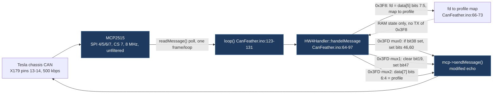

# binfen1-tesla-fsd-can-mod

Deep-dive analysis, replace mode, 2026-11-21. The pre-replace summary remains retrievable as `git show HEAD:docs/legacy/binfen1-tesla-fsd-can-mod.md` (all `#L<n>` citations below refer to that snapshot). The YAML frontmatter above is preserved byte-for-byte as stored at HEAD (`cmp` verified against `git show HEAD:...` lines 1-9; this repo normalizes the file to LF in git, so the pre-replace working tree's CRLF display was a checkout artifact), including its truncated description line — see contradiction row C5. This document uses LF endings.

## 1. Provenance

- Submodule: `legacy/binfen1-tesla-fsd-can-mod`
- Pinned gitlink (canonical form): `160000 495b4fc4c0df0a390cdcf5bdcbdaab19b9c44e7a 0` from `git ls-files -s legacy/binfen1-tesla-fsd-can-mod`; matches `git -C legacy/binfen1-tesla-fsd-can-mod rev-parse HEAD`; submodule working tree clean (`status --porcelain` empty).
- Upstream: `https://github.com/binfen1/tesla-fsd-can-mod` (origin remote).
- License: GPL-3.0 — header block `CanFeather.ino:1-14`, restated `README.md:164-166`.
- Analysis date: 2026-11-21. Mode: replace.
- Upstream files read, FULL-READ: `CanFeather.ino` lines 1-131 (entire file, 107 non-blank lines); `README.md` lines 1-166 (entire file); `.gitignore` (entire, 1 line: `build/`). `git -C legacy/binfen1-tesla-fsd-can-mod ls-files` inventory is exactly these 3 files — no hidden or platform directories exist, nothing skipped.
- Upstream history read for section 15: the full local `git log` (10 commits, all ancestors of the pin), the complete initial `60d0e61:CanFeather.ino` (210-line version), and diffs `60d0e61..61bd546`, `01ba780..61bd546`, and `c9050e3` — RANGE-CITED per diff hunk.
- Our-side files read as parity evidence: FULL-READ `firmware/lib/vehicle/can/handler/variant/hw4.h` (1-169), `firmware/lib/vehicle/can/handler/variant/bits.h` (1-58), `firmware/lib/vehicle/can/feature/fsd/profile.h` (1-111), `firmware/lib/vehicle/can/ids.h` (1-122), `firmware/lib/vehicle/can/feature/fsd/fsd.h` (1-58), `firmware/lib/vehicle/can/handler/dispatch.h` (1-46). RANGE-CITED: `firmware/test/test_native_ids/test_ids.cpp` (1-110), `firmware/lib/vehicle/can/handler/filters.h` (grep-anchored, lines 17-92), `firmware/lib/core/types.h` (lines 63, 837 via grep), `firmware/test/test_native_helpers/test_helpers.cpp` (157-190, 283-286 via grep), `firmware/lib/vehicle/can/feature/fsd/offsets.h` (17-23 via grep), `firmware/lib/vehicle/can/handler/bus/chassis.h` (line 96 via grep).
- Files explicitly NOT read upstream: none exist beyond the three read. Upstream network surfaces (GitHub issues, PRs, releases, discussions) were not consulted — such claims stay UNVERIFIED.
- No `## Upstream (...)` sections existed in the replaced doc; only the YAML frontmatter (lines 1-9) was preserved. The replaced doc had frontmatter, so no invention was needed.

## 2. Executive verdict

This repo is a 3-file, 131-line Arduino sketch ("CanFeather") for an ESP32-C3 Super Mini + one MCP2515 that passively polls the Tesla chassis CAN and echoes three mutated variants of the FSD control frame `0x3FD` (mux 0: set bits 46+60 gated on the UI-selected bit 38; mux 1: clear bit 19, set bit 47; mux 2: write a 3-bit speed profile into `data[7]` bits [6:4]), with the profile value auto-tracked from the follow-distance field in `0x3F8` `data[5]` bits [7:5]. It is HW4-only at the pin, hardcoded, with no command surface, no persistence, no filters, no checksum or counter handling, and no tests. Every byte-layout decision it makes is already present in our firmware, mostly bit-identical (`mapHW4FollowDistToProfile`, `writeHW4SpeedProfile`, `isFSDSelectedInUI`, `readFollowDistance`, mux0/mux1 bit constants), so there are no port candidates. Its value is as an independent second implementation confirming our layouts (with the caveat that our map may share ancestry with it — open question Q4), plus a recorded rollback: it dropped working Legacy/HW3 handlers when porting platforms. Nothing may be copied verbatim (GPL-3.0 text, and repo rules anyway); its README platform/variant instructions are stale and must not be trusted.

## 3. Evidence map

No TEST-READ evidence exists: this repo ships no tests. No CAPTURE evidence exists in this repo: no frame logs or decode artifacts. Everything below is CODE-READ unless stated.

| Source file | Lines | What it proves | Grade |
| ----------- | ----- | -------------- | ----- |
| `CanFeather.ino` | 21, 23 | HW4-only compile target: `#define HW4 HW4Handler`, `#define HW HW4`; comment "HW4 since Version 2026.2.3 uses FSDV14, before that compile for HW3" | CODE-READ |
| `CanFeather.ino` | 27-32 | ESP32-C3 Super Mini pins: LED 8, CAN_CS 7, CAN_INT 10 unused (polling) | CODE-READ |
| `CanFeather.ino` | 34-38 | `CarManagerBase`: `speedProfile` default 1, `FSDEnabled` default false, virtual `handelMessage` | CODE-READ |
| `CanFeather.ino` | 40-42 | Mux selector: `readMuxID` = `frame.data[0] & 0x07` | CODE-READ |
| `CanFeather.ino` | 44-46 | UI gate: `isFSDSelectedInUI` = `(frame.data[4] >> 6) & 0x01` (bit 38), no DLC guard | CODE-READ |
| `CanFeather.ino` | 65-74 | `0x3F8` (1016) follow-distance read `data[5]` bits[7:5]; map 1→3, 2→2, 3→1, 4→0, 5→4; other codes leave profile unchanged | CODE-READ |
| `CanFeather.ino` | 75-92 | `0x3FD` (1021) mux0 sets bits 46+60 (gate: bit 38), mux1 clears 19 / sets 47, mux2 writes `data[7]` bits[6:4]; each echoes via `mcp->sendMessage` | CODE-READ |
| `CanFeather.ino` | 104-120 | Setup: SPI 4/5/6/7, `CAN_500KBPS` @ `MCP_8MHZ` (16 MHz via comment only), no filter config, no `pinMode` anywhere | CODE-READ |
| `CanFeather.ino` | 123-131 | Polling loop, `optimize("O3")`, one frame per iteration, LED HIGH on read error / LOW on frame, no error classification | CODE-READ |
| `README.md` | 19, 26-34, 53-58 | Claims: intercept/re-transmit, TLSSC as trigger, follow-distance mapping, nag clear, serial debug | SUMMARY-ONLY |
| `README.md` | 39-43, 45, 97 | Claims LEGACY/HW3/HW4 variant table and `#define HW HW3` switch — false at pin | SUMMARY-ONLY (contradicted, see C2/C3) |
| `README.md` | 131-155 | Profile tables (Legacy offset 28/29/30; HW4 5-level) — names unproven by code | SUMMARY-ONLY |
| `.gitignore` | 1 | Ignores `build/` — Arduino IDE build dir, no vendored deps | CODE-READ |

## 4. Architecture and build surface

- Entry points: Arduino `setup()` (`CanFeather.ino:104-120`) and `loop()` (`CanFeather.ino:123-131`). No other translation units; single-file sketch.
- Dependency: external Arduino library `mcp2515` by autowp (`#include <mcp2515.h>`, `CanFeather.ino:18`; README.md:90) — not vendored. `can_frame`/`MCP2515::ERROR` types come from that library.
- Shared core vs platform port: none — there is no layering; handler, bit helpers, driver init, and loop live in one file. A vestigial polymorphism exists (`CarManagerBase` virtual, `CanFeather.ino:34-38`) with exactly one implementation (`HW4Handler`, `CanFeather.ino:63-98`) selected by compile-time `#define HW` (`CanFeather.ino:23`).
- Build flags: none. Build surface is the Arduino IDE with a board package; the sketch hardcodes `CAN_500KBPS`/`MCP_8MHZ` at `CanFeather.ino:116` with a comment telling the user to edit the source for a 16 MHz crystal.
- Filters: never configured — the device receives every ID on the bus and ignores non-matching ones in software (`HW4Handler::handelMessage` checks `1016`/`1021` only, `CanFeather.ino:65,75`). Contrast: our side programs MCP2515 acceptance filters (`firmware/lib/vehicle/can/handler/filters.h:54-64`).
- State machines: no mechanism in this repo has a 3-or-more-state machine. None found.



## 5. Mechanism catalogue

### M1 — HW4 FSD unlock (0x3FD mux 0)

- **Claim (README / summary):** README.md:26-30,55 — checks an Autopilot setting (TLSSC, per README) and "adjusts the required bits" to activate FSD. Old doc #L50 — sets bits 46 and 60 gated on bit 6 of byte 4.
- **Code path:** `CanFeather.ino:75-82` — `HW4Handler::handelMessage()` → `readMuxID()` (`:76`) → `isFSDSelectedInUI()` (`:77`) → `setBit(frame,46,true)`, `setBit(frame,60,true)` (`:79-80`) → `mcp->sendMessage(&frame)` (`:81`).
- **Frame spec:** ID 0x3FD (1021), DLC 8 assumed (code indexes up to `data[7]` without checking), mux = `data[0] & 0x07` == 0. Bits set: 46 (`data[5]` bit 6), 60 (`data[7]` bit 4). Counter: None found — frame echoed with counter untouched. Checksum: None found — no recomputation.
- **Gates and timing:** gate is bit 38 (`data[4]` bit 6) already set in the received frame; no other gate (no AP-state, no park/summon, no user toggle — `FSDEnabled` state at `:36` is never read by any handler). Timing: purely reactive per received frame; no interval, no jitter, no pause windows.
- **State machine:** None found (single gate, no states).
- **Tests:** None found.
- **Evidence grade:** CODE-READ.
- **Verdict:** CONFIRMED.
- **Adapt to TeslaCANModder?** already present — our `handleHW4` mux0 sets 38, 39, 46, 60, optionally 59 under richer gates (`firmware/lib/vehicle/can/handler/variant/hw4.h:136-147`); upstream is the bit-subset case (see P5 for the capture-first experiment).

### M2 — HW4 nag suppress (0x3FD mux 1)

- **Claim (README / summary):** README.md:57 "clears the hands-on-wheel nag bit". Old doc #L51/#L65 mention bit 19 only.
- **Code path:** `CanFeather.ino:83-87` — `HW4Handler::handelMessage()` → `setBit(frame,19,false)` (`:84`), `setBit(frame,47,true)` (`:85`) → `mcp->sendMessage(&frame)` (`:86`).
- **Frame spec:** ID 0x3FD, mux 1. Bit 19 (`data[2]` bit 3) cleared; bit 47 (`data[5]` bit 7) set. Counter/checksum: None found — untouched.
- **Gates and timing:** none — fires on every received mux-1 frame unconditionally. Purely reactive.
- **State machine:** None found.
- **Tests:** None found.
- **Evidence grade:** CODE-READ.
- **Verdict:** CONFIRMED (and the old doc's bit-19-only claim is incomplete: bit 47 is also set, `CanFeather.ino:85`).
- **Adapt to TeslaCANModder?** already present — `applyHW4NagSuppressBits` clears `NAG_BIT_HANDS_ON_REQUIREMENT`(19) and sets `FSD_BIT_NAG_ORGANIC`(47) plus optional extras, gated by `nagModeUsesBit19` + `apGateOpen` (`firmware/lib/vehicle/can/handler/variant/hw4.h:40-53,150`).

### M3 — HW4 speed profile inject (0x3FD mux 2)

- **Claim (README / summary):** README.md:31-34,131-155 — maps follow-distance to a speed profile; table names unproven.
- **Code path:** `CanFeather.ino:88-92` — `HW4Handler::handelMessage()` → `frame.data[7] &= ~(0x07 << 4)` (`:89`), `frame.data[7] |= (speedProfile & 0x07) << 4` (`:90`) → `mcp->sendMessage(&frame)` (`:91`).
- **Frame spec:** ID 0x3FD, mux 2. Profile field: `data[7]` bits [6:4], 3-bit, values 0-4 written. Counter/checksum: None found.
- **Gates and timing:** none — fires on every received mux-2 frame regardless of FSD state. Purely reactive.
- **State machine:** None found.
- **Tests:** None found.
- **Evidence grade:** CODE-READ.
- **Verdict:** CONFIRMED.
- **Adapt to TeslaCANModder?** already present — `writeHW4SpeedProfile` uses the identical mask/shift (`firmware/lib/vehicle/can/feature/fsd/profile.h:30-36`), gated by `s.fsdEnabled && apGateOpen` with an optional offset write (`firmware/lib/vehicle/can/handler/variant/hw4.h:157-167`).

### M4 — Follow-distance → profile auto-map (0x3F8)

- **Claim (README / summary):** README.md:32-34 — reads stalk, maps dynamically. Old doc #L48 — bits[7:5] of byte 5, 5-level.
- **Code path:** `CanFeather.ino:65-74` — `HW4Handler::handelMessage()` → `auto fd = (frame.data[5] & 0b11100000) >> 5` (`:66`) → `switch(fd)` (`:67-73`) updates RAM `speedProfile` only. No TX of 0x3F8.
- **Frame spec:** ID 0x3F8 (1016), read-only, `data[5]` bits [7:5]. Map: fd 1→3, 2→2, 3→1, 4→0, 5→4; fd 0/6/7 leave the last profile unchanged (no default case).
- **Gates and timing:** no pinning/lock — the stalk always overrides the profile; no user override exists (no command surface). No timing.
- **State machine:** None found (pure combinational map).
- **Tests:** None found.
- **Evidence grade:** CODE-READ.
- **Verdict:** CONFIRMED.
- **Adapt to TeslaCANModder?** already present — `mapHW4FollowDistToProfile` returns the identical map `{-1, 3, 2, 1, 0, 4}` (`firmware/lib/vehicle/can/feature/fsd/profile.h:54-58`), applied only when `!s.profileOverride` (`firmware/lib/vehicle/can/handler/variant/hw4.h:86-91`), with `readFollowDistance` adding a DLC>=6 guard (`firmware/lib/vehicle/can/ids.h:106-109`) that upstream lacks.

### M5 — MCP2515 polling loop + LED idle indicator

- **Claim (README / summary):** README.md:58,156-158 — serial debug output; nothing about LED.
- **Code path:** `CanFeather.ino:123-131` — `loop()` → `mcp->readMessage(&frame)` (`:125`) → error: `digitalWrite(LED_PIN, HIGH); return` (`:126-129`) → else `digitalWrite(LED_PIN, LOW)` (`:130`) → `handler->handelMessage(frame)` (`:131`).
- **Frame spec:** None found — transport-level mechanism.
- **Gates and timing:** one frame per loop iteration; no interrupt (`CAN_INT_PIN 10` unused, `:30`); LED HIGH = no frame/error, LOW = frame processed. `pinMode(LED_PIN, OUTPUT)` is never called (grep anchor A9) — see F4.
- **State machine:** None found.
- **Tests:** None found.
- **Evidence grade:** CODE-READ.
- **Verdict:** PARTIAL (the loop is confirmed; the LED indication likely does not drive the pin without `pinMode` — UNVERIFIED on hardware).
- **Adapt to TeslaCANModder?** no impact — our driver path is dispatch/ring-buffer based (`firmware/lib/vehicle/can/handler/dispatch.h:27-46`); unfiltered single-frame polling is strictly worse than our pipeline.

### M6 — Compile-time variant switch (vestigial polymorphism)

- **Claim (README / summary):** README.md:35-45,92-98 — three-variant table and "#define HW HW3" switch instructions. False at pin.
- **Code path:** `CanFeather.ino:21-23` — `#define HW4 HW4Handler`, `#define HW HW4`; `handler = std::make_unique<HW>()` (`:105`); virtual dispatch via `CarManagerBase` (`:34-38`).
- **Frame spec:** None found — build-level mechanism.
- **Gates and timing:** none.
- **State machine:** None found.
- **Tests:** None found.
- **Evidence grade:** CODE-READ.
- **Verdict:** CONTRADICTED vs README (only one variant exists at pin; negative anchor A8).
- **Adapt to TeslaCANModder?** no impact — we have runtime variant detection and dispatch (`handleMessage` → `handleChassisBus` → `handleHW4`, `firmware/lib/vehicle/can/handler/dispatch.h:27-46`, `firmware/lib/vehicle/can/handler/bus/chassis.h:96`).

## 6. Summary vs code contradiction table

| ID | Claim (with citation) | Code evidence | Verdict |
| -- | --------------------- | ------------- | ------- |
| C1 | README.md:19,62-67: runs on "Adafruit CAN Bus FeatherWing (MCP25625)", Feather M4/RP2040 CAN, exposes `PIN_CAN_STANDBY`/`PIN_CAN_RESET` | `CanFeather.ino:27-30,111-116`: ESP32-C3 Super Mini pins (LED 8, CS 7), `SPI.begin(4,5,6,7)`, no STANDBY/RESET pins exist | CONTRADICTED — README platform sections predate the port commit 495b4fc |
| C2 | README.md:39-43,97: `#define HW HW3  // Change to LEGACY, HW3, or HW4` | `CanFeather.ino:21-23`: `#define HW HW4`; no `HW3Handler`/`LegacyHandler` symbols exist (anchor A8 negative) | CONTRADICTED — variant instructions are dead |
| C3 | README.md:45: "If your vehicle is on an earlier firmware version, compile with HW3 even if your vehicle has HW4 hardware" | impossible at pin — the HW3 handler was deleted in 495b4fc (initial-commit comparison, section 15) | CONTRADICTED — advice now bricks the build |
| C4 | README.md:28,55: the trigger bit is the "Traffic Light and Stop Sign Control" Autopilot setting | `CanFeather.ino:44-46` names it `isFSDSelectedInUI` (bit 38); our comment `firmware/lib/vehicle/can/ids.h:114` says the same bit is STEERING_MODE=5 (FSD selected) | Upstream README contradicts its own function naming; both semantic labels are SUMMARY-ONLY — settle with a capture (Q1) |
| C5 | `git show HEAD:docs/legacy/binfen1-tesla-fsd-can-mod.md#L3`: frontmatter description says "Runs on an Adafruit Feathe" (stale platform, truncated mid-word) | `CanFeather.ino:27-30`: ESP32-C3 Super Mini | Stale frontmatter — kept byte-for-byte per replace-mode rules (this row is the record of the staleness) |
| C6 | `git show HEAD:...#L61`: "Concrete CAN ID 1016/1021 bit-level protocol for FSD activation on HW3/HW4" vs `#L40` of the same doc: "Legacy/HW3 handlers removed... only HW4" | `CanFeather.ino:23`: HW4-only | Internal contradiction inside the replaced doc |
| C7 | README.md:149-155: HW4 profile table keyed by "Distance 2..6" with names Max/Hurry/Normal/Chill/Sloth | `CanFeather.ino:66-73`: raw fd codes are 1..5, so the README's "Distance" column is off by one vs the wire codes; the numeric fd→profile map is consistent only after that shift; profile names appear nowhere in code | PARTIAL — numeric mapping confirmed, labels shifted, names SUMMARY-ONLY (Q3) |

## 7. CAN frame and signal inventory

| ID (hex+dec) | Bus | Period | DLC | Byte/bit layout | Scale/units | Counter | Checksum | R/W | Grade |
| ------------ | --- | ------ | --- | -------------- | ----------- | ------- | -------- | --- | ----- |
| 0x3F8 (1016) | chassis-equivalent (single bus, X179 13-14) | None found — read reactively, no TX of this ID | not checked (indexes `data[5]`) | fd = `data[5]` bits[7:5] | raw codes 1-5 (unitless stalk codes) | n/a (not touched) | n/a (not touched) | read | CODE-READ |
| 0x3FD (1021) mux 0 | chassis-equivalent | None found — echo per received frame, no interval logic | 8 assumed, unchecked | gate: bit 38 (`data[4]` bit 6) read; sets bit 46 (`data[5]` bit 6), bit 60 (`data[7]` bit 4) | unitless flags | untouched | None found — no recomputation | read + write (echo) | CODE-READ |
| 0x3FD (1021) mux 1 | chassis-equivalent | None found — echo per received frame | 8 assumed, unchecked | clears bit 19 (`data[2]` bit 3), sets bit 47 (`data[5]` bit 7) | unitless flags | untouched | None found | read + write (echo) | CODE-READ |
| 0x3FD (1021) mux 2 | chassis-equivalent | None found — echo per received frame | 8 assumed, unchecked | profile = `data[7]` bits[6:4] | 3-bit profile index 0-4 | untouched | None found | read + write (echo) | CODE-READ |

No DBC/JSON catalog is vendored — the `STRUCTURAL-PARSE` row type does not apply. Both this repo and our handler treat 0x3FD as counter/checksum-free; no capture in either repo proves that absence (Q7).

## 8. Constants and tuning table

| Constant | Value | File:line | Meaning | Grade |
| -------- | ----- | --------- | ------- | ----- |
| mux mask | `0x07` | `CanFeather.ino:41` | FSD mux selector = `data[0]` bits[2:0] | CODE-READ |
| UI gate | `data[4] >> 6 & 0x01` (bit 38) | `CanFeather.ino:45` | precondition for mux0 edits; read-only | CODE-READ |
| FSD enable bits | 46, 60 | `CanFeather.ino:79-80` | the only bits set on mux0 (contrast: ours also sets 38, 39, optionally 59) | CODE-READ |
| nag bits | 19 clear, 47 set | `CanFeather.ino:84-85` | hands-on suppression pair on mux1 | CODE-READ |
| profile field | `0x07 << 4` in `data[7]` | `CanFeather.ino:89-90` | 3-bit speed profile at bits[6:4] | CODE-READ |
| fd→profile map | 1→3, 2→2, 3→1, 4→0, 5→4 | `CanFeather.ino:67-73` | stalk codes to profile index; fd 0/6/7 keep previous | CODE-READ |
| default profile | `1` | `CanFeather.ino:35` | `speedProfile` initial value (code path start before any 0x3F8 frame) | CODE-READ |
| CAN bitrate / crystal | `CAN_500KBPS`, `MCP_8MHZ` | `CanFeather.ino:116` | 500 kbps bus, 8 MHz MCP2515 crystal; 16 MHz only as a source-edit comment | CODE-READ |
| serial baud | 115200 | `CanFeather.ino:107` | debug print transport | CODE-READ |

## 9. Failure modes and edge cases

No tests exist, so every row's "tested?" is untested. No TEST-READ evidence exists: this repo ships no tests.

| Failure | Handling code path | Tested? | Grade |
| ------- | ----------------- | ------- | ----- |
| No CAN frame / read error | `CanFeather.ino:126-129`: LED HIGH, return; all `MCP2515::ERROR` codes (NODATA, FAIL, buffer overflow) collapse into one branch | untested | CODE-READ |
| `setBitrate` failure | `CanFeather.ino:117-118`: prints "setBitrate failed" then continues into `setNormalMode()` anyway | untested | CODE-READ |
| DLC < 8 frames | None found — `data[4]`, `data[5]`, `data[7]` indexed with no DLC check (`:45,66,89`); short frames echo mutated garbage-tail bytes. Our side guards (`ids.h:108,121`, `profile.h:32`) | untested | CODE-READ |
| LED indication without `pinMode` | `digitalWrite(LED_PIN, …)` at `:127,130` but `pinMode(LED_PIN, OUTPUT)` never called anywhere (anchor A9) — on ESP32 Arduino cores `digitalWrite` does not enable output drive by itself, so the indicator is likely dead | untested | CODE-READ (absence) / UNVERIFIED (hardware behavior, Q5) |
| RX buffer overflow under burst | one `readMessage` per loop; no overflow accounting, no drain loop, frames silently dropped | untested | CODE-READ |
| bus-off / watchdog / brownout / OTA | None found — no recovery, no WDT feed logic, no OTA awareness | untested | CODE-READ (absence) |
| persistence across reboot | None found — `speedProfile`/`FSDEnabled` are RAM only; no NVS/EEPROM | untested | CODE-READ |

## 10. Test coverage map

None found — the repo ships no test files (`git ls-files`: `.gitignore`, `CanFeather.ino`, `README.md`). Every mutation path (mux0 gate, mux1 pair, mux2 field write, fd map) is unverified by any in-repo oracle. Risk in one line: a bit-mask or map regression in this sketch would only surface as "FSD does not engage" on a live vehicle, since there is no bench check of any kind. (Our counterpart layouts do have tests: e.g. `test_read_follow_distance_value_4` and `test_is_fsd_selected_bit_set`, `firmware/test/test_native_ids/test_ids.cpp:40,70`.)

## 11. Parity matrix with TeslaCANModder

All rows have our-side CODE-READ citations (tests cited additionally where present).

| Signal/frame | Upstream decode (cite) | Our decode (cite) | Delta | Action |
| ------------ | ---------------------- | ----------------- | ----- | ------ |
| 0x3F8 follow-distance field | `data[5]` bits[7:5], no DLC guard (`CanFeather.ino:66`) | `readFollowDistance`: same field + `dlc >= 6` guard (`firmware/lib/vehicle/can/ids.h:106-109`), TEST-READ `test_ids.cpp:19-66` | ours adds the guard; identical otherwise | already present — no change |
| fd→profile map | switch 1→3, 2→2, 3→1, 4→0, 5→4; invalid codes keep previous (`CanFeather.ino:67-73`) | `mapHW4FollowDistToProfile` map `{-1, 3, 2, 1, 0, 4}`, -1 = keep (`firmware/lib/vehicle/can/feature/fsd/profile.h:54-58`) | identical values and keep-previous semantics | already present |
| 0x3FD mux selector | `data[0] & 0x07` (`CanFeather.ino:40-42`) | `readMuxID` (`firmware/lib/core/types.h:63`), used at `hw4.h:133` | identical | already present |
| UI FSD-selected gate | bit 38 read, no guard (`CanFeather.ino:44-46`) | `isFSDSelectedInUI` bit 38 + `dlc >= 5` guard (`firmware/lib/vehicle/can/ids.h:119-122`), TEST-READ `test_ids.cpp:70-103`, `test_helpers.cpp:157-190` | ours adds guard + force-mode bypass (`fsdForceEnabled`, `hw4.h:134`) | already present |
| 0x3FD mux0 bit set | sets 46, 60 only, gate = bit 38 (`CanFeather.ino:78-81`) | sets `FSD_BIT_AP_ACTIVE`(38), `FSD_BIT_CONTINUE_ON_GREEN`(39), `FSD_BIT_EAP`(46), `FSD_BIT_DAS_DEV`(60), optional `FSD_BIT_EVD`(59) under `fsdAllowed && apGateOpen` + apFirst (`firmware/lib/vehicle/can/handler/variant/hw4.h:131-147`; constants `bits.h:19-23`) | ours is a superset with runtime gates; upstream is the minimal pair | capture-first experiment only (P5/Q2) — no code change without bench evidence |
| 0x3FD mux1 nag pair | clears 19, sets 47, unconditional (`CanFeather.ino:83-87`) | same pair via `applyHW4NagSuppressBits` (`hw4.h:40-53`, constants `bits.h:27,42`), gated by `nagModeUsesBit19(s.nagMode) && apGateOpen` (`hw4.h:150`), plus optional EAP/lane-graph/ECE-R79-clear | identical core bits; ours adds gates and extras | already present |
| 0x3FD mux2 profile field | `data[7]` bits[6:4], `(profile & 0x07) << 4`, no guard (`CanFeather.ino:89-90`) | `writeHW4SpeedProfile` `~0x70` mask, same shift, `dlc >= 8` guard (`firmware/lib/vehicle/can/feature/fsd/profile.h:30-36`), plus optional HW4 offset field `data[1]` bits[5:0] (`hw4.h:160-164`, masks `bits.h:53-54`) | identical field; ours adds guard + offset write + `fsdEnabled` gate | already present |
| MCP2515 RX configuration | no acceptance filters, receives all IDs, software ID checks (`CanFeather.ino:65,75,118`) | hardware acceptance filters per feature set (`firmware/lib/vehicle/can/handler/filters.h:54-64,80`), dispatch chain `handleMessage`→`handleChassisBus`→`handleHW4` (`dispatch.h:27-46`, `bus/chassis.h:96`) | ours filters and dispatches; upstream floods software | ours is stricter — ignore upstream |

## 12. Surface inventory and security notes

- Transport surfaces: exactly one — USB serial debug output at 115200 (`CanFeather.ino:93-95,107`), transmit-only, gated by `enablePrint` which is hardcoded `true` at `:25` with no runtime toggle. No serial command parser, no BLE, no WiFi, no OTA surface. None found beyond this.
- Commands: none. All behavior is hardcoded at compile time; the only "user input" is editing `#define HW` or the crystal constant in source.
- Credentials/keys/certs: None found.
- Untrusted archives / vendored code: None found (the `mcp2515` autowp library is an external dependency, not vendored; `.gitignore` only excludes `build/`).
- Dangerous build flags: None found (`optimize("O3")` on `loop()` is performance-only, `CanFeather.ino:123`).
- Provenance/security observations: README.md:7 states an active FSD entitlement is required; README.md:9-15 describes a cross-region subscription workaround (transfer vehicle to a Canadian account). That is a Tesla ToS gray-zone instruction, not code — do not propagate it into our docs (section 14).

## 13. Adaptation assessment

| Mechanism | Value | Cost | Risk | Grade | Decision |
| --------- | ----- | ---- | ---- | ----- | -------- |
| M1 FSD unlock (mux0 bits 46+60) | low — confirms a subset of our bits may suffice | zero (experiment is bench capture, not code) | capture-first required per `docs/checklists/can-review-checklist.md` before touching mux0 | CODE-READ | already present; optional capture experiment only (Q2) |
| M2 nag suppress (19/47) | none — bit-identical to ours | zero | none | CODE-READ | already present |
| M3 profile inject (data[7][6:4]) | none — bit-identical to ours | zero | none | CODE-READ | already present |
| M4 fd→profile map | none — identical map; upstream lacks our pin/lock and DLC guard, both deliberate on our side | zero | none | CODE-READ | already present |
| M5 polling loop + LED | none — worse than our dispatch/ring pipeline | would be a regression | unfiltered polling floods the MCU | CODE-READ | no impact |
| M6 compile-time variant switch | none — our runtime variant detection supersedes it | zero | none | CODE-READ | no impact |

No mechanism qualifies as a port candidate. The three nearest backlog items are captures, not code: minimal-bit mux0 test (Q2), bit-38 semantics (Q1), profile value→name confirmation (Q3).

## 14. Do-not-copy list

| Item | File:line | Reason |
| ---- | --------- | ------ |
| `setBit()` helper implementation | `CanFeather.ino:48-59` | we already have our own `setBit` in handler helpers; GPL text must not be pasted even though licenses match — port constants/behavior only, with an attribution comment |
| `HW4Handler::handelMessage` structure and the misspelled `handelMessage` identifier | `CanFeather.ino:37,63-98` | never import upstream identifiers or the single-file .ino layout into `firmware/lib`; our dispatch/variant architecture is the intended shape |
| Cross-region subscription workaround instructions | `README.md:9-15` | Tesla ToS gray-zone procedure; policy content, not evidence — keep out of our user-facing docs |
| HW4 profile name table (Max/Hurry/Normal/Chill/Sloth) | `README.md:149-155` | SUMMARY-ONLY labels with an off-by-one distance column (C7); copying it would launder unverified semantics into our reference docs |
| Initial-commit HW3 offset encoding (`data[0][7:6]` + `data[1][5:0]`, clamp 0-100) | `60d0e61:CanFeather.ino` (HW3Handler mux2, dropped in 495b4fc) | already implemented independently in our `writeHW3SpeedOffset` (`firmware/lib/vehicle/can/feature/fsd/offsets.h:17-23`); any future change there must stay a derived idea, independent implementation |

## 15. History and evolution

Mined from the submodule's local `git log` (10 commits, 2026-03-28/29, pin = HEAD, so pre-pin history was reviewed in full). Network-only sources (issues, PRs) were not consulted: UNVERIFIED.

- `60d0e61` (2026-03-28) "Initial commit" — 210-line sketch with three handlers (`LegacyHandler` on 0x3EE/1006, `HW3Handler` on 1016/1021 with a 0-100 speed offset written as 10 bits across `data[0][7:6]`+`data[1][5:0]`, `HW4Handler` identical to today's). Target board: Adafruit Feather RP2040 CAN (`PIN_CAN_*` aliases, `MCP_16MHZ`, "MCP25625 ready" banner). Default variant `#define HW HW3`.
- `d620b1c` "licence" — adds the GPL-3.0 header block now at `CanFeather.ino:1-14`.
- `01ba780` "Refactor HW4Handler definition and cleanup setup function" — moves `setBit` above the handlers (it was defined after them), attaches the "HW4 since Version 2026.2.3 uses FSDV14" comment to the `HW4` define.
- `00c86b4` + `c24e323` — README polish, including the anti-price-gouging rationale (README.md:3).
- `61bd546` "Better Readme" — README restructured with the speed-profile tables and the `#define HW` instructions that are now stale (C2).
- `1852a48` "Update layout and add alternative CAN bus access" — adds the X652 legacy-connector fallback (README.md:118-124, unverified for our hardware).
- `c9050e3` "Edit README.md" — one-line markdown heading fix (`HW3 & HW4 Profiles` → heading).
- `453a507` "Merge branch 'main' into 'main'" — a platform web-editor self-merge; no content change.
- `495b4fc` (2026-03-29, the pin) "Port to ESP32-C3 Super Mini, drop Legacy/HW3 support" — deletes the Legacy and HW3 handlers (−99 lines in the .ino), retargets pins (SPI 4/5/6/7, LED 8, CS 7), switches the crystal assumption `MCP_16MHZ` → `MCP_8MHZ`, changes the default variant `HW HW3` → `HW HW4`, adds `.gitignore`.

Rollback reading: the author chose breadth-reduction over multi-variant maintenance — HW3 and Legacy support were deleted rather than ported, and the README was not updated to match (C1-C3). The crystal flip 16→8 MHz implies the new ESP32-C3 CAN module uses an 8 MHz oscillator; nothing else in the frame logic changed between initial commit and pin. Commented-out debug leftovers (`writeBits`, `printBits` in mux2) present at `60d0e61` were removed by the port.

## 16. Re-verification recipe

```bash
OLD=495b4fc4c0df0a390cdcf5bdcbdaab19b9c44e7a
git -C legacy/binfen1-tesla-fsd-can-mod fetch --tags --prune
git -C legacy/binfen1-tesla-fsd-can-mod log --oneline $OLD..origin/main
git -C legacy/binfen1-tesla-fsd-can-mod diff --stat $OLD..origin/main
git -C legacy/binfen1-tesla-fsd-can-mod diff $OLD..origin/main -- CanFeather.ino README.md .gitignore
git ls-files -s legacy/binfen1-tesla-fsd-can-mod   # must print: 160000 495b4fc4c0df0a390cdcf5bdcbdaab19b9c44e7a 0
```

All anchors below were run at write time (2026-11-21) with the outputs shown. Upstream paths are relative to `legacy/binfen1-tesla-fsd-can-mod/`.

```text
grep -nE 'setBit\(frame, 46, true\)|setBit\(frame, 60, true\)' CanFeather.ino
  -> 79: setBit(frame, 46, true); / 80: setBit(frame, 60, true);
grep -nE 'setBit\(frame, 19, false\)|setBit\(frame, 47, true\)' CanFeather.ino
  -> 84: setBit(frame, 19, false); / 85: setBit(frame, 47, true);
grep -nE '0b11100000' CanFeather.ino
  -> 66: auto fd = (frame.data[5] & 0b11100000) >> 5;
grep -nE 'case 5: speedProfile = 4' CanFeather.ino
  -> 72: case 5: speedProfile = 4; break;
grep -nE 'frame.data\[7\] &= ~\(0x07 << 4\)' CanFeather.ino
  -> 89: frame.data[7] &= ~(0x07 << 4);
grep -nE 'SPI.begin\(4, 5, 6, 7\)|MCP_8MHZ' CanFeather.ino
  -> 111: SPI.begin(4, 5, 6, 7); / 116: mcp->setBitrate(CAN_500KBPS, MCP_8MHZ);
grep -nE 'isFSDSelectedInUI' CanFeather.ino
  -> 44 (definition), 77 (mux0 call)
grep -nE 'HW3Handler|LegacyHandler' CanFeather.ino
  -> no output (negative anchor: variants are gone at the pin)
grep -nE 'pinMode' CanFeather.ino
  -> no output (negative anchor: LED_PIN 8 never configured, see F4)
grep -niE 'crc|checksum' CanFeather.ino
  -> no output (negative anchor: 0x3FD echoed without any checksum work)
grep -nE 'setFilter|FilterMask|RXM|RXF' CanFeather.ino
  -> no output (negative anchor: no MCP2515 filter configuration)
```

Our-side drift anchors (run from repo root; the `already present` decisions above rest on these):

```text
grep -nE '\{-1, 3, 2, 1, 0, 4\}' firmware/lib/vehicle/can/feature/fsd/profile.h
  -> 56: static const int8_t map[] = {-1, 3, 2, 1, 0, 4};
grep -nE 'f.data\[7\] = \(f.data\[7\] & ~0x70\)' firmware/lib/vehicle/can/feature/fsd/profile.h
  -> 35: f.data[7] = (f.data[7] & ~0x70) | ((profile & 0x07) << 4);
grep -nE '#define FSD_BIT_AP_ACTIVE|#define FSD_BIT_EAP|#define FSD_BIT_DAS_DEV|#define NAG_BIT_HANDS_ON_REQUIREMENT|#define FSD_BIT_NAG_ORGANIC' firmware/lib/vehicle/can/handler/variant/bits.h
  -> 19: FSD_BIT_AP_ACTIVE 38 / 21: FSD_BIT_EAP 46 / 23: FSD_BIT_DAS_DEV 60 / 42: NAG_BIT_HANDS_ON_REQUIREMENT 19 / 27: FSD_BIT_NAG_ORGANIC 47
grep -nE 'readFollowDistance|isFSDSelectedInUI' firmware/lib/vehicle/can/ids.h
  -> 106: readFollowDistance / 119: isFSDSelectedInUI
grep -nE 'nagModeUsesBit19\(s.nagMode\)' firmware/lib/vehicle/can/handler/variant/hw4.h
  -> 150: if (mux == 1 && nagModeUsesBit19(s.nagMode) && apGateOpen)
grep -nE 'handleHW4\(f, s\)' firmware/lib/vehicle/can/handler/bus/chassis.h
  -> 96: handleHW4(f, s);
grep -nE 'test_read_follow_distance_value_4|test_is_fsd_selected_bit_set' firmware/test/test_native_ids/test_ids.cpp
  -> 40: void test_read_follow_distance_value_4() / 70: void test_is_fsd_selected_bit_set()
```

If line numbers drift more than ~10 after a bump, re-read the whole function; do not trust this document's numbers. Pre-pin upstream history WAS reviewed (all 10 commits are ancestors of the pin and were examined in section 15).

## 17. Open questions and explicitly not investigated

- Q1 (UNVERIFIED — settle with a bench capture of 0x3FD mux0 while toggling UI settings): what bit 38 (`data[4]` bit 6) semantically is. Upstream README says "Traffic Light and Stop Sign Control" (README.md:28,55); upstream code and our comment say "FSD selected"/STEERING_MODE=5 (`CanFeather.ino:44`, `firmware/lib/vehicle/can/ids.h:114`). Both labels are SUMMARY-ONLY.
- Q2 (UNVERIFIED — capture-first, then `docs/checklists/can-review-checklist.md`): whether bits 46+60 alone (upstream's mux0 set) engage FSD on HW4/FSDV14, which would tell us whether our extra bits 38/39/59 at `hw4.h:136-147` are load-bearing. No in-repo capture exists either side.
- Q3 (UNVERIFIED): profile value→name mapping. Code proves values 0-4 (`CanFeather.ino:67-73`); the Max/Hurry/Normal/Chill/Sloth names are README-only, with an off-by-one distance column (C7).
- Q4 (UNVERIFIED): whether our identical `{-1, 3, 2, 1, 0, 4}` map is shared ancestry or independent discovery — the pickaxe shows it entered our tree in commit `db1137b` with no attribution to binfen1; `git log --follow firmware/lib/vehicle/can/feature/fsd/profile.h` plus commit-message archaeology would settle it.
- Q5 (UNVERIFIED — bench): whether `digitalWrite(LED_PIN, …)` drives GPIO8 at all without `pinMode` on the ESP32-C3 Arduino core (F4).
- Q6 (UNVERIFIED — network): upstream GitHub issues/releases were never consulted for captures or field reports; this analysis used only the local clone.
- Q7 (UNVERIFIED — capture): both repos echo 0x3FD with no counter/checksum recomputation; absence of a checksum on this frame is an assumption shared by two implementations, not capture-proven.
- Q8 (UNVERIFIED — bench): behavior on DLC<8 0x3FD/0x3F8 frames from a real vehicle (upstream would echo garbage tails; ours guards — `ids.h:108,121`, `profile.h:32`).
- Not investigated: whether the README's X652 connector fallback (README.md:118-124) applies to any vehicle we support — left to the hardware docs owners.
- Pre-pin upstream history: reviewed in full (section 15 states this; there is no unreviewed pre-pin history because the pin is HEAD).
