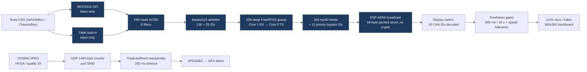
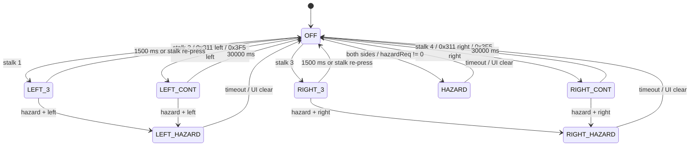
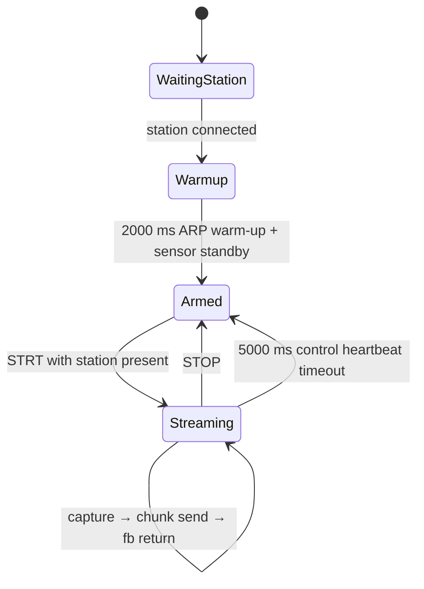

```mermaid
stateDiagram-v2
    [*] --> Idle
    Idle --> Assembling: first chunk, frameId != currentFrameId
    Assembling --> Assembling: more chunks, receivedChunks < expectedChunks
    Assembling --> Ready: all chunks received or END marker
    Assembling --> Ready: 200 ms timeout and >50% chunks
    Assembling --> Idle: 200 ms timeout and <=50% chunks
    Ready --> Idle: grabReadyFrame() / display released
```

# bobmorane83-TeslaCam

## 1. Provenance

- Submodule path (historical): `legacy/bobmorane83-TeslaCam`. Upstream URL recorded in `git show ee1571f^:.gitmodules`: `https://github.com/bobmorane83/TeslaCam`.
- **SPECIAL PROVENANCE — CONVERTED FOLDER.** No active submodule, no gitlink, no remote, no upstream fetch. `git ls-files -s legacy/bobmorane83-TeslaCam` returns 41 entries, all mode `100644` ordinary tracked files. Parent-repo commit `ee1571f` (2026-11-20, `chore(legacy): update submodules and preserve dead upstreams as tracked folders`) deleted the gitlink and added all 41 files in place; the upstream 404 is the recorded reason. Former gitlink: `160000 273677482082d7045820189716b003ddb25c0c29 0` (`git ls-tree ee1571f^ legacy/bobmorane83-TeslaCam`). No `git -C legacy/bobmorane83-TeslaCam ...` command is valid — there is no nested repository.
- License: none. No `LICENSE*` file in `git ls-files`; README contains no license grant. Frontmatter `author: bobmorane83` is attribution only.
- Analysis date: 2026-11-21 (today). Converted snapshot blobs are fixed by parent commit `ee1571f`; hashes in §16.
- Files read in full (FULL-READ, via `git ls-files` inventory, including hidden `.gitignore` files): `Bridge/src/main.cpp` (1-554), `Bridge/src/valid_can_ids.h` (1-43), `Camera/src/main.cpp` (1-380), `Ecran/firmware/src/main.cpp` (1-1982), `Ecran/firmware/src/lv_conf.h` (1-159), `Ecran/firmware/partitions.csv` (1-5), `auto_port.py` (1-24), `Bridge/platformio.ini` (1-32), `Camera/platformio.ini` (1-28), `Ecran/firmware/platformio.ini` (1-27), `.gitignore` (root/Bridge/Camera), `AGENTS.md` (1-7), `README.md` (1-169), `Guide.txt` (1-180), `PRD.md` (1-299), `IDEAS.md` (1-411), `Ecran/PRD_SPEED_ALERTS.md` (1-195), `Ecran/firmware/README.md` (1-88), `Bridge/HUB_README.md` (1-387), `Bridge/HUB_STATUS_REPORT.md` (1-368).
- RANGE-CITED (header + targeted ranges only, not full text): `Bridge/environment.md` (1-40), `Bridge/PERFORMANCE.md` (1-40 + grep anchors), `Camera/PERFORMANCE.md` (1-40 + grep anchors), `Ecran/PERFORMANCE.md` (1-40), `Can/SIGNAL_SYNTHESIS.md` (1-45 + heading index + targeted greps), `Can/Tesla-Model 3.md` (1-40), `Bridge/TESLA.md` (1-40 + heading index + targeted greps).
- STRUCTURAL-PARSE (schema/count level only): `Can/tesla_can.dbc`, `Can/Model3CAN.dbc`, `Can/tesla_can2.dbc` (`BO_`/`SG_`/`VAL_` counts, no per-signal read); `Ecran/firmware/src/font_montserrat_72.c` (header + structure, glyph tables not read); `Ecran/mockup/*.html` (grep anchors only).
- Explicitly NOT read: full 1196-line `SIGNAL_SYNTHESIS.md` body, full 2023-line `TESLA.md` body, full `PERFORMANCE.md` bodies, font glyph payloads, mockup JavaScript bodies, and all six binary files under `Photos/` (images).
- Replace mode: existing YAML frontmatter preserved byte-for-byte (description line carried no trailing whitespace, so no strip was needed). The pre-replace document contained no `## Upstream (...)` section, so there is nothing to re-place. Pre-replace claims cited as `git show HEAD:docs/legacy/bobmorane83-TeslaCam.md#<line>` throughout.

## 2. Executive verdict

Three independent ESP32-S3 devices implementing a **read-only telemetry silo**: a LilyGo T-2CAN bridge listens passively on MCP2515 (VehicleBus) and TWAI (ChassisBus) at 500 kbps, filters IDs twice (hardware mask + binary-search whitelist), rate-limits per CAN ID, and broadcasts an 18-byte packed frame over unencrypted ESP-NOW; a round LVGL display decodes 16 IDs and drives a dashboard; a separate Freenove camera streams JPEG chunks over an open SoftAP + raw UDP. **No CAN frame is ever mutated, injected, checksummed, or routed back to a vehicle bus** — the bridge is explicitly `MCP_LISTENONLY` / `TWAI_MODE_LISTEN_ONLY` (`Bridge/src/main.cpp:258`, `:296`). Mechanisms worth studying are the dual-filter pipeline, per-ID rate limiter with priority bypass, SoC buffer correction (`(bms-7.3)/92.7*100`), and timestamp-only stale-data gates. Candidates for TeslaCANModder: SoC correction, fused-speed-limit decode from 0x399, and stale-data hold timers — all capture-first, none a CAN-mutation port because our side already owns that pipeline. Never port: plaintext ESP-NOW broadcast, open SoftAP, MAC-pinned auto-flash, vendored DBCs and generated font, or any code verbatim (no upstream license exists).

## 3. Evidence map

| Source file | Lines | What it proves | Grade |
| --- | --- | --- | --- |
| `Bridge/src/main.cpp` | 19-36, 214-262 | MCP2515 pins, 500 kbps / 16 MHz, six hardware filters, listen-only mode | CODE-READ |
| `Bridge/src/main.cpp` | 264-286, 292-340 | Dual-bus drain loops, DLC clamp to 8, 16-byte MCP read buffer, TWAI listen-only, RTR/extended skip | CODE-READ |
| `Bridge/src/main.cpp` | 342-380 | `bsearch16` whitelist check, 18-byte packed message build, non-blocking queue send, drop counter | CODE-READ |
| `Bridge/src/main.cpp` | 386-440, 452-474 | WiFi STA only, channel 1, TX power 78, unencrypted broadcast peer, ESP-NOW callbacks | CODE-READ |
| `Bridge/src/main.cpp` | 480-531 | Core-1 RX task, Core-0 TX task, 200 ms/ID limiter, 11 priority IDs, 1 s heartbeat ID 0xFFF | CODE-READ |
| `Bridge/src/valid_can_ids.h` | 9-41 | 136 VehicleBus + 25 ChassisBus sorted IDs; 0x123 present | CODE-READ |
| `Camera/src/main.cpp` | 16-56, 118-151 | Open SoftAP `TeslaCam`, UDP 192.168.4.2:5000, 1400-byte chunks, control port 5001 | CODE-READ |
| `Camera/src/main.cpp` | 156-207, 212-217, 223-348 | 8-byte header, END marker 0xFFFF, OV5640 standby via reg 0x3008 bit 6, STRT/STOP control, 5 s heartbeat timeout | CODE-READ |
| `Ecran/firmware/src/main.cpp` | 103-185 | 16 CAN ID defines, `canData` fields, bridge timeout 10 s, regen cap 80 kW | CODE-READ |
| `Ecran/firmware/src/main.cpp` | 1251-1538 | All 16-ID decode switch, SoC buffer correction, A/DST logic, AP + fused limit + BSM from 0x399, trip energy | CODE-READ |
| `Ecran/firmware/src/main.cpp` | 1073-1232 | 500 ms blink cycles, 600 ms stale gates, speed tolerance arc, overspeed halo | CODE-READ |
| `Ecran/firmware/src/main.cpp` | 1573-1618, 1634-1752, 1859-1982 | WiFi reconnect/channel re-pin, UDP chunk reassembly + triple buffer, touch toggle, ESP-NOW pause | CODE-READ |
| `auto_port.py` | 1-24 | MAC-to-port pinning, abort on no match (cross-flash guard) | CODE-READ |
| `Bridge/platformio.ini`, `Camera/platformio.ini`, `Ecran/firmware/platformio.ini` | 1-32 / 1-28 / 1-27 | Three ESP32-S3 envs, hardcoded MACs, pioarduino platform pin, library sets | CODE-READ |
| `Can/tesla_can.dbc`, `Can/Model3CAN.dbc`, `Can/tesla_can2.dbc` | structural | 159 BO_/2752 SG_ each for first two; 19 BO_/210 SG_ for v2 | STRUCTURAL-PARSE |
| `Bridge/HUB_README.md`, `Bridge/HUB_STATUS_REPORT.md`, `PRD.md`, `IDEAS.md`, `README.md`, `Guide.txt` | cited per row in §6 | Stale/aspirational claims AP mode, 24-byte struct, START command, 1452-byte chunks, 50 kW regen, 500 ms black screen | SUMMARY-ONLY |
| `Bridge/HUB_STATUS_REPORT.md` | 11-35, 54-61 | Claims compile/flash/heartbeat logs but "Test sur bus CAN réel" unchecked | SUMMARY-ONLY |

No TEST-READ evidence exists: this repo ships no test directory, no test file, and no test target in any `platformio.ini`. No CAPTURE evidence exists in the converted snapshot: the serial logs printed in `HUB_STATUS_REPORT.md` are prose, not attached captures, and the real-car test is explicitly unchecked (`:61`). All §7-§12 frame-shape claims are CODE-READ of firmware source, not independently validated captures.

## 4. Architecture and build surface

Three separate PlatformIO projects (no workspace): `Bridge` (`env:t2can`, espressif32, MCP_CAN ^1.5.0), `Camera` (`env:esp32s3cam`), `Ecran/firmware` (`env:jc3636w518c`, pioarduino platform ZIP 53.03.13, Arduino_GFX ^1.5.0, JPEGDEC ^1.4.2, LVGL ^8.4.0). Each uses `pre:` `auto_port.py` with a hardcoded `custom_mac`. Shared core: none — the three firmwares duplicate the `ESP_CAN_Message_t` struct (`Bridge/src/main.cpp:85-91` and `Ecran/firmware/src/main.cpp:103-109`). Build flags: `-DBOARD_HAS_PSRAM`, `-DARDUINO_USB_*`, `-DLV_CONF_INCLUDE_SIMPLE`, `-DESP32QSPI_FREQUENCY=40000000`; no feature-gating flags analogous to our `BUS_*_ACTIVE`.



There is no "mutate/gate → TX back to bus" stage: the rightmost bus-facing TX edge does not exist in this repo. Gates are display-side freshness/color decisions only.

## 5. Mechanism catalogue

### Passive dual-bus CAN ingest with two-stage filtering

- **Claim (README / summary):** "reads from both MCP2515 (VehicleBus) and TWAI (ChassisBus) at 500 kbit/s, filters frames via whitelist" — `git show HEAD:docs/legacy/bobmorane83-TeslaCam.md#35`.
- **Code path:** `Bridge/src/main.cpp:214-262` `initializeCAN()` → `:264-286` `checkCANBus()` / `:292-340` `initializeTWAI()` / `checkTWAIBus()` → `:342-380` `isValidCanId()` → `queueCANMessage()`.
- **Frame spec:** all standard 11-bit IDs in whitelist; MCP buffers accept 0x100-0x5FF and 0x700-0x7FF, TWAI accept-all then software filter; DLC clamped 8; no counter/checksum inspection.
- **Gates and timing:** MCP reset sequence 100 ms ×3; RX poll each 1 tick (`vTaskDelay(1)`), drains all available frames; TWAI RX queue 64 deep; extra 16-byte MCP read buffer guards mcp_can copying DLC up to 15.
- **State machine:** None found (stateless polling).
- **Tests:** None found.
- **Evidence grade:** CODE-READ.
- **Verdict:** CONFIRMED.
- **Adapt to TeslaCANModder?** already present (our `firmware/lib/core/can/id_filter.h:25-77` O(1) bitmask, `firmware/lib/core/can/bus.h:26-36` three-bus activation).

### Per-ID ESP-NOW rate limiter with priority bypass and heartbeat

- **Claim (README / summary):** HUB_README.md:22 "max 1 msg/200ms per CAN ID (priority IDs bypass)"; BRG-03 heartbeat every 1 s.
- **Code path:** `Bridge/src/main.cpp:480-531` `espnowTxTask()` → `:442-464` `sendHeartbeat()` / `transmitViaESPNOW()`.
- **Frame spec:** heartbeat is pseudo-CAN ID 0xFFF, DLC 0, sent as `ESP_CAN_Message_t`; rate state is `espnow_last_sent[2048]` indexed by `id & 0x7FF`.
- **Gates and timing:** `ESPNOW_MIN_INTERVAL_MS=200`; priority IDs bypass entirely: 0x257, 0x266, 0x2E5, 0x33A, 0x292, 0x3F5, 0x045, 0x399, 0x249, 0x311, 0x3E2; queue blocking read 100 ms; heartbeat 1000 ms; stats every 10000 ms.
- **State machine:** None found.
- **Tests:** None found.
- **Evidence grade:** CODE-READ.
- **Verdict:** CONFIRMED.
- **Adapt to TeslaCANModder?** no impact — our transports are serial/WiFi REST/BLE, not ESP-NOW broadcast; the 11-ID priority list is a useful backlog thought but no current gap.

### 18-byte packed CAN-over-ESP-NOW wire contract

- **Claim (README / summary):** PRD.md:135-144 documents the struct as 18 bytes; HUB_STATUS_REPORT.md:168 says 24 bytes (see §6).
- **Code path:** `Bridge/src/main.cpp:85-91` (producer) and `Ecran/firmware/src/main.cpp:103-109` (consumer); `queueCANMessage()` memcpy + zero-fill, `transmitViaESPNOW()` sends `sizeof(ESP_CAN_Message_t)`, `onEspNowRecv()` rejects any other length (`:1237-1244`).
- **Frame spec:** `uint32 can_id | uint8 dlc | uint8 data[8] | uint32 timestamp | uint8 is_extended` = 18 bytes packed; no sequence number, no CRC, no authentication; broadcast FF:FF:FF:FF:FF:FF, `encrypt=false`.
- **Gates and timing:** length equality is the only validation; `millis()` timestamp assigned at queue time on the bridge.
- **State machine:** None found.
- **Tests:** None found.
- **Evidence grade:** CODE-READ.
- **Verdict:** CONFIRMED (18 bytes; 24-byte doc claim contradicted).
- **Adapt to TeslaCANModder?** never port as-is (unauthenticated plaintext broadcast); our serial contract is JSON-RPC envelopes with a `t` field.

### Display CAN decode with BMS SoC buffer correction

- **Claim (README / summary):** README.md:18-24 lists SoC, range, gear, power, temps; PRD.md:149 marks `SOCUI292` primary.
- **Code path:** `Ecran/firmware/src/main.cpp:1251-1538` `onEspNowRecv()` switch.
- **Frame spec:** 0x292 bits 10-19 ×0.1 → `bmsPct`; corrected as `(bmsPct - 7.3f) / (100.0f - 7.3f) * 100.0f` clamped 0..100 (`:1281-1295`); 0x33A `UI_SOC`/`UI_uSOE` explicitly rejected as unreliable (`:1275-1277`).
- **Gates and timing:** `dlc >= 4` for SoC; DLC-gated per case; no checksum validation; decode happens inside the ESP-NOW callback on Core 0.
- **State machine:** None found.
- **Tests:** None found.
- **Evidence grade:** CODE-READ.
- **Verdict:** CONFIRMED.
- **Adapt to TeslaCANModder?** **candidate for future PR** — capture-first; our `firmware/lib/vehicle/can/feature/telemetry/bms.h:191-195` exposes raw UI SoC with no buffer correction.

### Turn-signal halo state machine (8 modes)

- **Claim (README / summary):** README.md:24 "animated halo (left, right, warnings)"; PRD_SPEED_ALERTS.md describes 0x399-driven additions.
- **Code path:** `Ecran/firmware/src/main.cpp:311-323` (enum + timers), `:1384-1479` (0x3F5 / 0x311 / 0x249 inputs), `:1073-1191` (blink + blind-spot overlay).
- **Frame spec:** inputs 0x3F5 byte6 bits[3:2]/[5:4] status, byte0 hazard/indicator requests; 0x311 byte3 bits[1:0]/[3:2]; 0x249 byte2 bits[3:0] stalk; no output CAN frame.
- **Gates and timing:** 3-blink auto-cancel 1500 ms, continuous 30000 ms, reveal fade 150 ms, own 500 ms blink phase (`(now/500)%2`), UI_Warning has priority over stalk (`turnFromUIWarning`).
- **State machine:**



- **Tests:** None found (`TURN_SIGNAL_TEST=0` at `:113` is a manual demo, not a test; test harness at `:1877-1897`).
- **Evidence grade:** CODE-READ.
- **Verdict:** CONFIRMED.
- **Adapt to TeslaCANModder?** no impact — UI-only halo logic; our body/turn_signal and ALC code already own CAN-side turn state.

### Timestamp-only stale-data gates (brake / blind spot / trip)

- **Claim (README / summary):** `git show HEAD:docs/legacy/bobmorane83-TeslaCam.md#67` "Brake light anti-flicker: timestamp-only hold timer (600ms), refresh on ON only".
- **Code path:** `Ecran/firmware/src/main.cpp:1193-1210` brake halo, `:1116-1131` blind-spot overlay, `:1522-1536` trip timestamp, `:1482-1492` brake update.
- **Frame spec:** 0x3E2 byte0 bits[1:0] status==1 refreshes `lastBrakePedalMsg`; 0x399 bits[5:4]/[7:6] BSM levels; 0x082 byte0 bit0 trip active.
- **Gates and timing:** 600 ms hold for both brake and blind spot; refresh only on ON for brake (OFF/FAULT/SNA deliberately do not clear); trip SoC shown only if `now - lastTripMsg < 5000`.
- **State machine:** None found (two boolean visibility flags driven by elapsed time).
- **Tests:** None found.
- **Evidence grade:** CODE-READ + SUMMARY-ONLY (summary agrees; recorded here as evidence, not contradiction).
- **Verdict:** CONFIRMED.
- **Adapt to TeslaCANModder?** candidate for future PR in the **client** freshness layer only; do not copy into firmware CAN paths.

### Speed-limit tolerance arc and overspeed halo (F1-F4)

- **Claim (README / summary):** `Ecran/PRD_SPEED_ALERTS.md:32-55,62-151` proposed tolerance, colors, arc, halo.
- **Code path:** `Ecran/firmware/src/main.cpp:227-241` `lvSpeedColor()`, `:524-547` arc creation, `:860-884` arc update, `:1211-1230` halo, `:1494-1510` 0x399 decode.
- **Frame spec:** 0x399 byte0 bits[3:0] AP state ∈{3,4,5} → blue; byte1 bits[4:0] ×5 kph, 0=unknown, 31 (155) = none; tolerance 5 kph below 100, else 5%; red above limit+tolerance, orange above limit.
- **Gates and timing:** `hasLimit` requires live bridge; angles clamped to 180 kph and ±1.5° extension; halo shown immediately, no hysteresis.
- **State machine:** None found (pure threshold function).
- **Tests:** None found.
- **Evidence grade:** CODE-READ.
- **Verdict:** CONFIRMED (implementation differs from PRD in two constants — see §6).
- **Adapt to TeslaCANModder?** **candidate for future PR** — capture-first; our `ids.h:21,63` gives 0x399 two conflicting meanings (ISA on chassis, BSM on vehicle), so decode must be variant-gated.

### Camera JPEG chunk streaming with STRT/STOP control

- **Claim (README / summary):** README.md:27 "live front camera feed, activated by touch"; PRD.md:61-65 "START/STOP" 4-byte ASCII.
- **Code path:** `Camera/src/main.cpp:61-113` `initCamera()`, `:129-151` `initUDP()`, `:156-207` `sendFrame()`, `:223-348` `streamTask()`.
- **Frame spec:** JPEG UDP packets: `frame_id(2) | chunk_id(2) | total_chunks(2) | chunk_size(2) | payload(≤1400)`; end marker `chunk_id=0xFFFF, size=0`; control 4 bytes `STRT`/`STOP` on port 5001; destination unicast 192.168.4.2 (AP IP 192.168.4.1), not broadcast despite header comment.
- **Gates and timing:** sensor sleeps until first STRT and when stream stops; waits for ≥1 station + 2 s ARP warm-up; control heartbeat timeout 5000 ms; 1 ms yield every 3 chunks; FPS logged every 60 frames.
- **State machine:**



- **Tests:** None found.
- **Evidence grade:** CODE-READ.
- **Verdict:** CONFIRMED.
- **Adapt to TeslaCANModder?** no impact — different transport and device role; our client flasher/diagnostics do not stream video.

### Triple-buffered UDP frame reassembly on the display

- **Claim (README / summary):** PRD.md:76 ECR-06 "three JPEG buffers in PSRAM with FreeRTOS mutex"; `:1684-1694` frames promoted at >50% if stalled.
- **Code path:** `Ecran/firmware/src/main.cpp:1620-1632` `promoteCurrentFrame()`, `:1634-1671` `processPacket()`, `:1673-1695` `udpRecvTask()`, `:1697-1752` buffer handoff + JPEGDEC.
- **Frame spec:** accepts `chunkSize <= 1400`, `offset + chunkSize <= 65000`; no per-chunk CRC; END marker promotes only if frame/chunk IDs match and >0 chunks received.
- **Gates and timing:** 100 ms socket timeout drives assembly checks; 200 ms assembly timeout; partial frame promoted if >50% of chunks received, else discarded; 2 s no-frame state shows a blinking dot, not a full black screen.
- **State machine:**



- **Tests:** None found.
- **Evidence grade:** CODE-READ.
- **Verdict:** CONFIRMED.
- **Adapt to TeslaCANModder?** no impact (UI/transport-specific); the >50% promotion heuristic is a one-line idea if we ever add lossy image telemetry.

### Touch toggle with ESP-NOW pause and non-blocking WiFi

- **Claim (README / summary):** PRD.md:77,82 ECR-07/ECR-12 touch toggle; non-blocking WiFi.
- **Code path:** `Ecran/firmware/src/main.cpp:1552-1565` `isTouched()`/`sendCtrlCommand()`, `:1573-1593` WiFi + channel re-pin, `:1899-1944` loop management.
- **Frame spec:** I2C touch controller at 0x15, register 0x02, 1-byte count 1..5; control command `STRT`/`STOP` to 192.168.4.1:5001 re-sent every 2000 ms.
- **Gates and timing:** 300 ms touch debounce; 30 s manual WiFi retry on channel 1; `setAutoReconnect(false)` to prevent channel scanning; `espNowPaused=true` freezes dashboard CAN updates during camera mode.
- **State machine:** None found (two booleans `streamActive` / `espNowPaused` toggled together).
- **Tests:** None found.
- **Evidence grade:** CODE-READ.
- **Verdict:** CONFIRMED.
- **Adapt to TeslaCANModder?** no impact.

### MAC-pinned auto-port flashing

- **Claim (README / summary):** `git show HEAD:docs/legacy/bobmorane83-TeslaCam.md#65` "Auto-port detection by MAC address prevents cross-flashing".
- **Code path:** `auto_port.py:5-24`; wired as `extra_scripts = pre:` in each `platformio.ini` with `custom_mac` per board.
- **Frame spec:** None found (build-time only).
- **Gates and timing:** matches `SER=<MAC>` in `port.hwid` case-insensitively; on no match prints available ports and `sys.exit(1)` — fails closed.
- **State machine:** None found.
- **Tests:** None found.
- **Evidence grade:** CODE-READ.
- **Verdict:** CONFIRMED.
- **Adapt to TeslaCANModder?** no impact — our flash flow consumes GitHub release assets in the Expo client and has its own port selection.

### Geert-like DST / local-clock display helper

- **Claim (README / summary):** README.md:22 "time synchronized from vehicle".
- **Code path:** `Ecran/firmware/src/main.cpp:993-1032` France CET/CEST conversion using Zeller-style last-Sunday computation from `0x318` UTC fields.
- **Frame spec:** 0x318 bytes 0,1,3,4,5 = year offset, month, hour, day, minute; no DST bit consumed.
- **Gates and timing:** April-September always CEST; March/October switch at 01:00 UTC.
- **State machine:** None found.
- **Tests:** None found.
- **Evidence grade:** CODE-READ.
- **Verdict:** CONFIRMED.
- **Adapt to TeslaCANModder?** no impact — client uses host time; hard-coded France rules are a liability, not a feature.

## 6. Summary vs code contradiction table

| # | Claim (doc citation) | Code reality (citation) | Grade of claim |
| --- | --- | --- | --- |
| 1 | `git show HEAD:docs/legacy/bobmorane83-TeslaCam.md#15` and `#30`: camera feed travels over ESP-NOW from Bridge | Camera sends UDP to 192.168.4.2:5000 over SoftAP; Bridge never talks to Camera (`Camera/src/main.cpp:118-150`, negative anchor §16) | SUMMARY-ONLY |
| 2 | `git show HEAD:docs/legacy/bobmorane83-TeslaCam.md#39`: SIGNAL_SYNTHESIS has "~170 CAN messages and ~2900 signals" | Header says 159 messages / ~2752 signals; DBC parse 159/2752 (`Can/SIGNAL_SYNTHESIS.md:3-5`) | SUMMARY-ONLY |
| 3 | `git show HEAD:docs/legacy/bobmorane83-TeslaCam.md#50`: "DBC files contain ~159 messages with ~2752 signals" omits `tesla_can2.dbc` | Third DBC is 19 messages / 210 signals; phrase implies all DBCs (`Can/tesla_can2.dbc`, STRUCTURAL-PARSE) | SUMMARY-ONLY |
| 4 | HUB_README.md:23,110,250,320,323; PRD.md:91; HUB_STATUS_REPORT.md:32: WiFi AP "bridge" at boot, auto-off after 3 min | Bridge uses `WiFi.mode(WIFI_STA)` + `WiFi.disconnect()` only; no AP, no 3-min timer, no "AP SSID" print (`Bridge/src/main.cpp:386-403`) | SUMMARY-ONLY |
| 5 | HUB_STATUS_REPORT.md:168: message structure 24 bytes | Packed struct is 18 bytes; display rejects any other length (`Bridge/src/main.cpp:85-91`, `Ecran/firmware/src/main.cpp:103-109,1239`) | SUMMARY-ONLY |
| 6 | HUB_README.md:78,314; HUB_STATUS_REPORT.md:314; PRD.md:88; TESLA.md:9-10: 159 IDs / 135+24 | Whitelist has 136 + 25 = 161 IDs (`Bridge/src/valid_can_ids.h:29,37`) | SUMMARY-ONLY |
| 7 | HUB_STATUS_REPORT.md:220: `main.cpp` 379 lines | Current file is 554 lines; Bridge/PERFORMANCE.md:3 itself says 554 | SUMMARY-ONLY |
| 8 | HUB_README.md:141: `handleCANMessage()` parses/packages frames | No such symbol; path is `queueCANMessage()` (`Bridge/src/main.cpp:361-380`) | SUMMARY-ONLY |
| 9 | HUB_README.md:197: `CAN_SPEED MCP_500KBPS` | Code uses `CAN_500KBPS` (`Bridge/src/main.cpp:35`) | SUMMARY-ONLY |
| 10 | PRD.md:65,77,78,121,261; Guide.txt:121-124: command `START` | Both ends use 4-byte `STRT` (`Camera/src/main.cpp:270`, `Ecran/firmware/src/main.cpp:1923`) | SUMMARY-ONLY |
| 11 | PRD.md:61,108,113; Guide.txt:80-98: chunk payload ≤1452 bytes | `CHUNK_PAYLOAD=1400` in both sender and receiver (`Camera/src/main.cpp:27`, `Ecran/firmware/src/main.cpp:55`) | SUMMARY-ONLY |
| 12 | PRD.md:75,252,294; Guide.txt:180: black screen after 500 ms with no frame | `FRAME_TIMEOUT_MS=2000` and response is a blinking 6-px dot, not black screen (`Ecran/firmware/src/main.cpp:93,1960-1965`) | SUMMARY-ONLY |
| 13 | PRD.md:80: regen bar 0-50 kW | `MAX_REGEN_KW=80.0f`, bar percent = regen/80×100 (`Ecran/firmware/src/main.cpp:185,981`) | SUMMARY-ONLY |
| 14 | PRD.md:165,168: JPEG quality 10, hmirror 1 | Quality 18 (PSRAM HVGA) / 12 (no PSRAM); `set_hmirror(s, 0)` (`Camera/src/main.cpp:87,93,109`) | SUMMARY-ONLY |
| 15 | PRD.md:238: "LVGL n'est plus nécessaire"; PRD.md:227,235: `ESP Async UDP` dependency | Firmware is LVGL-centric; uses raw lwIP sockets; no AsyncUDP in `lib_deps` (`Ecran/firmware/src/main.cpp:15,1806-1843`, `Ecran/firmware/platformio.ini:24-27`) | SUMMARY-ONLY |
| 16 | PRD_SPEED_ALERTS.md:120: `COL_ORANGE = MKCOL(255,120,0)` | `COL_ORANGE = MKCOL(255,165,0)`; only halo amber is 255,120,0 (`Ecran/firmware/src/main.cpp:215,224`) | SUMMARY-ONLY |
| 17 | PRD_SPEED_ALERTS.md:80: tolerance arc width 10 px | 14 px (`Ecran/firmware/src/main.cpp:539`) | SUMMARY-ONLY |
| 18 | PRD_SPEED_ALERTS.md:181-185: F1-F5 implementation checkboxes all unchecked | F1-F4 implemented in firmware; F5 amber matches planned value (`Ecran/firmware/src/main.cpp:227-241,860-884,1211-1230,1494-1510`) | SUMMARY-ONLY |
| 19 | IDEAS.md:261: "0x123 is NOT in the whitelist" (contradicts IDEAS.md:383 in the same file) | 0x123 **is** in `VEHICLE_BUS_IDS` (`Bridge/src/valid_can_ids.h:12`) | SUMMARY-ONLY |
| 20 | IDEAS.md:201: "Batt temp min/max already decoded (0x2E5)" | 0x2E5 is front motor power; pack temps come from 0x312 (`Ecran/firmware/src/main.cpp:121,1298-1309,1361-1366`) | SUMMARY-ONLY |
| 21 | PRD.md:79: "decodes 7 CAN signals"; PRD.md:268: "6 signals" | Switch handles 16 distinct IDs (`Ecran/firmware/src/main.cpp:1251-1537`) | SUMMARY-ONLY |
| 22 | SIGNAL_SYNTHESIS.md:5: "Model3CAN.dbc - identical copy of tesla_can.dbc" | Blob hashes differ (2e030e79 vs 99bae450); `git diff --no-index --stat` = 1 insertion / 2 deletions | SUMMARY-ONLY |
| 23 | HUB_STATUS_REPORT.md:205: "Max Peers: 20 (configured for 3)" | `MAX_PEERS=3` defined but never used; exactly one broadcast peer is added (`Bridge/src/main.cpp:48,421-431`) | SUMMARY-ONLY |

## 7. CAN frame and signal inventory

Bridge forwards every whitelisted ID verbatim (136 VehicleBus + 25 ChassisBus, `Bridge/src/valid_can_ids.h:9-37`, CODE-READ/STRUCTURAL-PARSE of generated list) — not dumped here. Only frames actively decoded or synthesized in code are listed. "Bus" is upstream's bus label; after ESP-NOW the display has no bus distinction.

| ID (hex+dec) | Bus | Period | DLC | Byte/bit layout | Scale/units | Counter | Checksum | Read/write | Grade |
| --- | --- | --- | --- | --- | --- | --- | --- | --- | --- |
| 0x257 / 599 | Vehicle | ~20 ms assumed, no gate | ≥4 | `data[3] | (data[4]&0x01)<<8`, 9 bits | raw km/h | none | none validated | read | CODE-READ `Ecran:1253-1257` |
| 0x118 / 280 | Vehicle | no gate | ≥3 | `data[2] bits[7:5]`, 3 bits | gear 1=P..4=D, 7=SNA | none | none | read | CODE-READ `Ecran:1260-1265` |
| 0x33A / 826 | Vehicle | no gate | ≥8 | range `data[0] | (data[1]&0x03)<<8`; UI_SoC `data[6]&0x7F`; SOE `data[7]&0x7F` | miles ×1.609 → km; SoC fields logged but declared unreliable | none | none | read | CODE-READ `Ecran:1267-1279` |
| 0x292 / 658 | Vehicle | no gate | ≥4 | SOCUI292 bits 10-19: `(data[1]>>2)&0x3F | (data[2]&0x0F)<<6` | raw ×0.1 %, then `(x-7.3)/92.7*100` | none | none | read | CODE-READ `Ecran:1281-1296` |
| 0x312 / 786 | Vehicle | no gate | ≥8 | min bits44-52 from `data[5]>>4`,`data[6]&0x1F`; max bits53-61 from `data[6]>>5`,`data[7]` | ×0.25 −25 °C | none | none | read | CODE-READ `Ecran:1298-1311` |
| 0x321 / 801 | Vehicle | no gate | ≥2 / ≥6 | coolant bits0-9; ambient `data[5]` | ×0.125−40 °C; ×0.5−40 °C; 0x3FF/0 = SNA | none | none | read | CODE-READ `Ecran:1313-1331` |
| 0x243 / 579 | Vehicle | no gate | ≥6 | mux `data[0]&0x03`; cabin bits30-40 mux0 | ×0.1−40 °C, sanity −40..85 | none | none | read | CODE-READ `Ecran:1333-1351` |
| 0x266 / 614 | Vehicle | priority ID (unthrottled) | ≥2 | bits0-10 signed (`&0x400` sign extend) | ×0.5 kW rear motor | none | none | read | CODE-READ `Ecran:1353-1359` |
| 0x2E5 / 741 | Vehicle | priority ID (unthrottled) | ≥2 | bits0-10 signed | ×0.5 kW front motor | none | none | read | CODE-READ `Ecran:1361-1367` |
| 0x318 / 792 | Vehicle | no gate | ≥6 | bytes 0,1,3,4,5 = year offset, month, hour, day, minute | UTC fields | none | none | read | CODE-READ `Ecran:1369-1378` |
| 0x3F5 / 1013 | Vehicle | priority ID (unthrottled) | ≥7 | left/right status `data[6] bits[3:2]/[5:4]`; hazard `data[0] bits[7:4]`; indicators `data[0] bits[1:0]/[3:2]` | 2-bit status 1/2 = blink phases | none | none | read | CODE-READ `Ecran:1384-1423` |
| 0x311 / 785 | Vehicle | priority ID (unthrottled) | ≥4 | left `data[3]&0x03`, right `(data[3]>>2)&0x03` | nonzero = active | none | none | read | CODE-READ `Ecran:1425-1453` |
| 0x249 / 585 | Vehicle | priority ID (unthrottled) | ≥3 | stalk `data[2]&0x0F` | 1/2 left, 3/4 right | none | none (our side applies CRC-8; upstream does not) | read | CODE-READ `Ecran:1455-1479` |
| 0x3E2 / 994 | Vehicle | priority ID (unthrottled) | ≥1 | `data[0]&0x03` | 1=ON, 2=FAULT, 3=SNA | none | none | read | CODE-READ `Ecran:1482-1492` |
| 0x399 / 921 | Chassis | priority ID (unthrottled) | ≥2 (≥1 fallback) | AP state `data[0] bits[3:0]`; BSM L/R `bits[5:4]/[7:6]`; fused limit `data[1] bits[4:0]` | AP 3/4/5 active; BSM 1/2 = warn; limit ×5 kph, 0=unknown, 31=none | none | none | read | CODE-READ `Ecran:1494-1519` |
| 0x082 / 130 | Vehicle | no gate | ≥8 | trip active `data[0]&0x01`; energy `data[6]|data[7]<<8` signed | ×0.01 kWh; 0x8000/0x7FFF = SNA | none | none | read | CODE-READ `Ecran:1522-1536` |
| 0xFFF / 4095 | ESP-NOW pseudo-ID | 1000 ms | 0 | no payload | bridge liveness sentinel | none | none | write (synthetic) | CODE-READ `Bridge:60-61,442-450` |

DBC catalogs are STRUCTURAL-PARSE only: `tesla_can.dbc`/`Model3CAN.dbc` 159 messages / 2752 signals / 930 `VAL_` tables each; `tesla_can2.dbc` 19 / 210 / 110. No checksum or counter helper exists anywhere in the three firmware trees.

## 8. Constants and tuning table

| Constant | Value | File:line | Meaning | Grade |
| --- | --- | --- | --- | --- |
| `CAN_SPEED` / `CAN_CRYSTAL` | `CAN_500KBPS` / `MCP_16MHZ` | `Bridge/src/main.cpp:35-36` | Tesla 500 kbps, 16 MHz crystal | CODE-READ |
| Hardware filter masks / filters | `0x700`; `0x200,0x300,0x100,0x400,0x500,0x700` | `Bridge/src/main.cpp:249-256` | Accept 0x100-0x5FF + 0x700-0x7FF | CODE-READ |
| `WIFI_CHANNEL` / `WIFI_TX_POWER` | 1 / 78 (19.5 dBm) | `Bridge/src/main.cpp:41-42`, `Camera/src/main.cpp:21`, `Ecran/firmware/src/main.cpp:51` | Shared channel, max TX power | CODE-READ |
| `ESPNOW_MIN_INTERVAL_MS` | 200 | `Bridge/src/main.cpp:66` | Max 5 frames/s per non-priority ID | CODE-READ |
| Priority ID list | 11 IDs (0x257,0x266,0x2E5,0x33A,0x292,0x3F5,0x045,0x399,0x249,0x311,0x3E2) | `Bridge/src/main.cpp:112-114,505-513` | Rate-limit bypass | CODE-READ |
| `espnow_last_sent` | 2048 × 4 B | `Bridge/src/main.cpp:107,504` | Per-11-bit-ID timestamp table | CODE-READ |
| `CAN_QUEUE_SIZE` | 256 | `Bridge/src/main.cpp:74,169` | Inter-core queue depth | CODE-READ |
| `HEARTBEAT_INTERVAL_MS` / `HEARTBEAT_CAN_ID` | 1000 / 0xFFF | `Bridge/src/main.cpp:60-61` | Bridge liveness | CODE-READ |
| `STATS_INTERVAL` | 10000 | `Bridge/src/main.cpp:58,206` | Serial stats period | CODE-READ |
| `ESP_CAN_Message_t` | 18 bytes packed | `Bridge/src/main.cpp:85-91` | Wire contract | CODE-READ |
| `CHUNK_PAYLOAD` / `HEADER_SIZE` | 1400 / 8 | `Camera/src/main.cpp:27-28`, `Ecran/firmware/src/main.cpp:54-55` | UDP video chunking | CODE-READ |
| `MAX_FRAME_SIZE` | 65000 | `Ecran/firmware/src/main.cpp:56` | Reassembly hard cap | CODE-READ |
| `RECEIVER_PORT` / `CTRL_PORT` / `CTRL_TIMEOUT_MS` | 5000 / 5001 / 5000 | `Camera/src/main.cpp:24,53-54` | Video, control, heartbeat stop | CODE-READ |
| `CTRL_RESEND_MS` | 2000 | `Ecran/firmware/src/main.cpp:60` | STRT re-send while camera on | CODE-READ |
| `FRAME_ASSEMBLY_TIMEOUT_MS` / `FRAME_TIMEOUT_MS` | 200 / 2000 | `Ecran/firmware/src/main.cpp:86,93` | Partial-frame promotion / no-signal indicator | CODE-READ |
| `BRIDGE_TIMEOUT_MS` | 10000 | `Ecran/firmware/src/main.cpp:178` | Bridge dot + dashboard greying | CODE-READ |
| `MAX_REGEN_KW` | 80.0f | `Ecran/firmware/src/main.cpp:185,981` | Regen bar full scale | CODE-READ |
| `RATED_CONSUMPTION_KWH_PER_KM` | 0.1377f | `Ecran/firmware/src/main.cpp:135,919-923` | Destination-SoC estimator | CODE-READ |
| SoC buffer correction | 7.3 % | `Ecran/firmware/src/main.cpp:1288` | BMS→display calibration | CODE-READ (calibration provenance UNVERIFIED) |
| `TURN_3BLINK_MS` / `TURN_CONT_MS` / `TURN_REVEAL_MS` | 1500 / 30000 / 150 | `Ecran/firmware/src/main.cpp:317-319` | Halo timing | CODE-READ |
| Brake / blind-spot hold | 600 ms | `Ecran/firmware/src/main.cpp:1117,1196` | Stale-data anti-flicker | CODE-READ |
| Speed tolerance | 5 kph if <100, else 5 % | `Ecran/firmware/src/main.cpp:232-235,866-869,1218-1220` | Overspeed thresholds | CODE-READ |
| DST switch | month 3/10, day ≥25, 01:00 UTC | `Ecran/firmware/src/main.cpp:999-1023` | France CET/CEST | CODE-READ |
| OV5640 quality / standby | 18 or 12 / reg `0x3008` mask `0x40` | `Camera/src/main.cpp:87,93,215` | JPEG size, sensor sleep | CODE-READ |
| TWAI RX queue | 64 | `Bridge/src/main.cpp:297` | Burst absorption | CODE-READ |
| LV arc geometry | speed 135°..45° (270°), r=158; battery 148°..32° (244°), r=121 | `Ecran/firmware/src/main.cpp:345-356` | Dashboard layout | CODE-READ |
| `LV_DISP_DEF_REFR_PERIOD` | 100 ms | `Ecran/firmware/src/lv_conf.h:26` | 10 Hz dashboard | CODE-READ |

## 9. Failure modes and edge cases

| Failure | Handling code path | Tested? | Grade |
| --- | --- | --- | --- |
| MCP2515 init failure | Retry `CAN.begin()` every 2 s forever (`Bridge/src/main.cpp:228-239`) | No | CODE-READ |
| TWAI driver install/start failure | Error print, `twai_driver_uninstall()`, `twai_running=false`; bridge silently loses ChassisBus (`:302-317`) | No | CODE-READ |
| TWAI bus-off / error state | Listen-only config; no `twai_restart()` / error-state recovery anywhere | No | UNVERIFIED (absence) |
| Inter-core queue full | `stats_queue_full++`, frame dropped (`:377-379`) | No | CODE-READ |
| MCP2515 DLC up to 15 | 16-byte read buffer + clamp to 8 (`:269-275`); TWAI clamp (`:329-330`) | No | CODE-READ |
| Non-whitelisted ID | `stats_errors++`, drop (`:362-366`) | No | CODE-READ |
| ESP-NOW send failure | Callback logs at DEBUG_LEVEL 3 only; no retry/ack (`:466-470`) | No | CODE-READ |
| Rate-limit starvation | Non-priority IDs capped at 5/s; counter increments, no fairness (`:502-521`) | No | CODE-READ |
| Bridge silence | Display greys widgets after 10 s, dot blinks amber/red (`:844-845,1057-1065`) | No | CODE-READ |
| Camera control heartbeat loss | `streamEnabled=false` after 5 s, sensor sleeps (`:300-306`) | No | CODE-READ |
| UDP frame assembly stall | >50 % chunks promoted, otherwise discarded after 200 ms (`:1684-1693`) | No | CODE-READ |
| No camera frame for 2 s | Blinking 6-px dot overlay only (`:1960-1965`) | No | CODE-READ |
| PSRAM allocation failure | Infinite `while(true) delay(1000)` for buffers (`:1781-1790`) | No | CODE-READ |
| LVGL halo canvas allocation failure | Serial warning; halos silently absent (`:796-832`) | No | CODE-READ |
| WiFi STA disconnect / channel drift | `onWiFiStaDisconnected` re-pins channel 1; manual reconnect every 30 s (`:1573-1577,1910-1914`) | No | CODE-READ |
| ESP-NOW paused in camera mode | CAN-derived dashboard frozen by design (`:1922-1935`) | No | CODE-READ |
| OTA update in progress | No OTA code in any of the three firmware trees | No | UNVERIFIED (absence) |
| Brownout / reboot state | No NVS/Preferences writes in code; all state resets to defaults (`:176`) | No | UNVERIFIED (absence) |

## 10. Test coverage map

No test files exist in `git ls-files`; no test target exists in any `platformio.ini`. No TEST-READ evidence exists. Critical untested paths and their risk:

- Filter correctness (mask 0x700 + 161-ID whitelist): a wrong mask silently drops telemetry frames; only serial counters would reveal it.
- Rate limiter / priority bypass: no proof that safety-relevant IDs (0x3E2 brake, 0x399 BSM) actually survive under load.
- SoC buffer correction and all 16 bit-layout decoders: no captured frame asserts the formulas; our side disagrees on several (§11).
- UDP reassembly (END marker, >50 % promotion, 200 ms stall): malformed chunk ordering can display torn JPEGs; no unit harness.
- Control protocol `STRT`/`STOP` + 5 s timeout: no test that the sensor actually sleeps, so power/thermal claims are unverified.
- Dual-core queue handoff: no stress test for queue-full drops under real 500 kbps traffic.
- CAN checksums/counters (0x249 CRC-8 on our side): upstream ignores them; no test either way.

## 11. Parity matrix with TeslaCANModder

Every "our decode" cell is a CODE-READ citation in this repo. Rows without a found our-side counterpart are marked as such; SUMMARY-ONLY rows cannot drive a decision.

| Signal/frame | Upstream decode (cite) | Our decode (cite) | Delta | Action |
| --- | --- | --- | --- | --- |
| 0x257 speed | `Ecran:1253-1257`: `data[3]|(data[4]&1)<<8`, raw | `firmware/lib/vehicle/can/feature/telemetry/powertrain.h:18-22`: signed bytes 2-3 /100 | Different bytes and scale; both claim km/h | capture-first |
| 0x118 gear | `Ecran:1260-1265`: `data[2]>>5&7` | `powertrain.h:29-32`: `data[0]>>1&7` | Different byte/bit field | capture-first |
| 0x292 SoC | `Ecran:1281-1295`: bits10-19 ×0.1 then 7.3 % buffer correction | `bms.h:191-195` `decodeBmsSocUI` bits10-19 ×0.1, no correction; `bms.h:50-54` `decodeBmsSoc` bits0-9 | Upstream corrects to displayed %; we expose raw | **candidate, capture-first** |
| 0x33A range | `Ecran:1269-1270`: miles ×1.609 | `bms.h:235-239`: bits0-9 ×1.6 km | ~0.6 % factor difference, same bit field | align (document factor) |
| 0x312 pack temps | `Ecran:1301-1308`: ×0.25−25 from data[5..7] | `bms.h:332-347`: ×0.25−25 but masks `data[5]&0x0F<<5 | data[6]>>3` vs upstream high-nibble/low-5-bit split | Same scale, different bit masks — one side is wrong | capture-first |
| 0x399 BSM / AP / speed limit | `Ecran:1494-1510`: AP state, BSM, fused limit ×5 from one frame | `firmware/lib/vehicle/can/ids.h:21,63` assigns 0x399 to ISA (chassis) **and** BSM (vehicle); `firmware/lib/vehicle/can/feature/body/turn_signal.h:119-132`, `firmware/lib/vehicle/can/handler/bus/vehicle.h:173-174` decode BSM only | Our dual definition is a real hazard; no fused-limit decode found | **candidate, capture-first + variant gate** |
| 0x3F5 turn signals | `Ecran:1384-1422` status/request bits | `turn_signal.h:93-106`, `vehicle.h:165-166` decode left/right active | Both read 0x3F5; different bit details not fully compared | capture-first |
| 0x082 trip planning | `Ecran:1522-1536`: active + energy-at-dest (read) | `firmware/lib/vehicle/can/feature/comfort/precondition.h:5` uses 0x082 as TX preconditioning frame only | Upstream reads, our side writes | ignore (different direction) |
| TPMS | `IDEAS.md:297-302` proposes 0x352 TPMS; no decoder in code | `firmware/lib/vehicle/can/feature/telemetry/tpms.h:22-75` decodes 0x219 pressures/temps | Different CAN IDs; upstream idea is unverified | ignore (our decode is stronger) |
| 0x266 / 0x2E5 motor power | `Ecran:1353-1367`: signed 11-bit ×0.5 kW | No decoder found in `firmware/lib/**` (grep anchors §16 return no hits) | Upstream-only signal | ignore |
| 0x321 / 0x243 cabin/ambient temps | `Ecran:1313-1351` | No decoder found in `firmware/lib/**` | Upstream-only signals | ignore |
| ID whitelist | `Bridge/src/valid_can_ids.h:10-37` sorted arrays + binary search, 161 IDs | `firmware/lib/core/can/id_filter.h:25-77` 2048-bit mask, O(1) | Different mechanism, same intent; ours is faster and per-bus | already present |
| Frame ring/queue | `Bridge/src/main.cpp:74,169,377` 256-deep FreeRTOS queue, drop counter | `firmware/lib/core/can/ring_buffer.h:43-145` 256-entry ring with per-consumer `RingConsumer` | Both 256; ours supports independent consumers | already present |
| Heartbeat / liveness | 1 s 0xFFF DLC0 (`Bridge:60-61,442-450`) | `firmware/lib/client/command/dispatch.h:177` status stream with `speedLimitKph` etc.; no 0xFFF sentinel | Different contract | already present (concept) |
| Stale-data hold timers | 600 ms brake/BSM (`Ecran:1117,1196`) | No equivalent found in `firmware/lib/**` | Upstream-only UI freshness idea | candidate (client layer only) |
| ESP-NOW transport | Core bridge→display link, unstructured 18-byte frames | `packages/protocol/src/commands.ts:429-433` defines `espnow:on/off/channel:1-13`; no ESP-NOW implementation found under `firmware/` (grep §16 returns no hits) | Contract exists without firmware implementation in this snapshot | SUMMARY-ONLY for firmware side — do not drive decision |
| Auto-port MAC pinning | `auto_port.py:5-24` | No counterpart | Build-tooling specific | no impact |

## 12. Surface inventory and security notes

| Surface | Location | Semantics | Security note |
| --- | --- | --- | --- |
| USB serial console (115200) | all three firmwares | Debug prints, stats every 10 s; no command parser on Bridge/Camera | No auth; physical access required |
| ESP-NOW broadcast | `Bridge/src/main.cpp:409-464` | 18-byte CAN frames + 0xFFF heartbeat on channel 1, peer FF:FF:FF:FF:FF:FF | `encrypt=false` (`:424`); any receiver on channel 1 can sniff/inject spoofed 18-byte packets; display validates only length (`:1239`) |
| ESP-NOW receive callback | `Ecran/firmware/src/main.cpp:1237-1244` | Length check only | No MAC allowlist, no sequence/anti-replay, no CRC |
| WiFi SoftAP | `Camera/src/main.cpp:17-21,118-124` | SSID `TeslaCam`, **no password**, channel 1, IP 192.168.4.1 | Open network; anyone nearby can associate |
| UDP video 5000 | `Camera/src/main.cpp:129-151,156-207` | Unicast 192.168.4.2:5000, 1400-byte chunks | No encryption/auth; spoofable JPEG stream |
| UDP control 5001 | `Camera/src/main.cpp:223-286` | Any 4-byte datagram `STRT`/`STOP` toggles streaming | No auth; any associated station can start/stop camera; sensor state changes on untrusted input |
| UDP display sockets | `Ecran/firmware/src/main.cpp:1595-1618` | Bind 5000 listen, send 5001 to 192.168.4.1 | No source validation |
| I2C touch | `Ecran/firmware/src/main.cpp:64-67,1552-1559` | CST816S at 0x15, SDA7/SCL8 | Physical-only |
| Build-time MAC pinning | `auto_port.py:5-24`, all `platformio.ini` | Aborts upload if `custom_mac` not found | Fails closed (good); hardcoded MACs are device identifiers, not secrets |
| Remote platform dependency | `Ecran/firmware/platformio.ini:2` | pioarduino platform ZIP URL | Supply-chain pin by URL, no hash (integrity UNVERIFIED) |

No credentials, API keys, certificates, or private keys exist in the 41 tracked files. No license grant exists (§1). Dangerous-by-design items: open SoftAP, unencrypted broadcast, max TX power 78, and unbounded retry loops on allocation failure.

## 13. Adaptation assessment

| Mechanism | Value | Cost | Risk | Evidence grade | Decision |
| --- | --- | --- | --- | --- | --- |
| Dual-stage CAN filter | Low (ours is O(1) and per-bus) | Low | Low | CODE-READ | already present |
| Per-ID rate limit + priority bypass | Low (different transports) | Medium | Low | CODE-READ | no impact |
| 18-byte ESP-NOW wire struct | Low | Low | High (unauthenticated) | CODE-READ | never port as-is |
| SoC 7.3 % buffer correction | Medium-high (dashboard accuracy) | Low | Medium — needs real-car decode capture | CODE-READ | **candidate for future PR (capture-first)** |
| 0x399 fused limit ×5 + AP state | Medium (speed-alert feature) | Low | Medium-high — our 0x399 has two meanings | CODE-READ | **candidate for future PR (capture-first, variant-gated)** |
| 600 ms stale-data hold timers | Low-medium (UI stability) | Low | Low (display only) | CODE-READ | candidate (client layer only) |
| Turn/overspeed halo UI | Low | Low | Low | CODE-READ | no impact |
| UDP JPEG chunking + triple buffer | Low (no video transport in our scope) | High | Medium | CODE-READ | no impact |
| Touch/WiFi management | Low | Low | Low | CODE-READ | no impact |
| MAC-pinned auto-port | Low | Low | Low | CODE-READ | no impact |
| DST/Zeller clock helper | Low | Low | Medium (hard-coded France) | CODE-READ | never port |
| Vendored DBC catalogs | Medium as reference only | High | High (unknown license, 8k lines) | STRUCTURAL-PARSE | never import — research reference only |
| Generated Montserrat-72 font | Low | Medium | Medium (no font license) | STRUCTURAL-PARSE | never port |

## 14. Do-not-copy list

| Item | File:line | Reason |
| --- | --- | --- |
| Open SoftAP definition | `Camera/src/main.cpp:17-21,121` | No password; security regression if copied |
| `encrypt=false` broadcast peer | `Bridge/src/main.cpp:421-428` | Unauthenticated telemetry injection surface |
| Unvalidated 4-byte control commands | `Camera/src/main.cpp:265-285` | Anyone on the AP can start/stop capture |
| Unvalidated ESP-NOW frame length-only receive | `Ecran/firmware/src/main.cpp:1237-1244` | No auth/sequence/CRC; do not model our serial parser on it |
| Hardcoded board MACs | `Bridge/platformio.ini:18`, `Camera/platformio.ini:22`, `Ecran/firmware/platformio.ini:7` | Device-specific identifiers; cross-flash hazard |
| Generated font glyph tables | `Ecran/firmware/src/font_montserrat_72.c:1-1414` | Generated artifact, no font license recorded; never import into shipping dirs |
| Three DBC files (9277 lines total) | `Can/*.dbc` | Unknown license, not code; keep as research reference only |
| `Bridge/TESLA.md`, `Can/SIGNAL_SYNTHESIS.md` | whole files | Derived summaries with known stale claims (§6); leads, not evidence |
| `Guide.txt` | whole file | Chat-log of abandoned options, not a protocol spec |
| Mockup HTML | `Ecran/mockup/*.html` | Design reference; only color/geometry ideas, no code reuse |
| Infinite allocation-failure loops | `Ecran/firmware/src/main.cpp:1781-1790` | Bricks device instead of degrading; wrong pattern for our firmware |

## 15. History and evolution

Local parent-repo history (no nested git log exists — converted folder):

| Commit | Date | Gitlink SHA / event |
| --- | --- | --- |
| `47f433f` | 2026-04-18 | submodule added at `7361dba66e38332951f0201a6a8b3e496c4f83c9` |
| `a199425` | 2026-05-04 | bumped to `a552a882fdbcb1392046409a2a21a80283159c10` |
| `349ffe6` | 2026-06-13 | bumped to `273677482082d7045820189716b003ddb25c0c29` ("apply safety fixes from legacy upstream repos" — commit subject only; per-file upstream diff not available locally) |
| `ee1571f` | 2026-11-20 | gitlink deleted, 41 files preserved as ordinary tracked files after upstream 404 |

In-repo evolution visible from dated docs: `Guide.txt` (7 March) first recommends ESP-NOW + 240-byte JPEG chunks, then reverses at `:54-55` to SoftAP+UDP raw for the reverse-camera case — the shipped code follows the reversal. `HUB_README.md:7` (March 2026) still describes an AP that the code removed; `HUB_STATUS_REPORT.md` (22 Feb 2026) records a 379-line bridge with hardware not yet procured (`:61` unchecked), while `Bridge/PERFORMANCE.md:3` already describes the 554-line dual-core version. `PRD.md` (camera phase) declares LVGL unnecessary at `:238` and asks for `ESP Async UDP` at `:227,235`, both later contradicted by the shipped display firmware. `IDEAS.md` (P1 speed-limit/AP ideas) was partially implemented — `PRD_SPEED_ALERTS.md` still lists F1-F5 as unchecked although F1-F4 are in code. `SIGNAL_SYNTHESIS.md` dated 2026-04-11 consolidates the three DBCs; its "identical copy" claim is contradicted by blob hashes.

Network-only claims (GitHub issues/PRs, exact 404 date, upstream commit titles between pins) are UNVERIFIED — no network access was used and no nested git history exists.

## 16. Re-verification recipe

Converted folder: there is no upstream to fetch. Anchor the parent-repo snapshot instead:

```bash
cd <TeslaCANModder>
git rev-parse HEAD                                  # expect ee1571f-era or later; doc written at HEAD containing ee1571f
git ls-tree ee1571f^ legacy/bobmorane83-TeslaCam    # expect 160000 273677482082d7045820189716b003ddb25c0c29 0
git ls-files -s legacy/bobmorane83-TeslaCam         # expect 41 entries, all mode 100644 (no 160000)
git status --porcelain -- legacy/bobmorane83-TeslaCam docs/legacy/bobmorane83-TeslaCam.md
git log --oneline -10 -- legacy/bobmorane83-TeslaCam
```

Pinned blob hashes (`git ls-files -s`, verified at write time): `Bridge/src/main.cpp` `fd883966bdfa558a3577c81428086b1f3972bfdb`; `Bridge/src/valid_can_ids.h` `da89311b259c475e746d742bfc7fff60d711976a`; `Camera/src/main.cpp` `1f46c0302bf87f5b7b0ff60eb1de89472b6ac317`; `Ecran/firmware/src/main.cpp` `776329ef0a032293dc1cf46be075822ebdd4a6ad`; `auto_port.py` `e057c8e049d7686c0b6bd0cd914200e21bea6a7f`; `Can/tesla_can.dbc` `99bae4501a9ce200fd1274a6d1523e3f5b7f5476`; `Can/Model3CAN.dbc` `2e030e798dc32b076794e2f57e36d620e3d4775a`. If these change, re-read the affected file before trusting any line number below.

Grep anchors (all run with `git grep -nE` at write time; expected hits shown):

```text
git grep -nE 'MCP_LISTENONLY|TWAI_MODE_LISTEN_ONLY' -- legacy/bobmorane83-TeslaCam/Bridge/src/main.cpp
  -> expect :258 MCP_LISTENONLY, :296 TWAI_MODE_LISTEN_ONLY
git grep -nE 'HEARTBEAT_CAN_ID|ESPNOW_MIN_INTERVAL_MS|CAN_QUEUE_SIZE' -- legacy/bobmorane83-TeslaCam/Bridge/src/main.cpp
  -> expect :61 0xFFF, :66 200, :74 256
git grep -nE 'VEHICLE_BUS_IDS_COUNT|CHASSIS_BUS_IDS_COUNT|0x123,' -- legacy/bobmorane83-TeslaCam/Bridge/src/valid_can_ids.h
  -> expect :12 0x123, :29 136, :37 25
git grep -nE 'CHUNK_PAYLOAD|RECEIVER_PORT|CTRL_PORT|CTRL_TIMEOUT_MS|0x3008' -- legacy/bobmorane83-TeslaCam/Camera/src/main.cpp
  -> expect :27 1400, :24 5000, :53 5001, :54 5000, :215 0x3008
git grep -nE 'FRAME_ASSEMBLY_TIMEOUT_MS|FRAME_TIMEOUT_MS|BRIDGE_TIMEOUT_MS|MAX_REGEN_KW|CTRL_RESEND_MS' -- legacy/bobmorane83-TeslaCam/Ecran/firmware/src/main.cpp
  -> expect :60 2000, :86 200, :93 2000, :178 10000, :185 80.0f
git grep -nE '7.3f|displayPct|SOCUI292' -- legacy/bobmorane83-TeslaCam/Ecran/firmware/src/main.cpp
  -> expect :1277 SOCUI292, :1283 start_bit 10, :1288 (bmsPct - 7.3f) / 92.7f-equivalent
git grep -nE 'DAS_fusedSpeedLimit|rawLimit \* 5|apState == 3' -- legacy/bobmorane83-TeslaCam/Ecran/firmware/src/main.cpp
  -> expect :175 comment, :1498 apState, :1506 comment, :1508 rawLimit * 5
git grep -nE 'WIFI_AP|softAP|AP SSID|ssid' -- legacy/bobmorane83-TeslaCam/Bridge/src/main.cpp
  -> expect no output (Bridge is STA-only; contradiction rows 4)
git grep -niE 'esp.now|espnow' -- legacy/bobmorane83-TeslaCam/Camera/src/main.cpp
  -> expect no output (camera never uses ESP-NOW; contradiction row 1)
git grep -nE 'AP Auto-shutdown|24 bytes' -- legacy/bobmorane83-TeslaCam/Bridge/HUB_README.md legacy/bobmorane83-TeslaCam/Bridge/HUB_STATUS_REPORT.md
  -> expect HUB_README.md:23,110 and HUB_STATUS_REPORT.md:168
git grep -nE 'START.*STOP' -- legacy/bobmorane83-TeslaCam/PRD.md
  -> expect :65,:77,:78,:121,:261 (doc says START; code says STRT)
```

Our-side drift anchors (item 11 parity and "already present" decisions):

```text
git grep -nE 'decodeVehicleSpeed|decodeGearState|decodeBmsSocUI|decodeBmsPackTMin' -- firmware/lib/vehicle/can/feature/telemetry
  -> expect powertrain.h:18,29 and bms.h:191,332
git grep -nE 'swFilterAccept|idFilterTest|canRingBuffer' -- firmware/lib/core/can
  -> expect id_filter.h:72,104 and ring_buffer.h:43
git grep -nE 'decodeBlindSpotLeftLevel|bsmLeftLevel' -- firmware/lib
  -> expect turn_signal.h:119, types.h:543, handler/bus/vehicle.h:173
git grep -nE '0x266|0x2E5|0x321' -- firmware/lib packages/protocol/src
  -> expect no output (no our-side decoders for those IDs)
git grep -nE 'espNow: \(on|espNowChannel: \{' -- packages/protocol/src/commands.ts
  -> expect :429,:64 (protocol contract only; no firmware implementation found)
```

If any line number has drifted more than ~10 lines, re-read the whole function; do not trust this document's numbers. Pre-pin upstream history (commits before `2736774…`) was **not** reviewed — only the converted snapshot plus parent-repo commit metadata. All UNVERIFIED items are in §17.

## 17. Open questions and explicitly not investigated

- Upstream repo 404 and the exact removal date are UNVERIFIED beyond the `ee1571f` commit message; no network check was made.
- Pre-pin upstream history (between `7361dba…`, `a552a88…` and `2736774…`) was not reviewed; only the converted snapshot was analyzed.
- No CAPTURE evidence: no real-car CAN trace exists in the snapshot (`HUB_STATUS_REPORT.md:61` unchecked). All frame layouts are CODE-READ only and need a listen-only bench capture before any adaptation.
- No TEST-READ evidence: the repo ships no tests; all failure paths in §9 are untested.
- Calibration provenance of the 7.3 % BMS buffer correction (`Ecran:1288`) is UNVERIFIED — likely empirical, source not recorded.
- Correct bit layout for 0x312 pack temps and the 0x257/0x118 offsets are contested between upstream and our decoders (§11); which side matches the vehicle is UNVERIFIED.
- Our `ids.h:21,63` dual use of 0x399 (ISA vs BSM) needs a variant/bus capture before the fused-speed-limit idea can be used.
- Whether the upstream 0x399 `DAS_fusedSpeedLimit` value is kph or mph on non-EU cars is UNVERIFIED (`PRD_SPEED_ALERTS.md:191` flags this and notes `UI_mapSpeedLimitUnits` on 0x3D9 is not received).
- `tesla_can.dbc` vs `Model3CAN.dbc` differ by 1 insertion / 2 deletions; the semantic delta was not investigated (STRUCTURAL-PARSE only).
- Full 1196-line `SIGNAL_SYNTHESIS.md`, 2023-line `TESLA.md`, all PERFORMANCE bodies, font glyph tables, mockup JavaScript and all six `Photos/` binaries were not read; claims depending on them are summary-level.
- No license grant anywhere in the tree; whether upstream later added one cannot be checked (404).
- Whether other `legacy/` repos carry newer/cleaner copies of the same Model 3 DBC was not investigated.
- Converted frontmatter description ends mid-phrase (`...a CAN bridge (L`) — inherited truncation preserved per replace mode; not corrected in frontmatter.
- Whether `espnow:on/off/channel` protocol commands in our `packages/protocol` have a firmware implementation elsewhere in this repo was not fully traced (grep under `firmware/` found none); treat that row as SUMMARY-ONLY for firmware parity.
