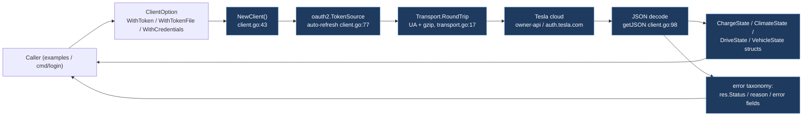
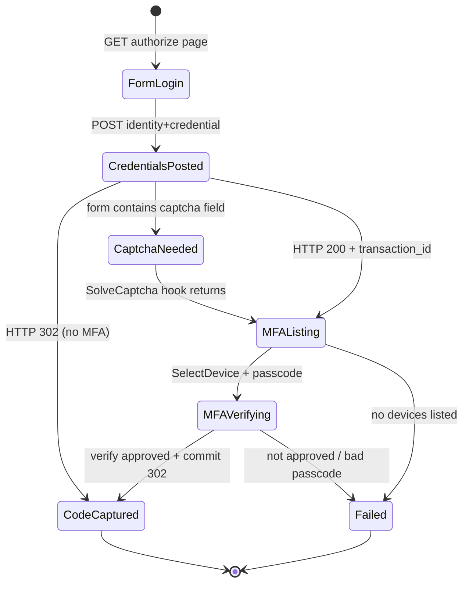

# bogosj/tesla

Deep code-grounded analysis (replace mode). Pre-replace summary is in git history — cite claims from it as `git show HEAD:docs/legacy/bogosj-tesla.md`. The pre-replace doc had YAML frontmatter (preserved above byte-for-byte) and **no** `## Upstream (...)` sections, so nothing beyond the frontmatter was carried forward verbatim.

## 1. Provenance

| Field | Value |
| ----- | ----- |
| Submodule path | `legacy/bogosj-tesla` |
| Gitlink (canonical) | `160000 a31b7b6396c9a3354c04eb91eefb4d9ba17de4d0 0` from `git ls-files -s legacy/bogosj-tesla` |
| Submodule HEAD | `a31b7b6396c9a3354c04eb91eefb4d9ba17de4d0` — matches gitlink (`git -C legacy/bogosj-tesla rev-parse HEAD`) |
| Working tree | clean (`git -C legacy/bogosj-tesla status --porcelain` → no output) |
| Pinned commit subject | `Allow result code 200 when setting backup percentage (#154)` |
| Upstream URL | https://github.com/bogosj/tesla.git (origin fetch/push) |
| License | MIT (LICENSE:5; portions © Jason Goecke 2016, rest © James Bogosian 2021, LICENSE:1-3) |
| Language / toolchain | Go 1.18, stdlib + `golang.org/x/oauth2`, `PuerkitoBio/goquery` (go.mod:3-11) |
| Analysis date | 2026-11-20 |
| Mode | Replace (this file rewrites the old shallow summary) |

Reading coverage (`git -C legacy/bogosj-tesla ls-files` = 24 tracked files, hidden dirs included — the only hidden paths are `.github/` and `.gitignore`, all inventoried):

- FULL-READ (every line): `client.go` (137), `transport.go` (68), `auth.go` (307), `auth_models.go` (17), `auth_option.go` (117), `client_options.go` (69), `commands.go` (305), `states.go` (325), `vehicles.go` (134), `products.go` (52), `energysite.go` (176), `useragent.go` (35), `client_test.go` (213), `commands_test.go` (155), `states_test.go` (106), `vehicles_test.go` (52), `products_test.go` (25), `cmd/login/main.go` (178), `examples/manage_car.go` (59), `examples/set_battery_reserve/main.go` (67), `examples/show_energy_site_status/main.go` (73), `examples/show_vehicle_info/main.go` (47), `README.md` (61), `LICENSE` (24), `go.mod` (21), `.golangci.yml` (42), `.github/workflows/test.yml` (15), `.github/workflows/codeql-analysis.yml` (67), `.github/workflows/reviewdog.yml` (30), `.github/dependabot.yml` (7), `.gitignore` (1).
- NOT read: `.github/images/gotesla.png` (binary logo image, no code content); `go.sum` (dependency lockfile hashes — no load-bearing claims made from it).

Our-side files read for parity (CODE-READ): `firmware/lib/vehicle/ble/handler/dispatch.h` (lines 200-299), `firmware/lib/vehicle/can/feature/body/lock.h`, `sentry.h`, `charge.h`, `window.h`, `trunk.h`, `comfort/seat.h`, `comfort/climate.h`, `telemetry/tpms.h`, `telemetry/bms.h` (grep-anchored lines cited per row in section 11).

## 2. Executive verdict

This is a **cloud-API client, not a CAN tool**: a Go wrapper around the Tesla Owner API over HTTPS (`owner-api.teslamotors.com`), forked from jsgoecke/tesla. It contains zero CAN frame logic, zero byte-level mutation, zero checksums. What matters for TeslaCANModder is not frames but three things: (1) the Owner API command endpoint catalogue and its `{"response":{"reason","result"}}` error taxonomy — every remote command our firmware also does locally via CAN (lock, horn, sentry, trunk, charge, climate, seat heat) has a cloud counterpart here, and the failure vocabulary (`already_standard`, `complete`, `error`/`error_description`) is a proven design worth mirroring as richer error codes in our serial/BLE contract; (2) the state-field naming (`charge_energy_added`, `inside_temp`, `outside_temp`) as a parity checklist against our CAN decoders — notably upstream decodes **no** TPMS field while our CAN side does, and upstream decodes cabin/outside temps which our CAN side currently does not; (3) the web-form SSO login scraper with MFA/captcha hooks and UA rotation — these are **never-port** items (credential handling, HTML scraping fragility, anti-blocking deception). Candidates: error-code mapping (tools/protocol), cabin-temp decode gap (capture-first on bench). Everything command-shaped is already present in our firmware via CAN or Tesla BLE.

## 3. Evidence map

No CAPTURE evidence exists in this repo — no vehicle frames or recordings ship with it. TEST-READ evidence exists only for commands, states, vehicles, products, and one header assertion; auth, transport, energysite, and useragent have no tests.

| Source file | Lines | What it proves | Grade |
| ----------- | ----- | -------------- | ----- |
| `client.go` | 43-84 | `NewClient` requires token or auth options; wipes `authHandler` after login (69-71) | CODE-READ |
| `client.go` | 19-28 | OAuth2 config: ClientID `ownerapi`, v3 auth endpoints, scopes `openid email offline_access` | CODE-READ |
| `client.go` | 77-81 | Token auto-refresh via `oauth2.TokenSource`; custom UA transport installed | CODE-READ |
| `client.go` | 127-129 | Non-200 → `errors.New(res.Status)`; response body discarded, no status-code taxonomy | CODE-READ |
| `client.go` | 16, 104-106 | `disallowUnknownFields = false` — decoder silently tolerates unknown JSON fields | CODE-READ |
| `transport.go` | 17-46 | UA injected, refreshed every 6h; gzip response body transparently decompressed | CODE-READ |
| `transport.go` | 27 | Advertises `br` in Accept-Encoding but only decodes gzip (41-43) — br body would surface raw | CODE-READ |
| `useragent.go` | 12-35 | UA = base32(6 random bytes) + `/` + random uint64 decimal | CODE-READ |
| `auth.go` | 120-203 | Form login: GET auth page, scrape hidden inputs via goquery, POST credentials urlencoded | CODE-READ |
| `auth.go` | 161-177 | Captcha branch: fetches `/captcha`, delegates to `SolveCaptcha` hook | CODE-READ |
| `auth.go` | 205-233, 235-277, 279-299 | MFA: list factors, POST passcode to `mfa/verify`, commit transaction → redirect `code` | CODE-READ |
| `auth.go` | 76-80 | Redirects suppressed via `CheckRedirect = ErrUseLastResponse` to read 302 Location | CODE-READ |
| `auth_option.go` | 25-34, 42-63 | PKCE S256 code challenge + random state; token exchange with verifier | CODE-READ |
| `commands.go` | 290-305 | `sendCommand` maps `result=false` + `reason` to a Go error | CODE-READ |
| `commands.go` | 47-60, 92-103 | Autopark/Homelink use `data, _ := v.Data()` — ignored error, zero lat/lon on failure | CODE-READ |
| `commands.go` | 275-279 | `remote_start_drive?password=` — account password in URL query string | CODE-READ |
| `states.go` | 298-320 | `stateError` maps `error`/`error_description` body fields to errors | CODE-READ |
| `states.go` | 233-257 | `timeSecs`/`timeMsec` custom unmarshalers (s vs ms epochs) | CODE-READ |
| `products.go` | 24-34 | `Identifier` unmarshals either quoted string or bare number | CODE-READ |
| `energysite.go` | 140-158 | `SetBatteryReserve` accepts response Code 200 **or** 201 — the pinned commit's change | CODE-READ |
| `commands_test.go` | 82-95 | `already_standard` and `complete` reason strings asserted as errors | TEST-READ |
| `states_test.go` | 91-106 | `TestStatesSpecError` asserts state-level error propagation | TEST-READ |
| `products_test.go` | 19-24 | String-or-number product ID decode asserted with both shapes | TEST-READ |
| `vehicles_test.go` | 42-52 | `commandPath` URL shape asserted | TEST-READ |
| `README.md` | 47 | Streaming API removed as broken — confirmed by local `git show 19f79e1 --stat` (stream.go, 93 lines deleted) | CODE-READ |

## 4. Architecture and build surface

Entry points: library consumers call `tesla.NewClient(ctx, options...)` (client.go:43); `cmd/login` is an interactive token-acquisition CLI (cmd/login/main.go:127-172); four `examples/` binaries demo usage. Shared core is the whole repo (single Go package `tesla`); there is no platform port, no build flags, no hardware abstraction. Dependencies: `golang.org/x/oauth2` (token machinery), `PuerkitoBio/goquery` (HTML scraping in auth), `smartystreets/goconvey` (tests), `promptui` + `open-golang` (cmd/login UX only). CI: `go test` on push/PR (.github/workflows/test.yml:1), golangci-lint via reviewdog (reviewdog.yml:18-30), CodeQL weekly (codeql-analysis.yml:20-21), dependabot daily for go modules (dependabot.yml:4-7).

No CAN frame pipeline exists; the closest analogue is the HTTP request/response flow:



Command path (TX analogue): caller → `Vehicle.commandPath()` (vehicles.go:128) → `Client.post` (client.go:114) → `sendCommand` result/reason check (commands.go:290).

## 5. Mechanism catalogue

### 5.1 OAuth2 token bootstrap and auto-refresh

- **Claim (README / summary):** "Includes an OAuth token helper in `cmd/login`" (`git show HEAD:docs/legacy/bogosj-tesla.md`, Overview section).
- **Code path:** `client.go:43` — `NewClient()` → options loop (50-55) → `authHandler.login` (64) or `WithToken/WithTokenFile` (client_options.go:14,35) → `oc.TokenSource` (77) → `oauth2.NewClient` (78) → `Transport` wrap (81).
- **Frame spec:** None found: no frame pipeline in this repo. OAuth2 v3 endpoints `https://auth.tesla.com/en_us/oauth2/v3/authorize` + `/oauth2/v3/token`, ClientID `ownerapi`, scopes `openid email offline_access` (client.go:20-27).
- **Gates and timing:** token XOR auth options is mutually exclusive (client.go:59-60); credentials wiped post-login (`client.authHandler = nil`, client.go:70); token expiry handled by oauth2 library refresh.
- **State machine:** None found — single-step bootstrap.
- **Tests:** `TestClientSpec` at client_test.go:48-53 asserts only Accept/Content-Type headers. No test exercises `NewClient` itself.
- **Evidence grade:** CODE-READ
- **Verdict:** CONFIRMED
- **Adapt to TeslaCANModder?** no impact (we have no Owner API client; our BLE key auth is VCSEC-based, firmware/lib/vehicle/ble/handler/dispatch.h:222-292)

### 5.2 SSO web-form login scraper

- **Claim (README / summary):** README:27-41 documents `cmd/login` producing a token file. Pre-replace doc: `auth.go / cmd/login | Owner API token acquisition`.
- **Code path:** `auth.go:120` — `login()` → GET auth page (121-134) → goquery scrape of `input[type=hidden],input[name=captcha]` (146-159) → optional captcha fetch+solve (161-177) → urlencoded POST with cookies (179-197) → status switch: 302 → code extracted (89-95), 200 → MFA path (97-117).
- **Frame spec:** None found — HTTP form fields `identity`, `credential`, `_phase=authenticate`, `_process=1` (auth.go:136-139,179-180).
- **Gates and timing:** redirect suppression via `CheckRedirect = http.ErrUseLastResponse` (auth.go:76-80); 30s dial / 10s TLS+header timeouts (auth.go:52-58).
- **State machine:** None found at this level (see 5.3 state diagram for the combined auth flow).
- **Tests:** None found — no test touches `auth.login`.
- **Evidence grade:** CODE-READ
- **Verdict:** CONFIRMED
- **Adapt to TeslaCANModder?** never port (HTML scraping of a vendor login page; account credentials handled in firmware would be a security regression)

### 5.3 MFA device verification flow

- **Claim (README / summary):** README:36-38 shows a `Passcode:` prompt. No pre-replace doc claim.
- **Code path:** `auth.go:99` — `listDevices()` (205-233, GET `authorize/mfa/factors?transaction_id=`) → user callback `SelectDevice` (108) → `verify()` (235-277, POST `mfaVerifyURL` with `transaction_id/factor_id/passcode/_csrf`) → check `out.Data.Approved` (273-275) → `commit()` (279-299, POST transaction_id) → `codeFromResponse` reads `Location` query `code` (301-307).
- **Frame spec:** None found — JSON body `{"transaction_id","factor_id","passcode","_csrf"}` (auth.go:242-247).
- **Gates and timing:** missing CSRF is a hard error (auth.go:237-239); no devices → error (104-106); default handler rejects MFA outright (`mfaUnsupported`, auth_option.go:86-88).
- **State machine:**



- **Tests:** None found — the MFA verify/commit path is untested.
- **Evidence grade:** CODE-READ
- **Verdict:** CONFIRMED
- **Adapt to TeslaCANModder?** never port

### 5.4 PKCE S256 with random state

- **Claim (README / summary):** None found in README or pre-replace doc.
- **Code path:** `auth_option.go:42` — `authHandler.login()` → `pkce()` (25-34: 87 random bytes → base64url verifier, SHA-256 → challenge) → `oc.AuthCodeURL(state(), ...)` with `code_challenge_method=S256` (48-51) → `oc.Exchange` with `code_verifier` (58-62). `state()` = 9 random bytes base64url (16-22).
- **Frame spec:** None found.
- **Gates and timing:** None found beyond the oauth2 exchange itself.
- **State machine:** None found.
- **Tests:** None found.
- **Evidence grade:** CODE-READ
- **Verdict:** CONFIRMED (attribution comment: `github.com/uhthomas/tesla`, auth_option.go:15)
- **Adapt to TeslaCANModder?** no impact (standard OAuth2 hygiene; only relevant if an Owner/Fleet API proxy is ever built, which would live in `tools/`, not firmware)

### 5.5 User-Agent rotation with 6-hour cache

- **Claim (README / summary):** None found — undocumented behavior.
- **Code path:** `transport.go:17` — `RoundTrip()` → `userAgent()` if empty or age > 6h (18-24) → headers `Accept: */*`, `Accept-Encoding: gzip, deflate, br`, `User-Agent` set only if absent (25-34) → gzip body wrapped (41-43).
- **Frame spec:** None found — UA format: `base32(6 random bytes)/uint64 BE decimal` (useragent.go:12-35).
- **Gates and timing:** 6h refresh window (transport.go:18); gzip-only decode while advertising `br` (transport.go:27 vs 41).
- **State machine:** None found.
- **Tests:** None found — neither UA rotation nor gzip reader is tested.
- **Evidence grade:** CODE-READ
- **Verdict:** CONFIRMED
- **Adapt to TeslaCANModder?** never port (its only purpose is making blocking harder — deceptive toward the service; also transport-layer, irrelevant to CAN)

### 5.6 Owner API command wrapper catalogue

- **Claim (README / summary):** Pre-replace doc lists endpoints honk_horn, flash_lights, door_lock/unlock, set_charge_limit, set_charging_amps, auto_conditioning_start, wake_up — all confirmed present (see contradiction table for the rows' inaccuracies).
- **Code path:** `vehicles.go:128` — `commandPath()` → `commands.go` wrappers → `sendCommand()` (290) → `Client.post` (client.go:114). Wake uses `wakePath()` (vehicles.go:132).
- **Frame spec:** None found — payloads are small JSON bodies: `{"percent": N}` (commands.go:151), `{"charging_amps": N}` (159), `{"heater":N,"level":N}` (242), `{"on":"true"}` (66), `{"which_trunk":"front|rear"}` (284), `{"command":"vent|close","lat":F,"lon":F}` (269), `AutoParkRequest{vehicle_id,lat,lon,action}` (19-24).
- **Gates and timing:** Autopark/Homelink require current lat/lon pulled from `v.Data()` (commands.go:49-53, 94-98) — with the error ignored; window control needs near-car lat/lon for `close` only (264-266 comment); remote start embeds the account password in the query (276).
- **State machine:** None found.
- **Tests:** `TestCommandsSpec` commands_test.go:16-155 — asserts every wrapper against a mock server, including payload bodies for set_temps/set_charge_limit/set_charging_amps (client_test.go:134-153) and action values for autopark (client_test.go:155-175).
- **Evidence grade:** CODE-READ (plus TEST-READ for payload shapes)
- **Verdict:** CONFIRMED
- **Adapt to TeslaCANModder?** already present via CAN/BLE (per-command rows in section 11)

### 5.7 Three-layer error taxonomy

- **Claim (README / summary):** Pre-replace doc: "The Go client maps HTTP 408/429 and vehicle-asleep errors explicitly" — CONTRADICTED, see section 6.
- **Code path:** three distinct layers: (1) HTTP: non-200 → `errors.New(res.Status)` (client.go:127-129) — opaque status text, body lost; (2) command: `result=false` + non-empty `reason` → `errors.New(reason)` (commands.go:300-302); energy sites: response `code` must be 200 or 201, else error with message (energysite.go:153-155); (3) state: body `error` + optional `error_description` → formatted error (states.go:298-307).
- **Frame spec:** None found.
- **Gates and timing:** command-layer check only when body length > 0 (commands.go:295).
- **State machine:** None found.
- **Tests:** `commands_test.go:82-95` asserts reason-strings `already_standard` and `complete` become errors; `states_test.go:91-106` asserts state-error propagation; energy-site code check (the pinned commit's change) is untested.
- **Evidence grade:** TEST-READ (command and state layers), CODE-READ (HTTP layer, energy-site layer)
- **Verdict:** PARTIAL — taxonomy exists, but it is reason-string based, not code based; no 408/429/asleep specialization anywhere.
- **Adapt to TeslaCANModder?** candidate for future PR — mirror the taxonomy shape (transport error vs command-rejected-with-reason vs state-error) in our serial/BLE error payloads; our BLE dispatch currently emits only generic `board.err` strings (e.g. `firmware/lib/vehicle/ble/handler/dispatch.h:248,265,294`).

### 5.8 Vehicle data decode with custom time types

- **Claim (README / summary):** Pre-replace doc: "states.go decodes fields such as `charge_energy_added`, `charger_power`, `inside_temp`, `outside_temp`, `tpms_pressure_fl`" — first four confirmed, tpms CONTRADICTED (section 6).
- **Code path:** `states.go:310` — `fetchState()` → `getJSON` `/vehicles/{id}/vehicle_data` (312-313) → `stateError` (316) → struct decode. `Data()` wrapper documented as keeping the car awake (322-324).
- **Frame spec:** None found — sections decoded: `charge_state` (11-65), `climate_state` (68-99), `drive_state` (102-117), `gui_settings` (120-128), `vehicle_state` (131-195), `vehicle_config` (vehicles.go:55-88), plus `nearby_charging_sites` (260-296) and `mobile_enabled` (225-231).
- **Gates and timing:** nullable time fields stay `interface{}` (42-43, 60) after two revert commits (section 15); epoch values parsed by `timeSecs` (233-244) and `timeMsec` (246-257).
- **State machine:** None found.
- **Tests:** `TestStatesSpec` states_test.go:24-89 asserts BatteryLevel/ChargingState/temps/GUI/APIVersion decode against fixture DataJSON (14-20).
- **Evidence grade:** TEST-READ + CODE-READ
- **Verdict:** PARTIAL (see tpms contradiction)
- **Adapt to TeslaCANModder?** capture-first for the decode gap (cabin/outside temp, section 11); field-name parity checklist only

### 5.9 Products and energy sites (Powerwall backup reserve)

- **Claim (README / summary):** Not mentioned in README or pre-replace doc.
- **Code path:** `products.go:43` — `Products()` → `/products`; `energysite.go:87` — `EnergySite(id)` → `/energy_sites/{id}/site_info`; `EnergySiteStatus` (97), `EnergySiteHistory` (115); `SetBatteryReserve` (140-158) → POST `/backup` with `{"backup_reserve_percent":N}`.
- **Frame spec:** None found.
- **Gates and timing:** accepted response codes 200 or 201 (energysite.go:153) — this is exactly the pinned commit a31b7b6 ("Allow result code 200 when setting backup percentage (#154)").
- **State machine:** None found.
- **Tests:** `TestProductsSpec` products_test.go:13-24 asserts string-or-number ID decode. No test covers `SetBatteryReserve` or any energy-site call — including the pinned-commit behavior.
- **Evidence grade:** CODE-READ
- **Verdict:** CONFIRMED
- **Adapt to TeslaCANModder?** no impact (energy products are outside TeslaCANModder scope)

## 6. Summary vs code contradiction table

Pre-replace claims cited from `git show HEAD:docs/legacy/bogosj-tesla.md` (line numbers refer to that blob).

| Pre-replace claim | Code reality | Both citations |
| ----------------- | ------------ | -------------- |
| "`client.go` \| HTTP client, rate limiting, retry logic" | No rate limiting and no retry exist anywhere in the tree | `git show HEAD:docs/legacy/bogosj-tesla.md` line 27 vs `git -C legacy/bogosj-tesla grep -nE 'rate.?limit\|retry\|backoff' -- '*.go'` → no output; client.go:92-131 shows plain GET/POST with a single attempt |
| "The Go client maps HTTP 408/429 and vehicle-asleep errors explicitly" | No 408, 429, or asleep specialization; non-200 becomes opaque `errors.New(res.Status)`; vehicle-side failures are reason strings | line 48 vs client.go:127-129; `git -C legacy/bogosj-tesla grep -nE '429\|StatusTooManyRequests' -- '*.go'` → no output |
| "states.go decodes fields such as ... `tpms_pressure_fl`" | No tpms field is decoded anywhere in the repo | line 51 vs `git -C legacy/bogosj-tesla grep -nE 'tpms' -- '*.go'` → no output (states.go has no such struct tag) |
| `set_charge_limit` → "TeslaCANModder equivalent `charge:limit:<percent>` ... Our BLE command uses same percent range" | Our command is `tesla:charge:limit:<n>` (clamped 50-100); no `charge:limit:<percent>` command exists; upstream performs **no** range validation, so there is no "same percent range" | lines 40 vs `grep -nE 'charge:limit' firmware/` → only `tesla:charge:limit` at firmware/lib/vehicle/ble/handler/dispatch.h:259-274; upstream commands.go:149-154 has no clamp |
| `set_charging_amps` → "`tesla:charge:amps:<N>` \| Verify 1-32 A mapping" | Resolved, not open: upstream sends the raw int with no validation (commands.go:157-162); the 1-32 clamp is purely our firmware's | line 41 vs commands.go:157-162 and dispatch.h:243-250 |

The old doc's other endpoint rows (honk_horn, door_lock/unlock, auto_conditioning_start, wake_up) are confirmed by code and appear in the evidence map / parity matrix instead.

## 7. CAN frame and signal inventory

None found: no frame pipeline in this repo. There are no CAN IDs, no DLCs, no byte/bit layouts, no counters, and no checksums anywhere in the tree (negative anchor: `git -C legacy/bogosj-tesla grep -nE 'can_id\|checksum\|crc\|counter' -- '*.go'` → no output). This repo speaks HTTPS+JSON to the Tesla cloud, not CAN to the vehicle.

## 8. Constants and tuning table

| Constant | Value | File:line | Meaning | Grade |
| -------- | ----- | --------- | ------- | ----- |
| `disallowUnknownFields` | `false` | client.go:16 | JSON decode leniency gate — unknown API fields silently ignored | CODE-READ |
| `ClientID` | `ownerapi` | client.go:20 | Public OAuth2 client id for the Owner API | CODE-READ |
| `RedirectURL` | `https://auth.tesla.com/void/callback` | client.go:21 | OAuth2 redirect sink; code parsed from Location before it is followed | CODE-READ |
| Auth/Token URLs | `.../en_us/oauth2/v3/authorize`, `.../oauth2/v3/token` | client.go:23-24 | SSO v3 endpoints | CODE-READ |
| Scopes | `openid email offline_access` | client.go:27 | Token scope set; offline_access enables refresh tokens | CODE-READ |
| `baseURL` | `https://owner-api.teslamotors.com/api/1` | client.go:45 | All vehicle/energy calls hang off this | CODE-READ |
| `streamingURL` | `https://streaming.vn.teslamotors.com` | client.go:46 | Vestigial: stored and settable (client_options.go:54-61) but read by nothing after the streaming-API removal | CODE-READ |
| `mfaVerifyURL` | `https://auth.tesla.com/oauth2/v3/authorize/mfa/verify` | auth.go:22 | MFA passcode verification endpoint | CODE-READ |
| Dial/TLS timeouts | 30s dial+keepalive, 10s TLS+header, 1s continue | auth.go:53-58 | Login client timeouts; note the API client itself has none | CODE-READ |
| UA refresh window | `6*time.Hour` | transport.go:18 | How long a generated UA is reused before rotation | CODE-READ |
| `prefixBytes` | 6 | useragent.go:13 | Random bytes base32-encoded into the UA prefix | CODE-READ |
| `mfaPasscodeLength` | 6 | cmd/login/main.go:22 | CLI passcode length validation | CODE-READ |
| Token file mode | `0600` | cmd/login/main.go:158 | Token written owner-only — correct credential hygiene | CODE-READ |
| Accepted site-command codes | `200 || 201` | energysite.go:153 | The pinned commit's fix — 200 was previously rejected | CODE-READ |
| History periods | `day\|week\|month\|year` | energysite.go:108-113 | Powerwall history query granularity | CODE-READ |

## 9. Failure modes and edge cases

| Failure | Handling code path | Tested? | Grade |
| ------- | ----------------- | ------- | ----- |
| HTTP non-200 on any call | `errors.New(res.Status)` — status text only, body discarded, no retry | No | CODE-READ |
| Command rejected by vehicle | `reason` string surfaced as error (commands.go:300-302) | Yes — commands_test.go:82-95 | TEST-READ |
| State body carries `error` | `stateError` formats `error[: error_description]` (states.go:298-307) | Yes — states_test.go:91-106 | TEST-READ |
| `v.Data()` fails before Autopark/Homelink | **Ignored** (`data, _ :=`), request sent with zero lat/lon to a frame that moves the car or garage door | No — silent zero-coordinate send is untested and unflagged | CODE-READ |
| `json.Marshal` fails in autoPark | Ignored (`body, _ :=`, commands.go:56) — empty body POST | No | CODE-READ |
| `http.NewRequest` fails in get/post | Ignored (`req, _ :=`, client.go:93,115) — nil deref risk | No | CODE-READ |
| MFA not approved | error `not approved` (auth.go:273-275) | No | CODE-READ |
| MFA factors list empty | error `no devices` (auth.go:104-106) | No | CODE-READ |
| Captcha demanded, no handler installed | `captcha solving is not supported` (auth_option.go:102-104) | No | CODE-READ |
| CSRF missing at MFA verify | hard error (auth.go:237-239) | No | CODE-READ |
| Token + credentials both supplied | `cannot have token and authorization options both` (client.go:59-61) | No | CODE-READ |
| No token at all | `an OAuth2 token must be provided` (client.go:73-75) | No | CODE-READ |
| Server responds `br`-encoded | Not handled — gzip-only unwrap (transport.go:41-43) while `br` is advertised (transport.go:27); raw compressed bytes would fail JSON decode | No | CODE-READ |
| Token expired mid-session | oauth2 TokenSource auto-refresh (client.go:77); refresh failure surfaces as generic transport error | No | CODE-READ |
| Energy-site backup set returns 200 | Accepted since pinned commit (energysite.go:153) | **No test** — the pinned change itself is unverified by CI | CODE-READ |
| Watchdog / bus-off / OTA / queue overflow / brownout | None found — not applicable, no hardware or persistent process | — | — |

## 10. Test coverage map

| Test file | What it asserts |
| --------- | --------------- |
| `client_test.go` | Header values (48-53); mock server routes for every command endpoint incl. exact JSON bodies for set_temps/set_charge_limit/set_charging_amps (134-153), autopark action+coords (155-175), homelink coords (177-189), sun roof states (191-201), sentry payload (203-210), remote-start password form (122-132) |
| `commands_test.go` | Every wrapper succeeds; reason-string errors `already_standard` (82-85) and `complete` (92-95) |
| `states_test.go` | charge/climate/drive/gui/vehicle_state decode; state-error path (91-106) |
| `vehicles_test.go` | list, single-get, `commandPath` URL shape (42-52) |
| `products_test.go` | string-or-number product ID (19-24) |

Critical paths with NO test: the entire auth flow (form scrape, captcha, MFA, PKCE — zero coverage); `transport.go` UA rotation and gzip; `useragent.go` generation; `energysite.go` — including the pinned commit's 200/201 acceptance change. Risk in one line: the auth path is the repo's most fragile surface (Tesla HTML shape changes break it silently) and the pinned behavior change ships untested.

## 11. Parity matrix with TeslaCANModder

Every row cites our-side code that was read (CODE-READ). "Upstream transport" is always the Owner API cloud; "ours" is CAN or Tesla BLE — different transports, so rows compare capability, not bytes.

| Signal / command | Upstream (cite) | TeslaCANModder (our CODE-READ cite) | Delta | Action |
| ---------------- | -------------- | ----------------------------------- | ----- | ----- |
| wake | `Wakeup()` POST `wake_up`, returns refreshed Vehicle (commands.go:106-118) | `tesla:wake` BLE VCSEC action (firmware/lib/vehicle/ble/handler/dispatch.h:222-226) | BLE path is local, no cloud roundtrip | ignore (already present) |
| charge start/stop | `StartCharging`/`StopCharging` (commands.go:165-176) | `tesla:charge:start/stop` BLE (dispatch.h:229-240) + CAN `charge:start` (firmware/lib/vehicle/can/feature/body/charge.h:64) | ours has both local paths | ignore (already present) |
| charging amps | `SetChargingAmps` — no range validation (commands.go:157-162) | `tesla:charge:amps:<n>` clamp 1-32 (dispatch.h:243-250) | upstream offers no evidence of valid range; our clamp is home-grown | ignore |
| charge limit | `SetChargeLimit` — no validation (commands.go:149-154) | `tesla:charge:limit:<n>` clamp 50-100 (dispatch.h:259-274) | same — upstream silent on range | ignore |
| climate on/off | `StartAirConditioning`/`StopAirConditioning` (commands.go:226-237) | `tesla:climate:on/off` BLE (dispatch.h:276-292) + CAN `climate:keep` (firmware/lib/vehicle/can/feature/comfort/climate.h:53) | ours keeps cabin conditioning locally | ignore (already present) |
| door lock/unlock | `LockDoors`/`UnlockDoors` (commands.go:193-204) | CAN `lock`/`unlock` (firmware/lib/vehicle/can/feature/body/lock.h:120) | ours local-authoritative | ignore (already present) |
| horn | `HonkHorn` (commands.go:186-190) | CAN `horn` (lock.h:135) | same | ignore (already present) |
| sentry mode | `EnableSentry` POST `set_sentry_mode` `{"on":"true"}` (commands.go:63-72) | CAN `sentry:on` (firmware/lib/vehicle/can/feature/body/sentry.h:47) | ours also has `sentry:off`; upstream wrapper only enables | ignore (already present) |
| trunk/frunk actuation | `OpenTrunk("front"/"rear")` toggle (commands.go:282-287) | CAN `trunk:open/close`, `frunk`, `glovebox` (firmware/lib/vehicle/can/feature/body/trunk.h:145-161) | ours has explicit open+close, upstream only toggle | ignore (already present) |
| window vent/close | `WindowControl("vent"/"close", lat, lon)` (commands.go:267-272) | CAN `window:vent:N`/`vent:open`/`vent:close` (firmware/lib/vehicle/can/feature/body/window.h:53-63) | ours positions 0-100, no geo gate needed | ignore (already present) |
| seat heater | `SetSeatHeater(heater, level)` (commands.go:240-245) | CAN `seat:fl:0..3` etc. 5 seats (firmware/lib/vehicle/can/feature/comfort/seat.h:109) | same capability | ignore (already present) |
| charge port open | `OpenChargePort` (commands.go:121-125) | CAN `chargeport`/`charge:port` (firmware/lib/vehicle/can/feature/body/charge.h:74) | same | ignore (already present) |
| battery level / SoC | `ChargeState.BatteryLevel` (states.go:27) | CAN BMS SoC decode, 0x292 bits 0-9 (firmware/lib/vehicle/can/feature/telemetry/bms.h:50-52) | different sources (cloud rollup vs raw CAN) | ignore |
| cabin/outside temp | `ClimateState.InsideTemp/OutsideTemp` (states.go:70-71) | **No our-side decoder** — `grep -nE 'cabinTemp\|outsideTemp\|interiorTemp\|ambientTemp' firmware/lib/vehicle/can/feature/` → no output | real decode gap on our side | capture-first (bench capture of climate-bearing frames before adding decode) |
| TPMS | **Absent upstream** — no tpms struct tag anywhere | CAN 0x219 decode into 4×pressure+temp (firmware/lib/vehicle/can/feature/telemetry/tpms.h:74) and `tpms` JSON (firmware/lib/client/command/dispatch.h:453-461) | upstream has nothing to teach here | ignore |
| command error codes | reason strings + 200/201 site codes (5.7) | generic `board.err` strings only (dispatch.h:248,265,294) | upstream's 3-layer taxonomy is richer | candidate for future PR (serial/BLE error codes) |

## 12. Surface inventory and security notes

Transport surface (all HTTPS JSON, single base URL + auth host):

| Surface | Semantics |
| ------- | --------- |
| `GET /api/1/vehicles`, `GET /api/1/vehicles/{id}` | list/fetch vehicles (vehicles.go:103-122) |
| `GET .../vehicle_data`, `.../mobile_enabled`, `.../nearby_charging_sites` | state queries (states.go:225-296,310-320) |
| `POST .../wake_up` | wake (commands.go:106) |
| `POST .../command/{honk_horn, flash_lights, door_lock, door_unlock, charge_port_door_open, charge_start, charge_stop, charge_standard, charge_max_range, set_charge_limit, set_charging_amps, auto_conditioning_start, auto_conditioning_stop, set_temps, remote_seat_heater_request, remote_steering_wheel_heater_request, sun_roof_control, window_control, remote_start_drive, actuate_trunk, trigger_homelink, autopark_request, set_sentry_mode, reset_valet_pin}` | command wrappers (commands.go:32-287) |
| `GET /api/1/products` | vehicles + energy sites mixed, dual-type `id` (products.go:43) |
| `GET /energy_sites/{id}/{site_info,site_status,history}`, `POST .../backup` | Powerwall surface (energysite.go:87-158) |
| `auth.tesla.com`: authorize page, `/captcha`, `oauth2/v3/authorize/mfa/factors`, `.../mfa/verify`, token endpoint | SSO login surface (auth.go, auth_option.go) |

Provenance / security findings:

- **Password in URL query string**: `remote_start_drive?password=" + password` (commands.go:276) — the account password travels as a query parameter (logged by proxies/servers routinely). Never reproduce.
- No hardcoded credentials or secrets in the tree; `ClientID "ownerapi"` is public knowledge, not a secret.
- Correct token hygiene: credentials pointer wiped after login (client.go:70), token file mode 0600 (cmd/login/main.go:158).
- UA rotation (5.5) exists specifically to defeat service-side blocking — ToS-hostile behavior; do not adopt.
- CI pins nothing: `actions/checkout@v2`, `codeql-action@v1`, `setup-go@v3`, reviewdog actions v1 (workflows, lines cited in section 1) — stale, unpinned third-party actions; a supply-chain note if anyone ever copies CI config.
- Scraping fragility: the login flow depends on Tesla's HTML input names (`input[type=hidden]`, `captcha`) — breaks silently on markup change (auth.go:146-159).

## 13. Adaptation assessment

| Mechanism | Value | Cost | Risk | Evidence | Decision |
| --------- | ----- | ---- | ---- | -------- | -------- |
| 5.7 error taxonomy (reason strings, 3 layers) | Medium — richer diagnostics for our `tesla:*` BLE commands and serial `error` payloads | Low — extend our existing JSON builder, e.g. firmware/lib/client/command/dispatch.h error emission | Low — transport-visible message shape change → walk `docs/checklists/can-review-checklist.md` (serial/BLE contract, not CAN frames) | CODE-READ upstream + our-side gap read | **candidate for future PR** (protocol/tools error codes) |
| 5.8 cabin/outside temp field parity | Medium — fills a client-display gap (cabin temp) | Medium — new CAN decode needs a bench capture first | Medium — decode-from-wrong-bits risk; must follow can-review checklist | CODE-READ upstream field names; our-side absence grep-verified | **capture-first** |
| 5.6 command catalogue as API-fallback proxy | Low — `flash_lights`, `remote_start_drive` have no CAN equivalent; old doc suggested an `api:` namespace | High — new Owner API client + token storage on ESP32 or tools | High — long-lived cloud credentials at rest; pre-Fleet-API auth is deprecated | SUMMARY-ONLY (old doc idea) + CODE-READ catalogue | **never port to firmware**; revisit only as a `tools/` experiment if ever needed |
| 5.1/5.2/5.3/5.4 auth bootstrap (token, scrape, MFA, PKCE) | None for firmware | — | High — account credentials in device, scraping fragility | CODE-READ | **never port** |
| 5.5 UA rotation | None | — | High — deceptive transport behavior | CODE-READ | **never port** |
| 5.9 energy sites / Powerwall | None — out of scope | — | — | CODE-READ | **no impact** |
| 5.6 everything else (wake, charge, climate, lock, horn, sentry, trunk, window, seat) | Already covered locally | — | — | CODE-READ both sides (section 11) | **already present** (CAN/BLE) |

## 14. Do-not-copy list

- `auth.go:120-203` — goquery form-scrape login: fragile against markup changes, handles account credentials, drags an HTML parser dependency (`PuerkitoBio/goquery` + cascadia) into any port.
- `auth_option.go:16-34` + `transport.go:17-24` — PKCE/state and UA-rotation plumbing: the UA rotation's purpose is evading blocking; PKCE itself is standard but only relevant to a cloud OAuth client we do not ship.
- `commands.go:276` — `remote_start_drive?password=`: account password in a URL query string.
- `commands.go:49,94` — `data, _ := v.Data()` before Autopark/Homelink: the exact ignored-error pattern our code standards forbid; copying it would send zero coordinates to car-motion endpoints.
- `client.go:93,115` — `req, _ := http.NewRequest(...)`: ignored error, nil-request deref risk.
- `client_test.go` goconvey BDD style — our repos use Jest/Unity; port test *intent* (payload-shape assertions at client_test.go:134-153 are genuinely good), not the DSL.

## 15. History and evolution

Mined from the submodule's local `git log` (370 commits, `ffef435 Initial project commit` at the root). Network-only events (issues, PR discussions) are not cited.

- **Fork lineage**: earliest commits and LICENSE:1-2 credit Jason Goecke (jsgoecke/tesla, 2016); all later work is James Bogosian. README:53 confirms the fork.
- **Streaming API: added then abandoned**. Added early (`411b38e Added support for vehicle stream`, plus timestamp-coercion fixes `0d66db6`, `3752a4e`); later removed as broken: `19f79e1 Remove Streaming API as it is currently broken. (#45)` deletes `stream.go` (93 lines) and `stream_test.go` (57 lines) — verified via `git show 19f79e1 --stat`. README:47 documents the removal and invites a fix. The vestigial `streamingURL` field survives in client.go:46 with no reader.
- **History was rewritten** — many changes appear twice under different SHAs (e.g. `19f79e1`/`cd89bda` both "Remove Streaming API as it is currently broken. (#45)"; `14f1277`/`7e843e7` both "Create a new client creation API with functional options. (#30)"). Consistent with the module-name rework (`ed2c1d0 Fix module name for pull request`) that rebased the jsgoecke-era history onto `github.com/bogosj/tesla` (go.mod:1). Consequence: any external SHA citation (like README:47's) can point at a pre-rewrite SHA not in this submodule's object graph.
- **Rolled-back experiments**: `9703143 ScheduledChargingStartTime is a time` reverted by `4f53036`; `12b3d2b Treat null as zero value for time` reverted by `8ea4e43`. Net result: nullable times stayed `interface{}` (states.go:42-43,60) — the author twice tried strict typing and abandoned it.
- **Auth rework era**: `eeb479d/e3261e5 Add missing headers and user-name header rotation (#43)` introduced the UA machinery; `fdfc947/6a18ac8 Expose login api (#37)` made login a library surface; `ka5e1b4 Fixed issue getting tesla token on username and password login` patched the scrape flow; `7276880 Add captcha-solving option (#57)` and the MFA verify flow followed. Attribution to `github.com/uhthomas/tesla` sits at auth_option.go:15.
- **Pinned commit itself**: `a31b7b6` widened energy-site backup success to Code 200 in addition to 201 (energysite.go:153) — a one-line semantic fix, untested.
- **Recent history is mostly maintenance**: of the last 30 commits, all but `a31b7b6`, `bd4ec6c`, `a07613a`, `b243c4d` are dependabot dependency bumps (oauth2 0.14→0.23, goquery, x/net, protobuf). The repo is effectively dormant since ~2021-2024 era commits.

## 16. Re-verification recipe

```bash
OLD=a31b7b6396c9a3354c04eb91eefb4d9ba17de4d0
git -C legacy/bogosj-tesla fetch --tags --prune
git -C legacy/bogosj-tesla log --oneline $OLD..origin/main
git -C legacy/bogosj-tesla diff --stat $OLD..origin/main
git ls-files -s legacy/bogosj-tesla   # must stay 160000 <sha> 0; compare to git -C legacy/bogosj-tesla rev-parse HEAD
```

Upstream anchors (run inside `legacy/bogosj-tesla`), demonstrated at write time:

```text
git grep -nE 'Result bool|Reason string' -- commands.go
  -> commands.go:13: Reason string ..., commands.go:14: Result bool ...
git grep -nE 'Code != 200 && Code != 201' -- energysite.go
  -> energysite.go:153
git grep -nE 'ownerapi' -- client.go
  -> client.go:20: ClientID: "ownerapi",
git grep -nE '6\*time\.Hour' -- transport.go
  -> transport.go:18
git grep -nE 'code_challenge_method' -- auth_option.go
  -> auth_option.go:50: ... "S256",
git grep -nE 'remote_start_drive' -- commands.go
  -> commands.go:276: ... "remote_start_drive?password=" + password)
git grep -nE 'charge_energy_added|charger_power|inside_temp|outside_temp' -- states.go
  -> states.go:29, states.go:35, states.go:70, states.go:71
git grep -nE 'data, _ := v\.Data\(\)' -- commands.go
  -> commands.go:49 and commands.go:94
git grep -nE 'disallowUnknownFields' -- client.go
  -> client.go:16 and client.go:104
git grep -nE 'vehicle_data' -- states.go
  -> states.go:312
```

Negative anchors (absence claims; all demonstrated, exit code 1 / no output):

```text
git grep -nE 'tpms' -- '*.go'                     -> no output (no TPMS decode anywhere)
git grep -nE '429|StatusTooManyRequests' -- '*.go' -> no output (no rate-limit handling)
git grep -nE 'rate.?limit|retry|backoff' -- '*.go' -> no output (no retry logic; only hit for 'sleep' is the comment states.go:322 about the car sleeping)
git grep -nE 'can_id|checksum|crc|counter' -- '*.go' -> no output (no CAN logic)
```

Our-side drift anchors (pin by symbol, not line; run from repo root), demonstrated at write time:

```text
grep -nE 'amps < 1 \|\| amps > 32' firmware/lib/vehicle/ble/handler/dispatch.h
  -> :246  (tesla:charge:amps clamp 1-32)
grep -nE 'pct < 50 \|\| pct > 100' firmware/lib/vehicle/ble/handler/dispatch.h
  -> :263  (tesla:charge:limit clamp 50-100)
grep -nE 'decodeBmsSoc\(' firmware/lib/vehicle/can/feature/telemetry/bms.h
  -> :50 (plus :52 body)
grep -nE '"sentry:on"' firmware/lib/vehicle/can/feature/body/sentry.h
  -> :36 (doc comment) and :47 (dispatch)
grep -nE 'decodeTpmsFrame\(f\.data' firmware/lib/vehicle/can/feature/telemetry/tpms.h
  -> :74
grep -nE 'strcmp\(cmd, "horn"\)' firmware/lib/vehicle/can/feature/body/lock.h
  -> :135
grep -nE 'charge:limit' firmware/lib -r
  -> only ble/handler/dispatch.h:259 tesla:charge:limit (proves no CAN charge:limit command exists)
```

If line numbers drift more than ~10 lines, re-read the whole function; do not trust this document's numbers.

## 17. Open questions and explicitly not investigated

- Pre-pin upstream history was **not** deep-reviewed: the 370-commit local log was scanned at subject level, and only the streaming-removal commit was diffed. Individual auth-era commits were not stepped through.
- Whether Tesla still accepts the `ownerapi` client-id / v3 SSO form flow in 2026 is UNVERIFIED — verifying requires a live login attempt, which this offline analysis did not perform. The repo's dormancy (section 15) makes staleness likely.
- Whether `remote_start_drive?password=` still works on the current API: UNVERIFIED, same reason.
- Whether the energy-site 200-vs-201 behavior change (pinned commit) holds against the live API: UNVERIFIED — running `go test ./...` in the submodule would at least confirm the suite passes, but no test covers the changed line (section 10).
- `go.sum` was not read (lockfile only); no claims rest on it. `.github/images/gotesla.png` is binary and was not opened.
- The cabin/outside-temp decode gap needs a bench capture of climate-bearing frames (candidate CAN IDs listed in `docs/reference/can-ids.md`, e.g. 0x2F3) before any decode is written — no capture exists yet.
- Upstream's `VehiclePartialResponse` (vehicles.go:9-28) vs `Vehicle` (31-52) duplication — no behavioral difference was investigated beyond confirming both exist; likely dead code from an API transition.
