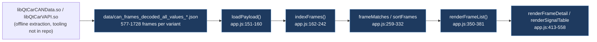

# bruvv-tesla-can-explorer

Deep-dive analysis (replace mode). The prior summary survives in git history; pre-replace claims are cited below as `HEAD:docs/legacy/bruvv-tesla-can-explorer.md:<line>`. The prior doc had no `## Upstream (...)` sections and its frontmatter is preserved byte-for-byte above (including the description line that ends mid-word at "ex" — see section 6).

## 1. Provenance

- Submodule path: `legacy/bruvv-tesla-can-explorer`
- Pinned gitlink (from `git ls-files -s`): `160000 cb07271ace7d482b7a41a4635c33e2b954c8c8ee 0`; `git -C legacy/bruvv-tesla-can-explorer rev-parse HEAD` matches; `status --porcelain` empty
- Upstream URL (submodule remote): https://github.com/bruvv/tesla-can-explorer — note the upstream README credits `mikegapinski/tesla-can-explorer` as the canonical project (README.md:5); relationship between the two remotes is UNVERIFIED (section 17)
- License: 0BSD (BSD Zero Clause), Copyright (c) 2026 Michał Gapiński (`LICENSE:1-14`)
- Analysis date: 2026-11-21
- Files read in full (FULL-READ): `app.js` (1-745), `index.html` (1-227), `README.md` (1-55), `enable_portal_source.sh` (1-163), `LICENSE` (1-14), `data/vapi_can_digest.json`, `..._mcu2.json`, `..._mcu3.json`, `..._modelsx_amd.json`, `..._modelsx_intel.json` (1-13 each)
- Large data files read as STRUCTURAL-PARSE with targeted RANGE-CITED row reads (schema + per-variant counts + specific frames/signals): the five `data/can_frames_decoded_all_values*.json` (mcu2 lines 103358-103640, 224820-226330, 385071-386190; modelsx_intel lines 47298-47304, 89918-90180, 224765-224777, 351431-351437, 441789-441796, 708545-708614) and the five `data/can_frames_decoded_enum_values*.csv` / `data/vapi_eth_signal_aliases*.csv` (headers plus sampled rows; identity checks via hashes)
- Files explicitly NOT read: `styles.css` (690 lines, presentational only, no protocol content). Nothing else is unread; `git ls-files` shows no hidden directories in this submodule (24 files, no dot-dirs)

## 2. Executive verdict

This repo is a static browser portal (no CAN hardware, no frame pipeline) over a vendored **diagnostic enum catalog**: 577 frames (Model 3 2026.2, MCU2/MCU3) and 579/1728 frames (Model S/X 2026.2.3, AMD/Intel) extracted from Tesla infotainment libraries `libQtCarCANData.so` / `libQtCarVAPI.so`, carrying per-frame signal names and enum value labels — **no bit positions, no DLC, no periods, no checksums**. The mechanisms that matter to us are entirely in the data: the enum domains for `DAS_autopilotHandsOnState` (NOT_REQD..SNA), `EPAS_handsOnLevel` (0..3), `GTW_autopilot` tier (NONE/HIGHWAY/ENHANCED/SELF_DRIVING/BASIC), `GTW_dasHw` (AP2.5/AP3/AP4), and the S/X PT-bus `GTW_carConfig2` country codes. The catalog data is **already adapted** into TeslaCANModder: `client/src/assets/can-decoder/legacy_*.json` are re-serialized copies of these datasets, consumed via `packages/protocol/src/decoder.ts` and `client/src/hooks/useDecoderDatasets.ts`. Candidates: refresh the vendored copies on upstream bumps, adopt catalog enum labels for our `dasHandsOnState` UI display, and bench-check the 0x399-vs-0x39B DAS_status address tension the catalog exposes. Never port: the Google Analytics beacon, the in-place `app.js` patcher, or any wholesale import of 20 MB catalogs into firmware.

## 3. Evidence map

No TEST-READ evidence exists: this repo ships no tests. No CAPTURE evidence exists: the repo contains no captured vehicle frames, only firmware-derived catalogs.

| Source file | Lines | What it proves | Grade |
| ----------- | ----- | -------------- | ----- |
| `app.js` | 3-21 | `DATA_SOURCES` registry: 4 variants (mcu2, mcu3, modelsx_amd, modelsx_intel), default `mcu2` | CODE-READ |
| `app.js` | 78-126 | `?source=` / `?data=` URL-param source selection with fallback and override-disable | CODE-READ |
| `app.js` | 151-160 | `loadPayload()` fetches JSON, throws on HTTP error | CODE-READ |
| `app.js` | 162-242 | `indexFrames()` builds lowercase search blobs, yields to UI every 20 frames | CODE-READ |
| `app.js` | 259-332 | Token-AND frame matching, bus/module filters, 5 sort modes | CODE-READ |
| `app.js` | 413-558 | Signal table render, pagination, expandable per-signal enum values | CODE-READ |
| `app.js` | 65-72 | `escapeHtml()` escapes all interpolations before DOM insertion | CODE-READ |
| `app.js` | 673-745 | `init()` error path → `showFatalError`; stat and provenance labels | CODE-READ |
| `index.html` | 9-17 | Google gtag.js beacon `G-H6QTPY0Q7N` loads from googletagmanager.com | CODE-READ |
| `index.html` | 18-208 | Static layout: frame list, detail panel, controls, loading overlay | CODE-READ |
| `enable_portal_source.sh` | 89-161 | Python patcher rewrites `DATA_SOURCES` / `DEFAULT_SOURCE_KEY` inside `app.js` | CODE-READ |
| `data/vapi_can_digest*.json` | 1-13 | Provenance: 792/818/772/664 VAPI tokens, all matched to DB signals | CODE-READ |
| `data/can_frames_decoded_all_values_mcu2.json` | 103358-103640 | DAS_status frame at 0x399 (bus ETH, id 3), 26 signals, hands-on enum 0..15 | STRUCTURAL-PARSE (targeted row reads) |
| same | 224820-226330 | GTW_carConfig at 0x7FF: `GTW_autopilot` tier enum, `GTW_dasHw` (3=PARKER_PASCAL_2_5, 4=TESLA_AP3, 5=TESLA_AP4) | STRUCTURAL-PARSE (targeted row reads) |
| same | 385071-386190 | UI_autopilotControl at 0x3FD, 74 signals incl. `UI_fsdBetaRequest`, `UI_applyEceR79`, `UI_showLaneGraph`, `UI_enableApproachingEmergencyVehicleDetection` | STRUCTURAL-PARSE (targeted row reads) |
| `..._modelsx_intel.json` | 47298-47304, 89918-90180, 708545-708614 | CH-bus DAS_control (0x2B9), EPAS_sysStatus (0x370, handsOnLevel 0..3), PT-bus GTW_carConfig2 (0x398, GTW_country ASCII codes) | STRUCTURAL-PARSE (targeted row reads) |
| all five catalog JSONs | schema + counts | Frame records carry only `bus_name/bus_id/address_dec/address_hex/frame_name/message_index/declared_signal_count/signals`; signals carry only `signal_index/signal_name/enum_map_symbol/possible_values/possible_values_note/vapi_alias/vapi_source` — no bit layout fields | STRUCTURAL-PARSE |
| `data/can_frames_decoded_enum_values_mcu2.csv` | 1-2 | CSV projection of the same enum rows (62,007 rows) | STRUCTURAL-PARSE |
| `data/vapi_eth_signal_aliases_mcu2.csv` | 1-2 | VAPI alias projection (`bus_name,address_hex,frame_name,signal_name,vapi_alias`, 792 rows) | STRUCTURAL-PARSE |

## 4. Architecture and build surface

Entry point: `index.html` loads `app.js` (plain script, no build system, no bundler, no dependencies). All logic lives in one 745-line file; `styles.css` is presentational. `enable_portal_source.sh` (bash + embedded Python) is a maintenance tool that patches `app.js` in place to register new datasets. There is no shared core vs platform split — the only platform boundary is the browser itself.

**None found: no frame pipeline in this repo.** The portal never receives, decodes, mutates, or transmits CAN frames; all "decoding" happened offline when the JSON catalogs were extracted from the Tesla libraries (extraction tooling is not in this repo). The display data flow is:



## 5. Mechanism catalogue

### Catalog payload schema (the data itself)

- **Claim (README / summary):** "pre-decoded CAN frames and signal value maps" from `libQtCarCANData.so` / `libQtCarVAPI.so` (README.md:3, 13).
- **Code path:** none — data files. `data/can_frames_decoded_all_values_mcu2.json:1-13` (provenance header: `generated_utc`, `dataset_source {vehicle, firmware, mcu, soc}`, `source_files`, `limitations`, `counts`, `vapi_digest`, `sources_processed`).
- **Frame spec:** per frame: `bus_name`, `bus_id`, `address_dec`, `address_hex`, `frame_name`, `message_index`, `declared_signal_count`, `signals[]`; per signal: `signal_index`, `signal_name`, `enum_map_symbol`, `possible_values[] {value_dec, value_hex, label}`, `possible_values_note`, `vapi_alias`, `vapi_source`. **No bit positions, no DLC, no period, no counter/checksum spec.**
- **Gates and timing:** None found (static data).
- **State machine:** None found.
- **Tests:** None found — repo ships no tests.
- **Evidence grade:** CODE-READ (schema verified across all five variants; contents STRUCTURAL-PARSE).
- **Verdict:** CONFIRMED.
- **Adapt to TeslaCANModder?** already present — vendored as `client/src/assets/can-decoder/legacy_*.json`, consumed by `packages/protocol/src/decoder.ts:44` and `client/src/hooks/useDecoderDatasets.ts:4-9`.

### Multi-variant source selection

- **Claim (README / summary):** run locally with `python3 -m http.server 8080`, open `/?source=mcu2` / `mcu3`, optional `?data=` override (README.md:24-38).
- **Code path:** `app.js:78-98` `getSelectionFromQuery()` → `app.js:151-160` `loadPayload()` → `app.js:673-745` `init()`; selector wiring `app.js:108-126`, `app.js:586-594`.
- **Frame spec:** None found (no CAN I/O).
- **Gates and timing:** unknown `?source` key falls back to `DEFAULT_SOURCE_KEY` ("mcu2", `app.js:21`); `?data=` override disables the dropdown and wins over `?source=` (`app.js:82-90`, `122-125`).
- **State machine:** two UI states (registered-source vs override); no 3+ state machine, diagram omitted.
- **Tests:** None found.
- **Evidence grade:** CODE-READ.
- **Verdict:** CONFIRMED.
- **Adapt to TeslaCANModder?** no impact (our client has its own dataset picker already).

### Async dataset load and search indexing

- **Claim (README / summary):** "Search across frame names, addresses, signals, enum maps, enum labels, and VAPI aliases" (README.md:42).
- **Code path:** `app.js:151-160` fetch → `app.js:162-242` `indexFrames()` builds per-frame `__search` and per-value `__labelSearch` blobs; signal-level blob cached in `getSignalSearchBlob()` `app.js:387-400`.
- **Frame spec:** None found.
- **Gates and timing:** UI yields every 20 frames via `setTimeout(0)` (`app.js:229-232`) because each catalog is 18-24 MB; 20 MB JSON parse happens on the main thread.
- **State machine:** None found.
- **Tests:** None found.
- **Evidence grade:** CODE-READ.
- **Verdict:** CONFIRMED (search covers exactly the fields listed; enum *labels* are searchable through `__labelSearch`).
- **Adapt to TeslaCANModder?** no impact.

### Frame filtering and sorting

- **Claim (README / summary):** "Filter by bus/module and sort by address, name, signal count, enum count, or VAPI alias count" (README.md:44).
- **Code path:** `app.js:259-284` `frameMatches()` (every token must match frame blob or label blob) → `app.js:286-314` `sortFrames()` (5 modes) → `app.js:316-332` `applyFrameFilters()`; 130 ms debounce on typing `app.js:596-603`.
- **Frame spec:** None found.
- **Gates and timing:** "Has Enumerated Signals" checkbox requires `__enumeratedSignalCount > 0` (`app.js:266-268`).
- **State machine:** None found.
- **Tests:** None found.
- **Evidence grade:** CODE-READ.
- **Verdict:** CONFIRMED.
- **Adapt to TeslaCANModder?** no impact.

### Signal detail rendering with enum expansion

- **Claim (README / summary):** "Expand per-signal decoded values directly in the frame detail view" (README.md:45).
- **Code path:** `app.js:413-454` `renderFrameDetail()` → `app.js:471-526` `renderSignalTable()` → `app.js:528-558` `renderValuesTable()`; pagination `app.js:456-469`, `app.js:631-653`; row expansion toggle `app.js:655-670`.
- **Frame spec:** None found.
- **Gates and timing:** page sizes 100/200/500, default 200 (`app.js:59`, `626`; `index.html:154-158`); signals with an `enum_map_symbol` but zero values get a warn-classed note (`app.js:485-486`).
- **State machine:** None found (expand/collapse is a set of keys, not a state machine).
- **Tests:** None found.
- **Evidence grade:** CODE-READ.
- **Verdict:** CONFIRMED.
- **Adapt to TeslaCANModder?** no impact — our client already renders decoder values via `describeDecodedFrame` (`packages/protocol/src/decoder.ts:55-69`, used at `client/src/AppExperience.tsx:194,225`).

### VAPI alias cross-reference

- **Claim (README / summary):** related VAPI artifacts per variant (README.md:17-22).
- **Code path:** data only: `data/vapi_eth_signal_aliases_*.csv` (header `bus_name,address_hex,frame_name,signal_name,vapi_alias`; 792/818/772/1182 rows for mcu2/mcu3/amd/intel) joined into the catalog JSON as `signal.vapi_alias` / `vapi_source`; digest counts at `data/vapi_can_digest.json:4-11`.
- **Frame spec:** None found.
- **Gates and timing:** header stat prefers `payload.vapi_digest.counts.db_signals_annotated_with_vapi_alias` over the live count when present (`app.js:720-729`).
- **State machine:** None found.
- **Tests:** None found.
- **Evidence grade:** CODE-READ (digests full-read; CSV joins STRUCTURAL-PARSE).
- **Verdict:** CONFIRMED. modelsx_intel digest self-reports 664 tokens but 1182 annotated signals (`data/vapi_can_digest_modelsx_intel.json:5-9`) — multiple signals can share one token; cause UNVERIFIED (section 17).
- **Adapt to TeslaCANModder?** candidate for future PR — our vendored copies drop `vapi_alias`; keeping the alias columns would let the client show VAPI names next to signal names.

### Portal source registration patcher

- **Claim (README / summary):** not mentioned in README (tool is undocumented upstream).
- **Code path:** `enable_portal_source.sh:36-87` (argument parsing, dataset-file existence warning) → embedded Python `enable_portal_source.sh:89-161` regex-patches the `DATA_SOURCES` block and `DEFAULT_SOURCE_KEY` inside `app.js`.
- **Frame spec:** None found.
- **Gates and timing:** exits non-zero on missing `app.js` or malformed block; warns when a `./data/*` URL has no file behind it (`enable_portal_source.sh:81-87`).
- **State machine:** None found.
- **Tests:** None found.
- **Evidence grade:** CODE-READ.
- **Verdict:** CONFIRMED.
- **Adapt to TeslaCANModder?** never port — regex-editing shipping source files is a maintenance anti-pattern for us (see section 14).

## 6. Summary vs code contradiction table

Pre-replace claims cite `git show HEAD:docs/legacy/bruvv-tesla-can-explorer.md:<line>`.

| Pre-replace / upstream claim | Code reality | Verdict |
| ---------------------------- | ------------ | ------- |
| HEAD doc:38 — `can_frames_decoded_all_values.json` is a "Combined dataset (all variants)" | Stale pre-S/X mcu2 snapshot: `frames` structurally identical to the mcu2 file (577 frames, verified by full-structure compare); the only difference is `dataset_source` lacking `mcu`/`soc`. Not referenced by `DATA_SOURCES` (app.js:3-20) | CONTRADICTED |
| HEAD doc:40 — `can_frames_decoded_enum_values.csv` is a "Combined enum value export" | Byte-identical (SHA-256) to `can_frames_decoded_enum_values_mcu2.csv` | CONTRADICTED |
| HEAD doc:42 — `vapi_can_digest.json` is a "Combined VAPI CAN digest" | Byte-identical (SHA-256) to `vapi_can_digest_mcu2.json` (same `generated_utc`, 792-token counts) | CONTRADICTED |
| HEAD doc:51 — datasets "cover all signal names, **bit positions**, enum values" | Catalogs carry no bit positions, widths, DLC, periods, or checksums at all (frame/signal key sets; negative anchor `grep -cE '"(bit_position|start_bit|bit_offset|dlc|period)"'` → 0). Our own tooling states this: `tools/lib/canExport.js:18-20` "no bit positions or signal widths" | CONTRADICTED |
| HEAD doc:56 — "Signal-level enum value maps for **all known** CAN signals" | Catalog `limitations[0]`: complete only for signals linked to `Diag_*_map` enum tables; mcu2 has 7,309 enumerated of 40,484 signals (18%) | CONTRADICTED (overstatement) |
| Upstream README.md:11-15 — "Vehicle: Model 3"; variants MCU2/MCU3 only | `app.js:3-20` registers four sources incl. Model S/X MCU2/MCU3 (added in the pinned commit "Add S/X 2026.2 data sources"); README was not updated | CONTRADICTED (stale README) |
| Frontmatter `description:` ends mid-word ("...Contains large JSON datasets ex") | Preserved byte-for-byte per replace-mode rules; flagged here as an inherited truncation, not edited | STALE-BUT-KEPT |

## 7. CAN frame and signal inventory

The app itself decodes, mutates, or injects **zero** frames — there is no frame pipeline. The vendored catalog (STRUCTURAL-PARSE, never dumped wholesale) summarizes as: five enum-only diagnostic catalogs extracted from 2026.2 / 2026.2.3 infotainment libraries — mcu2/mcu3: 577 frames each, bus ETH only, 40,484 signals, 62,007 enum rows; modelsx_amd: 579 frames, ETH only; modelsx_intel: 1,728 frames across BDY(45)/BFT(67)/CH(327)/ETH(678)/PT(594)/TH(17), 41,395 signals.

Exemplar catalog rows cited elsewhere in this document (labels `catalog sample`; all fields not present in the catalog say so):

| ID (hex+dec) | bus | period | DLC | byte/bit layout | scale/units | counter position | checksum | read or write | grade |
| ------------ | --- | ------ | --- | -------------- | ----------- | ---------------- | -------- | ------------- | ----- |
| 0x399 (921) | ETH (id 3) | not in catalog | not in catalog | not in catalog (26 signals incl. `DAS_autopilotHandsOnState` enum 0..15, `DAS_status2`-style names) | enum labels only | not in catalog | not in catalog | neither (static catalog) | STRUCTURAL-PARSE |
| 0x3FD (1021) | ETH (id 3) | not in catalog | not in catalog | not in catalog (74 signals; mux `UI_autopilotControlIndex`) | enum labels only | not in catalog | not in catalog | neither (static catalog) | STRUCTURAL-PARSE |
| 0x3EE (1006) | CH (id 5) / ETH (id 6) | not in catalog | not in catalog | not in catalog (58 signals, same `UI_autopilotControl` message as 0x3FD) | enum labels only | not in catalog | not in catalog | neither (static catalog) | STRUCTURAL-PARSE |
| 0x370 (880) | CH (id 5) | not in catalog | not in catalog | not in catalog (11 signals incl. `EPAS_handsOnLevel` domain 0..3, `EPAS_torsionBarTorque`, `EPAS_sysStatusCounter`, `EPAS_sysStatusChecksum`) | enum labels only | not in catalog | not in catalog | neither (static catalog) | STRUCTURAL-PARSE |
| 0x2B9 (697) | CH (id 5) | not in catalog | not in catalog | not in catalog (9 signals: `DAS_setSpeed`, `DAS_accState`, `DAS_accelMax/Min`, `DAS_jerkMax/Min`, `DAS_aebEvent`, counter, checksum) | enum labels only | not in catalog | not in catalog | neither (static catalog) | STRUCTURAL-PARSE |
| 0x488 (1160) | CH (id 5) | not in catalog | not in catalog | not in catalog (5 signals: `DAS_steeringAngleRequest`, `DAS_steeringControlType`, `DAS_steeringHapticRequest`, counter, checksum) | enum labels only | not in catalog | not in catalog | neither (static catalog) | STRUCTURAL-PARSE |
| 0x27D (637) | CH (id 5) | not in catalog | not in catalog | not in catalog (3 signals: `APS_eacAllow`, `APS_eacMonitorChecksum`, `APS_eacMonitorCounter`) | enum labels only | not in catalog | not in catalog | neither (static catalog) | STRUCTURAL-PARSE |
| 0x7FF (2047) | ETH (id 3) | not in catalog | not in catalog | not in catalog (191 signals incl. `GTW_autopilot` tier enum 0..4, `GTW_dasHw` enum 3/4/5, `GTW_country`) | enum labels only | not in catalog | not in catalog | neither (static catalog) | STRUCTURAL-PARSE |
| 0x398 (920) | PT (id 2) | not in catalog | not in catalog | not in catalog (10 signals incl. `GTW_country` ASCII codes e.g. 16709=0x4145="AE") | enum labels only | not in catalog | not in catalog | neither (static catalog) | STRUCTURAL-PARSE |

## 8. Constants and tuning table

| Constant | Value | File:line | Meaning | Grade |
| -------- | ----- | --------- | ------- | ----- |
| `DEFAULT_SOURCE_KEY` | "mcu2" | `app.js:21` | Default dataset when `?source` absent/unknown | CODE-READ |
| search debounce | 130 ms | `app.js:602` | Typing debounce before re-filter | CODE-READ |
| default signal page size | 200 (options 100/200/500) | `app.js:59`, `app.js:626`, `index.html:154-158` | Rows per signal page | CODE-READ |
| index yield interval | every 20 frames | `app.js:229-232` | `setTimeout(0)` yield keeps UI alive during 20 MB indexing | CODE-READ |
| invalid-enum marker | 4294967295 / 0xFFFFFFFF | e.g. `..._modelsx_intel.json:90150` (EPAS_handsOnLevel row), `..._mcu2.json:103583-103640` (hands-on rows) | Catalog-wide SNA/"no data" value on every enum map | STRUCTURAL-PARSE |
| `DAS_autopilotHandsOnState` domain | 0=NOT_REQD, 1=REQD_DETECTED, 2=REQD_NOT_DETECTED, 3=REQD_VISUAL, 4=REQD_CHIME_1, 5=REQD_CHIME_2, 6=REQD_SLOWING, 7=REQD_STRUCK_OUT, 8=SUSPENDED, 9/10=REQD_ESCALATED_CHIME_1/2, 15=SNA | `..._mcu2.json:103583,103589,103619,103629` | Hands-on request state machine labels our nag feature gates on | STRUCTURAL-PARSE |
| `EPAS_handsOnLevel` domain | 0,1,2,3 (+0xFFFFFFFF) | `..._modelsx_intel.json:90126-90151` | 2-bit hands-on level our nag echo writes | STRUCTURAL-PARSE |
| `GTW_autopilot` tier enum | 0=NONE, 1=HIGHWAY, 2=ENHANCED, 3=SELF_DRIVING, 4=BASIC | `..._mcu2.json:226267-226293` | AP tier readback labels (mux-2 byte 5 on our side) | STRUCTURAL-PARSE |
| `GTW_dasHw` enum | 3=PARKER_PASCAL_2_5, 4=TESLA_AP3, 5=TESLA_AP4 | `..._mcu2.json:225179-225189` | AP hardware generation domain | STRUCTURAL-PARSE |
| `GTW_country` codes | 16709=AE (0x4145), 16725=AU, 17230=CN, 18242=GB, 19023=JO, 19024=JP, 19282=SK, 21313=SA, 21843=US | `..._modelsx_intel.json:708610` | ASCII country codes on S/X PT-bus GTW_carConfig2 | STRUCTURAL-PARSE |
| VAPI token counts | mcu2 792, mcu3 818, amd 772, intel 664 tokens / 792/818/772/1182 annotated signals | `data/vapi_can_digest*.json:5-9` | Alias coverage per variant | CODE-READ |

## 9. Failure modes and edge cases

No bus-off, watchdog, OTA, queue-overflow, or brownout handling exists — the repo has no firmware. The actual failure paths are:

| Failure | Handling code path | Tested? | Grade |
| ------- | ----------------- | ------- | ----- |
| Dataset fetch fails (HTTP error) | `loadPayload()` throws `Failed to load ${url}: HTTP ${status}` (`app.js:155-157`) → `init()` catch → `showFatalError` overlay (`app.js:735-742`) | No | CODE-READ |
| 20 MB JSON parse failure | `response.json()` rejects in `loadPayload()` (`app.js:159`) → same catch/overlay | No | CODE-READ |
| Missing DOM element (defensive) | `els.dataSource` null-check (`app.js:109-126`), `datasetSourceLabel` (`app.js:682`), `statVapi` (`app.js:719`) | No | CODE-READ |
| Unknown `?source` key | falls back to `DEFAULT_SOURCE_KEY` (`app.js:81-82`) | No | CODE-READ |
| `?data=` override active | selector disabled with tooltip (`app.js:122-125`); switching source deletes the override param (`app.js:103`) | No | CODE-READ |
| Catalog string containing HTML | escaped via `escapeHtml()` before every interpolation (`app.js:65-72`, applied at `app.js:362-372,433-438,489-498,536-538`) | No | CODE-READ |

All error paths are untested — the repo ships no tests, so every row above is risk if the portal is used as a local tool.

## 10. Test coverage map

None found. The repo contains no test files, no test runner, no CI. Critical paths with no test: (1) the `escapeHtml` XSS barrier over 40k+ attacker-controllable catalog strings, (2) the fetch/parse failure overlay, (3) memory footprint of indexing a 24 MB catalog on low-RAM browsers.

## 11. Parity matrix with TeslaCANModder

Our-side citations are CODE-READ from shipping code (symbol-level; see drift anchors in section 16).

| Signal / frame | Upstream (cite) | Our decode (cite) | Delta | Action |
| -------------- | --------------- | ----------------- | ----- | ------ |
| Catalog schema itself | frame/signal/possible_values fields (`..._mcu2.json:1-13` header, schema) | `DecoderDataset`/`DecoderFrame`/`DecoderSignal` mirror the same field names (`packages/protocol/src/decoder.ts:3-52`); vendored copies loaded by `client/src/hooks/useDecoderDatasets.ts:4-9` with `address_dec`→`id` coercion (lines 76-99) | Renaming only (`address_dec`→`id`, `address_hex`→`hex`) | already present — refresh vendored copies on upstream bumps |
| 0x3FD UI_autopilotControl | 74 signals; `UI_fsdBetaRequest` NOT_ACTIVE/ACTIVE (`..._mcu2.json:385705`), `UI_applyEceR79` (385876), `UI_showLaneGraph` (386068), `UI_enableApproachingEmergencyVehicleDetection` (386182) | `CAN_ID_FSD_MUX 0x3FD` (`firmware/lib/vehicle/can/ids.h:25`); mux 0/1/2 mutations in `handleHW4` (`firmware/lib/vehicle/can/handler/variant/hw4.h:128-168`); bits 38/39/46/59/60, bit 19, bit 47 (`firmware/lib/vehicle/can/handler/variant/bits.h:19-27,42`) | Catalog has names only, no bit layout; name↔feature mapping is 1:1 (EVD, lane graph, ECE R79, FSD request) | align — use catalog names as canonical labels for our bit constants in docs |
| DAS_status address | `DAS_status` at **0x399** with 26 signals incl. `DAS_autopilotHandsOnState` (`..._mcu2.json:103363,103583`; same at 0x399 CH/ETH and 0x391 PT in `..._modelsx_intel.json`) | `CAN_ID_DAS_STATUS 0x39B` (`ids.h:64`); hands-on from 0x39B byte 5 bits[5:2] (`firmware/lib/core/types.h:496`); our own comment already notes "0x399 carries DAS_status on HW3 chassis bus" (`firmware/lib/vehicle/can/handler/bus/chassis.h:72-73`); `CAN_ID_ISA_SPEED`/`CAN_ID_BLIND_SPOT` both alias 0x399 (`ids.h:21,63`) | Catalog (2026.2) puts DAS_status at 0x399; we decode hands-on from 0x39B and treat 0x399 as ISA chime (HW4) / BSM | capture-first — bench-log both IDs across HW3/HW4 before changing any decode |
| `DAS_autopilotHandsOnState` enum | 0=NOT_REQD … 7=REQD_STRUCK_OUT, 8=SUSPENDED, 15=SNA (`..._mcu2.json:103583-103629`) | organic gate skips states 0, 8, 15 and requires AP state 3-6 (`firmware/lib/vehicle/can/feature/fsd/nag.h:147-152`); safe/feifan/natural gate via `dasHandsOnRequested` (`nag.h:57,136-141`) | Our skip-list matches the catalog's idle/suspended/SNA semantics exactly | align — adopt catalog labels for `dasHandsOn` display names in client |
| `EPAS_handsOnLevel` | domain 0..3 on CH-bus 0x370 (`..._modelsx_intel.json:89921,90126-90151`) | `handsOnLevel` 0/1/2 written to byte 4 bits[7:6] of 0x370 (`nag.h:110,482-483`); feifan leaves it at 0 (`nag.h:91,442`); frame on our Vehicle bus (`ids.h:59`) | Domain consistent (2-bit); bus differs (our Vehicle vs catalog CH for S/X; Model 3 catalog has no CH bus at all) | capture-first for Model 3 bus placement; enum consistent |
| DAS_control signal set | `DAS_setSpeed`, `DAS_accState`, `DAS_accelMax/Min`, `DAS_jerkMax/Min`, `DAS_aebEvent`, counter, checksum (`..._modelsx_intel.json:47301,47504`) | we inject 0x2B9 at 25 Hz: setSpeed bits 0-11 @0.1 km/h, accState bits 12-15 (4=ACC_ON, 13=CANCEL) (`firmware/lib/vehicle/can/feature/das/das_drive.h:18-20,146-157`) | Signal names and scaling corroborate our builder; catalog adds no bit layout | align — cite catalog names in das_drive.h comments; already present functionally |
| `GTW_autopilot` tier | 0..4 = NONE/HIGHWAY/ENHANCED/SELF_DRIVING/BASIC on 0x7FF (`..._mcu2.json:224820,226267-226293`) | `readGtwAutopilotTier` mux-2 byte 5 bits[4:2] (`firmware/lib/vehicle/can/handler/frame_readers.h:58-71`) | Enum labels match our documented tier table exactly | already present — catalog confirms labels |
| `GTW_dasHw` | 3=PARKER_PASCAL_2_5, 4=TESLA_AP3, 5=TESLA_AP4 (`..._mcu2.json:225179-225189`) | variant auto-detect from 0x398 (`ids.h:62` comment "HW gen byte[0] bits[7:6]") | Catalog carries HW gen on muxed 0x7FF, not 0x398; on S/X the 0x398 PT occupant is `GTW_carConfig2` (`..._modelsx_intel.json:708555`) | capture-first — verify our 0x398 HW-gen bits on HW3/HW4 benches |
| `GTW_country` (S/X PT 0x398) | ASCII codes 0x4145="AE" … 0x554B="US" (`..._modelsx_intel.json:708555,708610`) | region nibble from 0x398 byte 2 bits[7:4], codes 0-5 (`firmware/lib/vehicle/can/feature/fsd/region.h:14-30`) | Different signal on a different platform's frame; Model 3 catalogs are ETH-only so our Model 3 claim is untestable from this data | capture-first / ignore for Model 3 until an S/X target exists |
| 0x3EE "legacy FSD mux" | same message `UI_autopilotControl` at 0x3EE on CH and ETH (`..._modelsx_intel.json:224770,441794`) | `CAN_ID_LEGACY_FSD_MUX 0x3EE` "Legacy variant" (`ids.h:23`); legacy handler mutates mux 0/1 (`firmware/lib/vehicle/can/handler/variant/legacy.h:56-83`) | Catalog shows 0x3EE is a live S/X (2026.2.3) address of UI_autopilotControl, not only a "legacy" artifact | align docs naming; capture-first before touching legacy handler |
| CAN-ID label table | DAS_status at 921 in catalog | our TS labels: 921 "ISA Chime", 920 "GTW_carConfig (HW Detect)", 1021 "FSD Control (HW3/HW4)" (`packages/protocol/src/decoder.ts:72-94`) | 921 label is HW4-specific and conflicts with catalog name on Model 3 datasets | align — make the 921 label variant-aware or annotate with catalog names |

## 12. Surface inventory and security notes

- **HTTP static portal** (any web server; README.md:26-28 suggests `python3 -m http.server 8080`). No authentication, no write endpoints, no server-side code.
- **URL parameters:** `?source=<mcu2|mcu3|modelsx_amd|modelsx_intel>` (validated against `DATA_SOURCES`, unknown falls back to default — `app.js:81-82`) and `?data=<any URL>` which fetches arbitrary JSON and renders it (`app.js:84-90`). Same-origin/CORS limits apply; all rendered strings pass through `escapeHtml()` (`app.js:65-72`), and attribute contexts (e.g. `data-frame-key` at `app.js:362`) use the same escaping, so catalog-controlled XSS is contained.
- **Telemetry beacon:** Google Analytics gtag.js (`G-H6QTPY0Q7N`) loads unconditionally from `googletagmanager.com` (`index.html:9-17`) — a "local" portal still phones home. Do-not-copy (section 14).
- **Maintenance tool:** `enable_portal_source.sh` rewrites `app.js` in place (`enable_portal_source.sh:89-161`); run only on a writable checkout.
- **Provenance/security findings:** no hardcoded credentials, keys, or certificates anywhere in the 24 files; no dangerous build flags; no archives. Dataset provenance is fully self-declared (`source_lib` paths inside extracted firmware images, `data/vapi_can_digest.json:3`).

## 13. Adaptation assessment

| Mechanism | Value | Cost | Risk | Evidence | Decision |
| --------- | ----- | ---- | ---- | -------- | -------- |
| Enum catalog data (all variants) | High — authoritative 2026.2 signal names + enum domains; already wired into our client | Low — re-serialize on upstream bump | Low (display-only data) | CODE-READ + STRUCTURAL-PARSE | already present — keep refreshed (top candidate) |
| Hands-on / tier / dasHw enum labels | Medium — human-readable names for `dasHandsOnState`, `gtwAutopilotTier`, variant display | Trivial (naming only, no frame mutation) | None | STRUCTURAL-PARSE rows, our-side CODE-READ gates match | candidate for future PR (docs + client labels) |
| 0x399 vs 0x39B DAS_status address tension | Medium — could fix hands-on gating if 2026.x vehicles moved the frame | Medium — needs bench capture first | High if ported blind (frame mutation) | CODE-READ on both sides | capture-first, then candidate |
| VAPI alias columns in our vendored copies | Low-medium — maps CAN signals to Tesla API names | Low — keep fields during re-serialization | Low | CODE-READ (digest) + STRUCTURAL-PARSE | candidate for future PR |
| Portal search/index/pagination UI | None — our client has its own dataset browser | — | — | CODE-READ | no impact |
| `enable_portal_source.sh` in-place patcher | None for us | — | Teaches source-mutation anti-pattern | CODE-READ | never port |
| Google Analytics beacon | None | — | Privacy leak in offline tooling | CODE-READ | never port |

Top 3 adaptation candidates: (1) catalog refresh pipeline on upstream bumps, (2) enum-label adoption for hands-on/tier/dasHw display, (3) the 0x399/0x39B capture-first investigation.

## 14. Do-not-copy list

- `index.html:9-17` — Google gtag.js beacon: third-party tracking has no place in our offline-capable client/tools.
- `enable_portal_source.sh:89-161` — regex patching of shipping source (`app.js`) in place; brittle maintenance pattern, never for our repo.
- `app.js:171-178` — monkey-patched `__key`/`__module`/`__signals` fields on loaded data objects; acceptable in a throwaway portal, not our style (port behavior, not identifiers).
- The 20 MB raw catalog JSONs — never import into `firmware/` (RAM ceiling); the correct adaptation is what we already do: trimmed re-serializations under `client/src/assets/can-decoder/`.
- Upstream identifiers (`DATA_SOURCES`, `indexFrames`, `frameMatches`, `getSelectionFromQuery`) — do not reuse names in our code; attribute ideas in comments instead.

## 15. History and evolution

Local history is exactly one commit: `cb07271` 2026-02-25 "Add S/X 2026.2 data sources (Intel and AMD)" by Michał Gapiński, which added all 26 files at once (squashed history; `git rev-list --count HEAD` = 1). Consequences: what was tried, abandoned, or rolled back before the pin is **not visible locally**; the README still describing "Vehicle: Model 3" (README.md:11) while `app.js:3-20` already registers S/X sources is the only evolution artifact in the snapshot — the datasets were extended without a README pass. No changelog file exists. Network claims about upstream history (issues, PRs, the mikegapinski-vs-bruvv mirror relationship) are UNVERIFIED.

## 16. Re-verification recipe

```bash
OLD=cb07271ace7d482b7a41a4635c33e2b954c8c8ee
git -C legacy/bruvv-tesla-can-explorer fetch --tags --prune
git -C legacy/bruvv-tesla-can-explorer log --oneline $OLD..origin/main
git -C legacy/bruvv-tesla-can-explorer diff --stat $OLD..origin/main
git ls-files -s legacy/bruvv-tesla-can-explorer   # expect: 160000 cb07271ace7d482b7a41a4635c33e2b954c8c8ee 0
```

All anchors below were executed at write time (2026-11-21) with the expected hits shown. Use `grep -nE` (ERE); plain `grep -n 'a|b'` is BRE and will not match alternations.

Upstream anchors:

```text
grep -nE '"frame_name": "DAS_status"' legacy/bruvv-tesla-can-explorer/data/can_frames_decoded_all_values_mcu2.json
  -> expect hit at line 103363 (0x399, bus_id 3, 26 signals)
grep -nE '"frame_name": "UI_autopilotControl"' legacy/bruvv-tesla-can-explorer/data/can_frames_decoded_all_values_mcu2.json
  -> expect hit at line 385076 (0x3FD, 74 signals)
grep -cE '"address_dec": 923,' legacy/bruvv-tesla-can-explorer/data/can_frames_decoded_all_values_mcu2.json
  -> expect 0 (negative anchor: no 0x39B frame in the 2026.2 Model 3 catalog)
grep -nE 'UI_enableApproachingEmergencyVehicleDetection' legacy/bruvv-tesla-can-explorer/data/can_frames_decoded_all_values_mcu2.json
  -> expect hit at line 386182 (signal inside UI_autopilotControl)
grep -cE '"(bit_position|start_bit|bit_offset|dlc|period)"' legacy/bruvv-tesla-can-explorer/data/can_frames_decoded_all_values_mcu2.json
  -> expect 0 (negative anchor: catalog has no bit layout fields)
grep -nE '"frame_name": "EPAS_sysStatus"' legacy/bruvv-tesla-can-explorer/data/can_frames_decoded_all_values_modelsx_intel.json
  -> expect hit at line 89921 (CH bus, 0x370); EPAS_handsOnLevel at 90126
grep -nE '"frame_name": "GTW_carConfig2"' legacy/bruvv-tesla-can-explorer/data/can_frames_decoded_all_values_modelsx_intel.json
  -> expect hits at 351434 (ETH 0x31A) and 708555 (PT 0x398)
grep -nE 'const DATA_SOURCES' legacy/bruvv-tesla-can-explorer/app.js
  -> expect hit at line 3
grep -nE 'gtag/js' legacy/bruvv-tesla-can-explorer/index.html
  -> expect hit at line 10
grep -nE 'checksum|crc|bit_position|0x2F' legacy/bruvv-tesla-can-explorer/app.js
  -> no output (negative anchor: the portal does no frame math)
```

Our-side drift anchors (the "already present" decisions rest on these):

```text
grep -nE 'CAN_ID_ISA_SPEED|CAN_ID_BLIND_SPOT|CAN_ID_DAS_STATUS' firmware/lib/vehicle/can/ids.h
  -> expect lines 21, 63, 64 (0x399 double-alias + 0x39B)
grep -nE 'dasHandsOnState' firmware/lib/core/types.h
  -> expect line 496 (0x39B byte 5 bits[5:2])
grep -nE '0x399 carries DAS_status' firmware/lib/vehicle/can/handler/bus/chassis.h
  -> expect line 73
grep -nE 'FSD_BIT_EVD|NAG_BIT_HANDS_ON_REQUIREMENT' firmware/lib/vehicle/can/handler/variant/bits.h
  -> expect lines 22 and 42
grep -nE 'buildDecoderIndex' packages/protocol/src/decoder.ts
  -> expect line 44
grep -nE 'legacy_mcu2' client/src/hooks/useDecoderDatasets.ts
  -> expect line 4 (vendored dataset import)
grep -nE 'no bit positions' tools/lib/canExport.js
  -> expect line 18 (our tooling already documents the catalog limitation)
grep -nE 'makeFrame\(0x39B' firmware/test/test_native_frame_readers/test_frame_readers.cpp
  -> expect lines 58, 65, 72, 79, 86 (our 0x39B decode is test-covered)
```

If line numbers drift more than ~10, re-read the whole function; do not trust this document's numbers.

## 17. Open questions and explicitly not investigated

- Pre-pin upstream history was **not** reviewed — the local clone contains a single squashed commit; `git log` cannot answer what was tried or rolled back before 2026-02-25. Fetching `origin` with `--unshallow` would settle it (UNVERIFIED).
- The submodule remote is `bruvv/tesla-can-explorer` while README.md:5 credits `mikegapinski/tesla-can-explorer`; whether the two are identical mirrors or a fork is UNVERIFIED — compare `git ls-remote` of both.
- modelsx_intel digest reports 664 VAPI tokens but 1182 annotated signals (`data/vapi_can_digest_modelsx_intel.json:5-9`); the token→signal join was not re-derived (would verify by cross-joining `vapi_eth_signal_aliases_modelsx_intel.csv` against the JSON `vapi_alias` fields).
- Why the Model 3 catalogs are ETH-bus only while S/X Intel carries BDY/BFT/CH/ETH/PT/TH: the extraction tooling is not in this repo, so whether a Model 3 CH/PT extraction is possible is UNVERIFIED.
- The 0x399-vs-0x39B DAS_status placement on real vehicles (2026.2 UI DB vs our 0x39B decode) needs a bench capture; both our `ids.h` aliases and the catalog cannot be reconciled from data alone.
- Inherited our-side gap noticed during parity work (not caused by upstream): `firmware/lib/vehicle/can/feature/telemetry/vehicle_config.h:60-77` maps platform nibble 1=Model S, 2=Model X, 3=Model 3, 4=Model Y, while our `docs/reference/can-protocol.md` platform table lists 1=Model 3, 2=Model Y, 3=Model S, 4=Model X — one of them is wrong; the catalog carries no platform-ID enum to arbitrate (UNVERIFIED, needs capture).
