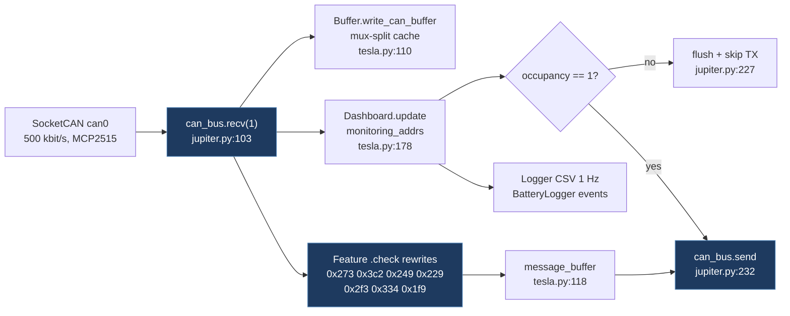
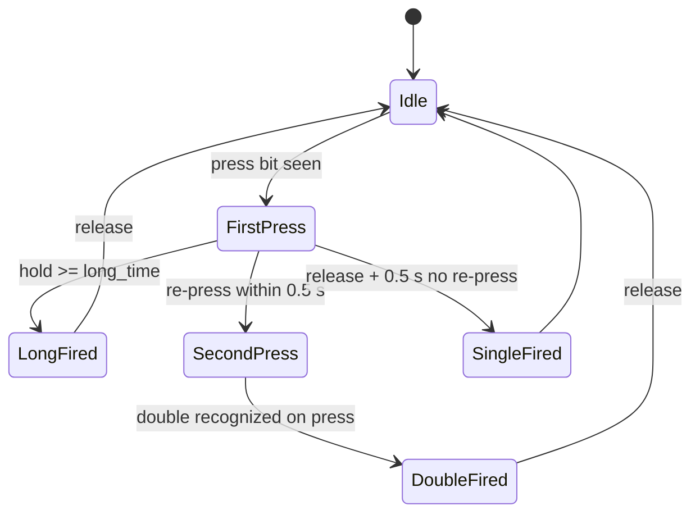
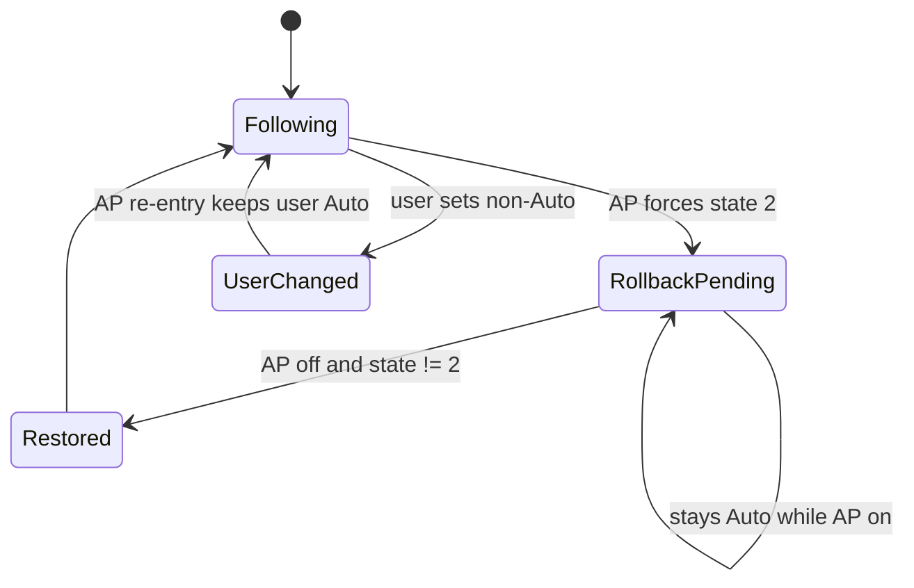

# canhackers-jupiter

Deep-dive analysis (replace mode). The pre-replace summary still exists in git history; its claims are cited below as `git show HEAD:docs/legacy/canhackers-jupiter.md` with line numbers.

## 1. Provenance

| Item | Value |
| --- | --- |
| Submodule path | `legacy/canhackers-jupiter` |
| Pinned gitlink | `160000 6cac60a3203d2c61d1b2b70cf9a841af09871375 0` (from `git ls-files -s legacy/canhackers-jupiter`) |
| Submodule HEAD | `6cac60a3203d2c61d1b2b70cf9a841af09871375` — matches gitlink; `git status --porcelain` clean |
| Upstream URL | `https://github.com/canhackers/jupiter` (fetch/push) |
| License | CC BY-NC 4.0 (Attribution-NonCommercial 4.0 International) — `LICENSE:1-15` |
| Analysis date | 2026-11-21 |
| Replaces | Pre-replace summary at `git show HEAD:docs/legacy/canhackers-jupiter.md` (working tree was identical to HEAD at analysis time, 0-line diff) |

Files read (FULL-READ, every line):

- `legacy/canhackers-jupiter/jupiter.py` (259 lines) — main loop, RX dispatch, TX gate, bus recovery
- `legacy/canhackers-jupiter/tesla.py` (1261 lines) — all features, decoders, loggers
- `legacy/canhackers-jupiter/packet_functions.py` (85 lines) — bit get/set, checksum, packet builder
- `legacy/canhackers-jupiter/functions.py` (56 lines) — CAN init, settings loader
- `legacy/canhackers-jupiter/beacon.py` (144 lines) — BLE beacon buttons
- `legacy/canhackers-jupiter/navdy.py` (139 lines) — HUD bridge
- `legacy/canhackers-jupiter/README.md` (169 lines) — HTML install guide (Korean)

RANGE-CITED: `LICENSE` lines 1-30 only (CC BY-NC header; remaining lines are standard boilerplate).

Files explicitly NOT read: `jupiter_slim_case.stl` (binary 3D-printable enclosure, 282784 bytes — no code). No hidden dot-directories exist: `git -C legacy/canhackers-jupiter ls-files` lists exactly 10 files, none under a dot-directory.

Frontmatter note: the original frontmatter had no trailing whitespace on the description line, so it is preserved byte-for-byte. The original doc had no `## Upstream (...)` sections, so nothing beyond the frontmatter was preserved.

Our-side files read for parity (all under `firmware/lib/`): `vehicle/can/feature/comfort/seatbelt.h` (full), `vehicle/can/feature/fsd/auto_lane_change.h` (full), `vehicle/can/crc8.h` (full), `vehicle/can/checksum.h` (full), `vehicle/can/feature/drive/drive_mode.h` (full), `vehicle/can/feature/comfort/wiper.h` (full), `vehicle/can/feature/comfort/air_recirc.h` (full), `vehicle/can/feature/body/mirror.h` (full), `vehicle/can/feature/body/turn_signal.h` (full), `vehicle/can/feature/telemetry/bms.h` (full), `vehicle/can/feature/telemetry/powertrain.h` (lines 1-80), `vehicle/can/ids.h` (lines 85-104).

No TEST-READ evidence exists: this repo ships no tests. No CAPTURE evidence exists in this repo — all frame layouts are CODE-READ only, and upstream's CRC tables are precomputed constants with no generating formula in the repo.

## 2. Executive verdict

A single-bus (SocketCAN `can0`, 500 kbit/s, MCP2515 HAT on a Raspberry Pi Zero 2W) Tesla Model Y 2021 in-flight frame rewriter and logger, written in Python with Korean comments. Its architecture is the mirror image of ours: instead of injecting synthesized bursts, every feature rewrites passing real frames in the RX path and queues the mutated copy for TX; a occupancy gate suppresses all synthetic TX when nobody is in the car. The mechanisms that matter: (1) a battery-health decode suite (0x3b2 SoH/CAC, 0x782 per-brick CAC, 0x401 per-brick voltage, 0x3f2 AC/DC energy split) that cross-validates our `bms.h` decodes bit-for-bit on the frames we share, (2) a dial-press "Mars Mode" nag eliminator that touches no torque signal at all, and (3) a button press FSM (short/long/double, park/drive split bindings) that our `btnmap:` command surface documents but our firmware does not implement. Adaptation candidates: battery-health decode additions, a firmware `btnmap` handler, and Mars Mode as an extra nag strategy. Must not be ported: any code (CC BY-NC 4.0), the buckle "mode 2" occupancy-switch defeat, the dial-combo `sudo reboot`, the door-open raw frames, and the continuous-Autopilot auto re-engage. Several decode conflicts (0x118, 0x257, 0x3f5, 0x249, 0x229, 0x312) exist between the two repos and need bench captures before either side is trusted.

## 3. Evidence map

| Source file | Lines | What it proves | Grade |
| --- | --- | --- | --- |
| `jupiter.py` | 23-24, 102-108 | Single SocketCAN bus `can0`; RX with 1 s timeout; recv failure → bus error | CODE-READ |
| `jupiter.py` | 77-97 | 5 s silent-bus watchdog, error counter, `>5` errors → `sudo reboot` | CODE-READ |
| `jupiter.py` | 114, 178-220 | Every RX frame goes to mux cache + per-ID feature rewrite dispatch | CODE-READ |
| `jupiter.py` | 226-241 | Synthetic TX only when `dash.occupancy == 1`; else buffer flushed, loop continues | CODE-READ |
| `tesla.py` | 13-22 | 56 logging addresses, 16 mux IDs with mux bit widths (0x401: 8-bit, 0x3b2/0x782: 7-bit, 0x3f2: 4-bit) | CODE-READ |
| `tesla.py` | 24-36 | Pre-built `command` frames — dead code (see section 6) | CODE-READ |
| `tesla.py` | 39-65 | `monitoring_addrs` decode table, 26 IDs | CODE-READ |
| `tesla.py` | 110-116 | Mux-split cache keyed by `signal[0] & (2**muxbits - 1)` | CODE-READ |
| `tesla.py` | 178-251 | Dashboard decode: gear, pedal, speed, torque, brake, 12 V, SoC, temps, occupancy, wiper, mirror, indicators | CODE-READ |
| `tesla.py` | 309-444 | `BatteryLogger`: health/dynamics/high-load CSVs, all bit layouts | CODE-READ |
| `tesla.py` | 623-674 | Button reads: 0x3e2 map lamps, 0x229 parking button; mirror request on 0x273; door frames on 0x1f9 | CODE-READ |
| `tesla.py` | 696-1081 | Autopilot class: Mars Mode, auto distance, continuous AP, wiper rollback, dial collision gate | CODE-READ |
| `tesla.py` | 1084-1115 | Buckle rewrite modes on 0x3c2 | CODE-READ |
| `tesla.py` | 1118-1159 | FreshAir recirc scheduler on 0x2f3 | CODE-READ |
| `tesla.py` | 1162-1187 | KickDown 0x334 sport rewrite with bumped counter + checksum | CODE-READ |
| `tesla.py` | 1190-1261 | Turn-signal stalk emulation on 0x249 with 4 precomputed CRC tables | CODE-READ |
| `packet_functions.py` | 67-70 | Checksum = `sum(data[:-1]) + (id>>8) + (id&0xFF) + constant`, mod 256 | CODE-READ |
| `packet_functions.py` | 72-85 | `make_new_packet` default counter at bit 52 len 4, checksum byte 7 | CODE-READ |
| `functions.py` | 5-16 | CAN up via `modprobe mcp251x`, `bitrate 500000` | CODE-READ |
| `functions.py` | 18-56 | Settings JSON with 13 feature defaults; bare-except recovery renames broken file | CODE-READ |
| `beacon.py` | 45-140 | BLE "Holy-IOT" beacon buttons → `dash.beacon` dict (resolves old doc's "Unknown") | CODE-READ |
| `navdy.py` | 84-139 | HUD JSON over RFCOMM; gear code spoofed 5/6 while AP active | CODE-READ |
| `README.md` | 8-9, 20-23 | Non-commercial restriction; tested on Model Y 2021 (Made in USA) from Model 3 DBC | SUMMARY-ONLY |
| `README.md` | 77 | `dtoverlay=mcp2515-can0,oscillator=12000000` — 12 MHz crystal | SUMMARY-ONLY |
| `LICENSE` | 1-15 | CC BY-NC 4.0 — code reuse forbidden in our GPL-3.0 tree | CODE-READ |

## 4. Architecture and build surface

Entry point: `jupiter.py:main()` loads settings, starts the `Jupiter` thread (`jupiter.py:247-256`); optional `navdy.Hud` thread. No build system — plain Python run from source in a venv via `rc.local` + `screen` (README.md:119-126). Dependencies: `python-can` (SocketCAN), `vcgencmd` (SoC temp), `bleak` (beacons), `PyBluez` (Navdy RFCOMM). Hardware bring-up is shell-driven (`functions.py:5-16`). A vestigial `device='panda'` branch exists in `Autopilot.__init__` (`tesla.py:721-728`) but everything else assumes the single raspi bus 0 (`jupiter.py:29`).



Key architectural difference vs TeslaCANModder: upstream never synthesizes a full frame from a cached template the way our `makeCtrlFrame` burst features do — it mutates the live frame in the RX path and re-transmits the mutated copy, relying on the next real frame to refresh state. Exception: door-open (raw frames, `tesla.py:662-669`) and turn-signal emulation (live-frame mutation with table CRC).

## 5. Mechanism catalogue

### CAN I/O spine: mux cache, message buffer, occupancy TX gate

- **Claim (README / summary):** `git show HEAD:docs/legacy/canhackers-jupiter.md` line 15 describes a "controller/automator"; no claim about the TX gate.
- **Code path:** `jupiter.py:103` recv → `Buffer.write_can_buffer` `tesla.py:110` → feature rewrites → `write_message_buffer` `tesla.py:118` → TX loop `jupiter.py:226-241`.
- **Frame spec:** cache keyed `(bus, address, mux)`; mux from `signal[0] & (2**bits - 1)` (`tesla.py:112`). TX gate: `dash.occupancy == 0` → flush and skip (`jupiter.py:227-229`).
- **Gates and timing:** occupancy flips to 0 only 10 s after `passenger_cnt == 0` (`tesla.py:243-251`), so feature requests written right before (mirror auto-fold on park) must land inside that 10 s window or their queued frames are dropped.
- **State machine:** None found.
- **Tests:** None found.
- **Evidence grade:** CODE-READ.
- **Verdict:** CONFIRMED.
- **Adapt to TeslaCANModder?** candidate — the occupancy TX gate is a cheap extra safety layer complementing our `apGateOpen()`; needs an occupancy decode we do not have.

### Dashboard decoder (`monitoring_addrs`)

- **Claim (README / summary):** old doc line 47 lists "50+ addresses" — the logging list has 56 entries (55 unique, 0x3f2 listed twice, `tesla.py:14-18`).
- **Code path:** `jupiter.py:117-119` → `Dashboard.update` `tesla.py:178-251`.
- **Frame spec:** see section 7 for per-field layouts.
- **Gates and timing:** decode runs on every RX frame; no gating.
- **State machine:** None found (flat if/elif dispatch).
- **Tests:** None found.
- **Evidence grade:** CODE-READ.
- **Verdict:** CONFIRMED.
- **Adapt to TeslaCANModder?** no impact — overlaps our telemetry; conflicts captured in section 11.

### Button press FSM and remappable bindings

- **Claim (README / summary):** old doc line 50 claims button states are read from 0x3c2 and 0x31a — contradicted, see section 6.
- **Code path:** `ButtonManager.check` `tesla.py:623-674` → `Button.press/release` `tesla.py:485-535` → timers `handle_long_click` `tesla.py:542`, `handle_single_click` `tesla.py:553` → `on_click` `tesla.py:560-569`.
- **Frame spec:** reads only: map lamp left/right = 0x3e2 bits 14 / 15 (`tesla.py:625-638`); parking button = 0x229 bits 16:17, values 1-2 pressed (`tesla.py:640-646`). Bindings can specify two actions as `"parkfn,drivefn"` split on gear at fire time (`jupiter.py:65-72`, `tesla.py:562-567`).
- **Gates and timing:** double-click window 0.5 s; long-click threshold 1.0 s (`tesla.py:448`, parking button long 0.5 s at `jupiter.py:55`); firing is gear-aware (park: gear 1/3, drive: gear 2/4, `tesla.py:562-567`).
- **State machine:**



- **Tests:** None found.
- **Evidence grade:** CODE-READ.
- **Verdict:** CONFIRMED.
- **Adapt to TeslaCANModder?** candidate — our `btnmap:` commands exist in `packages/protocol/src/commands.ts:412-415` and `docs/reference/commands.md` but have no firmware handler (`git grep -nE 'btnmap' -- firmware` → no output). The park/drive split-binding model is the concrete design to reimplement.

### Mars Mode nag eliminator (dial-press injection)

- **Claim (README / summary):** old doc line 51 calls this "speed offset control" — wrong, see section 6. Upstream comment credits spleck/panda and says US-built cars only (`tesla.py:780-782`).
- **Code path:** `Autopilot.tick` `tesla.py:758-791` → `switch_commands.append('speed_down'/'speed_up')` → `dial_work` `tesla.py:898-948` → 0x3c2 mutation → message buffer.
- **Frame spec:** 0x3c2 mux 1; right scroll wheel ticks at bits 24:29 written -1 then +1 (signed 6-bit), CRC-free frame (no checksum maintenance).
- **Gates and timing:** active only when `mars_mode and autosteer and nag_disabled` (`tesla.py:783`); fires at timer==5 (down) and timer==6 (up) of a 7 s cycle; commands spaced ≥0.2 s (`tesla.py:902`); injection only into a frame where the driver is not touching the dials (`swcRightDoublePress==0 and swcRightScrollTicks==0 and swcRightPressed==1 and tilt==1`, `tesla.py:930-931`).
- **State machine:** None found (timer counter, not states).
- **Tests:** None found.
- **Evidence grade:** CODE-READ (efficacy vs Tesla nag logic is SUMMARY-ONLY per upstream comment).
- **Verdict:** CONFIRMED as implemented; UNVERIFIED as nag-suppression efficacy.
- **Adapt to TeslaCANModder?** candidate — an 8th `nag:mode:*` that spoofs no torque and no EPAS frame; needs bench capture of the 0x3c2 dial fields first.

### Dynamic following distance (speed-based dial automation)

- **Claim (README / summary):** none in old doc beyond "follow distance management" (line 51) — accurate.
- **Code path:** `tick` `tesla.py:759-777` → `set_distance` `tesla.py:797-815` → `switch_commands` → `dial_work` writes distance_far bits 8:9 = 2 / distance_near bits 10:11 = 2 (`tesla.py:937-940`).
- **Frame spec:** 0x3c2 dial presses emulated in-flight; no checksum.
- **Gates and timing:** only when `auto_distance` and not `manual_distance` and AP/TACC active; 3 s smoothed speed buckets: ≤20→3, ≤60→2, ≤80→3, ≤100→4, else 5 (`tesla.py:766-775`); range clamp 2..7 (`tesla.py:1061,1069`); manual dial presses while AP active pin the target (`tesla.py:1075-1080`); startup reset sends 6 `distance_near` (`tesla.py:793-795`).
- **State machine:** None found.
- **Tests:** None found.
- **Evidence grade:** CODE-READ.
- **Verdict:** CONFIRMED.
- **Adapt to TeslaCANModder?** no impact — our `profile:auto`/follow-distance handling covers the adjacent use case via 0x3F8; different signal domain.

### Continuous Autopilot (stalk double-down re-engage)

- **Claim (README / summary):** none in old doc.
- **Code path:** disengage with turn indicator within 2 s (`tesla.py:817-828`, `1009-1021`) → `right_stalk_double_down` `tesla.py:894-896` → injection at `tesla.py:1035-1047`.
- **Frame spec:** 0x229: counter bits 8:11 incremented mod 16, gear stalk bits 12:14 set to 3 (half-down), CRC byte 0 from 16-entry `stalk_crc` table indexed by counter (`tesla.py:738,1036-1040`). Two presses spaced 0.5 s (`tesla.py:1035-1046`).
- **Gates and timing:** re-fire only if `ui_speed >= 30` and `accel_pedal_pos > 0` after indicator off ≥2 s (`tesla.py:953-958`); AP must have been active >0.5 s (`tesla.py:885`).
- **State machine:** engaged → disengage_time recorded → continuous_ap_request → double-down → re-engage (`continuous_ap_active` flag `tesla.py:883-887`).
- **Tests:** None found.
- **Evidence grade:** CODE-READ.
- **Verdict:** CONFIRMED as implemented.
- **Adapt to TeslaCANModder?** never port — automates re-engaging Autopilot without driver confirmation; conflicts with our DAS gate philosophy and the can-review checklist safety posture.

### Turn-signal-on-AP / alternate turn signal (0x249 emulation)

- **Claim (README / summary):** old doc line 15 lists "alternate turn signals" — accurate.
- **Code path:** right-dial clicks read on 0x3c2 (`tesla.py:1230-1260`) → `TurnSignal.check` on 0x249 (`tesla.py:1207-1228`).
- **Frame spec:** 0x249: counter bits 8:11 (+1 mod 16), indicator bits 16:19 (8=left full, 4=right full, 6=left half, 2=right half), CRC byte 0 from one of four 16-entry tables per position (`tesla.py:1193-1196,1212-1226`). Full 8-byte live frame echoed (not a 3-byte synthetic).
- **Gates and timing:** only when AP/TACC active with `turn_signal_on_ap`, deep press → full signal, shallow → half (cancel), 0.1 s hold before release clears (`tesla.py:1234-1259`); disabled entirely while AP active without the flag (`tesla.py:1231-1233`).
- **State machine:** indicator 0 → 8/6/4/2 → 0 on release.
- **Tests:** None found.
- **Evidence grade:** CODE-READ.
- **Verdict:** CONFIRMED as implemented; conflicts with our 0x249 layout claim (section 11).
- **Adapt to TeslaCANModder?** capture-first — our `buildStalkFrame` (`auto_lane_change.h:48-59`) writes stalk bits at byte[1] bits[7:6] in a 3-byte frame with `teslaCrc8`; upstream writes byte[2] low nibble in an 8-byte echo. Both cannot describe the same signal set.

### Wiper keep/rollback and slow wiper (0x273 in-flight rewrite)

- **Claim (README / summary):** old doc line 51 "wiper speed persistence" — accurate but incomplete (see card).
- **Code path:** `Autopilot.check` on 0x273 (`tesla.py:967-1007`).
- **Frame spec:** wiper state read from bits 56:58 (`tesla.py:226`); rewrite target written to bits 56:58 of the passing frame (`tesla.py:1006`).
- **Gates and timing:** rollback armed only if AP entry auto-switched wipers to state 2 and the user had not chosen Auto themselves (`tesla.py:970-982`); rollback released when state leaves 2 after AP exit (`tesla.py:984-990`); slow wiper: at `ui_speed <= 3` force state 1 (or 3 if currently 5/6) (`tesla.py:992-998`).
- **State machine:**



- **Tests:** None found.
- **Evidence grade:** CODE-READ.
- **Verdict:** CONFIRMED.
- **Adapt to TeslaCANModder?** candidate — our `wiperPersistRestore` (boot/wake restore, `wiper.h:55-66`) has no real-time rollback during AP; the state machine above is the missing piece. Same field, same bits (`wiper.h:33`).

### RearCenterBuckle (0x3c2 buckle/occupancy rewrite)

- **Claim (README / summary):** old doc line 15 "rear seatbelt buckle emulation" — accurate.
- **Code path:** `RearCenterBuckle.check` `tesla.py:1091-1115`.
- **Frame spec:** 0x3c2 mux 0 (little-endian mux read at `tesla.py:1097`). Mode 1: rear-center buckle bits 62:63 = 2 only when a rear-side seat is occupied and center is seated (`tesla.py:1099-1104`). Mode 2: bits 54:55 = 1, 62:63 = 2, plus rear-left/right occupancy switches forced to 1 (`tesla.py:1106-1113`).
- **Gates and timing:** global toggle `dash.buckle_emulator` XORed by a button binding (`tesla.py:689-690`); upstream's own comment warns mode 2 is a road-traffic-law violation risk (`tesla.py:1106-1107`).
- **State machine:** None found.
- **Tests:** None found.
- **Evidence grade:** CODE-READ.
- **Verdict:** CONFIRMED; mode 2 partially defeats occupancy detection.
- **Adapt to TeslaCANModder?** already present (different mechanism: our `seatbeltEmulationTick` injects 0x3F3 with `data[0]=0x07` every 500 ms, `seatbelt.h:30-47`). Mode 2: never port.

### FreshAir CO2-cycle recirc scheduler (0x2f3 rewrite)

- **Claim (README / summary):** old doc line 15 "automatic recirculation" — accurate.
- **Code path:** `FreshAir.check` `tesla.py:1134-1159`.
- **Frame spec:** recirc mode read from 0x2f3 bits 20:21 (0 Auto, 1 recirc, 2 fresh, `tesla.py:211`); fresh air forced by writing 2 to bits 20:21 of the passing frame (`tesla.py:1156`).
- **Gates and timing:** only when current mode is Auto (0); per-passenger-count cycle in minutes: 0-1 pax (10 recirc, 5 fresh), 2 (7, 8), 3 (5, 10), 4-5 (0, 1440) (`tesla.py:1127-1132`).
- **State machine:** recirc(1) ↔ fresh(2) with timer.
- **Tests:** None found.
- **Evidence grade:** CODE-READ.
- **Verdict:** CONFIRMED.
- **Adapt to TeslaCANModder?** no impact — we ship manual `airecirc:on/off` (0x2AA, different frame/field, `air_recirc.h:36-41`); auto-cycling requires the occupancy decode we lack.

### KickDown auto-sport (0x334 rewrite)

- **Claim (README / summary):** old doc line 15 "kick-down" — accurate.
- **Code path:** `KickDown.check` `tesla.py:1169-1187` → `make_new_packet` `packet_functions.py:72-85`.
- **Frame spec:** 0x334 bits 5:6 = 1 (Sport); counter bits 52:55 bumped +1; checksum byte 7 = `sum(data[0:7]) + 0x03 + 0x34` (`packet_functions.py:69-70`).
- **Gates and timing:** triggers when pedal map is Comfort (0) and `accel_pedal_pos > 90` (`tesla.py:1179`); latches until brake applied (`tesla.py:1172-1176`).
- **State machine:** apply latch 0→1, brake reset.
- **Tests:** None found.
- **Evidence grade:** CODE-READ.
- **Verdict:** CONFIRMED as implemented; checksum formula conflicts with our `driveChecksum` (section 11).
- **Adapt to TeslaCANModder?** no impact — our `drivemode:performance` override covers the intent (`drive_mode.h:84-131`); resolve the checksum delta before touching 0x334 again.

### Drive Logger (CSV + zip)

- **Claim (README / summary):** old doc line 67 "Drive logging to CSV with timestamped CAN data" — accurate.
- **Code path:** `Logger.initialize/close/write` `tesla.py:265-306`; gear transitions at `jupiter.py:122-146`.
- **Frame spec:** one CSV row per cached (address, mux) per second: `Time, Bus, MessageID, Multiplexer, Message` (`tesla.py:276,306`).
- **Gates and timing:** opens on Drive gear detection, closes on Park; cloud mode zips LZMA + moves to `sync/`, local mode DEFLATE (`tesla.py:285-293`).
- **State machine:** None found.
- **Tests:** None found.
- **Evidence grade:** CODE-READ.
- **Verdict:** CONFIRMED.
- **Adapt to TeslaCANModder?** no impact — our `recorder:on` ring buffer covers capture needs.

### BatteryLogger (health, dynamics, high-load)

- **Claim (README / summary):** not in the old doc body (it predates this feature? No — the old doc line 36 names `BatteryLogger` among the imports while claiming `tesla.py` was absent). Added in pinned HEAD commit 6cac60a "HV 배터리 모니터링 로그 기록".
- **Code path:** `BatteryLogger.log_health` `tesla.py:335-378`, `log_dynamics` `tesla.py:380-421`, `log_high_load` `tesla.py:423-444`.
- **Frame spec:** see section 7 rows for 0x352, 0x3b2, 0x3d2, 0x3f2, 0x782, 0x292, 0x332, 0x401.
- **Gates and timing:** health on drive start/end; dynamics every 300 s while driving (`jupiter.py:162-164`); high-load when `|torque_front|+|torque_rear| > 2000 Nm`, rate-limited 0.5 s (`jupiter.py:215-220`).
- **State machine:** None found.
- **Tests:** None found.
- **Evidence grade:** CODE-READ.
- **Verdict:** CONFIRMED.
- **Adapt to TeslaCANModder?** candidate — the strongest one; see section 13.

## 6. Summary vs code contradiction table

Pre-replace claims cited from `git show HEAD:docs/legacy/canhackers-jupiter.md` (working tree was identical to HEAD).

| Pre-replace claim (line) | Code says | Verdict |
| --- | --- | --- |
| Line 36: "`tesla.py` — **Not present in the repository** (imported by `jupiter.py` but not committed … making the project non-runnable as published)" | `git -C legacy/canhackers-jupiter ls-tree 5dfbcb4 --name-only` lists `tesla.py`; it is in both commits and is 1261 lines at HEAD, FULL-READ | CONTRADICTED — the old summary describes a stale snapshot |
| Line 50: "Button remapping: Reads map lamp and parking button states from CAN IDs 0x3c2 (VCLEFT_switchStatus) and 0x31a (VCRIGHT_switchStatus)" | Map lamps read from 0x3e2 (`tesla.py:625-638`); parking button from 0x229 bits 16:17 (`tesla.py:640-646`); 0x31a is only decoded for the front-right belt bit (`tesla.py:220-224`) | CONTRADICTED |
| Line 51 / 65: "Autopilot assist: Speed offset control" | There is no speed-offset field write anywhere; "speed_down"/"speed_up" are right-scroll-wheel dial emulations in Mars Mode (`tesla.py:783-789`); no FSD mux (0x3FD) is ever touched | CONTRADICTED (mechanism mislabeled) |
| Line 49: "CAN write commands: Pre-built command packets for volume up/down, speed up/down, distance near/far, door open (FL/FR/RL/RR)" | The `command` dict frames (`tesla.py:24-36`) are dead code — never referenced by any sender; dial actions are live-frame mutations via `switch_commands`/`dial_work` (`tesla.py:898-948`). Only the door-open hex frames are actually sent (`tesla.py:662-671`, values identical to the dict) | PARTIAL (door-open true; volume/speed/distance packet claim wrong for the shipped path) |

Consequence: the rest of the pre-replace summary is treated as SUMMARY-ONLY and was re-derived from code for this document. The mux-width agreement from old line 48 (0x282: 2-bit, 0x32c: 8-bit) checks out against `tesla.py:21-22` and is recorded in the evidence map, not here.

## 7. CAN frame and signal inventory

Bus: single `can0` (OBD pins 6/14 per README.md:39). All frames 8-byte unless noted. R = decode only, W = mutated/injected, R/W = both. "on RX" = rewritten on each arriving frame of that ID.

| ID (hex+dec) | Bus | Period | DLC | Byte/bit layout | Scale/units | Counter | Checksum | R/W | Grade |
| --- | --- | --- | --- | --- | --- | --- | --- | --- | --- |
| 0x273 (627) | can0 | on RX | 8 | mirror bits 24:25 (1 fold, 2 unfold); wiper bits 56:58 | enum | None found | None found (raw rewrite) | R/W | CODE-READ |
| 0x3c2 (962) | can0 | on RX | 8 | mux bits 0:1; left scroll ticks bits 16:21 signed; right scroll ticks bits 24:29 signed; distance far bits 8:9 / near bits 10:11 (=2 press); buckle bits 62:63; occupancy sw bits 56:57, 58:59; belt bits 54:55 | ticks ±1; presses enum | None found | None found | R/W | CODE-READ |
| 0x249 (585) | can0 | on RX | 8 | counter bits 8:11; indicator bits 16:19 (8 left, 4 right, 6 left-half, 2 right-half); CRC byte 0 | enum | bits 8:11 (+1 mod 16) | 4×16-entry per-position tables (`tesla.py:1193-1196`) | W | CODE-READ |
| 0x229 (553) | can0 | on RX | 8 | gear stalk bits 12:14 (1,2 up; 3,4 down; 3 = half-down injected); parking btn bits 16:17; counter bits 8:11; CRC byte 0 | enum | bits 8:11 (+1 mod 16) | `stalk_crc` 16-entry table (`tesla.py:738`) | R/W | CODE-READ |
| 0x1f9 (505) | can0 | on RX | 8 | door-open replacement frames: fl `6000000000000000`, fr `0003000000000000`, rl `0018000000000000`, rr `00c0000000000000` | raw | None found | None found | W | CODE-READ |
| 0x2f3 (755) | can0 | on RX | 8 | recirc bits 20:21 (0 Auto, 1 recirc, 2 fresh); fresh written as 2 | enum | None found | None found | R/W | CODE-READ |
| 0x334 (820) | can0 | on RX | 8 | pedal map bits 5:6 (0 Comfort, 1 Sport, 2 Performance); counter bits 52:55; checksum byte 7 | enum | bits 52:55 (+1 mod 16) | `sum(data[0:7]) + 0x03 + 0x34 & 0xFF` (`packet_functions.py:69-70`) | R/W | CODE-READ |
| 0x118 (280) | can0 | on RX | 8 | gear bits 21:23 (1 P, 4 D); accel bits 32:39 | accel ×0.4 % | None found | None found | R | CODE-READ |
| 0x257 (599) | can0 | on RX | 8 | speed bits 24:32, 9-bit unsigned, clamped ≥0 | km/h raw | None found | None found | R | CODE-READ |
| 0x39d (925) | can0 | on RX | 8 | brake bits 16:17 (1 not applied, 2 applied) | enum | None found | None found | R | CODE-READ |
| 0x108 (264) / 0x186 (390) | can0 | on RX | 8 | motor torque bits 27:39 signed, rear/front | ×2 Nm | None found | None found | R | CODE-READ |
| 0x528 (1320) | can0 | 1 Hz | 8 | full 8-byte big-endian Unix time | s | None found | None found | R | CODE-READ |
| 0x102 (258) / 0x103 (259) | can0 | on RX | 8 | mirror state bits 52:54 (1,3 folded; 2,4 unfolded) | enum | None found | None found | R | CODE-READ |
| 0x3e2 (994) | can0 | on RX | 8 | map lamp left bit 14, right bit 15 | bool | None found | None found | R | CODE-READ |
| 0x261 (609) | can0 | on RX | 8 | mux bits 0:2; mux 1 LVB voltage bits 32:43 | ×0.00544368 V | None found | None found | R | CODE-READ |
| 0x292 (658) | can0 | on RX | 8 | SoC UI bits 10:19; min bits 0:9; max bits 20:29; avg bits 30:39 | ×0.1 % | None found | None found | R | CODE-READ |
| 0x312 (786) | can0 | on RX | 8 | mux bits 0:1; mux 0: max temp bits 43:53, min temp bits 32:42 | max ×0.1 −40, min ×0.2 −40 °C | None found | None found | R | CODE-READ |
| 0x332 (818) | can0 | on RX | 8 | mux bits 0:1; mux 0: t_max b2, t_min b3, t_avg b4; mux 1: brick V max bits 2:13, min bits 16:27 | temps ×0.5 −40 °C; V ×0.002 V | None found | None found | R | CODE-READ |
| 0x352 (850) | can0 | on RX | 8 | mux bits 0:1; mux 0: dash "nominal_full" bits 0:10 (×0.1, `tesla.py:204`); logger full-pack bits 16:31 | full pack ×0.02 kWh | None found | None found | R | CODE-READ |
| 0x3d2 (978) | can0 | on RX | 8 | discharge bits 0:31, charge bits 32:63 | ×0.001 kWh | None found | None found | R | CODE-READ |
| 0x3f2 (1010) | can0 | on RX | 8 | mux bits 0:3; mux 0 = AC bits 8:39; mux 1 = DC bits 8:39 | ×0.001 kWh | None found | None found | R | CODE-READ |
| 0x3b2 (946) | can0 | on RX | 8 | mux bits 0:6 (7-bit); mux 0: CAC avg bits 8:20, min bits 24:36, max bits 44:56; mux 83: SoH bits 35:44 | ×0.1 Ah / ×0.1 % | None found | None found | R | CODE-READ |
| 0x782 (1922) | can0 | on RX | 8 | mux bits 0:6; per-mux brick CAC bits 22:34, mux 0-107 | ×0.1 Ah | None found | None found | R | CODE-READ |
| 0x401 (1025) | can0 | on RX | 8 | mux bits 0:7 (8-bit); 3 bricks per mux at bits 16:31, 32:47, 48:63, mux 0-35 | ×0.0001 V | None found | None found | R | CODE-READ |
| 0x3f5 (1013) | can0 | on RX | 8 | left indicator bits 0:1, right bits 2:3 (nonzero = on) | bool | None found | None found | R | CODE-READ |
| 0x31a (794) | can0 | on RX | 8 | front-right belt bits 40:41 (==2 buckled) | enum | None found | None found | R | CODE-READ |

No DBC/JSON catalog is vendored in this repo; layouts above come only from `get_value`/`modify_packet_value` call sites. All grades CODE-READ; upstream tested-vehicle claims (Model Y 2021 USA, Model 3 DBC basis) remain SUMMARY-ONLY (README.md:20-22).

## 8. Constants and tuning table

| Constant | Value | File:line | Meaning | Grade |
| --- | --- | --- | --- | --- |
| CAN bitrate | 500000 | `functions.py:9` | bus speed | CODE-READ |
| MCP2515 oscillator | 12000000 | `README.md:77` | crystal for the HAT overlay | SUMMARY-ONLY |
| double-click window | 0.5 s | `tesla.py:448` | Button.click_timeout | CODE-READ |
| long-press threshold | 1.0 s (0.5 s parking button) | `tesla.py:448`, `jupiter.py:55` | Button.long_click_threshold | CODE-READ |
| Mars Mode cycle | down at timer 5, up at timer 6, reset at 7 (1 Hz tick) | `tesla.py:783-791` | nag-reset dial press cadence ~7 s | CODE-READ |
| dial command spacing | 0.2 s | `tesla.py:902` | avoids overlapping synthetic dial presses | CODE-READ |
| distance range | current init 2, target init 3, clamp 2..7 | `tesla.py:732-733,1061,1069` | following-distance steps | CODE-READ |
| speed buckets | ≤20→3, ≤60→2, ≤80→3, ≤100→4, >100→5 | `tesla.py:766-775` | auto-distance targets | CODE-READ |
| smooth speed window | 3 samples (deque, 1 Hz) | `tesla.py:736,762-764` | average speed for bucketing | CODE-READ |
| continuous-AP windows | indicator 2 s; AP active 0.5 s; speed ≥30; accel >0 | `tesla.py:954,1015,885,955` | re-engage preconditions | CODE-READ |
| stalk double-down spacing | 0.5 s | `tesla.py:1035,1044` | two 0x229 half-down presses | CODE-READ |
| turn release holdoff | 0.1 s | `tesla.py:1257` | indicator signal minimum duration | CODE-READ |
| occupancy linger | 10 s | `tesla.py:249` | TX gate stays open 10 s after last occupant | CODE-READ |
| FreshAir cycle | (10,5), (10,5), (7,8), (5,10), (0,1440), (0,1440) min | `tesla.py:1127-1132` | (recirc, fresh) per passenger count 0-5 | CODE-READ |
| KickDown trigger | pedal >90 %, map 0, brake reset | `tesla.py:1179,1173` | auto-Sport latch | CODE-READ |
| high-load torque | 2000 Nm, 0.5 s rate limit | `jupiter.py:218` | total abs torque log trigger | CODE-READ |
| dynamics log interval | 300 s while driving | `jupiter.py:162-164` | battery dynamics CSV cadence | CODE-READ |
| bus watchdogs | 5 s silent, 10 s pre-connect, >5 errors → reboot | `jupiter.py:78,88,93` | bus recovery escalation | CODE-READ |
| checksum formula | `sum(data[:-1]) + (id>>8) + (id&0xFF) + c & 0xFF` | `packet_functions.py:69-70` | sum-plus-ID-bytes checksum (0x334 path) | CODE-READ |
| make_new_packet defaults | counter bit 52 len 4, checksum byte 7 | `packet_functions.py:72-73` | counter/checksum position for 0x334 | CODE-READ |
| LVB scale | 0.00544368 | `tesla.py:198` | 12 V battery voltage per bit | CODE-READ |
| brick counts | 108 bricks; 0x782 mux 0-107; 0x401 mux 0-35 × 3 | `tesla.py:363,402-408` | per-brick CAC/voltage inventory | CODE-READ |
| CRC tables | 4×16 turn tables + 16 stalk table | `tesla.py:1193-1196,738` | precomputed CRC byte per counter, no formula in repo | CODE-READ (derivation UNVERIFIED) |
| door-open frames | `60..`, `0003..`, `0018..`, `00c0..` | `tesla.py:663-669` | raw 0x1f9 door-open payloads | CODE-READ |

## 9. Failure modes and edge cases

| Failure | Handling code path | Tested? | Grade |
| --- | --- | --- | --- |
| recv exception | `bus_error = 1`, frame dropped, `continue` — re-init next loop (`jupiter.py:102-108`) | No | CODE-READ |
| 5 s bus silence (connected) | error counted, `initialize_canbus_connection` + new Bus object (`jupiter.py:88-92`) | No | CODE-READ |
| error count > 5 | `os.system('sudo reboot')` — whole-device reboot as bus recovery (`jupiter.py:78-80`) | No | CODE-READ |
| TX exception | `bus_error = 1`, reset attempted next loop (`jupiter.py:226-239`) | No | CODE-READ |
| no bus at startup | 10 s retry loop with printed heartbeat (`jupiter.py:93-97`) | No | CODE-READ |
| missing frame at log time | `_safe_get` KeyError → None; CSV row records zeros (`tesla.py:328-333`) | No | CODE-READ |
| corrupt settings JSON | bare `except`, file renamed `_error.json`, defaults rewritten (`functions.py:50-55`) | No | CODE-READ |
| dial-combo reboot | left+right dial held, re-detected ≥1 s apart → `sudo reboot` of the tool (`tesla.py:74-90`) | No | CODE-READ |
| mirror auto-fold vs TX gate | fold request queued on park only fires if it lands within the 10 s occupancy linger, else dropped (`tesla.py:141-144` + `jupiter.py:227-229`) | No | CODE-READ |
| Navdy socket loss | send raises, `connected=False`, 5 s reconnect loop (`navdy.py:31-39,59-78`) | No | CODE-READ |
| beacon scan failure | 5 retries × 10 s scan; registered-only monitoring (`beacon.py:9-29,115-120`) | No | CODE-READ |
| bus-off / MCP2515 error registers | None found — kernel SocketCAN hides them; only silence-based inference | No | CODE-READ |
| OTA in progress | None found — no OTA guard exists; features keep mutating frames during vehicle updates (our firmware pauses TX on 0x318) | No | CODE-READ |
| watchdog process | None found — `screen` + `rc.local` autostart is the only liveness mechanism (README.md:119-126) | No | CODE-READ |

Every error path in this repo is untested and untestable as shipped (no test harness, no bus simulator).

## 10. Test coverage map

Per test file: None found. This repo ships no tests (demonstrated: `git -C legacy/canhackers-jupiter grep -nE 'import pytest|unittest|def test_'` → no output).

Critical paths with NO test, and the risk in one line:

- Checksum/counter math (`packet_functions.py:67-85`) — a wrong byte silently corrupts every injected frame; no oracle exists anywhere in the repo.
- The four CRC tables (`tesla.py:1193-1196`) — no generating formula, so a table typo would be undetectable without a vehicle.
- Button FSM timers (`tesla.py:485-558`) — threading.Timer cancellation paths prone to missed/ghost clicks.
- Wiper rollback state machine (`tesla.py:967-1007`) — a stuck `wiper_mode_rollback_request` would fight the driver's wiper choice indefinitely.
- Mars Mode cadence (`tesla.py:783-791`) — an off-by-one in the 5/6/7 timer would send up before down.
- Occupancy TX gate (`jupiter.py:227-229`) — an inverted gate would fire frames into an unoccupied car or brick all features.

## 11. Parity matrix with TeslaCANModder

Our-side citations are CODE-READ from `firmware/lib/` (demonstrated anchors in section 16). Rows without agreement are the actionable ones.

| Signal/frame | Upstream decode (cite) | Our decode (cite) | Delta | Action |
| --- | --- | --- | --- | --- |
| 0x273 mirror fold bits 24:25, 1=fold 2=unfold | `tesla.py:649-654,677-681` | `mirror.h:27-32` `setMirrorFold` | identical field and values; ours bursts a cached frame, theirs rewrites passing frame | align (already present) |
| 0x273 wiper bits 56:58 | `tesla.py:226,1006` | `wiper.h:28-34` `setWiperRequest` | same field; they add in-AP rollback, we restore at boot only | candidate: add rollback state machine |
| 0x334 pedal map bits 5:6 (0 Comfort,1 Sport,2 Perf) | `tesla.py:183,1183` | `drive_mode.h:92-111` bits 6:5 of byte 0 | same field and values; trigger differs (auto >90 % pedal vs manual command) | align (already present) |
| 0x334 checksum byte 7 | sum(data[0:7]) + 0x03 + 0x34 (`packet_functions.py:69-70`) | `driveChecksum` plain sum, no ID bytes (`ids.h:90-96`, used at `drive_mode.h:110`) | formulas disagree on the same frame | capture-first (one side drops ID bytes; our own `dasChecksum` `checksum.h:25-36` does include ID bytes, so the discrepancy is real, not stylistic) |
| 0x292 SoC UI bits 10:19 ×0.1 | `tesla.py:200,385-389` | `bms.h:191-195` `decodeBmsSocUI` | identical | align (already present) |
| 0x332 brick V max bits 2:13, min bits 16:27, ×0.002 | `tesla.py:399-400` | `bms.h:125-140` | identical | align (already present) |
| 0x332 temps bytes 2/3/4 ×0.5 −40 | `tesla.py:393-395` | `bms.h:527-560` | identical (incl. "avg" = our modelTMax slot) | align (already present) |
| 0x352 full pack bytes 2-3 ×0.02 | `tesla.py:341` | `bms.h:92-97` | identical | align (already present) |
| 0x3d2 lifetime kWh counters ×0.001 | `tesla.py:352-355` | `bms.h:491-508` | identical | align (already present) |
| 0x3f2 mux counter bytes 1-4 ×0.001 | `tesla.py:357-361` (mux0=AC, mux1=DC) | `bms.h:515-520` | identical layout; we lack the AC/DC labels | align: add labels to protocol output |
| 0x3b2 SoH (mux 83 bits 35:44) + CAC stats (mux 0) | `tesla.py:343-350` | no our-side decode (`git grep -nE '0x3b2' -- firmware/lib` → no output) | upstream-only | adopt (candidate) |
| 0x782 per-brick CAC bits 22:34, mux 0-107 | `tesla.py:363-366` | no our-side decode (grep → no output) | upstream-only | adopt (candidate) |
| 0x401 per-brick V, 3 bricks/mux, ×0.0001 | `tesla.py:402-408` | ID known (`ids.h:71` `CAN_ID_BMS_BRICK_V 0x401`), decode absent | upstream-only | adopt (candidate) |
| 0x118 gear | bits 21:23 (`tesla.py:183`) | bits 3:1 (`powertrain.h:29-32`) | conflicting bit positions, same value mapping (P=1, D=4) | capture-first |
| 0x118 accel pedal | bits 32:39 ×0.4 (`tesla.py:184`) | byte 1 direct 0-100 (`powertrain.h:39-42`) | conflicting fields | capture-first |
| brake state | 0x39d bits 16:17 (`tesla.py:194`) | 0x118 bits 20:19 (`powertrain.h:49-52`) | different frames entirely | capture-first |
| 0x257 speed | bits 24:32 unsigned, clamped (`tesla.py:188`) | bytes 2-3 signed ×0.01 (`powertrain.h:18-22`) | conflicting decode of same ID | capture-first |
| 0x3f5 turn indicators | bits 0:1 left, 2:3 right as two status fields (`tesla.py:239-241`) | single request field bits 1:0, 1=left 2=right 3=hazard (`turn_signal.h:28-31`) | conflicting byte-0 layouts | capture-first |
| 0x249 stalk injection | indicator bits 16:19, CRC table byte 0, full 8-byte echo (`tesla.py:1212-1227`) | stalk bits byte[1] 7:6, DLC 3, `teslaCrc8` + `MAGIC_0x249` (`auto_lane_change.h:48-59`, `crc8.h:52-54`) | different signal slots and CRC derivation on the same ID | capture-first |
| 0x229 role | gear stalk, CRC full byte 0 (`tesla.py:1024,1036-1040`) | EPAS harness, CRC in data[0] high nibble, counter low nibble (`crc8.h:48-50`, `docs/reference/can-protocol.md`) | repos disagree on what lives at 0x229 | capture-first (likely different bus segment: OBD tap vs X179 chassis) |
| seatbelt emulation | 0x3c2 in-flight rewrite bits 62:63 (`tesla.py:1096-1115`) | 0x3F3 periodic injection `data[0]=0x07`, 500 ms (`seatbelt.h:30-47`) | different frame and mechanism, same goal | ignore (both shipped; keep ours) |
| air recirculation | 0x2f3 bits 20:21 in-flight (`tesla.py:1134-1159`) | 0x2AA byte 0 bit 0 burst (`air_recirc.h:31-42`) | different frame/field | capture-first if an auto-cycle feature is ever built |
| 0x312 pack temps | mux 0: max bits 43:53 ×0.1, min bits 32:42 ×0.2 (`tesla.py:205-209`) | bytes 0/1 −40 (`bms.h:61-74`), plus separate 0.5-scale slots at bytes 2-5 | conflicting decodes of same frame | capture-first |
| 0x528 Unix time | 8-byte BE seconds, 1 Hz (`tesla.py:179-181`, `jupiter.py:149-153`) | no our-side decode (`git grep -nE '0x528' -- firmware/lib` → no output) | upstream-only | no impact for now |
| 0x261 12 V battery | mux 1 bits 32:43 ×0.00544368 (`tesla.py:195-198`) | no our-side decode (grep → no output) | upstream-only | candidate (LVB monitor is cheap diagnostics) |
| button remap | full FSM + bindings (`tesla.py:447-693`) | `btnmap:` built in `packages/protocol/src/commands.ts:412-415`, documented in `docs/reference/commands.md:825-832`, no firmware handler (`git grep -nE 'btnmap' -- firmware` → no output) | upstream ships what we only document | adopt (candidate) |
| occupancy (0x3c2/0x31a bits) | `tesla.py:213-224` | no our-side decode | upstream-only | candidate if the TX gate is adopted |

## 12. Surface inventory and security notes

Transport/command surfaces (no network services at all — no web, no serial shell):

| Surface | Semantics | Grade |
| --- | --- | --- |
| CAN `can0` (only surface) | everything in sections 5-7 | CODE-READ |
| `/home/jupiter_settings.json` | 13 feature toggles read at boot; corrupted file renamed and regenerated (`functions.py:18-56`) | CODE-READ |
| `/home/drive_record/` CSVs | drive logs + zips; `/home/drive_record/battery/` health/dynamics/high-load CSVs | CODE-READ |
| BLE "Holy-IOT" beacons | beacon buttons → `dash.beacon` dict; addresses persisted to `/home/beacons` (`beacon.py:93-140`) | CODE-READ |
| Navdy HUD RFCOMM | JSON `{'__speed__','__tachometer__',gear,...}` every 0.2 s; gear spoofed to 5/6 while AP active (`navdy.py:112-133`) | CODE-READ |
| dial-combo reboot | left+right dial double-hold ≥1 s apart reboots the Pi (`tesla.py:74-90`) | CODE-READ |

Security/provenance findings:

- Privileged shell calls with fixed strings: `sudo reboot` (`jupiter.py:80`, `tesla.py:88`), `sudo modprobe`/`ifconfig` (`functions.py:7-11`). No user-controlled interpolation into these — the risky pattern is below.
- Shell interpolation: `os.system(f"echo 'disconnect {addr}' | bluetoothctl")` at `beacon.py:108`, where `addr` comes from a scanned BLE device address — attacker-influenced input reaching a shell; a spoofed advertisement name/address is format-constrained, but the pattern must never be reimplemented.
- No credentials, keys, or certs anywhere in the repo. No archives fetched at runtime. No dangerous build flags (no build system).
- License hazard: CC BY-NC 4.0 (`LICENSE:1-15`) — see section 14.

## 13. Adaptation assessment

| Mechanism | Value | Cost | Risk | Evidence grade | Decision |
| --- | --- | --- | --- | --- | --- |
| Battery-health decode suite (0x3b2 SoH/CAC, 0x782 brick CAC, 0x401 brick V, 0x3f2 AC/DC labels) | high — battery diagnostics we lack; four shared-frame decodes already match our `bms.h` bit-for-bit, raising confidence in their DBC fidelity | low — read-only decoders in our existing `bms.h` style, plus protocol fields | low (decode-only, no TX) | CODE-READ (both sides) | candidate for future PR — bench capture to confirm before shipping; extends `bms` response |
| Button remap firmware handler | high — our `btnmap:` commands are advertised but unimplemented upstream of the protocol package | medium — press FSM + bindings store + 0x3e2/0x229 decodes we do not have | medium (0x1f9 door frames excluded) | CODE-READ | candidate for future PR — reimplement FSM, not code; skip door-open bindings |
| Mars Mode nag eliminator | medium — torque-free, EPAS-free nag strategy orthogonal to our 7 `nag:mode:*` options | low — reuse our existing 0x3c2 injection path (`buildPalladiumTurnFrame` already writes 0x3C2) | medium — efficacy UNVERIFIED, US-build caveat from upstream comment | CODE-READ | candidate — capture-first; would land as `nag:mode:mars` |
| Wiper in-AP rollback | medium — fixes a real annoyance (AP resets wipers to Auto) that our boot-restore does not cover | low — state machine in `wiper.h` + 0x273 rewrite | low (comfort feature) | CODE-READ | candidate for future PR |
| Occupancy TX gate | medium — extra safety layer; suppresses all synthetic TX in an unoccupied car | medium — needs 0x3c2/0x31a occupancy decode | low | CODE-READ | candidate (pattern adoption, not code) |
| 12 V battery monitor (0x261) | low-medium — nice diagnostics field | low | low | CODE-READ | candidate (backlog) |
| Continuous AP re-engage | none | — | high (driving automation) | CODE-READ | never port |
| Turn-signal-on-AP (0x249 emulation) | low — we already have ALC confirm + 0x3F5 turn commands | — | unresolved layout conflict with our `buildStalkFrame` | CODE-READ | capture-first, then re-decide |
| KickDown auto-sport | low — overlaps manual `drivemode:` | — | 0x334 checksum formula conflict unresolved | CODE-READ | no impact |
| FreshAir auto-cycle | low — overlaps manual `airecirc:` | — | needs occupancy decode | CODE-READ | no impact (backlog) |
| Drive CSV logger | none — our recorder covers it | — | — | CODE-READ | no impact |
| Buckle mode 2 occupancy defeat | negative | — | safety + legality (upstream's own warning) | CODE-READ | never port |
| Dial-combo reboot / shell init | none for us (different platform) | — | `os.system` patterns | CODE-READ | never port |
| Navdy HUD / HolyIoT beacons | none — proprietary HUD + BLE buttons out of scope | — | — | CODE-READ | no impact |

## 14. Do-not-copy list

- Everything under `legacy/canhackers-jupiter/` — license is CC BY-NC 4.0 (`LICENSE:1-15`), incompatible with GPL-3.0 code reuse. Port behavior, constants and byte layouts only, with an attribution comment naming the upstream symbol; write `derived idea, independent implementation`.
- `tesla.py:738` (`stalk_crc`) and `tesla.py:1193-1196` (four turn CRC tables) — brute-force captured values with no generating formula in the repo; copying them verbatim is both a license problem and a snapshot-test anti-pattern. Recompute from our `teslaCrc8` engine or capture independently.
- `jupiter.py:78-80` and `tesla.py:88` (`os.system('sudo reboot')`) — whole-device reboot as error recovery; never bring `os.system`/`sudo` patterns into firmware.
- `functions.py:7-11` (`sudo modprobe`/`ifconfig` shell bring-up) — platform shell init; irrelevant and unportable.
- `beacon.py:108` (`os.system(f"echo 'disconnect {addr}' | bluetoothctl")`) — untrusted-input-to-shell pattern.
- `tesla.py:662-669` (raw 0x1f9 door-open frames) — actuation of doors from hardcoded frames; any equivalent must come from our own capture and a can-review pass.
- `tesla.py:1106-1113` (buckle mode 2: forcing occupancy switches to 1) — defeats occupancy detection; upstream itself flags it as a road-traffic-law violation risk.
- `tesla.py:1035-1047` (automatic Autopilot re-engagement) — driving-behavior automation we do not want regardless of license.

## 15. History and evolution

The submodule clone is shallow (`git -C legacy/canhackers-jupiter rev-parse --is-shallow-repository` → `true`); only two commits exist locally, both authored 2026-04-18 by `canhackers <linulinu@naver.com>`:

1. `5dfbcb4` "HV배터리 온도 체크 로직 수정. 체크섬 계산 로직 수정" (HV battery temp check logic fix; checksum calculation logic fix) — the initial commit as cloned; already contained `tesla.py` (1101 lines) plus all other files. The checksum fix mentioned in the message predates the shallow boundary — what changed is UNVERIFIED.
2. `6cac60a` "HV 배터리 모니터링 로그 기록" — "HV battery monitoring log recording" — added `BatteryLogger` (health on drive start/end, dynamics every 300 s, high-load on torque >2000 Nm) and the 0x108/0x186 torque monitor in the main loop (`git diff 5dfbcb4 6cac60a`: `jupiter.py` +17, `tesla.py` +158/-2; `packet_functions.py` untouched between the two commits).

Notable engineering choices visible in the snapshot: the dial command queue (`switch_commands`) decouples "what we want the car to think was pressed" from frame timing; the collision gate only injects into frames where the driver is demonstrably not touching the dials; dead code (`command` dict, `tesla.py:24-36`) was left in place when the queue mechanism replaced it. Nothing in the local history shows an abandoned-then-rolled-back approach — the shallow clone hides everything earlier. Network-only claims (issues, the Naver cafe threads referenced in README) were not reviewed and stay UNVERIFIED.

## 16. Re-verification recipe

```bash
OLD=6cac60a3203d2c61d1b2b70cf9a841af09871375
git -C legacy/canhackers-jupiter fetch --tags --prune
git -C legacy/canhackers-jupiter log --oneline $OLD..origin/main
git -C legacy/canhackers-jupiter diff --stat $OLD..origin/main
git -C legacy/canhackers-jupiter diff $OLD..origin/main -- jupiter.py tesla.py packet_functions.py
git ls-files -s legacy/canhackers-jupiter   # expect: 160000 6cac60a3203d2c61d1b2b70cf9a841af09871375 0
git -C legacy/canhackers-jupiter rev-parse HEAD   # must match the gitlink
```

On this Windows host there is no standalone `grep`; every anchor below was demonstrated at write time with `git grep -nE` (same POSIX ERE semantics as `grep -nE`):

```text
git -C legacy/canhackers-jupiter grep -nE 'def log_health|def log_dynamics|def log_high_load' -- tesla.py
  -> tesla.py:335 / :380 / :423 (BatteryLogger entry points)
git -C legacy/canhackers-jupiter grep -nE '0x3b2|0x782|0x401' -- tesla.py
  -> hits incl. :22 (mux widths 0x401:8, 0x3b2:7, 0x782:7), :343, :349, :364, :403
git -C legacy/canhackers-jupiter grep -nE 'calculate_checksum|def make_new_packet' -- packet_functions.py
  -> :67 and :72
git -C legacy/canhackers-jupiter grep -nE '0x370|EPAS|handsOn' -- tesla.py
  -> no output (negative anchor: upstream never touches 0x370 — its nag strategy is dial-press, not EPAS echo)
git -C legacy/canhackers-jupiter grep -nE 'import pytest|unittest|def test_'
  -> no output (negative anchor: repo ships no tests)
```

Our-side drift anchors (the "already present" and conflict rows depend on these):

```text
git grep -nE 'decodeBmsCellVoltageMax|decodeBmsSocUI|decodeBmsKwhMuxCounter' -- firmware/lib/vehicle/can/feature/telemetry/bms.h
  -> :125 / :191 / :515
git grep -nE 'setMirrorFold' -- firmware/lib/vehicle/can/feature/body/mirror.h
  -> :27 (bits 24-25 fold field)
git grep -nE 'MAGIC_0x249|buildStalkFrame' -- firmware/lib/vehicle/can
  -> crc8.h:53 MAGIC_0x249; auto_lane_change.h:48/:58 buildStalkFrame
git grep -nE 'driveChecksum' -- firmware/lib/vehicle/can/ids.h
  -> :90 (plain sum, no ID bytes — the 0x334 conflict)
git grep -nE 'nagChecksum|dasChecksum' -- firmware/lib/vehicle/can/checksum.h
  -> :67 / :25 (our sum+ID-bytes checksum family)
git grep -nE 'btnmap' -- firmware
  -> no output (negative anchor: firmware has no btnmap handler; builders live in packages/protocol/src/commands.ts:412-415)
git grep -nE '0x3b2|0x782|0x39d' -- firmware/lib
  -> no output (negative anchor: battery-health suite and IBST brake absent on our side)
git grep -nE '0x528|0x261' -- firmware/lib
  -> no output (negative anchor: Unix-time and 12 V decodes absent on our side)
git grep -nE '0x401' -- firmware/lib/vehicle/can/ids.h
  -> :71 (CAN_ID_BMS_BRICK_V known, decoder absent)
```

If line numbers drift more than ~10, re-read the whole function; do not trust this document's numbers.

## 17. Open questions and explicitly not investigated

- Pre-pin upstream history was NOT reviewed — the submodule clone is shallow (boundary at 5dfbcb4); the "checksum calculation logic fix" named in that commit message cannot be traced locally. Fetching `--unshallow` would settle it.
- Every frame layout in section 7 is CODE-READ only; no CAPTURE evidence exists in this repo. A bench capture (listen-only, our `can:raw:on` + recorder) on a Model Y would adjudicate every "capture-first" row in section 11 — the 0x118/0x257/0x3f5/0x249/0x229/0x312 conflicts are the highest-value targets.
- The CRC tables' derivation is UNVERIFIED — no formula in the repo reproduces `stalk_crc` or the four turn tables; recomputing them with our `teslaCrc8` + per-ID magic (or proving they do not match) is the concrete test.
- Mars Mode efficacy (does a scroll-wheel press actually reset the nag countdown on 2026 firmware?) is UNVERIFIED; a single AP drive with `stream:on` would settle it.
- UNVERIFIED: whether upstream's OBD-pin-6/14 tap and our X179 chassis tap see the same 0x229 content (the EPAS-harness vs gear-stalk role conflict assumes different segments; never checked).
- UNVERIFIED: the 0x352 dash decode (`tesla.py:204`, bits 0:10 ×0.1 "nominal_full") disagrees with the logger's own bits 16:31 ×0.02 full-pack decode in the same file — possibly a stale dashboard field never cleaned up; not investigated further.
- Not investigated: Navdy proprietary firmware requirements, the Naver cafe threads (network-only), the STL enclosure, `bleak`/PyBluez version pinning, and anything about runtime performance on the Pi Zero 2W.
- Inherited gap closed: the pre-replace doc's "tesla.py not present" claim described a state of the remote that no longer (or never did) match the pinned submodule; any doc still citing the old summary's feature list should be treated as superseded by this document.
