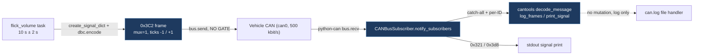
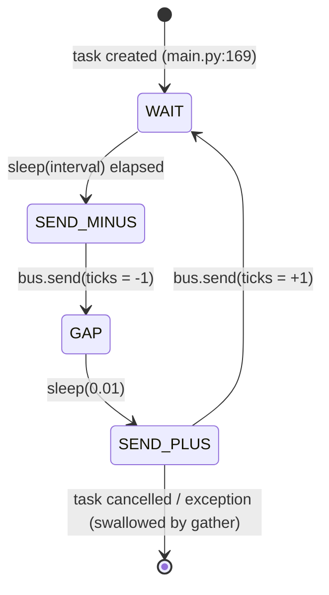

# cbusillo-TeslaPiCAN

## 1. Provenance

- Submodule path: `legacy/cbusillo-TeslaPiCAN`
- Pinned gitlink (canonical form from `git ls-files -s`): `160000 396f25a2834d2379dadb275ddedf7c41061d87e1 0`
- `git -C legacy/cbusillo-TeslaPiCAN rev-parse HEAD` = `396f25a2834d2379dadb275ddedf7c41061d87e1` — matches gitlink; `status --porcelain` empty.
- Upstream: `origin` fetch/push `https://github.com/cbusillo/TeslaPiCAN`. Local branch `main`, single commit `396f25a "filter subscriptions based on id"`, marked `(grafted)` — shallow clone.
- License: no `LICENSE` at the parent repo root (unlicensed). Nested DBC submodule `dbc/model3` is MIT, Copyright (c) 2019 Josh Wardell (`dbc/model3/LICENSE:1-3`).
- Analysis date: 2026-11-21.
- Files read:
    - `main.py` — FULL-READ, lines 1-176 (entire codebase).
    - `.gitmodules` — FULL-READ, lines 1-3.
    - `.gitignore` — FULL-READ, lines 1-269 (JetBrains/Python template; non-load-bearing).
    - `.idea/.gitignore`, `.idea/modules.xml`, `.idea/vcs.xml`, `.idea/codeStyles/codeStyleConfig.xml`, `.idea/inspectionProfiles/profiles_settings.xml`, `.idea/inspectionProfiles/Project_Default.xml` — FULL-READ (IDE metadata; no CAN logic).
    - Nested gitlink: `160000 c56c113c353d09b1a5dd57677461f02fe8b7c6ca 0` at `dbc/model3`, present on disk with `Model3CAN.dbc` (322430 bytes), `LICENSE`, `README.md`.
    - `dbc/model3/Model3CAN.dbc` — STRUCTURAL-PARSE + RANGE-CITED: pattern scan plus lines 2246-2305 (0x3C2), 2421-2430 (0x321), 2505-2509 (0x3D8), 4142-4143 (value tables). Not read in full.
    - `dbc/model3/LICENSE` FULL-READ 1-21; `dbc/model3/README.md` FULL-READ 1-21.
    - Our side (CODE-READ): `firmware/lib/vehicle/can/ids.h:66`, `firmware/lib/vehicle/can/feature/fsd/auto_lane_change.h:50-135`, `firmware/lib/core/can/ring_buffer.h:60-139`; context `docs/reference/can-ids.md`, `docs/reference/commands.md`, `AGENTS.md`.
- Files explicitly NOT read: the remaining ~321,900 bytes of `Model3CAN.dbc` (STRUCTURAL-PARSE only); pre-pin upstream history (clone is grafted to one commit, cannot be read locally); the `firmware/.pio-home/` third-party dependency tree; any network source (issues, PRs, releases) — none consulted.
- Replace-mode provenance: pre-replace summary exists only in git history (`git show HEAD:docs/legacy/cbusillo-TeslaPiCAN.md`); its YAML frontmatter is preserved byte-for-byte (description line has no trailing whitespace, so no stripping was needed). The pre-replace document contained no `## Upstream (...)` section, so there is nothing to carry over verbatim.

## 2. Executive verdict

`cbusillo-TeslaPiCAN` is a 176-line Python proof-of-concept, not a firmware or tool: one `main.py` runs an asyncio loop over a Raspberry Pi SocketCAN `can0` interface, decodes every frame with `cantools` against Josh Wardell's `model3dbc`, prints two signals (brake-fluid/coolant on 0x321, elevation on 0x3D8), and — the only write path — injects a 0x3C2 `VCLEFT_switchStatus` frame every ~10 s ±2 s with left-scroll ticks `-1` then `+1` to flick the volume/scroll wheel. Three mechanisms matter as *ideas*: the ID-filtered async subscriber, the multiplexer-aware DBC signal-dict builder, and the periodic jittered injection loop. None is a candidate for a direct port: our `RingConsumer` ring buffer already implements multi-consumer fan-out with overflow detection (`already present`), our frames are hand-built with explicit CRC/counter handling rather than DBC-driven zero-filled encodes, and the 0x3C2 injection is **un-gated** — no AP/DAS/park precondition, no cooldown state, no listen-before-write — exactly the shape our `alcShouldConfirm` gate exists to prevent. `flick_volume()` is a **never port** item. There are no tests, no dependency pins, no OTA guard, no bus-off handling, and no persistence; all such claims are absent from the code and graded accordingly below.

## 3. Evidence map

| Source file | Lines | What it proves | Grade |
| --- | --- | --- | --- |
| `main.py` | 12-18 | Bitrate 500000, channel `can0`, DBC path, flick interval 10.0 s and jitter 2 s are module constants | CODE-READ |
| `main.py` | 20-23 | `SIGNALS_TO_PRINT` maps 0x321 → brake-fluid/coolant and 0x3d8 → Elevation3D8 | CODE-READ |
| `main.py` | 55-75 | `CANBusSubscriber.subscribe/unsubscribe/notify_subscribers`: catch-all under key `None`, then per-ID callbacks | CODE-READ |
| `main.py` | 76-81 | `read_can_messages`: blocking `bus.recv()` in `while True`, dispatch, `asyncio.sleep(0.000001)` | CODE-READ |
| `main.py` | 84-99 | `create_signal_dict`: zero-fill all signals, override named ones, inject mux value from `multiplexer_ids[0]` | CODE-READ |
| `main.py` | 102-122 | `flick_volume`: 0x3C2 encode → `can.Message` → `bus.send()` twice, `-1` then `+1`, 10 ms gap | CODE-READ |
| `main.py` | 125-137 | `log_frames`: `decode_message` with `DecodeError`/`KeyError`/`ValueError` handling to file logger | CODE-READ |
| `main.py` | 139-148 | `print_signal`: decoded-signal lookup by name with two exception branches | CODE-READ |
| `main.py` | 151-172 | `main`: DBC load, bus construction, callback wiring, two asyncio tasks gathered with `return_exceptions=True` | CODE-READ |
| `main.py` | 66-67 | `unsubscribe()` checks `callback in self.subscribers` (dict keys are IDs/None) → dead path | CODE-READ |
| `main.py` | 116, 122 | `bus.send()` — the previously hedged "implies write capability" is real TX | CODE-READ |
| `.gitmodules` | 1-3 | `dbc/model3` is a submodule of `https://github.com/joshwardell/model3dbc.git` | CODE-READ |
| `dbc/model3/Model3CAN.dbc` | 2246-2305 | 0x3C2 `ID3C2VCLEFT_switchStatus`, DLC 8, mux `VCLEFT_switchStatusIndex` `M 0|2`, `VCLEFT_swcLeftScrollTicks m1 16|6@1-`; no checksum signal in block | STRUCTURAL-PARSE |
| `dbc/model3/Model3CAN.dbc` | 2421-2430, 4142-4143 | 0x321 `ID321VCFRONT_sensors` DLC 8; `brakeFluidLevel 22|2`, `coolantLevel 21|1`, value tables LOW/NORMAL, FILLED/NOT_OK | STRUCTURAL-PARSE |
| `dbc/model3/Model3CAN.dbc` | 2505-2506 | 0x3D8 `ID3D8Elevation` DLC 2, `Elevation3D8 0|14@1-` scale 1, unit M | STRUCTURAL-PARSE |
| `dbc/model3/LICENSE`, `README.md` | 1-21 each | Nested DBC is MIT (Josh Wardell 2019), third-party provenance | CODE-READ |
| `firmware/lib/vehicle/can/ids.h` | 66 | Our `CAN_ID_VCLEFT_SWITCH` = 0x3C2, TX yoke turn-signal/ALC | CODE-READ (our side) |
| `firmware/lib/vehicle/can/feature/fsd/auto_lane_change.h` | 69-87, 95-104 | Our 0x3C2 frame: byte[0]=0x29, button bits in data[6]/[7]; gated by `alcShouldConfirm` (enable, DAS lane-change state, 2 s cooldown) | CODE-READ (our side) |
| `firmware/lib/core/can/ring_buffer.h` | 68-75, 105-118 | Our `RingConsumer` per-consumer `readIdx`/`lastSeq`/`dropped`, lap detection in `ringPeek` | CODE-READ (our side) |
| `git show HEAD:docs/legacy/cbusillo-TeslaPiCAN.md` | 3, 15, 22, 41, 51 | Pre-replace claims (license None, empty DBC dir, "configurable" interval, write-capability hedge) | SUMMARY-ONLY |
| `main.py` (python-can `recv()` default timeout semantics) | 78 | Blocking-vs-nonblocking behavior depends on unpinned python-can version | UNVERIFIED |

No TEST-READ evidence exists: this repo ships no test files, no CI config, and no test framework. No CAPTURE evidence exists: no CAN log, trace, or decode tool output is committed (the only logger writes `can.log` at runtime, and that file is not in the repo).

## 4. Architecture and build surface

Single process, single entry point: `if __name__ == '__main__': asyncio.run(main())` (`main.py:175-176`). No shared core vs platform port split — one flat script. Dependencies are imported but unpinned: `asyncio`, `logging`, `random`, `pathlib`, `typing` (stdlib) and `can`, `cantools` (third-party, `main.py:1-8`); there is no `requirements.txt`, `pyproject.toml`, or `setup.py`. Build flags: none. Dependency boundary: `python-can` owns the SocketCAN bus object, `cantools` owns the DBC catalog and encode/decode; the script owns only pub/sub, logging, and the flick loop.



Note the missing "mutate/gate" stage upstream: the read path never mutates a real frame, and the write path builds a synthetic frame from DBC defaults with no gate. Our equivalent pipeline routes RX through variant handlers into a shared ring buffer and gates every TX; see `firmware/lib/core/can/ring_buffer.h:68` and `firmware/lib/vehicle/can/feature/fsd/auto_lane_change.h:95`.

## 5. Mechanism catalogue

### Async ID-filtered CAN subscriber

- **Claim (README / summary):** "async CAN message subscriber system", "supports subscribing to specific CAN IDs or all messages" (`git show HEAD:docs/legacy/cbusillo-TeslaPiCAN.md#L15`, `#L36`).
- **Code path:** `main.py:76-81` — `read_can_messages()` → `bus.recv()` → `CANBusSubscriber.notify_subscribers()` (`main.py:69-74`) → catch-all callbacks then `self.subscribers[message.arbitration_id]` callbacks.
- **Frame spec:** None — transport-agnostic dispatch on `can.Message.arbitration_id`; no ID filtering at the MCP2515/hardware level (contrast our ID masks).
- **Gates and timing:** None on dispatch; `asyncio.sleep(0.000001)` yield after each received message.
- **State machine:** None found.
- **Tests:** None found.
- **Evidence grade:** CODE-READ.
- **Verdict:** CONFIRMED.
- **Adapt to TeslaCANModder?** already present — our `RingConsumer` (`firmware/lib/core/can/ring_buffer.h:68-75`) gives independent multi-consumer fan-out plus `dropped` overflow accounting, which this dict-of-lists does not.

### Multiplexer-aware DBC signal helper

- **Claim (README / summary):** "create_signal_dict() — Builds signal dictionaries from DBC message definitions with multiplexer support", "Supports multiplexed CAN frames with proper mux ID handling" (`git show HEAD:docs/legacy/cbusillo-TeslaPiCAN.md#L38`, `#L50`).
- **Code path:** `main.py:84-99` — `create_signal_dict()` → scans `message.signals` for `is_multiplexer`, copies named signals' supplied values, sets the mux signal to `signal.multiplexer_ids[0]`; used at `main.py:103-104` before `volume_message.encode(signals)` at `main.py:114,120`. Decode counterpart at `main.py:127,142` (`dbc.decode_message`).
- **Frame spec:** DBC-driven, no hand-written byte layout. For 0x3C2 the mux selector is `VCLEFT_switchStatusIndex M 0|2@1+` and the target signal is `VCLEFT_swcLeftScrollTicks m1 16|6@1-` scale 1 range -32..31 (`dbc/model3/Model3CAN.dbc:2247,2300`).
- **Gates and timing:** Zero-fill default for every signal (`default_value=0`, `main.py:84-85`); only named signals are overridden. No validation that the supplied mux ID matches the chosen signal's `multiplexer_ids`.
- **State machine:** None found.
- **Tests:** None found.
- **Evidence grade:** CODE-READ (helper and call sites); STRUCTURAL-PARSE (DBC layout).
- **Verdict:** CONFIRMED.
- **Adapt to TeslaCANModder?** no impact — our frames are built explicitly with our own CRC/counter helpers (e.g. `teslaCrc8` at `auto_lane_change.h:58`), not via zero-filled DBC encodes; a DBC dependency would add a runtime catalog and a new failure path without fixing a gap we have.

### Periodic volume/scroll flick injector

- **Claim (README / summary):** "volume/scroll wheel flick feature that periodically sends CAN commands", "configurable interval and jitter" (`git show HEAD:docs/legacy/cbusillo-TeslaPiCAN.md#L15`, `#L40`).
- **Code path:** `main.py:102-122` — `flick_volume()` → `dbc.get_message_by_frame_id(0x3c2)` → `create_signal_dict(...)` once → loop: jitter → `asyncio.sleep(interval)` → encode ticks `-1` → `can.Message(0x3c2, is_extended_id=False)` → `bus.send()` → `sleep(0.01)` → encode ticks `+1` → `bus.send()`.
- **Frame spec:** ID 0x3C2 (962), DLC 8, standard 11-bit ID, VehicleBus per DBC (`dbc/model3/Model3CAN.dbc:2246`). Mux selector `VCLEFT_switchStatusIndex` bits `[1:0]` set to 1 via `multiplexer_ids[0]`; `VCLEFT_swcLeftScrollTicks` at bits `16|6`, signed, scale 1, written `-1` then `+1`. Counter: none (no counter signal in the block). Checksum: none (no checksum signal in the block; contrast our frames which carry CRC-8/OPENSAFETY per `docs/reference/can-protocol.md`).
- **Gates and timing:** Interval `VOLUME_FLICK_INTERVAL = 10.0` s; jitter `(random.randint(0, 2000 * 2) / 1000) - 2` → uniform -2.000..+2.000 s in 0.001 s steps; inter-frame gap 0.01 s; loop is infinite. **No gate of any kind** — not DAS state, not AP state, not park/summon, not OTA, not bus health. "Configurable" means editing module constants; there is no command, env var, CLI flag, or runtime setter.
- **State machine:**



- **Tests:** None found.
- **Evidence grade:** CODE-READ (path and constants); STRUCTURAL-PARSE (frame layout).
- **Verdict:** CONFIRMED for behavior; CONTRADICTED for the word "configurable" (see section 6).
- **Adapt to TeslaCANModder?** never — un-gated periodic injection into a driver-control-adjacent frame; our `alcShouldConfirm` gate (`auto_lane_change.h:95-104`) is the safety shape to keep, not the loop to copy.

## 6. Summary vs code contradiction table

| Pre-replace claim (git history) | Code / on-disk evidence | Verdict |
| --- | --- | --- |
| `git show HEAD:docs/legacy/cbusillo-TeslaPiCAN.md#L15`, `#L41`: "DBC files directory is currently empty (likely a submodule that was not initialized)" | `dbc/model3/` is populated on disk: `Model3CAN.dbc` (322430 bytes), `LICENSE`, `README.md`; parent tracks it as gitlink `160000 c56c113... 0` (`.gitmodules:1-3`) | CONTRADICTED (as stated). Nuance: parent `git ls-files` shows only the gitlink; a fresh checkout without `submodule update` would indeed be empty, but the analyzed snapshot is not. |
| `git show HEAD:docs/legacy/cbusillo-TeslaPiCAN.md#L22`: "License: None" | Parent root has no `LICENSE`, but the vendored DBC is MIT (`dbc/model3/LICENSE:1-3`, Josh Wardell 2019) | PARTIAL — parent unlicensed; blanket "None" omits the third-party MIT payload in-tree. |
| `git show HEAD:docs/legacy/cbusillo-TeslaPiCAN.md#L40`: "configurable interval and jitter" | `VOLUME_FLICK_INTERVAL`/`VOLUME_FLICK_JITTER` are module constants at `main.py:17-18`; no CLI/env/command setter exists anywhere in `main.py` | CONTRADICTED — source-editable only, not runtime-configurable. |
| `git show HEAD:docs/legacy/cbusillo-TeslaPiCAN.md#L51`: "Can send CAN messages (volume flick feature implies write capability)" | `bus.send(can_frame)` at `main.py:116` and `main.py:122` — direct, not merely implied | CONFIRMED but wording is weak; upgraded to CODE-READ in the evidence map, not a factual contradiction. |
| `git show HEAD:docs/legacy/cbusillo-TeslaPiCAN.md#L3`: frontmatter description truncated mid-word ("It implement") | Same bytes preserved per replace-mode contract | Not a code contradiction; recorded here so a future agent knows the truncation is inherited, not introduced. |

All other summary claims (500 kbit/s, `can0`, pub/sub, mux-aware helper, 0x321/0x3d8 signals, asyncio) agree with code and are therefore in the evidence map, not here.

## 7. CAN frame and signal inventory

| ID (hex+dec) | Bus | Period | DLC | Byte/bit layout | Scale/units | Counter | Checksum | Read/write | Grade |
| --- | --- | --- | --- | --- | --- | --- | --- | --- | --- |
| 0x321 / 801 `ID321VCFRONT_sensors` | VehicleBus (`dbc/model3/Model3CAN.dbc:2421`) | RX, no period in code | 8 | `VCFRONT_brakeFluidLevel 22\|2@1+`; `VCFRONT_coolantLevel 21\|1@1+` (`:2423-2424`) | 1, enum 0=SNA/1=LOW/2=NORMAL and 0=NOT_OK/1=FILLED (`:4142-4143`) | none | none in DBC block | READ — printed via `SIGNALS_TO_PRINT` (`main.py:21`) | CODE-READ (use) + STRUCTURAL-PARSE (layout) |
| 0x3d8 / 984 `ID3D8Elevation` | VehicleBus (`:2505`) | RX, no period in code | 2 | `Elevation3D8 0\|14@1-` (`:2506`) | 1, M (metres), -8192..8191 | none | none in DBC block | READ — printed (`main.py:22`) | CODE-READ (use) + STRUCTURAL-PARSE (layout) |
| 0x3c2 / 962 `ID3C2VCLEFT_switchStatus` | VehicleBus (`:2246`) | TX every 10 s ±2 s; pair 10 ms apart (`main.py:106-117`) | 8 | `VCLEFT_switchStatusIndex M 0\|2@1+` (mux selector); `VCLEFT_swcLeftScrollTicks m1 16\|6@1-` (`:2247,2300`) | ticks scale 1, -32..31; written `-1` then `+1` | none | none in DBC block | WRITE — `bus.send` (`main.py:116,122`) | CODE-READ (frame build) + STRUCTURAL-PARSE (layout) |

DBC catalog handling: `Model3CAN.dbc` is 322430 bytes and was treated as STRUCTURAL-PARSE with RANGE-CITED line ranges only; it is **not** dumped wholesale here. No CAPTURE row exists — no captured frame or tool output is committed. Note our CAN-ID reference (`docs/reference/can-ids.md`) lists 0x3C2 (962) but not 0x321 (801) or 0x3D8 (984).

## 8. Constants and tuning table

| Constant | Value | File:line | Meaning | Grade |
| --- | --- | --- | --- | --- |
| `CAN_BUS_BITRATE` | `500000` | `main.py:12` | SocketCAN bitrate, 500 kbit/s | CODE-READ |
| `VEHICLE_BUS_CHANNEL` | `'can0'` | `main.py:15` | Single SocketCAN channel | CODE-READ |
| `CAN_DBC_FILE` | `dbc/model3/Model3CAN.dbc` | `main.py:13` | Hard-coded DBC path; no fallback | CODE-READ |
| `VOLUME_FLICK_INTERVAL` | `10.0` | `main.py:17` | Base seconds between flick pairs | CODE-READ |
| `VOLUME_FLICK_JITTER` | `2` | `main.py:18` | `±2` s uniform jitter window | CODE-READ |
| jitter expression | `randint(0, 2000*J)/1000 - J` | `main.py:106` | -2.000..+2.000 s, 1 ms resolution | CODE-READ |
| inter-frame sleep | `0.01` | `main.py:117` | Gap between `-1` and `+1` scroll frames | CODE-READ |
| poll sleep | `0.000001` | `main.py:81` | Event-loop yield after each RX message | CODE-READ |
| scroll tick values | `-1`, `+1` | `main.py:104,113,119` | DBC encodes 6-bit signed ticks into bits 16..21 | CODE-READ |
| injected arbitration ID | `0x3c2`, `is_extended_id=False` | `main.py:103,115` | Standard 11-bit frame | CODE-READ |
| `SIGNALS_TO_PRINT` | `0x321`, `0x3d8` | `main.py:20-23` | Only two IDs/signals surfaced to stdout | CODE-READ |
| log file name / level | `can.log`, `DEBUG` | `main.py:50-52` | File handler for all decoded frames | CODE-READ |
| mux selection | `signal.multiplexer_ids[0]` | `main.py:93-97` | Picks first mux ID, not validated against supplied signal | CODE-READ |

Tuning claims are CODE-READ for the expressions themselves; whether 10 s/±2 s/ticks ±1 produce the intended vehicle UI effect on a real car is UNVERIFIED — it would need a bench capture with `candump` and a known-good frame for comparison.

## 9. Failure modes and edge cases

| Failure | Handling code path | Tested? | Grade |
| --- | --- | --- | --- |
| DBC file missing / submodule not initialized | None — `dbc.add_dbc_file(CAN_DBC_FILE)` at `main.py:153` raises uncaught; no fallback | No test | CODE-READ |
| `DecodeError` on unknown/malformed frame | `log_frames` catches and logs raw hex (`main.py:129-133`); `print_signal` catches separately (`main.py:145-146`) | No test | CODE-READ |
| Unknown arbitration ID | `KeyError`/`ValueError` swallowed to debug log (`main.py:135-136`, `:147-148`) | No test | CODE-READ |
| `unsubscribe()` actually unsubscribing | Broken: `callback in self.subscribers` tests dict keys (IDs/None), so always false (`main.py:66-67`) — dead path | No test | CODE-READ |
| Blocking `bus.recv()` stalling the event loop | None — `bus.recv()` at `main.py:78` is blocking in the async loop; only a 1 µs sleep follows, so flick timing can slip. Exact block/return semantics depend on unpinned python-can version | No test | CODE-READ (structure); UNVERIFIED (library semantics) |
| Task exception / silent death | `asyncio.gather(..., return_exceptions=True)` at `main.py:172` collects exceptions without logging or restart | No test | CODE-READ |
| Bus-off / TX error on `bus.send()` | None — no try/except around `bus.send()` at `main.py:116,122` | No test | CODE-READ |
| Queue overflow / backpressure | No queue exists; single blocking receive, no per-consumer drop accounting (contrast our `ringPeek` lap detection at `firmware/lib/core/can/ring_buffer.h:110-115`) | No test | CODE-READ |
| OTA update in progress | No OTA detection or TX pause anywhere; contrast our 0x318 guard in `docs/reference/can-protocol.md` | No test | CODE-READ |
| Brownout / reboot state | No persistence — all settings are compile-time constants; no NVS equivalent | No test | CODE-READ |
| Missing-frame / watchdog timeout | None found — no timer or health check on RX | No test | CODE-READ |
| Dependency drift | No `requirements.txt`/lockfile; `can` and `cantools` versions unpinned | No test | CODE-READ |

## 10. Test coverage map

Per-test-file map: **None found** — no files under `test/`, `tests/`, or any `*_test.py`; no CI config; no pytest/unittest import in `main.py`.

Critical paths with no test, and the risk each carries:

- `create_signal_dict` mux selection (`main.py:84-99`) — no oracle test that the mux value matches the encoded signal; a wrong `multiplexer_ids[0]` silently produces the wrong frame body.
- `flick_volume` `-1`/`+1` sequence and 10 ms gap (`main.py:113-122`) — no test that the two encoded frames differ only in bits 16..21; a DBC change could invert or widen the scroll tick.
- `CANBusSubscriber.notify_subscribers` ordering (`main.py:69-74`) — no test that catch-all and ID-specific callbacks both fire exactly once.
- `unsubscribe()` (`main.py:65-67`) — no test, so the dead branch survives unnoticed.
- Decode-error and unknown-ID branches (`main.py:129-136`, `:145-148`) — no test that raw hex is captured or that stdout stays clean.
- Bus send failure / bus-off (`main.py:116,122`) — no test, so TX failure silently ends the loop via `gather(return_exceptions=True)`.
- DBC-load failure (`main.py:153`) — no test for startup behavior when the nested submodule is absent.

## 11. Parity matrix with TeslaCANModder

| Signal/frame | Upstream decode/build (cite) | Our decode/build (cite) | Delta | Action |
| --- | --- | --- | --- | --- |
| 0x3C2 / 962 `VCLEFT_switchStatus` | Synthetic build, mux via `multiplexer_ids[0]` + scroll ticks `16\|6@1-`, un-gated (`main.py:102-122`; `dbc/model3/Model3CAN.dbc:2247,2300`) | `buildPalladiumTurnFrame` builds byte[0]=0x29, button bits in data[6]/[7], 8 bytes, gated by `alcShouldConfirm` (`firmware/lib/vehicle/can/feature/fsd/auto_lane_change.h:69-87,95-104`); ID at `firmware/lib/vehicle/can/ids.h:66` | Same CAN ID, incompatible mux encoding, different purpose; ours gated (enable + DAS lane-change state + cooldown), upstream not | already present — keep our gate, do not merge the upstream encoding |
| 0x321 / 801 `VCFRONT_sensors` | `SIGNALS_TO_PRINT` + `print_signal` decode (`main.py:21,139-148`); layout `dbc/model3/Model3CAN.dbc:2423-2424` | No occurrence in shipping code: `grep -nEr '0x321\|VCFRONT_brakeFluidLevel' firmware/lib firmware/src firmware/test` → no output (verified) | We do not decode brake-fluid/coolant level | ignore — low-value read; capture first if a use case appears (negative our-side anchor is CODE-READ absence) |
| 0x3d8 / 984 `ID3D8Elevation` | `SIGNALS_TO_PRINT` + `print_signal` (`main.py:22,139-148`); layout `dbc/model3/Model3CAN.dbc:2506` | No occurrence in shipping code: `grep -nEr '0x3D8\|Elevation3D8' firmware/lib firmware/src firmware/test` → no output (verified) | We do not decode elevation | ignore — no in-vehicle consumer for metres |
| Async multi-consumer frame fan-out | `CANBusSubscriber` dict of callbacks (`main.py:55-75`) | `canRingBuffer` + `RingConsumer{readIdx,lastSeq,dropped}`, `ringPeek` lap detection (`firmware/lib/core/can/ring_buffer.h:68-75,105-118`) | Our design is pull-based with explicit overflow accounting; upstream push-callback with no backpressure | already present — our version is strictly more observable |
| DBC-driven multiplexed encode | `create_signal_dict` + `cantools.encode` with zero defaults (`main.py:84-99,114,120`) | No DBC-driven encode; hand-built frames with `teslaCrc8` and explicit counters (`auto_lane_change.h:50-59,69-87`) | Different design: data-driven catalog vs explicit byte layout; ours carries CRC/counter discipline upstream lacks | ignore — do not introduce a runtime DBC dependency |
| Periodic jittered injection | Jitter `±2 s` on 10 s interval (`main.py:17-18,106-107`) | Our periodic injectors use fixed intervals with explicit gates and cooldowns (`auto_lane_change.h:95-104`, `docs/reference/commands.md` drive-mode 20 Hz) | Upstream jitters to avoid patterns; ours relies on state gates, not schedule randomness | no impact — jitter alone is not a safety gate |

Every row has a our-side CODE-READ citation (positive or a verified negative search over shipping dirs); none is SUMMARY-ONLY, so these rows may inform decisions.

## 12. Surface inventory and security notes

Transport surfaces exposed by the repo:

| Surface | Endpoint/channel | Semantics | Grade |
| --- | --- | --- | --- |
| SocketCAN RX | `can0`, 500 kbit/s | All frames received, decoded to file log; two signals printed to stdout | CODE-READ (`main.py:15,78,125-148`) |
| SocketCAN TX | `can0`, frame 0x3C2 standard ID | Two frames per cycle, ticks `-1` then `+1`, 10 ms apart | CODE-READ (`main.py:103-122`) |
| File log | `can.log`, DEBUG, timestamped `%(asctime)s-%(name)s-%(levelname)s` | All decoded frames written at runtime; file deleted at import (`main.py:33,50`) | CODE-READ |
| stdout | `print()` in `print_signal` | Brake-fluid/coolant and elevation values | CODE-READ (`main.py:144`) |
| Serial / REST / BLE / web | None found | No command parser, no network listener, no BLE code | CODE-READ (absence) |

Provenance and security findings:

- **Un-gated actuator-adjacent injection:** `flick_volume` writes to the same 0x3C2 `VCLEFT_switchStatus` frame our ALC path uses for turn-signal confirmation, with no state gate. This is the single most important do-not-copy item; a port would bypass `alcShouldConfirm` (`auto_lane_change.h:95-104`) and the `can-review-checklist.md` requirements.
- **Third-party trust boundary:** the DBC is a nested submodule from `https://github.com/joshwardell/model3dbc.git` (`.gitmodules:3`), MIT, 322430 bytes. It is data, not code, but it defines the exact bit encoding of every injected frame — a DBC change silently changes TX shape.
- **No credentials, keys, certs, or tokens** found in any tracked file; `.gitignore` ignores `.env` (`:231`) but no `.env` exists.
- **No dangerous build flags** — there is no build system at all.
- **Import-time side effects:** module-level logger creation deletes `can.log` at import (`main.py:33,50`); no CLI guard, so importing `main.py` for reuse truncates the log.
- **Unpinned dependencies:** no lockfile; `bus.recv()`/`encode()` behavior can change across `python-can`/`cantools` versions (UNVERIFIED which versions were used by the author).

## 13. Adaptation assessment

| Mechanism | Value | Cost | Risk | Evidence grade | Decision |
| --- | --- | --- | --- | --- | --- |
| Async ID-filtered subscriber | Low — we already fan out to WiFi/BLE/Serial/Recorder | ~0; no code to add | Low | CODE-READ (both sides) | already present — our ring buffer already handles this with overflow detection |
| Multiplexer-aware DBC signal helper | Low — our frame builders are explicit and CRC-aware | High — would add a runtime DBC catalog and a decode/encode dependency | Medium — zero-default encode can mask missing inputs; DBC drift changes TX shape | CODE-READ | no impact — do not add a DBC runtime to firmware |
| Periodic volume/scroll flick injection | Very low — no in-vehicle use case stated | Low to write, high to make safe | High — un-gated write into a driver-control-adjacent frame; same ID as our ALC path | CODE-READ | never port — keep our gated `buildPalladiumTurnFrame` + `alcShouldConfirm` instead |
| 0x321 / 0x3D8 signal decoding | Low — brake-fluid/coolant and elevation have no consumer in our feature set | Low to add, but pointless without a consumer | Low (read-only) | CODE-READ | ignore — revisit only with a bench capture and a concrete feature |
| Jittered schedule as an anti-detection idea | Low — jitter is not a substitute for state gating | Low | Medium — randomness could mask a bad gate | SUMMARY-ONLY (no claim in upstream docs that jitter is deliberate anti-detection) | no impact — not a basis for any change |

## 14. Do-not-copy list

| Item (file:line) | Reason |
| --- | --- |
| `flick_volume()` entire loop — `main.py:102-122` | Un-gated periodic CAN TX into 0x3C2, the same ID our gated ALC confirmation uses. Copying it would bypass `alcShouldConfirm` and `can-review-checklist.md`. |
| `create_signal_dict()` zero-fill + DBC encode — `main.py:84-99,114,120` | Encodes unsolicited signals as 0 and trusts unvalidated `multiplexer_ids[0]`; our frames are built from explicit values/cached real frames with CRC/counter helpers. |
| Blocking `bus.recv()` + 1 µs busy yield — `main.py:76-81` | Wrong for our cooperative/RTOS CAN loop; our `RingConsumer` provides backpressure and drop accounting. |
| Broken `unsubscribe()` check — `main.py:65-67` | Dead branch (`callback in self.subscribers` tests dict keys); porting would inherit a bug. |
| Import-time file logger that deletes `can.log` — `main.py:33,48-52` | Destructive side effect at import; our log ring is in-memory and explicit. |
| `dbc.add_dbc_file(CAN_DBC_FILE)` hard path dependency — `main.py:13,153` | No fallback if the DBC is absent; our decoder is code, not a runtime file. |
| Vendored `Model3CAN.dbc` wholesale — `dbc/model3/Model3CAN.dbc` (322430 bytes, MIT) | Third-party data catalog; never import legacy files into `firmware/`, `client/`, `packages/`, or `tools/`. |

No `## Upstream (...)` section was present in the pre-replace document, so there is nothing to reproduce here.

## 15. History and evolution

Local history of the submodule is **one grafted commit**: `396f25a "filter subscriptions based on id"`. The commit message implies an earlier version dispatched callbacks differently (perhaps to all subscribers) and this commit added per-ID filtering, but the diff is unavailable locally (shallow/grafted clone) — that inference is UNVERIFIED, not a finding. No changelog, no tags, no release notes, and no other commits exist in the local clone. Network-only claims (GitHub issues/PRs, author intent, upstream discussions) were not consulted and remain UNVERIFIED.

The nested DBC submodule has a longer local history (`c56c113 "Add files via upload"` plus `24ef335`, `c7ad5d0`, `c61be33`, `4fc0402`, etc.), pinning `c56c113c353d09b1a5dd57677461f02fe8b7c6ca`; its README (`dbc/model3/README.md:4-6`) directs users to fetch the latest commit rather than the latest release, which is a maintenance signal about catalog drift but not evidence about any specific frame version. Page `docs/legacy/cbusillo-TeslaPiCAN.md` in git history is the only pre-replace analysis; its claims are treated as leads, not evidence.

## 16. Re-verification recipe

Pin and freshness (run from repo root; on this Windows workspace `grep` is Git-bash `C:\Program Files\Git\usr\bin\grep.exe`):

```bash
OLD=396f25a2834d2379dadb275ddedf7c41061d87e1
git ls-files -s legacy/cbusillo-TeslaPiCAN
# -> 160000 396f25a2834d2379dadb275ddedf7c41061d87e1 0
git -C legacy/cbusillo-TeslaPiCAN rev-parse HEAD          # must equal OLD
git -C legacy/cbusillo-TeslaPiCAN status --porcelain      # must be empty
git -C legacy/cbusillo-TeslaPiCAN fetch --tags --prune
git -C legacy/cbusillo-TeslaPiCAN log --oneline $OLD..origin/main
git -C legacy/cbusillo-TeslaPiCAN diff --stat $OLD..origin/main
git -C legacy/cbusillo-TeslaPiCAN diff $OLD..origin/main -- main.py .gitmodules
git -C legacy/cbusillo-TeslaPiCAN/dbc/model3 rev-parse HEAD   # expect c56c113c353d09b1a5dd57677461f02fe8b7c6ca
```

If the parent gitlink moves, re-run the whole analysis — this document describes only the pinned snapshot. If the DBC gitlink moves, re-derive every byte/bit layout in section 7 and every DBC anchor below.

Demonstrated anchors (all run at write time on 2026-11-21 with `grep -nE`; `\|` below means an escaped literal pipe in ERE):

```text
grep -nE 'CAN_BUS_BITRATE' legacy/cbusillo-TeslaPiCAN/main.py        -> 12:CAN_BUS_BITRATE = 500000 (and :154 usage)
grep -nE 'CAN_DBC_FILE' legacy/cbusillo-TeslaPiCAN/main.py           -> 13:CAN_DBC_FILE = Path('dbc/model3/Model3CAN.dbc') (and :153)
grep -nE '0x321\|0x3d8' legacy/cbusillo-TeslaPiCAN/main.py            -> 21:0x321 ... (and 22:0x3d8 ...)
grep -nE 'class CANBusSubscriber' legacy/cbusillo-TeslaPiCAN/main.py  -> 55:class CANBusSubscriber:
grep -nE 'def create_signal_dict' legacy/cbusillo-TeslaPiCAN/main.py  -> 84:def create_signal_dict(...)
grep -nE '0x3c2\|VCLEFT_swcLeftScrollTicks' legacy/cbusillo-TeslaPiCAN/main.py
    -> 103,104,113,115,119 (get_message_by_frame_id / dict key / -1 / Message / +1)
grep -nE 'VOLUME_FLICK_INTERVAL\|VOLUME_FLICK_JITTER' legacy/cbusillo-TeslaPiCAN/main.py
    -> 17:...10.0, 18:...2, 106-107 (formula)
grep -nE 'bus.recv\|bus.send' legacy/cbusillo-TeslaPiCAN/main.py      -> 78,116,122
grep -nE 'socketcan\|can0' legacy/cbusillo-TeslaPiCAN/main.py         -> 15:can0, 154:socketcan
grep -nE 'crc\|checksum\|0xAA\|XOR' legacy/cbusillo-TeslaPiCAN/main.py -> no output (negative anchor: no checksum/framing in upstream)
grep -nE 'BO_ 962 ID3C2VCLEFT_switchStatus' legacy/cbusillo-TeslaPiCAN/dbc/model3/Model3CAN.dbc
    -> 2246:BO_ 962 ID3C2VCLEFT_switchStatus: 8 VehicleBus
grep -nE 'SG_ VCLEFT_swcLeftScrollTicks m1 : 16\|6@1-' legacy/cbusillo-TeslaPiCAN/dbc/model3/Model3CAN.dbc
    -> 2300: SG_ VCLEFT_swcLeftScrollTicks m1 : 16|6@1- (1,0) [-32|31]
grep -nE 'BO_ 801 ID321VCFRONT_sensors' legacy/cbusillo-TeslaPiCAN/dbc/model3/Model3CAN.dbc
    -> 2421:BO_ 801 ID321VCFRONT_sensors: 8 VehicleBus
grep -nE 'SG_ VCFRONT_brakeFluidLevel : 22\|2' legacy/cbusillo-TeslaPiCAN/dbc/model3/Model3CAN.dbc
    -> 2423: SG_ VCFRONT_brakeFluidLevel : 22|2@1+ (1,0) [0|2]
grep -nE 'SG_ VCFRONT_coolantLevel : 21\|1' legacy/cbusillo-TeslaPiCAN/dbc/model3/Model3CAN.dbc
    -> 2424: SG_ VCFRONT_coolantLevel : 21|1@1+ (1,0) [0|1]
grep -nE 'BO_ 984 ID3D8Elevation' legacy/cbusillo-TeslaPiCAN/dbc/model3/Model3CAN.dbc
    -> 2505:BO_ 984 ID3D8Elevation: 2 VehicleBus
grep -nE 'SG_ Elevation3D8 : 0\|14@1-' legacy/cbusillo-TeslaPiCAN/dbc/model3/Model3CAN.dbc
    -> 2506: SG_ Elevation3D8 : 0|14@1- (1,0) [-8192|8191] "M"
```

Our-side drift anchors (pin by symbol, not by line number):

```text
grep -nE 'CAN_ID_VCLEFT_SWITCH' firmware/lib/vehicle/can/ids.h
    -> 66:#define CAN_ID_VCLEFT_SWITCH     0x3C2
grep -nE 'buildPalladiumTurnFrame' firmware/lib/vehicle/can/feature/fsd/auto_lane_change.h
    -> 69:inline void buildPalladiumTurnFrame(Frame &f, bool turnLeft)
grep -nE 'struct RingConsumer' firmware/lib/core/can/ring_buffer.h
    -> 68:struct RingConsumer
grep -nEr '0x321\|0x3D8\|Elevation3D8\|VCFRONT_brakeFluidLevel' firmware/lib firmware/src firmware/test
    -> no output (negative anchor: we do not decode 0x321 / 0x3D8)
```

If line numbers drift more than ~10, re-read the whole function; do not trust this document's numbers. Pre-pin upstream history was **not** reviewed — the clone is grafted to a single commit, so there is nothing earlier to read locally; that gap is inherited in section 17.

## 17. Open questions and explicitly not investigated

- Whether the author's 10 s ±2 s / ticks ±1 values were chosen from a real vehicle capture: UNVERIFIED. Would need a `candump`-style capture and a known-good 0x3C2 scroll frame; no CAPTURE evidence exists in the repo.
- Exact `python-can` `bus.recv()` blocking behavior and `cantools` `encode()` requirements for unspecified signals, given no pinned dependency versions: UNVERIFIED. Would need a reproducible environment with pinned versions and a direct experiment.
- Whether `unsubscribe()` was ever exercised — no callers exist in `main.py`; it may be unused public API. UNVERIFIED.
- The `dbc/model3` gitlink `c56c113...` may differ from the latest upstream `model3dbc`; only the pinned snapshot's cited ranges were read, not the full 322430-byte catalog. Full DBC review not investigated.
- Pre-pin history of `cbusillo/TeslaPiCAN` was not reviewed (grafted single-commit clone). The "filter subscriptions based on id" commit implies prior behavior that cannot be verified locally.
- No network sources (issues, PRs, discussions, releases) were consulted; all such claims are UNVERIFIED by design.
- Whether the 0x3C2 injection was ever observed to change vehicle volume on HW3 vs HW4: not investigated — no bench, no CAPTURE, and our own 0x3C2 usage is a different mux encoding (`byte[0]=0x29` vs DBC `switchStatusIndex` mux bits 0..1).
- Runtime safety of injecting into 0x3C2 on a public road: not tested and not recommended; any future work must start with `docs/checklists/can-review-checklist.md` and a listen-only bench capture.
