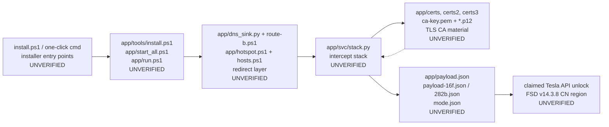

# cos003-tesla-drug

## 1. Provenance

- **Submodule path:** `legacy/cos003-tesla-drug`.
- **Pinned gitlink SHA:** `160000 7def0dcc9ed0e91a5476f82487ecaefe223d20bd 0` (canonical form from `git ls-files -s legacy/cos003-tesla-drug`). `git -C legacy/cos003-tesla-drug rev-parse HEAD` returns the same SHA; `status --porcelain` is empty; `log -1 --format='%H %s'` = `7def0dcc9ed0e91a5476f82487ecaefe223d20bd Add files via upload`. SHA match verified 2026-11-21.
- **Upstream URL:** `https://github.com/cos003/tesla-drug` (origin fetch+push). The claimed original, `https://github.com/zeratulhx/Tesla-drug`, returned HTTP 404 on 2026-11-20; a 404 does not establish deleted vs. private (`docs/legacy/tesla-drug-forks-2026-11-20.md:7`). This fork was pinned as one of four reference snapshots in that catalog (`:8`, `:14-21`).
- **License:** MIT (`LICENSE:1-21`), `Copyright (c) 2026 zeratulhx` (`LICENSE:3`). Note the license holder is the original author `zeratulhx`, not fork owner `cos003`; whether the grant covers the ZIP added by the fork is UNVERIFIED. MIT is compatible with our GPL-3.0 in principle, but compatibility does not authorize copying code or importing key material.
- **Analysis date:** 2026-11-21.
- **Files read (direct primary-source reads):** `README.md:1-2` (full, 2 lines), `LICENSE:1-21` (full, 21 lines), `CLEAN-2026.zip` central directory only (78 entries; names, uncompressed/compressed sizes, timestamps; STRUCTURAL-PARSE), local `git log` (2 commits) and `git show --stat` for both, `docs/legacy/tesla-drug-forks-2026-11-20.md:1-21` (provenance). Our-side counterpart read for the parity boundary: `firmware/lib/vehicle/can/ids.h:18-31`.
- **Files explicitly NOT read:** every one of the 78 members inside `CLEAN-2026.zip`. No extraction, decompression of member content, execution, install, or unpacking was performed. Specifically unread: `install.ps1`, `一键安装.cmd` (U+4E00 U+952E U+5B89 U+88C5, "one-click install"), all `app/*.ps1`, `app/*.py`, `app/tools/*`, `app/web/*`, `app/certs/`, `app/certs2/`, `app/certs3/`, `app/payload*.json`, `app/mode.json`, and all in-archive README/HANDOFF/CHANGELOG/ENDPOINTS markdown. No hidden tracked files exist beyond `.git`.
- **Reading coverage vocabulary:** the ZIP is labeled STRUCTURAL-PARSE (schema/size-level only), not FULL-READ. No tracked file is a DBC catalog or generated code. No implementation source is tracked in this snapshot; therefore no symbol-level CODE-READ, no TEST-READ, and no CAPTURE evidence exists for any unlock mechanism. `CODE-READ` rows in section 3 mean a primary file in the pinned snapshot was read directly (README, LICENSE, git metadata), not that an implementation was audited.
- **Frontmatter / Upstream preservation:** no pre-existing `docs/legacy/cos003-tesla-drug.md` existed at analysis time, so no YAML frontmatter and no `## Upstream (...)` section could be preserved. The frontmatter above is newly authored; this is stated explicitly rather than implied to be preserved.

## 2. Executive verdict

This is a minimal research artifact, not a firmware project: the pinned tree contains only a 2-line README claiming an "unverified Tesla unlock v14.3.8 in CN region", an MIT license attributed to `zeratulhx`, and a 165,504-byte opaque `CLEAN-2026.zip`. Structural parsing of the ZIP central directory (filenames and sizes only) shows a self-installing Windows toolkit named `FSD-MITM-STANDALONE-CLEAN-20261119` with PowerShell/Python installers, a local web panel, an intercept stack, ARP/DNS/hotspot redirection helpers, three CA/certificate directories including `ca-key.pem` and multiple `.p12` bundles, and opaque JSON payloads. Every substantive claim about behavior is therefore SUMMARY-ONLY or UNVERIFIED: no code was read, no frame was decoded, and no test exists in the tracked tree. There is no CAN pipeline, no frame mutation, no checksum or counter logic, and no shared signal with TeslaCANModder, so no mechanism can be ported. The only defensible disposition for all five catalogued mechanisms is `never port`. The genuine value of this snapshot is as a provenance/trust boundary case: keep it pinned and read-only, treat the archive/cert/key material as untrusted, and never extract or execute it.

## 3. Evidence map

| Source file | Lines | What it proves | Grade |
| --- | --- | --- | --- |
| `README.md` | 1-2 | Project title and the sole behavioral claim: "Unverified Tesla unlock v14.3.8 in CN region" | CODE-READ |
| `LICENSE` | 1-21 | MIT license text, full grant and disclaimer | CODE-READ |
| `LICENSE` | 3 | Copyright holder is `zeratulhx` (2026), not fork owner `cos003` | CODE-READ |
| `CLEAN-2026.zip` | central directory, 78 entries | Archive exists, is 165,504 bytes, and contains installer/MITM/cert/payload entries; nothing about their behavior | UNVERIFIED |
| local `git log` / `git show --stat` | commits `918bb06`, `7def0dc` | Only two commits: docs first, binary ZIP second; no source ever tracked | CODE-READ |
| `docs/legacy/tesla-drug-forks-2026-11-20.md` | 3, 7, 8, 10, 18 | Research-only classification, original 404, four pinned snapshots, untrusted ZIP/cert/key warning, this fork's pin | SUMMARY-ONLY |
| `firmware/lib/vehicle/can/ids.h` | 25 | Our-side FSD mux is CAN ID `0x3FD` (1021), a different domain from an HTTP/API MITM | CODE-READ |

No TEST-READ evidence exists: this repo ships no tests in tracked files. No CAPTURE evidence exists in this repo. No implementation-level CODE-READ evidence exists: there is no implementation in tracked files.

## 4. Architecture and build surface

- **Entry points (tracked):** none. No source, no executable, no build system, no PlatformIO/npm/Cargo manifest, no CI config.
- **Build flags / dependency boundaries:** None found. The only dependency metadata is `app/requirements.txt` (813 bytes) inside the ZIP, unread.
- **CAN frame pipeline:** None found: no frame pipeline in this repo. No RX → decode → mutate/gate → TX path exists in tracked files; no CAN ID, DLC, counter, checksum, bus, or variant appears in any tracked plaintext file.
- **Structural-only topology (inferred from ZIP entry names, not from content; UNVERIFIED):**



## 5. Mechanism catalogue

### Unverified FSD v14.3.8 CN-region unlock claim

- **Claim (README / summary):** `README.md:1-2` — "Unverified Tesla unlock v14.3.8 in CN region".
- **Code path:** None found — no implementation tracked; in-archive `app/fsd_mock.py` and `app/CAR-ENDPOINTS-2026-11-13.md` are entry names only and were not read.
- **Frame spec:** None found — no CAN frame appears in any tracked file.
- **Gates and timing:** None found.
- **State machine:** None found.
- **Tests:** None found.
- **Evidence grade:** SUMMARY-ONLY.
- **Verdict:** UNVERIFIED.
- **Adapt to TeslaCANModder?** never — unverified, safety-critical driver-assistance claim with zero readable evidence.

### Opaque self-installing toolkit distribution

- **Claim (README / summary):** provenance catalog calls `CLEAN-2026.zip` an "uninspected archive" (`docs/legacy/tesla-drug-forks-2026-11-20.md:18`); no tracked text describes its contents.
- **Code path:** `CLEAN-2026.zip` → central directory only → entries `install.ps1` (20,241 B) and `一键安装.cmd` (401 B) are the likely installers, inferred from names only.
- **Frame spec:** None found.
- **Gates and timing:** None found.
- **State machine:** None found.
- **Tests:** None found — structural entry `app/test.ps1` (4,372 B) exists but was not read.
- **Evidence grade:** UNVERIFIED.
- **Verdict:** UNVERIFIED.
- **Adapt to TeslaCANModder?** never — opaque executable installer; must not be extracted or run.

### TLS MITM / CA and private-key material

- **Claim (README / summary):** None found in tracked README; inferred solely from archive entry names.
- **Code path:** structural entries `app/certs/ca-key.pem` (288 B), `app/certs/*.p12`, `app/certs/mitmproxy-ca.pem`, `app/certs2/`, `app/certs3/`, `app/tools/export_device_ca.py`, `app/tools/extract_ca.py`, `app/tools/tesl_regen_ca.py`, `app/tools/_check_ca.py`, `app/tools/_check_ca2.py`.
- **Frame spec:** None found.
- **Gates and timing:** None found.
- **State machine:** None found.
- **Tests:** None found — the `_check_ca*.py` entries were not read.
- **Evidence grade:** UNVERIFIED.
- **Verdict:** UNVERIFIED.
- **Adapt to TeslaCANModder?** never — untrusted CA/private-key material; import would compromise trust boundaries.

### Network redirection and interception chain

- **Claim (README / summary):** None found in tracked README; inferred solely from archive entry names.
- **Code path:** structural entries `app/tools/arp_mitm.py` (14,177 B), `app/dns_sink.py` (6,819 B), `app/hotspot.ps1`, `app/route-b.ps1`, `app/hosts.ps1`, `app/start_all.ps1`, `app/svc/stack.py`.
- **Frame spec:** None found.
- **Gates and timing:** None found.
- **State machine:** None found.
- **Tests:** None found.
- **Evidence grade:** UNVERIFIED.
- **Verdict:** UNVERIFIED.
- **Adapt to TeslaCANModder?** never — active network MITM, unrelated to in-vehicle CAN and outside our transport model.

### API payload injection and local control panel

- **Claim (README / summary):** "unlock v14.3.8 in CN region" (`README.md:2`) is the only claim; payload semantics are unread.
- **Code path:** structural entries `app/payload.json` (602 B), `app/payload-16f.json` (476 B), `app/payload-282b.json` (282 B), `app/mode.json` (17 B), `app/web/server.py` (22,410 B), `app/web/fsd_panel.py` (34,757 B), `app/web/static/index.html` (18,240 B), `app/CAR-ENDPOINTS-2026-11-13.md`.
- **Frame spec:** None found.
- **Gates and timing:** None found.
- **State machine:** None found.
- **Tests:** None found.
- **Evidence grade:** UNVERIFIED.
- **Verdict:** UNVERIFIED.
- **Adapt to TeslaCANModder?** never — opaque API payloads targeting a claimed backend unlock, not vehicle CAN.

## 6. Summary vs code contradiction table

None found. There is no pre-replace summary to contradict (this document is newly created) and no implementation in tracked files whose behavior could disagree with `README.md` or the provenance catalog. The catalog's characterization of `CLEAN-2026.zip` as "uninspected" (`docs/legacy/tesla-drug-forks-2026-11-20.md:18`) remains accurate after this analysis because only the central directory was read.

One non-contradiction worth recording: the README frames the artifact as an "unlock", while the ZIP entry names describe a TLS/network MITM toolkit with CA keys and payloads. That is a scope gap, not a factual conflict — no readable code resolves which claim is authoritative, so both are carried forward as UNVERIFIED.

## 7. CAN frame and signal inventory

None found. No frame is decoded, mutated, injected, or cached in any tracked file; no CAN ID, bus, period, DLC, byte/bit layout, counter position, or checksum was read. No claim about frames inside the archive can be made without extracting it, which is out of scope.

STRUCTURAL-PARSE summary: the ZIP central directory lists 78 entries under a single root `FSD-MITM-STANDALONE-CLEAN-20261119`, including 4 small JSON files (`mode.json`, `payload.json`, `payload-16f.json`, `payload-282b.json`), 3 certificate directories (`certs`, `certs2`, `certs3`) and numerous `.ps1`, `.py`, `.cmd` and `.md` entries. No DBC or CAN-catalog filename appears among the 78 names. Entry names, sizes and timestamps only; no content read.

## 8. Constants and tuning table

None found. No load-bearing numeric constant was read from code, because no code is tracked. The only numeric tokens in tracked plaintext are the unverified version string `v14.3.8` (`README.md:2`) and the MIT copyright year `2026` (`LICENSE:3`); neither shapes a frame, gate, or timing window and neither is a CAN constant. Values visible in the ZIP central directory (file sizes, timestamps) are archive metadata, not tuning constants.

## 9. Failure modes and edge cases

None found. No bus-off handling, watchdog, OTA guard, queue-overflow path, brownout/reboot state, missing-frame timeout, or error branch is readable in this snapshot. Every such path is untested by construction: there is no tracked implementation and no tracked test. Structural entry names such as `app/tools/supervise_all.py`, `app/tools/keep_hotspot.ps1`, `app/stop_api_intercept.ps1` and `app/svc/stop_stack.ps1` hint at supervision/stop paths, but their contents were not read, so no handling claim is made.

## 10. Test coverage map

None found. No test file is tracked in the submodule. Structural ZIP entries `app/test.ps1` (4,372 B), `app/tools/selftest.py` (1,911 B), `app/tools/_check_ca.py` (1,063 B) and `app/tools/_check_ca2.py` (1,896 B) suggest self-check tooling, but none was read and no assertion is known. Critical paths with no test: all of them — installer behavior, redirect setup, interception, payload content, and any claimed unlock effect. Risk: the README's central claim has no reproducible verification artifact anywhere in the tracked tree.

## 11. Parity matrix with TeslaCANModder

None found. No signal or frame is touched by both sides: upstream has no readable CAN/protocol surface, and the inferred toolkit operates at the HTTP/API and network layer. A parity row without an our-side CODE-READ citation is SUMMARY-ONLY and cannot drive a decision, so no rows are asserted.

Boundary note (not a parity row): our only conceptually comparable surface is FSD activation, implemented in-vehicle as `CAN_ID_FSD_MUX 0x3FD` (1021) at `firmware/lib/vehicle/can/ids.h:25` (CODE-READ) with variant handling under `firmware/lib/vehicle/can/handler/variant/`. Upstream has no readable counterpart, so the action is `ignore`, not `align` or `capture-first`. No shared constant, byte layout, or timing window exists to compare.

## 12. Surface inventory and security notes

All surface rows below derive from ZIP central-directory entry names only; no content was read and no surface was exercised.

| Surface (structural entry) | Semantics inferred from name | Grade | Security note |
| --- | --- | --- | --- |
| `install.ps1`, `一键安装.cmd`, `app/tools/install.ps1`, `app/install_client.ps1`, `app/fix-once.ps1` | Installer / one-click bootstrap | UNVERIFIED | Executes on the host and mutates system state; never run. |
| `app/web/server.py`, `app/web/fsd_panel.py`, `app/web/static/index.html`, `app/web/hotspot_probe.ps1` | Local web control panel | UNVERIFIED | Bind/exposure unknown; do not expose to a network. |
| `app/svc/stack.py`, `app/svc/stack_start.cmd`, `app/svc/stop_stack.ps1`, `app/start_all.ps1`, `app/start_all.cmd`, `app/stop_all*.ps1`, `app/run.ps1` | Service orchestration / intercept stack | UNVERIFIED | Lifecycle unknown; do not start. |
| `app/tools/arp_mitm.py`, `app/dns_sink.py`, `app/hotspot.ps1`, `app/route-b.ps1`, `app/hosts.ps1`, `app/tools/lan_scan.py`, `app/tools/tesl_probe.py` | Network redirection and discovery | UNVERIFIED | Active MITM and host-file/route mutation; out of scope and untrusted. |
| `app/certs/`, `app/certs2/`, `app/certs3/`, `app/certs/ca-key.pem`, `*.p12`, `*.cer`, `mitmproxy-ca*.pem`, `mitmproxy-dhparam.pem` | TLS CA certificates and private key material | UNVERIFIED | Private key and PKCS#12 bundles present; treat as compromised, never import or trust. |
| `app/payload.json`, `app/payload-16f.json`, `app/payload-282b.json`, `app/mode.json`, `app/fsd_mock.py`, `app/tools/car_follow.ps1`, `app/tools/car_check.ps1` | Opaque API payloads / mock car behavior | UNVERIFIED | Never send to a vehicle or backend; content unvalidated. |
| `app/README.md`, `app/CHANGELOG-2026-11-13.md`, `app/HANDOFF.md`, `app/HANDOVER-2026-11-14.md`, `app/CAR-ENDPOINTS-2026-11-13.md`, root `README.md` | Documentation / endpoint notes | SUMMARY-ONLY | Claims unverified; not evidence of behavior. |

Security notes:

- `docs/legacy/tesla-drug-forks-2026-11-20.md:3` classifies all such sources as research-only and warns against use against an actual vehicle; `:10` states the ZIP/certificate/key material in forks is untrusted and has not been executed or validated. This analysis preserved that boundary.
- Original upstream is a 404 (`:7`), so there is no authoritative repository to audit against; fork provenance is UNVERIFIED.
- MIT licensing (`LICENSE:1-21`) is permissive but says nothing about the trustworthiness of the bundled keys or payloads, and the license holder (`zeratulhx`) differs from the fork owner (`cos003`).

## 13. Adaptation assessment

| Mechanism | Value | Cost | Risk | Evidence grade | Decision |
| --- | --- | --- | --- | --- | --- |
| Unverified FSD v14.3.8 CN-region unlock claim | None — no CAN/protocol overlap | Not applicable | Critical — safety-critical driver-assistance claim | SUMMARY-ONLY | never port |
| Opaque self-installing toolkit distribution | None | Not applicable | Critical — executes untrusted installers | UNVERIFIED | never port |
| TLS MITM / CA and private-key material | None | Not applicable | Critical — untrusted private keys and certs | UNVERIFIED | never port |
| Network redirection and interception chain | None | Not applicable | Critical — active MITM against network/vehicle | UNVERIFIED | never port |
| API payload injection and local control panel | None | Not applicable | Critical — unverified vehicle/backend payloads | UNVERIFIED | never port |

No mechanism reaches the adaptation gate: none has CAPTURE or TEST-READ evidence, none has readable CODE-READ implementation, and none touches a signal we ship. No CAN review is triggered because no frame mutation is proposed.

## 14. Do-not-copy list

| Item | File / entry | Reason |
| --- | --- | --- |
| Entire opaque archive | `CLEAN-2026.zip` (165,504 B) | Untrusted, uninspected executable toolkit; do not extract, execute, or import into shipping trees. |
| Installers | `install.ps1`, `一键安装.cmd`, `app/tools/install.ps1`, `app/install_client.ps1`, `app/fix-once.ps1`, `app/install_client.cmd`, `app/start_all.cmd`, `app/svc/stack_start.cmd` | Mutate host state; unverified content. |
| CA / certificate / key material | `app/certs/ca-key.pem`, `app/certs/*.p12`, `app/certs/*.cer`, `app/certs/mitmproxy-ca.pem`, `app/certs/mitmproxy-dhparam.pem`, `app/certs2/*`, `app/certs3/*` | Untrusted private keys and CA bundles; never trust or import. |
| CA extraction / regeneration helpers | `app/tools/export_device_ca.py`, `app/tools/extract_ca.py`, `app/tools/tesl_regen_ca.py`, `app/tools/_check_ca.py`, `app/tools/_check_ca2.py` | Unverified tooling that handles device CA material. |
| Network MITM helpers | `app/tools/arp_mitm.py`, `app/dns_sink.py`, `app/hotspot.ps1`, `app/route-b.ps1`, `app/hosts.ps1`, `app/tools/lan_scan.py`, `app/tools/tesl_probe.py` | Active interception/redirection; unrelated to our CAN transports. |
| Opaque payloads | `app/payload.json`, `app/payload-16f.json`, `app/payload-282b.json`, `app/mode.json` | Unvalidated content targeting a claimed backend unlock. |
| Mock / control panel | `app/fsd_mock.py`, `app/web/server.py`, `app/web/fsd_panel.py`, `app/web/static/index.html` | Unverified spoof/control surfaces; no independent oracle. |
| Documentation claims as evidence | `README.md:1-2`, all in-archive `*.md` | SUMMARY-ONLY / UNVERIFIED; cannot justify an adaptation decision. |

Preservation note: no pre-existing `## Upstream (...)` section existed in this document, so none was preserved; the section below records the provenance cross-link instead.

## 15. History and evolution

Local submodule history (complete for the cloned refs; reviewed at write time):

| Commit | Date (author local time) | Author | Change |
| --- | --- | --- | --- |
| `918bb0667a6f13862c6ed65f60aa5602c0b9d2c5` | 2026-11-19 23:13:15 +0800 | zeratulhx | "Initial commit" — added `LICENSE` (21 lines) and `README.md` (2 lines), 23 insertions total. |
| `7def0dcc9ed0e91a5476f82487ecaefe223d20bd` | 2026-11-19 23:14:09 +0800 | zeratulhx | "Add files via upload" — added `CLEAN-2026.zip` as a binary (0 → 165,504 bytes). |

`main`, `origin/main` and `origin/HEAD` all point at the pinned commit; no tags exist; no other branches were observed. The pattern is: documentation-first, then a single opaque binary drop 54 seconds later. No source code was ever committed. No in-repo changelog exists outside the ZIP; the in-archive `app/CHANGELOG-2026-11-13.md`, `app/HANDOFF.md` and `app/HANDOVER-2026-11-14.md` were not read, so no "tried and abandoned" narrative is available. No rollback, revert, or superseded approach is visible locally.

Network-only claims are UNVERIFIED: fork discovery (152 accessible repositories, 139 pinned), the original repo's 404, and upstream issue/PR history come from `docs/legacy/tesla-drug-forks-2026-11-20.md:5-10`, not from repository code. No network request was made during this analysis.

## 16. Re-verification recipe

Re-anchor the snapshot (the gitlink is authoritative; stop if HEAD differs):

```bash
OLD=7def0dcc9ed0e91a5476f82487ecaefe223d20bd
git ls-files -s legacy/cos003-tesla-drug            # expect 160000 $OLD 0
git -C legacy/cos003-tesla-drug rev-parse HEAD      # expect $OLD
git -C legacy/cos003-tesla-drug status --porcelain  # expect empty
git -C legacy/cos003-tesla-drug log -1 --format='%H %s'
git -C legacy/cos003-tesla-drug log --oneline --all --decorate
```

After an upstream bump (future agent only — `fetch` mutates refs and was NOT run during this research task):

```bash
git -C legacy/cos003-tesla-drug fetch --tags --prune
git -C legacy/cos003-tesla-drug log --oneline $OLD..origin/main
git -C legacy/cos003-tesla-drug diff --stat $OLD..origin/main
git -C legacy/cos003-tesla-drug diff $OLD..origin/main -- README.md LICENSE
git ls-files -s legacy/cos003-tesla-drug            # re-compare gitlink to rev-parse HEAD
```

Re-parse the ZIP structurally only, with no extraction (PowerShell):

```powershell
Add-Type -AssemblyName System.IO.Compression.FileSystem
$zip = [System.IO.Compression.ZipFile]::OpenRead('legacy/cos003-tesla-drug/CLEAN-2026.zip')
$zip.Entries.Count                                  # expect 78 at the pinned SHA
$zip.Entries | ForEach-Object { '{0} {1}' -f $_.Length, $_.FullName }
$zip.Dispose()
```

Demonstrated grep anchors on 2026-11-21 (Git-bash `grep -nE`; expected hits pasted from actual runs):

```text
grep -nE 'Tesla-drug|V14\.3\.8|CN region' legacy/cos003-tesla-drug/README.md
  -> 1:# Tesla-drug
  -> 2:Unverified Tesla unlock v14.3.8 in CN region

grep -nE 'MIT License|zeratulhx' legacy/cos003-tesla-drug/LICENSE
  -> 1:MIT License
  -> 3:Copyright (c) 2026 zeratulhx

grep -nE '7def0dcc9ed0|uninspected archive' docs/legacy/tesla-drug-forks-2026-11-20.md
  -> 18:| [`legacy/cos003-tesla-drug`](../../legacy/cos003-tesla-drug) | ... | `7def0dcc9ed0` ... (uninspected archive) |

grep -nE 'HTTP 404 on 2026-11-20' docs/legacy/tesla-drug-forks-2026-11-20.md
  -> 7:- Original: [zeratulhx/Tesla-drug](...) returned HTTP 404 on 2026-11-20. ...
```

Demonstrated negative anchors (absence claims — expect no output, exit 1):

```text
git -C legacy/cos003-tesla-drug ls-files | grep -iE '\.(c|cc|cpp|h|hpp|ino|py|js|ts|go)$'
  -> no output (no tracked implementation source)

grep -rniE '0x3FD|MCP2515|CAN bus|canbus' legacy/cos003-tesla-drug/README.md legacy/cos003-tesla-drug/LICENSE
  -> no output (no CAN concept in tracked plaintext)
```

Our-side drift anchors (pin by symbol, not line number):

```text
grep -rniE 'mitmproxy|arp_mitm|dns_sink|fsd_mock|ca-key\.pem' firmware client packages/protocol tools
  -> no output (our shipping trees have no MITM/cert-intercept surface)

grep -rnE '0x3FD|0x3fd|CAN_ID_FSD|FSD_MUX' firmware/lib/vehicle/can firmware/lib/core/can
  -> expected hits including firmware/lib/vehicle/can/ids.h:25 (#define CAN_ID_FSD_MUX 0x3FD)
     and firmware/lib/vehicle/can/handler/variant/{hw3,hw4,legacy}.h
```

If line numbers drift more than ~10, re-read the whole file or function; do not trust this document's numbers. The pinned SHA above is the only version this analysis describes.

## 17. Open questions and explicitly not investigated

- All 78 ZIP member contents remain unread by design. No payload, script, certificate, key, README, changelog, or endpoint document inside the archive was opened, extracted, or executed; all statements about them are UNVERIFIED structural inferences.
- Pre-pin upstream history: the submodule's complete local history (2 commits) was reviewed, but history of the claimed original `zeratulhx/Tesla-drug` was not — that repository returned HTTP 404 on 2026-11-20 and its history is unavailable. Whether the fork's ZIP was copied unchanged from any other fork is UNVERIFIED.
- The exact identity of the non-ASCII installer entry `一键安装.cmd` is established from codepoints only (U+4E00 U+952E U+5B89 U+88C5); its behavior is UNVERIFIED.
- Whether the MIT grant from `zeratulhx` legally covers the fork's ZIP is UNVERIFIED; the license holder and fork owner differ.
- Whether `v14.3.8` refers to a Tesla firmware version, a toolkit version, or an unverified marketing string is UNVERIFIED — no readable source defines it.
- No benchmark, capture, test, or independent oracle exists for the claimed unlock; no vehicle was contacted and no tool was run against one. Frame-level claims would require a listen-only bench capture plus a CAN review, which are explicitly out of scope here.
- Verification that would settle the archive questions: isolated, offline, read-only extraction into a disposable sandbox with static inspection only (hashes, strings, signature checks) by a separately assessed trust boundary — not performed in this analysis.

## Upstream (2026-11-20)

Provenance and fork-catalog cross-link: `docs/legacy/tesla-drug-forks-2026-11-20.md` (pinned snapshot row at line 18; research-only warning at line 3; untrusted ZIP/cert/key warning at line 10). No additional upstream section existed to preserve.
