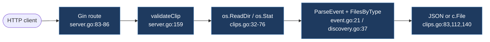

# denysvitali-tesla-sentry-viewer

## 1. Provenance

- Submodule path: `legacy/denysvitali-tesla-sentry-viewer`.
- Pinned gitlink (canonical form from `git ls-files -s`): `160000 d8099ace7b8a426d358575bf5e71e58f8b24b044 0`. `git -C legacy/denysvitali-tesla-sentry-viewer rev-parse HEAD` matches; `status --porcelain` is empty.
- Upstream URL: `https://github.com/denysvitali/tesla-sentry-viewer` (origin fetch/push).
- License: MIT, `LICENSE:1-21` (`Copyright (c) 2025 Denys Vitali`), RANGE-CITED lines 1-6. Our shipping code is GPL-3.0: ideas only, never source text.
- Analysis date: 2026-11-21.
- Files read FULL-READ (every line): `cmd/server/main.go` (138), `pkg/sentry.go` (39), `pkg/event/event.go` (36), `pkg/event/event_test.go` (50), `pkg/clip/discovery.go` (64), `pkg/clip/discovery_test.go` (96), `pkg/clip/sorting.go` (24), `pkg/config/config.go` (122), `pkg/config/config_test.go` (63), `pkg/errors/errors.go` (67), `pkg/errors/errors_test.go` (54), `pkg/server/server.go` (168), `pkg/server/clips.go` (141), `convert.sh` (15), `merge.sh` (16), `get-version.sh` (7), `config.example.yaml` (27), `go.mod` (59), `Makefile` (127), `Dockerfile` (56), `.goreleaser.yaml` (50), `CLAUDE.md` (74), `README.md` (291), `.gitignore` (5), `.dockerignore` (6), `.claude/settings.local.json` (13), `.github/workflows/{ci,docker,release,test}.yml` (121/44/57/103).
- Files explicitly NOT read: `go.sum` (227 lines, dependency lock — STRUCTURAL-PARSE only, not audited); local tag `0.1.0` tree except `pkg/parse.go` and `cmd/server/main.go` (RANGE-CITED via `git show 45bffe1:<file>`); the two parent objects of the pinned merge (`3be92ab…`, `c5cb492…`) are absent locally (grafted shallow boundary), so PR #1's exact diff is not available.
- Evidence grades present: CODE-READ, TEST-READ, SUMMARY-ONLY, UNVERIFIED. No CAPTURE evidence exists (no CAN bus, no frame captures in this repo). Absence claims are stated in prose, not as a sixth grade.
- Replace-mode preservation: pre-replace frontmatter lines 1-9 are preserved verbatim as text; the file was CRLF (56 CR/56 LF), so the description line's trailing CR was stripped by converting to LF, with no other frontmatter change. No `## Upstream (...)` section existed in the pre-replace doc (`git show HEAD:docs/legacy/denysvitali-tesla-sentry-viewer.md`), so there is nothing to reinsert.

## 2. Executive verdict

This is a Go 1.23.4 CLI/HTTP server that browses Tesla Sentry Mode folders on disk: it discovers timestamped clip directories, parses `event.json`, groups `.mp4` files by camera type, and serves them over a Gin REST API. The only robust mechanisms are anchored clip-filename classification (`pkg/clip/discovery.go:21`) and strict event parsing (`pkg/event/event.go:21-36`), both TEST-READ. The headline "merges videos with ffmpeg" claim is no longer true in the pinned binary: no Go file imports `os/exec` or calls ffmpeg; merging survives only as two standalone shell scripts with hardcoded directories (`merge.sh`, `convert.sh`) and as deleted pre-2026 library code. Cobra/Viper config, typed errors, and Docker/CI packaging are real but partially broken (dead config keys, ineffective CI gates, a missing Dockerfile `COPY` source, and a healthcheck that calls an uninstalled `curl`). No CAN frames, signals, gates, or checksums exist, so there is no frame porting work and no `can-review-checklist.md` trigger. One modest adaptation candidate exists: the HTTP security-header middleware (`pkg/server/server.go:96-115`) for our WiFi REST responses; everything else is no-impact or never-port.

## 3. Evidence map

| Source file | Lines | What it proves | Grade |
| --- | --- | --- | --- |
| `cmd/server/main.go` | 21-45, 47-71, 73-138 | Single Cobra root command (`cobra.ExactArgs(1)`, `Run: runServer`), flags, Viper binding, default `MaxWorkers=4`, startup | CODE-READ |
| `pkg/clip/discovery.go` | 12-63 | Anchored `VideoFileRegex`, four camera constants, `FilesByType` grouping | CODE-READ |
| `pkg/clip/discovery_test.go` | 12-96 | Filename classification and grouping assertions | TEST-READ |
| `pkg/clip/sorting.go` | 9-24 | `SortByName` helper exists; no test file | CODE-READ |
| `pkg/event/event.go` | 10-36 | `event.json` decoded into six string fields; unknown fields tolerated (no `DisallowUnknownFields`) | CODE-READ |
| `pkg/event/event_test.go` | 12-50 | Happy path, missing file, invalid JSON | TEST-READ |
| `pkg/server/server.go` | 29, 31-54, 56-94, 96-168 | Routes, CORS `*`, security headers, unanchored `directoryRegex`, `validateClip` without `Abort` | CODE-READ |
| `pkg/server/clips.go` | 15-141 | `ClipResponse` shape, `.mp4` suffix check, `c.File` delivery, 404/500 branches | CODE-READ |
| `pkg/config/config.go` | 12-122 | Config struct, `max_workers` vs `server.max_workers` key split, five unused compat helpers | CODE-READ |
| `pkg/config/config_test.go` | 10-63 | Defaults, `TESLA_SENTRY_*` env precedence, output directory creation | TEST-READ |
| `pkg/errors/errors.go` | 7-67 | `AppError` with `Code`/`Details`/`Unwrap`, eight code constants | CODE-READ |
| `pkg/errors/errors_test.go` | 9-54 | Error string formatting and code constants | TEST-READ |
| `pkg/sentry.go` | 1-39 | Deprecated backward-compat facade, not core logic | CODE-READ |
| `merge.sh` / `convert.sh` | 1-16 / 1-15 | Standalone ffmpeg 4-way `xstack` merge and VAAPI transcode; no Go caller | CODE-READ |
| `Dockerfile` / `Makefile` / `.goreleaser.yaml` | 1-56 / 1-127 / 1-50 | Non-root runtime, ffmpeg install, missing `config.yaml` COPY, curl healthcheck, release ldflags | CODE-READ |
| `.github/workflows/ci.yml`, `test.yml`, `docker.yml`, `release.yml` | 121, 103, 44, 57 lines | CI gates; `main` vs `master` split; format/lint gates weakened | CODE-READ |
| Repo-wide grep (`--include=*.go`) | all files | No `os/exec`, `exec.Command`, `ProcessVideo`, `mergeVideo`, or `DisallowUnknownFields` in pinned snapshot | CODE-READ |
| `README.md` | 1-291 | Product claims; no code behind Lipgloss, subcommands, or Go-side merge | SUMMARY-ONLY |
| `git show HEAD:docs/legacy/denysvitali-tesla-sentry-viewer.md` | 3, 15, 34-43 | Pre-replace summary claims (stale) | SUMMARY-ONLY |
| `git show 45bffe1:pkg/parse.go` | 1-158 | Pre-pin (2022) `mergeVideo`/`mergeFiles` via ffmpeg concat and `DisallowUnknownFields` | CODE-READ |

No TEST-READ evidence exists for `pkg/server`, `cmd/server`, shell scripts, Docker, or CI: this repo's four test files cover only event, clip, config, and errors.

## 4. Architecture and build surface

- Entry point: `cmd/server/main.go:130-138` → `runServer` (`:73-128`) → `server.NewWithConfig` → `Listen`. Single command; no `process`/`server`/`version` subcommands despite README.
- Shared core: `pkg/event`, `pkg/clip`, `pkg/config`, `pkg/errors`, `pkg/server`; compatibility shims in `pkg/sentry.go`. No platform port layer, no build flags (`BUS_*`-style gating absent).
- Dependencies (`go.mod:5-12`): gin 1.10.0, gin-contrib/cors 1.7.3, logrus 1.9.3, cobra 1.10.2, viper 1.18.2, testify 1.10.0. No Lipgloss/Bubble Tea, no `os/exec`.
- Build surface: `make build` (`Makefile:8-14`) compiles `./cmd/server`; GoReleaser `.goreleaser.yaml:10-30` targets linux/windows/darwin amd64/arm64; Docker builds `golang:1.23.4-alpine` → `alpine:3.18` with ffmpeg.
- Dependency boundaries: server imports config + event + clip; no circular imports; `pkg/errors` is defined but never imported by server or CLI.

None found: no frame pipeline in this repo. HTTP request flow for orientation only:



## 5. Mechanism catalogue

### Sentry clip discovery and classification

- **Claim (README / summary):** "Video Processing: Merge multiple Tesla Sentry videos into single files" (`README.md:7`); pre-replace summary line 15.
- **Code path:** `cmd/server/main.go:73` → `pkg/server/server.go:125-151` `getClips` → `pkg/server/clips.go:60-81` → `pkg/clip/discovery.go:37-64` `FilesByType` → `:25-32` `GetFileType`.
- **Frame spec:** None found (no CAN). Data layout: filename `^\d{4}-\d{2}-\d{2}_\d{2}-\d{2}-\d{2}-(.*?)\.mp4$` (`discovery.go:21`), camera suffix captured in group 1; constants `front`, `back`, `left_repeater`, `right_repeater` (`discovery.go:13-16`).
- **Gates and timing:** A directory is listed only if its name matches the (unanchored) `directoryRegex` (`server.go:29`) AND contains `event.json` (`server.go:139-143`). No interval or jitter.
- **State machine:** None found.
- **Tests:** `TestGetFileType` at `pkg/clip/discovery_test.go:12`, `TestFilesByType` at `:58`, `TestFilesByType_EmptyDirectory` at `:87` — assert camera mapping, two-front grouping, and empty result.
- **Evidence grade:** CODE-READ.
- **Verdict:** CONFIRMED for discovery; PARTIAL for the "video processing" headline (no Go merge).
- **Adapt to TeslaCANModder?** no impact; the anchored-regex discipline is a useful hygiene idea only.

### Event metadata parsing

- **Claim (README / summary):** "Serve Sentry clips and metadata" (`README.md:8`), `event.json` metadata.
- **Code path:** `pkg/event/event.go:21-36` `ParseEvent` → `json.NewDecoder(...).Decode(&event)`; called from `pkg/server/clips.go:51`.
- **Frame spec:** None found. Data layout: six string fields `timestamp`, `city`, `est_lat`, `est_lon`, `reason`, `camera` (`event.go:11-18`).
- **Gates and timing:** No `DisallowUnknownFields` in the pinned snapshot; unknown fields are ignored. Pre-pin tag `0.1.0` called `dec.DisallowUnknownFields()` (`git show 45bffe1:pkg/parse.go:35-45`), matching the pinned commit message about allowing unknown event fields.
- **State machine:** None found.
- **Tests:** `TestParseEvent` at `pkg/event/event_test.go:12`, `TestParseEvent_FileNotFound` at `:37`, `TestParseEvent_InvalidJSON` at `:43`.
- **Evidence grade:** CODE-READ.
- **Verdict:** CONFIRMED.
- **Adapt to TeslaCANModder?** no impact (our protocol has its own JSON parsing; no shared schema).

### HTTP REST surface and request validation

- **Claim (README / summary):** Endpoints `GET /health`, `/version`, `/api/v1/clips`, `/api/v1/clips/:clip_id[/thumb|/:file_name]` (`README.md:134-170`); "comprehensive security headers" (`README.md:287`).
- **Code path:** `pkg/server/server.go:56-94` `Listen` → `securityHeaders` (`:96-115`) → `validateClip` (`:159-168`) → `pkg/server/clips.go:20-141`.
- **Frame spec:** None found. Wire format is JSON (`ClipResponse` at `clips.go:15-18`) plus raw `.mp4`/`thumb.png` via `c.File`.
- **Gates and timing:** CORS `AllowOrigins: []string{"*"}`, methods GET/OPTIONS, `MaxAge: 12 * time.Hour` (`server.go:64-70`); headers `nosniff`, `X-Frame-Options DENY`, `X-XSS-Protection`, CSP `default-src 'self'`, `Referrer-Policy`, HSTS `max-age=63072000` (`server.go:99-104`). Clip-id validation uses an unanchored regex and writes 400 without calling `c.Abort()` (`server.go:161-167`).
- **State machine:** None found.
- **Tests:** None found (no `pkg/server/*_test.go`; no endpoint tests).
- **Evidence grade:** CODE-READ.
- **Verdict:** PARTIAL — endpoint list matches code; validation and security claims are overstated.
- **Adapt to TeslaCANModder?** candidate for future PR: port the header idea into our `sendJsonResponse` (`firmware/lib/client/api/routes.h:261-265`), excluding HSTS-over-HTTP and evaluating CSP against the inline dashboard.

### Cobra/Viper configuration resolution

- **Claim (README / summary):** "Configuration priority: CLI flags → env → config file → defaults" (`README.md:83-87`, `CLAUDE.md:25-30`).
- **Code path:** `cmd/server/main.go:30-71` `init()`/`initConfig()` → `runServer:77-92`; `pkg/config/config.go:21-75` `NewConfig`/`getViper*`; `EnsureOutputDirectory` (`:102-122`).
- **Frame spec:** None found. Keys: `debug`, `output`, `ffmpeg`, `server.listen`, `server.max_workers` / `max_workers`, `log_level`; env prefix `TESLA_SENTRY` with `.`→`_` replacer (`main.go:63-65`).
- **Gates and timing:** Defaults `127.0.0.1:8150`, `output`, `ffmpeg`, `4`, `info` (`main.go:36-38,87-92`; `config.go:23-29`). `cfg.FFmpegPath` and `cfg.MaxWorkers` are stored but no worker pool or ffmpeg process is ever started.
- **State machine:** None found.
- **Tests:** `TestNewConfig` at `pkg/config/config_test.go:10`, `TestConfigFromEnvironment` at `:22`, `TestEnsureOutputDirectory` at `:50`.
- **Evidence grade:** CODE-READ.
- **Verdict:** PARTIAL — env path tested, but `max_workers` key is inconsistent between `NewConfig` (`config.go:26`) and `runServer` (`main.go:81`), and `getStringEnv`/`getBoolEnv`/`getIntEnv` (`config.go:77-100`) are dead code.
- **Adapt to TeslaCANModder?** no impact (we use NVS persistence, not Viper).

### Backward-compatibility facades

- **Claim (README / summary):** Pre-replace summary line 35 calls `pkg/sentry.go` "Core sentry event handling logic".
- **Code path:** `pkg/sentry.go:18-39` aliases `Event`/`ParseEvent`/`FilesByType`/`GetFileType`; `pkg/server/server.go:31-35` `New`; `pkg/config/config.go:21-30` `NewConfig`.
- **Frame spec:** None found.
- **Gates and timing:** None found.
- **State machine:** None found.
- **Tests:** None found.
- **Evidence grade:** CODE-READ.
- **Verdict:** CONTRADICTED — all three are explicitly deprecated wrappers.
- **Adapt to TeslaCANModder?** never port (deprecated shims add no behavior).

### FFmpeg merge scripts

- **Claim (README / summary):** "Merge multiple Tesla Sentry videos into single files" (`README.md:7`, pre-replace summary line 15).
- **Code path:** `merge.sh:8-16` (`xstack=inputs=4:layout=0_0|w0_0|w0+w1_0|w0_h0`) and `convert.sh:8-15` (VAAPI → `libx264 -crf 35`, scale width 800). No Go caller: anchored grep for `os/exec|exec.Command` in `cmd/server/main.go` returns no output.
- **Frame spec:** None found. Inputs hardcoded `output-2/{left_repeater,front,right_repeater,back}.mp4`; output `output-2/merged.mp4`.
- **Gates and timing:** Scripts assume pre-existing directories; no argument validation, no error handling, no cleanup.
- **State machine:** None found.
- **Tests:** None found.
- **Evidence grade:** CODE-READ.
- **Verdict:** PARTIAL — files exist and work as scripts, but are not part of the binary. Pre-pin `mergeFiles` (`git show 45bffe1:pkg/parse.go:115-150`) was deleted in the 2026 refactor.
- **Adapt to TeslaCANModder?** never port (out of scope; no video path in firmware/client/protocol/tools).

### Packaging, Docker, and CI

- **Claim (README / summary):** "Docker support with health checks" (`README.md:12,172-187`), GoReleaser multi-platform builds (`README.md:189-231`), linter and format CI (`README.md:253-256`).
- **Code path:** `Dockerfile:1-56`, `Makefile:1-127`, `.goreleaser.yaml:1-50`, `.github/workflows/ci.yml`, `test.yml`, `docker.yml`, `release.yml`.
- **Frame spec:** None found.
- **Gates and timing:** Healthcheck interval 30 s / timeout 3 s (`Dockerfile:48-49`); CI `main` (`ci.yml:5`) vs Docker workflow `master` (`docker.yml:6`); lint wrapped with `|| echo "Linter not installed, skipping"` (`ci.yml:46`); `make format` runs `gofmt -w .` instead of checking a diff (`Makefile:101-103`).
- **State machine:** None found.
- **Tests:** None found (CI is the only executor; not validated locally).
- **Evidence grade:** CODE-READ.
- **Verdict:** PARTIAL — artifacts are configured, but several gates are ineffective or broken.
- **Adapt to TeslaCANModder?** no impact; do not copy the broken healthcheck or weakened CI gates.

## 6. Summary vs code contradiction table

| Pre-replace claim (git show HEAD) / upstream claim | Code evidence | Grade |
| --- | --- | --- |
| Frontmatter description "It merges multiple sentry event video files in" (`git show HEAD:docs/legacy/denysvitali-tesla-sentry-viewer.md#L3`); overview line 15 "merges ... using ffmpeg" (#L15) | No `os/exec` or ffmpeg call in any pinned `.go` file; merge only in uncalled `merge.sh`/`convert.sh`; deleted from Go at the 2026 refactor (`git show 45bffe1:pkg/parse.go`) | CODE-READ |
| #L15 "rich terminal UI with Lipgloss"; `README.md:9,13` Lipgloss / "tables, spinners" | `go.mod:5-12` has no lipgloss/bubbletea; no TUI code anywhere; negative grep on `go.mod` returns no output | CODE-READ |
| `README.md:43-49` subcommands `process`, `server`, `version` | `cmd/server/main.go:21-28` defines one root command (`cobra.ExactArgs(1)`, `Run: runServer`); no `AddCommand` calls | CODE-READ |
| #L34 "cmd/server/ — CLI entry point using Cobra command framework" (true framework, but implies rich CLI) | Cobra is used (`main.go:11`), but only for one server command; `CLAUDE.md:9` additionally says "using go-arg" — stale from tag `0.1.0`, whose `cmd/server/main.go` used `github.com/alexflint/go-arg` | CODE-READ |
| #L35 "`pkg/sentry.go` — Core sentry event handling logic" | `pkg/sentry.go:1-6` labels itself "Deprecated: Import the specific packages instead"; `:18-39` are aliases only | CODE-READ |
| `README.md:120,131` `TESLA_SENTRY_SERVER_MAX_WORKERS` / `--max-workers` flag | No `--max-workers` flag defined (`main.go:34-38`); `main.go:81` reads `server.max_workers`, `config.go:26` reads `max_workers`, `config_test.go:27` uses `TESLA_SENTRY_MAX_WORKERS` — three different keys | CODE-READ |
| `README.md:7,276` "Video Processing" / "Concurrent video processing with configurable worker count" | `cfg.MaxWorkers` is only compared to zero and defaulted (`main.go:87-88`); no goroutine, pool, or worker launch exists | CODE-READ |
| `README.md:281-287` "Non-root user", "health checks", "CORS configuration for API security" | Non-root is true (`Dockerfile:40`), but healthcheck calls `curl` (`Dockerfile:49`) while runtime installs only ffmpeg (`:24`); CORS is `AllowOrigins: *` with no auth (`server.go:64-70`) | CODE-READ |
| `README.md:262-270` "standardized error codes" | `pkg/errors/errors.go:57-67` defines eight codes, but no server/CLI file imports `pkg/errors`; handlers use inline strings incl. `INVALID_CLIP_ID` (`clips.go:26`) not defined there | CODE-READ |
| `README.md:208-211` "Update the version in `go.mod`" for releases | `go.mod:3` is the Go language version (`go 1.23.4`), not an application version; app version comes from `main.Version` (`main.go:17`) injected by `-ldflags` | CODE-READ |

Agreements (not contradictions): pre-replace #L21 "CAN Interface: N/A" and #L45-47 "No direct CAN integration" match the code; `README.md:134-170` endpoint paths match `server.go:73-86`. These live in the evidence map, not this table.

## 7. CAN frame and signal inventory

None found: no CAN bus, no frame decode, mutate, inject, counter, or checksum in this repo. No DBC/JSON catalog is vendored, so there is no STRUCTURAL-PARSE catalog to summarize.

Non-CAN structured inputs, for completeness (not frame inventory): `event.json` — six string fields, decoded at `pkg/event/event.go:10-36`; clip filename — anchored regex with camera suffix captured, parsed at `pkg/clip/discovery.go:19-32`. Both are read-only; the repo writes no vehicle-facing data.

## 8. Constants and tuning table

| Constant | Value | File:line | Meaning | Grade |
| --- | --- | --- | --- | --- |
| `VideoFileRegex` | `^\d{4}-\d{2}-\d{2}_\d{2}-\d{2}-\d{2}-(.*?)\.mp4$` | `pkg/clip/discovery.go:21` | Strict clip-name match (anchored) | CODE-READ |
| `directoryRegex` | `\d{4}-\d{2}-\d{2}_\d{2}-\d{2}-\d{2}` (no anchors) | `pkg/server/server.go:29` | Loose clip-id match used by validation | CODE-READ |
| Default listen address | `127.0.0.1:8150` | `cmd/server/main.go:36`, `pkg/config/config.go:27,37` | Bind address; Docker overrides to `0.0.0.0:8150` | CODE-READ |
| Default workers | `4` | `cmd/server/main.go:88`, `pkg/config/config.go:26` | Stored only; no concurrency consumer | CODE-READ |
| CORS `MaxAge` | `12 * time.Hour` | `pkg/server/server.go:69` | Preflight cache window | CODE-READ |
| CORS origins | `[]string{"*"}` | `pkg/server/server.go:65` | Any origin allowed, no auth on GET routes | CODE-READ |
| HSTS | `max-age=63072000; includeSubDomains; preload` | `pkg/server/server.go:104` | Sent on plain HTTP responses | CODE-READ |
| VAAPI transcode | `scale_vaapi=w=800:h=-1`, `-crf 35`, `libx264` | `convert.sh:12-14` | Standalone script tuning | CODE-READ |
| 4-way layout | `xstack=inputs=4:layout=0_0|w0_0|w0+w1_0|w0_h0` | `merge.sh:14` | Camera mosaic order | CODE-READ |
| Docker healthcheck | `--interval=30s --timeout=3s` | `Dockerfile:48` | Container liveness timing | CODE-READ |

`config.example.yaml:18-27` declares `concurrency.max_parallel_processes: 2`, `timeout_seconds: 300`, and `security.*` keys; no code reads them (SUMMARY-ONLY as configuration documentation, not load-bearing constants).

## 9. Failure modes and edge cases

No bus-off, watchdog, OTA, queue-overflow, brownout, or missing-frame timeout paths exist: this repo has no CAN or embedded state. HTTP/filesystem and build paths only:

| Failure | Handling code path | Tested? | Grade |
| --- | --- | --- | --- |
| Invalid clip id reaches `validateClip` | Writes 400 JSON at `pkg/server/server.go:161-167` but never calls `c.Abort()`; `getClipFile` checks only `.mp4` suffix (`clips.go:89`) | No server tests | CODE-READ |
| Loose clip-id acceptance | Unanchored `directoryRegex` (`server.go:29`) accepts any name containing a timestamp-like substring | No | CODE-READ |
| Path traversal via encoded `:clip_id` / `:file_name` with `path.Join` (`clips.go:32,98,126`) | No canonicalization or `filepath.Rel` containment check | No; requires runtime probe to confirm | UNVERIFIED |
| `event.json` missing or malformed | `ParseEvent` returns error (`event.go:22-32`); `getClip` maps to 500 (`clips.go:51-58`) | Yes, parse-level only (`event_test.go:37,43`) | CODE-READ |
| `os.ReadDir` / `os.Stat` failure | 500 at `server.go:127-134`, `clips.go:60-76`; 404 at `clips.go:33-40` | No | CODE-READ |
| Directory supplied instead of `.mp4` | 500 at `clips.go:106-110`; thumb equivalent `:134-138` | No | CODE-READ |
| No HTTP timeouts or shutdown handling | `e.Run(addr)` blocking with no `http.Server` timeouts (`server.go:93`) | No | CODE-READ |
| Docker build context lacks `config.yaml` | `Dockerfile:34` copies `/app/config.yaml`; tracked tree has only `config.example.yaml` (`git ls-files`) | No build run in this analysis | UNVERIFIED |
| Healthcheck binary missing | `Dockerfile:49` runs `curl`; runtime `apk add` installs only ffmpeg (`:24`) | No | CODE-READ |
| CI test matrix includes Go 1.22 | `.github/workflows/test.yml:15` vs `go.mod:3` requires `go 1.23.4` | No local CI run | CODE-READ |
| Config key drift | `server.max_workers` (`main.go:81`) vs `max_workers` (`config.go:26`) vs `TESLA_SENTRY_MAX_WORKERS` (`config_test.go:27`) | Partially (`config_test.go:22`) | CODE-READ |

## 10. Test coverage map

| Test file | What it asserts |
| --- | --- |
| `pkg/event/event_test.go:12` | Six fields decode from a well-formed `event.json` |
| `pkg/event/event_test.go:37,43` | Missing file and invalid JSON return errors |
| `pkg/clip/discovery_test.go:12` | Four camera suffixes recognized; non-matching names rejected |
| `pkg/clip/discovery_test.go:58,87` | Grouping by camera, `event.json` ignored, empty directory yields empty map |
| `pkg/config/config_test.go:10` | Defaults for all six config fields |
| `pkg/config/config_test.go:22` | `TESLA_SENTRY_*` env vars override defaults |
| `pkg/config/config_test.go:50` | Output directory created and made absolute |
| `pkg/errors/errors_test.go:9,44` | `AppError` string formats with/without details and wrapped errors; all eight codes |

Critical paths with NO test: all Gin routes and `validateClip` (including the missing `Abort`), CORS/security-header behavior, CLI flag/config-file precedence and the three-way `max_workers` key split, `SortByName` (`pkg/clip/sorting.go`), both ffmpeg scripts, Dockerfile build/healthcheck, and CI gate semantics. Risk: the two security-relevant findings in section 9 (missing `Abort`, unanchored id regex) are code-observed but have no runtime oracle, so exploitability stays UNVERIFIED.

## 11. Parity matrix with TeslaCANModder

No CAN signal or frame is shared: upstream touches zero CAN IDs, so there are no frame-parity rows and no CAN adaptation decisions to make. The rows below are non-CAN surface overlaps; every our-side citation is CODE-READ.

| Signal/frame (non-CAN surface) | Upstream decode/behavior (cite) | Our decode/behavior (cite) | Delta | Action |
| --- | --- | --- | --- | --- |
| Health endpoint | `GET /health`, JSON `{status,version,service}` — `pkg/server/server.go:73,117-123` | `GET /api/ping`, `{"t":"pong","v":1}` — `firmware/lib/client/api/init.h:55`, `routes.h:363-368` | Different path and envelope; both unauthenticated | ignore (no impact) |
| CORS allow-all | `AllowOrigins: []string{"*"}` — `pkg/server/server.go:65` | `Access-Control-Allow-Origin: *` — `firmware/lib/client/api/routes.h:249-254` | Same permissive origin; ours additionally gates mutating routes with `X-API-Key` (`init.h:49-51`, `routes.h:311`) | ignore; do not loosen our auth |
| Binary file download | `c.File` for `.mp4`/`thumb.png` — `pkg/server/clips.go:112,140` | `GET /api/recorder/download` binary CSV — `firmware/lib/client/api/init.h:25,121` | Different artifact type; no shared format | ignore |

## 12. Surface inventory and security notes

| Surface | Semantics | Security note |
| --- | --- | --- |
| `GET /health`, `GET /version` (`server.go:73,76`) | JSON liveness/version | Unauthenticated by design |
| `GET /api/v1/clips` (`server.go:83`) | Lists dirs matching loose regex and containing `event.json` | Unanchored name match (`server.go:29`) |
| `GET /api/v1/clips/:clip_id` (`server.go:84`, `clips.go:20`) | `ClipResponse` JSON with event + camera→files map | `validateClip` writes 400 without `Abort` (`server.go:161`) |
| `GET /api/v1/clips/:clip_id/thumb` (`server.go:85`, `clips.go:115`) | Serves `thumb.png` via `c.File` | `path.Join` on user id (`clips.go:126`) |
| `GET /api/v1/clips/:clip_id/:file_name` (`server.go:86`, `clips.go:86`) | Serves any path ending `.mp4` via `c.File` | Suffix-only check (`clips.go:89`), no containment check |
| `OPTIONS /*path` (`server.go:89`) | Always 200 | CORS preflight with `*` origin |
| CLI flags `--config`, `-D/--debug`, `-l/--listen`, `-o/--output`, `--ffmpeg` (`main.go:34-38`) | Viper-bound; exactly one positional directory | No `--max-workers` flag despite README |
| Env `TESLA_SENTRY_*` (`main.go:63-65`) | `.`→`_` key replacer | Standard Viper precedence; no secret material consumed |
| Config file `~/.tesla-sentry-viewer.yaml` (`main.go:47-70`) | YAML, missing file ignored | Example enables `allow_origins: ["*"]` (`config.example.yaml:25`) |
| `merge.sh` / `convert.sh` | Local ffmpeg invocations | Hardcoded `output`/`output-2` paths; no shell escaping of `$1` beyond quotes |
| Docker image (`Dockerfile`) | Non-root `appuser`, ffmpeg runtime, port 8150 | Missing `config.yaml` COPY source; curl healthcheck uninstalled |

Provenance findings: no hardcoded credential values, keys, or certificates found; workflows reference `${{ secrets.GITHUB_TOKEN }}` and `${{ secrets.DOCKER_HUB_USERNAME/TOKEN }}` as references only (`ci.yml:83,113-114`). `.claude/settings.local.json:3-9` allow-lists `go build`, `go test`, `make build*`, `go mod tidy` — local agent policy, not a secret. Dangerous flags: none for CAN; `CGO_ENABLED=0` (`Makefile:11`) is benign. Outdated third-party actions (`upload-artifact@v3`, `create-release@v1`, `upload-release-asset@v1`) appear in `ci.yml:52,81,91` (UNVERIFIED as a live failure without running CI).

## 13. Adaptation assessment

| Mechanism | Value | Cost | Risk | Evidence grade | Decision |
| --- | --- | --- | --- | --- | --- |
| Clip discovery / anchored filename regex | Low (no video artifacts in our stack) | Low | Low | CODE-READ + TEST-READ | no impact |
| `event.json` tolerant decode | Low (schema unrelated) | Low | Low | CODE-READ + TEST-READ | no impact |
| HTTP security-header middleware | Medium (our WiFi REST lacks nosniff/X-Frame-Options/Referrer-Policy) | Low — extend `sendJsonResponse` at `firmware/lib/client/api/routes.h:261` | Medium — CSP `default-src 'self'` may break inline dashboard; HSTS over HTTP is wrong | CODE-READ | candidate for future PR (port subset only, bench-verify) |
| Cobra/Viper config resolution | Low (we use NVS) | Medium | Low | CODE-READ | no impact |
| Deprecated compatibility facades | None | Low | Low | CODE-READ | never port |
| FFmpeg merge scripts | None (out of scope) | High | Low | CODE-READ | never port |
| Docker/CI packaging | Low | Low | Medium (broken gates) | CODE-READ | no impact; never copy broken bits |

No decision rests on SUMMARY-ONLY or UNVERIFIED evidence. Any future header change to our WiFi server is transport-visible; it needs a `docs/checklists/can-review-checklist.md` read if message shape changes, plus bench verification.

## 14. Do-not-copy list

- `pkg/server/server.go:29` unanchored `directoryRegex` — accepts substring ids; use anchored matching if a similar route is ever built.
- `pkg/server/server.go:159-167` `validateClip` without `c.Abort()` — rejected requests continue down the handler chain; copy the intent, not the omission.
- `pkg/server/server.go:64-70` CORS `*` with no authentication — our mutating routes require `X-API-Key` (`firmware/lib/client/api/init.h:49-51`, `routes.h:311`); keep our gate.
- `pkg/server/server.go:104` HSTS header over plain HTTP — misleading and preload-unsafe.
- `pkg/server/server.go:107-111` cache-control applied to non-`/api` paths (likely inverted intent).
- `pkg/server/clips.go:32,98,126` `path.Join` on user-controlled path parameters without containment validation.
- `Dockerfile:34` `COPY ... /app/config.yaml` with no such tracked file; `Dockerfile:49` curl healthcheck without curl installed.
- `Makefile:13` `-X main.BuildDate/-X main.GitCommit` inject into variables that do not exist in `cmd/server/main.go:17` (only `Version`).
- `Makefile:101-103` / `ci.yml:49` `gofmt -w .` used as a CI "check"; `ci.yml:46` `make lint || echo "Linter not installed, skipping"`.
- `pkg/config/config.go:77-100` dead `getStringEnv`/`getBoolEnv`/`getIntEnv` helpers and `pkg/sentry.go:1-39` deprecated aliases.
- `merge.sh:8-16` / `convert.sh:8-15` ffmpeg commands with hardcoded directories and ignored errors — never import into shipping trees.
- License boundary: MIT upstream vs GPL-3.0ours; port behavior/constants only, with independent tests and attribution.

Preserved `## Upstream (...)` sections from the pre-replace doc: none existed (`git show HEAD:docs/legacy/denysvitali-tesla-sentry-viewer.md`), so there is nothing to place after this section.

## 15. History and evolution

Local submodule log (no network used): `e53ba34` "initial commit" (2022-05-04) → `17d4073` "docs: add README" (2022-05-04) → `99227c7` "chore: exclude build" (2022-06-18) → `45bffe1` "feat: dockerize and add --version" (2022-06-18, tag `0.1.0`) → `d8099ac` "Merge pull request #1 from ravibowman/fix/allow-unknown-event-fields" (2026-03-16, pinned).

- The pinned commit is grafted: `git cat-file -p HEAD` lists parents `3be92ab…` and `c5cb492…`, but both objects are absent locally. PR #1's exact diff is therefore UNVERIFIED; only its subject and the observable effect (no `DisallowUnknownFields` in `pkg/event/event.go`) are known.
- `git diff --stat 45bffe1 d8099ac` shows the 2026 refactor: removed top-level `main.go`, `pkg/parse.go`, `pkg/parse_test.go`, `pkg/event.go`; added `pkg/{event,clip,config,errors,server}/`, Cobra/Viper CLI, CLAUDE.md, `.claude/`, four workflows, `.goreleaser.yaml`, and 16 new test files' worth of coverage (4 test files).
- At tag `0.1.0`, `pkg/parse.go` contained `ProcessVideo` → `mergeVideo` → `mergeFiles` using `ffmpeg -f concat -safe 0 -c copy` (`git show 45bffe1:pkg/parse.go:19-29,58-150`). That whole path was deleted in the pinned snapshot; the standalone `merge.sh` is a different, `xstack`-based implementation, and neither is called by the current binary.
- `DisallowUnknownFields()` was present at tag `0.1.0` (`git show 45bffe1:pkg/parse.go:35-45`) and is absent now — consistent with the pinned merge subject; the intermediate rollback itself is not locally diffable.
- The CLI switched from `go-arg` (`git show 45bffe1:cmd/server/main.go`) to Cobra (`cmd/server/main.go:11`), but `CLAUDE.md:9` still says "go-arg": stale documentation inherited across the refactor.
- README's `process`/`server`/`version` subcommands and Lipgloss UI have no counterpart in any locally available tree; whether they existed in an unreviewed upstream branch is UNVERIFIED.

## 16. Re-verification recipe

```bash
OLD=$(git ls-files -s legacy/denysvitali-tesla-sentry-viewer | awk '{print $2}')  # expect d8099ace7b8a426d358575bf5e71e58f8b24b044
git -C legacy/denysvitali-tesla-sentry-viewer rev-parse HEAD                     # must equal OLD
git -C legacy/denysvitali-tesla-sentry-viewer status --porcelain                 # must be empty
git -C legacy/denysvitali-tesla-sentry-viewer fetch --tags --prune
git -C legacy/denysvitali-tesla-sentry-viewer log --oneline $OLD..origin/master
git -C legacy/denysvitali-tesla-sentry-viewer diff --stat $OLD..origin/master
git -C legacy/denysvitali-tesla-sentry-viewer diff $OLD..origin/master -- cmd pkg
git ls-files -s legacy/denysvitali-tesla-sentry-viewer                           # recheck gitlink: 160000 <sha> 0
```

Demonstrated anchors (run with Git's `grep.exe` at write time; `EXIT=1` means no output):

```text
grep -nE 'VideoFileRegex' legacy/denysvitali-tesla-sentry-viewer/pkg/clip/discovery.go
  -> 19,21,26,30 (anchored regex at 21)
grep -nE 'directoryRegex' legacy/denysvitali-tesla-sentry-viewer/pkg/server/server.go
  -> 29,138,161 (no ^/$ anchors at 29)
grep -nE 'AllowOrigins|MaxAge' legacy/denysvitali-tesla-sentry-viewer/pkg/server/server.go
  -> 65 ("*"), 69 ("12 * time.Hour")
grep -nE 'max-age=63072000|X-Frame-Options' legacy/denysvitali-tesla-sentry-viewer/pkg/server/server.go
  -> 100,104
grep -nE 'os/exec|exec[.]Command' legacy/denysvitali-tesla-sentry-viewer/cmd/server/main.go
  -> no output, EXIT=1 (no Go ffmpeg path)
grep -nE 'lipgloss|bubbletea' legacy/denysvitali-tesla-sentry-viewer/go.mod
  -> no output, EXIT=1 (no TUI dependency)
grep -nE 'cobra[.]ExactArgs|Run: *runServer' legacy/denysvitali-tesla-sentry-viewer/cmd/server/main.go
  -> 26,27 (single command)
grep -rnE --include=*.go 'cfg[.]FFmpegPath|cfg[.]MaxWorkers' legacy/denysvitali-tesla-sentry-viewer
  -> main.go:87,88 and config_test.go:15,16,36,37 only (no production consumer)
grep -rnE 'Abort' legacy/denysvitali-tesla-sentry-viewer/pkg/server
  -> no output, EXIT=1 (validateClip does not abort)
grep -nE 'COPY.*config[.]yaml|curl -f' legacy/denysvitali-tesla-sentry-viewer/Dockerfile
  -> 34 (missing COPY source), 49 (curl healthcheck)
grep -nE 'main[.]BuildDate|main[.]GitCommit' legacy/denysvitali-tesla-sentry-viewer/cmd/server/main.go
  -> no output, EXIT=1 (undefined ldflag targets)
grep -nE 'branches:' legacy/denysvitali-tesla-sentry-viewer/.github/workflows/docker.yml
  -> 5 (master; ci.yml uses main)
grep -rnE --include=*.go 'os[.]CreateTemp|exec[.]Command|ProcessVideo|mergeVideo|DisallowUnknownFields' legacy/denysvitali-tesla-sentry-viewer
  -> no output, EXIT=1 (pre-2026 merge code fully removed)

Our-side drift anchors (already-present / candidate decisions depend on these):
grep -nE 'Access-Control-Allow-Origin' firmware/lib/client/api/routes.h
  -> 251 ("*")
grep -nE '/api/ping' firmware/lib/client/api/init.h
  -> 55
grep -nE 'handleGetPing' firmware/lib/client/api/routes.h
  -> 365
grep -nE '/api/recorder/download' firmware/lib/client/api/init.h
  -> 25,121,146
grep -nE 'requireAuth' firmware/lib/client/api/routes.h
  -> 311 (POST /api/command), 382 (/api/disable)
```

If line numbers drift more than ~10, re-read the whole function; do not trust this document's numbers. Pre-pin history reviewed: only local tag `0.1.0` (2022) trees via `git show` for `pkg/parse.go` and `cmd/server/main.go`, plus the `git diff --stat 45bffe1 d8099ac` file list. The pinned commit's two parent objects are absent locally; PR #1's exact patch was not reviewed.

## 17. Open questions and explicitly not investigated

- PR #1 ("allow unknown event fields"): exact patch UNVERIFIED (parents grafted/absent locally); verify after fetch with `git show c5cb4926…` once available.
- Whether the README's `process`/`server`/`version` subcommands and Lipgloss UI ever existed upstream: UNVERIFIED; no local tree contains them.
- Runtime exploitability of the missing `c.Abort()` and unanchored clip-id regex (section 9): UNVERIFIED; needs a Gin integration probe with encoded path separators.
- Docker build failure (missing `config.yaml`, missing `curl`): UNVERIFIED at runtime because no image was built here; verify with `make docker-build` and a healthcheck probe.
- Actual Viper precedence among bound flag defaults, env vars, and config file for `server.max_workers` vs `max_workers`: UNVERIFIED; no integration test binds all three.
- `go.sum` (227 lines) was STRUCTURAL-PARSE only; dependency provenance/vulnerability audit not performed.
- No GitHub issues, PR discussions, or network sources were consulted; all network-only claims stay UNVERIFIED.
- No CAN bus exists in this repo by design, so there is no CAPTURE evidence, no frame oracle, and no frame-level open question to inherit.
