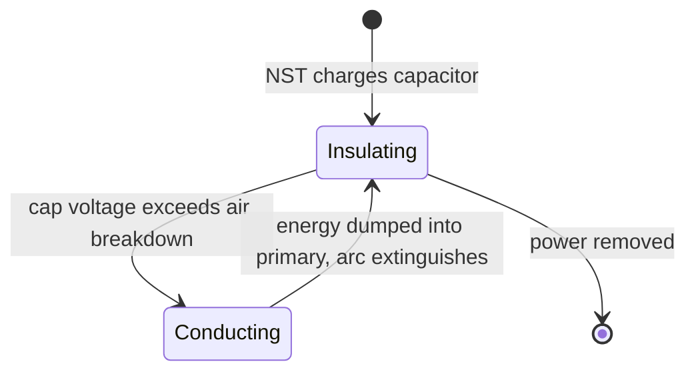

# devon-smith-six-pack-capacitor-tesla-coil

## 1. Provenance

- **Submodule path:** `legacy/devon-smith-six-pack-capacitor-tesla-coil`
- **Pinned gitlink:** `160000 2985356db84657b309b5d45acb9405491a5f3dbc 0` (`git ls-files -s`)
- **Submodule HEAD:** `2985356db84657b309b5d45acb9405491a5f3dbc` — matches gitlink. `git status --porcelain` empty.
- **Upstream URL:** `https://github.com/devon-smith/six-pack-capacitor-tesla-coil` (`git remote -v`, origin fetch/push)
- **License:** none declared. No `LICENSE` file in `git ls-files`; README has no license statement (`README.md:1-48`).
- **Analysis date:** 2026-11-21
- **Files read:** `README.md:1-48` — FULL-READ (the entire tracked tree).
- **Files explicitly NOT read:** none. `git -C legacy/devon-smith-six-pack-capacitor-tesla-coil ls-files -co --exclude-standard` returns only `README.md`, so there are no hidden, untracked, or platform source directories to skip. The `.git/` metadata directory exists but is not source.
- **Frontmatter:** preserved byte-for-byte in replace mode. The `description` line ends at `six-pa` with no trailing whitespace (byte-verified via `git show HEAD:...` hex dump), so no trailing-whitespace strip was applied. No `## Upstream (...)` section existed in the pre-replace doc, so none was re-inserted.

## 2. Executive verdict

This is a README-only hardware hobby project: a spark-gap Tesla coil (resonant transformer) built from a neon sign transformer, a six-bottle salt-water capacitor bank, a primary/secondary coil pair, a Terry Filter, and a toroid top load. It contains no source code, no firmware, no CAN bus, no protocol data, and no transport surface. Nothing here is a candidate for TeslaCANModder: there is no frame pipeline, no constant or byte layout to lift, and no signal overlap with our state model. Every claim in this analysis is SUMMARY-ONLY (README prose only), with no TEST-READ or CAPTURE evidence. The repo is a known false positive from the "Tesla" keyword and should stay excluded from feature archaeology.

## 3. Evidence map

| Source file | Lines | What it proves | Grade |
| --- | --- | --- | --- |
| `README.md` | 1 | Project identity: homemade Tesla coil, not a vehicle project | SUMMARY-ONLY |
| `README.md` | 3, 14, 26 | Six glass bottles, salt water, mineral oil capacitor construction | SUMMARY-ONLY |
| `README.md` | 7, 13, 28 | NST steps 120 V AC to ~10 kV / 10–12 kV; repeated spark cycle | SUMMARY-ONLY |
| `README.md` | 7, 17, 38 | Spark gap acts as voltage-breakdown switch | SUMMARY-ONLY |
| `README.md` | 7, 15, 16 | Primary-to-secondary resonant voltage step-up; winding overlap ruins coil | SUMMARY-ONLY |
| `README.md` | 9, 19, 43 | Terry Filter protects NST from RF interference and overvoltage | SUMMARY-ONLY |
| `README.md` | 3, 18, 33, 47 | Top-load plasma discharge; bulb lit by electric field | SUMMARY-ONLY |
| `README.md` | 23, 28 | Winding under tension; trial-and-error primary tap tuning at 10 kV | SUMMARY-ONLY |
| `README.md` | 36, 38, 47 | Images/video are external GitHub user-attachment links, not vendored assets | CODE-READ |
| `git ls-files` (submodule) | None found | Tracked tree is exactly one file (`README.md`); no code, tests, DBC, or JSON catalog | CODE-READ |
| `git log` (submodule) | None found | Single commit `2985356` "Update README.md", dated 2026-04-04 | CODE-READ |
| `git remote -v` (submodule) | None found | Upstream owner/repo slug `devon-smith/six-pack-capacitor-tesla-coil` | CODE-READ |

No TEST-READ evidence exists: this repo ships no tests. No CAPTURE evidence exists: there are no frames, logs, or decode artifacts. No CODE-READ evidence of a frame pipeline exists because the tree has no source files; the only CODE-READ claims are git metadata and the README's external-link markup.

## 4. Architecture and build surface

- **Entry points:** None found — no source files, no `main`, no library target.
- **Shared core vs platform port:** None found — no code of any kind.
- **Build flags / feature gates:** None found — no build system files in `git ls-files`.
- **Dependency boundaries:** None found. Only external hyperlinks in `README.md:42-43` (Wikipedia Tesla coil article, hvtesla.com Terry Filter page) and remote media in `README.md:36,38,47`.

None found: no frame pipeline in this repo.

## 5. Mechanism catalogue

These are physical/electrical mechanisms described in prose, not implemented behaviors. Every card therefore has `None found` for code path, frame spec, and tests, and an UNVERIFIED verdict: the README is the only source.

### NST step-up charging

- **Claim (README / summary):** `README.md:7,13` — neon sign transformer steps 120 V AC up to ~10 kV (10–12 kV in component list) to charge the capacitor bank.
- **Code path:** None found — no source files.
- **Frame spec:** None found — no CAN frames.
- **Gates and timing:** None found in code; prose only: transformer feed is continuous AC; no interval or duty cycle documented.
- **State machine:** None found.
- **Tests:** None found — no test files.
- **Evidence grade:** SUMMARY-ONLY
- **Verdict:** UNVERIFIED (documented in README; no code, test, or bench capture corroborates it)
- **Adapt to TeslaCANModder?** never port — high-voltage analog hardware with no software surface.

### Six-pack capacitor bank

- **Claim (README / summary):** `README.md:3,14,26` — six glass bottles filled with salt water, topped with mineral oil, wired together as the tank capacitor.
- **Code path:** None found — no source files.
- **Frame spec:** None found — no CAN frames.
- **Gates and timing:** None found; no capacitance, voltage rating, or bottle geometry documented.
- **State machine:** None found.
- **Tests:** None found — no test files.
- **Evidence grade:** SUMMARY-ONLY
- **Verdict:** UNVERIFIED
- **Adapt to TeslaCANModder?** never port — physical construction detail only.

### Spark gap switching

- **Claim (README / summary):** `README.md:7,17` — air insulates until capacitor voltage is high enough to arc across the gap; the arc dumps stored energy into the primary coil and the cycle repeats "many times per second."
- **Code path:** None found — no source files.
- **Frame spec:** None found — no CAN frames.
- **Gates and timing:** Prose only, `README.md:7`: conduction gate is the air-breakdown threshold; repetition rate is qualitative ("many times per second"), not quantified; no gap distance given.
- **State machine:** Three states described in `README.md:7`; no code implements them.



- **Tests:** None found — no test files.
- **Evidence grade:** SUMMARY-ONLY
- **Verdict:** UNVERIFIED
- **Adapt to TeslaCANModder?** no impact — the "switch on threshold, then recover" idea is generic; nothing maps to our injection gates.

### Resonant energy transfer (primary → secondary → top load)

- **Claim (README / summary):** `README.md:7,15,16` — primary coil discharge induces much higher voltage in the tightly wound secondary; any winding overlap shorts the coil.
- **Code path:** None found — no source files.
- **Frame spec:** None found — no CAN frames.
- **Gates and timing:** None found; no turn counts or coupling coefficient documented.
- **State machine:** None found.
- **Tests:** None found — no test files.
- **Evidence grade:** SUMMARY-ONLY
- **Verdict:** UNVERIFIED
- **Adapt to TeslaCANModder?** never port — passive analog resonance.

### Terry Filter protection

- **Claim (README / summary):** `README.md:9,19,43` — filter between NST and rest of circuit protects the transformer from RF interference and voltage spikes feeding back.
- **Code path:** None found — no source files.
- **Frame spec:** None found — no CAN frames.
- **Gates and timing:** None found — no component values or filter topology documented.
- **State machine:** None found.
- **Tests:** None found — no test files.
- **Evidence grade:** SUMMARY-ONLY
- **Verdict:** UNVERIFIED
- **Adapt to TeslaCANModder?** no impact — a protection rationale, not an implementable gate.

### Top-load plasma discharge / field coupling

- **Claim (README / summary):** `README.md:3,18,33,47` — toroid top load discharges visible arcs into air; a fluorescent bulb held nearby lights without wires.
- **Code path:** None found — no source files.
- **Frame spec:** None found — no CAN frames.
- **Gates and timing:** None found — no output voltage/current or arc length documented.
- **State machine:** None found.
- **Tests:** None found — no test files.
- **Evidence grade:** SUMMARY-ONLY
- **Verdict:** UNVERIFIED
- **Adapt to TeslaCANModder?** no impact — physical demo only.

### Primary tap tuning

- **Claim (README / summary):** `README.md:28` — primary coil tap point adjusted by trial and error for optimal arcing, with the whole assembly live at 10 kV.
- **Code path:** None found — no source files.
- **Frame spec:** None found — no CAN frames.
- **Gates and timing:** None found — no tuning range or target resonance documented.
- **State machine:** None found.
- **Tests:** None found — no test files.
- **Evidence grade:** SUMMARY-ONLY
- **Verdict:** UNVERIFIED
- **Adapt to TeslaCANModder?** never port — manual high-voltage procedure with no software artifact.

## 6. Summary vs code contradiction table

| Pre-replace claim | Upstream evidence | Grade | Resolution |
| --- | --- | --- | --- |
| `git show HEAD:docs/legacy/devon-smith-six-pack-capacitor-tesla-coil.md#8` — `repo: smith-six-pack-capacitor-tesla-coil` | `git remote -v` → `devon-smith/six-pack-capacitor-tesla-coil`; upstream slug is `six-pack-capacitor-tesla-coil`, not `smith-six-pack-capacitor-tesla-coil` | CODE-READ | Frontmatter kept verbatim per replace mode; slug mismatch recorded here, not silently edited. |
| `git show HEAD:docs/legacy/devon-smith-six-pack-capacitor-tesla-coil.md#3` — `description:` truncated mid-word at `built with a six-pa` | `README.md:3,14` describe a "six-pack capacitor" bank; the description is incomplete, not a different claim | SUMMARY-ONLY | Frontmatter kept verbatim (no trailing whitespace present to strip); truncation recorded as inherited defect. |

All other pre-replace claims (N/A platform, N/A language, N/A CAN interface, no direct CAN integration, not relevant, no reusability) agree with the code-level inventory and are recorded in section 3, not here.

## 7. CAN frame and signal inventory

None found. The repo decodes, mutates, and injects no CAN frames; there is no bus assignment, DLC, byte/bit layout, counter, checksum, or read/write frame of any kind. No vendored DBC/JSON catalog exists in `git ls-files`, so there is nothing to label STRUCTURAL-PARSE either.

## 8. Constants and tuning table

No frame, gate, or timing constants exist in code. The only load-bearing numbers are unquantified or prose-only hardware values; they are recorded here so a future reader does not mistake them for measured or implemented parameters.

| Constant | Value | File:line | Meaning | Grade |
| --- | --- | --- | --- | --- |
| Mains input | 120 V AC | `README.md:7` | NST primary supply | SUMMARY-ONLY |
| NST output | ~10 kV (prose), 10–12 kV (component list) | `README.md:7,13,28` | Capacitor charge voltage; two inconsistent descriptions of the same spec | SUMMARY-ONLY |
| Bank unit count | six glass bottles | `README.md:3,14,26` | Number of salt-water capacitor cells | SUMMARY-ONLY |
| Spark repetition | "many times per second" | `README.md:7` | Qualitative firing rate, not a measured frequency | SUMMARY-ONLY |
| Winding rule | zero overlap | `README.md:16,23` | Overlap shorts the secondary; build constraint, not a runtime constant | SUMMARY-ONLY |

## 9. Failure modes and edge cases

No software failure paths exist (no bus-off, watchdog, OTA behavior, queue overflow, brownout/reboot state, or missing-frame timeout). Hardware failure notes are prose-only and untested.

| Failure | Handling code path | Tested? | Grade |
| --- | --- | --- | --- |
| Secondary winding overlap shorts the coil | None in code; prose mitigation is slow tensioned winding — `README.md:16,23` | No tests exist | SUMMARY-ONLY |
| RF/voltage feedback damages NST | None in code; Terry Filter — `README.md:9,19` | No tests exist | SUMMARY-ONLY |
| Cap voltage below air-breakdown threshold: no discharge | None in code; prose — `README.md:7,17` | No tests exist | SUMMARY-ONLY |
| Operator exposure to live 10 kV during tuning | None in code; warning prose — `README.md:28` | No tests exist | SUMMARY-ONLY |

## 10. Test coverage map

None found. `git ls-files` lists only `README.md`; no test files, fixtures, or CI config exist.

Critical paths with no test: every electrical path above (charge, breakdown, energy transfer, filter protection, top-load discharge) — risk is that all hardware claims rest on unreviewed prose with no measurement, so none can be treated as verified engineering data.

## 11. Parity matrix with TeslaCANModder

None found. No signal, frame, constant, or protocol concept is shared between this repo and TeslaCANModder, so there are no rows to populate. Because there are no parity rows and no `already present` decisions, no our-side CODE-READ citation or drift anchor is load-bearing in this analysis.

## 12. Surface inventory and security notes

- **Transport surfaces (serial/web/BLE commands or endpoints):** None found — no source, no server, no command parser.
- **Credentials, keys, certs:** None found in tracked files.
- **Untrusted archives:** None found.
- **External content:** `README.md:36,38,47` hotlink GitHub `user-attachments` media; `README.md:42-43` link Wikipedia and hvtesla.com. These are passive links in a markdown file; no code fetches or executes them (CODE-READ, git inventory plus README markup).
- **Dangerous build flags:** None found — no build system.
- **Safety note (not repo security):** `README.md:28` states the assembly is live at 10 kV during tuning; treat the hardware, not the software, as the hazard.

## 13. Adaptation assessment

| Mechanism | Value | Cost | Risk | Evidence grade | Decision |
| --- | --- | --- | --- | --- | --- |
| NST step-up charging | None — analog power supply | None found | None if ignored | SUMMARY-ONLY | never port (unrelated domain, no code) |
| Six-pack capacitor bank | None — physical construction | None found | None if ignored | SUMMARY-ONLY | never port |
| Spark gap switching | None — threshold-arc switch | None found | None if ignored | SUMMARY-ONLY | no impact |
| Resonant energy transfer | None — passive analog | None found | None if ignored | SUMMARY-ONLY | never port |
| Terry Filter protection | None — no software gate analog worth porting | None found | None if ignored | SUMMARY-ONLY | no impact |
| Top-load discharge | None — physical demo | None found | None if ignored | SUMMARY-ONLY | no impact |
| Primary tap tuning | None — manual procedure | None found | None if ignored | SUMMARY-ONLY | never port |

No `candidate for future PR` and no `already present` decisions exist. Do-not-copy list is in section 14.

## 14. Do-not-copy list

- `README.md:1-48` — entire content. Reason: prose about a high-voltage hobby device; no CAN, firmware, protocol, or client relevance. Importing it into `firmware/`, `client/`, `packages/`, or `tools/` would be scope creep.
- `README.md:36,38,47` — external GitHub user-attachment image/video URLs. Reason: third-party hosted, license unknown, not vendored; do not mirror into the repo.
- `README.md:42-43` — external Wikipedia/hvtesla.com links. Reason: do not convert into build dependencies or auto-fetched docs content.
- The "Tesla" keyword in `README.md:1,3` — reason: do not treat keyword matches from this repo as relevance signals in future submodule sweeps; this is a documented false positive.
- Frontmatter `repo` slug and truncated `description` — reason: do not silently "repair" these in later replace runs; preserve bytes and record discrepancies in section 6 per the skill's replace mode.

## 15. History and evolution

Local submodule `git log --all` contains exactly one commit: `2985356db84657b309b5d45acb9405491a5f3dbc` "Update README.md", dated 2026-04-04. There is no changelog, no tag in the local tree, and no branch divergence visible. Nothing was tried and abandoned in the available history — the snapshot is a single README revision. Network-only claims (GitHub issues, PRs, release notes, or commit history before this SHA) were not consulted and remain UNVERIFIED.

## 16. Re-verification recipe

Commands for a future agent after an upstream bump (not run during this analysis; `fetch` is listed for the reader, not executed here):

```bash
OLD=2985356db84657b309b5d45acb9405491a5f3dbc
git ls-files -s legacy/devon-smith-six-pack-capacitor-tesla-coil
git -C legacy/devon-smith-six-pack-capacitor-tesla-coil rev-parse HEAD
git -C legacy/devon-smith-six-pack-capacitor-tesla-coil status --porcelain
git -C legacy/devon-smith-six-pack-capacitor-tesla-coil fetch --tags --prune
git -C legacy/devon-smith-six-pack-capacitor-tesla-coil log --oneline $OLD..origin/main
git -C legacy/devon-smith-six-pack-capacitor-tesla-coil diff --stat $OLD..origin/main
git -C legacy/devon-smith-six-pack-capacitor-tesla-coil diff $OLD..origin/main -- README.md
git -C legacy/devon-smith-six-pack-capacitor-tesla-coil ls-files
```

Pinned gitlink in canonical form: `160000 2985356db84657b309b5d45acb9405491a5f3dbc 0`. Verify `rev-parse HEAD` still equals `$OLD`; if it does not, the document describes the wrong snapshot.

Grep anchors, all demonstrated at write time against the pinned snapshot (run from repo root, `grep -nE`, extended regex):

```text
grep -nE 'Six-Pack Capacitor Tesla Coil|Neon Sign Transformer|neon sign transformer' legacy/devon-smith-six-pack-capacitor-tesla-coil/README.md
  -> expect lines 1, 7, 13
grep -nE '10kV|10.?12kV' legacy/devon-smith-six-pack-capacitor-tesla-coil/README.md
  -> expect lines 7, 13, 28
grep -nE 'Terry [Ff]ilter' legacy/devon-smith-six-pack-capacitor-tesla-coil/README.md
  -> expect lines 9, 19, 43
grep -nE 'salt water|mineral oil' legacy/devon-smith-six-pack-capacitor-tesla-coil/README.md
  -> expect lines 3, 14, 26
grep -nE 'spark gap' legacy/devon-smith-six-pack-capacitor-tesla-coil/README.md
  -> expect lines 7, 38
grep -nE 'CAN bus|CAN frame|0x[0-9A-Fa-f]{3}|ESP32|firmware|UART|BLE|checksum' legacy/devon-smith-six-pack-capacitor-tesla-coil/README.md
  -> no output (negative anchor: no software/CAN vocabulary)
grep -nE '#include|^void |^int |^class |^struct ' legacy/devon-smith-six-pack-capacitor-tesla-coil/README.md
  -> no output (negative anchor: no source code)
git -C legacy/devon-smith-six-pack-capacitor-tesla-coil ls-files | wc -l
  -> 1
```

If line numbers drift more than ~10, re-read `README.md` in full rather than trusting these numbers. Upstream history before the pinned SHA was **not** reviewed — only the pinned snapshot was analyzed. Our-side drift anchors: none are load-bearing because section 11 has no parity rows and section 13 has no `already present` decisions.

## 17. Open questions and explicitly not investigated

- License of the repo and of the hotlinked media — UNVERIFIED; no `LICENSE` in `git ls-files` and no statement in README. Verify by checking upstream repository metadata at the pinned SHA and the asset hosts.
- Whether the external images/video are licensed for reuse — UNVERIFIED; would need asset metadata or upstream author confirmation.
- Actual capacitance, capacitor voltage rating, secondary turn count, spark-gap distance, resonant frequency, and measured output — UNVERIFIED; would require schematics, bench measurement, or a capture, none of which exist in the repo.
- The 10 kV vs 10–12 kV discrepancy in `README.md:7` vs `README.md:13` — UNVERIFIED; prose inconsistency only, no schematic resolves it.
- Exact firing rate behind "many times per second" — UNVERIFIED; would need a high-speed capture.
- Whether upstream gained code, frames, or docs after `2985356` — UNVERIFIED; run the section 16 diff recipe to settle it.
- Network-only claims (issues, PRs, upstream discussion) — explicitly not investigated.
- Pre-pin upstream history — explicitly not reviewed; only the pinned snapshot is described.
- No CAPTURE and no TEST-READ evidence exist for any claim in this document.
