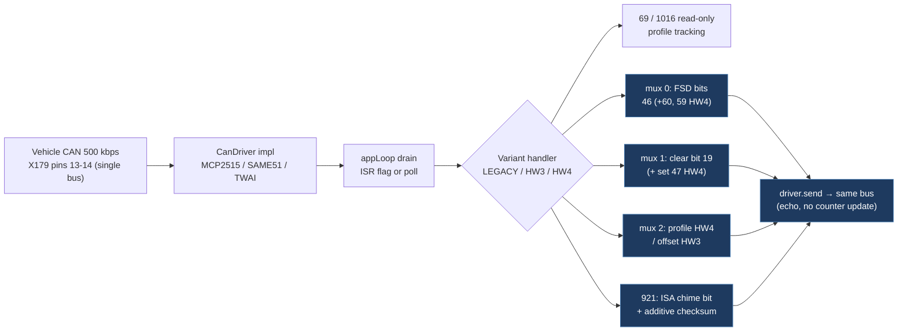
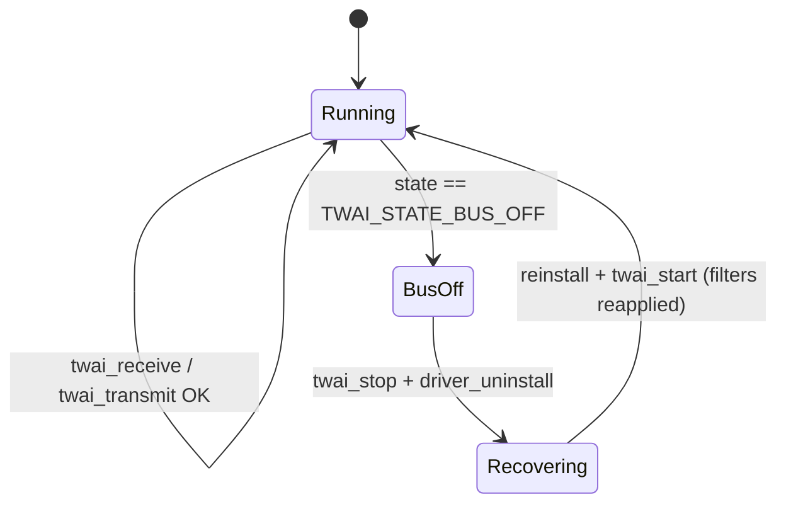

# dongho74s-tesla-open-can-mod

Deep-dive analysis (replace mode). The pre-replace summary still exists in git history; citations to it use `git show HEAD:docs/legacy/dongho74s-tesla-open-can-mod.md:<line>` and refer to the parent commit of this rewrite.

## 1. Provenance

- Submodule path: `legacy/dongho74s-tesla-open-can-mod`
- Pinned gitlink (canonical form from `git ls-files -s`): `160000 c92d8512ef8ce5fe37c578e615b6ee24db0e35cd 0`
- Submodule `HEAD` matches the gitlink: `c92d8512ef8ce5fe37c578e615b6ee24db0e35cd` — `Fix Include Paths and Header Consolidation` (2026-03-31, author AlexanderRubbel)
- Working tree clean (`git status --porcelain` empty)
- Upstream URL: `https://github.com/dongho74s/tesla-open-can-mod` (origin fetch/push)
- License: GPL-3.0 (`LICENSE:1-5` confirms "GNU GENERAL PUBLIC LICENSE, Version 3"; `README.md:368-370` restates it). `THIRD_PARTY_LICENSES` bundles MIT (autowp MCP2515, Adafruit_CAN) and Apache-2.0 (esp-idf TWAI) texts.
- Analysis date: 2026-11-21. Mode: **replace** (per task instruction). The pre-replace doc's YAML frontmatter (lines 1-9 above) is preserved verbatim, including the `description:` value that is truncated mid-sentence at "Runs on Adafruit" — kept bytes, not fixed. Two normalizations, both disclosed: (a) the original file used CRLF line endings; line endings were normalized to LF per repo markdown hygiene, content otherwise unchanged; (b) the original `description:` line ended with one trailing space after "Adafruit", dropped per the skill's hygiene rule (the batch-audit pilot treats inherited trailing spaces as defects to fix before committing; YAML scalar semantics are unchanged). The pre-replace doc had **no `## Upstream (...)` sections**, so nothing beyond the frontmatter required preservation.
- Inventory: full `git ls-files` list read first (31 entries). No hidden platform directories exist in the inventory (`.pio/`, `.vscode/`, `.idea/`, `.cursor/` are gitignored per `.gitignore:1-4` and absent from git). This rules out the missed-dotfile failure mode seen in other analyses.

Files read (coverage per the closed vocabulary — every upstream source file is small and was read end-to-end):

| File | Coverage | Notes |
| --- | --- | --- |
| `include/handlers.h` (165 lines) | FULL-READ | All three variant handlers, EVD/ISA defaults |
| `include/can_helpers.h` (22) | FULL-READ | readMuxID, isFSDSelectedInUI, setSpeedProfileV12V13, setBit |
| `include/can_frame_types.h` (8) | FULL-READ | CanFrame struct |
| `include/app.h` (52) | FULL-READ | Variant select, setup/loop templates |
| `include/drivers/can_driver.h` (10) | FULL-READ | Abstract interface |
| `include/drivers/mcp2515_driver.h` (52) | FULL-READ | Init, filters, ISR, read/send |
| `include/drivers/same51_driver.h` (50) | FULL-READ | Combined-mask filter, polling |
| `include/drivers/twai_driver.h` (84) | FULL-READ | Filter math, bus-off recovery |
| `include/drivers/mock_driver.h` (21) | FULL-READ | Test double |
| `src/main.cpp` (41) | FULL-READ | PlatformIO entry point |
| `RP2040CAN.ino` (54) | FULL-READ | Arduino IDE entry point |
| `platformio.ini` (28) | FULL-READ | 5 environments |
| `test/test_native_helpers/test_helpers.cpp` (129) | FULL-READ | 18 tests |
| `test/test_native_hw3/test_hw3_handler.cpp` (135) | FULL-READ | 13 tests |
| `test/test_native_hw4/test_hw4_handler.cpp` (225) | FULL-READ | 24 tests |
| `test/test_native_legacy/test_legacy_handler.cpp` (113) | FULL-READ | 12 tests |
| `test/test_native_twai/test_twai_filter.cpp` (149) | FULL-READ | 16 tests |
| `README.md` (258) | FULL-READ | Read after code, for comparison |
| `guides/FSD_SUBSCRIPTION_GUIDE.md` (26) | FULL-READ | Read after code |
| `guides/INSTALLATION_GUIDE_M4_CAN.md` (59) | FULL-READ | Read after code |
| `guides/WIRING_GUIDE.md` (41) | FULL-READ | Read after code |
| `THIRD_PARTY_LICENSES` (62) | FULL-READ | MIT/MIT/Apache-2.0 texts |
| `.gitignore` (4), `lib/README` (37), `test/README` (8), `guides/.gitkeep`, `guides/images/.gitkeep` | FULL-READ | Boilerplate; no project logic |

Files explicitly NOT read:

- `guides/images/connected-setup.png`, `guides/images/pinout-labeled.png`, `guides/images/x179-connector.png` — binary images, not read.
- `LICENSE` (553 lines) — RANGE-CITED (lines 1-5 only); remainder is the standard unmodified GPL-3.0 text.

Our-side files read for parity (all CODE-READ, full files): `firmware/lib/vehicle/can/handler/variant/{hw4,hw3,legacy,bits,frame_readers}.h`, `firmware/lib/vehicle/can/handler/{helpers,filters}.h`, `firmware/lib/vehicle/can/feature/fsd/{profile,offsets,isa_chime}.h`, `firmware/lib/vehicle/can/checksum.h`, `firmware/lib/vehicle/can/ids.h` (decoder section).

## 2. Executive verdict

A compact single-bus FSD CAN enabler: one reactive interceptor that filters 2-3 CAN IDs per vehicle variant, mutates a handful of bits on the FSD mux frames (0x3EE/0x3FD plus 0x399 ISA on HW4), and echoes the mutated frame back on the same bus. Every mechanism it ships — FSD-selected gate, follow-distance profile tracking, HW3 offset auto-track, HW4 profile inject, mux-1 nag clear, ISA chime suppress with additive checksum, EVD bit — is **already present in TeslaCANModder with identical byte layouts** (both projects share the `tesla-open-can-mod` lineage; even helper identifiers like `setSpeedProfileV12V13`, `readMuxID`, `isFSDSelectedInUI` match ours). Its value to us is twofold: independent cross-validation of our frame constants (two separately written implementations agree, which is corroboration, not proof), and one operational claim worth a capture-first investigation — HW4 vehicles on the 2026.8.x branch still run FSD v13 and need HW3-style handling (`README.md:50`). Must NOT be ported: the mutation is completely ungated (no AP-state gate, no park/summon gate, no OTA guard, no NVS persistence), EVD bit 59 is forced on at compile time, and DLC is never checked before byte writes.

## 3. Evidence map

No CAPTURE evidence exists in this repo — no frame captures ship with it. TEST-READ evidence exists in abundance (83 Unity test cases across 5 native suites).

| Source file | Lines | What it proves | Grade |
| --- | --- | --- | --- |
| `include/handlers.h` | 26-31, 36-41 | Legacy filters {69,1006}; stalk byte[1]>>5 → profile | CODE-READ |
| `include/handlers.h` | 43-54 | Legacy mux0 bit 46 + profile; mux1 bit 19 clear | CODE-READ |
| `include/handlers.h` | 68-82 | HW3 filters {1016,1021}; fd map 1→2, 2→1, 3→0 | CODE-READ |
| `include/handlers.h` | 84-110 | HW3 mux0 gate + bit 46 + offset formula; mux2 offset write | CODE-READ |
| `include/handlers.h` | 123-127 | HW4 filters {921,1016,1021} (README omits 921) | CODE-READ |
| `include/handlers.h` | 130-138 | ISA: data[1] \|= 0x20 + additive checksum with ID bytes | CODE-READ |
| `include/handlers.h` | 139-147 | HW4 fd map 1→3 … 5→4 (5 levels, incl. profile 4) | CODE-READ |
| `include/handlers.h` | 149-169 | HW4 mux0 bits 46/60/59; mux1 bits 19/47; mux2 profile bits [6:4] of byte 7 | CODE-READ |
| `include/handlers.h` | 13, 155-157 | EVD bit 59 forced on via `constexpr bool = true` | CODE-READ |
| `include/can_helpers.h` | 5-7, 9-11, 13-16 | Mux mask 0x07; UI gate data[4] bit 6; profile field data[6] bits[2:1] | CODE-READ |
| `include/app.h` | 13-21 | Variant chosen by HW4/HW3/LEGACY define, no runtime switch | CODE-READ |
| `include/app.h` | 26-27, 50-63 | Single volatile ISR flag + drain loop; no ring buffer | CODE-READ |
| `include/drivers/mcp2515_driver.h` | 15-21, 36-40 | 500 kbps @ MCP_16MHZ hardcoded; interrupt attached | CODE-READ |
| `include/drivers/twai_driver.h` | 27-51, 83-94 | Combined acceptance mask; bus-off detect + reinstall recovery | CODE-READ |
| `include/drivers/same51_driver.h` | 21-33 | Combined single-filter mask for 1-filter hardware | CODE-READ |
| `src/main.cpp` | 29-33 | Ready strings per driver ("SAME51 CAN ready @ 500k" etc.) | CODE-READ |
| `test/test_native_hw4/test_hw4_handler.cpp` | 196-212 | ISA checksum independently recomputed in test (0xD1) | TEST-READ |
| `test/test_native_hw3/test_hw3_handler.cpp` | 52-84 | FSDEnabled latch semantics + mux2 gate | TEST-READ |
| `test/test_native_twai/test_twai_filter.cpp` | 11-28 | TWAI filter math re-implemented in test, not linked to driver | TEST-READ |
| `test/test_native_helpers/test_helpers.cpp` | 10-130 | Bit/mux/UI-gate/profile-field primitives | TEST-READ |
| `README.md` | 44-50, 65-94, 287-293 | Upstream's own protocol tables (checked against code; see section 6) | SUMMARY-ONLY |
| `guides/WIRING_GUIDE.md` | 5, 25, 49 | Non-Highland 2023 Model 3; X652 fallback; termination warning | SUMMARY-ONLY |
| `guides/INSTALLATION_GUIDE_M4_CAN.md` | 29, 33 | Stale `TARGET_HW3` API; wrong ready string (see section 6) | SUMMARY-ONLY |

## 4. Architecture and build surface

Two entry points share one core: `RP2040CAN.ino` (Arduino IDE, board+vehicle selected by uncommenting defines at lines 16-26) and `src/main.cpp` (PlatformIO, board selected by env build flags, vehicle by editing a define). All logic lives in headers under `include/`; `src/main.cpp:1-5` states this explicitly.

Layering is clean: handlers (`handlers.h`) depend only on the `CanDriver` interface (`drivers/can_driver.h:5-11`) and the `CanFrame` POD (`can_frame_types.h:6-10`); drivers know nothing about vehicle logic. `app.h:13-21` resolves `SelectedHandler` at compile time via `HW4`/`HW3`/`LEGACY`, and `appSetup`/`appLoop` templates branch on `Driver::kSupportsISR` (`app.h:43-45`, `52-55`) — MCP2515 uses ISR-flag + drain, SAME51/TWAI poll.

Build flags: `DRIVER_MCP2515` / `DRIVER_SAME51` / `DRIVER_TWAI` (mutually exclusive, `main.cpp:10-25`), `HW4`/`HW3`/`LEGACY` (mutually exclusive, `app.h:13-21`), `NATIVE_BUILD` for tests (`platformio.ini:31`). TWAI pins default `GPIO_NUM_5`/`GPIO_NUM_4` (`main.cpp:17-22`); the M5Stack Atom env overrides to TX 22 / RX 19 and defines `PIN_LED=27` (`platformio.ini:27`).



Dependency boundaries: third-party deps are `autowp/MCP2515` (MIT), `Adafruit CAN`/`CANSAME5x` (MIT), ESP-IDF TWAI (Apache-2.0) — all declared in `platformio.ini:6,13,21` and re-licensed in `THIRD_PARTY_LICENSES`.

## 5. Mechanism catalogue

### 5.1 FSD mux-0 activation gate (FSDEnabled latch)

- **Claim (README / summary):** "FSD enable bit is set when 'Traffic Light and Stop Sign Control' is enabled" (`README.md:60`); pre-replace doc described the bit sets but not the gate.
- **Code path:** `app.h:58-60` drain → `handlers.h:33/73/129` `handleMessage()` → `can_helpers.h:5-7` `readMuxID()` → `can_helpers.h:9-11` `isFSDSelectedInUI()` → `can_helpers.h:18-27` `setBit()` → `driver.send()`.
- **Frame spec:** 0x3EE (Legacy) / 0x3FD (HW3, HW4), DLC 8 assumed. Gate = `data[4]` bit 6 (frame bit 38). Sets bit 46 on all variants; HW4 adds bits 60 and 59 (`handlers.h:153-158`). Legacy/HW3 also write the profile into `data[6]` bits[2:1] via `setSpeedProfileV12V13` (`handlers.h:48,97`).
- **Gates and timing:** `FSDEnabled` is latched only on mux-0 frames (`handlers.h:45,86,151`); injection requires the latch. No AP-state, park, or timing gate of any kind. Echo is immediate on RX; there are no timers anywhere in the repo.
- **State machine:** 2-state latch: set/cleared by mux-0 `data[4]` bit 6; no timeout decay if mux-0 stops arriving.
- **Tests:** `test_hw3_fsd_enabled_only_set_on_mux0` at `test/test_native_hw3/test_hw3_handler.cpp:52-68` asserts the latch survives a mux-2 frame with the UI bit clear; `test_hw4_no_send_when_fsd_disabled_mux0` at `test/test_native_hw4/test_hw4_handler.cpp:95-102`; `test_legacy_no_send_when_fsd_disabled` at `test/test_native_legacy/test_legacy_handler.cpp:61-68`.
- **Evidence grade:** CODE-READ.
- **Verdict:** CONFIRMED.
- **Adapt to TeslaCANModder?** already present (our `isFSDSelectedInUI` at `firmware/lib/vehicle/can/ids.h:119-121` reads the identical byte/bit; we add `fsdForceEnabled` bypass at `variant/hw3.h:121` and `variant/hw4.h:134`).

### 5.2 Follow-distance → speed-profile tracking

- **Claim (README / summary):** "Reads the follow-distance stalk setting; maps it dynamically to a speed profile" (`README.md:33-35`); HW4 has "Extended speed-profile range (5 levels)" (`README.md:48`).
- **Code path:** Legacy: `handlers.h:36-41` reads 0x045 `data[1] >> 5`. HW3/HW4: `handlers.h:74-82,139-148` read 0x3F8 `(data[5] & 0b11100000) >> 5`. No TX on these IDs — read-only state update.
- **Frame spec:** 0x045 byte[1] bits[7:5]; 0x3F8 byte[5] bits[7:5]. Legacy map: pos ≤ 1 → 2, pos == 2 → 1, else 0. HW3 map: 1→2, 2→1, 3→0. HW4 map: 1→3, 2→2, 3→1, 4→0, **5→4** (a fifth profile level our code also ships).
- **Gates and timing:** none — every frame overwrites `speedProfile`. Note the HW3 precedence trap: on 0x3FD mux-0 the UI-offset switch (`handlers.h:89-95`) overwrites the follow-distance-derived profile while FSD is enabled.
- **State machine:** None found — stateless mapping into a scalar.
- **Tests:** `test_hw3_follow_distance_1_sets_profile_2` at `test/test_native_hw3/test_hw3_handler.cpp:21-27` (and 2/3/0 cases); `test_hw4_follow_distance_5_sets_profile_4` at `test/test_native_hw4/test_hw4_handler.cpp:49-54`; `test_legacy_stalk_pos3_sets_profile_0` at `test/test_native_legacy/test_legacy_handler.cpp:43-48`.
- **Evidence grade:** CODE-READ.
- **Verdict:** CONFIRMED.
- **Adapt to TeslaCANModder?** already present — our `mapHW3FollowDistToProfile`/`mapHW4FollowDistToProfile` (`firmware/lib/vehicle/can/feature/fsd/profile.h:43-58`) are byte-identical maps including level 4; ours adds a `profileOverride` pin (`variant/hw3.h:72-77`).

### 5.3 HW3 speed-offset auto-track + mux-2 re-inject

- **Claim (README / summary):** "Write speed offset to bits 6-7 of byte 0 and bits 0-5 of byte 1" (`README.md:84`).
- **Code path:** `handlers.h:88-95` decode on mux-0 → `handlers.h:104-110` encode on mux-2 → `driver.send()`.
- **Frame spec:** read: `data[3]` bits[6:1], bias −30 → signed steps; offset = clamp(steps × 5, 0, 100). Write: `data[0]` bits[7:6] = offset & 0x03, `data[1]` bits[5:0] = offset >> 2. No counter or checksum touched.
- **Gates and timing:** mux-2 write is gated on the FSDEnabled latch (`handlers.h:104`) — unlike HW4's mux-2 (see 5.4). The mux-0 `off` switch (2→profile 2, 1→1, 0→0) silently overrides the follow-distance profile.
- **State machine:** None found — scalar auto-track.
- **Tests:** `test_hw3_fsd_disabled_on_mux0_prevents_mux2_send` at `test/test_native_hw3/test_hw3_handler.cpp:70-84` asserts the gate; no test asserts the ×5/clamp arithmetic itself (helpers tests cover only the write masks via mux2 send count).
- **Evidence grade:** CODE-READ.
- **Verdict:** CONFIRMED (layout) / offset arithmetic itself untested.
- **Adapt to TeslaCANModder?** already present — `readHW3UiOffsetSteps` (`firmware/lib/vehicle/can/feature/fsd/offsets.h:31-35`), `calculateHW3SpeedOffset` (`offsets.h:42-50`), `writeHW3SpeedOffset` (`offsets.h:17-24`) are formula-identical; ours adds `offsetOverride` pin (`variant/hw3.h:128-129`).

### 5.4 HW4 mux-2 profile injection

- **Claim (README / summary):** "Write speed profile to bits 4-6 of byte 7" (`README.md:94`).
- **Code path:** `handlers.h:165-169` → `driver.send()`.
- **Frame spec:** 0x3FD mux 2: clear `data[7]` bits[6:4], write `speedProfile & 0x07` there.
- **Gates and timing:** **ungated** — sends on every mux-2 frame regardless of FSDEnabled (asserted by `test_hw4_fsd_enabled_only_set_on_mux0` at `test/test_native_hw4/test_hw4_handler.cpp:58-72`, whose comment says "mux 2 always sends for HW4"). Asymmetry vs HW3 (gated) has no documented rationale; single-commit history gives no reason.
- **State machine:** None found.
- **Tests:** `test_hw4_mux2_injects_speed_profile` and `test_hw4_mux2_clears_old_profile_bits` at `test/test_native_hw4/test_hw4_handler.cpp:118-138`.
- **Evidence grade:** CODE-READ.
- **Verdict:** CONFIRMED.
- **Adapt to TeslaCANModder?** already present — `writeHW4SpeedProfile` (`firmware/lib/vehicle/can/feature/fsd/profile.h:30-36`) is mask-identical (`~0x70`, `<< 4`); ours gates on `s.fsdEnabled` + AP gate (`variant/hw4.h:157`), which is strictly safer.

### 5.5 Mux-1 nag suppression (bit 19, +47 on HW4)

- **Claim (README / summary):** "Nag suppression — clears the hands-on-wheel nag bit" (`README.md:62`).
- **Code path:** `handlers.h:51-54` (Legacy), `100-103` (HW3), `160-164` (HW4) → `driver.send()`.
- **Frame spec:** clear frame bit 19 on 0x3EE/0x3FD mux 1; HW4 additionally sets bit 47 (`handlers.h:162`).
- **Gates and timing:** **unconditional** — sends on every mux-1 frame even with FSD disabled. No DAS hands-on-state awareness, no EPAS echo, no timing/jitter.
- **State machine:** None found — stateless bit clear.
- **Tests:** `test_hw4_nag_suppression_clears_bit19_sets_bit47` at `test/test_native_hw4/test_hw4_handler.cpp:106-114`; HW3/Legacy equivalents at `test_hw3_handler.cpp:99-106` and `test_legacy_handler.cpp:90-97`.
- **Evidence grade:** CODE-READ.
- **Verdict:** CONFIRMED.
- **Adapt to TeslaCANModder?** already present as `nag:mode:bit19` — ours clears bit 19 + sets bit 47 identically (`variant/hw4.h:40-53`) but gates on `nagModeUsesBit19(s.nagMode)` + AP gate (`variant/hw4.h:150`); our 0x370 EPAS echo modes have no upstream counterpart here.

### 5.6 HW4 ISA speed chime suppression (0x399) + additive checksum

- **Claim (README / summary):** "ISA speed chime suppression (optional, disabled by default)" (`README.md:90`).
- **Code path:** `handlers.h:130-138` → `driver.send()`; early-return skips all FSD logic for this frame.
- **Frame spec:** 0x399 (921): `data[1] |= 0x20`; checksum `data[7] = (Σ data[0..6] + (921 & 0xFF) + (921 >> 8)) & 0xFF` = payload sum + 0x99 + 0x03 (`handlers.h:132-135`). No counter field touched. DLC never checked before writing `data[1]`/`data[7]`.
- **Gates and timing:** gated only on the compile-time default `isaSpeedChimeSuppress` (`DEFAULT_ISA_SPEED_CHIME_SUPPRESS = false`, `handlers.h:14`) — no runtime command toggles it.
- **State machine:** None found.
- **Tests:** `test_hw4_isa_suppress_checksum_correct` at `test/test_native_hw4/test_hw4_handler.cpp:196-212` recomputes 0x10 + 0x25 + 0x99 + 0x03 = 0xD1 independently in the test body (a real oracle, not a snapshot).
- **Evidence grade:** CODE-READ (checksum layout TEST-READ).
- **Verdict:** CONFIRMED.
- **Adapt to TeslaCANModder?** already present — our `computeHW4IsaChecksum` (`firmware/lib/vehicle/can/checksum.h:47-56`) is the identical formula; our handler adds `apGateOpen` + `dlc >= 8` guards (`variant/hw4.h:70-79`) and a runtime `isa-chime:on/off` command (`feature/fsd/isa_chime.h:24-39`).

### 5.7 Emergency vehicle detection (bit 59, compile-time forced)

- **Claim (README / summary):** "Approaching Emergency Vehicle Detection" as an HW4 FSD v14 feature (`README.md:37-38`).
- **Code path:** `handlers.h:13` `constexpr bool enableEmergencyVehicleDetection = true` → `handlers.h:155-157` sets bit 59 on mux-0 whenever FSDEnabled.
- **Frame spec:** 0x3FD mux 0, frame bit 59.
- **Gates and timing:** no gate beyond the FSDEnabled latch; not toggleable at runtime, not persisted.
- **State machine:** None found.
- **Tests:** `test_hw4_fsd_mux0_sets_emergency_bit59` at `test/test_native_hw4/test_hw4_handler.cpp:86-93`.
- **Evidence grade:** CODE-READ.
- **Verdict:** CONFIRMED (as a forced-on behavior, not a configurable feature).
- **Adapt to TeslaCANModder?** already present — ours is `evd:on/off` toggleable (`variant/hw4.h:143-144` checks `s.evdEnabled`). Never port the forced-on `constexpr` pattern.

### 5.8 TWAI combined acceptance mask + bus-off recovery

- **Claim (README / summary):** ESP32 TWAI "Compiles, needs on-vehicle testing" (`README.md:104`); Atomic CAN Base "Tested" (`README.md:105`).
- **Code path:** `twai_driver.h:27-51` `setFilters()` (mask math + driver reinstall) → `twai_driver.h:59-69` `read()` → `twai_driver.h:83-94` `isBusOff()`/`recover()`.
- **Frame spec:** N/A (driver layer). Combined mask: `differ = OR(ids[0]^ids[i])`; `acceptance_code = (ids[0] & ~differ) << 21`; `acceptance_mask = (differ << 21) | 0x001FFFFF` (`twai_driver.h:41-44`). RX queue 32, TX queue 16 (`twai_driver.h:16-17`); TX timeout 10 ms (`twai_driver.h:77`).
- **Gates and timing:** reinstall on every filter change; poll-based RX (`twai_driver.h:53-57` comment explains why no alert task).
- **State machine:** 3 states — running, bus-off detected, recovered-by-reinstall.



- **Tests:** `test/test_native_twai/test_twai_filter.cpp:11-28` re-implements the mask math (`computeTwaiFilter`) rather than calling the driver — currently formula-identical to `twai_driver.h:32-43`, but a silent-drift risk since it is a copy.
- **Evidence grade:** CODE-READ.
- **Verdict:** CONFIRMED (code); on-vehicle behavior UNVERIFIED for the plain ESP32 env.
- **Adapt to TeslaCANModder?** no impact — we drive MCP2515 on all three buses; keep as reference if a native-TWAI build is ever added.

### 5.9 SAME51 combined single-filter mask

- **Claim (README / summary):** M4 CAN Express "Compiles, needs on-vehicle testing" (`README.md:103`).
- **Code path:** `same51_driver.h:21-33` `setFilters()`.
- **Frame spec:** N/A. Same `differ`-mask trick as 5.8, applied to CANSAME5x's single standard filter element: `mask = ~differ & 0x7FF`, `base = ids[0] & mask` (`same51_driver.h:26-32`). Poll-only, `enableInterrupt` returns false with a rationale comment (`same51_driver.h:35-38`).
- **Gates and timing:** wide masks for far-apart ID sets (e.g. Legacy {69, 1006}) will false-positive accept unrelated IDs — the HW-side filter is lossy, and nothing downstream re-checks IDs before mutation (handlers only match exact IDs, so false accepts are dropped silently).
- **State machine:** None found.
- **Tests:** None found — no SAME51 test.
- **Evidence grade:** CODE-READ.
- **Verdict:** CONFIRMED (code).
- **Adapt to TeslaCANModder?** no impact — reference only.

### 5.10 MCP2515 ISR flag + drain + 6-slot exact-match filters

- **Claim (README / summary):** README contradicts itself here: pins table says the interrupt pin is "unused; polling mode" (`README.md:114`), boards table says "Tested" (`README.md:102`).
- **Code path:** `mcp2515_driver.h:23-34` `setFilters()` (6 RXF slots, masks 0x7FF exact) → `mcp2515_driver.h:36-40` `enableInterrupt()` → `app.h:26-27` `canISR()` flag → `app.h:57-60` drain loop.
- **Frame spec:** N/A. Bitrate hardcoded `CAN_500KBPS` @ `MCP_16MHZ` (`mcp2515_driver.h:17`) — no crystal auto-detect, no 8 MHz profile.
- **Gates and timing:** single volatile flag (`frameReady`, initialized `true` at `app.h:26`); drain until `read()` returns false. MCP2515 has only 2 RX buffer slots — a slow handler silently drops frames with no overflow counter.
- **State machine:** None found.
- **Tests:** None found — no MCP2515 test; `MockDriver::read` always returns false (`mock_driver.h:17-19`), so handler tests never exercise the drain path.
- **Evidence grade:** CODE-READ.
- **Verdict:** CONFIRMED (code); README's "unused; polling mode" claim CONTRADICTED (see section 6).
- **Adapt to TeslaCANModder?** no impact — our `core/can` MCP2515 plumbing (health counters, ring buffer, clock auto-detect via `canclock:*`) is a superset; never port the single-flag pattern.

## 6. Summary vs code contradiction table

Pre-replace citations refer to `git show HEAD:docs/legacy/dongho74s-tesla-open-can-mod.md` (the parent commit of this rewrite); upstream citations are live file:line.

| # | Claim | Citation | Code reality | Citation | Call |
| --- | --- | --- | --- | --- | --- |
| 1 | HW4 "Listens on CAN IDs 1016, 1021" | `README.md:48` | HW4 filters are {921, 1016, 1021} | `include/handlers.h:123-127` | CONTRADICTED (921 omitted from table) |
| 2 | "PIN_CAN_INTERRUPT — interrupt pin (unused; polling mode)" | `README.md:114` | MCP2515 driver attaches a falling-edge interrupt and app drains on the flag | `include/drivers/mcp2515_driver.h:36-40`, `include/app.h:43-45` | CONTRADICTED |
| 3 | "PIN_CAN_RESET — MCP2515 hardware reset" listed as a required board pin | `README.md:116` | No reference to `PIN_CAN_RESET` anywhere in the repo | negative anchor, section 16 N2 | CONTRADICTED (stale pin list; `PIN_CAN_STANDBY` at `README.md:115` is likewise only used by the SAME51 driver) |
| 4 | "ASS (Actually Smart Summon) is no longer restricted by EU regulations" | `README.md:21` | No ASS, summon, or EU-region code path exists; handlers touch only 0x045/0x3EE/0x3F8/0x3FD/0x399 | `include/handlers.h` full read | CONTRADICTED (claim with no implementation) |
| 5 | Build via `#define HW_target TARGET_HW3` | `guides/INSTALLATION_GUIDE_M4_CAN.md:29` | Variant defines are `HW4`/`HW3`/`LEGACY`; `TARGET_*` identifiers do not exist | `include/app.h:13-21` | CONTRADICTED (stale API from an older header layout) |
| 6 | After flash "you should see `CANSAME5x ready @ 500k`" | `guides/INSTALLATION_GUIDE_M4_CAN.md:33` | Firmware prints `SAME51 CAN ready @ 500k` | `src/main.cpp:31` | CONTRADICTED (string mismatch) |
| 7 | Profiles table: "Distance 2 → Hurry (HW3) / Max (HW4)" etc. | `README.md:287-293` | Code maps raw field values fd=1→2, fd=2→1, fd=3→0 (HW3) and fd=1..5→3..0,4 (HW4) | `include/handlers.h:77-79,142-146` | UNRESOLVED — table and code agree only if the stalk encodes displayed-distance minus one; a bench capture of 0x3F8/0x045 would settle it |
| 8 | "Complete wiring guide for Model 3 Highland" | `git show HEAD:docs/legacy/dongho74s-tesla-open-can-mod.md:81` | Guide states photos are a "2023 Model 3 (non-Highland)" | `guides/WIRING_GUIDE.md:5` | CONTRADICTED |
| 9 | Helper named `setSpeedProfile` | `git show HEAD:docs/legacy/dongho74s-tesla-open-can-mod.md:40` | Function is `setSpeedProfileV12V13` | `include/can_helpers.h:13` | CONTRADICTED (name only) |
| 10 | "Supports HW3 (Legacy and Palladium) and HW4 vehicles" | `git show HEAD:docs/legacy/dongho74s-tesla-open-can-mod.md:15` | README defines Legacy as pre-Palladium portrait-screen HW3-retrofit cars; HW3 is landscape Palladium-era | `README.md:52-56` | CONTRADICTED (variant conflation) |

Everything else the pre-replace doc claimed about frame IDs, bits, and mux layout checked out against the code (see parity, section 11) — but per the skill, the two doc-level contradictions above mean the rest of the old summary's unchecked claims should have been treated as SUMMARY-ONLY until re-verified; this document re-verified them all against code.

## 7. CAN frame and signal inventory

All mutation in this repo is echo-on-RX: there are no periodic timers, no bursts, no cached-frame injection. "Period" below is therefore the period of the intercepted vehicle frame. No counter field is incremented by upstream anywhere, and 0x3EE/0x3F8/0x3FD are re-sent without any checksum recomputation (negative anchor N1, section 16).

| ID (hex+dec) | Bus | Period | DLC | Byte/bit layout | Scale/units | Counter | Checksum | R/W | Grade |
| --- | --- | --- | --- | --- | --- | --- | --- | --- | --- |
| 0x045 / 69 `STW_ACTN_RQ` | single bus (X179 13-14) | n/a (read-only) | ≥2 assumed | byte[1] bits[7:5] stalk position | 7 positions → profile | none touched | none | read | CODE-READ |
| 0x3EE / 1006 Legacy FSD mux | same | echo-on-RX | 8 assumed | mux = data[0]&0x07; mux0: bit 46 set, profile in data[6] bits[2:1]; mux1: bit 19 cleared | profile 0-2 | none touched | none (sent blind) | read+mutate+TX | CODE-READ |
| 0x3F8 / 1016 `UI_driverAssistControl` | same | n/a (read-only) | ≥6 assumed | byte[5] bits[7:5] follow distance | HW3 fd 1-3; HW4 fd 1-5 | none | none | read | CODE-READ |
| 0x3FD / 1021 `UI_autopilotControl` | same | echo-on-RX | 8 assumed | mux = data[0]&0x07; mux0: bit 46 (+60, +59 HW4), gate data[4] bit 6; mux1: bit 19 clear (+ bit 47 set HW4); mux2: HW3 offset in data[0] bits[7:6] + data[1] bits[5:0], HW4 profile in data[7] bits[6:4] | offset 0-100 step 5; profile 0-4 | none touched | none (sent blind) | read+mutate+TX | CODE-READ |
| 0x399 / 921 (ISA speed chime; upstream README names it `DAS_status`) | same | echo-on-RX | 8 assumed (unchecked) | data[1] \|= 0x20 chime-suppress flag | boolean flag | none touched | data[7] = (Σ data[0..6] + 0x99 + 0x03) & 0xFF | read+mutate+TX | CODE-READ; checksum layout TEST-READ |

No DBC/JSON catalog is vendored, so no STRUCTURAL-PARSE entries exist. Signal names are attributed by upstream to mikegapinski/tesla-can-explorer (`README.md:96`) — SUMMARY-ONLY naming, function confirmed by code.

## 8. Constants and tuning table

| Constant | Value | File:line | Meaning | Grade |
| --- | --- | --- | --- | --- |
| `enableEmergencyVehicleDetection` | `true` (constexpr, not runtime-toggleable) | `include/handlers.h:13` | EVD bit 59 forced on whenever FSD mux-0 injection runs | CODE-READ |
| `DEFAULT_ISA_SPEED_CHIME_SUPPRESS` | `false` | `include/handlers.h:14` | ISA chime suppress defaults off; no runtime command exists | TEST-READ |
| mux mask | `0x07` on data[0] | `include/can_helpers.h:6` | FSD-frame multiplexer index | TEST-READ |
| FSD UI gate | data[4] bit 6 (frame bit 38) | `include/can_helpers.h:10` | STEERING_MODE=5 / FSD-selected trigger; the README's "Traffic Light and Stop Sign Control" framing | TEST-READ |
| profile field | data[6] bits[2:1], mask 0x06, `profile << 1` | `include/can_helpers.h:14-15` | v12/v13 speed profile encoding | TEST-READ |
| FSD enable bit | 46 | `include/handlers.h:47,96,153` | set on mux-0 for all variants | TEST-READ |
| nag bit | 19 | `include/handlers.h:52,101,161` | cleared on mux-1 for all variants | TEST-READ |
| HW4 mux-1 extra bit | 47 | `include/handlers.h:162` | set alongside bit-19 clear (our code calls this "Summon EU unlock") | TEST-READ |
| FSD v14 bit | 60 | `include/handlers.h:154` | HW4-only mux-0 set | TEST-READ |
| EVD bit | 59 | `include/handlers.h:156` | HW4-only mux-0 set, forced on | TEST-READ |
| offset bias | `(data[3]>>1 & 0x3F) - 30` | `include/handlers.h:88-89` | 6-bit UI offset field, −30 bias → signed steps | CODE-READ |
| offset scale/clamp | steps × 5, clamp [0, 100] | `include/handlers.h:88` | UI steps → speed offset units | CODE-READ |
| offset→profile switch | steps 2→2, 1→1, 0→0 | `include/handlers.h:90-95` | silently overrides follow-distance profile on mux-0 | CODE-READ |
| HW3 fd map | 1→2, 2→1, 3→0 | `include/handlers.h:77-79` | 3-level profile map | TEST-READ |
| HW4 fd map | 1→3, 2→2, 3→1, 4→0, 5→4 | `include/handlers.h:142-146` | 5-level map incl. "Sloth" level 4 | TEST-READ |
| legacy stalk map | pos≤1→2, pos==2→1, else 0 | `include/handlers.h:38-40` | stalk-position profile map | TEST-READ |
| HW4 profile write | `(profile & 0x07) << 4` in data[7] | `include/handlers.h:166-167` | mux-2 profile field bits[6:4] | TEST-READ |
| HW3 offset write | data[0] bits[7:6] = low 2 bits; data[1] bits[5:0] = high bits | `include/handlers.h:105-108` | mux-2 8-bit offset encoding | CODE-READ |
| ISA suppress mask | `0x20` in data[1] | `include/handlers.h:131` | chime-suppress flag | TEST-READ |
| ISA checksum ID terms | `(921 & 0xFF) + (921 >> 8)` = 0x99 + 0x03 | `include/handlers.h:134` | additive checksum includes both ID bytes | TEST-READ |
| CAN bitrate/crystal | `CAN_500KBPS` @ `MCP_16MHZ` | `include/drivers/mcp2515_driver.h:17` | 16 MHz crystal hardcoded — no 8/20 MHz fallback (we auto-detect) | CODE-READ |
| MCP filter masks | 0x7FF exact-match on both mask groups | `include/drivers/mcp2515_driver.h:25,28` | exact ID filtering across 6 RXF slots | CODE-READ |
| TWAI queues / TX timeout | rx 32, tx 16, 10 ms | `include/drivers/twai_driver.h:16-17,77` | buffer sizing; send timeout before bus-off check | CODE-READ |
| TWAI default pins | TX GPIO5, RX GPIO4; Atom: 22/19 + PIN_LED 27 | `src/main.cpp:18-22`, `platformio.ini:27` | board pin mapping | CODE-READ |
| boot timing | `delay(1500)`, Serial 115200, 1 s wait | `include/app.h:32-35` | bring-up sequencing; `frameReady` starts `true` (`app.h:26`) | CODE-READ |

## 9. Failure modes and edge cases

| Failure | Handling code path | Tested? | Grade |
| --- | --- | --- | --- |
| CAN controller init failure | `app.h:38-40` prints "CAN init failed" and keeps running with a dead driver — no retry, no state flag | no | CODE-READ |
| MCP2515 TX failure | `mcp2515_driver.h:51-57` `send()` is void; autowp error code ignored | no | CODE-READ |
| TWAI bus-off | `twai_driver.h:83-94` detect via `twai_get_status_info`, recover via uninstall+reinstall+start; also checked after failed RX (`:61-64`) and TX (`:77-79`) | no — driver untested; only the filter math copy is tested | CODE-READ |
| MCP2515 RX overflow | 2-slot HW buffer + single volatile flag (`app.h:26-27`); no overflow counter, silent frame loss | no | CODE-READ |
| Short/malformed DLC | handlers index data[0..7] with no DLC guard (e.g. ISA path writes data[1]/data[7] unchecked, `handlers.h:130-137`); fixed 8-byte array prevents OOB but mutates garbage | no | CODE-READ |
| Watchdog / brownout | None found | n/a | CODE-READ (absence) |
| OTA in progress | None found — injection continues during OTA (our firmware pauses TX on 0x318) | n/a | CODE-READ (absence) |
| Persistence of settings | None found — variant and ISA flag are compile-time; every reboot resets state | n/a | CODE-READ (absence) |
| Stale FSDEnabled latch | latch never decays if mux-0 stops arriving after a set (`handlers.h:45,86,151`); mux-1/mux-2 keep firing | no | CODE-READ |
| `esp32_twai` env build | `app.h:59,62` uses `PIN_LED`, which only the M5Stack env defines (`platformio.ini:27`); plain `esp32dev` likely fails to compile | no | UNVERIFIED — run `pio run -e esp32_twai` to settle |
| SAME51 wide-mask false accepts | combined mask accepts unrelated IDs for far-apart sets; handlers drop them by exact-ID match, so effect is wasted bus load, not misinjection | no | CODE-READ |

## 10. Test coverage map

| Test file | What it asserts |
| --- | --- |
| `test/test_native_helpers/test_helpers.cpp` (18 tests, `:10-130`) | `setBit` byte/bit math incl. cross-byte isolation; `readMuxID` masking; `isFSDSelectedInUI` bit-6 gating; `setSpeedProfileV12V13` field preservation |
| `test/test_native_legacy/test_legacy_handler.cpp` (12 tests) | stalk positions → profiles; mux-0 gate + bit 46 + profile write; mux-1 bit 19; filter IDs {69,1006}; no-send on unrelated ID 999 |
| `test/test_native_hw3/test_hw3_handler.cpp` (13 tests) | fd→profile map; FSDEnabled latch regression ("FSD shadowing fix"); mux-2 gate on latch; bit 46 on mux-0; bit 19 on mux-1; filter IDs; send counts |
| `test/test_native_hw4/test_hw4_handler.cpp` (24 tests) | fd→profile 5-level map; latch; bits 46/60/59 on mux-0; bit 19 clear + 47 set on mux-1; mux-2 profile inject + old-bit clear; ISA flag bit, preservation, checksum 0xD1 (independent recompute), early-return; filter IDs {921,1016,1021} |
| `test/test_native_twai/test_twai_filter.cpp` (16 tests) | accept/reject behavior of the combined-mask math; exact mask values (e.g. differ 0x065 for HW4 set); single-ID exactness; empty-count |

Critical paths with NO test:

- All three real drivers (init, filter programming, ISR wiring, bus-off recovery) — risk: driver regressions ship silently.
- `app.h` setup/loop drain logic — risk: the ISR-flag pattern is only exercised implicitly.
- HW3 offset arithmetic (−30 bias, ×5, clamp) — only its downstream write is count-tested; risk: a formula regression changes injected offsets with all tests green.
- `test_native_twai` tests a re-implementation of the driver math, not the driver — drift risk (currently identical, verified by eye against `twai_driver.h:32-43`).
- No malformed-DLC or fuzz input tests.

## 11. Parity matrix with TeslaCANModder

All rows carry a our-side CODE-READ citation (closed rule: no SUMMARY-ONLY rows). Our-side file paths are relative to `firmware/`.

| Signal/frame | Upstream decode (cite) | Our decode (cite) | Delta | Action |
| --- | --- | --- | --- | --- |
| FSD UI gate bit | `can_helpers.h:9-11` data[4] bit 6 | `lib/vehicle/can/ids.h:119-121` identical | none | ignore (identical) |
| 0x3FD mux0 bit set HW4 | `handlers.h:153-158` {46, 60, 59-forced} | `lib/vehicle/can/handler/variant/hw4.h:138-144` {38, 39, 46, 60, 59-toggle} | we add bits 38/39; EVD toggleable | ignore (ours superset; toggle safer) |
| 0x3FD mux0 bit set HW3/Legacy | `handlers.h:96-98` / `:47-48` {46} + profile | `variant/hw3.h:131-134` / `variant/legacy.h:68-69` {38, 39, 46} + profile | we add 38/39 | ignore |
| mux0 gating | latch only (`handlers.h:86-87`) | latch + `fsdEnabled` + `fsdForceEnabled` + `apGateOpen` (`hw3.h:121-123`) | ours adds runtime toggles + AP injection gate | ignore (ours safer) |
| mux1 nag bits HW4 | `handlers.h:160-164` bit19 clear + bit47 set, unconditional | `hw4.h:150-155` + `applyHW4NagSuppressBits` `hw4.h:40-53`: same bits + optional EAP(46)/lane-graph(45)/ECE-R79(20), gated on nagMode + AP gate | ours gated + extras | ignore (ours superset) |
| HW3 fd→profile | `handlers.h:74-81` 1→2, 2→1, 3→0 | `feature/fsd/profile.h:43-47` `{-1,2,1,0}` | none | ignore (identical) |
| HW4 fd→profile incl. level 4 | `handlers.h:139-147` 1→3 … 5→4 | `feature/fsd/profile.h:54-58` `{-1,3,2,1,0,4}` | none — "Sloth" level 4 already ours, command accepts 0-4 (`profile.h:103-105`) | ignore (identical) |
| Legacy stalk→profile | `handlers.h:36-41` | `variant/legacy.h:43-51` | none | ignore (identical) |
| HW3 offset steps read | `handlers.h:89` −30 bias | `feature/fsd/offsets.h:31-35` | none | ignore (identical) |
| HW3 offset ×5 clamp | `handlers.h:88` clamp [0,100] | `offsets.h:42-50` | none | ignore (identical) |
| HW3 mux2 offset write | `handlers.h:104-110` data[0][7:6]+data[1][5:0] | `offsets.h:17-24` | none | ignore (identical) |
| HW4 mux2 profile write | `handlers.h:165-169` data[7][6:4] | `profile.h:30-36` + `hw4.h:159` | none | ignore (identical) |
| HW4 mux2 offset write | None found upstream | `hw4.h:160-164` writes offset into byte1[5:0] | ours extra | ignore |
| HW4 mux2 gating | sends ungated (asserted `test_hw4_handler.cpp:71` "mux 2 always sends") | gated on `s.fsdEnabled` + AP gate (`hw4.h:157`) | ours gated | ignore (ours safer) |
| ISA 0x399 flag + checksum | `handlers.h:130-137` \|0x20; Σ+0x99+0x03 | `hw4.h:70-81` + `handler/variant/bits.h:47-50` + `checksum.h:47-56` | identical formula; ours adds dlc/AP gates + HW4-only command | ignore — independent corroboration of our checksum |
| EVD bit 59 | forced-on constexpr (`handlers.h:13,155-157`) | toggle `s.evdEnabled` (`hw4.h:143-144`) | ours runtime-toggleable | ignore; never port forced-on |
| Chassis filter set | static per variant (`handlers.h:123-127`) | dynamic toggle-inject per feature + variant-detect discriminators (`handler/filters.h:52-59`) | ours dynamic | ignore (ours superset) |
| Legacy profile source | stalk only (`handlers.h:43-50`) | stalk + UI-offset-steps tracking (`legacy.h:65-67`) | ours extra | ignore |

Not touched by upstream at all (no parity row possible): 0x370 EPAS echo, 0x273 vehicle control, BMS/TPMS decode, OTA guard, region/ECE R79, Summon, BLE/WiFi, gamepad. Our nag suite and vehicle-command surface have no upstream counterpart in this repo.

## 12. Surface inventory and security notes

| Surface | Semantics | Citation |
| --- | --- | --- |
| USB Serial (debug print only) | 115200 baud; per-variant one-line FSD/profile/offset status on mux-0, gated by `enablePrint` (default true) | `app.h:33`, `handlers.h:56-58,111-114,170-173`, `README.md:295-297` |

That is the entire surface: no WiFi, no BLE, no REST, no command parser, no OTA. The device is compile-time configured and field-unconfigurable.

Security/provenance findings:

- No hardcoded credentials, keys, or certs anywhere (all 26 text files read end-to-end).
- `platformio.ini:2` pulls the RP2040 platform from an unofficial git fork URL (`maxgerhardt/platform-raspberrypi`) instead of the registry — a supply-chain trust decision worth noting; do not replicate in our CI.
- `RP2040CAN.ino:54` applies `__attribute__((optimize("O3")))` to `loop()` — a benign but unusual build-shaping attribute.
- `README.md:11-17` and `guides/FSD_SUBSCRIPTION_GUIDE.md` document a Tesla account-region transfer workaround to subscribe to FSD (~99 CAD/month). ToS-adjacent guidance, not code; do not mirror into our docs (also section 14).
- No dangerous build flags beyond the platform fork URL.

## 13. Adaptation assessment

| Mechanism | Value | Cost | Risk | Evidence grade | Decision |
| --- | --- | --- | --- | --- | --- |
| 5.1 FSD gate latch | none — we ship it | 0 | 0 | CODE-READ | already present |
| 5.2 fd→profile maps (incl. HW4 level 4) | none — byte-identical incl. level 4 | 0 | 0 | CODE-READ | already present |
| 5.3 HW3 offset auto-track | none — formula-identical | 0 | 0 | CODE-READ | already present |
| 5.4 HW4 mux2 profile inject | none — mask-identical, ours gated | 0 | 0 | CODE-READ | already present |
| 5.5 mux1 nag clear (+47) | none — ours is a gated superset | 0 | 0 | CODE-READ | already present |
| 5.6 ISA 0x399 suppress + additive checksum | independent cross-validation of our checksum formula (two codebases, same bytes: Σ data[0..6] + 0x99 + 0x03) | 0 — nothing to port | low | CODE-READ + TEST-READ | already present; cite as corroboration in `can-review-checklist.md` when touching ISA |
| 5.7 EVD bit 59 (forced-on) | none — ours is a runtime toggle | 0 | forcing it on would inject during every FSD session without user consent | CODE-READ | already present; never port the forced-on pattern |
| 5.8 TWAI filter math + bus-off recovery | reference for any future native-TWAI build | medium (new driver layer) | untested on vehicle upstream (`README.md:104`) | CODE-READ | no impact — keep as reference |
| 5.9 SAME51 combined-mask trick | reference for 1-filter hardware | n/a | wide masks false-accept | CODE-READ | no impact |
| 5.10 MCP2515 ISR/drain + 16 MHz hardcode | none — our core/can plumbing supersedes | 0 | single-flag pattern regresses our ring buffer | CODE-READ | no impact; never port |
| (new) HW4-on-FSD-v13 mux handling | README says 2026.8.x HW4 cars run FSD v13 and should compile `HW3` (`README.md:50`) — implying v13 cars need HW3-style mux-2 (offset write, no profile write) | small: branch in `handleHW4` mux-2 on `fsdProto` (already in our `platform` payload: V13 vs V14) | unknown without bench data | SUMMARY-ONLY upstream claim | **candidate for future PR, capture-first** — record 0x3FD mux-2 traffic on a 2026.8.x HW4 car before changing `variant/hw4.h:157-167` |

## 14. Do-not-copy list

| Item | File:line | Reason |
| --- | --- | --- |
| Dense clamp one-liner `std::max(std::min(((uint8_t)((frame.data[3] >> 1) & 0x3F) - 30) * 5, 100), 0)` | `include/handlers.h:88` | unreadable; our named-function form (`feature/fsd/offsets.h:42-50`) is the pattern to keep |
| Ungated mux-1 / HW4 mux-2 echo | `include/handlers.h:100-103,160-164,165-169` | no AP/park gate, no OTA guard — never replicate the ungated mutation pattern in our firmware |
| ISA write without DLC guard | `include/handlers.h:130-137` | ours checks `dlc >= 8` first (`variant/hw4.h:72`); the upstream form mutates garbage on short frames |
| Single volatile `frameReady` flag drain | `include/app.h:26-27` | regresses our lock-free ring buffer + health counters; do not port |
| Hardcoded `MCP_16MHZ` clock profile | `include/drivers/mcp2515_driver.h:17` | we auto-detect 8/16/20 MHz (`canclock:*`); copying this would break 8 MHz boards |
| Unofficial platform git URL | `platformio.ini:2` | supply-chain trust risk; never copy into our CI config |
| FSD subscription account-transfer instructions | `README.md:11-17`, `guides/FSD_SUBSCRIPTION_GUIDE.md:1-36` | ToS-adjacent operational guidance, not engineering content; do not mirror in our docs |

The pre-replace doc had no `## Upstream (...)` sections to preserve after this point; nothing was dropped.

## 15. History and evolution

The submodule working copy contains exactly one commit — the checkout is a shallow clone (`rev-list --count HEAD` = 1; `.git/modules/legacy/dongho74s-tesla-open-can-mod/shallow` exists):

```text
c92d8512ef8ce5fe37c578e615b6ee24db0e35cd 2026-03-31 AlexanderRubbel "Fix Include Paths and Header Consolidation"
```

What can be read from that single commit: the repo arrived at its current state via an include-path cleanup and header consolidation (all vehicle logic consolidated into `include/`, dual entry points `RP2040CAN.ino` + `src/main.cpp` sharing `include/app.h`). What was tried, rolled back, or why the HW3-vs-HW4 mux-2 gating asymmetry exists (5.4) is not determinable locally. Pre-pin upstream history was **not reviewed** — it is not present in the shallow clone; fetching it would require network access (recipe in section 16 step 2). Any claim about upstream issues/PRs is UNVERIFIED by this analysis.

Context from our own tree: `legacy/enstw-tesla-can-mod-guide/PROGRESS.md:218` groups this repo into a `tesla-open-can-mod` family with `1-v-1` and `JelloEa`; sibling submodules `legacy/1-v-1-tesla-open-can-mod` and `legacy/JelloEa-Tesla-Open-CAN-Mod` exist locally for cross-comparison (not analyzed here). The shared identifiers between upstream and our shipping code (`setSpeedProfileV12V13`, `readMuxID`, `isFSDSelectedInUI`) indicate common ancestry rather than any copy from us — a genealogy note, not a license problem, since both sides are GPL-3.0 and we still never import its files.

## 16. Re-verification recipe

Pinned snapshot:

```text
160000 c92d8512ef8ce5fe37c578e615b6ee24db0e35cd 0   (git ls-files -s legacy/dongho74s-tesla-open-can-mod)
```

After an upstream bump:

```bash
OLD=c92d8512ef8ce5fe37c578e615b6ee24db0e35cd
git -C legacy/dongho74s-tesla-open-can-mod fetch --tags --prune
git -C legacy/dongho74s-tesla-open-can-mod log --oneline $OLD..origin/main
git -C legacy/dongho74s-tesla-open-can-mod diff --stat $OLD..origin/main
git -C legacy/dongho74s-tesla-open-can-mod diff $OLD..origin/main -- include/ src/ test/ platformio.ini
git ls-files -s legacy/dongho74s-tesla-open-can-mod   # compare gitlink to rev-parse HEAD
```

Upstream grep anchors (all demonstrated at write time with the stated expected hits; use `grep -nE`, extended regex):

```text
grep -nE 'sum \+= \(921' include/handlers.h
  -> 134:sum += (921 & 0xFF) + (921 >> 8);
grep -nE 'setBit\(frame, 4[67]|setBit\(frame, [56]0|setBit\(frame, 19' include/handlers.h
  -> 47,52,96,101,153,154,161,162 (bit writes: 46, 19, 60, 47)
grep -nE 'data\[4\] >> 6' include/can_helpers.h
  -> 10:return (frame.data[4] >> 6) & 0x01;
grep -nE 'frame\.data\[3\] >> 1|speedOffset & 0x03|speedOffset >> 2' include/handlers.h
  -> 88,89,107,108 (offset read and mux-2 write)
grep -nE 'case [1-5]: speedProfile' include/handlers.h
  -> 77-79 (HW3 fd map), 142-146 (HW4 fd map incl. case 5 -> 4)
grep -nE 'frame\.data\[1\] >> 5' include/handlers.h
  -> 37 (legacy stalk decode)
grep -nE 'enableEmergencyVehicleDetection' include/handlers.h
  -> 13 (constexpr true), 155 (use)
```

Negative anchors (absence claims):

```text
grep -nE 'checksum|CRC|crc' include/handlers.h      -> no output (0x3EE/0x3FD sent without checksum recompute)
grep -nE 'OTA|ota|watchdog|NVS|nvram' include/handlers.h include/app.h src/main.cpp
  -> no output (no OTA guard, no watchdog, no persistence)
grep -nE 'PIN_CAN_RESET|ASS|Summon|summon' include/ src/ RP2040CAN.ino
  -> no output (README's reset-pin and ASS claims have no code; Summon absent)
```

Our-side drift anchors (the `already present` decisions rest on these; demonstrated at write time):

```text
grep -nE 'FSD_BIT_AP_ACTIVE|FSD_BIT_EAP|FSD_BIT_DAS_DEV|FSD_BIT_EVD|writeHW4SpeedProfile|HW4_OFFSET_FIELD_MASK' firmware/lib/vehicle/can/handler/variant/hw4.h
  -> 45,138,140,141,144,159,163
grep -nE 'map\[\] = \{-1, 2, 1, 0\}|map\[\] = \{-1, 3, 2, 1, 0, 4\}|& ~0x70|& ~0x06' firmware/lib/vehicle/can/feature/fsd/profile.h
  -> 22,35,45,56
grep -nE '\) - 30|steps \* 5|& ~0xC0|& ~0x3F' firmware/lib/vehicle/can/feature/fsd/offsets.h
  -> 22,23,34,44
grep -nE 'computeHW4IsaChecksum|f\.id & 0xFF|f\.id >> 8' firmware/lib/vehicle/can/checksum.h
  -> 47,54
grep -nE 'apGateOpen\(\)|nagModeUsesBit19' firmware/lib/vehicle/can/handler/variant/hw4.h firmware/lib/vehicle/can/handler/variant/hw3.h
  -> hw4.h:67,150; hw3.h:67,140
grep -nE 'data\[4\] >> 6|data\[5\] & 0xE0' firmware/lib/vehicle/can/ids.h
  -> 108,121
grep -nE 'data\[1\] >> 5' firmware/lib/vehicle/can/handler/variant/legacy.h
  -> 45
```

If line numbers drift by more than ~10, re-read the whole function; do not trust this document's numbers. Pre-pin upstream history was not reviewed (shallow clone); this recipe's fetch step is how a future agent can start reviewing it.

## 17. Open questions and explicitly not investigated

- Pre-pin upstream history NOT reviewed: the submodule is a shallow clone with a single commit; evolution, abandoned approaches, and the reason for the HW3-vs-HW4 mux-2 gating asymmetry (5.4) are unknown. Network fetch + `git log` would verify.
- Follow-distance encoding off-by-one (contradiction #7): does 0x3F8 byte[5] bits[7:5] carry the displayed distance or distance−1? A bench capture of 0x3F8 while cycling the stalk settles both upstream's README table and our identical map.
- HW4 on 2026.8.x = FSD v13 (`README.md:50`): SUMMARY-ONLY. If true, our `handleHW4` mux-2 (profile write) mismatches those cars and should branch on `fsdProto`. Capture-first on a 2026.8.x HW4 car; do not port on this claim alone.
- `pio run -e esp32_twai` compile failure suspected (undefined `PIN_LED` in the plain `esp32dev` env) — UNVERIFIED; a build would settle it.
- "Compiles, needs on-vehicle testing" claims for SAME51 and TWAI (`README.md:103-104`): UNVERIFIED — no evidence in-repo beyond the code existing.
- Whether 0x3EE/0x3FD truly carry no checksum/counter that must be recomputed: both this repo and ours send them blind; agreement between two docs is not validation. A listen-only bench capture is the settling evidence and is required by `docs/checklists/can-review-checklist.md` before any mutation change.
- 0x399 naming: upstream README calls 921 `DAS_status`; our docs call it the ISA speed chime frame. Same frame, different community naming (source-of-names is tesla-can-explorer, `README.md:96`) — no action, recorded to prevent future confusion.
- Sibling family repos (`1-v-1-tesla-open-can-mod`, `JelloEa-Tesla-Open-CAN-Mod`, and other `*-tesla-fsd-can-mod*` submodules) were NOT analyzed here; a family-wide diff could reveal which fork introduced the HW4 fd=5→profile-4 map and the offset auto-track.
