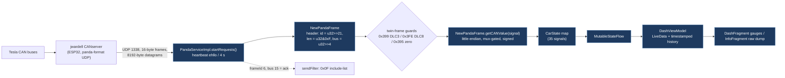
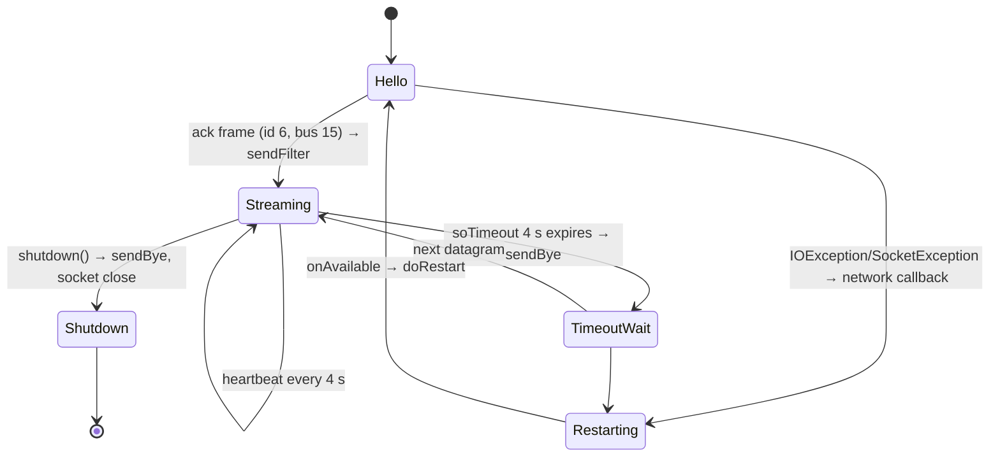

# ekr-candash

Deep-dive analysis of `legacy/ekr-candash` (replace mode: this file supersedes the previous summary; the old text is still reachable via `git show HEAD:docs/legacy/ekr-candash.md` and pre-replace claims are cited that way below).

## 1. Provenance

- Submodule path: `legacy/ekr-candash`
- Pinned gitlink (canonical, from `git ls-files -s legacy/ekr-candash`): `160000 c10d1293a73bec48a505da0a8381c89458fb6cde 0 legacy/ekr-candash`
- `git -C legacy/ekr-candash rev-parse HEAD` matches: `c10d1293a73bec48a505da0a8381c89458fb6cde` (subject: `Update README.md`, dated 2022-01-19)
- `git -C legacy/ekr-candash status --porcelain` clean; repository is **shallow** (`rev-parse --is-shallow-repository` → `true`), local history contains exactly 1 commit
- Upstream URL: `https://github.com/ekr/candash` (fetch/push origin)
- License: GPL-3.0 (`LICENSE`, full text read)
- Analysis date: 2026-11-21
- Frontmatter preservation: the pre-replace doc's YAML frontmatter is kept content-for-content. Two deviations, both ordered and recorded: (a) the description line carried inherited trailing whitespace after `It connects to a`, stripped per instruction; (b) the pre-replace file used CRLF line endings throughout — this file is written LF-only per hygiene, so frontmatter line terminators changed while line content did not. The description is also truncated mid-sentence in the original; recorded as a row in section 6, not edited.
- The pre-replace doc contained **no** `## Upstream (...)` sections (verified: `git show HEAD:docs/legacy/ekr-candash.md` lists only `## Overview`, `## Technical Details`, `## Architecture`, `## CAN Bus Integration`, `## Relevance to Our Project`), so nothing beyond the frontmatter was carried forward verbatim.

Files read (FULL-READ, with line ranges):

| File (under `legacy/ekr-candash/`) | Lines |
| --- | --- |
| `README.md` | 1-44 |
| `android/app/build.gradle` | 1-75 |
| `android/app/src/main/AndroidManifest.xml` | 1-41 |
| `android/app/src/main/java/app/candash/cluster/AppModule.kt` | 1-37 |
| `android/app/src/main/java/app/candash/cluster/BatteryGauge.kt` | 1-66 |
| `android/app/src/main/java/app/candash/cluster/CANNService.kt` | 1-80 |
| `android/app/src/main/java/app/candash/cluster/CANSignal.kt` | 1-14 |
| `android/app/src/main/java/app/candash/cluster/CANSignalHelper.kt` | 1-105 |
| `android/app/src/main/java/app/candash/cluster/CarState.kt` | 1-16 |
| `android/app/src/main/java/app/candash/cluster/CircularGauge.kt` | 1-102 |
| `android/app/src/main/java/app/candash/cluster/Constants.kt` | 1-78 |
| `android/app/src/main/java/app/candash/cluster/DashFragment.kt` | 1-1352 |
| `android/app/src/main/java/app/candash/cluster/DashRepository.kt` | 1-38 |
| `android/app/src/main/java/app/candash/cluster/DashViewModel.kt` | 1-240 |
| `android/app/src/main/java/app/candash/cluster/FullscreenActivity.kt` | 1-144 |
| `android/app/src/main/java/app/candash/cluster/Hex.java` | 1-90 |
| `android/app/src/main/java/app/candash/cluster/InfoFragment.kt` | 1-112 |
| `android/app/src/main/java/app/candash/cluster/LinearGauge.kt` | 1-77 |
| `android/app/src/main/java/app/candash/cluster/MockPandaService.kt` | 1-198 |
| `android/app/src/main/java/app/candash/cluster/NewPandaFrame.kt` | 1-86 |
| `android/app/src/main/java/app/candash/cluster/PandaFrame.java` | 1-196 |
| `android/app/src/main/java/app/candash/cluster/PandaService.kt` | 1-10 |
| `android/app/src/main/java/app/candash/cluster/PandaServiceImpl.kt` | 1-300 |
| `android/app/src/main/java/app/candash/cluster/PowerConnectionReceiver.kt` | 1-38 |
| `android/app/src/main/java/app/candash/cluster/StringUtils.java` | 1-28 |
| `android/app/src/main/java/app/candash/cluster/TeslaDashboardApplication.kt` | 1-5 |
| `android/app/src/main/java/app/candash/cluster/TimestampedValue.kt` | 1-7 |
| `android/app/src/test/java/app/candash/cluster/GetFrameValueTest.kt` | 1-74 |
| `android/app/src/test/java/app/candash/cluster/PandaFrameTest.java` | 1-11 |

Files explicitly NOT read (inventoried via `git -C legacy/ekr-candash ls-files`, hidden dirs included):

- `.idea/` (4 files), `android/.idea/` (10 files), `android/app/.idea/` — IDE project metadata, no protocol content
- `android/app/src/main/res/**` — drawables, fonts, layouts (`fragment_dash.xml` etc.), values, anims; UI chrome only; every gauge-scaling constant cited below comes from `DashFragment.kt` code, not these files
- `android/gradle/wrapper/gradle-wrapper.jar` — binary
- `android/build.gradle`, `android/settings.gradle`, `android/gradle.properties`, `android/gradlew*`, `android/app/proguard-rules.pro`, all `.gitignore` files — build plumbing; dependency surface captured from `android/app/build.gradle` (okhttp 3.5.0, guava, hilt, coroutines 1.3.9)

## 2. Executive verdict

CANdash is a **read-only Android instrument-cluster client**, not a CAN manipulator: it receives raw 16-byte comma.ai-panda-format frames from a jwardell CANserver over UDP port 1338 and decodes them entirely client-side. The valuable artifact for TeslaCANModder is the hand-reverse-engineered signal table (`CANSignalHelper.createCANSignals()`, 35 signal registrations over 22 frames, with startBit/bitLength/factor/offset/mux) plus several frame reads we do not ship (0x2D3 sun state, 0x204 charge status, 0x1D5/0x1D8 motor torque, 0x22E ultrasonic distances, 0x241 coolant flow, 0x395/0x396 inverter temps, 0x3FE brake temps, 0x368 cruise set speed, 0x7FF mux-1 AWD bit). Four of its decodes bit-match ours exactly (0x399 blind spot, 0x2E1 frunk latch, 0x33A SoC integer, 0x332 mux-0 min thermistor), which is genuine independent confirmation. Its decoder assumes **little-endian byte assembly for every multi-byte signal**, which contradicts our big-endian decoders and community DBC convention — either CANserver byte-swaps payloads upstream or candash decodes are wrong for multi-byte fields; only a bench capture settles it, so every candash bit position is a lead, not a port. Nothing here mutates, injects, or checksums frames — there is no safety-relevant CAN behavior to port, and the dead code (`PandaFrame.java` string decoder, `CANNService` websocket experiment) must never be copied.

## 3. Evidence map

No CAPTURE evidence exists in this repo: no captured vehicle frames are committed; all test vectors are hand-constructed. Every real-behavior claim below is CODE-READ or TEST-READ; TEST-READ asserts the decode implementation's behavior on self-built vectors only (circular for real-vehicle claims, noted per row).

| Source file | Lines | What it proves | Grade |
| --- | --- | --- | --- |
| `PandaServiceImpl.kt` | 26, 29-33 | CANserver wire constants: UDP port 1338, heartbeat string `"ehllo"` (sic), goodbye `"bye"`, 4000 ms heartbeat interval, unused 1000 ms timeout constant | CODE-READ |
| `PandaServiceImpl.kt` | 45-59 | Socket: unbound `DatagramSocket`, `soTimeout` = 4000 ms, `reuseAddress` | CODE-READ |
| `PandaServiceImpl.kt` | 87-162 | RX loop: 8192-byte datagram (16 × 512), 16-byte frame stride, `frameId == 0` breaks, ack detection, heartbeat resend | CODE-READ |
| `PandaServiceImpl.kt` | 127-134 | Ack frame identity: `frameId == 6 && busId == 15` triggers filter upload; other frames go to `handleFrame` | CODE-READ |
| `PandaServiceImpl.kt` | 164-191 | Read-only dispatch: signals looked up per frame ID, values written into `CarState`; wrong-bus twin guards (0x399 DLC 3, 0x3FE DLC 8, 0x395 zero-payload) | CODE-READ |
| `PandaServiceImpl.kt` | 224-228 | Filter upload: `0x0F` include-list; commented `0x0C` "send all" alternative | CODE-READ |
| `PandaServiceImpl.kt` | 230-293 | Send failure → `checkNetwork` → `restartLater` → `ConnectivityManager.NetworkCallback` → `doRestart` | CODE-READ |
| `NewPandaFrame.kt` | 3-20 | Panda 16-byte header: `frameId = u32le >> 21`, `frameLength = u32le & 0x0F`, `busId = u32le >> 4` | CODE-READ |
| `NewPandaFrame.kt` | 31-57 | Signal decode: little-endian byte assembly, per-byte accumulation `value += valueForByte shl previousByteBitLength` | CODE-READ |
| `NewPandaFrame.kt` | 59-75 | Two's-complement via `valueToSigned`; mux check `byte0 & mask == muxIndex` where mask width = `serviceIndex` bits | CODE-READ |
| `CANSignalHelper.kt` | 49-96 | The full signal table: 35 registrations, frame IDs 0x102-0x7FF, with startBit/bitLength/factor/offset/mux/signed | CODE-READ |
| `CANSignalHelper.kt` | 11-21 | Socket filter bytes: first byte `0x0F` = include mode, then `busId.toByte()` + 4-byte frame ID per signal (duplicates included) | CODE-READ |
| `Constants.kt` | 40-43, 59-65 | Gear codes 1=P 2=R 3=N 4=D; charge status enum 0-6 (inactive/connected/standby/EVSETestActive/EVSETestPassed/enabled/fault) | CODE-READ |
| `DashFragment.kt` | 410-445 | Power = `battAmps * battVolts`, min/max odometer prefs, power bar scaled `pow(0.7)` | CODE-READ |
| `DashFragment.kt` | 628-642 | Ultrasonic thresholds: base l1=300/l2=200; above 35 mph (or 35 km/h-converted) l1=400/l2=250 | CODE-READ |
| `DashFragment.kt` | 754-798 | Blind spot red-flash gated on BSL/BSR ∈ {1,2} and suppressed when `autopilotState == 3` | CODE-READ |
| `DashFragment.kt` | 833-872 | Charging UI mode gate: `chargeStatus != 0` swaps dash for charge meter | CODE-READ |
| `DashFragment.kt` | 879-903 | Closure semantics: open ∈ {1,4}, closed = 2; all-closed requires every closure == 2 | CODE-READ |
| `GetFrameValueTest.kt` | 11-17 | TEST-READ: ack frame parses to `frameId 6`, `busId 15` | TEST-READ |
| `GetFrameValueTest.kt` | 37-52 | TEST-READ: 0x2E1 mux hit decodes 2, wrong mux returns null | TEST-READ |
| `GetFrameValueTest.kt` | 55-61 | TEST-READ: 0x132 16-bit signed LE decode ×−0.1 = 3.0 (circular vector — asserts the LE assumption, not the vehicle) | TEST-READ |
| `CANNService.kt` | 38-75 | Dead websocket experiment to `http://canserver.local/ws`, callbacks only log; never wired to UI | CODE-READ |
| `PandaFrame.java` | 96-179 | Legacy string-based decoder with fixed 3-bit mux; superseded in-repo by `NewPandaFrame` | CODE-READ |
| `PandaFrameTest.java` | 7-10 | Vacuous test: calls `getValueString`, asserts nothing | TEST-READ |
| `MockPandaService.kt` | 13-28 | Mock data source, 2000 ms period, 4 canned `CarState`s cycling | CODE-READ |
| `DashViewModel.kt` | 179-239 | NSD/mDNS discovery of service type `_panda._udp` | CODE-READ |
| `AndroidManifest.xml` | 7-9 | Permissions: INTERNET, ACCESS_NETWORK_STATE, WAKE_LOCK only — no location, no USB | CODE-READ |
| `README.md` | 1-44 | Setup flow (CANserver v2.1 firmware, hotspot modes), blind spot rationale ("car does not return blind spot data from the cameras unless the turn signal is on"), known speed-pause issue | SUMMARY-ONLY |

## 4. Architecture and build surface

Single-module Android app (applicationId `app.candash.cluster`, minSdk 23, targetSdk 30, viewBinding, Hilt DI, coroutines 1.3.9, okhttp 3.5.0). No shared core / platform port split — this is a pure client. No build flags gate any protocol behavior.

Entry points: `FullscreenActivity` (launcher) → `DashFragment` / `InfoFragment` switch; `PowerConnectionReceiver` (dead); `TeslaDashboardApplication` (Hilt shell). Data pipeline is fully one-directional — nothing is ever transmitted to the vehicle bus (verified by demonstrated negative anchor: no `sendframe|writeframe|cansend|transmit` anywhere in `android/app/src/main/java/`).



There is no TX path to the vehicle anywhere in this repo; the only outbound traffic is heartbeat/bye/filter datagrams to the CANserver.

## 5. Mechanism catalogue

### 5.1 CANserver UDP stream client

- **Claim (README / summary):** connect to CANserver over Wi-Fi (hotspot either way); old doc (`git show HEAD:docs/legacy/ekr-candash.md` line 21) says "Indirect — connects to a CANserver over Wi-Fi, which bridges CAN bus to network".
- **Code path:** `PandaServiceImpl.kt:87` — `startRequests()` → `sendHello()` (heartbeat `"ehllo"`, line 29) → `getSocket().receive(packet)` → 16-byte stride loop (123-135) → `handleFrame` / `sendFilter`.
- **Frame spec:** transport-level only: 8192-byte datagram = up to 512 panda frames × 16 bytes; header 8 bytes (LE): `frameId = u32 >> 21`, `busId = u32 >> 4`, `frameLength = u32 & 0x0F` (`NewPandaFrame.kt:9-13`); payload 8 bytes. Ack frame: `frameId == 6 && busId == 15` (`PandaServiceImpl.kt:129`). Stride stop: `frameId == 0` (`PandaServiceImpl.kt:127`).
- **Gates and timing:** heartbeat every 4000 ms (`PandaServiceImpl.kt:32,101-104`); socket `soTimeout` 4000 ms (`PandaServiceImpl.kt:48,56`); on timeout sends `"bye"` and continues (112-119).
- **State machine:** running ⇄ shutdown via `inShutdown`/`shutdown` flags with `yield()` wait (90-93); crash path leaves `shutdown = false` (156-159).



- **Tests:** None found. No test exercises the socket loop, heartbeat cadence, or ack handling.
- **Evidence grade:** CODE-READ
- **Verdict:** CONFIRMED (protocol constants); the ack/filter handshake semantics beyond `0x0F`/`0x0C` are UNVERIFIED against any CANserver spec (none exists in this repo).
- **Adapt to TeslaCANModder?** no impact — we are the CAN source; our WiFi REST/stream transports already fill the server role.

### 5.2 Socket include-filter negotiation

- **Claim (README / summary):** not mentioned in old doc.
- **Code path:** `CANSignalHelper.kt:11-21` — `socketFilterToInclude()` → `PandaServiceImpl.kt:224-228` `sendFilter()` on ack.
- **Frame spec:** one datagram: first byte `0x0F` ("including these"), then per signal `busId.toByte()` (all registered signals use −1 → `0xFF`) + 4-byte LE frame ID; duplicate frames repeated once per signal registration (30+ entries for 22 unique IDs). Commented alternative: `byteArrayOf(0x0C)` = send all (`PandaServiceImpl.kt:226-227`).
- **Gates and timing:** sent only once per ack.
- **State machine:** None found.
- **Tests:** None found.
- **Evidence grade:** CODE-READ
- **Verdict:** PARTIAL — byte format is code-factual but `0x0F`/`0x0C`/`0xFF`-bus semantics have no in-repo documentation; UNVERIFIED against CANserver firmware.
- **Adapt to TeslaCANModder?** already present conceptually — our firmware's variant ID filters (`firmware/lib/vehicle/can/handler/filters.h:91,117`) plus `can:raw:on/off` are the same idea server-side.

### 5.3 Little-endian multiplexed signal decoder

- **Claim (README / summary):** old doc line 48: "App receives decoded CAN signals over the network (not raw CAN frames)"; line 50: "No direct CAN frame parsing in the app itself". Both CONTRADICTED — see section 6.
- **Code path:** `NewPandaFrame.kt:31` — `getCANValue(canSignal)` → `isCorrectMux()` (64-71) → per-byte LE accumulation (39-51) → `valueToSigned` (59-62) → factor/offset (52-56).
- **Frame spec:** signal = (`startBit`, `bitLength`, `factor`, `offset`, `serviceIndex`, `muxIndex`, `signed`); mux: `payload[0] & ((0xff >> (8 - serviceIndex))) == muxIndex`, i.e. `serviceIndex` is the mux bit-width in byte 0 (3 → `0x07`, 2 → `0x03`, 8 → full byte). Multi-byte values assembled low-byte-first: `value += valueForByte shl previousByteBitLength`.
- **Gates and timing:** wrong mux returns `null` (not 0) — consumers skip the update.
- **State machine:** None found.
- **Tests:** `testFrunkState` (`GetFrameValueTest.kt:37-43`) asserts mux-0 0x2E1 bits 3-6 decodes 2; `testFrunkStateWrongMultiplex` (46-52) asserts wrong mux → null; `testBatteryAmps` (55-61) asserts 0x132 16-bit signed ×−0.1 → 3.0 on a hand-built LE vector (circular); `testAckFrame` (11-17) asserts header parse; `testBinaryStringConversion` (20-25) asserts payload↔binary-string roundtrip; `testSpeed` (28-34) asserts 0 from a non-production signal definition (startBit 12, len 12, ×0.08 −40) that matches no registered signal.
- **Evidence grade:** CODE-READ + TEST-READ (implementation behavior only; no vehicle capture)
- **Verdict:** CONFIRMED as implementation; the LE byte-order assumption for multi-byte signals is UNVERIFIED against real frames and conflicts with our big-endian decoders (see section 11).
- **Adapt to TeslaCANModder?** never port as decoder code — unvalidated byte order and we already have a decode pipeline; the signal table is adapted as data leads only (section 13).

### 5.4 Any-bus twin-frame guards

- **Claim (README / summary):** old doc line 46 mentions dual-bus CANserver for blind spot, but not the twin-ID problem.
- **Code path:** `PandaServiceImpl.kt:171-179` — inside `handleFrame()`: drop `0x399` with `frameLength == 3`, drop `0x3FE` with `frameLength == 8`, drop `0x395` when `frame.isZero(1)` (payload bytes 1-7 all zero).
- **Frame spec:** heuristic: same 11-bit ID arrives from both CAN buses (signals registered with `busId = -1` = any bus); the "wrong" twin is identified by DLC or zero payload, not by bus ID.
- **Gates and timing:** per-frame, evaluated before decode; note the comment at `PandaServiceImpl.kt:169-170` — "since I am using the 'any bus' filter, 0x399 exists on both buses with different data".
- **State machine:** None found.
- **Tests:** None found.
- **Evidence grade:** CODE-READ
- **Verdict:** CONFIRMED (guards exist); effectiveness UNVERIFIED (no capture, no test).
- **Adapt to TeslaCANModder?** no impact — our firmware scopes 0x399 by bus/variant instead (`firmware/lib/vehicle/can/ids.h:21` ISA vs `ids.h:63` blind spot; `docs/reference/can-protocol.md` "On HW3, 0x399 on the Vehicle bus carries DAS_status (blind spot)" note) — same problem, stricter solution, already present.

### 5.5 Blind spot monitoring pipeline

- **Claim (README / summary):** README lines 30-32: ultrasonic-based, camera BSM only when turn signal on; old doc line 49 says only "blind spot alerts (from rear ultrasonic sensors)" — incomplete, see section 6.
- **Code path:** `PandaServiceImpl.kt:164-191` decode → `CarState` → `DashFragment.kt:742-830` render: camera BSM path `blindSpotLeft/Right ∈ {1,2}` → red flashing background + BS warning icon (754-798), gated off when `autopilotState == 3` (744); ultrasonic path `leftVehicle/rightVehicle` (0x22E 9-bit distances) → two-stage proximity arcs (799-830), only when `gearState != gearPark` (799).
- **Frame spec:** 0x399: BSL bits 4-5, BSR bits 6-7 (×1, level 0/1/2); AutopilotState bits 0-3 (gate value 3); 0x22E: leftVehicle bits 45-53, rightVehicle bits 0-8 (×1, raw distance units — treated as centimeters implicitly via thresholds).
- **Gates and timing:** speed-dependent thresholds: `sensingSpeedLimit = 35` (MPH display) or `35f.kmh` when units are km/h (`DashFragment.kt:628-635`); above it l1=400/l2=250, below l1=300/l2=200 (636-642); two arcs: `< l1 && >= l2` outer, `< l2` inner (801-820).
- **State machine:** BSL/BSR levels 0/1/2 plus AP-override:

```mermaid
stateDiagram-v2
    [*] --> Clear : BSL=0, BSR=0
    Clear --> LeftWarn : BSL in {1,2}
    Clear --> RightWarn : BSR in {1,2}
    LeftWarn --> Clear : BSL=0
    RightWarn --> Clear : BSR=0
    LeftWarn --> APBlue : autopilotState == 3 (BSM UI suppressed)
    RightWarn --> APBlue
    APBlue --> Clear : AP state != 3
    note right of APBlue : DashFragment.kt:744 gate\nblind spot supersedes AP unless AP engaged
```

- **Tests:** None found for the pipeline; decode bits covered indirectly only by repo-less tests (no test touches 0x399 or 0x22E).
- **Evidence grade:** CODE-READ
- **Verdict:** CONFIRMED (dual-mechanism: 0x399 camera BSM + 0x22E ultrasonic).
- **Adapt to TeslaCANModder?** already present — our `decodeBlindSpotLeftLevel/RightLevel` (`firmware/lib/vehicle/can/feature/body/turn_signal.h:119-138`) reads the identical bits (byte 0 bits 5:4 / 7:6).

### 5.6 Closure / door state machine

- **Claim (README / summary):** not mentioned in old doc.
- **Code path:** `DashFragment.kt:879-903` `processDoors()` → `displayOpenDoors()` (905-1019) → car-outline UI.
- **Frame spec:** 0x102: frontLeft bits 0-3, rearLeft bits 4-7; 0x103: frontRight bits 0-3, rearRight bits 4-7, liftgate bits 56-59; 0x2E1: frunk bits 3-6, mux 0 (3-bit mux). All ×1. Latch semantics: open ∈ {1,4}, closed = 2 (881-897); all-closed requires every closure == 2 exactly.
- **Gates and timing:** split-screen variant uses `setOf(1,3)` for liftgate (`DashFragment.kt:963-965`) — internal inconsistency (likely bug, candash-only, harmless to us).
- **State machine:** per closure: unknown(0) / open(1) / closed(2) / moving-ajar(4).
- **Tests:** `testFrunkState` (`GetFrameValueTest.kt:37-43`) asserts 0x2E1 mux-0 frunk field = 2 — the only closure TEST-READ.
- **Evidence grade:** CODE-READ + TEST-READ
- **Verdict:** CONFIRMED; {1,4}-open vs our `status != 2 && status != 0` (open = anything but closed/unknown) is a near-align delta (section 11).
- **Adapt to TeslaCANModder?** already present — `firmware/lib/vehicle/can/feature/drive/drive_context.h:39-105` decodes identical bit fields including frunk bits 3-6 mux 0 (`decodeFrunkOpen`, drive_context.h:100-105).

### 5.7 Charging-mode UI gate

- **Claim (README / summary):** not mentioned in old doc.
- **Code path:** `DashFragment.kt:833-872` — `chargeStatus != 0` → hide power/speed views, show charge meter + big SoC + charge rate; `== 0` → restore.
- **Frame spec:** 0x204 chargeStatus bits 4-5 (×1); value enum from `Constants.kt:59-65`: 0 inactive, 1 connected, 2 standby, 3 EVSETestActive, 4 EVSETestPassed, 5 enabled, 6 fault. UI only distinguishes zero vs non-zero.
- **Gates and timing:** min-power odometer suppressed while parked (`DashFragment.kt:412-415` "do not store minpower if car is charging").
- **State machine:**

```mermaid
stateDiagram-v2
    [*] --> Driving : chargeStatus == 0 (inactive)
    Driving --> Charging : chargeStatus != 0
    Charging --> Charging : connected/standby/EVSE-test/enabled/fault all render identically
    Charging --> Driving : chargeStatus == 0
    note right of Charging : DashFragment.kt:833-872\nenum granularity from Constants.kt:59-65 unused by UI
```

- **Tests:** None found.
- **Evidence grade:** CODE-READ
- **Verdict:** CONFIRMED as implementation; the 0x204 bit position itself has no independent confirmation (UNVERIFIED against capture).
- **Adapt to TeslaCanModder?** candidate for future PR — we ship no 0x204 decode; a charge-status field would gate client charging views. Capture-first.

### 5.8 Day/night theming from car state

- **Claim (README / summary):** README line 26 "Tap speed to force night mode on, otherwise it will copy what the car does".
- **Code path:** `CANSignalHelper.kt:64` isSunUp (0x2D3 bits 25-26) → `DashFragment.kt:229-235` `isSunUp()` → `setColors()` (1021-1176); force-night long-press (332-335); auto-follow observe (393-397).
- **Frame spec:** 0x2D3 bits 25-26, ×1; `1` = day, else night (182-187).
- **Gates and timing:** day/night switch repaints ~60 views and all gauge color filters each change.
- **State machine:** day / night / forced-night (3 render states).
- **Tests:** None found.
- **Evidence grade:** CODE-READ
- **Verdict:** CONFIRMED.
- **Adapt to TeslaCANModder?** candidate for future PR — 0x2D3 is not in our decode set (`firmware/lib/vehicle/can/ids.h` has no 0x2D3); one signal would let our dashboard/monitor mirror car day-night. Capture-first.

### 5.9 Power / torque performance gauges

- **Claim (README / summary):** README lines 20-21 (power meter min/max odometer, kW/HP toggle).
- **Code path:** `DashFragment.kt:401-445` power = `battAmps * battVolts` (W), min/max prefs (tap resets, 304-309), `pow(0.7)` bar compression (441-443), kW↔HP ×0.00134102 (426-428,438); torque: 0x1D5 front / 0x1D8 rear, bits 21-33, signed, ×0.222 (542-566), sign-flipped in reverse (544-546,557-559), auto-scaling max prefs (549-552,561-564).
- **Frame spec:** 0x1D5/0x1D8: 13-bit signed ×0.222 Nm-equivalent (units unlabeled in code); gauge denominators: brake temps /984 (518,524), inverter temps /214 (529,534), coolant /40 (539), battery brick temp (v+40)/128 (569).
- **Gates and timing:** RWD (`driveConfig == 0`, 0x7FF mux-1 bit 10) hides front motor views (276-285).
- **State machine:** None found (continuous values).
- **Tests:** None found.
- **Evidence grade:** CODE-READ
- **Verdict:** CONFIRMED as rendering logic; 0x1D5/0x1D8 bit positions UNVERIFIED against capture (we decode RPM from 0x106/0x115 instead — different frames, no conflict).
- **Adapt to TeslaCANModder?** candidate for future PR — motor torque decode is richer than our RPM-only telemetry (`firmware/lib/vehicle/can/feature/telemetry/powertrain.h:70-73` decodes 0x106/0x115 RPM); capture-first.

### 5.10 Autopilot status and hands-on UI

- **Claim (README / summary):** not detailed in old doc.
- **Code path:** 0x399 AutopilotState bits 0-3 (`CANSignalHelper.kt:69`) → gear highlight >2 (`DashFragment.kt:448-456`), icon states 1/2/3 (`updateAutopilotUI`, 1309-1345); AutopilotHands bits 42-45 (`CANSignalHelper.kt:70`) → warning band `> 2 && < 15` triggers flashing blue background + AP warning icon (571-625); steering icon rotated by 0x129 (`DashFragment.kt:1336-1343`).
- **Frame spec:** 0x399: AutopilotState bits 0-3 ×1 (values 1/2/3 observed; 3 = engaged), AutopilotHands bits 42-45 ×1 (0-2 quiet, 3-14 escalating warning).
- **Gates and timing:** 1000 ms reverse color animation; warning latched by `autopilotHandsToggle` (595-607).
- **State machine:** engaged(3) / standby(1-2) / off; hands warning on/off.
- **Tests:** None found.
- **Evidence grade:** CODE-READ
- **Verdict:** PARTIAL — hands-on band `2 < h < 15` is a UI heuristic, not a documented DAS state mapping; 0x399 AP-state nibble UNVERIFIED (our AP state comes from 0x39B, `firmware/lib/vehicle/can/handler/frame_readers.h:28-45`).
- **Adapt to TeslaCANModder?** no impact — client-side presentation; our nag/AP work already reads 0x39B hands-on state (`readDASAutopilotStatus/State`).

### 5.11 Mock and dead data sources

- **Claim (README / summary):** not mentioned.
- **Code path:** `MockPandaService.kt:19-28` cycles 4 canned `CarState`s every 2000 ms (`MS_BETWEEN_REQUESTS = 2_000`, line 13); `DashRepository.kt:15-17` selects mock via SharedPreferences `use_mock_server`; `CANNService.kt:38-75` dead websocket to `http://canserver.local/ws` (logs only, `GlobalScope.launch` at init, line 23); `PandaFrame.java` dead string decoder (superseded by `NewPandaFrame`; production path never instantiates it).
- **Frame spec:** None found (mock emits decoded values, not frames).
- **Gates and timing:** mock period 2000 ms; `CANNService.speed()` emits random 0-60 every 1000 ms (28-36).
- **State machine:** None found.
- **Tests:** None found.
- **Evidence grade:** CODE-READ
- **Verdict:** CONFIRMED dead/aux code.
- **Adapt to TeslaCANModder?** no impact — we ship `simu:start` synthetic CAN (`firmware/lib/vehicle/can/feature/misc/can_sim.h:28-29`) which is strictly richer (frame-level, not value-level mock). Never port the `GlobalScope` pattern.

### 5.12 Network resilience and discovery

- **Claim (README / summary):** README setup says click 'scan' and IP auto-populates; old doc line 39 says "Auto-discovers CANserver IP via scanning" (mischaracterized — it is NSD/mDNS discovery behind a manual button, see section 6).
- **Code path:** `DashViewModel.kt:179-239` NSD discovery of `_panda._udp` → resolve → `saveSettings`; `PandaServiceImpl.kt:238-244` send-failure → `checkNetwork` → `restartLater` (257-283) registers `ConnectivityManager.NetworkCallback` → `doRestart` (285-293) restarts RX.
- **Frame spec:** None found (control-plane only).
- **Gates and timing:** `sendBye` suppresses `checkNetwork` via `isBye` flag (240,243).
- **State machine:** see 5.1 connection lifecycle diagram.
- **Tests:** None found.
- **Evidence grade:** CODE-READ
- **Verdict:** CONFIRMED.
- **Adapt to TeslaCANModder?** candidate for future PR (client side) — mDNS-style discovery would replace manual IP entry when connecting our client to the ESP32 over WiFi; our firmware already serves mDNS-adjacent surfaces? (UNVERIFIED — whether our client currently supports any auto-discovery was not checked in this pass).

## 6. Summary vs code contradiction table

Pre-replace claims cited as `git show HEAD:docs/legacy/ekr-candash.md#<line>` (the old summary text; no live link).

| # | Pre-replace claim | Code evidence | Verdict |
| --- | --- | --- | --- |
| 1 | `HEAD:...md#48` — "App receives decoded CAN signals over the network (not raw CAN frames)" | `PandaServiceImpl.kt:105-135` receives raw 16-byte panda frames; `NewPandaFrame.kt:31-57` + `CANSignalHelper.kt:49-96` decode them client-side | CONTRADICTED |
| 2 | `HEAD:...md#50` — "No direct CAN frame parsing in the app itself — the CANserver handles decoding" | 35 signal registrations with startBit/bitLength/factor/offset/mux in `CANSignalHelper.kt:51-94`; frame header parse in `NewPandaFrame.kt:9-13` | CONTRADICTED |
| 3 | `HEAD:...md#3` (frontmatter description) — truncated mid-sentence ("It connects to a"), plus inherited trailing whitespace | preserved bytes; staleness recorded here per replace-mode rules; content otherwise accurate but incomplete (no port, no protocol) | STALE FRONTMATTER (kept, not edited) |
| 4 | `HEAD:...md#39` — "Auto-discovers CANserver IP via scanning" | `DashViewModel.kt:180` NSD/mDNS service discovery of `_panda._udp`, behind a manual 'scan' button (`InfoFragment.kt:50-57`); not a network scan | PARTIAL/mischaracterized |
| 5 | `HEAD:...md#49` — "blind spot alerts (from rear ultrasonic sensors)" only | two sources: 0x399 camera BSM levels (`CANSignalHelper.kt:58-59`, `DashFragment.kt:754-798`) and 0x22E ultrasonic distances (`CANSignalHelper.kt:67-68`, `DashFragment.kt:799-830`); README itself documents the camera-vs-signal gating | PARTIAL |

Agreements (old doc correct: indirect Wi-Fi bridge architecture, GPL-3.0, Android platform, dual-bus CANserver for blind spot, UI/UX takeaway value) are recorded in the evidence map and mechanism cards, not repeated here.

## 7. CAN frame and signal inventory

All rows are READ-ONLY: this repo never transmits on any bus. No frame carries a counter or checksum that this code reads or verifies (demonstrated negative anchor: `checksum|CRC` absent from all cluster sources). No vendored DBC/JSON catalog exists — the table below is the entire code-referenced inventory. "LE" = little-endian byte assembly as implemented by `NewPandaFrame.getCANValue` (the LE assumption itself is UNVERIFIED vs real frames — see section 11 preamble). `busId = -1` (any bus) for every signal; periods unknown (streamed as received; no period table in repo).

| ID (hex+dec) | Bus | Period | DLC | Byte/bit layout (LE numbering) | Scale/units | Counter | Checksum | R/W | Grade |
| --- | --- | --- | --- | --- | --- | --- | --- | --- | --- |
| 0x102 (258) | any | None found | 8 assumed | frontLeftDoor bits 0-3; rearLeftDoor bits 4-7 | latch: 1/4 open, 2 closed | none | none | read | CODE-READ (`CANSignalHelper.kt:78,80`) |
| 0x103 (259) | any | None found | 8 assumed | frontRightDoor bits 0-3; rearRightDoor bits 4-7; liftgateState bits 56-59 | latch: 1/4 open, 2 closed | none | none | read | CODE-READ (`CANSignalHelper.kt:73,79,81`) |
| 0x118 (280) | any | None found | 8 assumed | gearSelected bits 21-23 | 1=P 2=R 3=N 4=D | none | none | read | CODE-READ (`CANSignalHelper.kt:77`) — bit position conflicts with our decode, section 11 |
| 0x129 (297) | any | None found | 8 assumed | steeringAngle bits 16-29, signed | ×0.1, offset −819.2 (degrees) | none | none | read | CODE-READ (`CANSignalHelper.kt:82`) — conflicts with our decode |
| 0x132 (306) | any | None found | 8 assumed | battVolts bits 0-15; battAmps bits 16-31 signed | ×0.01 V; ×−0.1 A (positive = discharge) | none | none | read | CODE-READ (`CANSignalHelper.kt:52-53`) — LE conflicts with our BE |
| 0x1D5 (469) | any | None found | 8 assumed | frontTorque bits 21-33, signed | ×0.222 (Nm assumed) | none | none | read | CODE-READ (`CANSignalHelper.kt:83`) |
| 0x1D8 (472) | any | None found | 8 assumed | rearTorque bits 21-33, signed | ×0.222 | none | none | read | CODE-READ (`CANSignalHelper.kt:84`) |
| 0x204 (516) | any | None found | 8 assumed | chargeStatus bits 4-5 | 0-6 enum (see 5.7) | none | none | read | CODE-READ (`CANSignalHelper.kt:90`) |
| 0x22E (558) | any | None found | 8 assumed | rightVehicle bits 0-8; leftVehicle bits 45-53 | ×1 raw distance (cm assumed) | none | none | read | CODE-READ (`CANSignalHelper.kt:67-68`) |
| 0x241 (577) | any | None found | 8 assumed | coolantFlow bits 22-30 | ×0.11 (L/min assumed) | none | none | read | CODE-READ (`CANSignalHelper.kt:89`) |
| 0x257 (599) | any | None found | 8 assumed | uiSpeed bits 24-32; uiSpeedUnits bit 33 | ×1 (mph or km/h per bit 33) | none | none | read | CODE-READ (`CANSignalHelper.kt:55,57`) — different signal than our 0x257 decode |
| 0x2D3 (723) | any | None found | 8 assumed | isSunUp bits 25-26 | 1 = day, else night | none | none | read | CODE-READ (`CANSignalHelper.kt:64`) |
| 0x2E1 (737) | any | None found | 8 assumed | mux bits 0-2 (3-bit); frunkState bits 3-6 on mux 0 | latch: 1/4 open, 2 closed | none | none | read | CODE-READ (`CANSignalHelper.kt:74`) + TEST-READ (`GetFrameValueTest.kt:37-52`) |
| 0x332 (818) | any | None found | 8 assumed | mux bits 0-1 (2-bit); battBrickMin bits 24-31 on mux 0 | ×0.5, offset −40 °C | none | none | read | CODE-READ (`CANSignalHelper.kt:85`) |
| 0x33A (826) | any | None found | 8 assumed | uiRange bits 0-9; stateOfCharge bits 48-54 | ×1 mi (range); ×1 % (SoC) | none | none | read | CODE-READ (`CANSignalHelper.kt:51,61`) |
| 0x368 (872) | any | None found | 8 assumed | cruiseControlSpeed / maxSpeedAP bits 32-40 (duplicate registrations) | ×0.5 (units unlabeled) | none | none | read | CODE-READ (`CANSignalHelper.kt:71-72`) |
| 0x395 (917) | any | None found | DLC-guarded | rearTemp bits 24-31 | ×1, offset −40 °C | none | none | read | CODE-READ (`CANSignalHelper.kt:88`, guard `PandaServiceImpl.kt:178`) |
| 0x396 (918) | any | None found | 8 assumed | frontTemp bits 24-31 | ×1, offset −40 °C | none | none | read | CODE-READ (`CANSignalHelper.kt:87`) |
| 0x399 (921) | any | None found | DLC-3 twin dropped | autopilotState bits 0-3; BSL bits 4-5; BSR bits 6-7; autopilotHands bits 42-45 | ×1 levels | none | none | read | CODE-READ (`CANSignalHelper.kt:58-59,69-70`, guard `PandaServiceImpl.kt:171`) |
| 0x3F5 (1013) | any | None found | 8 assumed | turnSignalLeft bits 0-1; turnSignalRight bits 2-3 | 0 off, 1 dark-lit, 2 lit | none | none | read | CODE-READ (`CANSignalHelper.kt:62-63`) — conflicts with our decode |
| 0x3FE (1022) | any | None found | DLC-8 twin dropped | brakeTempFL bits 0-9; FR bits 10-19; RL bits 20-29; RR bits 30-39 | ×1, offset −40 °C | none | none | read | CODE-READ (`CANSignalHelper.kt:91-94`, guard `PandaServiceImpl.kt:174`) |
| 0x7FF (2047) | any | None found | 8 assumed | mux byte 0 (full, 8-bit); driveConfig bit 10 on mux 1 | 1 = AWD, 0 = RWD (`Constants.kt:53-54`) | none | none | read | CODE-READ (`CANSignalHelper.kt:86`) |

No frames are mutated, injected, or built from zeros anywhere in this repo.

## 8. Constants and tuning table

| Constant | Value | File:line | Meaning | Grade |
| --- | --- | --- | --- | --- |
| `port` | `1338` | `PandaServiceImpl.kt:26` | CANserver UDP port | CODE-READ |
| `heartbeat` | `"ehllo"` (sic — typo'd "hello") | `PandaServiceImpl.kt:29` | heartbeat string; must be reproduced verbatim to talk to a CANserver | CODE-READ |
| `goodbye` | `"bye"` | `PandaServiceImpl.kt:30` | disconnect string | CODE-READ |
| `heartBeatIntervalMs` | `4_000` | `PandaServiceImpl.kt:32` | heartbeat + socket timeout cadence | CODE-READ |
| `socketTimeoutMs` | `1_000` | `PandaServiceImpl.kt:33` | declared but unused — actual `soTimeout` = 4000 (48,56); dead constant | CODE-READ |
| datagram buffer | `16 * 512` | `PandaServiceImpl.kt:106` | up to 512 panda frames per receive | CODE-READ |
| ack identity | `frameId 6, busId 15` | `PandaServiceImpl.kt:129` | triggers filter upload | CODE-READ |
| filter include byte | `0x0F` | `CANSignalHelper.kt:14` | "include these frames" mode | CODE-READ |
| filter all byte | `0x0C` (commented out) | `PandaServiceImpl.kt:227` | send-all alternative | CODE-READ |
| mux bit-widths | `serviceIndex` 3 / 2 / 8 → masks `0x07` / `0x03` / `0xFF` | `NewPandaFrame.kt:64-71` | mux selector width in byte 0 | CODE-READ |
| gear codes | `1,2,3,4` | `Constants.kt:40-43` | P, R, N, D | CODE-READ |
| charge status enum | `0..6` | `Constants.kt:59-65` | inactive/connected/standby/EVSE-test-active/EVSE-test-passed/enabled/fault | CODE-READ |
| `awd` / `rwd` | `1f` / `0f` | `Constants.kt:53-54` | driveConfig values | CODE-READ |
| `l1Distance` / `l2Distance` | `300/200` base, `400/250` above limit | `DashFragment.kt:45-46,636-642` | ultrasonic proximity thresholds | CODE-READ |
| `sensingSpeedLimit` | `35` | `DashFragment.kt:628,634` | mph (or 35 km/h converted) threshold switching ultrasonic bands | CODE-READ |
| autopilot engaged | `== 3` (BSM gate), `> 2` (gear highlight) | `DashFragment.kt:744,449` | AP state values | CODE-READ |
| hands warning band | `> 2 && < 15` | `DashFragment.kt:578` | hands-on escalation heuristic (UI-only, no DBC backing in repo) | CODE-READ |
| power bar exponent | `pow(0.7f)` | `DashFragment.kt:441-443` | nonlinear power gauge compression | CODE-READ |
| kW→HP | `0.00134102` | `DashFragment.kt:426-428,438` | unit toggle | CODE-READ |
| gauge denominators | brake `/984`, inverter `/214`, coolant `/40`, battery `(v+40)/128` | `DashFragment.kt:518,529,534,539,569` | full-scale normalization (display-only) | CODE-READ |
| door open set | `{1,4}` (closed `2`); liftgate split-screen `{1,3}` | `DashFragment.kt:881-897,963-965` | latch semantics; internal inconsistency noted | CODE-READ |
| `MS_BETWEEN_REQUESTS` | `2_000` | `MockPandaService.kt:13` | mock cadence | CODE-READ |
| `ipAddressLocalNetwork` | `192.168.4.1` | `Constants.kt:15-16` | CANserver hotspot default IP | CODE-READ |
| NSD service type | `_panda._udp` | `DashViewModel.kt:180` | discovery target | CODE-READ |
| battery poll | `1000` ms | `FullscreenActivity.kt:31,57-78` | keep-screen-on check cadence | CODE-READ |

## 9. Failure modes and edge cases

No MCP2515/bus-off/watchdog/OTA concepts exist in this repo (no CAN hardware) — `None found` for those categories; the rows below are the app's actual failure surface.

| Failure | Handling code path | Tested? | Grade |
| --- | --- | --- | --- |
| UDP receive timeout (4 s) | `PandaServiceImpl.kt:112-119` → sendBye, `yield()`, continue loop | No | CODE-READ |
| Send IOException/SocketException | `PandaServiceImpl.kt:236-244` → `checkNetwork` → `restartLater` → NetworkCallback `onAvailable` → `doRestart` → `startRequests` | No | CODE-READ |
| Generic exception in RX loop | `PandaServiceImpl.kt:156-159` → logs, `inShutdown = false`, loop **exits**; `shutdown` stays `false` so `isRunning()` still reports true — silent stall, no user feedback, no retry | No | CODE-READ |
| Partial datagram (padding) | `frameId == 0` → `break` (`PandaServiceImpl.kt:127-128`) | No | CODE-READ |
| Wrong-bus twin frames | hard guards 0x399 DLC 3 / 0x3FE DLC 8 / 0x395 zero-payload (`PandaServiceImpl.kt:171-179`) | No | CODE-READ |
| Wrong mux frame | `getCANValue` returns null → value silently not updated (`NewPandaFrame.kt:64-71`) | Yes — `testFrunkStateWrongMultiplex` (`GetFrameValueTest.kt:46-52`) | TEST-READ |
| CANserver IP wrong/unset | default `192.168.4.1` (`Constants.kt:15`), heartbeat still sent; timeouts forever with no stale-data indicator (values freeze; no "signal lost" UI) | No | CODE-READ |
| Stale gauge values after signal loss | `CarState` map never decays; min/max odometer prefs persist across restarts (`DashFragment.kt:411-414`) — a stale `maxPower` can pin the power bar scale | No | CODE-READ |
| Split-screen re-entry | `savedLayoutParams` NSE risk if never populated (`DashFragment.kt:354-360` force-unwraps `savedParams!!`) | No | CODE-READ |
| Mock/real service switch mid-run | `DashViewModel.saveSettings` (52-58) cancels job then restarts; race with `inShutdown` flag loop (`PandaServiceImpl.kt:90-92`) | No | CODE-READ |
| PowerConnectionReceiver | computes `isPlugged` but the launch intent is commented out (`PowerConnectionReceiver.kt:28-35`) — dead receiver | No | CODE-READ |

## 10. Test coverage map

- `GetFrameValueTest.kt` — asserts: ack header parse (`testAckFrame`, 11-17: frameId 6, busId 15); payload↔binary-string roundtrip (`testBinaryStringConversion`, 20-25); a near-vacuous speed decode (`testSpeed`, 28-34: asserts 0 using a signal definition that matches no registered signal); frunk mux hit and miss (`testFrunkState`, 37-43; `testFrunkStateWrongMultiplex`, 46-52); 0x132 signed LE current (`testBatteryAmps`, 55-61: ×−0.1 → 3.0). All vectors are hand-built with the same LE assumption the decoder implements — they verify the implementation, not the vehicle.
- `PandaFrameTest.java` — vacuous: calls `PandaFrame.getValueString` with no assertion (7-10).

Critical paths with NO test (risk in one line each):

- `handleFrame` twin guards (`PandaServiceImpl.kt:171-179`) — a wrong-bus frame silently corrupts BSM/temp displays.
- Heartbeat/ack/filter protocol bytes — a typo'd `"ehllo"` would silently kill the stream; nothing pins it.
- Network recovery path — untested restart logic can deadlock on `inShutdown` flag races.
- RX-loop generic exception — app reports running while dead (section 9).
- All `DashFragment` interpretation constants (thresholds 300/400, charge enum, hands band) — display correctness rests on no test at all.
- 0x118 gear / 0x129 steering / 0x3F5 turn-signal bit positions — no test and conflicting with our decodes (section 11).

## 11. Parity matrix with TeslaCANModder

Preamble: candash assembles every multi-byte signal **little-endian** (`NewPandaFrame.kt:39-51`), while all our decoders assemble **big-endian** (e.g. `firmware/lib/vehicle/can/feature/telemetry/bms.h:20,31`). For single-byte/nibble fields the two conventions coincide; for multi-byte fields they do not. Either CANserver byte-swaps payloads before UDP (UNVERIFIED — no CANserver source in this repo) or candash multi-byte decodes are wrong. Until a bench capture settles this per frame, every multi-byte candash position below is a lead, not a port. All our-side citations are CODE-READ from our tree.

| Signal/frame | Upstream decode (cite) | Our decode (cite) | Delta | Action |
| --- | --- | --- | --- | --- |
| 0x33A SoC bits 48-54 ×1 % | `CANSignalHelper.kt:51` | `decodeBmsActualSocInt` `firmware/lib/vehicle/can/feature/telemetry/bms.h:268-270` (`data[6] & 0x7F`) | none — identical bits, single-byte field | ignore (independent confirmation) |
| 0x33A range bits 0-9 | `CANSignalHelper.kt:61` (LE, ×1 mi) | `decodeBmsExpectedRange` `bms.h:235-239` (BE assembly `(data[0]<<2)\|(data[1]>>6)`, ×1.6 km) | same span claimed, different physical bits (`data[1]` top vs bottom) + unit factor | capture-first |
| 0x132 voltage bits 0-15 ×0.01 | `CANSignalHelper.kt:52` (LE) | `decodeBmsVoltage` `bms.h:18-22` (BE) | byte-order contradiction | capture-first (ours matches community DBC consensus) |
| 0x132 current bits 16-31 | `CANSignalHelper.kt:53` (signed LE, ×−0.1, positive = discharge) | `decodeBmsCurrent` `bms.h:29-33` (signed BE, ×0.1, negative = discharge) | byte order + sign convention | capture-first |
| 0x257 speed | `CANSignalHelper.kt:55,57` uiSpeed bits 24-32 ×1 + units bit 33 | `decodeVehicleSpeed` `firmware/lib/vehicle/can/feature/telemetry/powertrain.h:18-22` (bytes 2-3 signed ×0.01 km/h) | different signals on same frame (UI speed vs physical speed) | capture-first; candash's UI-speed is a candidate decode for our monitor |
| 0x399 BSL/BSR | `CANSignalHelper.kt:58-59` bits 4-5 / 6-7 | `decodeBlindSpotLeftLevel/RightLevel` `firmware/lib/vehicle/can/feature/body/turn_signal.h:119-138` (byte 0 bits 5:4 / 7:6) | none — exact bit match | ignore (independent confirmation) |
| 0x399 AP state / hands | `CANSignalHelper.kt:69-70` bits 0-3 / 42-45 | we read AP status/state from 0x39B: `readDASAutopilotStatus/State` `firmware/lib/vehicle/can/handler/frame_readers.h:28-45`; 0x399 declared in our ids twice by role (`ids.h:21` ISA chime HW4, `ids.h:63` blind spot) | different frame for AP state; 0x399 dual identity handled by variant on our side, by DLC upstream | ignore for AP state; capture-first if we ever want 0x399 as AP-state fallback |
| 0x3F5 turn signals | `CANSignalHelper.kt:62-63` byte 0 bits 0-1 / 2-3 | `decodeTurnSignalLeftActive/RightActive` `turn_signal.h:93-111` (byte 6 bits 3:2 / 5:4) | bit-position contradiction — both cannot be right | capture-first (we also TX 0x3F5 bursts for `turn:left3`, so decode-vs-inject coherence matters) |
| 0x2E1 frunk latch | `CANSignalHelper.kt:74` bits 3-6, mux 0 (3-bit) | `decodeFrunkOpen` `firmware/lib/vehicle/can/feature/drive/drive_context.h:100-105` (mux 0, bits 3-6) | none — exact match | ignore (independent confirmation) |
| 0x102/0x103 door latches | `CANSignalHelper.kt:78-81` bits 0-3 / 4-7; open = {1,4}, closed = 2 | `decodeDoor*Open` `drive_context.h:50-83` + `decodeLatchOpen` :39-43 (open = anything but 0/2) | near-align; ours broader (treats 3,5+ as open too) | ignore (ours is the safer superset) |
| 0x118 gear | `CANSignalHelper.kt:77` bits 21-23 (1=P 2=R 3=N 4=D) | `decodeGearState` `powertrain.h:29-32` (byte 0 bits 3:1, same value codes) | bit-position contradiction; value codes agree | capture-first |
| 0x129 steering angle | `CANSignalHelper.kt:82` bits 16-29, ×0.1, offset −819.2 | `decodeSteeringAngle` `powertrain.h:59-63` (bytes 0-1 signed ×0.1, ± right) | bit-position + encoding contradiction (offset-binary 14-bit vs signed 16-bit) | capture-first |
| 0x332 mux-0 min brick temp | `CANSignalHelper.kt:85` bits 24-31, ×0.5, −40, 2-bit mux | `decodeBmsThermistorTMin` `bms.h:537-540` (`data[3] * 0.5f - 40.0f`) | none — same byte, same scale | ignore (independent confirmation) |
| 0x7FF GTW_carConfig | `CANSignalHelper.kt:86` mux 1, bit 10 (AWD) | `readGtwAutopilotTier` `frame_readers.h:65-72` (mux 2, byte 5 bits 4:2, AP tier) | same frame, different mux and purpose — no conflict | capture-first if we add the AWD bit to `platform` |
| 0x368 cruise set speed | `CANSignalHelper.kt:71-72` bits 32-40 ×0.5 (registered twice under two names) | `decodeCruiseSetSpeedKph` `firmware/lib/vehicle/can/handler/bus/chassis.h:37-41` + `drive_context.h:137-143` (0x389 bits 0-11 ×0.1, SNA `0xFFF`) | different frame entirely (0x368 vs 0x389) | capture-first; 0x368 not in our `ids.h` |
| 0x102/0x103/0x2E1/0x3F5 R/W role | read-only everywhere | we TX 0x2E1-adjacent closures? no — we TX 0x273 (`firmware/lib/vehicle/can/feature/body/trunk.h:32-50`) and 0x3F5 bursts; candash only reads | complementary roles, no overlap conflict | ignore |

Frames upstream decodes that we do not touch at all (candidate leads, not parity conflicts): 0x1D5/0x1D8 (torque — we decode RPM from 0x106/0x115 instead, `powertrain.h:70-73`), 0x2D3 (sun), 0x204 (charge status), 0x22E (ultrasonic), 0x241 (coolant), 0x395/0x396 (inverter temps — our `can-ids.md` lists 0x315/0x376 for inverter temps, different IDs), 0x3FE (brake temps), 0x7FF mux-1 AWD bit.

## 12. Surface inventory and security notes

| Surface | Where | Semantics |
| --- | --- | --- |
| UDP client → CANserver :1338 | `PandaServiceImpl.kt:87-162` | heartbeat `"ehllo"` / bye / include-filter upload; receives frame stream; read-only w.r.t. vehicle |
| NSD/mDNS discovery `_panda._udp` | `DashViewModel.kt:179-239` | resolves CANserver host address |
| WebSocket `http://canserver.local/ws` | `CANNService.kt:38-75` | dead experiment; logs only; never used by UI |
| Mock service toggle + IP entry | `InfoFragment.kt:43-57`, `DashRepository.kt:15-17` | SharedPreferences `use_mock_server`, `ip_address_pref_key` |
| Long-press gestures (dash config) | `DashFragment.kt:310-335` | fragment switch, night-mode toggle, gauge-mode cycle |
| Keep-screen-on battery watcher | `FullscreenActivity.kt:57-78` | FLAG_KEEP_SCREEN_ON while plugged |
| PowerConnectionReceiver | `PowerConnectionReceiver.kt:12-37` | registered in manifest; launch code commented out — dead |

Provenance/security findings:

- No hardcoded credentials, keys, or certs anywhere.
- UDP stream is **unauthenticated plaintext**: any host on the network can spoof CANserver frames and drive false gauge/blind-spot displays (display-only risk — no actuation path exists in this app).
- WebSocket target is cleartext `http://`; dead code but would be insecure if revived.
- Default IP `192.168.4.1` (`Constants.kt:15`) hard-coded hotspot assumption.
- `allowBackup="true"` in manifest — minor, no secrets present.
- No dangerous build flags; gradle wrapper jar committed (standard practice, not a finding).
- App never gains write access to the vehicle: demonstrated negative anchors show no frame transmit, no checksum/CRC code at all.

## 13. Adaptation assessment

| Mechanism | Value | Cost | Risk | Evidence | Decision |
| --- | --- | --- | --- | --- | --- |
| Signal table as decode leads (0x2D3, 0x204, 0x22E, 0x1D5/0x1D8, 0x241, 0x395/0x396, 0x3FE, 0x368, 0x7FF mux-1 AWD) | high — 9 frames we do not decode, with concrete bit layouts | low (extend our decode pipeline per frame; e.g. add alongside `bms.h`/`drive_context.h` readers) | medium — all bit positions rest on candash's unvalidated LE decoder | CODE-READ upstream, no CAPTURE | candidate for future PR — capture-first, one frame at a time |
| 0x204 charge-status decode + charging-UI gate pattern | high for client charging view | low (one decoder + one state field) | low — read-only single byte | CODE-READ | candidate for future PR |
| 0x2D3 day/night decode | medium (dashboard theming parity with car) | low | low | CODE-READ | candidate for future PR |
| 0x1D5/0x1D8 motor torque | medium (perf telemetry richer than RPM) | low | medium — LE unverified | CODE-READ | candidate for future PR, after byte-order capture |
| mDNS/NSD auto-discovery pattern for client→ESP32 WiFi | medium (UX) | medium (client + firmware service advertisement) | low | CODE-READ upstream; our-side support UNVERIFIED | candidate for future PR (client-side investigation first) |
| 0x399 blind spot decode | none — ours matches bit-for-bit | — | — | CODE-READ both sides | already present |
| 0x2E1 frunk / door latch decode | none — identical | — | — | CODE-READ both sides | already present |
| 0x33A SoC / 0x332 mux-0 temp | none — identical | — | — | CODE-READ both sides | already present |
| Include-filter negotiation | none — our `filters.h` + `can:raw:on/off` cover it | — | — | CODE-READ both sides | already present (server-side) |
| Twin-frame guards (DLC/zero heuristics) | negative — weaker than our bus/variant scoping | — | would add brittle heuristics | CODE-READ | never port |
| LE signal decoder (`NewPandaFrame.getCANValue`) | none — unvalidated byte order, we have a pipeline | — | high if copied | CODE-READ | never port |
| `PandaFrame.java` string decoder | none — dead in-repo, O(payload) string building per signal | — | — | CODE-READ | never port |
| `CANNService` websocket + `GlobalScope` | none — dead, leaky | — | — | CODE-READ | never port |
| CANserver UDP client (`ehllo`, port 1338) | none — we are the CAN source, not a client of jwardell hardware | — | — | CODE-READ | no impact |

Top 3 adaptation candidates: (1) 0x204 charge-status decode with a charging-mode gate in the client monitor; (2) 0x2D3 isSunUp day/night signal; (3) 0x1D5/0x1D8 motor torque decode — all capture-first, none on SUMMARY-ONLY evidence.

## 14. Do-not-copy list

| Item | File:line | Reason |
| --- | --- | --- |
| `"ehllo"` heartbeat literal | `PandaServiceImpl.kt:29` | typo'd protocol constant; if any CANserver interop is ever built it must be captured from the real protocol doc, not inherited as a joke that became load-bearing |
| LE byte-order decode assumption | `NewPandaFrame.kt:39-51` | contradicts our BE decoders and community DBC convention; unvalidated |
| String-based bit extraction (`getPayloadBinaryString`, `signExtend` with TODO bounds check) | `PandaFrame.java:53-154` | dead, allocation-heavy, superseded even upstream |
| `GlobalScope.launch` in constructor | `CANNService.kt:22-26` | unstructured concurrency leak pattern |
| DLC/zero-payload twin guards | `PandaServiceImpl.kt:171-179` | frame-shape heuristics brittle across variants; our bus/variant scoping is the correct mechanism |
| `xor`-composed UI flag masks | `FullscreenActivity.kt:94,122` | `xor` used where intent was `or` (Android UI anyway, irrelevant to us — but do not copy as a pattern) |
| Hands-on warning band `>2 && <15` | `DashFragment.kt:578` | UI heuristic with no DBC backing in repo; must not inform any DAS-state logic |
| Duplicate signal registration (two names, same bits) | `CANSignalHelper.kt:71-72` | upstream wart; keep our single-definition discipline |

## 15. History and evolution

- The submodule clone is **shallow with exactly one commit**: `c10d129 2022-01-19 "Update README.md"`. `git -C legacy/ekr-candash log` shows nothing else; pre-pin history was NOT reviewed (see section 17).
- Evolution must therefore be read from the code itself (CODE-READ, in-tree evidence):
  - Decoder rewrite: `PandaFrame.java` (binary-string walking, fixed 3-bit mux at `PandaFrame.java:168`, sign-extension TODO at :41-48) was replaced by `NewPandaFrame.kt` (bitwise, parametric mux width) — the production path (`PandaServiceImpl.kt:125`) only instantiates `NewPandaFrame`.
  - Transport experiment abandoned: `CANNService.kt` websocket to `http://canserver.local/ws` (with a random-number `speed()` stub at :28-36) was superseded by the UDP panda stream in `PandaServiceImpl`.
  - Signals tried and rolled back (commented registrations): `uiSpeedHighSpeed` 0x257 bits 34-42 (`CANSignalHelper.kt:56`), `rearLeftVehicle`/`rearRightVehicle` 0x22E at bits 36/9 replaced by the current `leftVehicle`/`rightVehicle` at 45/0 (:65-66 vs :67-68), `displayBrightnessLev` 0x273 bits 32-39 ×0.5 (:60), `conditionalSpeedLimit` 0x3D9 bits 56-60 ×5 (:75), `solarAngle` 0x2D3 bits 32-39 signed (:76) — the sun-angle experiment reduced to the 2-bit `isSunUp` that shipped.
  - A richer canned mock dataset was commented out wholesale (`MockPandaService.kt:94-198`) in favor of the 4-state minimal set.
  - `socketTimeoutMs = 1_000` declared but never wired (`PandaServiceImpl.kt:33`) — a tuning experiment that never landed; effective timeout is 4000 ms.
  - The pre-replace analysis doc claimed things the code disproves (section 6) — treat any other prose-only claims from that era as SUMMARY-ONLY.
- Network-only history (GitHub issues/PRs, candash.app site, jwardell CANserver firmware v2.1 protocol): UNVERIFIED — not fetched during this analysis.

## 16. Re-verification recipe

Pinned snapshot: `160000 c10d1293a73bec48a505da0a8381c89458fb6cde 0 legacy/ekr-candash` (canonical `git ls-files -s` form). Analysis date 2026-11-21. This machine has no standalone `grep` binary in pwsh; every anchor below was demonstrated with `git grep -nE` (ERE semantics identical to `grep -nE`), run from the repo root. Run inside the submodule for upstream anchors — submodule files are invisible to the parent repo's `git grep`.

```bash
OLD=c10d1293a73bec48a505da0a8381c89458fb6cde
git -C legacy/ekr-candash fetch --tags --prune
git -C legacy/ekr-candash log --oneline $OLD..origin/main   # expect: nothing if still pinned (shallow clone may need unshallow first)
git -C legacy/ekr-candash diff --stat $OLD..origin/main
git -C legacy/ekr-candash diff $OLD..origin/main -- android/app/src/main/java/ android/app/src/test/
git ls-files -s legacy/ekr-candash   # expect: 160000 c10d1293a73bec48a505da0a8381c89458fb6cde 0
git -C legacy/ekr-candash rev-parse HEAD   # must equal the gitlink SHA above
```

Positive anchors (demonstrated 2026-11-21, expected hits pasted):

```text
git -C legacy/ekr-candash grep -nE 'stateOfCharge, -1, Hex\(0x33A\)|battAmps, -1, Hex\(0x132\)' -- android/app/src/main/java/app/candash/cluster/CANSignalHelper.kt
  -> CANSignalHelper.kt:51: insertCANSignal(Constants.stateOfCharge, -1, Hex(0x33A), 48, 7, 1f, 0f)
  -> CANSignalHelper.kt:53: insertCANSignal(Constants.battAmps, -1, Hex(0x132), 16, 16, -.1f, 0f, signed=true)

git -C legacy/ekr-candash grep -nE 'ehllo|val port = 1338|heartBeatIntervalMs = 4_000|16 \* 512' -- android/app/src/main/java/app/candash/cluster/PandaServiceImpl.kt
  -> PandaServiceImpl.kt:26: private val port = 1338
  -> PandaServiceImpl.kt:29: private val heartbeat = "ehllo"
  -> PandaServiceImpl.kt:32: private val heartBeatIntervalMs = 4_000
  -> PandaServiceImpl.kt:106: val buf = ByteArray(16 * 512)

git -C legacy/ekr-candash grep -nE 'shr 21|and 0x0F|shr 4' -- android/app/src/main/java/app/candash/cluster/NewPandaFrame.kt
  -> NewPandaFrame.kt:9: val frameId = firstHeaderValue shr 21
  -> NewPandaFrame.kt:12: val frameLength = secondHeaderValue and 0x0F
  -> NewPandaFrame.kt:13: val busId = secondHeaderValue shr 4

git -C legacy/ekr-candash grep -nE 'canserver\.local|_panda\._udp' -- android/app/src/main/java/app/candash/cluster/CANNService.kt android/app/src/main/java/app/candash/cluster/DashViewModel.kt
  -> CANNService.kt:40: .url("http://canserver.local/ws")
  -> DashViewModel.kt:180: nsdManager?.discoverServices("_panda._udp", NsdManager.PROTOCOL_DNS_SD, getDiscoveryListener())
```

Negative anchors (absence claims, demonstrated, exit code 1 = no output):

```text
git -C legacy/ekr-candash grep -nE '0xAA|XOR' -- android/app/src/main/java/app/candash/cluster/NewPandaFrame.kt android/app/src/main/java/app/candash/cluster/PandaFrame.java
  -> no output (no binary framing, no XOR checksums)

git -C legacy/ekr-candash grep -niE 'checksum|CRC' -- 'android/app/src/main/java/app/candash/cluster/*.kt' 'android/app/src/main/java/app/candash/cluster/*.java'
  -> no output (repo never reads or computes any CAN checksum)

git -C legacy/ekr-candash grep -nEi 'sendframe|writeframe|cansend|transmit' -- android/app/src/main/java/
  -> no output (read-only app; nothing is ever sent to the vehicle bus)
```

Our-side drift anchors (the `already present` decisions rest on these; demonstrated):

```text
git grep -nE 'decodeBlindSpotLeftLevel|f\.data\[0\] >> 4' -- firmware/lib/vehicle/can/feature/body/turn_signal.h
  -> turn_signal.h:119: inline uint8_t decodeBlindSpotLeftLevel(const Frame &f)
  -> turn_signal.h:123: uint8_t level = (f.data[0] >> 4) & 0x03; // Byte 0 bits 5:4

git grep -nE 'decodeBmsActualSocInt|data\[6\] & 0x7F' -- firmware/lib/vehicle/can/feature/telemetry/bms.h
  -> bms.h:268: inline uint8_t decodeBmsActualSocInt(const uint8_t *data)
  -> bms.h:270: return data[6] & 0x7F; // bits 48-54: 7-bit integer %

git grep -nE 'decodeFrunkOpen|readBitsLE\(f\.data, 3, 4\)' -- firmware/lib/vehicle/can/feature/drive/drive_context.h
  -> drive_context.h:100: inline bool decodeFrunkOpen(const Frame &f)
  -> drive_context.h:105: return decodeLatchOpen((uint8_t)(readBitsLE(f.data, 3, 4) & 0x0F)); // bits 3-6: frunk latch

git grep -nE 'CAN_ID_DAS_STATUS2|decodeCruiseSetSpeedKph' -- firmware/lib/vehicle/can/handler/bus/chassis.h
  -> chassis.h:37: s.cruiseSetSpeedKph = decodeCruiseSetSpeedKph(f);
  -> chassis.h:41: if (f.id == CAN_ID_DAS_STATUS2 && f.dlc >= 2)
```

If line numbers drift more than ~10, re-read the whole function; do not trust this document's numbers. Note for pwsh users: bare `grep` is unavailable on this machine (demonstrated failure during this analysis); `git grep -nE` is the verified equivalent and works from any directory.

## 17. Open questions and explicitly not investigated

- Pre-pin upstream history was **not reviewed**: the submodule is a shallow clone containing a single commit (`c10d129`, 2022-01-19); nothing before that pin is visible locally. Unshallowing (`git fetch --unshallow`) plus a `git log` pass would recover evolution; not done here.
- UNVERIFIED (each names what would settle it):
  - Little-endian vs big-endian multi-byte assembly (0x132, 0x33A range, 0x257, 0x368, 0x1D5/0x1D8): settle with a listen-only bench capture on our chassis/vehicle bus, comparing `decodeBmsVoltage` output against candash's LE math on the same frame.
  - 0x118 gear bits 21-23 (candash) vs our byte 0 bits 3:1: same capture; both cannot be correct for the same vehicle.
  - 0x129 steering bits 16-29 offset-binary (candash) vs our bytes 0-1 signed: capture.
  - 0x3F5 turn-signal byte 0 (candash) vs our byte 6: capture; also relevant because we inject 0x3F5 bursts (`turn:left3`) — decode must match what we inject.
  - Whether CANserver byte-swaps payloads before UDP (would reconcile the LE paradox): would require jwardell CANserver source (not in this repo) or a CANserver-side capture; not investigated.
  - 0x368 signal identity and units (×0.5 — mph? km/h?): capture; frame absent from our `can-ids.md`.
  - `0x0F`/`0x0C`/`0xFF`-bus filter semantics vs the CANserver firmware v2.1 protocol: needs the CANserver protocol documentation (README references it, repo does not contain it); network fetch not attempted.
  - Whether our client currently supports any mDNS-style auto-discovery for the ESP32 WiFi transport: our-side check outside this repo's scope; the adaptation candidate in 13 rests on that open question.
  - candash.app website / Discord references in README: network-only, not fetched.
- Explicitly not investigated: `android/app/src/main/res/**` layout XMLs (gauge geometry lives in code constants, section 8), IDE metadata, gradle wrapper jar contents, and the two Android instrumented-test dependencies (declared in `build.gradle` but no `androidTest` sources exist — the declared espresso runner is dead configuration).
