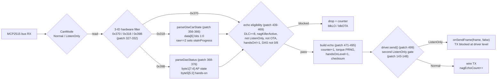
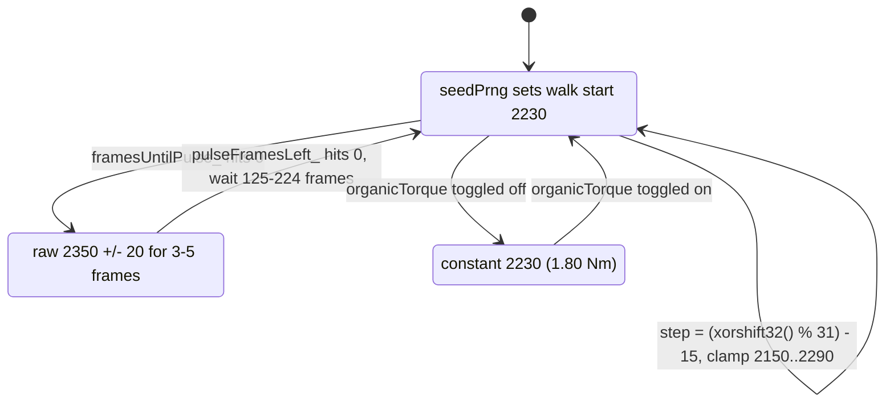
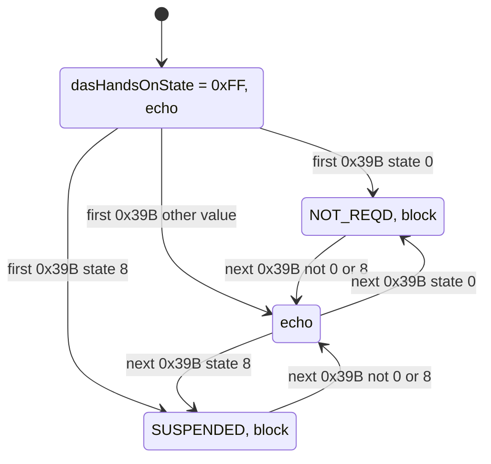

# enstw-tesla-can-mod-guide — code-grounded deep dive

## 1. Provenance

- **Submodule path:** `legacy/enstw-tesla-can-mod-guide`
- **Pinned gitlink SHA:** `c2097d7c1b77813d04402dafb714c9b6cf9fc52a` (`160000`, matches `rev-parse HEAD`; working tree clean)
- **Upstream URL:** `https://github.com/enstw/tesla-can-mod-guide` (origin fetch+push)
- **Upstream HEAD subject:** `docs: record 2nd-CAN FeatherWing 5709 ordered from DigiKey (1528-5709-ND)`
- **License:** none present in the gitlink tree (no `LICENSE` file in `git ls-files`); existing summary's `License: None` is correct. Upstream `flipper-tesla-fsd` / `ev-open-can-tools` code is referenced but **not vendored** here — both are gitignored (`.gitignore:29-32`), so any claim about their internals is second-hand in this snapshot.
- **Analysis date:** 2026-11-20
- **Files read (full, text):**
    - `README.md:1-213`
    - `AGENTS.md:1-88`
    - `CLAUDE.md:1-5`, `GEMINI.md:1-5` (stubs pointing to `AGENTS.md`)
    - `install-target.yaml:1-144`
    - `PROGRESS.md:1-360`
    - `FEATHER_HYPERY11_PORT_PLAN.md:1-661`
    - `patches/README.md:1-25`
    - `patches/2026-05-11-feather-hypery11-port.patch:1-1315` (the only code-like artifact)
    - `.gitignore:1-32`
- **Files explicitly NOT read:** `images/connected-setup.png`, `images/pinout-labeled.png`, `images/x170-enhanced.png`, `images/x179-connector.png` (binary; the repo itself says a photo cannot establish H/L polarity — `README.md:43,56`, `install-target.yaml:62`). No hidden source dirs exist beyond `.gitignore` (confirmed via `git ls-files`).
- **Citation convention:** patch line numbers are **patch-file lines** (the `+` lines), not line numbers in the target `ev-open-can-tools` tree.

## 2. Executive verdict

This is not a firmware repository; it is a goal-oriented install/research workspace for one 2024 Model 3 Highland HW4 on firmware 2026.20.6.1, plus a captured 1315-line `git apply` patch carrying the only implementation evidence: a driver-level listen-only `CanMode` gate (Sections 1), and a `FeatherHypery11Handler` doing 0x318 OTA gating, 0x39B DAS parsing, 0x370 EPAS counter+1 echo with forced `handsOnLevel=1`, and xorshift32 organic torque (Sections 2-3), plus 48 native Unity tests. The hardware wiring, AP-First gate, ±1.8 Nm cap, dual-CAN tap, BLE/Ban-Shield posture and FSD/telemetry decisions are **field notes, not code in this snapshot**. Of the 15 catalogued mechanisms, only the listen-only driver gate is a genuine gap in our firmware (we unconditionally call `setNormalMode()` at `firmware/lib/core/driver/common.h:100,217,256` and `esp32/board.h:72`); the 0x370 echo, checksum, DAS parse, DAS gate and organic/feifan strategies are already present and more sophisticated in `firmware/lib/vehicle/can/feature/fsd/nag.h` and `firmware/lib/vehicle/can/checksum.h`. The genuinely useful candidates are: (a) driver-level listen-only enforcement, (b) the 0x318 raw==2-only OTA gate (our docs claim an OTA-aware pause but no `otaInProgress` assignment was found in `firmware/lib`), and (c) a 0x39B byte0-low-nibble decode fallback for the #116 variant. Everything derived from hypery11 issue reports is SUMMARY-ONLY here and must stay a backlog item. FSD region unlock and telemetry-disable must be ported never on this evidence (reported server-side-blocked / suspected ban signal).

## 3. Evidence map

| Source file | Lines | What it proves | Grade |
| --- | --- | --- | --- |
| `patches/2026-05-11-feather-hypery11-port.patch` | 87-116 | `CanMode` enum + base-class `mode_` + `setMode()`/`mode()` API | CODE-READ |
| same | 117-174, 175-230 | MCP2515/ESP32 drivers apply ListenOnly via `setListenOnlyMode()`, preserve through `init()`/`setFilters()`, block `send()` | CODE-READ |
| same | 231-273 | `MockDriver` `blocked[]`, `setFiltersCalls`, mode reset | CODE-READ |
| same | 33-82 | `appSetup()` sets ListenOnly before `init()` under `LISTEN_ONLY_BOOT`; `appLoop()` emits status only on `FEATHER_HYPERY11` firmware build | CODE-READ |
| same | 274-535 | `FeatherHypery11Handler`: filters, DLC guards, 0x318/0x39B parse, 0x370 echo, torque PRNG, counters | CODE-READ |
| same | 339-366 | OTA gate: `frame.data[6] & 0x03`, only `raw == 2` blocks (issue #19 false-positive note) | CODE-READ |
| same | 368-376 | 0x39B parse: `ap=(byte1>>4)&0xF`, `handsOn=(byte5>>2)&0xF` | CODE-READ |
| same | 439-500 | Echo eligibility + frame build: skip `handsOn==1`, skip DAS 0/8, counter low nibble +1, `handsOnLevel=1`, checksum `sum(b0..b6)+0x70+0x03` | CODE-READ |
| same | 319-325, 502-534 | Torque constants `2150/2290/2330/2370/2230`; xorshift32 walk; pulse `2350±20` every 125-224 frames for 3-5 frames | CODE-READ |
| same | 587-767 | `test_native_can_mode` — 12 `RUN_TEST`, includes TX-block and `setFilters()` persistence | TEST-READ |
| same | 768-1315 | `test_native_hypery11` — 36 `RUN_TEST`, independent checksum oracle `verifyEchoChecksum`, envelope assertion | TEST-READ |
| `README.md` | 17-84, 126-155, 171-200 | Shopping list, X179 pinout table, termination, install steps, 2026.20 ban/bus findings | SUMMARY-ONLY |
| `install-target.yaml` | 4-62, 64-117, 119-144 | Canonical vehicle/hardware/target bus; 2026.20 reassessment; compile-time semantics; rollout | SUMMARY-ONLY |
| `PROGRESS.md` | 13-21, 75-103, 104-360 | Firmware state, AP-First / ±1.8 Nm / EPAS-faithful / Nag Burst field findings, upstream sync state | SUMMARY-ONLY |
| `FEATHER_HYPERY11_PORT_PLAN.md` | 29-66, 68-164, 207-347, 399-661 | Resume commands, Section 1/2/3 status, Bluefruit/FeatherWing wiring, test matrix, bring-up | SUMMARY-ONLY |
| `patches/README.md` | 12-25 | Patch targets baseline `3b0bd91`; `git apply --check` may need hand re-port | SUMMARY-ONLY |
| Our `firmware/lib/vehicle/can/feature/fsd/nag.h` | 11-32, 126-160, 412-487 | Our 3-stage `nagEchoShouldEcho`/`nagEchoCompute`/`nagEchoApply` pipeline; AP gate 3-6; DAS skip 0/8/15; handsOnLevel caller-controlled | CODE-READ (our side) |
| Our `firmware/lib/vehicle/can/checksum.h` | 58-75 | Our `nagChecksum()` = sum(b0..b6)+ID bytes, derived from `CAN_ID_EPAS_TORQUE` | CODE-READ (our side) |
| Our `firmware/lib/vehicle/can/handler/frame_readers.h` | 12-55 | Our 0x39B byte1-hi-nibble AP-state parse; no byte0 variant fallback | CODE-READ (our side) |
| Our `firmware/lib/vehicle/can/handler/bus/vehicle.h` | 130-136, 324-325 | Our 0x39B hands-on/ap/lane parse and real-hands capture from 0x370 byte4 | CODE-READ (our side) |
| Our `firmware/lib/core/driver/common.h` / `esp32/board.h` | 100, 217, 256 / 72 | Our MCP2515 setup unconditionally calls `setNormalMode()` — no driver-level listen-only mode | CODE-READ (our side) |
| Our `firmware/lib/vehicle/can/feature/safety/ban_shield.h` | 44-132 | Our 0x7FF snapshot/replay defense exists; it is a broadcast mask, not ban insurance | CODE-READ (our side) |
| `docs/reference/can-protocol.md`, `docs/reference/commands.md` (this repo) | as shipped | shipping CAN ID / command reference used for delta comparison | CODE-READ (docs) |

No CAPTURE-grade evidence exists in this snapshot: there is no candump, no captured frame log, and all four `images/*.png` are unread.

## 4. Architecture and build surface

- **Entry points:** no runtime entry point in this repo. The workspace coordinates four (gitignored) upstream clones: `flipper-tesla-fsd` (behavior source), `ev-open-can-tools` (host platform, `feather_rp2040_can`), `ev-open-can-tools-plugins` (JSON rules), and this guide root (`AGENTS.md:23-28`, `.gitignore:29-32`).
- **Shared core vs platform port:** all C++ lives in one patch against `ev-open-can-tools` baseline `3b0bd91` (`patches/README.md:14`). It modifies the shared driver layer (`can_driver.h`, both MCP2515 drivers, `mock_driver.h`), the shared dispatcher (`app.h`), adds one platform-specific handler (`handlers_hypery11.h`), one new firmware env, and two native test dirs (`FEATHER_HYPERY11_PORT_PLAN.md:68-146`).
- **Build flags:** `FEATHER_HYPERY11`, `LISTEN_ONLY_BOOT`, `DRIVER_MCP2515` (patch 544-553); `NATIVE_BUILD`, `FEATHER_HYPERY11` on native envs (patch 572-582). The per-feature knobs `dasGate`/`organicTorque`/`nagKillerActive` are runtime `Shared<bool>` fields, not compile flags (`FEATHER_HYPERY11_PORT_PLAN.md:152-155`).
- **Dependency boundaries:** Arduino framework + `autowp/autowp-mcp2515`, earlephilhower RP2040 core (patch 540-549). No WiFi/BLE/Flipper UI is ported by design (`install-target.yaml:74-77`). `Serial1` BLE bridge and NeoPixel are **planned** (port plan 207-281, 502-510), not in the patch.
- **Test surface:** four native envs — `native` (132), `native_nag` (28), `native_can_mode` (12), `native_hypery11` (36). The patch contains 48 `RUN_TEST` calls total across the two new suites; verified count.

Frame pipeline carried by the patch (patch-file line citations):



## 5. Mechanism catalogue

### M1 — X179 physical install envelope

- **Claim (README / summary):** X179 pin 1=+12V, 9/10=Body CAN, 13/14=Chassis CAN, 20=GND; MP1584EN fixed 5V buck; cut TERM 120Ω; wait 8-10 min after power-off; passenger footwell.
- **Code path:** none — hardware/doc only (`README.md:66-128`, `install-target.yaml:21-62`).
- **Frame spec:** n/a. **Gates/timing:** car off 8-10 min; 60Ω pair resistance; ~12V red→chassis.
- **State machine:** n/a. **Tests:** none.
- **Evidence grade:** SUMMARY-ONLY (physical claims unverifiable from git).
- **Verdict:** UNVERIFIED.
- **Adapt to TeslaCANModder?** no impact — our `docs/guides/hardware-setup.md` / `docs/reference/can-ids.md` already cover X179 and 500 kbps; do not treat photo labels as authoritative.

### M2 — Driver-level CAN mode / true listen-only gate

- **Claim:** "true MCP2515 listen-only mode first; a no-send handler is not enough" (`README.md:194`, port plan 401-419).
- **Code path:** patch 87-116 (`CanMode`, `mode_`) → 117-230 (`applyMode()` calls `setListenOnlyMode()`/`setNormalMode()`; `send()` returns false + `onSendFrame(frame,false)` in ListenOnly) → 33-52 (`appSetup()` sets ListenOnly before `init()` under `LISTEN_ONLY_BOOT`) → 231-273 (`MockDriver` records `blocked[]`).
- **Frame spec:** n/a (mode/transport gate). Counter/checksum n/a.
- **Gates and timing:** mode set before `init()`, preserved across `setFilters()`; TX blocked at driver level even if a handler calls `send()`.
- **State machine:** Normal ↔ ListenOnly via `setMode()`.
- **Tests:** `test_default_mode_is_normal`, `test_send_blocked_in_listen_only_mode`, `test_set_filters_preserves_listen_only_mode`, `test_listen_only_callback_reports_failure` at patch 611-744 (12 tests, 12 RUN_TEST at 750-764).
- **Evidence grade:** CODE-READ + TEST-READ.
- **Verdict:** CONFIRMED.
- **Adapt to TeslaCANModder?** **candidate for future PR** (top). Our `firmware/lib/core/driver/common.h:100,217,256` and `esp32/board.h:72` call `setNormalMode()` unconditionally; no `CanMode` abstraction exists. Requires `docs/checklists/can-review-checklist.md` + listen-only bench capture.

### M3 — Periodic `[STATUS]` emitter / diagnostics surface

- **Claim:** firmware prints one grep-able line every ~1 s: `[STATUS] t=… mode=… 370=… 318=… 39B=… dasSeen=… ota=… echo=… blkLO=… blkOTA=…`; NeoPixel and BLE mirrors planned.
- **Code path:** patch 386-414 (`emitStatusIfDue`, `kStatusIntervalMs=1000`, no-op under `NATIVE_BUILD`) wired at patch 57-70 from `appLoop()` via `static_cast<FeatherHypery11Handler*>`.
- **Frame spec:** n/a (Serial 115200; planned BLE 9600 at port plan 261-266).
- **Gates:** compiled out on native; mode label from live driver mode.
- **Tests:** `test_status_emit_compiles_on_native_as_noop` at patch 1217-1230.
- **Evidence grade:** CODE-READ (emitter) / SUMMARY-ONLY (NeoPixel, BLE mirror).
- **Verdict:** PARTIAL — emitter CONFIRMED, mirrors UNVERIFIED.
- **Adapt to TeslaCANModder?** no impact — our JSON-RPC `status` / `status:compact` and `recorder:status` already provide richer state. Do not copy the `[STATUS]` text format into our wire protocol.

### M4 — 0x318 OTA-install TX pause

- **Claim:** "raw value 2 means OTA installing and must block TX"; raw 1 historically caused false positives (hypery11 #19).
- **Code path:** patch 339-342 (`parseGtwCarState`) → 356-366 (`raw = frame.data[6] & 0x03; otaInProgress = (raw == 2)`) → 451-454 (`handleEpas` blocks echo).
- **Frame spec:** ID 0x318 (792), DLC ≥ 7, `data[6] bits[1:0]`: 0=none, 1=available, 2=installing, 3=scheduled.
- **Gates/timing:** single-frame state, cleared when raw returns 0; no timer.
- **State machine:** `otaInProgress` false↔true.
- **Tests:** `test_ota_raw_{0,1,2,3}`, `test_ota_clears_when_back_to_0` at patch 872-916.
- **Evidence grade:** CODE-READ + TEST-READ.
- **Verdict:** CONFIRMED.
- **Adapt to TeslaCANModder?** **candidate for future PR** — our `docs/reference/can-protocol.md` claims "OTA Guard: TX automatically paused when 0x318 indicates OTA in progress", but grep found no `otaInProgress` assignment anywhere in `firmware/lib` (only the `io.schema.json` field). Verify our actual gate first; if absent, implement the raw==2-only decode in our existing vehicle-bus handler (`firmware/lib/vehicle/can/handler/bus/vehicle.h` near `CAN_ID_GTW_CAR_STATE` handling) with a can-review checklist.

### M5 — 0x39B DAS state parse

- **Claim:** parse DAS AP state and hands-on state from 0x39B.
- **Code path:** patch 344-347 → 368-376: `dasApState=(byte1>>4)&0xF`, `dasHandsOnState=(byte5>>2)&0xF`, `dasSeen=true`; DLC ≥ 7 guard.
- **Frame spec:** ID 0x39B (923), DLC ≥ 7; AP nibble byte1[7:4], hands-on nibble byte5[5:2].
- **Gates/timing:** none. **State machine:** `dasSeen` latches true.
- **Tests:** `test_das_status_parses_ap_state`, `test_das_status_parses_hands_on_state` at patch 920-931.
- **Evidence grade:** CODE-READ + TEST-READ.
- **Verdict:** CONFIRMED.
- **Adapt to TeslaCANModder?** **already present** — our `frame_readers.h:42-45` and `vehicle.h:130-136` do the same. **Actual gap:** field note #116 says some HW4 2026.20 builds carry DAS state in `0x39B` byte0 low nibble (`PROGRESS.md:13`, `install-target.yaml:13`); our reader has no fallback. Candidate: add variant-aware decode fallback, pending on-car capture.

### M6 — 0x370 EPAS counter+1 echo, checksum, forced handsOnLevel=1

- **Claim:** echo 0x370 with counter+1 and recomputed checksum; force `handsOnLevel=1`.
- **Code path:** patch 334-354 (dispatch) → 439-500 (`handleEpas` builds echo) → 491-495 checksum → 499 `driver.send(echo)`.
- **Frame spec:** ID 0x370 (880), DLC 8. `data[0,1,5]` copied; `data[2]=(src&0xF0)|(torq>>8 &0xF)`; `data[3]=torq&0xFF`; `data[4]=(src&~0xC0)|0x40` (level 1); `data[6]=(src&0xF0)|((src&0xF)+1)`; `data[7]=sum(b0..b6)+0x70+0x03` (mod 256). Built from the real cached frame, not zeros.
- **Gates/timing:** DLC≥8, nag enabled, not ListenOnly, not OTA, `handsOn!=1`, DAS gate pass.
- **State machine:** none.
- **Tests:** `test_counter_{increments,wraps,preserves_upper}`, `test_echo_checksum_is_correct`, `test_echo_checksum_correct_across_counter_sweep`, `test_echo_preserves_bytes_0_1_5` at patch 1049-1185; independent oracle `verifyEchoChecksum` at patch 824-831.
- **Evidence grade:** CODE-READ + TEST-READ.
- **Verdict:** CONFIRMED.
- **Adapt to TeslaCANModder?** **already present** — `firmware/lib/vehicle/can/feature/fsd/nag.h:457-487` (`nagEchoApply`) + `checksum.h:67-75` (`nagChecksum`) implement the same shape with a shared pipeline. Do not re-port; our `legacy`/`safe` modes are exactly this behavior.

### M7 — Organic torque walk + grip pulses

- **Claim:** organic torque `1.00-2.40 Nm` walk with `2.80-3.20 Nm` grip pulses (`FEATHER_HYPERY11_PORT_PLAN.md:117-119,470-472`).
- **Code path:** patch 424-437 (`prngState_=0xDEADBEEF`, xorshift32) → 479/502-534 (`nextTorqueRaw`) → write into `data[2:3]` at 480-481.
- **Frame spec:** raw encoding `rawTorque=(Nm+20.5)/0.01`; walk raw `2150..2290` (1.00-2.40 Nm), pulse raw `2330..2370` (2.80-3.20 Nm, generated `2350+((rand%41)-20)`), fixed `2230` (1.80 Nm). Pulse duration `3+(rand%3)` frames, interval `125+(rand%100)` frames (~5-9 s at 25 Hz).
- **Gates/timing:** modulo-based (frame count), not wall-clock; `seedPrng(0)` falls back to `0xDEADBEEF`.
- **State machine:** walk ↔ pulse via `pulseFramesLeft_` / `framesUntilPulse_`.
- **Tests:** `test_organic_torque_stays_in_planned_envelope` (500 frames, requires both populations), `test_organic_torque_disabled_returns_fixed_value` at patch 1110-1149.
- **Evidence grade:** CODE-READ + TEST-READ.
- **Verdict:** CONFIRMED (as coded) — but see C2/C3 contradictions.
- **Adapt to TeslaCANModder?** **already present and deeper** — `nag.h:72-87,223-342` has a timed state machine (2 s state-2 pause, 500 ms state-1 grace, 1 s strong pause/1.5 s cycle/500 ms ramp), steering-angle feedback, and grip excursions `NAG_ORG_RAW_EXC_BASE=2350` (~3.02 Nm) every 125-225 frames. Our `feifan` mode (`nag.h:94-96,389-401,440-444`) is the closer match to upstream's late EPAS-faithful finding. Do not copy the simpler frame-count PRNG.



### M8 — DAS-aware nag gate (0/8 skip, 0xFF conservative echo)

- **Claim:** echo only when DAS hands-on state is not 0 (NOT_REQD) and not 8 (SUSPENDED); unseen 0xFF echoes conservatively.
- **Code path:** patch 462-469 (`if (das == 0 || das == 8) return;`) with default `dasHandsOnState=0xFF` at patch 304.
- **Frame spec:** state nibble from 0x39B byte5[5:2].
- **Gates/timing:** `dasGate` runtime toggle; disabled toggle overrides block (tested).
- **State machine:** n/a.
- **Tests:** `test_das_state_{0,8,2}_…`, `test_unseen_das_state_0xff_echoes_conservatively`, `test_das_gate_disabled_overrides_block` at patch 979-1020.
- **Evidence grade:** CODE-READ + TEST-READ.
- **Verdict:** CONFIRMED.
- **Adapt to TeslaCANModder?** **already present, stricter** — `nag.h:57-60` (`dasHandsOnRequested` 2-7,9,10) and `nag.h:150-155` (organic skips 0/8/15 + driver bypass). Our design does not do the "0xFF echoes" fallback; that fallback is a *weaker* safety posture, so do not adopt it.



### M9 — AP-First gate (`das_ap_state >= 3`)

- **Claim:** hold all injection until AP engaged and stable ≥1 s; beta.15 fixed off-by-one `>=3` (ACTIVE) not `>=2` (AVAILABLE) (`PROGRESS.md:145-148,255-260,354-356`).
- **Code path:** **none in the patch** — `dasApState` is parsed at patch 373 and stored at 302, but `handleEpas` (patch 439-500) never reads it. The gate exists only as a field note / required follow-up.
- **Frame spec:** 0x39B byte1[7:4] ≥ 3. **Gates/timing:** ≥1 s stability claimed in prose, not implemented here.
- **State machine:** n/a. **Tests:** none for a gate.
- **Evidence grade:** SUMMARY-ONLY (repo); our counterpart is CODE-READ.
- **Verdict:** UNVERIFIED in this repo — CONTRADICTED by patch code as a "required fix not yet applied".
- **Adapt to TeslaCANModder?** **already present for organic/full** (`nag.h:147-149` requires `dasApState` 3-6). Candidate (backlog, SUMMARY-ONLY): extend AP gating to `safe`/`natural`/`feifan`, which currently gate on hands-on only (`nag.h:132-141`) — but only after a bench capture confirms the 14.x/2026.20 preflight behavior.

### M10 — Dual-CAN tap contingency (second MCP2515 FeatherWing)

- **Claim:** on 2026.20, 0x370 (Party CAN 2/3) and DAS hands-on state may be on different buses; single-MCP2515 Feather can tap only one pair. Wing #5709 (PID 5709) ordered 2026-07-28 from DigiKey 1528-5709-ND; cut SJ3 TERM; shared SPI with onboard MCP25625.
- **Code path:** none — hardware/procurement notes only (`PROGRESS.md:19,26-32,335-347`, port plan 282-347).
- **Frame spec:** n/a. **Gates/timing:** only needed if listen-only sniff shows the two frames on different pairs.
- **Tests:** none. **Evidence grade:** SUMMARY-ONLY.
- **Verdict:** UNVERIFIED.
- **Adapt to TeslaCANModder?** **already present** — our firmware supports 3 buses (`BUS_MAX 3`, `busActive(i)`) with chassis/vehicle/body build flags. The actionable item is not code: validate whether "Party CAN X179 2/3" maps to our `BUS_BODY_ACTIVE` lane before any routing change (see preserved Upstream section).

### M11 — BLE diagnostics-only / USB-only reflash posture

- **Claim:** Bluefruit LE UART Friend on `Serial1` is diagnostics/control only; RP2040 flash stays USB-only; keep USB-C reachable after sealing (`install-target.yaml:33-41`, `PROGRESS.md:101-102`, port plan 207-280).
- **Code path:** none in patch — planned wiring only (`CTS` strapped to GND, mode switch `UART`, 9600 baud, no level shifting).
- **Gates/timing:** wiring alone does nothing until Section 4 command parser ships.
- **Tests:** none. **Evidence grade:** SUMMARY-ONLY.
- **Verdict:** UNVERIFIED (no code); rationale internally consistent.
- **Adapt to TeslaCANModder?** no impact — our BLE transport is telemetry/control, and our flashing path is USB/release-asset based; do not copy BLE-bootloader speculation (explicitly rejected upstream).

### M12 — 0x7FF Ban Shield / GTW Config Replay

- **Claim:** learn a healthy 0x7FF snapshot and retransmit on foreign payload; must be armed before 0x3FD unlock.
- **Code path:** **none in this repo** — only rollout prose (`PROGRESS.md:87,174-181`, `install-target.yaml:131`). Upstream renamed it "GTW Config Replay" and reports **no ban-prevention case in 6 weeks** (#60/#67).
- **Frame spec:** 0x7FF muxed GTW config; nibble decode in `PROGRESS.md:19`.
- **Tests:** none. **Evidence grade:** SUMMARY-ONLY (repo); our counterpart CODE-READ.
- **Verdict:** UNVERIFIED here / CONTRADICTED as "ban insurance".
- **Adapt to TeslaCANModder?** **already present** — `firmware/lib/vehicle/can/feature/safety/ban_shield.h:44-132` learns and replays a snapshot (`gtwSnapshot[8][8]` at `core/types.h:606`). Keep it as a broadcast-layer mask; never document it as ban prevention.

### M13 — FSD region unlock via 0x3FD bit 46 + 60

- **Claim:** unlock Taiwan region gate for a paid FSD VIN using 0x3FD HW4 bits 46+60; reported **blocked on 2026.20** — tier/region re-derived server-side (hypery11 #117), FSD NN refuses unapproved regions, #1 ban trigger (`README.md:10,153-155`, `PROGRESS.md:161-172,285-297`).
- **Code path:** none — deferred by design (`install-target.yaml:84-87,126-132`).
- **Frame spec:** 0x3FD mux0 bits 46/60 claimed; no implementation here.
- **Tests:** none. **Evidence grade:** SUMMARY-ONLY.
- **Verdict:** UNVERIFIED / reported BLOCKED.
- **Adapt to TeslaCANModder?** **never port on this evidence.** Our `region:spoof:*` (0x398 byte2) and `fsd:force:*` are separate mechanisms; do not add 0x3FD bit-46/60 region unlock from a repo that itself froze the goal.

### M14 — Telemetry-disable write (0x3F8 bit 43)

- **Claim:** candidate `UI_enableTripTelemetry=0`, default off; author warns the write "may itself be a ban signal" (`README.md:11,199`, `install-target.yaml:133-137`, `PROGRESS.md:94,305-310`).
- **Code path:** none — research-only, explicitly deferred.
- **Tests:** none. **Evidence grade:** SUMMARY-ONLY (hypothesis, flagged as such in `PROGRESS.md:315-317`).
- **Verdict:** UNVERIFIED.
- **Adapt to TeslaCANModder?** **never port** — no code, suspected ban signal, and our command set has no such write.

### M15 — Upstream tooling concepts (tap checker / incident recorder / 0x39B auto-profiles)

- **Claim:** ESP32-first tools: a tap capability checker that reports "works here / dual-CAN recommended", a ~10 s pre / 5 s post abort black-box recorder, and `0x39B`/`0x399` variant auto-profiles (`PROGRESS.md:197-209`).
- **Code path:** none in this repo (tools live in the gitignored `flipper-tesla-fsd` clone).
- **Tests:** none. **Evidence grade:** SUMMARY-ONLY.
- **Verdict:** UNVERIFIED.
- **Adapt to TeslaCANModder?** **candidate (concept only)** for the tap-capability checker; our `firmware/lib/core/can/recorder.h` and `ring_buffer.h` already cover capture, and our per-bus health status covers detection. Requires the actual upstream source before any port.

## 6. Summary vs code contradiction table

| # | Summary / README claim | Code evidence | Resolution |
| --- | --- | --- | --- |
| C1 | `docs/legacy` (old) + `README` say **205 tests** ("205 native tests across 4 suites", "205 passing"); port plan `:58` says `205/205 (132+28+12+33)` | Patch has **48 `RUN_TEST`** (12 in `test_can_mode` at 750-764, 36 in `test_hypery11` at 1266-1312); port plan `:124-135` itself says `36/36` and `208/208` | Old 205/33 figures stale. Authoritative count = **208** (132+28+12+36). Treat summary test counts as unreliable. |
| C2 | `PROGRESS.md:86` describes grip pulses **3.10-3.30 Nm** | Patch 323-324 `kTorquePulseMin=2330` (2.80 Nm), `kTorquePulseMax=2370` (3.20 Nm); 509 generates `2350±20` → 2330..2370. Port plan `:118` agrees with code (2.80-3.20) | PROGRESS figure wrong; code and port plan agree. |
| C3 | `PROGRESS.md:149-150,256-258` and `README.md:198` require a **±1.8 Nm hard cap** before TX ("our ~3 Nm pulses exceed this") | Patch 321-325 walk to 2290 (2.40 Nm), pulses to 2370 (3.20 Nm); only `kTorqueFixed=2230` is 1.80 Nm | Known unapplied fix, not a doc error per se — but the shipped patch violates the stated safety requirement. Do not treat the patch as vehicle-ready. |
| C4 | `PROGRESS.md:145-148,354-356`, port plan `:637-639` say AP-First `das_ap_state >= 3` gate is mandatory / must be re-ported | Patch parses `dasApState` at 373 but `handleEpas` (439-500) has **no** AP-state check | Gate absent from patch. Evidence for the gate is SUMMARY-ONLY in this snapshot. |
| C5 | Old summary said target bus X179 **13/14 Chassis "verified by frame visibility"** (`docs/legacy` old `:55-56`, `README.md:82`) | `README.md:196`, `install-target.yaml:58-59`, `PROGRESS.md:125-139`: 13/14 Bus-6 Chassis copy **trips 14.x preflight**; 0x370 confirmed on **Party CAN 2/3**; 9/10 is Vehicle CAN | Summary claim contradicted; canonical 13/14 left pending on-car confirmation, likely to move to 2/3. |
| C6 | Old summary said **"No standalone source code"** (`docs/legacy` old `:49`) | Patch contains a 256-line `FeatherHypery11Handler` (274-535), 175-line + 542-line native test files (587-1315), driver and dispatcher edits | Summary understated the artifact: there is no *buildable tree*, but there is substantial C++ source in patch form. |
| C7 | `install-target.yaml:114-115` sets `enable_fsd_region_unlock: true` and `enable_telemetry_disable_code: true` in `compile_time_semantics` | Same file `:84-87,133-137` and port plan `:535-536` defer both and keep them **off** for Goal A; `required_runtime_defaults` `:100-103` sets `telemetry_off_enabled: false` | Naming/stance tension: the `enable_*` flags describe eventual semantics, not enabled features. Do not read them as "on". |
| C8 | `PROGRESS.md:86` / port plan `:117-119` say pulses "every 5-9 s" | Patch 529-530: `125+(rand%100)` frames at 25 Hz = 5.0-8.96 s | CONFIRMED (no contradiction) — included to show the claim was checked. |

## 7. CAN frame and signal inventory

All citations are patch-file lines (see the convention in section 1). The "bus" column for the three decoded frames is upstream SUMMARY-ONLY on 2026.20: 0x370 is reported on Party CAN (X179 2/3), not the assumed 13/14 (`README.md:196`, `PROGRESS.md:125-139`); the patch itself is bus-agnostic (`echo.bus = frame.bus`, patch 474).

| ID (hex / dec) | Name | Bus | Period | DLC | Byte / bit layout | Scale / units | Counter | Checksum | R/W | Grade |
| --- | --- | --- | --- | --- | --- | --- | --- | --- | --- | --- |
| 0x370 / 880 | EPAS3P_sysStatus | Party CAN claimed on 2026.20 (SUMMARY-ONLY); patch bus-agnostic | no code rate-limit; pulse pacing assumes ~25 Hz (patch 527-528) | 8 — RX guard (patch 441), TX always 8 (patch 473) | RX: handsOnLevel `data[4] bits[7:6]` (patch 458). TX echo: bytes 0,1,5 copied (patch 476-485); torque 12-bit `data[2]` low nibble + `data[3]`, `data[2]` high nibble preserved (patch 480-481); handsOnLevel forced 1 in `data[4] bits[7:6]` (patch 484) | raw = (Nm + 20.5) / 0.01 (patch 319-320); walk 2150-2290 = 1.00-2.40 Nm, pulse 2330-2370 = 2.80-3.20 Nm, fixed 2230 = 1.80 Nm | `data[6] bits[3:0]`, +1 mod 16, high nibble preserved (patch 487-489) | `data[7] = (sum(data[0..6]) + 0x70 + 0x03) & 0xFF` (patch 491-495) — payload sum plus ID bytes | read (gate/decode) + write (echo injection) | CODE-READ |
| 0x318 / 792 | GTW_carState | Vehicle CAN per our reference; upstream tap location SUMMARY-ONLY | none (event decode) | ≥ 7 guard (patch 358) | `data[6] bits[1:0]` GTW_updateInProgress: 0=none, 1=available, 2=installing, 3=scheduled (patch 361-364) | enumerated raw, no scale | not used | not used | read only (drives `otaInProgress` TX gate) | CODE-READ |
| 0x39B / 923 | DAS_status | Vehicle CAN per our reference; upstream tap location SUMMARY-ONLY | none (event decode) | ≥ 7 guard (patch 370) | `data[1] bits[7:4]` DAS_autopilotState (patch 373); `data[5] bits[5:2]` DAS_autopilotHandsOnState (patch 374); `dasSeen` latch (patch 375) | 4-bit states, no scale | not used | not used | read only | CODE-READ |
| 0x3FD / 1021 | FSD mux (region unlock) | Chassis CAN per our reference | none | n/a | claimed mux-0 bits 46+60, no code in this snapshot | n/a | n/a | n/a | none — deferred by design (`install-target.yaml:84-87`) | SUMMARY-ONLY |
| 0x3F8 / 1016 | UI_enableTripTelemetry | n/a | none | n/a | claimed bit-43 write = 0, no code | n/a | n/a | n/a | none — research-only (`install-target.yaml:133-137`) | SUMMARY-ONLY |
| 0x7FF / 2047 | GTW_carConfig mux | Vehicle CAN per our reference | none | n/a | "learn healthy snapshot, replay on foreign payload" concept only (`PROGRESS.md:174-181`) | n/a | n/a | n/a | none — upstream renamed it GTW Config Replay; no code here | SUMMARY-ONLY |
| 0x399 / 921 | DAS_status variant carrier | n/a | none | n/a | `0x39B`/`0x399` variant auto-profile tooling concept (`PROGRESS.md:197-209`); note our reference assigns 0x399 to the HW4 ISA speed chime — layout conflict untested | n/a | n/a | n/a | none — tooling lives in the gitignored `flipper-tesla-fsd` clone | SUMMARY-ONLY |

## 8. Constants and tuning table

| Constant | Value | File:line (patch) | Meaning | Grade |
| --- | --- | --- | --- | --- |
| `kIdEpasStatus` | `0x370` (880) | 315 | EPAS sysStatus RX + echo TX arbitration ID | CODE-READ |
| `kIdGtwCarState` | `0x318` (792) | 316 | GTW car state (OTA decode) ID | CODE-READ |
| `kIdDasStatus` | `0x39B` (923) | 317 | DAS status decode ID | CODE-READ |
| torque raw scale | `raw = (Nm + 20.5) / 0.01` | 319-320 | 12-bit torque encoding into `data[2:3]` (high nibble of `data[2]` preserved) | CODE-READ |
| `kTorqueWalkMin` | 2150 (1.00 Nm) | 321 | organic walk clamp, low | CODE-READ |
| `kTorqueWalkMax` | 2290 (2.40 Nm) | 322 | organic walk clamp, high | CODE-READ |
| `kTorquePulseMin` / `kTorquePulseMax` | 2330 / 2370 (2.80 / 3.20 Nm) | 323-324 | grip pulse band; the comment at patch 320 says "3.10-3.30 Nm" — arithmetic on the same scale gives 2.80-3.20, the same discrepancy family as contradiction C2 | CODE-READ |
| `kTorqueFixed` | 2230 (1.80 Nm) | 325 | fixed fallback when organicTorque is off, and the `seedPrng` walk start value (patch 381) | CODE-READ |
| pulse center | `2350 + (xorshift32() % 41) - 20` | 509 | grip pulse raw generation (2330..2370, 3.00 Nm center) | CODE-READ |
| walk step | `(xorshift32() % 31) - 15` | 514 | ±15 raw per frame random walk | CODE-READ |
| pulse duration | `3 + (xorshift32() % 3)` = 3-5 frames | 529 | grip excursion length | CODE-READ |
| pulse interval | `125 + (xorshift32() % 100)` = 125-224 frames (~5.0-8.96 s at 25 Hz) | 527-530 | inter-pulse gap | CODE-READ |
| `framesUntilPulse_` initial | 175 | 383, 427 | first-pulse delay set by `seedPrng()` | CODE-READ |
| `prngState_` seed | `0xDEADBEEF` | 380, 424 | xorshift32 state; `seedPrng(0)` falls back to it | CODE-READ |
| handsOn skip level | `handsOn == 1` from `data[4] bits[7:6]` | 458-460 | real driver hands detected → no echo | CODE-READ |
| handsOnLevel force | `(data[4] & ~0xC0) \| 0x40` | 483-484 | echoed frame always reports level 1 | CODE-READ |
| DAS block set | `{0, 8}` | 467 | NOT_REQD and SUSPENDED skip the echo; 0xFF (unseen) falls through | CODE-READ |
| `dasHandsOnState` init | `0xFF` | 304 | unseen-DAS conservative-echo default | CODE-READ |
| OTA raw gate | `raw == 2` only | 364-365 | only "installing" blocks TX; raw 1 is a documented false positive (hypery11 #19, network-only) | CODE-READ |
| rolling counter | `(cnt + 1) & 0x0F` on `data[6] bits[3:0]` | 487-489 | 4-bit counter, high nibble preserved | CODE-READ |
| echo checksum | `sum(data[0..6]) + 0x70 + 0x03`, `& 0xFF` | 491-495 | payload sum plus ID bytes (0x370 = 0x03, 0x70) | CODE-READ |
| `kStatusIntervalMs` | 1000 | 420 | `[STATUS]` emit cadence (firmware build only) | CODE-READ |

## 9. Failure modes and edge cases

| Failure | Handling code path | Tested? | Grade |
| --- | --- | --- | --- |
| 0x370 frame with DLC < 8 | `handleEpas` early return (patch 441-442) | yes — `test_short_epas_dlc_does_not_echo` (patch 1253-1260) | TEST-READ |
| 0x318 frame with DLC < 7 | `parseGtwCarState` early return, OTA state untouched (patch 358-359) | no — every 0x318 test uses DLC 8 | CODE-READ |
| 0x39B frame with DLC < 7 | `parseDasStatus` early return (patch 370-371) | no | CODE-READ |
| MCP2515 `init()` failure | `appSetup` prints "CAN init failed" and **continues** (patch 45-48); handler not disabled, no retry, no safe mode | no | CODE-READ |
| `driver.send()` failure | return value ignored at patch 499 — `framesSent++` / `nagEchoCount++` increment even if the driver fails (TX buffer full, bus error); `onSendFrame(frame, false)` is the only signal | no — MockDriver always succeeds | CODE-READ |
| reboot / brownout | no persistence at all (no NVS in the patch); `LISTEN_ONLY_BOOT` re-parks the driver in ListenOnly before `init()` on every boot (patch 38-43), so a reset returns the board TX-blocked | no — native builds never exercise boot ordering | CODE-READ |
| 0x39B never seen | `dasHandsOnState` stays `0xFF`, gate echoes conservatively (patch 304, 462-468) | yes — `test_unseen_das_state_0xff_echoes_conservatively` (patch 1003-1011) | TEST-READ |
| 0x318 never seen | `otaInProgress` stays false (init at patch 301), echo allowed | no direct test | CODE-READ |
| corrupted 0x370 input checksum | handler never validates the input checksum (stated in the test comment, patch 785-787); a corrupt-but-DLC-8 frame is echoed with a *recomputed valid* checksum | no — accepted by design in the comment | CODE-READ |
| `seedPrng(0)` | falls back to `0xDEADBEEF` (patch 380) | no — tests always seed `0x12345678` (patch 848) | CODE-READ |
| counter wrap 0xF → 0x0 | `(cnt + 1) & 0x0F` (patch 487-489) | yes — `test_counter_wraps_from_f_to_0` (patch 1057-1063) | TEST-READ |
| bus-off / MCP2515 TX errors / RX overflow | None found in the patch — delegated to the autowp `autowp-mcp2515` library, invisible in this snapshot | no | CODE-READ |
| watchdog | None found in the patch | no | CODE-READ |
| `onSendFrame` callback unset | null-guarded before every call (patch 145-146, 258-259) | yes — callback tests (patch 723-744) | TEST-READ |

Untested paths most likely to bite on-vehicle: init-failure-continues and send-return-ignored — both make the `[STATUS]` counters overstate successful echoes.

## 10. Test coverage map

The patch ships 48 `RUN_TEST` calls: 12 in `test_native_can_mode` + 36 in `test_native_hypery11`. Demonstrated at write time:

```text
grep -nE 'RUN_TEST' legacy/enstw-tesla-can-mod-guide/patches/2026-05-11-feather-hypery11-port.patch
    -> expect 48 hits: lines 750-764 (12, can_mode suite) and 1266-1312 (36, hypery11 suite)
```

Executed for this update; hit count = 48 exactly as above.

Per-file assertions — `test/test_native_can_mode/test_can_mode.cpp` (patch 587-767, 12 tests, all against `MockDriver`):

| Group | Tests (patch lines) | What it asserts |
| --- | --- | --- |
| mode persistence (3) | `test_default_mode_is_normal`, `test_set_mode_listen_only_persists`, `test_set_mode_back_to_normal_persists` (611-630) | default Normal; `setMode` persists both directions |
| TX gating (4) | `test_send_succeeds_in_normal_mode`, `test_send_blocked_in_listen_only_mode`, `test_multiple_sends_all_blocked_in_listen_only`, `test_switching_from_listen_only_to_normal_allows_send` (632-673) | sends recorded vs blocked by mode, including prior-block retention |
| filter persistence (3) | `test_set_filters_preserves_listen_only_mode`, `test_set_filters_preserves_normal_mode`, `test_repeated_set_filters_does_not_drop_listen_only` (675-711) | mode survives 1..3 `setFilters()` calls |
| callback contract (2) | `test_listen_only_callback_reports_failure`, `test_normal_callback_reports_success` (723-744) | `onSendFrame(frame, ok)` reflects block/success |

`test/test_native_hypery11/test_hypery11_handler.cpp` (patch 768-1315, 36 tests):

| Group | Tests (patch lines) | What it asserts |
| --- | --- | --- |
| filters (1) | `test_filter_ids_includes_required_frames` (854-868) | 0x370/0x318/0x39B all present in the filter set |
| OTA raw semantics (5) | `test_ota_raw_{0,1,2,3}`, `test_ota_clears_when_back_to_0` (872-916) | only raw 2 sets `otaInProgress`; cleared on return to 0 |
| DAS parse (2) | `test_das_status_parses_ap_state`, `test_das_status_parses_hands_on_state` (920-931) | byte1[7:4] and byte5[5:2] decodes, `dasSeen` latch |
| EPAS handsOn eligibility (4) | `test_epas_handson_{0,2,3}_produces_echo*`, `test_epas_handson_1_produces_no_echo` (941-975) | levels 0/2/3 echo (3 forces output level 1), level 1 skips |
| DAS gate (5) | `test_das_state_{0,8}_blocks_echo`, `test_das_state_2_allows_echo`, `test_unseen_das_state_0xff_echoes_conservatively`, `test_das_gate_disabled_overrides_block` (979-1020) | skip set {0,8}; 0xFF unseen echoes; toggle override wins |
| listen-only / master toggle (2) | `test_listen_only_blocks_echo_via_driver_mode` (1024-1033), `test_nag_killer_disabled_blocks_echo` (1037-1045) | handler-level block counted in `nagBlockedListenOnly`; `nagKillerActive` off → no echo |
| counter (3) | `test_counter_{increments,wraps,preserves_upper}` (1049-1081) | +1, 0xF wrap, upper nibble preserved |
| checksum (2) | `test_echo_checksum_is_correct`, `test_echo_checksum_correct_across_counter_sweep` (1085-1106) | independent oracle `verifyEchoChecksum` (patch 824-831), 16-value counter sweep |
| organic torque (2) | `test_organic_torque_stays_in_planned_envelope`, `test_organic_torque_disabled_returns_fixed_value` (1110-1149) | 500-frame run inside walk/pulse union, both populations present; disabled → `kTorqueFixed` |
| output shape (3) | `test_echo_id_is_0x370`, `test_echo_dlc_is_8`, `test_echo_preserves_bytes_0_1_5` (1153-1185) | ID, DLC, passthrough bytes 0/1/5 |
| counters/diagnostics (5) | `test_epas_seen_count_increments`, `test_gtw_seen_count_increments_only_on_318`, `test_das_seen_count_increments_only_on_39B`, `test_status_emit_compiles_on_native_as_noop`, `test_nag_echo_count_tracks_successful_echoes` (1189-1239) | per-ID seen counters, native status no-op, echo+framesSent tracking |
| robustness (2) | `test_unknown_id_is_ignored`, `test_short_epas_dlc_does_not_echo` (1243-1260) | non-filter ID is a no-op, DLC guard |

Critical paths with NO test (risk in one line each):

- MCP2515 `applyMode()` register path (patch 165-171, 221-227) — native suites run `MockDriver` only; a wrong chip-register sequence would pass all 48 tests and fail only on hardware.
- `appSetup()` boot ordering (setMode before `init()`, patch 38-43) — no native test exercises the boot path; a regression setting mode after `init()` would leave the chip active for one register window.
- `driver.send()` return value (patch 499) — never asserted; on-vehicle TX failures would still increment `nagEchoCount`.
- `[STATUS]` firmware output — the native test only asserts no crash (patch 1217-1230); garbled serial bytes would pass.
- DLC guards for 0x318/0x39B (patch 358-359, 370-371) — only the 0x370 short-frame guard has a test.
- `seedPrng(0)` → `0xDEADBEEF` fallback (patch 380) — never seeded with 0 in any test.

## 11. Parity matrix with TeslaCANModder

Our-side citations in this table were re-read for this update (CODE-READ): `firmware/lib/vehicle/can/feature/fsd/nag.h` (full), `firmware/lib/vehicle/can/checksum.h` (full), `firmware/lib/vehicle/can/handler/frame_readers.h` (full), `firmware/lib/vehicle/can/handler/bus/vehicle.h:110-169,310-339`, `firmware/lib/vehicle/can/ids.h`, `firmware/lib/core/driver/common.h`, `firmware/lib/core/driver/esp32/board.h`, `firmware/lib/vehicle/can/feature/safety/ban_shield.h:40-136`.

| Signal / frame | Upstream (patch cite) | Our side (cite) | Delta | Action |
| --- | --- | --- | --- | --- |
| 0x370 echo checksum | sum(b0..b6)+0x70+0x03, `& 0xFF` (patch 491-495) | `nagChecksum` = sum(b0..b6)+ID bytes (`firmware/lib/vehicle/can/checksum.h:67-75`) | identical arithmetic; ours derives the ID bytes from `CAN_ID_EPAS_TORQUE` instead of literals | ignore — already present |
| 0x370 rolling counter | `data[6] bits[3:0]` +1 mod 16, high nibble kept (patch 487-489) | `nagEchoApply` on the configured byte, +1 mod 16, high nibble kept (`nag.h:462-465`) | same byte for organic/feifan; our legacy/safe/natural use byte 1 | ignore — ours is a superset |
| 0x370 handsOnLevel | always forced 1 (patch 484) | caller-controlled 0/1/2 per mode (`nag.h:420,426,438,443,482-483`) | upstream single fixed level; our feifan deliberately leaves 0 | capture-first — which level survives the 2026.20 preflight is field evidence |
| 0x370 torque slot + scale | 12-bit, `data[2]` high nibble preserved; raw = (Nm+20.5)/0.01 offset scale (patch 319-320, 480-481) | 12-bit preserved, signed around `NAG_ORG_RAW_CENTER` 2048 (`nag.h:79,470-474`) | same bit slot, different zero point — upstream walk 2150-2370 vs our band around 2048 | capture-first — never merge constants (see do-not-copy list) |
| 0x318 GTW_updateInProgress | raw==2-only TX gate (patch 364-365, 451-454) | `CAN_ID_GTW_CAR_STATE` defined (`firmware/lib/vehicle/can/ids.h:52`) but no decode/consumer in `firmware/lib` — no OTA gate in code | upstream gates TX on OTA; ours does not (docs-only claim, `docs/reference/can-protocol.md` "OTA Guard") | **align** — candidate PR (M4) |
| 0x39B dasApState | byte1[7:4] (patch 373) | `readDASAutopilotState` byte1[7:4] (`firmware/lib/vehicle/can/handler/frame_readers.h:42-45`), consumed at `vehicle.h:134` | identical | ignore — aligned |
| 0x39B dasHandsOnState | byte5[5:2] (patch 374) | `readDasHandsOnState` byte5[5:2] (`nag.h:47-50`), called on the 0x39B frame at `vehicle.h:130-132` | identical layout; our `nag.h:43` doc-comment labels the helper "from 0x370" while its only call site is the 0x39B handler — comment quirk, decode is byte-identical | ignore — aligned (fix our comment opportunistically) |
| DAS gate skip set | skip {0,8}, echo on 0xFF (patch 304, 462-468) | `dasHandsOnRequested` = 2-7, 9, 10 (`nag.h:57-60`); organic also skips 15, gates AP 3-6 + driver bypass (`nag.h:142-155`) | ours stricter; no conservative-echo-on-unseen anywhere | ignore — upstream 0xFF fallback is weaker posture, do not adopt |
| unseen-DAS default posture | 0xFF → echo immediately (patch 462-468) | safe/natural/feifan return false while `!dasSeen` (`nag.h:133-141`) | opposite defaults: upstream injects blind, ours waits for DAS evidence | ignore — ours safer |
| 0x7FF GTW config replay | prose only, no code (`PROGRESS.md:174-181`) | `handleGtwShield` two-phase learn/armed snapshot replay (`firmware/lib/vehicle/can/feature/safety/ban_shield.h:95-136`), commands at `:53-81` | theirs unimplemented, ours implemented | ignore — already present |
| 0x3F8 telemetry-disable write | bit-43 write hypothesis, no code (`README.md:199`, `install-target.yaml:133-137`) | 0x3F8 is `CAN_ID_FOLLOW_DIST`, read-only follow distance (`firmware/lib/vehicle/can/ids.h:24`); no write path exists | frame-role collision if ever attempted; suspected ban signal upstream | never port (M14) |
| driver listen-only gate | `CanMode` blocks `send()` at driver level (patch 141-148, 199-206); `LISTEN_ONLY_BOOT` boot parking (patch 38-43) | `setNormalMode()` unconditional at `firmware/lib/core/driver/common.h:100,217,256` + `firmware/lib/core/driver/esp32/board.h:72`; no `CanMode` abstraction | upstream has a true driver-level TX gate, ours does not | **align** — candidate PR (M2) |

Demonstrated anchors for the two absence deltas (executed for this update with the workspace grep tooling):

```text
grep -rnE 'otaInProgress|0x318|CAN_ID_GTW_CAR_STATE' firmware/lib (C++ headers/sources)
    -> expect exactly 1 hit: firmware/lib/vehicle/can/ids.h:52 (#define CAN_ID_GTW_CAR_STATE)
    -> no otaInProgress assignment anywhere in firmware/lib
grep -nE 'setNormalMode|setListenOnlyMode|CanMode' firmware/lib/core/driver/common.h firmware/lib/core/driver/esp32/board.h
    -> expect 4 hits, all setNormalMode: common.h:100, 217, 256 and board.h:72
    -> no setListenOnlyMode / CanMode hit — no driver-level listen-only mode on our side
```

## 12. Surface inventory and security notes

Transport and execution surfaces in the patch:

| Surface | Where (patch) | Semantics |
| --- | --- | --- |
| CAN RX | 3-ID MCP2515 filter set (patch 327-332) | hardware-filtered passive intake of 0x370/0x318/0x39B only |
| CAN TX | single echo path via `driver.send()` (patch 499), driver-level ListenOnly block (patch 143-148, 201-206) | the only write to the bus the patch can perform |
| USB Serial 115200 | `[STATUS]` emitter (patch 390-414, interval 1000 ms at patch 420) | one grep-able diagnostics line per second; output-only — no command parser shipped; the Section 4 parser is planned (port plan 207-347) but absent from the patch |
| runtime toggles | `nagKillerActive`, `dasGate`, `organicTorque` (patch 296-298) | `Shared<>` fields with no transport binding — not externally reachable; compile-time defaults (all true) |
| native test envs | `native_can_mode`, `native_hypery11` (patch 572-582) | host-only; cannot touch a vehicle |
| BLE (`Serial1`, planned) | wiring only (port plan 207-281) | diagnostics/control only, explicitly not an OTA path; no code in the patch |

None found: no WiFi, no web endpoint, no USB command surface, no remote-update surface in the patch.

Security and provenance notes:

- Hardcoded credentials, keys, certificates: None found (all 12 tracked files read; the three upstream clones are gitignored, `.gitignore:29-32`, so no vendored third-party code ships either).
- `install-target.yaml:132` refers to "this VIN" in prose but contains no literal VIN or other PII value.
- Dangerous build flags: `LISTEN_ONLY_BOOT` is a safety feature (boots TX-blocked); no debug/unsafe flag exists in the patch.
- Unvalidated decodes: 0x318 and 0x39B inputs are trusted without checksum/counter validation (only the 0x370 echo recomputes); a DLC-valid but corrupt frame could keep `otaInProgress` false during a real OTA — treat the OTA gate as best-effort, capture-first.
- The patch targets a third-party baseline (`ev-open-can-tools` @ `3b0bd91`, `patches/README.md:14`) and this repo carries no LICENSE — never `git apply` it into `firmware/`, `client/`, `packages/`, or `tools/`.

## 13. Adaptation assessment

| Mechanism | Value | Cost | Risk | Evidence grade | Decision |
| --- | --- | --- | --- | --- | --- |
| M1 X179 install envelope | Low (our docs cover it) | Low | Physical miswiring | SUMMARY-ONLY | no impact |
| M2 driver listen-only gate | High (first-plug safety) | Medium — touches shared driver layer, all envs | HIGH — frame-routing/TX behavior | CODE-READ+TEST-READ | **candidate for future PR** (with can-review checklist + bench capture) |
| M3 `[STATUS]` emitter | Low | Low | None | CODE-READ (partial) | no impact — our JSON-RPC status is richer |
| M4 0x318 raw==2 OTA gate | High (TX pause correctness) | Low — one decode branch in `vehicle.h` | Medium — gate mutation | CODE-READ+TEST-READ | **candidate for future PR** (verify our current gate first) |
| M5 0x39B parse | Low — we have it | Low | None | CODE-READ+TEST-READ | already present; candidate only for #116 byte0 fallback (needs capture) |
| M6 0x370 echo/checksum | Low — we have it | — | HIGH if duplicated | CODE-READ+TEST-READ | already present — never re-port |
| M7 organic torque | Low — ours is deeper | — | Frame-shape divergence | CODE-READ+TEST-READ | already present — never port simpler PRNG |
| M8 DAS gate | Low — ours is stricter | — | Weaker fallback if adopted | CODE-READ+TEST-READ | already present — do not adopt 0xFF fallback |
| M9 AP-First gate | Medium-high on 14.x/2026.20 | Low in our code (one condition) | Medium — gating change | SUMMARY-ONLY in repo | already present for organic/full; backlog candidate for other modes |
| M10 dual-CAN tap | Low (we have 3 buses) | Hardware-only | Routing misconfiguration | SUMMARY-ONLY | already present — validate bus mapping, do not copy hardware plan |
| M11 BLE diagnostics-only | Low | — | None | SUMMARY-ONLY | no impact |
| M12 0x7FF replay | Low — we have it | — | Mislabeling as ban insurance | SUMMARY-ONLY | already present — keep as broadcast mask |
| M13 0x3FD region unlock | Negative on 2026.20 | High | VIN ban | SUMMARY-ONLY | **never port** |
| M14 0x3F8 telemetry-disable | Negative | Low | Suspected ban signal | SUMMARY-ONLY | **never port** |
| M15 tap checker concepts | Medium | Medium (needs upstream source) | Low if listen-only | SUMMARY-ONLY | candidate (concept only) |

Top 3 adaptation candidates: **M2** (driver listen-only gate), **M4** (0x318 raw==2 OTA gate), **M5/#116** (0x39B variant decode fallback). None are permitted on SUMMARY-ONLY evidence alone; M2/M4 are CODE-READ+TEST-READ.

## 14. Do-not-copy list

- `patches/...patch:274-535` — entire `FeatherHypery11Handler`: no license in this repo, derived from a gitignored upstream, and our `nag.h` pipeline already covers the behavior. Re-implement any idea in our own `Frame`/`State` types.
- `patches/...patch:429-437` — `xorshift32()` PRNG and `0xDEADBEEF` seed: our `_nagXorshift()` in `nag/math.h` is the independent oracle; copying the PRNG would make torque tests circular.
- `patches/...patch:321-325` — torque constants `2150/2290/2330/2370/2230`: our raw scale is signed around center 2048 (`NAG_ORG_RAW_CENTER`), not this unsigned offset scale; copying numbers would corrupt `data[2:3]`.
- `patches/...patch:491-495` — literal `0x70 + 0x03`: use our `nagChecksum()` (`firmware/lib/vehicle/can/checksum.h:67-75`) which derives it from `CAN_ID_EPAS_TORQUE`.
- `patches/...patch:87-230` — `CanMode` enum / `setMode()` / `applyMode()` identifiers: if we add listen-only, use our own names and preserve our `MCP2515` wrapper conventions; do not transplant the patch wholesale.
- `patches/...patch:386-414` — `[STATUS]` text format and `Serial.printf` path: our wire format is single-line JSON-RPC (`docs/reference/commands.md`); never add plain-text commands to our transports.
- `PROGRESS.md:161-172,285-297` / `install-target.yaml:126-132` — 0x3FD region-unlock recipe: reported blocked and highest ban risk.
- `README.md:11,199` / `install-target.yaml:133-137` — 0x3F8 bit-43 telemetry-disable: suspected ban signal, no code.
- `PROGRESS.md:174-181` — "Ban Shield prevents ban" framing: our `ban_shield.h` is a broadcast mask only.
- `images/*.png` — unread binaries; repo itself says a photo cannot establish H/L polarity (`README.md:43,56`). Never use them as a wiring oracle.
- The patch file itself — never `git apply` it into `firmware/`, `client/`, `packages/`, or `tools/`. `docs/legacy/` analysis stays in docs.

## 15. History and evolution

Mined from the submodule's local `git log` (21 commits, 2026-04-05 → 2026-07-28). Pre-pin history **was reviewed**: the repo's entire lifetime predates the pinned HEAD by only ~4 months and every commit was walked for this section. Commit hashes below are local CODE-READ evidence (messages and diffs); hypery11 issue numbers quoted inside them stay network-only UNVERIFIED.

Timeline of the workspace:

- 2026-04-05 (`89f3398`): repo born as a pure wiring guide — heat-shrink step and list auto-numbering; no firmware goals yet.
- 2026-05-04: the "EV Open Can Mod" upstream link was corrected four times in one day (`6c92b2f` → `d75a002` "remove empty link" → `8e68881` → `75d07ac` "Update ... AGAIN") — early instability in choosing the host platform. Same day: AI-agent context reorganized (`e1afab7`), clone pre-flight check added (`db9f6c2`), and an **approach change** — `c21197a` switched the install guide to a passive adapter with progress tracking.
- 2026-05-05: goal scope recorded — paid-FSD region-unlock plan and telemetry-off decision (`4304479`), Acceleration Boost logged as a second paid entitlement (`442752b`); Feather target handoff (`b3993c1`) then self-corrected the very next commit (`d1d276f` "correct firmware and X179 handoff"); port plan captured (`fc56a7c`).
- 2026-05-10/11: handoff plan (`d94e9bd`) → the 1315-line patch artifact committed (`4a558b5`) → status emitter added **to the patch in place** (`e69ebc6`): `native_hypery11` grew 33→36 tests and the firmware build 66,776→76,864 bytes (+10 KB for the printf path); the commit message also records the intended capture pattern (`pio device monitor ... | tee logs/sniff-*.log`). This 36-test count is what makes the authoritative total 208 and settles contradiction C1.
- 2026-05-17/18: wireless diagnostics decisions and Section 4 scope frozen (`7326f38`); Bluefruit LE UART Friend wiring guide (`d683939`).
- 2026-07-11 (`3eee6a5`, largest revision — 5 files, +338 lines): vehicle firmware 2026.14.3 → 2026.20.6.1; region unlock frozen as blocked (server-side tier re-derivation, #1 ban trigger); bus-tap finding (0x370 on Party CAN 2/3, not the assumed 13/14); BLE declared diagnostics-only, never an OTA path; the grafted 2026-05-11 logic declared stale vs hypery11 2.16-beta.15 — yet the logic-only Feather port was reaffirmed (stay the course).
- 2026-07-12 → 07-28: dual-CAN contingency part recorded (`52cc6f3`) → **claim rollback** (`68bee78`): schematic review corrected the earlier shared-SPI claim — a stacked FeatherWing SHARES the header SPI (SCK=GPIO14/MOSI=GPIO15/MISO=GPIO8, CS=GPIO19, INT=GPIO22), so two MCP2515 driver instances must serialize transactions; the purchasing claim was also corrected (Mouser does not stock PID 5709; DigiKey 1528-5709-ND confirmed) and 10 MHz substitute modules warned against (the autowp lib has no `MCP_10MHZ`) → part ordered (`c2097d7`, HEAD).

Tried → abandoned or rolled back:

1. **Region unlock (Goal B):** planned (`4304479`) → frozen (`3eee6a5`). Recorded reason: server-side tier/region re-derivation on 2026.20, #1 ban trigger. Never implemented in any commit.
2. **Telemetry disable (0x3F8 bit 43):** planned (`4304479`) → demoted to research-only, default off.
3. **X179 13/14 "verified by frame visibility" assumption:** corrected to suspect, likely 2/3 (`3eee6a5`); canonical bus left pending listen-only confirmation.
4. **Private-SPI claim for the stacked second CAN FeatherWing:** rolled back after schematic verification (`68bee78`) — the Wing shares the header SPI.
5. **205/33 test-count figures:** superseded by 208/36 when `e69ebc6` grew the hypery11 suite in place (matches contradiction C1).
6. **AP-First gate / ±1.8 Nm cap / EPAS-faithful field fixes:** documented as required in `PROGRESS.md` but the 2026-05-11 patch was never amended to include them; still open at HEAD — `AGENTS.md` instructs "re-sync the grafted hypery11 logic" before any vehicle TX.

UNVERIFIED (network-only, inherited from commit messages and docs): hypery11 #19/#60/#67/#100/#117 issue contents, the 2.16-beta.15 upstream state, and all 2026.20 ban/telemetry enforcement claims — none checked against the network for this analysis.

## 16. Re-verification recipe

```bash
OLD=c2097d7c1b77813d04402dafb714c9b6cf9fc52a
git ls-files -s legacy/enstw-tesla-can-mod-guide   # expect 160000 $OLD
git -C legacy/enstw-tesla-can-mod-guide rev-parse HEAD
git -C legacy/enstw-tesla-can-mod-guide status --porcelain
git -C legacy/enstw-tesla-can-mod-guide fetch --tags --prune
git -C legacy/enstw-tesla-can-mod-guide log --oneline $OLD..origin/main
git -C legacy/enstw-tesla-can-mod-guide diff --stat $OLD..origin/main
git -C legacy/enstw-tesla-can-mod-guide diff $OLD..origin/main -- patches/ FEATHER_HYPERY11_PORT_PLAN.md
```

Grep anchors (run from repo root; expected hits at pinned SHA):

```text
grep -n 'CanMode::ListenOnly' legacy/enstw-tesla-can-mod-guide/patches/2026-05-11-feather-hypery11-port.patch
    -> drivers gate send(); appSetup sets mode before init()
grep -n 'otaInProgress = (raw == 2)' legacy/enstw-tesla-can-mod-guide/patches/2026-05-11-feather-hypery11-port.patch
    -> expect line 365 only
grep -nE 'kTorquePulseMin|kTorquePulseMax|kTorqueFixed' legacy/enstw-tesla-can-mod-guide/patches/2026-05-11-feather-hypery11-port.patch  -> expect kTorquePulseMin=2330, kTorquePulseMax=2370, kTorqueFixed lines
    -> expect 2330 / 2370 / 2230
grep -n 'dasApState' legacy/enstw-tesla-can-mod-guide/patches/2026-05-11-feather-hypery11-port.patch
    -> expect 302/302/923-style hits: parsed/stored/tested, NEVER a >= 3 gate in handleEpas
grep -c '^+    RUN_TEST(' legacy/enstw-tesla-can-mod-guide/patches/2026-05-11-feather-hypery11-port.patch
    -> expect 48 (12 + 36)
grep -n 'Party CAN' legacy/enstw-tesla-can-mod-guide/README.md legacy/enstw-tesla-can-mod-guide/install-target.yaml
    -> expect pin 2/3 claim, pin 13/14 marked suspect
```

If line numbers drift more than ~10, re-read the whole function (especially `handleEpas` and `nextTorqueRaw`); do not trust this document's numbers. Also re-check that the gitlink still equals `rev-parse HEAD` before reusing any claim.

## 17. Open questions and explicitly not investigated

- **UNVERIFIED:** Does a single X179 pair carry both `0x370` and a DAS hands-on frame (`0x39B`/`0x399`)? Single-CAN Feather can tap only one; answer requires listen-only capture (`install-target.yaml:59`, port plan 613-620).
- **UNVERIFIED:** Is `0x370` even present on this VIN's tapped bus? Absent on a China-MIC Highland 2026.20 variant (#117, `PROGRESS.md:348-353`).
- **UNVERIFIED:** "Party CAN X179 2/3" ↔ our `BUS_BODY_ACTIVE` lane mapping; needs listen-only validation before any routing change (preserved Upstream section).
- **UNVERIFIED:** Our own OTA gate — docs claim 0x318 TX pause, but no `otaInProgress` assignment was found in `firmware/lib`. Re-check with full-tree grep before implementing M4.
- **UNVERIFIED:** #116 variant layout with `DAS_autopilotState` in `0x39B` byte0 low nibble; our `frame_readers.h` only reads byte1[7:4].
- **UNVERIFIED:** 205 vs 208 test count — the patch's 48 `RUN_TEST` supports 208; if the gitignored `ev-open-can-tools` clone at `3b0bd91` becomes available, re-run all four native suites to settle it.
- **UNVERIFIED:** License status of upstream behavior source (`flipper-tesla-fsd`) — not vendored here; this repo has no `LICENSE` file.
- **NOT INVESTIGATED:** four `images/*.png` (binary); `flipper-tesla-fsd`, `ev-open-can-tools`, `ev-open-can-tools-plugins` contents (gitignored/absent); the patch's applicability to upstream `main` (reported 33 commits behind at `3b0bd91`, `PROGRESS.md:115-119`); actual brake/steer behavior on vehicle; Tesla server-side enforcement claims (external news/issues, not code).

## Upstream (2026-11-20)

- 4 doc commits. Vehicle firmware now 2026.20.6.1; `0x370` reported on Party CAN (X179 2/3) rather than Vehicle CAN; region unlock treated as blocked on 2026.20; BLE is diagnostics/control only, not an OTA path.
- Bus placement claim needs listen-only validation against our `BUS_BODY_ACTIVE` lane before any routing change.
- Full list: `docs/legacy/upstream-review-2026-11-20.md`.
