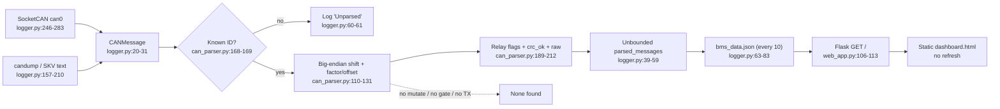
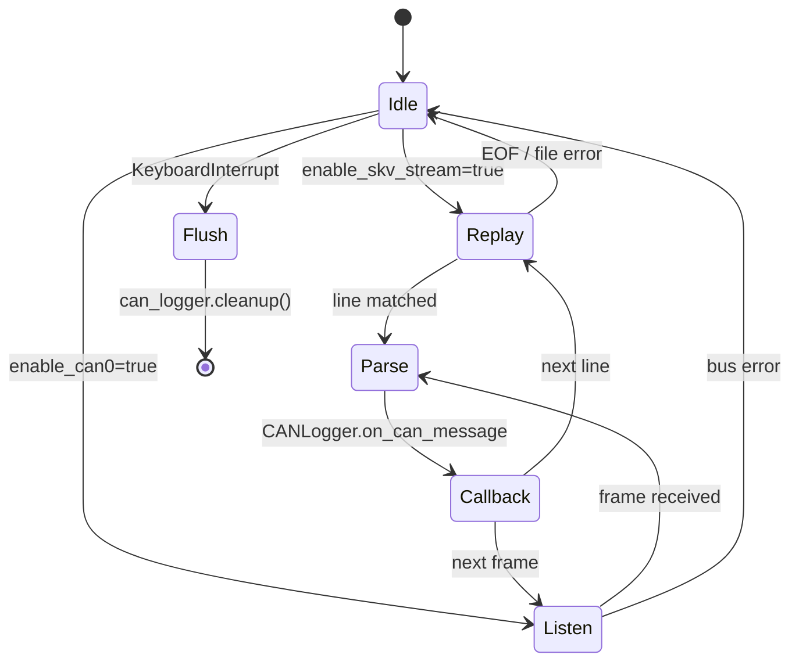
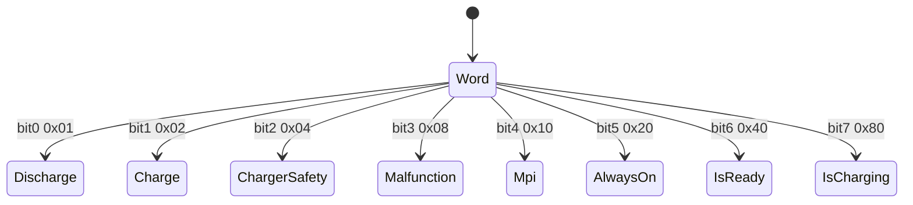
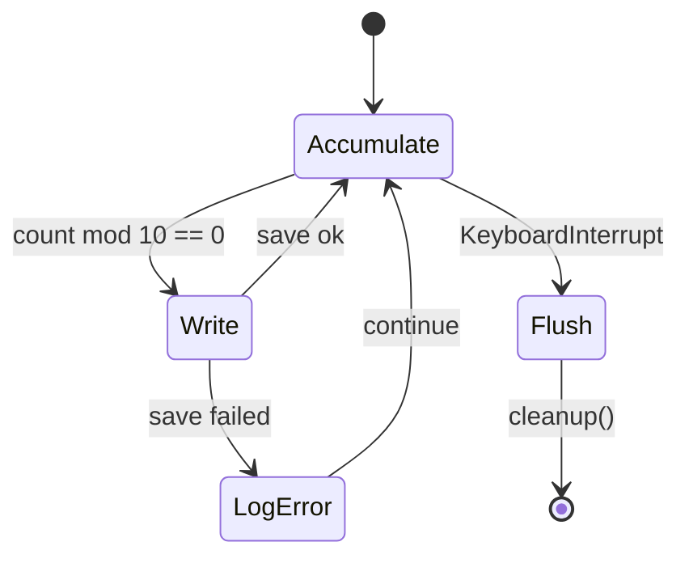
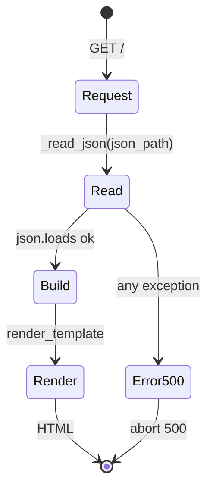
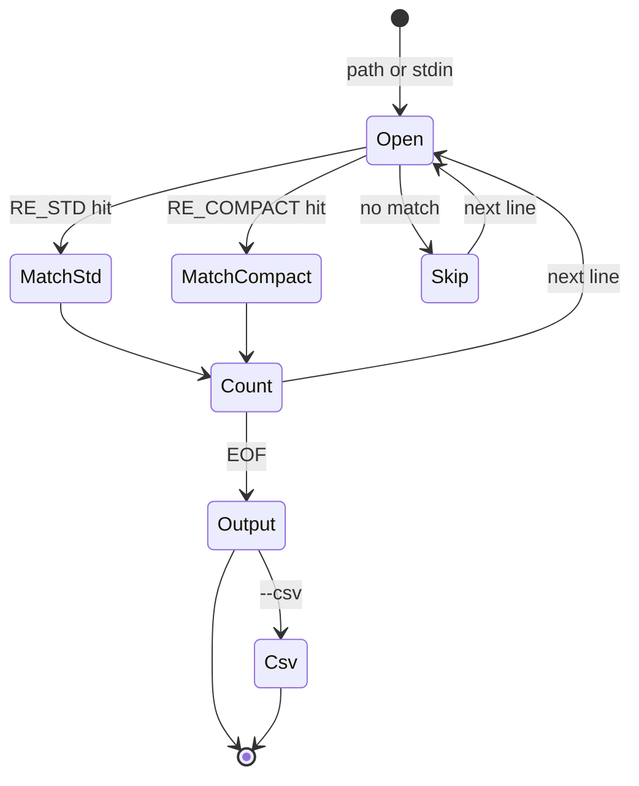
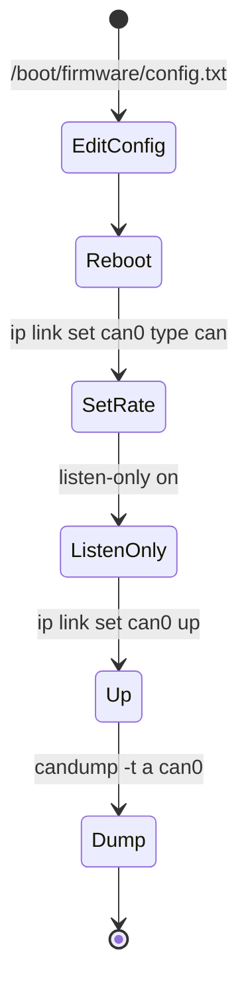

# erikhedb-WE-EV-CAN-Dashboard_POC

## 1. Provenance

- Submodule path: `legacy/erikhedb-WE-EV-CAN-Dashboard_POC`
- Pinned gitlink: `160000 5c6194ab5cfb4a167c356f83c15ba26f0d5ba5a2 0` (`git ls-files -s`); `git -C legacy/erikhedb-WE-EV-CAN-Dashboard_POC rev-parse HEAD` returns the same SHA. Working tree clean (`git status --porcelain` empty).
- Upstream URL: `https://github.com/erikhedb/WE-EV-CAN-Dashboard_POC` (origin fetch/push).
- License: no `LICENSE`/`COPYING` file in `git ls-files`; `README.md:35` says "Code and architecture are **free to copy, reuse, and adapt**" — informal grant, not a license file (CODE-READ for absence, SUMMARY-ONLY for intent).
- Analysis date: 2026-11-21.
- Mode: **replace**. YAML frontmatter preserved byte-for-byte (description line has no inherited trailing whitespace; no other frontmatter change). The pre-replace doc had **no `## Upstream (...)` section**, so none is preserved. Pre-replace claims cited as `git show HEAD:docs/legacy/erikhedb-WE-EV-CAN-Dashboard_POC.md#<line>`.
- Full reads (all tracked files except the one binary): `.gitignore` (207), `README.md` (32), `docs/architecture.md` (18), `docs/hardware.MD` (10), `docs/linux-can.md` (20), `docs/project_structure.md` (32), `logger/.python-version` (1), `logger/README.md` (35), `logger/can_parser.py` (293), `logger/data/bms_data.json` (75), `logger/logger.py` (335), `logger/main.py` (4), `logger/pyproject.toml` (23), `logger/test_output.json` (54), `logger/uv.lock` (99), `sample/log_stat.py` (89), `web/.python-version` (1), `web/dashboard.html` (238), `web/pyproject.toml` (10), `web/uv.lock` (115), `web/web_app.py` (110).
- Reading coverage: source/docs/JSON FULL-READ; `logger/uv.lock` and `web/uv.lock` STRUCTURAL-PARSE (dependency pins only; generated lockfiles).
- Explicitly NOT read: `sample-ui.png` (binary screenshot, no decode value). No hidden directories were skipped — `git ls-files` returned 23 entries including dotfiles; no untracked files exist.

## 2. Executive verdict

Listen-only EV telemetry POC: a Python `OrionCANParser` decodes eight Orion BMS 2 message definitions from SocketCAN or replayed candump/SKV lines, a threaded logger rewrites one JSON snapshot every ten parsed frames, and a single-route Flask page renders three of those frames. The mechanisms worth reusing are the explicit signal table (start bit / length / factor / offset), the dual live/replay ingest with a config flag, the relay low-byte flag splitter, and the candump ID-frequency CLI. Nothing here mutates, injects, checksums, or routes CAN frames. Critical defects: CRC validation is a stub that always returns `True`, the extended-frame and 0x6B3/0x6B4 start bits use a different bit-numbering convention from the big-endian extractor (committed sample decodes 0x1806E7F4 as 0.0 V / 3072 A), the parsed-message list is unbounded, and no test suite exists. Do not port the CRC stub, the bit-extraction convention, or the unbounded snapshot writer. Our firmware already ships stronger equivalents for BMS decode, bounded ring buffers, and periodic status; the only genuine candidate is a bench-side candump replay/frequency tool under `tools/`.

## 3. Evidence map

| Source file | Lines | What it proves | Grade |
| --- | --- | --- | --- |
| `logger/can_parser.py` | 14-24, 57-108 | Nine declared `MessageType` IDs; eight entries in `_build_message_definitions()`, no `0x18FF50E5` | CODE-READ |
| `logger/can_parser.py` | 110-131 | Big-endian integer bit shift extraction; `value = raw * factor + offset`; Volts rounded to 4 dp | CODE-READ |
| `logger/can_parser.py` | 133-147 | Relay low-byte bit masks to eight named flags | CODE-READ |
| `logger/can_parser.py` | 149-159 | `_calculate_crc()` returns `True` for any 8+ byte payload; no CRC math | CODE-READ |
| `logger/can_parser.py` | 161-212 | `parse_message()` drops unknown IDs, adds relay/CRC/raw fields, never validates DLC | CODE-READ |
| `logger/can_parser.py` | 218-252 | Last-wins frame grouping, JSON envelope, disk write | CODE-READ |
| `logger/can_parser.py` | 255-299 | `__main__` demo with three hard-coded frames and no assertions | CODE-READ |
| `logger/logger.py` | 33-87 | `CANLogger` callback, unbounded `parsed_messages`, save every 10 frames | CODE-READ |
| `logger/logger.py` | 101-155 | Config from `[tool.logger]`, rotating log setup (10MB / 5 backups) | CODE-READ |
| `logger/logger.py` | 157-210 | candump and SKV line parsers | CODE-READ |
| `logger/logger.py` | 212-283 | Replay replay loop, live SocketCAN listener, error paths | CODE-READ |
| `logger/logger.py` | 285-348 | Dead `pass` callback; real `main()` starts two daemon threads and sleeps forever | CODE-READ |
| `logger/data/bms_data.json` | 1-75 | Committed snapshot: six frames, derived fields, `crc_ok: true`, extended-frame values 0.0 V / 3072 A | CODE-READ (artifact) |
| `logger/test_output.json` | 1-54 | Committed demo output, three frames | CODE-READ (artifact) |
| `logger/main.py` | 1-6 | Hello-world stub, not a logger entry point | CODE-READ |
| `logger/pyproject.toml` | 11-25 | `[tool.logger]`: 500000 bitrate, `enable_can0=false`, `enable_skv_stream=true`, path `../sample/can0.log`, 0.1 s delay | CODE-READ |
| `web/web_app.py` | 6-100 | JSON bridge path, three-frame context, `high = low + High_Cell_Voltage` | CODE-READ |
| `web/web_app.py` | 102-127 | Single `GET /` route, 500 on any error, localhost:8080 default, `debug=False` | CODE-READ |
| `web/dashboard.html` | 147-255 | Template fields, relay flag pills, tab-only JavaScript (no refresh) | CODE-READ |
| `sample/log_stat.py` | 19-101 | candump standard/compact regexes, ID counts, optional CSV | CODE-READ |
| `docs/linux-can.md` | 6-36 | Two MCP2515 overlays, 16 MHz, 500 kbps, listen-only bench setup | SUMMARY-ONLY |
| `docs/hardware.MD` | 1-12 | Pi 5 8GB, Waveshare 2-channel isolated CAN HAT, Tesla RDU hardware | SUMMARY-ONLY |
| `docs/project_structure.md` | 3-38 | Sample frame-count table includes 0x7EB/0x7E3/0x7DF (not decoded by code); references `config/` which does not exist | SUMMARY-ONLY |
| `README.md` | 1-52 | Retirement notice, RDU claims, informal reuse grant | SUMMARY-ONLY |
| `git show HEAD:docs/legacy/erikhedb-WE-EV-CAN-Dashboard_POC.md` | 15-76 | Pre-replace summary claims audited in section 6 | SUMMARY-ONLY |
| `firmware/lib/vehicle/can/feature/telemetry/bms.h` | 18-54, 125-162, 374-377, 491-520 | Our BMS decode counterparts (our-side parity anchors) | CODE-READ |
| `firmware/lib/vehicle/can/handler/bus/vehicle.h` | 75-113, 228-247 | Our decode dispatch with DLC guards | CODE-READ |
| `firmware/lib/core/can/ring_buffer.h` | 43-59, 105-117 | Our bounded 256-entry ring with per-consumer overflow tracking | CODE-READ |
| `firmware/lib/core/can/recorder.h` | 12, 144-163 | Our bounded recorder capture | CODE-READ |
| `firmware/lib/io/serial/usb/esp32/state.h` | 24-25 | Our 250 ms live status interval | CODE-READ |

No TEST-READ evidence exists: this repo ships no tests (`git grep -nE '^def test_' -- '*.py'` → no output; demonstrated in section 16). No CAPTURE evidence exists in this repo: only committed decoded JSON artifacts and a docs frame-count table, with no raw capture file or frame-count metadata under version control.

## 4. Architecture and build surface

- Entry points: `logger/logger.py:291-348 main()` (real logger), `web/web_app.py:124-127` (Flask CLI), `sample/log_stat.py:50-101` (ID counter), `logger/can_parser.py:255-299` (demo), `logger/main.py:1-6` (hello world, unused).
- No compiled build, no build flags, no platform port layer. Two independent uv-managed Python projects: `logger` (Python >=3.11, `python-can>=4.0.0`, pinned 4.6.1 in `logger/uv.lock:26-27`) and `web` (Python >=3.13, Flask 3.1.2 / Jinja2 3.1.6 in `web/uv.lock:34-70`).
- Dependency boundary: logger writes `logger/data/bms_data.json` (`logger.py:76`); web reads the same path by default (`web_app.py:7`). No shared package, no API, no queue.
- Configuration: `[tool.logger]` in `logger/pyproject.toml:11-25`; `load_config()` at `logger.py:101-109`.
- No TX path exists. `listen_can0()` uses `can.interface.Bus()` in default (non-listen-only) mode at `logger.py:252-257`, but the code never calls `bus.send()`; `docs/linux-can.md:26` is the only listen-only instruction, in a shell recipe.



## 5. Mechanism catalogue

### M1 — DBC-style signal extraction

- **Claim (README / summary):** "DBC-style signal definition system with bitfield extraction (start bit, length, factor, offset)" (`git show HEAD:docs/legacy/erikhedb-WE-EV-CAN-Dashboard_POC.md#62`).
- **Code path:** `logger/can_parser.py:57-108` `_build_message_definitions()` → `parse_message():161-212` → `_extract_signal():110-131`.
- **Frame spec:** 8-byte payload coerced with `int.from_bytes(data, 'big')` (114); `mask = (1 << length) - 1` (117); `raw = (data_int >> start_bit) & mask` (119); `value = raw * factor + offset` (122); `unit == "Volts"` rounded to 4 dp (125-126). For byte-aligned signals, `start_bit` 48 selects bytes 0-1, 32 selects bytes 2-3, 24 selects byte 4, 16 selects bytes 4-5, 0 selects byte 7. No DLC check.
- **Gates and timing:** only IDs present in the definitions dict are parsed (168-169); extraction exceptions are printed and yield `None` (129-131); parse exceptions printed and yield `None` (214-216).
- **State machine:** None found.
- **Tests:** None found. The `__main__` demo at `can_parser.py:255-299` has no assertions.
- **Evidence grade:** CODE-READ.
- **Verdict:** PARTIAL — matches committed 0x6B0-0x6B2 values, but 0x6B3/0x6B4 and extended IDs use start bits 7/23/39, which are incompatible with this big-endian shift convention.
- **Adapt to TeslaCANModder?** no impact — explicit factor/offset table and unit rounding already present in our `bms.h:18-54`; do not reuse the bit-numbering convention.

### M2 — Dual-source CAN ingest (live + replay)

- **Claim (README / summary):** "Dual Data Sources: CAN0 interface listening and SKV file streaming", "Multi-threaded" (`logger/README.md:7-11`).
- **Code path:** `logger/logger.py:291-348 main()` → `stream_can_file():212-244` and `listen_can0():246-283` → `CANLogger.on_can_message():43-61`.
- **Frame spec:** live path maps `msg.arbitration_id:X`, `msg.dlc`, `list(msg.data)` (264-270); candump path parses `(ts) iface id [dlc] bytes` (164-184); SKV path splits on `;` and reads at most 8 data fields (192-207).
- **Gates and timing:** `enable_can0=false`, `enable_skv_stream=true`, `skv_file_path="../sample/can0.log"`, `skv_stream_delay=0.1` (`logger/pyproject.toml:22-25`); bitrate 500000 (`logger.py:302,329`; `pyproject.toml:14`); daemon threads (`logger.py:321,334`); main loop `while True: time.sleep(1)` (340-342); replay sleeps after every line including unparsed (239).
- **State machine:**



- **Tests:** None found.
- **Evidence grade:** CODE-READ.
- **Verdict:** CONFIRMED — both sources and flags exist, but the shipped default config points to an untracked replay file.
- **Adapt to TeslaCANModder?** candidate — bench-only candump replay harness under `tools/`; our synthetic-frame path `firmware/lib/vehicle/can/feature/misc/can_sim.h:67` already covers in-firmware simulation (CODE-READ), but no our-side file-replay tool was read, so capture-first before deciding.

### M3 — Relay low-byte flag splitter

- **Claim (README / summary):** "Pack current, instantaneous voltage, SOC%, relay state" for 0x6B0 (`git show HEAD:docs/legacy/erikhedb-WE-EV-CAN-Dashboard_POC.md#55`).
- **Code path:** `logger/can_parser.py:133-147 _parse_relay_flags()` ← `parse_message():189-201` → `web/web_app.py:49` → `web/dashboard.html:218-232`.
- **Frame spec:** 0x6B0 `Relay_State` at `start_bit=16, length=16` (64); only `low_byte = relay_state & 0xFF` (136) used; masks `0x01` discharge, `0x02` charge, `0x04` charger_safety, `0x08` malfunction, `0x10` mpi, `0x20` always_on, `0x40` is_ready, `0x80` is_charging (138-145); `raw_low_byte_hex` retained (146). Committed `0xA005` → low `0x05` → discharge + charger_safety (`bms_data.json:14-25`).
- **Gates and timing:** 0x6B0 only; no edge detection, debounce, or timeout; high byte discarded.
- **State machine:**



- **Tests:** None found.
- **Evidence grade:** CODE-READ.
- **Verdict:** CONFIRMED — flags match committed artifact.
- **Adapt to TeslaCANModder?** no impact — Orion-specific; our contactor state is decoded from 0x212 bits 8-10 at `bms.h:374-377`.

### M4 — Every-ten-frames JSON snapshot bridge

- **Claim (README / summary):** "Continuously update JSON files with the latest data" (`docs/architecture.md:14`, `README.md:18`).
- **Code path:** `logger/logger.py:43-61 on_can_message()` → `save_structured_data():63-83` → `logger/can_parser.py:218-242 create_structured_json()` → `save_json():244-252`.
- **Frame spec:** envelope keys `namespace="orion_bms_can"`, `version="1.0.0"`, `written_at_epoch`, `mode="live"`, `frames` as list of `{"can_id": ..., **signals}` (230-236). Grouping into a dict means **last frame per ID wins** (224-227). `cells` optional but never supplied by logger (70-73, 239-240).
- **Gates and timing:** write when `len(parsed_messages) % 10 == 0` (`logger.py:58`); output `data/bms_data.json` (76); `cleanup()` writes remaining data on Ctrl-C (85-87, 343-345).
- **State machine:**



- **Tests:** None found.
- **Evidence grade:** CODE-READ.
- **Verdict:** CONFIRMED with defect — `parsed_messages` is never cleared (`logger.py:39,54`), so memory and rewrite cost grow without bound.
- **Adapt to TeslaCANModder?** no impact — our bounded recorder (`recorder.h:12,144-163`) and 250 ms status stream (`state.h:25`) already cover this need.

### M5 — Single-route Flask view with derived high-cell voltage

- **Claim (README / summary):** "Flask dashboard for real-time CAN data visualization" (`git show HEAD:docs/legacy/erikhedb-WE-EV-CAN-Dashboard_POC.md#72`).
- **Code path:** `web/web_app.py:102-115 create_app()` → `index():106-113` → `build_context():35-100` → `web/dashboard.html:147-255`.
- **Frame spec:** reads only `6B0`, `6B1`, `6B2` (39-41); `high_cell_voltage = low_cell_voltage + high_cell_delta` where `high_cell_delta` is the `High_Cell_Voltage` signal (63-69); temperatures rendered with `|int` (dashboard.html:184,188); relay flags and `crc_ok` passed through (45-51, 55-60, 72-79).
- **Gates and timing:** one `GET /` route; `debug=False`; default bind `127.0.0.1:8080` (120-121); any read/parse error → `abort(500, description=str(e))` (112-113); no polling, `setInterval`, `fetch`, or WebSocket in the template.
- **State machine:**



- **Tests:** None found.
- **Evidence grade:** CODE-READ.
- **Verdict:** PARTIAL — real dashboard, but static and single-shot per request; "real-time" is not implemented.
- **Adapt to TeslaCANModder?** no impact — client already renders telemetry; treat `low + High_Cell_Voltage` as a do-not-copy unless the signal is proven to be a delta.

### M6 — CRC field with always-true validation

- **Claim (README / summary):** committed JSON exposes `crc`, `crc_ok` (`logger/data/bms_data.json:26-27,37-38,49-50`); `CRC_Checksum` signals carry offsets 1720/1721 (`can_parser.py:65,72`).
- **Code path:** `logger/can_parser.py:203-206` sets `crc_ok = self._calculate_crc(...)` → `_calculate_crc():149-159`.
- **Frame spec:** no polynomial, init value, XOR table, or byte summation. `len(data) < 8` → `False`; otherwise `return True` (153-157). Comment at 152 admits "this may need to be adjusted".
- **Gates and timing:** None found.
- **State machine:** None found.
- **Tests:** None found.
- **Evidence grade:** CODE-READ.
- **Verdict:** CONTRADICTED — field named `crc_ok` is not a checksum validation; every 8-byte frame passes.
- **Adapt to TeslaCANModder?** never port — a false-valid signal is a safety regression.

### M7 — candump ID-frequency CLI

- **Claim (README / summary):** "Count CAN frames per ID from a standard candump log and sort by count" (`sample/log_stat.py:2-8`); sample output in `docs/project_structure.md:7-21`.
- **Code path:** `sample/log_stat.py:19-39` regexes → `parse_line():41-48` → `main():50-101`.
- **Frame spec:** `RE_STD` captures optional `(ts)`, iface, ID, `[dlc]`, bytes (19-28); `RE_COMPACT` captures `iface ID#DATA` (31-39); ID uppercased as a string (44,47); counts and percentages only — no payload decode.
- **Gates and timing:** `-n/--top` slices sorted results (53,76-77); `--csv` writes rank/can_id/count/percent (54,91-98); `-` reads stdin (61); sorted by `(-count, id)` (75).
- **State machine:**



- **Tests:** None found.
- **Evidence grade:** CODE-READ.
- **Verdict:** CONFIRMED.
- **Adapt to TeslaCANModder?** candidate — useful bench triage under `tools/`; reimplement with our `Frame` type and an independent counting oracle, not by importing this file.

### M8 — MCP2515 / SocketCAN bench recipe (documentation only)

- **Claim (README / summary):** Pi 5 + two MCP2515 at 16 MHz, 500 kbps, listen-only capture (`docs/linux-can.md:6-36`), Waveshare 2-channel isolated HAT (`docs/hardware.MD:10-12`).
- **Code path:** None found in the recipe itself; related code config at `logger/pyproject.toml:13-14` and `logger/logger.py:252-254,278`.
- **Frame spec:** overlays `dtoverlay=mcp2515,spi1-2,oscillator=16000000,interrupt=13` (can0) and `spi1-1,...,interrupt=22` (can1); `ip link set can0 type can bitrate 500000 listen-only on`; `candump -t a can0`.
- **Gates and timing:** SPI1 with 3 chip selects (`dtoverlay=spi1-3cs`); 16 MHz crystal; 500000 bit/s.
- **State machine:**



- **Tests:** None found.
- **Evidence grade:** SUMMARY-ONLY for hardware recipe; CODE-READ for the 500000 bitrate in code/config.
- **Verdict:** PARTIAL — plausible and consistent with code bitrate; hardware not verified.
- **Adapt to TeslaCANModder?** candidate for a docs/checklists bench note only (16 MHz profile + listen-only capture); no code port, and SUMMARY-ONLY cannot drive a code decision.

## 6. Summary vs code contradiction table

| # | Pre-replace claim / upstream claim | Code evidence | Grade |
| --- | --- | --- | --- |
| C1 | "Tesla Model 3 RDU connected", "inverter data" decoded (`git show HEAD:docs/legacy/erikhedb-WE-EV-CAN-Dashboard_POC.md#15`; `README.md:26-27`) | Only nine Orion BMS IDs declared (`can_parser.py:14-24`); no Tesla ID or RDU handler; unknown IDs dropped (`can_parser.py:168-169`) | CODE-READ vs SUMMARY-ONLY |
| C2 | "**License**: None" (`git show HEAD:docs/legacy/erikhedb-WE-EV-CAN-Dashboard_POC.md#22`) | No LICENSE file tracked, but `README.md:35` grants copy/reuse/adapt — not "none" | CODE-READ (absence) + SUMMARY-ONLY (grant) |
| C3 | "`logger/main.py` — CAN logger entry point (stub — mostly in can_parser.py)" (`git show HEAD:docs/legacy/erikhedb-WE-EV-CAN-Dashboard_POC.md#36`) | `logger/main.py:1-6` is a standalone hello-world; real entry is `logger/logger.py:291-348`; parser is `can_parser.py`, not `main.py` | CODE-READ |
| C4 | Extended IDs `0x1806E7F4`, `0x1806E5F4`, `0x1806E9F4`, `0x18FF50E5` parsed (`git show HEAD:docs/legacy/erikhedb-WE-EV-CAN-Dashboard_POC.md#37`; also `#60`) | Definitions dict has only the first three (`can_parser.py:92-106`); `0x18FF50E5` exists only as an enum member (24) and is dropped at 168-169 | CODE-READ |
| C5 | "real-time visualization" (`git show HEAD:docs/legacy/erikhedb-WE-EV-CAN-Dashboard_POC.md#15,#72`) | Read-on-request Flask route (`web_app.py:106-113`); template JS only toggles tabs (`dashboard.html:244-255`); no refresh anchor (negative grep in section 16) | CODE-READ |
| C6 | 0x6B2 carries "High/low cell voltages and IDs" (`git show HEAD:docs/legacy/erikhedb-WE-EV-CAN-Dashboard_POC.md#57`) | `High_Cell_Voltage` is used as a *delta* added to `Low_Cell_Voltage` (`web_app.py:63-69`); committed values 0.0071 V and 3.8673 V (`bms_data.json:43-44`) confirm delta semantics | CODE-READ |
| C7 | `crc_ok` presented as checksum status (`bms_data.json:27,37,50`; `web_app.py:50,59,78`) | `_calculate_crc()` returns `True` unconditionally for 8+ bytes (`can_parser.py:149-159`) | CODE-READ |
| C8 | "DBC-style signal definition system" (`git show HEAD:docs/legacy/erikhedb-WE-EV-CAN-Dashboard_POC.md#62`) | Extraction is big-endian shift (`can_parser.py:114-119`); 0x6B3/0x6B4/extended signals use start bits 7/23/39 (83-105), a different convention. Recomputing committed raw `0B D7 00 3C 00 00 00 00` (`bms_data.json:58`) with the code yields 0.0 V / 3072 A, matching the committed JSON but not a plausible pack voltage | CODE-READ |
| C9 | "`sample/` — Sample data files", `sample/can0.skv` in README (`git show HEAD:docs/legacy/erikhedb-WE-EV-CAN-Dashboard_POC.md#41`; `logger/README.md:43`) | No `.skv`/`.log` tracked; config points to `../sample/can0.log` (`pyproject.toml:24`) while code default says `../sample/can0.skv` (`logger.py:305`); missing file only logged (`logger.py:241-242`) | CODE-READ |

## 7. CAN frame and signal inventory

All frames are Orion BMS 2 traffic on an external CAN interface (`can0`); none are Tesla vehicle frames. Period is **None found** in code or captured metadata; `docs/project_structure.md:7-21` gives counts over 28,764 frames, not intervals. DLC is passed in but **not validated** by `parse_message()` (`can_parser.py:161-212`); committed samples are 8 bytes. Counter position: **None found** for every frame. "Checksum" column describes the declared signal only — validation is the stub from M6.

| ID (hex + dec) | Bus | Period | DLC | Byte/bit layout (`start_bit:length`) | Scale / units | Counter | Checksum | Read / write | Grade |
| --- | --- | --- | --- | --- | --- | --- | --- | --- | --- |
| `0x6B0` (1712) | Orion BMS / can0 | None found | not validated (sample 8) | current 48:16, voltage 32:16, SOC 24:8, relay 16:16, CRC 0:8 (`can_parser.py:60-66`) | 0.1 A, 0.1 V, 0.5 %, raw, raw+1720 | None found | `CRC_Checksum` byte7, `crc_ok` stub | read | CODE-READ |
| `0x6B1` (1713) | Orion BMS / can0 | None found | not validated (sample 8) | DCL 48:16, CCL 40:8, high temp 24:8, low temp 16:8, CRC 0:8 (`can_parser.py:67-73`) | 1 A, 1 A, 1 C, 1 C, raw+1721 | None found | `CRC_Checksum` byte7, stub | read | CODE-READ |
| `0x6B2` (1714) | Orion BMS / can0 | None found | not validated (sample 8) | high cell 48:16, low cell 32:16, high ID 24:8, low ID 16:8, populated 8:8, CRC 0:8 (`can_parser.py:74-81`) | 1e-4 V, 1e-4 V, ID, ID, count, raw | None found | `CRC_Checksum` byte7, stub | read | CODE-READ |
| `0x6B3` (1715) | Orion BMS / can0 | None found | not validated | CCL 7:16, DCL 23:16, failsafes 39:16 (`can_parser.py:82-86`) | 1 A, 1 A, raw | None found | none declared | read | CODE-READ (definition only; no sample) |
| `0x6B4` (1716) | Orion BMS / can0 | None found | not validated | AC power 7:16, AC current 23:16, plug state 39:8 (`can_parser.py:87-91`) | 1 W, 1 A, raw | None found | none declared | read | CODE-READ (definition only; no sample) |
| `0x1806E7F4` (403044036) | Charger (extended) / can0 | None found | not validated (sample 8) | max pack V 7:16, pack CCL 23:16, DTC 39:1 (`can_parser.py:92-96`) | 0.1 V, 0.1 A, bit | None found | none declared; `DTC_P0A08_...` name | read | CODE-READ (decode value contradicted by artifact) |
| `0x1806E5F4` (403043828) | Charger (extended) / can0 | None found | not validated (sample 8) | max cell V 7:16, CCL 23:16, DTC 39:1 (`can_parser.py:97-101`) | 0.001388888888888889 V (1/720), 0.1 A, bit | None found | none declared | read | CODE-READ |
| `0x1806E9F4` (403044340) | Charger (extended) / can0 | None found | not validated (sample 8) | max cell V 7:16, CCL 23:16, DTC 39:1 (`can_parser.py:102-106`) | 1/720 V, 0.1 A, bit | None found | none declared | read | CODE-READ |
| `0x18FF50E5` (419071205) | Third-party (extended) / can0 | None found | not validated | None found — enum only (`can_parser.py:24`), absent from definitions (92-107) | None found | None found | none declared | read (declared, not decodable) | CODE-READ |

No DBC file is vendored; the definitions are hand-transcribed Python dataclasses (`can_parser.py:26-46`). No frame is mutated, injected, or written to a bus anywhere in the repo.

## 8. Constants and tuning table

| Constant | Value | File:line | Meaning | Grade |
| --- | --- | --- | --- | --- |
| `CRC_Checksum` offset (0x6B0) | 1720 | `logger/can_parser.py:65` | Added to raw byte7 to produce reported CRC value | CODE-READ |
| `CRC_Checksum` offset (0x6B1) | 1721 | `logger/can_parser.py:72` | Same for 0x6B1 | CODE-READ |
| `Pack_Current` factor | 0.1 | `logger/can_parser.py:61` | A per raw count | CODE-READ |
| `Pack_SOC` factor | 0.5 | `logger/can_parser.py:63` | Percent per raw count | CODE-READ |
| `Pack_Inst_Voltage` factor | 0.1 | `logger/can_parser.py:62` | V per raw count | CODE-READ |
| Cell voltage factor (0x6B2) | 1.0E-4 | `logger/can_parser.py:75-76` | V per raw count | CODE-READ |
| Max cell voltage factor (extended) | 0.001388888888888889 (1/720) | `logger/can_parser.py:98,103,105` | V per raw count | CODE-READ |
| Relay bit masks | 0x01..0x80 | `logger/can_parser.py:138-145` | Eight relay/status flags | CODE-READ |
| CRC-stub length gate | 8 | `logger/can_parser.py:153` | Below 8 bytes → `crc_ok=false`; else always true | CODE-READ |
| Snapshot trigger | every 10 parsed messages | `logger/logger.py:58` | Full JSON rewrite interval | CODE-READ |
| Rotating log size / backups | 10MB / 5 | `logger/pyproject.toml:18-19`; `logger/logger.py:118-119` | Log rotation policy | CODE-READ |
| CAN bitrate | 500000 | `logger/pyproject.toml:14`; `logger/logger.py:302,329,278` | SocketCAN bitrate / hint text | CODE-READ |
| MCP2515 oscillator | 16000000 | `docs/linux-can.md:12,15` | Bench crystal profile | SUMMARY-ONLY |
| SKV replay delay | 0.1 s | `logger/pyproject.toml:25`; `logger/logger.py:316,239` | Sleep after every replay line | CODE-READ |
| SKV max data fields | `min(12, len(parts))` | `logger/logger.py:203` | Caps replay frame at 8 bytes | CODE-READ |
| Flask bind | `127.0.0.1:8080`, `debug=False` | `web/web_app.py:120-121,127` | Local-only HTTP surface | CODE-READ |

## 9. Failure modes and edge cases

| Failure | Handling code path | Tested? | Grade |
| --- | --- | --- | --- |
| Unknown CAN ID | `parse_message()` returns `None`; logger logs `Unparsed` (`can_parser.py:168-169`; `logger.py:60-61`) | No — no test suite | CODE-READ |
| Short / malformed payload | No DLC validation; `_extract_signal` may shift beyond data or raise, caught and printed (`can_parser.py:110-131,214-216`) | No | CODE-READ |
| Invalid CRC | None — `_calculate_crc()` returns `True` for 8+ bytes (`can_parser.py:149-159`) | No | CODE-READ |
| Missing replay file | `FileNotFoundError` logged, thread ends (`logger.py:241-242`); default path points to untracked `../sample/can0.log` (`pyproject.toml:24`) | No | CODE-READ |
| SKV first line is data, not header | `if ';' in first_line: next(f)` unconditionally discards line 1 (`logger.py:217-224`) | No | CODE-READ |
| Live bus creation fails | Broad `except` logs error and hint (`logger.py:276-278`); `finally` calls `bus.shutdown()` on possibly unbound `bus`, swallowed by bare `except: pass` (`279-283`) | No | CODE-READ |
| Bus-off / watchdog / OTA / brownout | None found — no bus state machine, no watchdog, no OTA guard, no reboot-state persistence in code | No | CODE-READ (absence) |
| Queue / memory growth | `parsed_messages` never cleared (`logger.py:39,54`); each trigger rewrites full JSON (`58-59`, `70-77`) | No | CODE-READ |
| JSON read/parse failure in web | `abort(500, description=str(e))` leaks exception text/path (`web_app.py:108-113`) | No | CODE-READ |
| Missing JSON file at startup | Flask still starts; first request returns 500 (`web_app.py:106-113`) | No | CODE-READ |
| Stale data displayed | No age check; only `written_at_epoch`/mtime strings rendered (`web_app.py:81-95`; `dashboard.html:150`) | No | CODE-READ |
| Dependency mismatch | logger requires Python >=3.11 (`logger/pyproject.toml:6`), web >=3.13 (`web/pyproject.toml:6`); no unified environment | No | CODE-READ |

## 10. Test coverage map

- Test files: **None found**. `git ls-files` contains no `test_*.py`, no pytest/unittest config, no CI workflow.
- Demo only: `can_parser.py:255-299` parses three hard-coded frames and writes `logger/test_output.json`; there are no assertions and it is not wired to a test runner.
- Committed artifacts `logger/test_output.json` and `logger/data/bms_data.json` are outputs, not oracles.

| Critical path with no test | Risk in one line |
| --- | --- |
| Big-endian start-bit extraction (`can_parser.py:110-131`) | Endianness error silently produces plausible-looking but wrong values (extended frames: 0.0 V / 3072 A). |
| Relay flag splitter (`can_parser.py:133-147`) | A bit-position change would invert charge/discharge flags with no signal. |
| CRC stub (`can_parser.py:149-159`) | Corrupt frames are reported as valid forever. |
| 0x6B3/0x6B4 and 0x18FF50E5 handling | Declared but never exercised; `0x18FF50E5` is silently dropped. |
| candump / SKV line parsers (`logger.py:157-210`) | Header-skip heuristic can drop a frame; no regression guard. |
| JSON last-wins grouping and 10-frame rewrite (`logger.py:54-83`) | Unbounded memory and write amplification go unnoticed. |
| Flask context and derived high-cell voltage (`web_app.py:35-100`) | A wrong delta/abs assumption yields a wrong displayed cell voltage. |
| Thread lifecycle / missing-file paths (`logger.py:212-348`) | Silent thread death leaves dashboard stale with no alert. |

## 11. Parity matrix with TeslaCANModder

Every row has a our-side CODE-READ citation; none rests on the old summary alone. Upstream IDs do not overlap our Tesla IDs, so all frame-level deltas are structural, not drop-in.

| Signal / frame | Upstream decode (cite) | Our decode (cite) | Delta | Action |
| --- | --- | --- | --- | --- |
| Pack voltage | 0x6B0 start 48, len 16, ×0.1 V (`logger/can_parser.py:61`) | `decodeBmsVoltage` 0x132 bytes 0-1 ×0.01 V (`firmware/lib/vehicle/can/feature/telemetry/bms.h:18-22`; dispatch `firmware/lib/vehicle/can/handler/bus/vehicle.h:75-79`) | Different ID, different scale | ignore |
| Pack current | 0x6B0 start 48, len 16, ×0.1 A (`logger/can_parser.py:61`) | `decodeBmsCurrent` 0x132 bytes 2-3 signed ×0.1 A (`bms.h:29-33`) | Upstream current/voltage share a declared start-bit slot; ours are distinct byte ranges | ignore |
| State of charge | 0x6B0 start 24, len 8, ×0.5 % (`can_parser.py:63`) | `decodeBmsSoc` 0x292 bits 0-9 ×0.1 % (`bms.h:50-54`; `vehicle.h:85-97`) | 8-bit vs 10-bit, 0.5 vs 0.1 | ignore |
| Cell voltage min/max | 0x6B2 16-bit ×1e-4 V (`can_parser.py:75-76`) | `decodeBmsCellVoltageMax/Min` 0x332 mux 1, 12-bit ×0.002 V (`bms.h:125-140`; `vehicle.h:228-247`) | 16-bit vs 12-bit; upstream extended 1/720 factor broken | capture-first |
| Pack temperatures | 0x6B1 raw °C (`can_parser.py:70-71`) | `decodeBmsTempMin/Max` 0x312 byte−40 °C (`bms.h:61-74`; `vehicle.h:99-113`) | Offset-40 vs raw | ignore |
| Relay / contactor state | 0x6B0 low-byte flags (`can_parser.py:133-147`) | `decodeBmsContactorState` 0x212 bits 8-10 (`bms.h:374-377`) | 8 independent flags vs 3-bit code | ignore |
| Charge / discharge limits | 0x6B1 DCL/CCL in A (`can_parser.py:68-69`) | `decodeBmsMaxRegenPower` / `decodeBmsMaxDischargePower` in kW (`bms.h:147-162`) | Units differ | ignore |
| Lifetime kWh counters | None found upstream | `decodeBmsKwhDischargeTotal` / `decodeBmsKwhChargeTotal` (`bms.h:491-508`) | Upstream gap | already present |
| Frame buffering | Unbounded `parsed_messages` list (`logger.py:39,54`) | Bounded ring `canRingBuffer` (`firmware/lib/core/can/ring_buffer.h:43-59,105-117`) and recorder (`firmware/lib/core/can/recorder.h:12,144-163`) | Bounded vs unbounded, overflow-tracked vs silent | already present |
| Periodic telemetry delivery | Rewrite whole JSON every 10 parsed frames (`logger.py:57-59`) | `STATUS_LIVE_INTERVAL_MS = 250` (`firmware/lib/io/serial/usb/esp32/state.h:24-25`; `firmware/lib/client/command/dispatch.h:54-56`) | Event-driven file vs fixed-rate stream | already present |

## 12. Surface inventory and security notes

| Surface | Semantics | Provenance / security note | Grade |
| --- | --- | --- | --- |
| `GET /` (Flask) | Renders snapshot HTML; 500 on any read/parse failure | `web/web_app.py:106-113`; no auth, no CSRF concern (read-only) | CODE-READ |
| `--json` CLI flag | Arbitrary JSON path, default `../logger/data/bms_data.json` | `web/web_app.py:7,117-119`; operator-controlled path | CODE-READ |
| `--host`, `--port` CLI flags | Default `127.0.0.1:8080`; `debug=False` | `web/web_app.py:120-121,127`; exposing via `--host 0.0.0.0` adds no auth | CODE-READ |
| `[tool.logger]` config | Selects live vs replay source, bitrate, log rotation, delay | `logger/pyproject.toml:11-25`; `logger.py:101-109` | CODE-READ |
| `sample/log_stat.py` CLI | `path`/`-`, `-n/--top`, `--csv` | `sample/log_stat.py:50-55`; writes CSV to operator path | CODE-READ |
| Serial / BLE / WiFi commands | None found | No command dispatcher in repo; Flask is the only network surface | CODE-READ (absence) |

Security/provenance findings: no hardcoded credentials, keys, certs, or tokens found in tracked files; no untrusted archive unpacking; no dangerous compiler/build flags. Error text is echoed to HTTP clients via `abort(500, description=str(e))` (`web_app.py:113`) — path/exception disclosure. `raw_json` is rendered through Jinja autoescaping (no `|safe` in `dashboard.html:240`). Reuse grant in `README.md:35` without a LICENSE file is a legal ambiguity, not a security control. Sample data path is untracked, so captured-frame provenance cannot be verified.

## 13. Adaptation assessment

| Mechanism | Value | Cost | Risk | Evidence grade | Decision |
| --- | --- | --- | --- | --- | --- |
| M1 signal table | Medium (pattern only) | Low | Wrong bit-numbering if copied | CODE-READ | already present — our `bms.h` uses explicit decode functions with DLC guards |
| M2 dual-source ingest | Medium for bench | Medium | Missing default file, silent thread death | CODE-READ | candidate — bench replay tool in `tools/`, capture-first; not firmware |
| M3 relay flags | Low | Low | Orion-specific semantics | CODE-READ | no impact — our contactor decode at `bms.h:374-377` |
| M4 JSON snapshot | Low | Low | Unbounded memory, write amplification | CODE-READ | no impact — our recorder/ring + 250 ms status already better |
| M5 Flask view | Low | Low | Static, misleading "real-time", error leakage | CODE-READ | no impact — client already renders telemetry |
| M6 CRC stub | None (negative value) | Zero | False validation; safety regression | CODE-READ | never port |
| M7 ID-frequency CLI | Medium for diagnostics | Low | Regex-only, no DLC/data decoding | CODE-READ | candidate for future PR in `tools/`, independent implementation |
| M8 bench recipe | Medium (docs only) | Low | Hardware unverified; listen-only would block TX if copied into firmware | SUMMARY-ONLY | no code decision — bench docs note only; needs CAPTURE first |

## 14. Do-not-copy list

| Item | File:line | Reason |
| --- | --- | --- |
| `_calculate_crc()` always-true stub | `logger/can_parser.py:149-159` | Reports corrupt frames valid; `crc_ok` is a false safety signal. |
| `int.from_bytes(...,'big')` + raw `start_bit` shift | `logger/can_parser.py:110-126` | Incompatible with the 7/23/39 DBC-style start bits used at 83-105; produces 0.0 V / 3072 A on committed sample. |
| Unbounded `parsed_messages` + full rewrite every 10 | `logger/logger.py:39,54,58-59,70-77` | Memory and I/O grow with uptime; our recorder is bounded at 256. |
| Bare `except: pass` around `bus.shutdown()` | `logger/logger.py:279-283` | Hides unbound-local and bus errors. |
| Broad `except Exception` with `print()` in parser | `logger/can_parser.py:129-131,214-216` | Drops frames silently into stdout instead of a log ring. |
| `abort(500, description=str(e))` | `web/web_app.py:112-113` | Leaks filesystem paths and exception text to HTTP clients. |
| `next(f)` header-skip heuristic | `logger/logger.py:217-224` | Drops the first data line when it contains `;`. |
| `listen-only on` in a shipping config | `docs/linux-can.md:26` | Bench-only; copying into firmware setup would prevent all TX. |
| Treat `High_Cell_Voltage` as absolute | `web/web_app.py:63-69` | It is added to low-cell voltage upstream; absolute interpretation would produce wrong values. |
| Verbatim source import into shipping dirs | whole `logger/`, `web/`, `sample/` | Skill rule: port behavior/constants/byte layout only; never import legacy files into `firmware/`, `client/`, `packages/`, `tools/`. |

## 15. History and evolution

Local submodule history is a single squashed commit: `5c6194a 2025-09-16 Update README.md`, which added all 23 tracked files (1960 insertions). `git -C legacy/erikhedb-WE-EV-CAN-Dashboard_POC rev-list --count HEAD` → `1`. No changelog file, no tags fetched locally, no earlier commits available. Consequently no abandoned approaches or rollbacks can be reconstructed from local history. Snapshot-visible dead ends: `logger/main.py` hello world (unused), module-level `on_can_message()` that is `pass` (`logger.py:285-289`), `CRC_Checksum` signals paired with a CRC stub, and the `0x18FF50E5` enum entry with no definition. `README.md:2` states the codebase is being retired for a Go rewrite (new project named WE-EV-CAN-Dashboard); that project and any issues/PRs are network-only and **UNVERIFIED** — no network claims are made here. Pre-pin upstream history was **not** reviewed.

## 16. Re-verification recipe

Pinned gitlink (canonical form): `160000 5c6194ab5cfb4a167c356f83c15ba26f0d5ba5a2 0`.

```bash
OLD=5c6194ab5cfb4a167c356f83c15ba26f0d5ba5a2
git -C legacy/erikhedb-WE-EV-CAN-Dashboard_POC rev-parse HEAD
git -C legacy/erikhedb-WE-EV-CAN-Dashboard_POC status --porcelain
git -C legacy/erikhedb-WE-EV-CAN-Dashboard_POC fetch --tags --prune
git -C legacy/erikhedb-WE-EV-CAN-Dashboard_POC log --oneline $OLD..origin/main
git -C legacy/erikhedb-WE-EV-CAN-Dashboard_POC diff --stat $OLD..origin/main
git -C legacy/erikhedb-WE-EV-CAN-Dashboard_POC diff $OLD..origin/main -- logger web sample docs
git ls-files -s legacy/erikhedb-WE-EV-CAN-Dashboard_POC
```

This shell is pwsh, where bare `grep` is unavailable; all anchors below were **demonstrated at write time** with `git -C legacy/erikhedb-WE-EV-CAN-Dashboard_POC grep -nE` (git's grep is ERE-equivalent). On a POSIX shell use the same patterns with `grep -nE`.

Upstream anchors — expected hits:

```text
git -C legacy/erikhedb-WE-EV-CAN-Dashboard_POC grep -nE 'MSGID_0X6B0|0x6B0:' -- logger/can_parser.py
  -> can_parser.py:16 MSGID_0X6B0 = 0x6B0 ; :60 "0x6B0: {"
git -C legacy/erikhedb-WE-EV-CAN-Dashboard_POC grep -nE '0x18FF50E5' -- logger/can_parser.py
  -> can_parser.py:24 only (enum member)
git -C legacy/erikhedb-WE-EV-CAN-Dashboard_POC grep -nE '0x18FF50E5:' -- logger/can_parser.py
  -> NO OUTPUT (negative anchor: no definition)
git -C legacy/erikhedb-WE-EV-CAN-Dashboard_POC grep -nE 'int\.from_bytes|start_bit' -- logger/can_parser.py
  -> :30 start_bit field, :114 int.from_bytes, :118 shift = signal.start_bit
git -C legacy/erikhedb-WE-EV-CAN-Dashboard_POC grep -nE 'For now, return True' -- logger/can_parser.py
  -> :156 (CRC stub)
git -C legacy/erikhedb-WE-EV-CAN-Dashboard_POC grep -nE 'len\(self\.parsed_messages\) % 10' -- logger/logger.py
  -> :58
git -C legacy/erikhedb-WE-EV-CAN-Dashboard_POC grep -nE 'enable_skv_stream|skv_file_path|enable_can0' -- logger/pyproject.toml
  -> :22 enable_can0=false, :23 enable_skv_stream=true, :24 skv_file_path="../sample/can0.log"
git -C legacy/erikhedb-WE-EV-CAN-Dashboard_POC grep -nE '@app.route|high_cell_voltage = low_cell_voltage|127\.0\.0\.1' -- web/web_app.py
  -> :69 high_cell_voltage = low_cell_voltage + high_cell_delta, :106 @app.route("/"), :120 default host
git -C legacy/erikhedb-WE-EV-CAN-Dashboard_POC grep -nE 'setInterval|fetch\(|websocket' -- web/dashboard.html
  -> NO OUTPUT (negative anchor: no auto-refresh)
git -C legacy/erikhedb-WE-EV-CAN-Dashboard_POC grep -nE 'RE_STD|RE_COMPACT' -- sample/log_stat.py
  -> :19, :31, :42, :45
git -C legacy/erikhedb-WE-EV-CAN-Dashboard_POC grep -nE 'free to copy|retiring this codebase' -- README.md
  -> :2 retirement notice, :35 reuse grant
git -C legacy/erikhedb-WE-EV-CAN-Dashboard_POC grep -nE 'LICENSE|license' -- README.md
  -> NO OUTPUT (negative anchor: no license text in README)
git -C legacy/erikhedb-WE-EV-CAN-Dashboard_POC grep -nE 'dtoverlay=mcp2515|bitrate 500000' -- docs/linux-can.md
  -> :12, :15, :26
git -C legacy/erikhedb-WE-EV-CAN-Dashboard_POC grep -nE '^def test_' -- '*.py'
  -> NO OUTPUT (negative anchor: no tests)
```

Our-side drift anchors — expected hits (pin by symbol, not line number):

```text
git grep -nE 'decodeBmsVoltage|decodeBmsSoc' -- firmware/lib/vehicle/can/feature/telemetry/bms.h firmware/lib/vehicle/can/handler/bus/vehicle.h
  -> bms.h:18 decodeBmsVoltage, :42 caller; vehicle.h:77 s.bmsVoltage = decodeBmsVoltage(f.data)
git grep -nE 'decodeBmsContactorState|decodeBmsKwhDischargeTotal' -- firmware/lib/vehicle/can/feature/telemetry/bms.h
  -> :374, :491
git grep -nE 'STATUS_LIVE_INTERVAL_MS = 250' -- firmware/lib/io/serial/usb/esp32/state.h
  -> :25
git grep -nE 'canRingBuffer\.writeIdx|RING_BUF_SIZE' -- firmware/lib/core/can/ring_buffer.h
  -> :53, :59, :84, :94, :110, :112, :114, :135
git grep -nE 'canRecorderCapture|CAN_RECORDER_SIZE' -- firmware/lib/core/can/recorder.h
  -> :12, :31, :33, :108, :144, :162, :163, :189, :195
git grep -nE '0x6B0|0x1806E7F4' -- firmware/lib/vehicle/can/ids.h
  -> NO OUTPUT (negative anchor: no Orion BMS IDs in our ID table)
```

Arithmetic re-check for C8 (demonstrated with Python against committed raw bytes):

```bash
python -c "d=bytes([0x0B,0xD7,0,0x3C,0,0,0,0]); i=int.from_bytes(d,'big'); print((i>>7)&0xffff, ((i>>23)&0xffff)*0.1)"
  -> 0 3072.0   (matches logger/data/bms_data.json:55-58; not a plausible pack voltage)
```

If line numbers drift more than ~10, re-read the whole function; do not trust this document's numbers.

## 17. Open questions and explicitly not investigated

- License: no LICENSE file; `README.md:35` is an informal reuse grant. Legal review needed before any derivative code lands.
- No raw candump/SKV capture is tracked; frame periods, true DLCs, and capture provenance are UNVERIFIED. A listen-only bench capture with frame counts would settle them.
- Correctness of 0x6B3 / 0x6B4 start-bit layouts (7/23/39) is UNVERIFIED — no sample frames for those IDs.
- The `DTC_P0A08_Charger_Safety_Relay_Fault` bit at 39:1 in extended frames is UNVERIFIED — no sample with the bit set.
- Whether `High_Cell_Voltage` is semantically a delta is inferred from `web_app.py:63-69` plus committed values; needs the original DBC or a labelled capture to confirm.
- Whether the RDU/Tesla CAN decoding claimed in `README.md:26-27` ever existed is UNVERIFIED — no code, ID, or handler in this snapshot.
- No test framework and no CAPTURE evidence with frame count; all behavioral confidence is CODE-READ only.
- Pre-pin upstream history was not reviewed (only the pinned snapshot); the Go rewrite referenced at `README.md:2` was not inspected — network-only and UNVERIFIED.
- `docs/project_structure.md:36-38` references a `config/` directory that does not exist in the gitlink; its purpose is UNVERIFIED.
- Bare `grep -nE` anchors were demonstrated via `git grep -nE` on this pwsh host; POSIX-shell equivalence was not executed here.

No `## Upstream (...)` sections existed in the pre-replace document; there was nothing to preserve beyond the YAML frontmatter.
