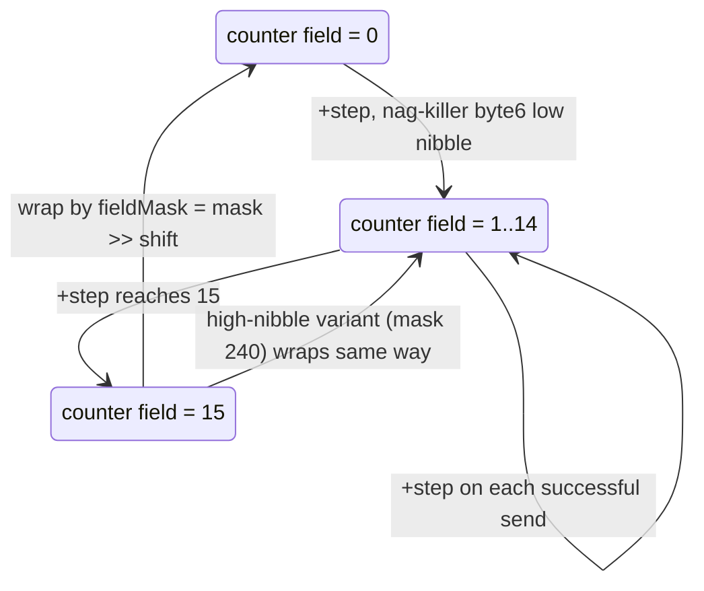
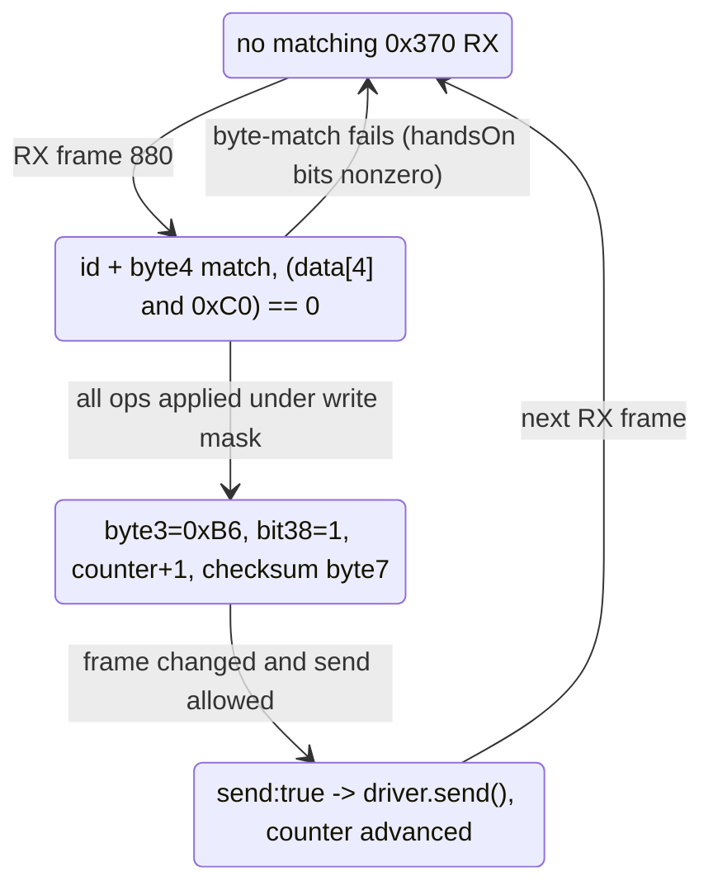

# ev-open-can-tools / ev-open-can-tools-plugins — deep dive (code-grounded)

## 1. Provenance

| Field | Value |
| --- | --- |
| Submodule path | `legacy/ev-open-can-tools-ev-open-can-tools-plugins` |
| Pinned gitlink | `160000 1d9686bf9d95a077f72028385aa19fbbc84bcc39 0` |
| `rev-parse HEAD` | `1d9686bf9d95a077f72028385aa19fbbc84bcc39` (MATCH) |
| Worktree status | clean (`git status --porcelain` empty) |
| Commit subject | `1d9686b New nag-killer plugin will only work with version 3.0.0` |
| Upstream URL | `https://github.com/ev-open-can-tools/ev-open-can-tools-plugins` (origin fetch+push) |
| License | GPL-3.0 (`README.md:116`, root `LICENSE`; commit `5e0674d` changed AGPL → GPL v3; `LICENSE:635` credits "Alexander rgegeg") |
| Analysis date | 2026-11-21 |
| Repo size | 21 local commits, 18 tracked files, no code, no build system, no tests |

Files read in full (FULL-READ, pinned SHA): `README.md:1-116`; `LICENSE:1-674`;
`All HW/summon-eu-unlock.json:1-15`; `Beta/RHD.json:1-13`; `Beta/disable-telemetry.json:1-161`;
`Beta/nag-killer.json:1-35`; `HW3/ad-activation-hw3.json:1-15`; `HW3/bypass-tlssc-hw3.json:1-16`;
`HW3/enable-TSLLC-and-continue-on-green-with-car-infront.json:1-17`;
`HW4/bypass-tlssc+fsd-hw4.json:1-17`; `HW4/emergency-vehicle-detection+fsd-hw4.json:1-17`;
`HW4/fsd-activation-only-hw4.json:1-16`; `HW4/hw4-speed-offset-plus-5.json:1-15`;
`HW4/hw4-speed-offset-plus-7.json:1-15`; `HW4/hw4-speed-offset-plus-10.json:1-15`;
`HW4/hw4-speed-offset-plus-15.json:1-15`; `HW4/isa-chime-suppress-hw4.json:1-15`;
`LEGACY/ad-activation-legacy.json:1-20`. `git ls-files` was used for inventory, so no hidden or
platform subdirectory was skipped; every tracked file in this submodule was read.

Engine-side files read **for rule-model grounding only** (they live in the companion repo
`legacy/ev-open-can-tools-ev-open-can-tools`, not here; full analysis is in
`docs/legacy/ev-open-can-tools-ev-open-can-tools.md`): `include/plugin_engine.h:60-159,510-979,1215-1344,1480-1614`;
`include/can_helpers.h:195-231`; `include/can_frame_types.h:1-24`.

Our-side counterparts read (CODE-READ at the same date): `firmware/lib/vehicle/can/handler/variant/bits.h:1-58`;
`firmware/lib/vehicle/can/handler/variant/hw4.h:97-169`; `firmware/lib/vehicle/can/feature/fsd/offsets.h:1-95`;
`firmware/lib/vehicle/can/feature/fsd/isa_chime.h:1-40`; `firmware/lib/vehicle/can/feature/das/tlssc.h:1-60`;
`firmware/lib/vehicle/can/checksum.h:40-75`; `firmware/lib/vehicle/can/feature/fsd/nag.h:100-162,403-486`;
`firmware/lib/client/command/dispatch.h:494-509,598-613`; `firmware/lib/vehicle/can/ids.h:20,78`.

Files explicitly NOT re-read: the remainder of the companion core's `plugin_engine.h` (SPIFFS storage,
UDS state machine, filter merging), its web/dashboard handlers and native tests, and all of
`firmware/` outside the cited ranges. These are gaps, not silent omissions.

Replace mode: existing YAML frontmatter preserved byte-for-byte (no trailing whitespace was present on
`description:`); the original document contained **no** `## Upstream (...)` sections, so none needed
preserving. Pre-replace claims are cited as `git show HEAD:docs/legacy/ev-open-can-tools-ev-open-can-tools-plugins.md#<line>`.

## 2. Executive verdict

This is a data-only companion repo: 16 JSON rule files plus README and license, with zero source code.
Its value is not a mechanism to port but the **exact signal targets and rule shape** it encodes for the
runtime plugin engine analyzed in the companion doc. That engine matches one byte via
`(data[matchByte] & matchMask) == (matchValue & matchMask)` — not 8-byte masks — and applies seven op
types (`set_bit`, `set_byte`, `or_byte`, `and_byte`, `checksum`, `counter`, `emit_periodic`) under a
64-bit per-byte allowed-write mask. Most targets already ship in our firmware (FSD mux0 bits 38/39/46/47/59/60,
ISA 0x399 byte1 bit5, HW4 offset byte1 bits[5:0], 0x3F8 driving-side bit 41 for LHD), but three real gaps
emerge: the nag-killer file's byte-match + counter + checksum + `send:true` self-echo pattern, RHD
bit41=1 (we only clear it), and a 15-frame telemetry-clearing suite we deliberately do not implement.
The old summary is not trustworthy: it names three files that do not exist at this SHA, misattributes
the TLSSC bypass target to 0x331, and calls "all other targets already implemented" when RHD and
telemetry targets are not. Never copy these JSON files into shipping code — our firmware compiles
features in, and a runtime arbitrary-TX rule loader is a different threat model.

## 3. Evidence map

| Source file | Lines | What it proves | Grade |
| --- | --- | --- | --- |
| `HW4/fsd-activation-only-hw4.json` | 1-16 | 0x3FD mux0 bits 46 + 60; "NOT SAFE" description | CODE-READ |
| `HW3/ad-activation-hw3.json` | 1-15 | 0x3FD mux0 bit 46 only | CODE-READ |
| `LEGACY/ad-activation-legacy.json` | 1-20 | 0x3EE/1006 mux0 bit 46; author DukeNukem-dev | CODE-READ |
| `HW4/bypass-tlssc+fsd-hw4.json` | 1-17 | "TLSSC bypass" = 0x3FD mux0 bit 38, plus 46/60 — **not** 0x331 | CODE-READ |
| `HW3/bypass-tlssc-hw3.json` | 1-16 | same bit-38 scheme on HW3 | CODE-READ |
| `HW4/emergency-vehicle-detection+fsd-hw4.json` | 1-17 | EVD = 0x3FD mux0 bit 59 with 46/60 | CODE-READ |
| `All HW/summon-eu-unlock.json` | 1-15 | 0x3FD mux1 bit 19 clear + bit 47 set, all variants | CODE-READ |
| `HW4/isa-chime-suppress-hw4.json` | 1-15 | 0x399 `or_byte` byte1 val 32 (0x20) + `checksum` | CODE-READ |
| `HW4/hw4-speed-offset-plus-{5,7,10,15}.json` | 1-15 each | 0x3FD mux2 `set_byte` byte1 mask 63, val 7/10/14/21 | CODE-READ |
| `HW3/enable-TSLLC-and-continue-on-green-with-car-infront.json` | 1-17 | bits 38/39 on 0x3FD, `bus:"VEH"`, `mux_mask:7`, `signal` annotations | CODE-READ |
| `Beta/RHD.json` | 1-13 | 0x3F8/1016 bit 41 = 1; description says untested | CODE-READ |
| `Beta/disable-telemetry.json` | 1-161 | 15 rules across 12 IDs clearing telemetry/log bits; `counter` + `checksum` on 0x389 | CODE-READ |
| `Beta/nag-killer.json` | 1-35 | byte-match 4/0xC0/0, `set_byte` byte3=182, bit38, counter byte6/0x0F/1, checksum, `send:true` | CODE-READ |
| `README.md` | 1-116 | install-by-URL workflow, schema field list, stale file list, safety notice, GPL-3.0 | SUMMARY-ONLY |
| `LICENSE` | 1-674 | GPL-3.0 text; AGPL → GPL change recorded in git history | CODE-READ |
| `include/plugin_engine.h` (companion) | 114-127,639-663,723-969,1225-1320,1480-1609 | rule struct, single-byte match, schema validation, write-mask arbitration, send/checksum/counter path | CODE-READ |
| `include/can_helpers.h` (companion) | 199-231 | `computeVehicleChecksum` = Σ bytes 0..6 + low(id) + high(id) into byte7; global `setBit` 0..63 | CODE-READ |
| `include/can_frame_types.h` (companion) | 6-24 | bus masks CH=1, VEH=2, PARTY=4; `CanFrame` | CODE-READ |
| `git show HEAD:docs/legacy/ev-open-can-tools-ev-open-can-tools-plugins.md` | 15-47 | pre-replace summary claims (Table "Available Plugins", "Relevance") | SUMMARY-ONLY |

No TEST-READ evidence exists: this repo ships no tests, no CI config, and no test directory. No CAPTURE
evidence exists in this repo — no candump, decode log, or frame count accompanies any plugin. All frame
claims below are CODE-READ of the JSON data plus CODE-READ of the companion engine that consumes it;
they describe *what the rules would write*, never a validated on-vehicle effect.

## 4. Architecture and build surface

No entry points, no shared core vs platform port, no build flags, no dependency boundaries: the tree is
five directories (`All HW/`, `Beta/`, `HW3/`, `HW4/`, `LEGACY/`) of standalone JSON plus README/LICENSE.
The runtime that gives these files meaning is the companion repo's `plugin_engine.h`.

Rule schema (grounded in `plugin_engine.h:114-127,723-969`):

| Field | Engine handling | Default |
| --- | --- | --- |
| `name`, `version`, `author` | required strings, printable ASCII, length-capped (`:732-749`) | — |
| `description` | not parsed by engine; documentation only | — |
| `rules[].id` | 11-bit CAN ID, `> 0x7FF` rejected (`:767-772`) | required |
| `rules[].bus` | `CH`/`VEH`/`PARTY`/`ANY`, string, array or integer (`:537-635`) | `ANY` |
| `rules[].mux` | -1 = any mux; compared on `data[0] & muxMask` (`:646-654`) | -1 |
| `rules[].mux_mask` | explicit mask; else `0x07` for mux ≤ 7, `0xFF` above (`:513-518`) | derived |
| `match_byte`/`match_mask`/`match_val` | one byte only; out-of-DLC ⇒ no match (`:804-820`, `:656-663`) | no match |
| `rules[].send` | if false, rule observes but does not echo (`:821`) | `true` |
| `rules[].ops[]` | 1..`PLUGIN_OPS_MAX`; unknown type rejects whole plugin (`:825-929`) | required |

Action types (`:842-902`): `set_bit` (global bit 0..63, `data[bit/8]` bit `bit%8` via `can_helpers.h:216-230`),
`set_byte` (`(old & ~mask) | (val & mask)`), `or_byte`, `and_byte`, `checksum` (byte7),
`counter` (shifted contiguous field, wrap by `fieldMask`, `can_helpers.h`-style `pluginApplyCounter`
at `plugin_engine.h:1215-1223`), `emit_periodic` (restricted to 0x7FF mux3, unused in this repo).

The write path is mask-arbitrated: each op yields a 64-bit write mask (`pluginOpWriteMask`,
`:1225-1255`), intersected with the DLC-derived `validWriteMask` and with `claimed` bytes from
higher-priority plugins (`:1498-1570`); a later op touching a claimed byte is dropped. `checksum` writes
byte7 only, and `counter` advances only after a successful `driver.send()` (`:1590-1601`).

Plugin data flow (engine-side, consuming these JSON files):

```mermaid
flowchart LR
    JSON["Plugin JSON files<br/>this repo: data only"] --> PARSE["pluginParseJson()<br/>plugin_engine.h:723-969"]
    PARSE --> STORE["pluginStore[]<br/>enabled + priority + rules"]
    RX["CAN RX frame<br/>id / bus / mux / byte"] --> MATCH{"id + bus + mux<br/>+ single-byte mask"}
    STORE --> MATCH
    MATCH -->|"no match"| PASS["pass through, no TX"]
    MATCH -->|match| OPS["ops: set_bit / set_byte<br/>or_byte / and_byte"]
    OPS --> WRITE["allowed-write mask<br/>& DLC mask & claimed"]
    WRITE --> CK{"checksum op?"}
    CK -->|yes| SUM["data[7] = sum(bytes 0..6)<br/>+ low(id) + high(id)"]
    CK -->|no| CHANGED{"frame changed?"}
    SUM --> CHANGED
    CHANGED -->|no| PASS
    CHANGED -->|yes| SEND{"send:true?"}
    SEND -->|no| PASS
    SEND -->|yes| TX["driver.send()<br/>then counter advance"]
    TX --> GATE["central TX gate<br/>companion section 5.4"]
    classDef data fill:#1e3a5f,stroke:#4a7fb5,color:#fff
    class JSON,STORE data
```



## 5. Mechanism catalogue

### 5.1 Single-byte mask matching with bus and mux selectors

- **Claim (README / summary):** README:71 says a rule "matches a CAN frame ID, applies one or more operations"; old summary `git show HEAD:docs/legacy/ev-open-can-tools-ev-open-can-tools-plugins.md#15-17` says targets are useful as a signal cross-check.
- **Code path:** `plugin_engine.h:114-127` `PluginRule` → `:639-663` `pluginRuleMatchesBus/Mux/Byte` → `:1512-1517` dispatch loop.
- **Frame spec:** match on 11-bit `id`, optional `bus` bitmask, optional `data[0] & muxMask == mux`, optional `(data[matchByte] & matchMask) == (matchValue & matchMask)`. Only `Beta/nag-killer.json:8-10` uses the byte match (4 / 0xC0 / 0).
- **Gates/timing:** `match_byte >= dlc || >= 8` ⇒ no match (`plugin_engine.h:660-661`); `mux_mask` defaults to 0x07 (`:513-518`); bus tokens case-insensitive with `,|+ ` separators (`:552-597`).
- **State machine:** None found — stateless predicate.
- **Tests:** None in this repo; companion `test_native_plugin_engine.cpp` covers mux/byte masks (inventory in companion doc section 10).
- **Evidence grade:** CODE-READ.
- **Verdict:** CONFIRMED.
- **Adapt to TeslaCANModder?** no impact — our variant handlers match by CAN ID and mux directly (`firmware/lib/vehicle/can/handler/variant/hw4.h:128-133`); a generic runtime matcher adds no capability we use.

### 5.2 Action types and global bit numbering

- **Claim (README / summary):** README:64-73 lists only `name/version/author/rules` and "one or more operations"; no action vocabulary.
- **Code path:** `plugin_engine.h:825-945` schema parse → `:1257-1311` `pluginApplyOpMasked` → `can_helpers.h:216-230` `setBit`.
- **Frame spec:** `set_bit` index 0..63 (byte = index/8, bit = index%8, e.g. bit 59 ⇒ byte 7 bit 3); byte ops index 0..7; `set_byte` uses `op.mask` (default 0xFF), `or_byte`/`and_byte` use `op.val`.
- **Gates/timing:** `set_bit` index ≥ 64 rejected (`:930-931`); byte op index ≥ 8 rejected (`:932-935`).
- **State machine:** None found.
- **Tests:** None in this repo; companion engine tests cover or/and ops.
- **Evidence grade:** CODE-READ.
- **Verdict:** CONFIRMED.
- **Adapt to TeslaCANModder?** no impact — our `setBit` and per-feature writers (`hw4.h:138-144`, `offsets.h:17-24`) are the direct equivalent.

### 5.3 Counter and checksum ops with write-mask arbitration

- **Claim (README / summary):** not described in README or old summary.
- **Code path:** `plugin_engine.h:875-882` parse → `:1215-1223` `pluginApplyCounter` → `:1225-1255` `pluginOpWriteMask` → `:1537-1570` `claimed` arbitration → `:1590-1601` post-TX counter advance → `can_helpers.h:199-214` `computeVehicleChecksum`.
- **Frame spec:** `counter` byte + contiguous mask + step (`Beta/nag-killer.json:23-27` byte6 mask15 step1; `Beta/disable-telemetry.json:38` byte6 mask240); checksum always byte7 = Σ `data[0..6]` + low(id) + high(id) (id 880 ⇒ +0x70 +0x03).
- **Gates/timing:** counter mask must be a shifted contiguous field (`:936-944`); counter/checksum ops require their exact write mask unclaimed; advance happens only after `driver.send()` returns true (`:1595-1601`).
- **State machine:** counter field wraps under its own mask.



- **Tests:** None in this repo; companion `test_plugin_engine.cpp` includes a duplicate-counter plugin case.
- **Evidence grade:** CODE-READ.
- **Verdict:** CONFIRMED.
- **Adapt to TeslaCANModder?** already present — our rolling counter (`nag.h:462-465`, low nibble of byte 1 or 6) and `nagChecksum` (`checksum.h:67-75`) are byte-for-byte the same algorithm; the write-mask arbitration idea is worth an attribution comment only.

### 5.4 `send:true` self-echo rule (nag-killer)

- **Claim (README / summary):** not in README; HEAD commit `1d9686b` adds it with the note "only works on version 3.0.0+".
- **Code path:** `Beta/nag-killer.json:6-33` → `plugin_engine.h:1519-1524` (`sendAfter`) → `:1573-1601` (`pluginFrameChanged` + `driver.send`).
- **Frame spec:** 0x370/880 DLC8; match `data[4] & 0xC0 == 0`; ops `data[3] = 0xB6` (182), global bit 38 = 1 (byte4 bit6), counter byte6 low nibble +1, checksum byte7 = Σ bytes0..6 + 0x70 + 0x03; `send:true` re-injects the modified frame.
- **Gates/timing:** only on matched RX frames; no AP/DAS gate in the JSON itself — engine-level `dashInjectionActive()` is the only higher gate (companion section 5.11).
- **State machine:** per-frame echo decision.



- **Tests:** None in this repo; version dependency asserted only by the plugin name and commit subject — UNVERIFIED reason.
- **Evidence grade:** CODE-READ.
- **Verdict:** CONFIRMED as data; version gate UNVERIFIED.
- **Adapt to TeslaCANModder?** already present — our nag echo is a dedicated handler (`nag.h:412-486`); shipping a data-driven echo loader is not desirable. The 0xC0 hands-on match condition is a small idea-candidate.

### 5.5 FSD activation rule family (0x3FD / 0x3EE mux0)

- **Claim (README / summary):** old summary `#34-35` lists `ad-activation-hw3/hw4.json` with "bit 46 (FSD), bit 60 (FSDv14)".
- **Code path:** `HW3/ad-activation-hw3.json:7-13`; `HW4/fsd-activation-only-hw4.json:7-14`; `LEGACY/ad-activation-legacy.json:7-18` (id 1006); `HW4/bypass-tlssc+fsd-hw4.json:11-13` (adds bit 38).
- **Frame spec:** 0x3FD/1021 mux0 bits 46 (UI_autosteerEnabled) and 60 (HW4 extended); no checksum op; Legacy uses 0x3EE/1006 bit 46.
- **Gates/timing:** mux match only; no AP/stability gate in the plugin files — engine supply the global injection gate.
- **State machine:** None found.
- **Tests:** None in this repo; companion handler tests exist.
- **Evidence grade:** CODE-READ.
- **Verdict:** CONFIRMED (file names in old summary are stale — see section 6).
- **Adapt to TeslaCANModder?** already present — `bits.h:21,23` (`FSD_BIT_EAP` 46, `FSD_BIT_DAS_DEV` 60) set in `hw4.h:140-141`, Legacy equivalent in `legacy.h`.

### 5.6 "TLSSC bypass" as mux0 bit 38

- **Claim (README / summary):** old summary `#35` says `bypass-tlssc-hw3/hw4.json` targets `0x331 byte 0 bits 5-0 = 0x1B`.
- **Code path:** `HW3/bypass-tlssc-hw3.json:10-13` and `HW4/bypass-tlssc+fsd-hw4.json:10-14` both set global bit 38 on 0x3FD mux0; no rule in this repo writes 0x331.
- **Frame spec:** 0x3FD mux0 bit 38 (`data[4] bit 6`), described in-file as "Sets the TLSSC bypass bit". 0x331 is never mentioned anywhere in the 18 files (negative anchor in section 16).
- **Gates/timing:** mux0 match only.
- **State machine:** None found.
- **Tests:** None in this repo.
- **Evidence grade:** CODE-READ.
- **Verdict:** CONTRADICTED (old summary's 0x331 target is false for these files).
- **Adapt to TeslaCANModder?** never port as-is — our `tlssc.h:46-59` writes 0x331 byte0 = 0x1B, and `bits.h:19` names bit 38 `FSD_BIT_AP_ACTIVE`. The upstream "bit38 = TLSSC" is a semantic conflict needing a bench capture before any reinterpretation.

### 5.7 Summon EU unlock (mux1 bit 19 clear + bit 47 set)

- **Claim (README / summary):** old summary `#36` lists per-HW summon files targeting "0x3FD mux-0 summon bits"; README:22 and :34 still list them.
- **Code path:** `All HW/summon-eu-unlock.json:6-13` — id 1021, mux 1, `set_bit 19 val 0`, `set_bit 47 val 1`.
- **Frame spec:** 0x3FD mux1 bit 19 cleared, bit 47 set; no checksum op.
- **Gates/timing:** mux1 match; engine-level gate only.
- **State machine:** None found. Historical note: commit `912994e` changed the second bit from 46 to 47.
- **Tests:** None in this repo.
- **Evidence grade:** CODE-READ.
- **Verdict:** CONTRADICTED on mux/file layout (mux1 universal file, not mux0 per-HW files); CONFIRMED on bit values.
- **Adapt to TeslaCANModder?** already present — `bits.h:27,42` (`FSD_BIT_NAG_ORGANIC` 47 annotated "also acts as Summon EU unlock", `NAG_BIT_HANDS_ON_REQUIREMENT` 19) applied in `hw4.h:150-153`.

### 5.8 ISA chime suppression (`or_byte` + checksum)

- **Claim (README / summary):** old summary `#37` says `0x399 byte 1 bit 5`.
- **Code path:** `HW4/isa-chime-suppress-hw4.json:6-13` → `plugin_engine.h:1278-1287` `OP_OR_BYTE` → `:1298-1299` checksum → `can_helpers.h:199-214`.
- **Frame spec:** 0x399/921 byte1 |= 0x20; byte7 = Σ bytes0..6 + 0x99 + 0x03 = Σ + 0x9C.
- **Gates/timing:** no mux, no bus restriction; engine gate only. No HW4 guard in JSON — the file name is the only variant hint.
- **State machine:** None found.
- **Tests:** None in this repo; companion `test_native_hw4` covers the equivalent checksum.
- **Evidence grade:** CODE-READ.
- **Verdict:** CONFIRMED.
- **Adapt to TeslaCANModder?** already present — `bits.h:48-50` mask 0x20, `checksum.h:47-56` identical formula, command gated HW4-only in `isa_chime.h:24-38`.

### 5.9 HW4 speed offset raw encoding

- **Claim (README / summary):** old summary `#39` says "0x3FD mux-2 byte 1 bits 5-0"; `#46` calls our `offsets.h` "a stub".
- **Code path:** four files `HW4/hw4-speed-offset-plus-*.json:7-12` — id 1021, mux 2, `set_byte byte1 mask 63 val V`.
- **Frame spec:** byte1 bits[5:0], upper 2 bits preserved by the mask; raw values `+5 → 7`, `+7 → 10`, `+10 → 14`, `+15 → 21` (≈ raw = km/h label × 1.4). The filename↔raw mapping is data-level fact; the scale's physical meaning is UNVERIFIED.
- **Gates/timing:** mux2 match only; engine gate only.
- **State machine:** None found.
- **Tests:** None in this repo.
- **Evidence grade:** CODE-READ.
- **Verdict:** CONFIRMED on byte/mask; UNVERIFIED on scale semantics.
- **Adapt to TeslaCANModder?** capture-first — our `hw4.h:160-164` writes `s.speedOffset & 0x3F` directly (0..63 range, `offsets.h:86-89`) with no ×1.4 conversion; verify on a bench which unit the field really carries. Our `offsets.h` is not a stub (companion contradiction row 11).

### 5.10 Driving-side bit 41 (RHD)

- **Claim (README / summary):** not in old summary; README:11-13 mentions only HW3/HW4 folders, not `Beta/`.
- **Code path:** `Beta/RHD.json:6-11` — id 1016, `set_bit 41 val 1` (`UI_drivingSide`).
- **Frame spec:** 0x3F8/1016 global bit 41 = byte5 bit1.
- **Gates/timing:** no mux/bus restriction; file description explicitly says untested and warns against enabling on left-side-road vehicles.
- **State machine:** None found.
- **Tests:** None in this repo.
- **Evidence grade:** CODE-READ.
- **Verdict:** CONFIRMED as data; effect UNVERIFIED.
- **Adapt to TeslaCANModder?** candidate for future PR (low priority) — we only clear bit 41 for LHD (`bits.h:45`, `hw4.h:97`, `dispatch.h:498-506`); an RHD-enable command does not exist. Requires CAPTURE before any change.

### 5.11 Multi-frame telemetry clearing suite

- **Claim (README / summary):** not in old summary; README does not list `Beta/`.
- **Code path:** `Beta/disable-telemetry.json:5-160` — 15 rules: 0x3F8 (5 bits), 0x3FD mux1 (bits 48/50), 0x389 (bits 13/34/35 + counter byte6 mask 0xF0 + checksum), 0x3B3 (bit31), and 0x340/0x341/0x342/0x360/0x3BA/0x3C0/0x3C8/0x3CD/0x3CE/0x3CF mux0 (bit33 each).
- **Frame spec:** all `set_bit val 0`; bus restrictions `"CH"`, `"VEH"`, `["CH","VEH"]`, `["CH","PARTY"]`; `mux_mask` 7 or 15; signal names supplied as documentation.
- **Gates/timing:** per-rule mux/bus matching only; no global gate in JSON.
- **State machine:** None found.
- **Tests:** None in this repo; file itself is labeled `UNTESTED` at `:2-4`.
- **Evidence grade:** CODE-READ.
- **Verdict:** CONFIRMED as data; every target's real effect UNVERIFIED.
- **Adapt to TeslaCANModder?** never port — this is detection-evasion/telemetry suppression, outside our product direction; we clear exactly one related bit (bit 43, `dispatch.h:598-613`).

### 5.12 Schema annotations (`signal`, `bus` arrays, `mux_mask`) not consumed as semantics

- **Claim (README / summary):** README:60-73 says "typical top-level fields include name/version/author/rules" and defers details to external docs.
- **Code path:** `plugin_engine.h:780-787` reads `mux_mask`/`muxMask`, `:787` reads `bus`, but no parser reads `signal` anywhere — grep across engine shows `signal` has no handler; `mux_mask` 7 and 15 in the plugin files are explicit overrides of the derived defaults.
- **Frame spec:** `HW3/enable-TSLLC...json:7-9` uses `"bus": "VEH"`, `"mux": 0`, `"mux_mask": 7`; `Beta/disable-telemetry.json:20,32` use bus arrays.
- **Gates/timing:** none — annotation-level.
- **State machine:** None found.
- **Tests:** None in this repo.
- **Evidence grade:** CODE-READ (presence in JSON and absence of a parser branch).
- **Verdict:** CONFIRMED as inert metadata; the DBC provenance of the `signal` strings is UNVERIFIED.
- **Adapt to TeslaCANModder?** no impact — do not copy signal names as facts; our `bits.h:19-54` is the authoritative naming.

## 6. Summary vs code contradiction table

Pre-replace doc = `git show HEAD:docs/legacy/ev-open-can-tools-ev-open-can-tools-plugins.md#<line>`.

| # | Existing doc / README claim | Code evidence | Verdict |
| --- | --- | --- | --- |
| 1 | pre-replace `#35` and README:21/27: `bypass-tlssc-hw3/hw4.json` targets `0x331 byte0 bits5-0 = 0x1B` | both files set 0x3FD mux0 bit 38 (`HW3/bypass-tlssc-hw3.json:11`, `HW4/bypass-tlssc+fsd-hw4.json:11`); `0x331` appears in zero plugin files | CONTRADICTED |
| 2 | pre-replace `#34`: `ad-activation-hw3/hw4.json` exists | no such file; `HW4/fsd-activation-only-hw4.json` is the HW4 equivalent (renamed in commit `8a742e6`) | CONTRADICTED |
| 3 | pre-replace `#36` and README:22/34: `summon-eu-unlock-hw3/hw4.json` exist, "mux-0 summon bits" | only `All HW/summon-eu-unlock.json:6-12`, mux **1**, bits 19/47 (consolidated in `8a742e6`) | CONTRADICTED |
| 4 | pre-replace `#35`: `bypass-tlssc-hw4.json` | actual file `HW4/bypass-tlssc+fsd-hw4.json` (renamed `8a742e6`) | CONTRADICTED |
| 5 | pre-replace `#47`: "All other targets already implemented in our firmware" | RHD bit41=1 (`Beta/RHD.json:9`) and 15-rule telemetry suite (`Beta/disable-telemetry.json:5-160`) have no our-side equivalent | CONTRADICTED |
| 6 | pre-replace `#45`: EVD bit59 "not yet in our codebase" | `bits.h:22`, `hw4.h:142-144` set it when `evdEnabled` | CONTRADICTED |
| 7 | pre-replace `#46`: "our `offsets.h` is a stub" | `offsets.h:17-95` full read/write/command (already in companion contradiction row 11) | CONTRADICTED |
| 8 | README:11-13: repo organized by `HW3/` and `HW4/` only | `git ls-files` also shows `All HW/`, `Beta/`, `LEGACY/` | CONTRADICTED |
| 9 | companion doc section 5.11: plugin engine uses 8-byte `byteMask[8]`/`byteValue[8]` | `plugin_engine.h:114-127,656-663` stores single `matchByte/matchMask/matchValue`; this repo's only byte match is `Beta/nag-killer.json:8-10` | CONTRADICTED |
| 10 | pre-replace `#39`: offset "byte 1 bits 5-0" | CONFIRMED — `HW4/hw4-speed-offset-plus-*.json:11` uses `mask: 63`, byte 1 | CONFIRMED |
| 11 | pre-replace `#37`: ISA `0x399 byte1 bit5` | CONFIRMED — `HW4/isa-chime-suppress-hw4.json:10` `or_byte` val 32 | CONFIRMED |
| 12 | pre-replace `#38`: EVD bit59 on 0x3FD mux0 | CONFIRMED — `HW4/emergency-vehicle-detection+fsd-hw4.json:12` | CONFIRMED |
| 13 | companion doc section 4: FSD mux frames ride the single Party CAN lane | `HW3/enable-TSLLC...json:7` pins the same 0x3FD rule to `"bus": "VEH"`; on the companion's Party-CAN build it can never match | CONTRADICTED / UNVERIFIED (no capture) |

**Conclusion:** only the three bit/byte targets in rows 10-12 survived unchanged. Treat every other
pre-replace claim as SUMMARY-ONLY until re-checked here. The same caution applies to README's file
inventory — it names four files absent at the pinned SHA.

## 7. CAN frame and signal inventory

No DBC or JSON frame catalog is vendored; the plugin JSON files themselves are the complete data set and
were FULL-READ. All rows are write intents from CODE-READ data, not captured traffic. IDs are 11-bit
(e.g. 1021 = 0x3FD). "Period" is "on matching RX", since the engine has no per-rule timer; only the
unused `emit_periodic` op has an interval.

| ID (hex+dec) | Bus | Period | DLC | Byte/bit layout | Scale / units | Counter | Checksum | R/W | Grade |
| --- | --- | --- | --- | --- | --- | --- | --- | --- | --- |
| `0x3FD / 1021` mux0 | ANY (one VEH rule) | on RX | 8 | mux `data[0]&7`; set bits 38,39,46,60; EVD bit59; "TLSSC" bit38 | boolean bits | n/a | none | write | CODE-READ |
| `0x3FD / 1021` mux1 | ANY | on RX | 8 | bit19=0, bit47=1; telemetry bits48/50=0; set_byte byte0 val 1 mask 7 (mux select) | boolean bits | n/a | none | write | CODE-READ |
| `0x3FD / 1021` mux2 | ANY | on RX | 8 | byte1 bits[5:0] = 7/10/14/21, mask 63, upper 2 bits preserved | raw ×≈1.4 vs filename km/h (UNVERIFIED) | n/a | none | write | CODE-READ |
| `0x3EE / 1006` mux0 | ANY | on RX | 8 | bit46=1 (Legacy FSD activation) | boolean | n/a | none | write | CODE-READ |
| `0x399 / 921` | ANY | on RX | 8 | byte1 |= 0x20 | boolean suppress | n/a | byte7 = Σ bytes0..6 + 0x9C | write | CODE-READ |
| `0x370 / 880` | ANY | on RX | 8 | match `data[4]&0xC0==0`; byte3=0xB6; bit38=1 | raw torque byte + hands-on bit | byte6 low nibble, +1 | byte7 = Σ bytes0..6 + 0x73 | write (echo) | CODE-READ |
| `0x3F8 / 1016` | ANY | on RX | ≥6 | bit19/42/43/44/55=0 (telemetry); bit41=1 (RHD) | boolean bits | n/a | none | write | CODE-READ |
| `0x389 / 905` | CH + PARTY | on RX | ≥7 | bits13/34/35=0 (PMM/radar telemetry) | boolean bits | byte6 mask 0xF0 | byte7 via Σ + id | write | CODE-READ |
| `0x3B3 / 947` | CH + VEH | on RX | ≥4 | bit31=0 (VCSEC conditional logging) | boolean | n/a | none | write | CODE-READ |
| `0x340 / 832` mux0 | CH + VEH | on RX | ≥4 | mux byte0 mask 15 = 0; bit33=0 | boolean | n/a | none | write | CODE-READ |
| `0x341 / 833` mux0 | VEH | on RX | ≥4 | bit33=0 (ECU log upload) | boolean | n/a | none | write | CODE-READ |
| `0x342 / 834` mux0 | VEH | on RX | ≥4 | bit33=0 | boolean | n/a | none | write | CODE-READ |
| `0x360 / 864` mux0 | VEH | on RX | ≥4 | bit33=0 | boolean | n/a | none | write | CODE-READ |
| `0x3BA / 954` mux0 | CH | on RX | ≥4 | bit33=0 | boolean | n/a | none | write | CODE-READ |
| `0x3C0 / 960` mux0 | VEH | on RX | ≥4 | bit33=0 | boolean | n/a | none | write | CODE-READ |
| `0x3C8 / 968` mux0 | VEH | on RX | ≥4 | bit33=0 | boolean | n/a | none | write | CODE-READ |
| `0x3CD / 973` mux0 | VEH | on RX | ≥4 | bit33=0 | boolean | n/a | none | write | CODE-READ |
| `0x3CE / 974` mux0 | VEH | on RX | ≥4 | bit33=0 | boolean | n/a | none | write | CODE-READ |
| `0x3CF / 975` mux0 | VEH | on RX | ≥4 | bit33=0 | boolean | n/a | none | write | CODE-READ |

## 8. Constants and tuning table

| Constant | Value | File:line | Meaning | Grade |
| --- | --- | --- | --- | --- |
| `set_bit` indices | 19, 38, 39, 41, 42, 43, 44, 46, 47, 48, 50, 55, 59, 60 | all 16 JSON files | global 0..63 bit positions written into frames | CODE-READ |
| byte-match triple | byte 4 / mask 192 (0xC0) / val 0 | `Beta/nag-killer.json:8-10` | only single-byte match in this repo (hands-on bits clear) | CODE-READ |
| nag echo byte3 value | 182 (0xB6) | `Beta/nag-killer.json:13-16` | raw torque byte written on 0x370 | CODE-READ |
| nag counter | byte 6 / mask 15 (0x0F) / step 1 | `Beta/nag-killer.json:23-27` | rolling counter low nibble | CODE-READ |
| 0x389 counter | byte 6 / mask 240 (0xF0) / default step 1 | `Beta/disable-telemetry.json:38` | rolling counter high nibble | CODE-READ |
| ISA OR value | 32 (0x20), byte 1 | `HW4/isa-chime-suppress-hw4.json:10` | chime suppress bit | CODE-READ |
| ISA checksum | Σ bytes0..6 + 0x99 + 0x03 (=+0x9C) | engine `can_helpers.h:199-213` with id 921 | trailing checksum | CODE-READ |
| nag checksum | Σ bytes0..6 + 0x70 + 0x03 (=+0x73) | engine `can_helpers.h:199-213` with id 880 | trailing checksum | CODE-READ |
| offset raw values | 7 / 10 / 14 / 21 for +5 / +7 / +10 / +15 | `HW4/hw4-speed-offset-plus-*.json:11` | byte1 bits[5:0], mask 63 | CODE-READ |
| mux values | 0, 1, 2 | FSD / summon / offset plugins | FSD frame multiplexer selector | CODE-READ |
| `mux_mask` | 7 (3-bit), 15 (4-bit) | TSLLC plugin:9; telemetry plugin:22,54,... | explicit mux mask override | CODE-READ |
| bus tokens | `CH`, `VEH`, `PARTY`, `ANY`, arrays | telemetry plugin:8,20,32,...; TSLLC:7 | masks 1/2/4/0 in engine | CODE-READ |
| `send` | `true` (explicit in one file; engine default true) | `Beta/nag-killer.json:32`; engine `:821` | echo modified frame back to bus | CODE-READ |
| plugin version strings | `1.0`, `1.0.0`, `1.0.1`, `2.0.0` | all plugin files | author-side versioning, no engine semantics | CODE-READ |
| engine JSON size cap | 32 KiB | engine `:725` | larger plugin rejected | CODE-READ |
| engine `set_bit` index ceiling | 64 | engine `:930-931` | global bit bound | CODE-READ |
| engine DLC valid mask | `(1 << dlc*8) - 1` | engine `:1500` | prevents writes past DLC | CODE-READ |

## 9. Failure modes and edge cases

| Failure | Handling code path | Tested? | Grade |
| --- | --- | --- | --- |
| Malformed / >32 KiB plugin JSON | `pluginParseJson` rejects (`plugin_engine.h:725-730`) | companion engine tests only; no test in this repo | CODE-READ |
| CAN ID > 0x7FF, bad mux, bad byte index | schema rejects (`:767-820`, `:930-935`) | companion engine tests only | CODE-READ |
| Non-contiguous counter mask | rejected at parse (`:936-944`) | companion engine tests only | CODE-READ |
| Match byte past DLC | no match, no TX (`:660-661`) | companion engine tests only | CODE-READ |
| Two plugins claim same byte | lower-priority op dropped via `claimed` (`:1537-1570`) | no test found | CODE-READ |
| Checksum byte already claimed | `checksumPending` never set (`:1539-1547`) | no test found | CODE-READ |
| Short frame (<8) with checksum op | write mask for byte7 intersects DLC mask to 0 ⇒ op dropped | no test found | CODE-READ |
| `driver.send()` fails | `sendOk=false`, `sendFailCount++`, counter not advanced (`:1590-1597`) | companion diagnostics only | CODE-READ |
| Missing-frame timeout / bus-off / OTA / brownout | none in this repo; engine-level gates live in companion firmware | companion doc section 9 | CODE-READ |
| Rule never matches because bus is wrong (`bus:"VEH"` on 0x3FD) | no fallback in JSON; silently inert on Party-CAN builds | no | UNVERIFIED |
| Untested plugin effects | `Beta/RHD.json:4`, `Beta/disable-telemetry.json:2-4`, nag-killer name:2 | no | CODE-READ |
| JSON validity at contribution time | README:94 asks contributors to "make sure the JSON is valid"; no CI in this repo | no | CODE-READ |

## 10. Test coverage map

No test files, no CI workflows, no fixtures: `git ls-files` returns only 16 JSON files, README and LICENSE.
No TEST-READ evidence exists, so no plugin in this repo has an independent correctness oracle.

Critical paths with NO test:

- **All 16 JSON files are unvalidated against the current engine schema** — a field rename or tightened
  bound upstream could silently disable a plugin; verify with the companion `native_plugin_engine` env.
- **Bit targets** — no bench capture confirms that bit 38 is "TLSSC bypass" rather than our
  `FSD_BIT_AP_ACTIVE`, or that the offset raw scale is ×1.4.
- **Bus/mux selectors** — the `bus:"VEH"` 0x3FD rule and the 0x389 `["CH","PARTY"]` rule have no
  match test for this specific data.
- **Cross-plugin arbitration** — no two-plugin priority test uses these actual files.
- **Counter/checksum replay** — no test replays nag-killer's `send:true` echo to check counter wrap.

## 11. Parity matrix with TeslaCANModder

Every row has an our-side CODE-READ citation; action vocabulary: align / capture-first / ignore.

| Signal / frame | Upstream decode / write (cite) | Our decode / write (cite) | Delta | Action |
| --- | --- | --- | --- | --- |
| 0x3FD mux0 bit 46 | `HW4/fsd-activation-only-hw4.json:11`, `HW3/ad-activation-hw3.json:11` set 1 | `bits.h:21` `FSD_BIT_EAP` 46 set at `hw4.h:140` | same bit, already present | ignore |
| 0x3FD mux0 bit 60 | `HW4/fsd-activation-only-hw4.json:12` set 1 | `bits.h:23` `FSD_BIT_DAS_DEV` 60 set at `hw4.h:141` | same bit, already present | ignore |
| 0x3FD mux0 bit 38 | "TLSSC bypass" in `HW3/bypass-tlssc-hw3.json:11` | `bits.h:19` `FSD_BIT_AP_ACTIVE` 38 set at `hw4.h:138` | same bit, conflicting signal name | capture-first |
| 0x3FD mux0 bit 39 | continue-on-green `HW3/enable-TSLLC...json:13` | `bits.h:20` set at `hw4.h:139` | identical | ignore |
| 0x3FD mux0 bit 59 (EVD) | `HW4/emergency-vehicle-detection+fsd-hw4.json:12` | `bits.h:22`, `hw4.h:142-144` gated by `evdEnabled` | identical, ours gated | ignore |
| TLSSC tier | no 0x331 rule in any plugin; bit38 used instead | `tlssc.h:46-59` writes 0x331 byte0 = 0x1B | different mechanism; ours matches the *old summary*, not the plugins | ignore |
| 0x3FD mux1 bits 19/47 | `All HW/summon-eu-unlock.json:10-11` | `bits.h:27,42`, `hw4.h:150-153` | identical | ignore |
| 0x3FD mux1 bit 48 | "cabin camera telemetry" clear at `Beta/disable-telemetry.json:26` | `bits.h:38` `UI_BIT_HAS_DRIVE_ON_NAV` 48 (we set it) | same bit, conflicting name and polarity | capture-first |
| 0x3FD mux2 byte1 bits[5:0] | offset raw 7/10/14/21 (`HW4/hw4-speed-offset-plus-*.json:11`) | `hw4.h:160-164` writes `speedOffset & 0x3F`, range 0..63 (`offsets.h:86-89`) | unit/scale mapping differs | capture-first |
| 0x399 byte1 bit5 + checksum | `HW4/isa-chime-suppress-hw4.json:10-11` | `bits.h:48-50`, `checksum.h:47-56`, HW4 gate `isa_chime.h:28-31` | identical; ours adds variant gate | ignore |
| 0x370 echo counter/checksum | counter byte6 low nibble, `Σ + 0x73` (`Beta/nag-killer.json:23-30`) | `nag.h:462-465`, `checksum.h:67-75` | identical counter/checksum; torque byte differs | ignore |
| 0x370 byte3 torque value | `set_byte byte3 = 182` (`Beta/nag-killer.json:13-16`) | our torque is 12-bit raw at bytes 2-3 (`nag.h:451-486`) | different encoding; needs independent oracle | capture-first |
| 0x3F8 bit 41 | RHD `=1` (`Beta/RHD.json:9`) | `bits.h:45`, `hw4.h:97`, `dispatch.h:498-506` clear it for LHD only | we lack RHD enable | align |
| 0x3F8 telemetry bits | clear 19/42/43/44/55 (`Beta/disable-telemetry.json:11-15`) | only bit43 cleared (`bits.h:37`, `dispatch.h:598-613`) | we intentionally clear less | ignore |
| 0x389 counters / telemetry | clear bits 13/34/35 + byte6 counter (`Beta/disable-telemetry.json:35-39`) | `ids.h:20` reads 0x389 for ACC speed cap; no writer | no counterpart | ignore |
| 0x3B3 / 0x340..0x3CF alert matrices | clear bit31 / bit33 (`Beta/disable-telemetry.json:43-158`) | `ids.h:78` uses 0x3B3 for trunk control; no alert-matrix writer | different frame purpose | ignore |

Our-side drift anchors for these rows are in section 16.

## 12. Surface inventory and security notes

### 12.1 Transport surfaces

This repo exposes **no** transport of its own — no serial, HTTP, BLE, or CLI surface. Its only
interface is human/README-driven: install through the companion dashboard by raw GitHub URL, file
upload, or pasted JSON (`README.md:36-49`). The receiving surfaces live in the companion repo
(`/plugin_install` fetch-from-URL, upload, `pluginParseJson`, SPIFFS storage — companion doc
sections 12.1 and 5.11). That means these JSON files are **network-sourced CAN transmit rules by
design**: anyone who controls the JSON controls bytes written to the bus once installed.

### 12.2 Security notes

- **No signatures or integrity metadata** on any plugin file; only the engine's schema validation.
  Whether the dashboard verifies the source before fetching is UNVERIFIED (companion handlers not read here).
- **Detection-evasion content** — `Beta/disable-telemetry.json:2-4` and the "YOU WILL GET BANNED"
  descriptions on nine files are explicit anti-detection framing. Do not import this intent. CODE-READ.
- **Self-declared untested plugins** — `Beta/RHD.json:4`, `Beta/disable-telemetry.json:2-4`;
  `Beta/nag-killer.json:2` limits itself to engine v3.0.0+ with no rationale recorded beyond commit `1d9686b`. CODE-READ / UNVERIFIED reason.
- **Wrong-bus rule** — `HW3/enable-TSLLC...json:7` pins 0x3FD to VEH although the companion core reads
  it on Party CAN; a silent no-op at best, a sign of unverified targets at worst. UNVERIFIED by capture.
- **`signal` names** (e.g. `UI_enableCabinCameraTelemetry`) come from a DBC not shipped in either repo; provenance UNVERIFIED.
- **Credentials / keys / certs** — none found in any of the 18 files; the tree is fully enumerated, so
  this is stronger than a partial scan but still not a repo-history secret scan. CODE-READ.
- **License** — GPL-3.0 (`README.md:116`, `LICENSE`); compatible with our GPL-3.0 project but does not
  excuse verbatim copying (section 14). CODE-READ.

## 13. Adaptation assessment

| Mechanism | Value | Cost | Risk | Evidence | Decision |
| --- | --- | --- | --- | --- | --- |
| 5.1 single-byte mask match | low (we match by ID/mux) | small | low | CODE-READ | no impact |
| 5.2 action types / bit numbering | none | — | — | CODE-READ | no impact (we have direct writers) |
| 5.3 counter + checksum + write mask | low (we ship counter/checksum) | small comment only | low | CODE-READ | already present; cite the write-mask idea |
| 5.4 `send:true` self-echo rule | low | high if implemented as runtime loader | high (arbitrary TX) | CODE-READ | already present as compiled nag handler; never add the loader |
| 5.5 FSD activation family | none | — | — | CODE-READ | already present |
| 5.6 bit38 "TLSSC bypass" | low (semantic ambiguity) | bench capture | medium (wrong bit meaning) | CODE-READ | capture-first, never port as-is |
| 5.7 summon EU unlock | none | — | — | CODE-READ | already present |
| 5.8 ISA chime | none | — | — | CODE-READ | already present |
| 5.9 HW4 offset raw values | medium (scale question) | bench capture | medium (wrong speed) | CODE-READ / UNVERIFIED scale | capture-first |
| 5.10 RHD bit41 | low | small command + capture | low (untested upstream) | CODE-READ | candidate for future PR (low priority) |
| 5.11 telemetry-clearing suite | none by policy | — | high (detection evasion) | CODE-READ | never port |
| 5.12 schema annotations | none | — | low (names unverified) | CODE-READ | no impact |

Any adopted bit/byte target requires `docs/checklists/can-review-checklist.md` and a listen-only bench
capture. Port behavior, constants and byte layout only — never JSON files, upstream identifiers, or
source text. Reference our authoritative names in `firmware/lib/vehicle/can/handler/variant/bits.h`.

## 14. Do-not-copy list

- All 16 JSON files verbatim — importing them implies a runtime arbitrary-TX rule loader, a different
  threat model from our compiled handlers. Port numbers and byte layout only.
- `Beta/disable-telemetry.json` entire file — telemetry/log suppression is detection evasion, not a feature we adopt.
- `Beta/nag-killer.json:6-33` — our `fsd/nag.h` `nagEchoCompute`/`nagEchoApply` pipeline is authoritative; a JSON echo would regress organic/natural/feifan.
- `HW3/enable-TSLLC-and-continue-on-green-with-car-infront.json:7-9` — `"bus":"VEH"` for 0x3FD contradicts companion Party-CAN routing; copy nothing from this rule until captured.
- `signal` field names across telemetry/TSLLC plugins — DBC provenance not shipped or verified; use `bits.h:19-54`.
- README:36-49 install-by-URL workflow — network-sourced TX rules; do not add to our client or firmware.
- Companion `include/plugin_engine.h:245-288` XOR "key" and any other companion-engine source — see companion doc section 14; this repo adds no key material.

## 15. History and evolution

Mined from the submodule's **complete local history** (21 commits, initial commit `2ce4895` through
pinned HEAD `1d9686b`); no network sources consulted, so issue/PR text beyond commit subjects stays
UNVERIFIED (e.g. "PR #3" is only a merge subject).

```bash
git -C legacy/ev-open-can-tools-ev-open-can-tools-plugins rev-list --count HEAD       # -> 21
git -C legacy/ev-open-can-tools-ev-open-can-tools-plugins log --format='%h %ad %s' --date=short -40
git -C legacy/ev-open-can-tools-ev-open-can-tools-plugins show --stat 912994e
git -C legacy/ev-open-can-tools-ev-open-can-tools-plugins show --stat 8a742e6
```

| When | Event | Evidence | Grade |
| --- | --- | --- | --- |
| 2026-04-18 | `2ce4895` initial commit; `5e0674d` license changed AGPL → GPL-3.0 | `LICENSE`, `git log` | CODE-READ |
| 2026-04-19 | `7456b81` plugins added; `504ac10` duplicates removed; `79323cf` README | `git log` | CODE-READ |
| 2026-04-21 | `98d9d4c`/`3eb95c1` "will get banned" warning text; `e60dd4d` version bump 1.0.1; `912994e` summon unlock bit **46 → 47** fixed | `git show 912994e` | CODE-READ |
| 2026-04-22 | PR #1 merge `6a67abc`; `400308c` detailed descriptions + adds `Beta/LHD.json` | `git show --stat 400308c` | CODE-READ |
| 2026-04-25 | `8a742e6` restructure: per-HW summon files → `All HW/summon-eu-unlock.json`; `ad-activation-hw4` → `fsd-activation-only-hw4`; `bypass-tlssc-hw4` → `bypass-tlssc+fsd-hw4`; EVD file renamed to `+fsd` variant | `git show --stat 8a742e6` | CODE-READ |
| 2026-04-27 | `2e10e49` adds TSLLC + continue-on-green plugin (bus VEH) | `git log`, file:7 | CODE-READ |
| 2026-04-29 | `17eb97a` `Beta/LHD.json` renamed `Beta/RHD.json` — terminology fix | `git show --stat 17eb97a` | CODE-READ |
| 2026-04-30 | `9e52cc2` adds deliberately "UNTESTED" telemetry plugin; `9da3931`/`72962cc` add Legacy FSD plugin (author DukeNukem-dev); `0522969` adds ban warning; PR #3 merge `a8b51ea` | `git show --stat 9e52cc2`, `git log` | CODE-READ |
| 2026-05-04 | HEAD `1d9686b` adds `Beta/nag-killer.json`, restricted to engine v3.0.0+ | `git show --stat 1d9686b` | CODE-READ |

What was tried and abandoned:

- **Per-hardware summon plugins** — `HW3/summon-eu-unlock-hw3.json` and `HW4/...-hw4.json` were deleted
  in `8a742e6` in favor of one universal `All HW/` file after the bit-46 → 47 fix.
- **Standalone bypass/EVD plugins** — renamed into `+fsd` bundles in `8a742e6`, i.e. the author decided
  these features must be shipped with FSD activation rather than alone.
- **`Beta/LHD.json`** — renamed to `RHD.json` one week later; the bit-41 semantics had been mislabeled.
- **AGPL license** — replaced with GPL-3.0 eight days after the initial commit.

Pre-pin history was reviewed in full: this repo's local log starts at its initial commit and contains
only 21 commits, all listed above. Companion core history before its v3.0.0 era was **not** reviewed here.

## 16. Re-verification recipe

```bash
OLD=1d9686bf9d95a077f72028385aa19fbbc84bcc39
git -C legacy/ev-open-can-tools-ev-open-can-tools-plugins fetch --tags --prune
git -C legacy/ev-open-can-tools-ev-open-can-tools-plugins log --oneline $OLD..origin/main
git -C legacy/ev-open-can-tools-ev-open-can-tools-plugins diff --stat $OLD..origin/main
git -C legacy/ev-open-can-tools-ev-open-can-tools-plugins diff $OLD..origin/main -- '*.json' README.md
git ls-files -s legacy/ev-open-can-tools-ev-open-can-tools-plugins   # -> 160000 1d9686... 0
git -C legacy/ev-open-can-tools-ev-open-can-tools-plugins rev-parse HEAD
git -C legacy/ev-open-can-tools-ev-open-can-tools-plugins status --porcelain
```

Grep anchors with expected hits — **all run and confirmed this pass**. Plugin-repo anchors from
`legacy/ev-open-can-tools-ev-open-can-tools-plugins`:

```text
grep -nE '"match_byte"|"match_mask"|"match_val"' Beta/nag-killer.json              -> 8,9,10 (4,192,0)
grep -nE '"type": "counter"' Beta/nag-killer.json Beta/disable-telemetry.json      -> nag:23, telemetry:38
grep -nE '"type": "checksum"' Beta/nag-killer.json HW4/isa-chime-suppress-hw4.json -> 29 / 11
grep -nE '"send": true' Beta/nag-killer.json                                       -> 32
grep -nE '"bit": 59' HW4/emergency-vehicle-detection+fsd-hw4.json                  -> 12
grep -nE '"bit": 41' Beta/RHD.json                                                 -> 9
grep -nE '"signal"' HW3/enable-TSLLC-and-continue-on-green-with-car-infront.json   -> 12,13
grep -nE '"bus":' Beta/disable-telemetry.json                                      -> 8,20,32,44,52,63,74,85,96,107,118,129,140,151
grep -nE '"val": (7|10|14|21)' HW4/hw4-speed-offset-plus-*.json                    -> 11 in each of the four files
grep -nE '"byteMask"|"byteValue"|"emit_periodic"|"gtw_silent"|"send": false' -r .  -> no output (negative)
grep -rnE '0x331' .                                                                -> no output (negative: no TLSSC 0x331 rule)
```

Companion-engine anchors from `legacy/ev-open-can-tools-ev-open-can-tools` (rule model only):

```text
grep -nE 'frame.data\[rule.matchByte\] & rule.matchMask' include/plugin_engine.h    -> 662 (single byte)
grep -nE 'strcmp\(type, "(set_bit|set_byte|or_byte|and_byte|checksum|counter|emit_periodic)"\)' include/plugin_engine.h -> 842,849,857,864,871,875,883
grep -nE 'o.index >= 64' include/plugin_engine.h                                    -> 930
grep -nE '1ULL << op.index' include/plugin_engine.h                                 -> 1231
grep -nE '0xFFULL << 56' include/plugin_engine.h                                    -> 1246
grep -nE 'validWriteMask = dlc' include/plugin_engine.h                             -> 1500
grep -nE 'pluginDefaultMuxMask' include/plugin_engine.h                             -> 513,652,669,783,786
grep -nE 'CAN_BUS_CH|CAN_BUS_VEH|CAN_BUS_PARTY' include/can_frame_types.h           -> 9,10,11
grep -nE 'computeVehicleChecksum' include/can_helpers.h                             -> 199
```

Our-side drift anchors from repo root (pin the `already present` decisions by symbol):

```text
grep -nE 'FSD_BIT_AP_ACTIVE|FSD_BIT_CONTINUE_ON_GREEN|FSD_BIT_EAP|FSD_BIT_EVD|FSD_BIT_DAS_DEV' firmware/lib/vehicle/can/handler/variant/bits.h -> 19,20,21,22,23
grep -nE 'FSD_BIT_NAG_ORGANIC|NAG_BIT_HANDS_ON_REQUIREMENT|FSD_BIT_DRIVING_SIDE|ISA_CHIME_SUPPRESS_MASK|HW4_OFFSET_FIELD_MASK' firmware/lib/vehicle/can/handler/variant/bits.h -> 27,42,45,50,54
grep -nE 'FSD_BIT_AP_ACTIVE, true|s.speedOffset & HW4_OFFSET_FIELD_MASK|FSD_BIT_DRIVING_SIDE, false' firmware/lib/vehicle/can/handler/variant/hw4.h -> 138,163,97
grep -nE 'original & 0xC0.*0x1B' firmware/lib/vehicle/can/feature/das/tlssc.h       -> 54
grep -nE 'computeHW4IsaChecksum|nagChecksum' firmware/lib/vehicle/can/checksum.h    -> 47,67
grep -nE 'f.data\[t.counterByte\] & 0x0F' firmware/lib/vehicle/can/feature/fsd/nag.h -> 464
grep -nE 'lhd:on|bit 43 on 0x3F8' firmware/lib/client/command/dispatch.h            -> 499,598
```

If line numbers drift more than ~10, re-read the whole file; do not trust this document's numbers.
After an upstream bump, first re-run the gitlink-vs-HEAD check — a mismatch invalidates the whole analysis.

## 17. Open questions and explicitly not investigated

- **UNVERIFIED:** HW4 offset raw scale — files labeled +5/+7/+10/+15 carry raw 7/10/14/21 (≈×1.4).
  Settle with a listen-only bench capture or the companion engine/DBC conversion path; do not assume a unit.
- **UNVERIFIED:** why `Beta/nag-killer.json` requires engine v3.0.0+ — only the plugin name and HEAD
  commit subject assert it. Read the companion `CHANGELOG.md` / `plugin_engine.h` history for the gate.
- **UNVERIFIED:** `signal` string provenance (external DBC not shipped) and whether bit 38 really means
  TLSSC bypass rather than our `FSD_BIT_AP_ACTIVE`. Needs a captured 0x3FD mux0 frame plus label source.
- **UNVERIFIED:** whether the companion dashboard verifies plugin JSON origin/signature before
  `plugin_install`; those handler bodies were not read here.
- **UNVERIFIED:** whether `"bus":"VEH"` on 0x3FD ever matches in a current companion build (its docs say
  Party CAN). Capture or read the companion filter setup.
- **UNVERIFIED:** all 15 telemetry-clear targets and the RHD bit — no CAPTURE evidence in either repo.
- **NOT INVESTIGATED:** companion engine tests, SPIFFS storage, UDS state machine, web dashboard handlers,
  its pre-v3.0.0 history, and any on-vehicle traces. No CAPTURE evidence exists for any row in sections 7-11.
- **Safety:** these plugins request CAN frame mutation and self-echo. No target may become a shipping
  change without `docs/checklists/can-review-checklist.md` and an independent listen-only bench capture.
