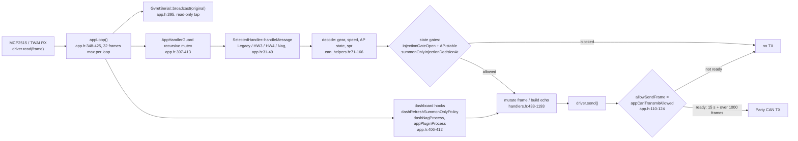
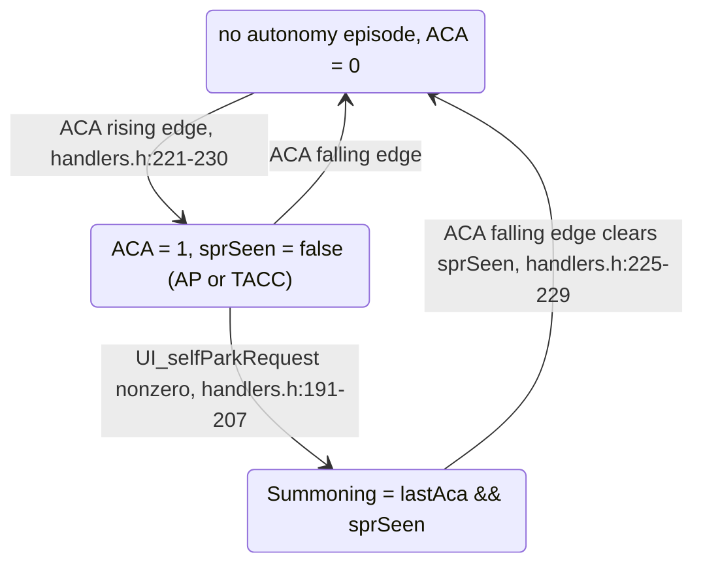
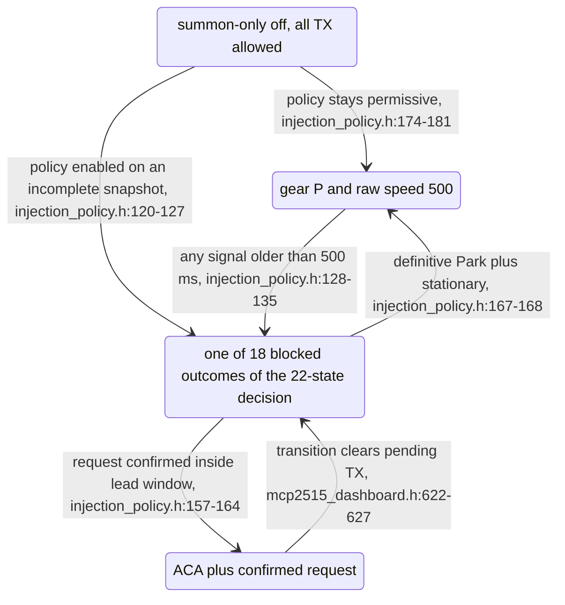
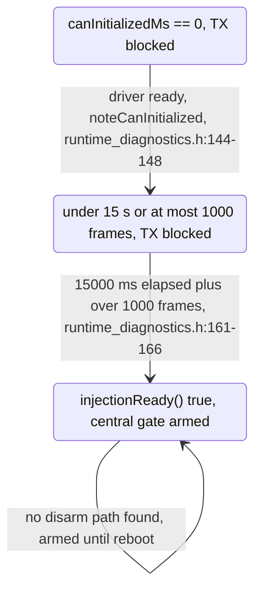
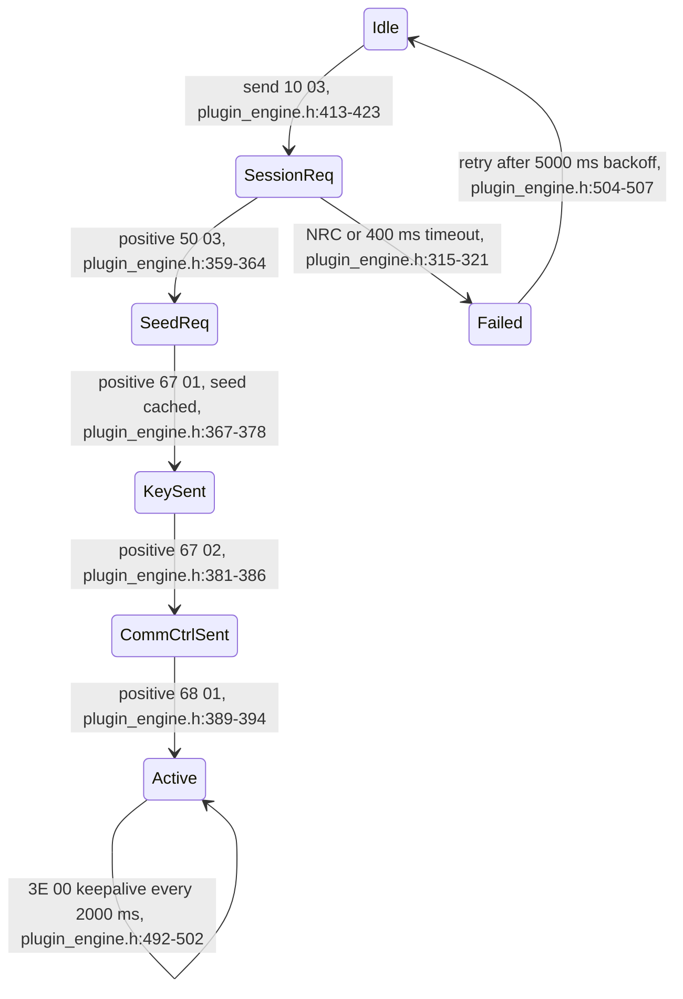
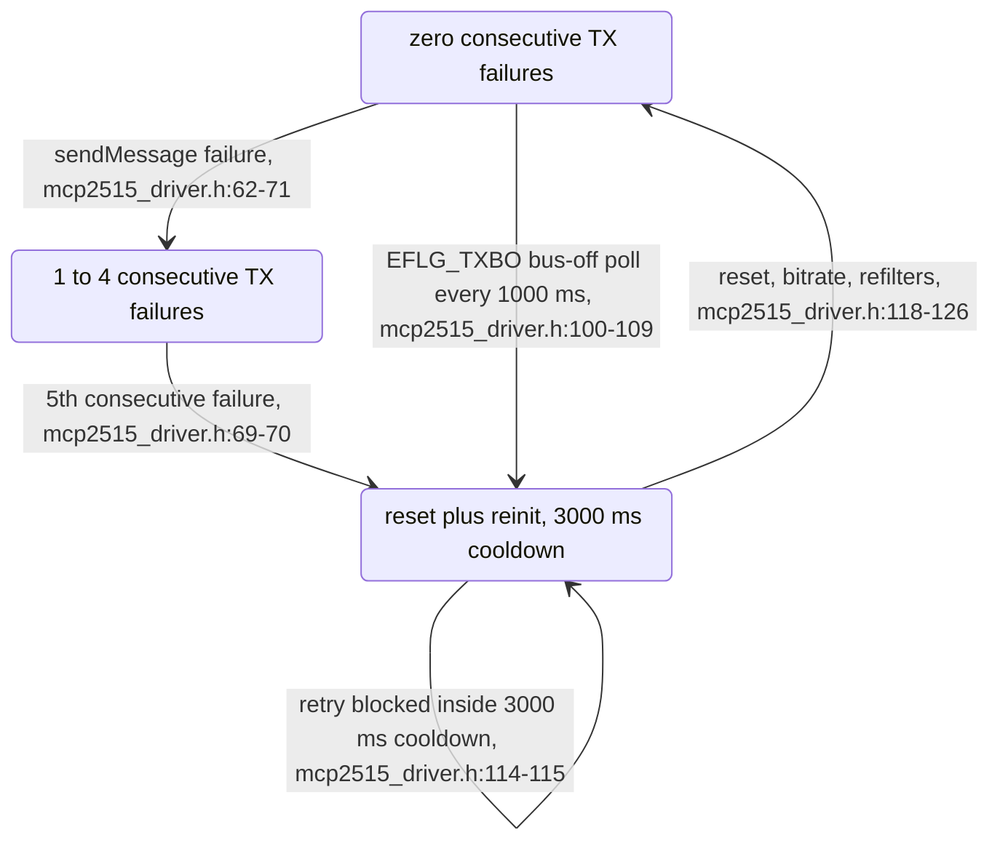

# ev-open-can-tools / ev-open-can-tools — deep dive (code-grounded)

## 1. Provenance

| Field | Value |
| --- | --- |
| Submodule path | `legacy/ev-open-can-tools-ev-open-can-tools` |
| Pinned gitlink | `160000 338d2760899735530c7eeccb190a4673f1c58202` |
| `rev-parse HEAD` | `338d2760899735530c7eeccb190a4673f1c58202` (MATCH) |
| Worktree status | clean (`git status --porcelain` empty) |
| Commit subject | `338d276 Release 3.1.1 with enhancements and fixes` |
| Upstream URL | `https://github.com/ev-open-can-tools/ev-open-can-tools` (origin fetch+push) |
| Version | `VERSION:1` = `3.1.1`; `CHANGELOG.md:12` = `[3.1.1] - 2026-08-03` |
| License | GPL-3.0 (`README.md:82`, root `LICENSE`) |
| Analysis date | 2026-11-20 |

Files read (line ranges, pinned SHA): `VERSION:1`; `README.md:1-84`; `CHANGELOG.md:1-120`;
`platformio.ini:1-120,161-223`; `include/can_frame_types.h:1-24`; `include/shared_types.h:1-11`;
`include/can_helpers.h:1-231`; `include/handlers.h:1-1212`; `include/injection_policy.h:1-231`;
`include/app.h:1-425`; `include/runtime_diagnostics.h:1-218`;
`include/drivers/can_driver.h:1-48`; `include/drivers/mcp2515_driver.h:1-135`;
`include/gvret_protocol.h:1-42`; `include/plugin_engine.h:40-189,240-309,640-679,1257-1336,1468-1507`;
`include/web/mcp2515_dashboard.h:495-542,555-639,740-824,4065-4079`;
`test/test_native_helpers/test_helpers.cpp:250-324`; `test/test_native_nag/test_nag_handler.cpp:70-199`;
`test/test_native_summon_only_injection/test_summon_only_injection.cpp:1-120`;
plus test-name/line inventory across all `test/test_native_*/` and `test/*.py`.

Our-side counterparts read: `firmware/lib/core/types.h:830-843`; `firmware/lib/core/can/health.h:1-108`;
`firmware/lib/vehicle/can/checksum.h:1-75`; `firmware/lib/vehicle/can/handler/frame_readers.h:1-60`;
`firmware/lib/vehicle/can/handler/variant/{hw3:60-150,hw4:60-157,legacy:30-80}.h`;
`firmware/lib/vehicle/can/feature/fsd/{profile:1-111,offsets:1-95,nag:1-179}.h`;
`firmware/lib/vehicle/can/feature/das/tlssc.h:1-60`; `firmware/src/esp32/main.cpp:130-150`;
`firmware/lib/vehicle/can/handler/variant/bits.h:22`.

Files explicitly NOT read in full: `src/espidf_runtime.cpp` (1496 lines), `include/platform/espidf_runtime.h` (574),
`include/drivers/twai_driver.h` (428, only `sendAllowed` line 171 via grep),
`include/drivers/esp32_mcp2515_driver.h` (only `sendAllowed` line 238 via grep),
`include/web/mcp2515_dashboard_ui*.h` (generated UI), `include/bounded_text_writer.h`,
`docs/*.md` beyond README/CHANGELOG, `onboarding/index.html`, partition CSVs, CI workflows,
`legacy-arduino/`, `scripts/`. These are listed as gaps, not silently omitted.

## 2. Executive verdict

This is a research/hobby Tesla CAN mod firmware, now at v3.1.1 (not v2.5.2 as the old summary claims). The
load-bearing material is not the frame mutations — most of those we already ship byte-for-byte — but the
**safety gating stack**: a fail-closed Summon-only injection policy (`injection_policy.h`), a 15 s + 1000-frame
startup readiness gate (`RuntimeDiagnostics::injectionReady`), a central driver-level `sendAllowed` transmit gate
(`app.h:110-124`), and ACA/self-park-request summon discrimination (`handlers.h:178-239`). The old summary's
claim that "our codebase does not have an AP injection gate" is wrong: `State::apGateOpen()` and its wiring already
exist. Nag core, profile/offset encoding, EVD, ISA chime, TLSSC, and checksums are all already present in our tree.
Best adaptation candidates: Summon-only fail-closed policy, startup readiness gate, and own-echo duplicate rejection.
Never port: the GTW UDS silencing machine (key algorithm is a placeholder XOR) and any legacy file verbatim.
Evidence is mostly CODE-READ + TEST-READ; no CAPTURE evidence exists in this checkout.

## 3. Evidence map

| Source file | Lines | What it proves | Grade |
| --- | --- | --- | --- |
| `VERSION` / `CHANGELOG.md` | 1 / 12-120 | v3.1.1, 2026-08-03; safety claim list | CODE-READ |
| `include/can_helpers.h` | 63-69 | `injectionGateOpenWithStableAp`: Park/Summon unconditional, AP requires `apStableMs >= required` | CODE-READ |
| `include/can_helpers.h` | 88-109,123-133 | DAS/HW4 AP status = `data[0]&0x0F`; hands-on = byte5 mid nibble; `readDIGear` = `(data[2]>>5)&7` | CODE-READ + TEST-READ (`test_helpers.cpp:140-233`) |
| `include/can_helpers.h` | 187-214 | `setSpeedProfileV12V13` byte6 bits[2:1]; `setSpeedProfileHW4` byte7 bits[6:4]; `computeVehicleChecksum` = low(id)+high(id)+bytes except ck byte | CODE-READ + TEST-READ (`test_helpers.cpp:277-321`) |
| `include/handlers.h` | 136-139 | `injectionGateOpen()` plain OR of AP/Park/Summon | CODE-READ |
| `include/handlers.h` | 178-239 | `recomputeSummoning` = `lastAca && sprSeen`; ACA falling edge clears `sprSeen` | CODE-READ |
| `include/handlers.h` | 352-478 | Legacy: IDs 69/280/390/599/921/1016/1006; stalk→profile; mux0 FSD+bit46, mux1 bit19 clear | CODE-READ |
| `include/handlers.h` | 480-664 | HW3: IDs 280/390/599/921/1016/1021/2047; offset *read* from `data[3]>>1 & 0x3F -30)*5` clamp 0..100; no mux2 TX | CODE-READ |
| `include/handlers.h` | 691-992 | NagHandler modes A/B/C, torque clamps ±1.80 Nm, own-echo reject, DAS+steering gates | CODE-READ + TEST-READ (`test_nag_handler.cpp:75-198`) |
| `include/handlers.h` | 994-1212 | HW4: IDs 280/390/599/923/1016/1021/2047; AP from 0x39B; ISA on 0x399; mux0 bit46/60/59, mux2 profile | CODE-READ |
| `include/injection_policy.h` | 7-13,117-181 | 500 ms freshness, 2000 ms request lead, stationary raw 500, max 4062, SNA 4095; 22-state fail-closed decision | CODE-READ + TEST-READ (`test_summon_only_injection.cpp:36-117`) |
| `include/app.h` | 101-124,265-301 | `appCanTransmitAllowed` = ready + summon policy; wired to `appDriver->allowSendFrame` | CODE-READ + TEST-READ (`test_espidf_stability_regression.py:35`) |
| `include/runtime_diagnostics.h` | 17-19,161-166 | 15 s injection delay, >1000 CAN frames required | CODE-READ + TEST-READ (`test_espidf_stability_regression.py:29`) |
| `include/drivers/can_driver.h` | 21-24 | `sendAllowed()` central hook | CODE-READ |
| `include/drivers/mcp2515_driver.h` | 55-135 | TX failure count 5 → `tryRecover`, bus-off poll 1 s, 3 s cooldown, 16 MHz | CODE-READ |
| `include/drivers/{twai,esp32_mcp2515}_driver.h` | 171 / 238 | ESP32 drivers call `sendAllowed(frame)` in `send()` | CODE-READ (grep) |
| `include/plugin_engine.h` | 114-127,656-663 | single-byte `matchByte/matchMask/matchValue` (not 8-byte masks) | CODE-READ |
| `include/plugin_engine.h` | 245-288 | GTW UDS key = XOR with build-flag byte; non-functional without proprietary algorithm | CODE-READ |
| `include/plugin_engine.h` | 1257-1319,1468-1507 | op set/counter/checksum (`computeVehicleChecksum` byte7), periodic emit, UDS response intercept | CODE-READ |
| `include/gvret_protocol.h` | 11-40 | read-only GVRET: `0xF1` start, `0x00` build frame, 4 B timestamp + 4 B ID + DLC + data | CODE-READ + TEST-READ (`test_native_gvret/`) |
| `include/web/mcp2515_dashboard.h` | 504,528-542,631-635,4067-4079 | 1000 ms AP stable delay; `dashInjectionActive()` gates plugin + nag paths | CODE-READ |
| `README.md` | 5,9-11,23-32,82 | not plug-and-play, bench-first, read-only GVRET, plugins are injection path, GPL-3.0 | SUMMARY-ONLY (project's own docs) |
| `CHANGELOG.md` | 67-75 | claims "Legacy FSD waits 2 s AP" — no matching 2000 ms constant in code | UNVERIFIED |
| no captured frames / candump with counts in repo | — | no CAN behavior is CAPTURE-backed | none |

## 4. Architecture and build surface

- Entry: PlatformIO `src/main.cpp` (215 lines); ESP-IDF runtime in `src/espidf_runtime.cpp`; Arduino fallback in
  `legacy-arduino/src/main.cpp`. Core shared headers are `include/`; platform ports are `include/drivers/`
  (`mcp2515_driver.h`, `twai_driver.h`, `same51_driver.h`, `esp32_mcp2515_driver.h`, `mock_driver.h`) and
  `include/platform/espidf_runtime.h`.
- Handler selection is compile-time (`app.h:31-49`): `ESP32_DASHBOARD` → `DASH_DEFAULT_HW` (0 Legacy / 2 HW4 /
  else HW3); else `NAG_KILLER` / `HW4` / `HW3` / `LEGACY`, with `#error` if none. One active handler at runtime,
  swapped under a recursive mutex (`AppHandlerGuard`, `app.h:55-90`).
- Build flags that change safety behavior: `ESP32_DASHBOARD`, `DRIVER_TWAI`, `DRIVER_ESP32_EXT_MCP2515`,
  `ISA_SPEED_CHIME_SUPPRESS`, `EMERGENCY_VEHICLE_DETECTION`, `ENHANCED_AUTOPILOT`, `BYPASS_TLSSC_REQUIREMENT`,
  `NAG_KILLER`, `INJECTION_AFTER_AP` / `DASH_INJECTION_AFTER_AP`, `PLUGIN_GTW_UDS_KEY_READY`, `NATIVE_BUILD`.
  Feature defaults flip from disabled to enabled **only for non-dashboard builds** (`can_helpers.h:6-50`) — a
  dashboard build starts all injections runtime-off and is the safe default.
- Native test envs: `env:native`, `native_dashboard`, `native_nag`, `native_injection_after_ap`,
  `native_plugin_engine`, `native_plugin_engine_custom_key`, `native_mcp2515_recovery` (`platformio.ini:161-223`).
- Dependency boundary: ArduinoJson 7 for plugins/dashboard; ESP-IDF 6.0.1 (`platformio/espressif32@7.0.0`,
  `framework-espidf @ 4.60001.0`) on ESP32; Arduino for RP2040/M4.

Frame pipeline (single Party CAN lane, RX-driven; every TX passes the central gate):



## 5. Mechanism catalogue

### 5.1 AP Injection Gate (plain OR + stable-AP helper)

- **Claim:** summary `docs/legacy/...md:47-65` gates injection on `APActive || Parked || Summoning`; CHANGELOG adds a 1 s stability rule.
- **Code path:** `handlers.h:136-139` `CarManagerBase::injectionGateOpen()` → plain OR; `can_helpers.h:63-69` `injectionGateOpenWithStableAp()` → `if (parked||summoning) return true; return apActive && apStableMs>=requiredApStableMs`; dashboard `mcp2515_dashboard.h:504,528-542` supplies `kDashApInjectionStableDelayMs = 1000`.
- **Frame spec:** none — state gate, not a frame. AP state read from 0x399 legacy/HW3 (`can_helpers.h:88-99`, `status 3..6`) and 0x39B HW4 (`can_helpers.h:101-104`, `data[0]&0x0F`).
- **Gates/timing:** 1000 ms AP-stable for AP path; Park and Summon bypass stability.
- **State machine:** AP rising edge starts timer (`mcp2515_dashboard.h:509-525`), falling edge resets.
- **Tests:** `test_helpers.cpp:259-273` `test_injection_gate_stable_ap_blocks_ap_rising_edge` (999<1000 false), `..._allows_after_delay` (1000 true), `..._still_allows_park_and_summon`.
- **Evidence grade:** CODE-READ + TEST-READ.
- **Verdict:** CONFIRMED (summary describes only half: it omits the stable-AP helper).
- **Adapt:** already present — our `State::apGateOpen()` (`core/types.h:837-842`) is the same OR; no AP-stability timer in our gate.

### 5.2 Summon gate (ACA + self-park-request latch)

- **Claim:** summary lines 59,115: Summoning needs ACA (0x118 byte6 bit2) AND a `UI_selfParkRequest` (0x3F8 byte3 bits 7:4), ACA falling edge clears.
- **Code path:** `handlers.h:187-208` `updateSummonFrom1016()` (`spr = (data[3]>>4)&0x0F`, `sprSeen=true` when nonzero); `handlers.h:215-239` `updateSummonFromDISystemStatus()` (`aca = data[6]&0x04`, falling edge clears `sprSeen`); `handlers.h:178-181` `recomputeSummoning() = lastAca && sprSeen`.
- **Frame spec:** 0x3F8 = 1016 `UI_driverAssistControl`, byte3 bits 7:4; 0x118 = 280 `DI_systemStatus`, byte6 bit2 (bit 50).
- **Gates/timing:** `kSummonInjectionRequestLeadMs = 2000` (`injection_policy.h:8`) used for request-confirm freshness in `updateSummonFromDISystemStatus`.
- **State machine:** rising ACA without confirmed request clears `summonPolicyRequestConfirmed`; falling ACA clears both flags.
- **Tests:** covered indirectly by `test_summon_only_injection.cpp` (snapshot has `summonRequestConfirmed`); no direct ACA-edge test named — UNVERIFIED detail.
- **Evidence grade:** CODE-READ.
- **Verdict:** CONFIRMED.
- **Adapt:** candidate (our `apGateSummoning` is only `summonRemaining > 0` at `src/esp32/main.cpp:136`, no spr/ACA discrimination).



### 5.3 Summon-only injection policy (fail-closed)

- **Claim:** not in old summary at all; CHANGELOG:22-24 adds "fail-closed Summon-only injection policy".
- **Code path:** `injection_policy.h:117-172` `evaluateSummonInjectionPolicy()` → `summonOnlyInjectionDecision()` (`:174-181`) → called from `handlers.h:311-315` and `app.h:110-124` (global transmit gate) and `mcp2515_dashboard.h:597-629` (`dashRefreshSummonOnlyPolicy` resets periodic emit + clears pending TX on block).
- **Frame spec:** DI gear 1..4 valid; speed raw stationary 500, max valid 4062, SNA 4095 (`injection_policy.h:9-11`); freshness 500 ms (`:7`); allowed only `AllowedParked` (gear P + raw==500) or `AllowedSummon` (ACA + confirmed request). Blocks: 22 states incl `ContradictoryGear`, `ParkedButMoving`, `AutopilotActive`, `AutonomyUnconfirmed`, `Stale*`, `Missing*`.
- **Gates/timing:** all four signals (DI, speed, AP, summon state) must be seen and <=500 ms fresh; secondary gear must agree with DI gear when fresh.
- **State machine:** pure decision function; transition to any blocked state clears pending transmits (`mcp2515_dashboard.h:622-627`).
- **Tests:** `test_summon_only_injection.cpp:36-117` — parked+stationary allow, summon+moving allow, manual/AP/moving-without-summon block, transitions stop immediately; `:119+` missing/stale blocks.
- **Evidence grade:** CODE-READ + TEST-READ.
- **Verdict:** CONFIRMED.
- **Adapt:** candidate for future PR — strongest item in this repo.



### 5.4 Startup readiness + central transmit gate

- **Claim:** CHANGELOG:46-48 "CAN init waits ten seconds and injection waits at least fifteen seconds after CAN init plus more than 1,000 valid frames."
- **Code path:** `runtime_diagnostics.h:17-19` `DRIVER_WAKE_DELAY_MS=10000`, `INJECTION_DELAY_MS=15000`, `CAN_LIVE_FRAME_THRESHOLD=1000`; `:161-166` `injectionReady()` = `initialized!=0 && now-initialized>=15000 && canFrames>1000`. `app.h:101-108` `appInjectionReady()` → `app.h:110-124` `appCanTransmitAllowed()` → wired at `:295` `appDriver->allowSendFrame`. `CanDriver::sendAllowed()` at `can_driver.h:21-24`; enforced in `twai_driver.h:171` and `esp32_mcp2515_driver.h:238` — **not** in Arduino `mcp2515_driver.h:55-75`.
- **Frame spec:** none; transport-level gate.
- **Gates/timing:** 15 s + >1000 frames; when summon-only enabled, the policy must also allow.
- **Tests:** `test_espidf_stability_regression.py:24,29,35,37`.
- **Evidence grade:** CODE-READ + TEST-READ.
- **Verdict:** CONFIRMED.
- **Adapt:** candidate — our firmware logs bus health (`core/can/health.h:43-72`) with no time/frame-count injection readiness gate.



### 5.5 FSD mux0 injection (Legacy/HW3/HW4) + EVD + TLSSC bypass

- **Claim:** summary lines 72,80,104-107: FSD enable bit46, HW4 bit60, EVD bit59, profile writers.
- **Code path:** Legacy `handlers.h:437-449` (mux0 `isADSelectedInUI` + `setSpeedProfileV12V13` + `setBit(46)`); HW3 `handlers.h:597-620` (mux0 bit46, offset read at `:601`); HW4 `handlers.h:1142-1157` (mux0 `setBit(46)`, `setBit(60)`, `setBit(59)` if `emergencyVehicleDetectionRuntime`). TLSSC bypass is `isADSelectedInUI()` `can_helpers.h:76-81` returning true when `bypassTlsscRequirementRuntime`.
- **Frame spec:** 0x3FD=1021 mux0 (`data[0]&7`); bits 46 (FSD), 60 (FSDv14), 59 (EVD); profile byte6 bits[2:1] HW3 / byte7 bits[6:4] HW4.
- **Gates/timing:** `ADEnabled = isADSelectedInUI() && (!checkAD||checkAD())`; dashboard `checkAD` = `canActive` only (`mcp2515_dashboard.h:499-502`) — no AP-stability on built-in FSD path.
- **Tests:** `test_native_hw3/`, `test_native_hw4/`, `test_native_dashboard/`, `test_native_bypass_tlssc_requirement/` (test inventory).
- **Evidence grade:** CODE-READ.
- **Verdict:** CONFIRMED.
- **Adapt:** already present — our `writeHW4SpeedProfile`/`setSpeedProfileV12V13`, EVD bit59 (`variant/bits.h:22`, `hw4.h:142-144`), TLSSC 0x331 0x1B (`das/tlssc.h:46-59`) all ship.

### 5.6 Follow-distance → profile auto-mapping

- **Claim:** summary lines 71,79,103: stalk→profile.
- **Code path:** Legacy `handlers.h:366-382` `pos=data[1]>>5` → {≤1:2, 2:1, else 0}; HW3 `handlers.h:529-551` `fd=(data[5]&0xE0)>>5` → {1:2,2:1,3:0}; HW4 `handlers.h:1081-1106` → {1:3,2:2,3:1,4:0,5:4}.
- **Frame spec:** 0x045=69 byte1 bits 7:5 (Legacy); 0x3F8=1016 byte5 bits 7:5 (HW3/HW4).
- **Gates/timing:** only when `speedProfileAuto` true (`shouldInjectSpeedProfile()` `handlers.h:337-344`).
- **Tests:** `test_native_hw3/`, `test_native_hw4/`; our counterpart `test_native_frame_readers`.
- **Evidence grade:** CODE-READ.
- **Verdict:** CONFIRMED.
- **Adapt:** already present — `profile.h:43-58` maps identical tables; wired in `hw3.h:74` / `hw4.h:88`.

### 5.7 HW3 speed offset read (injection absent)

- **Claim:** summary line 82 claims mux2 speed-offset injection with byte0 bits[7:6]+byte1 bits[5:0].
- **Code path:** `handlers.h:601` only reads `speedOffset = clamp(((data[3]>>1)&0x3F)-30)*5, 0, 100)`; no `index==2` branch in `HW3Handler` (grep: only `case 2` at `:542` and `:1094`, and `index==2` at `:1159` which is HW4 profile).
- **Frame spec:** read from 1021 mux0 `data[3]` bits[6:1], bias −30, ×5, clamp 0..100 (HW4 range 0..63 is UI-side in our code).
- **Tests:** `test_native_hw3/` checks offset decode; no mux2 TX test.
- **Evidence grade:** CODE-READ (grep-verified absence).
- **Verdict:** CONTRADICTED (summary describes behavior not in this version).
- **Adapt:** no impact / already present — our `offsets.h:17-50` has read + write + command; we are equal or ahead.

### 5.8 ISA speed chime suppression (HW4)

- **Claim:** summary line 102/119: 0x399 byte1 bit5 + checksum.
- **Code path:** `handlers.h:1061-1079` (guarded `ISA_SPEED_CHIME_SUPPRESS && !ESP32_DASHBOARD`): `frame.data[1] |= 0x20`; `sum = Σdata[0..6] + (921&0xFF) + (921>>8)` = Σ + 0x99 + 0x03; `data[7]=sum&0xFF`; `driver.send(frame)`.
- **Frame spec:** 0x399=921, byte1 bit5, checksum byte7 = sum(bytes0..6)+0x9C.
- **Gates/timing:** only non-dashboard HW4 builds with the flag; `isaSpeedChimeSuppressRuntime`.
- **Tests:** `test_native_helpers`, `test_native_hw4` ISA cases.
- **Evidence grade:** CODE-READ.
- **Verdict:** CONFIRMED.
- **Adapt:** already present — `checksum.h:47-56` `computeHW4IsaChecksum` is the same formula; `fsd/isa_chime.h` ships.

### 5.9 NagHandler 0x370 echo modes A/B/C + own-echo rejection

- **Claim:** summary lines 85-96: "simple always-echo, fixed 1.80 Nm, no DAS gating, no organic variation."
- **Code path:** `handlers.h:691-992`. `handsOn=(data[4]>>6)&3`; `torqueRaw=(data[2]&0x0F)<<8|data[3]`; `isOwnEcho = (handsOn==1 && torqueRaw==0x08B6) || matchesLastEcho(frame)` (`:769-773`, `:893-898`); `decideInjection()` (`:929-991`) Mode A fixed `0x08B6`, Mode B cycle `{0x08B6,0x0898,0x076C,0x074E}` with 1000 ms burst/1500 ms pause/200 ms step, Mode C requires AP 3..6, |steer|≤5°, 1000 ms context freshness and state-2/3 walks; clamp ±0.08–1.80 Nm (`:23-33`, `:860-865`). Echo frame: `data[2]=(data[2]&0xF0)|(torque>>8)`, `data[3]=torque&0xFF`, `data[4]|=0x40`, counter `data[6]&0x0F +1`, checksum `Σdata[0..6]+0x73` (`:787-809`).
- **Frame spec:** 0x370=880 DLC8; counter low nibble byte6; checksum byte7; HW4 Mode C blocked (`nagModeAllowedForHardware` `:65-69`).
- **Gates/timing:** `transmissionAllowed && nagKillerActive && nagKillerRuntime && mode!=0 && !isOwnEcho && handsOnEligible`.
- **Tests:** `test_nag_handler.cpp:75-110` (filters, Mode C blocked on HW4), `:116-198` (echo only handsOn=0, counter +1/wrap/upper-nibble preserve).
- **Evidence grade:** CODE-READ + TEST-READ.
- **Verdict:** CONTRADICTED (summary is one mode, code has three and DAS gating).
- **Adapt:** already present (our organic/natural/feifan exceed it); only the 12-bit full-torque own-echo compare is a small idea-candidate.

### 5.10 Bit-19 nag suppression in variant handlers

- **Claim:** summary lines 73,81,105: mux1 bit19 clear gated by injection gate.
- **Code path:** Legacy `handlers.h:450-459` (non-dashboard only); HW3 `:621-645` (`ENHANCED_AUTOPILOT` branch requires `enhancedAutopilotInjectionAllowed(injectionGateOpen())`, else always-on); HW4 `:1168-1193` (adds bit47). Dashboard builds never inject mux1 nag (`test_native_dashboard` asserts this).
- **Frame spec:** 1021/1006 mux1 bit19 cleared; HW4 also bit47 set.
- **Gates/timing:** `checkNag` callback; dashboard sets `dashCheckNagDisabled()` = false.
- **Tests:** `test_dashboard_handlers.cpp:70,124,178` mux1 does not inject.
- **Evidence grade:** CODE-READ + TEST-READ.
- **Verdict:** CONFIRMED.
- **Adapt:** already present — `nagModeUsesBit19` gated by `apGateOpen()` in `hw3.h:140` / `hw4.h:150` / `legacy.h:75`.

### 5.11 Plugin JSON rule engine (single-byte mask, ops, counters, periodic emit)

- **Claim:** summary/CHANGELOG claim 8-byte `byteMask[8]`/`byteValue[8]` matching.
- **Code path:** `PluginRule` `plugin_engine.h:114-127`; `pluginRuleMatchesByte()` `:656-663` single byte; `pluginApplyOpMasked()` `:1257-1311` supports SET_BIT/SET_BYTE/OR/AND/CHECKSUM/COUNTER/PERIODIC with a 64-bit allowed-write mask; `pluginAdvanceCounters()` `:1313-1320` writes `computeVehicleChecksum` byte7; `pluginProcessFrame()` `:1468-1520` intercepts UDS responses, claims writes, recomputes checksum.
- **Frame spec:** any CAN ID/mux/single-byte mask/bus mask; ops mutate 0..7 bytes; checksum always byte7 via low(id)+high(id)+payload.
- **Gates/timing:** requires `dashInjectionActive()` (`mcp2515_dashboard.h:4067-4072`) = canActive + ready + AP gate + summon policy; counters advance only on successful TX (CHANGELOG:93).
- **Tests:** `test_native_plugin_engine/`, `test_native_plugin_engine_custom_key/`, JSON schema tests in `test_can_analyzer.py`.
- **Evidence grade:** CODE-READ + TEST-READ.
- **Verdict:** CONTRADICTED on mask width; CONFIRMED on ops/engine.
- **Adapt:** no impact to never — our firmware uses compiled-in handlers, not runtime JSON TX rules; adding an arbitrary runtime rule loader is a different threat model. The allowed-write-mask idea is worth a comment, not a port.

### 5.12 GTW UDS silencing machine (non-functional placeholder)

- **Claim:** CHANGELOG/plugin docs mention gateway silencing.
- **Code path:** `plugin_engine.h:245-288` `pluginGtwSilentSupported()` returns true only if `PLUGIN_GTW_UDS_KEY_READY` defined; `pluginGtwUdsComputeKey()` is `outKey[i] = seed[i] ^ xorKey` with a build-flag byte; comment `:256-258` says without the real proprietary algorithm the gateway answers NRC invalidKey. State machine `:307-506` (session 0x10 03, seed 0x27 01, key 0x27 02, comm ctrl 0x28 01 01, active + 0x3E keepalive).
- **Frame spec:** request ID from `PLUGIN_GTW_UDS_REQUEST_ID`, ISO-TP single frame PCI in `data[0]`.
- **Tests:** `test_native_plugin_engine_custom_key/` with `-DPLUGIN_GTW_UDS_KEY_READY=0xAB` (synthetic, not real vehicle).
- **Evidence grade:** CODE-READ + TEST-READ.
- **Verdict:** CONFIRMED as placeholder.
- **Adapt:** never port — no real key; our `ban_shield.h` / GTW shield already cover frame defense.



### 5.13 MCP2515 / TWAI bus-off auto-recovery

- **Claim:** summary Upstream 2026-06-20 lines 142,160: auto-recovery with exponential backoff (1→2→4→8→30 s).
- **Code path (this SHA):** Arduino `mcp2515_driver.h:100-127` `checkBusOff()` polls `EFLG_TXBO` every `kErrorCheckIntervalMs=1000`, `tryRecover()` resets + 16 MHz bitrate + reapplies filters, with `kRecoveryCooldownMs=3000`, triggered after `kMaxConsecutiveTxFailures=5` (`:69,78-81`). TWAI equivalent at `include/drivers/twai_driver.h` (not fully read). No 1→2→4→8→30 s exponential ladder found in the read files.
- **Frame spec:** n/a — driver health.
- **Gates/timing:** 1 s error poll, 3 s recovery cooldown, 5 failure threshold.
- **Tests:** `test_native_mcp2515_recovery/` (61 lines), `test_espidf_stability_regression.py:50`.
- **Evidence grade:** CODE-READ (Arduino driver) + TEST-READ; exponential-ladder claim UNVERIFIED.
- **Verdict:** PARTIAL (recovery exists; backoff ladder not confirmed at this SHA).
- **Adapt:** candidate for future PR — our `core/can/health.h` detects but does not auto-recover; a 3 s cooldown reset/reinit fits our `bus.h` driver layer.



### 5.14 GVRET read-only binary logging

- **Claim:** README:28 "read-only GVRET/SavvyCAN logging"; CHANGELOG:33-34 "explicit dashboard arming, bounded non-blocking sessions".
- **Code path:** `gvret_protocol.h:11-40` `encodeCanFrame()` → `0xF1` start, `0x00` build-frame, 4 B LE timestamp, 4 B LE ID, DLC byte, data; `kGetParams/kGetDeviceInfo/kKeepAlive/kGetBusCount` response constants. `app.h:395` `GvretSerial::broadcast(original)` on every RX; `app.h:298-299` monitor-all callback.
- **Frame spec:** 11 + DLC bytes per frame; 11-bit IDs only (`id>0x7FF` rejected).
- **Gates/timing:** non-blocking, client-connected gates `setMonitorAll`.
- **Tests:** `test_native_gvret/test_gvret_protocol.cpp` (43 lines); `test_espidf_stability_regression.py:91` "gvret is bounded read-only and nonblocking".
- **Evidence grade:** CODE-READ + TEST-READ.
- **Verdict:** CONFIRMED.
- **Adapt:** candidate (low priority) — our protocol package defines `gvret:on/off/port` strings and docs, but no firmware GVRET encoder was found under `firmware/` via grep; verify before claiming.

## 6. Summary vs code contradiction table

| # | Existing doc / README claim | Code evidence | Verdict |
| --- | --- | --- | --- |
| 1 | Overview line 15: "stable release is v2.5.2 (April 2026)" | `VERSION:1` = 3.1.1; `CHANGELOG.md:12` = 3.1.1 / 2026-08-03 | CONTRADICTED (doc's own Upstream 2026-11-20 says v3.1.1) |
| 2 | Lines 62,114: `DI_gear` byte2 bits0-2 | `can_helpers.h:130-133` `(data[2]>>5)&7` = bits5-7; comment at `:128` | CONTRADICTED |
| 3 | Line 100: HW4 AP status from CAN 921 | `handlers.h:1052-1060` uses 923/0x39B; 921 only ISA at `:1062` | CONTRADICTED |
| 4 | Lines 52-55: gate = AP||Park||Summon (no stability mention) | `can_helpers.h:63-69` + `mcp2515_dashboard.h:504` add 1000 ms AP stability | CONTRADICTED (incomplete) |
| 5 | Line 89: NagHandler simple always-echo, no DAS gating/variation | `handlers.h:691-992` modes A/B/C, DAS + steering gates, torque walks | CONTRADICTED |
| 6 | Line 87: NagHandler filters ID 880 only | `handlers.h:717-722` Mode C adds 0x399/0x129 or 0x39B; test `test_nag_handler.cpp:84-93` | CONTRADICTED |
| 7 | Line 143 (v3.0 note): plugin `byteMask[8]`/`byteValue[8]`, all-bytes match | `plugin_engine.h:114-127,656-663` single `matchByte/matchMask/matchValue` | CONTRADICTED |
| 8 | Line 82: HW3 mux2 speed-offset injection | no `index==2` branch in `HW3Handler`; only read at `handlers.h:601` | CONTRADICTED |
| 9 | Line 131: "our codebase does not have AP injection gate" | `firmware/lib/core/types.h:837-842` `State::apGateOpen()`; wired in `hw3.h:67/123`, `hw4.h:67/136`, tests `test_native_ap_gate/` | CONTRADICTED |
| 10 | Line 132: profile.h "not wired to the stalk" | `firmware/lib/vehicle/can/feature/fsd/profile.h:43-58`; wired `hw3.h:74`, `hw4.h:88` | CONTRADICTED |
| 11 | Line 133: `offsets.h` "is a stub" | `offsets.h:17-95` full read/write/command | CONTRADICTED |
| 12 | Line 134: EVD "not in our codebase" | `variant/bits.h:22`, `hw4.h:142-144`, `dispatch.h:659-673`, tests | CONTRADICTED |
| 13 | Line 136: "our nag suppress is ungated" | `fsd/nag.h:126-159` DAS/AP/driver-bypass gates | CONTRADICTED |
| 14 | Line 160: MCP2515 auto-recovery "exponential backoff 1→2→4→8→30 s" | Arduino driver `mcp2515_driver.h:78-81,100-127` = fixed 3 s cooldown / 5 failures; no ladder found | PARTIAL / UNVERIFIED |
| 15 | CHANGELOG:70 "Legacy FSD waits 2 s AP" | only 1000 ms stable-AP constant at `mcp2515_dashboard.h:504`; no 2000 ms | UNVERIFIED |
| 16 | Lines 118,122 (status 3-0 / mux bits) | `can_helpers.h:88-91` `data[0]&0x0F` (bits0-3) | CONFIRMED (same field, wording differs) |
| 17 | Line 96 nag checksum `Σb0..b6 + 0x73` | `handlers.h:807-809` exact | CONFIRMED |
| 18 | Lines 113-125 CAN ID/signal table (0x399, 0x3F8, 0x3FD, 0x7FF) | `can_helpers.h:83-86` GTW `(data[5]>>2)&7`; `handlers.h:191,536,1088` | CONFIRMED |
| 19 | Line 160 "we currently log but do not auto-recover" | our `core/can/health.h:43-72` is detection-only — CONFIRMED on our side | CONFIRMED |

**Conclusion:** the pre-existing summary is not trustworthy as a mechanism source. Treat every claim in it as
SUMMARY-ONLY until re-checked against this document. Only rows 16-19 survived unchanged.

## 7. CAN frame and signal inventory

Read scope added for this update (2026-11-20, sections 7-12 and 15): upstream `include/handlers.h:1-1212`,
`include/can_helpers.h:1-231`, `include/injection_policy.h:1-231`, `include/runtime_diagnostics.h:1-218`,
`include/drivers/mcp2515_driver.h:1-135`, `include/gvret_protocol.h:1-42`, `include/app.h:1-425`,
`include/plugin_engine.h:300-519`, `include/web/mcp2515_dashboard.h:495-664` and `:4244-4279`,
`CHANGELOG.md:296-405`, and the submodule `git log` (280 commits). Our side adds
`firmware/lib/vehicle/can/handler/bus/vehicle.h:370-409`, `feature/telemetry/powertrain.h:14-93`,
`handler/variant/{hw3,hw4,legacy,bits}.h`, `feature/fsd/{profile,offsets,nag,isa_chime}.h`,
`feature/das/tlssc.h`, `checksum.h`, `handler/frame_readers.h`, `core/types.h:828-843`,
`core/can/health.h`, and `src/esp32/main.cpp:126-155`.

No DBC or JSON frame catalog ships in this repo — the rows below are built from code reads, not a vendored
database. All traffic rides the single Party CAN lane (`handlers.h:687`, commit `447049d`); reception is
event-driven, so "period" is the arrival cadence, not an upstream TX timer.

| ID (hex+dec) | Bus | Period | DLC | Byte/bit layout | Scale / units | Counter | Checksum | R/W | Grade |
| --- | --- | --- | --- | --- | --- | --- | --- | --- | --- |
| `0x045 / 69` STW_ACTN_RQ | Party CAN | on RX | ≥2 | stalk pos `data[1] bits[7:5]` | pos 1-7, `handlers.h:366-370` | n/a | n/a | read | CODE-READ |
| `0x118 / 280` DI_systemStatus | Party CAN | on RX | ≥3 gear, 8 for policy | gear `data[2] bits[7:5]`; ACA `data[6] bit 2` | gear 0=INVALID, 1=P, 2=R, 3=N, 4=D, 7=SNA (`can_helpers.h:128-133`) | n/a | n/a | read | CODE-READ |
| `0x186 / 390` DIF gear | Party CAN | on RX | 8 | gear `data[7] bits[5:3]` | same gear codes (`can_helpers.h:123-126`) | n/a | n/a | read | CODE-READ |
| `0x257 / 599` DI_speed | Party CAN | on RX | 8 | raw 12-bit `(data[1]>>4)\|(data[2]<<4)` | ×0.08 km/h, −40 offset; 500=0 km/h, 4062 max valid, 4095 SNA (`can_helpers.h:135-141`, `injection_policy.h:9-11`) | n/a | n/a | read | CODE-READ |
| `0x399 / 921` DAS_status (Legacy/HW3) | Party CAN | on RX | ≥1 | AP status `data[0] bits[3:0]`; hands-on `data[5] bits[5:2]` | AP active 3..6 (`can_helpers.h:88-99`) | n/a | n/a | read | CODE-READ |
| `0x399 / 921` ISA chime (HW4 non-dashboard) | Party CAN | on RX | 8 | sets `data[1] bit 5` (`0x20`) | chime suppressed (`handlers.h:1061-1079`) | n/a | `data[7] = Σ data[0..6] + 0x9C` (`handlers.h:1069-1073`) | write | CODE-READ |
| `0x39B / 923` DAS_status (HW4) | Party CAN | on RX | ≥1 | AP status `data[0] bits[3:0]` | active 3..6 (`handlers.h:1052-1060`) | n/a | n/a | read | CODE-READ |
| `0x3F8 / 1016` UI_driverAssistControl | Party CAN | on RX | ≥4 spr, ≥6 fd | spr `data[3] bits[7:4]`; follow-distance `data[5] bits[7:5]` | spr 4=PRIME, 5=PAUSE, 7/8=AUTO_SUMMON, 11=SMART; cancels 3/9 (`handlers.h:183-208`, `injection_policy.h:92-115`) | n/a | n/a | read | CODE-READ |
| `0x3EE / 1006` Legacy FSD mux | Party CAN | on RX | 8 | mux `data[0] bits[2:0]`; AD-selected `data[4] bit 5`; mux0 TX: profile `data[6] bits[2:1]` + bit 46; mux1: bit 19 clear | profile 0..3 (`can_helpers.h:187-191`) | n/a | n/a | read+write | CODE-READ |
| `0x3FD / 1021` FSD mux | Party CAN | on RX | 8 | HW3 mux0: bit 46 + offset read `data[3] bits[6:1]`; HW4 mux0: bits 46, 60, 59 (EVD); mux1: bit 19 clear, HW4 also sets bit 47; HW4 mux2: profile `data[7] bits[6:4]`, manual profile only | offset = (raw − 30) × 5, clamp 0..100 (`handlers.h:601`) | n/a | n/a | read+write | CODE-READ |
| `0x7FF / 2047` GTW_carConfig mux 2 | Party CAN | on RX | ≥6 | autopilot tier `data[5] bits[4:2]` | 0=NONE, 1=HIGHWAY, 2=ENHANCED, 3=SELF_DRIVING, 4=BASIC (`can_helpers.h:83-86`, `:168-185`) | n/a | n/a | read | CODE-READ |
| `0x370 / 880` EPAS3P_sysStatus | Party CAN | on RX, echo per frame | 8 | handsOn `data[4] bits[7:6]`; torque `(data[2]&0x0F)<<8\|data[3]`; echo writes torque, `data[4] bit 6`, counter `data[6] bits[3:0]` | torque raw 0x074E..0x08B6 = ±1.80 Nm (`handlers.h:25-33`) | `data[6]` low nibble, +1 per echo | `data[7] = Σ data[0..6] + 0x73` (`handlers.h:807-809`) | read+write | CODE-READ |
| `0x129 / 281` SCCM steering angle | Party CAN | on RX | ≥4 | validity `data[3] bits[7:6]` must be 1; angle `data[2]\|(data[3]&0x3F)<<8` | ×0.1, −819.2° (`can_helpers.h:111-121`) | n/a | n/a | read | CODE-READ |
| `0x684 / 1668` GTW UDS request | Party CAN | keepalive 2000 ms when active | 8 | ISO-TP single frame: PCI `data[0]`, payload `data[1..7]` | services 10 03, 27 01/02, 28 01 01, 3E 00 (`plugin_engine.h:413-507`) | n/a | n/a | write | CODE-READ |
| `0x685 / 1669` GTW UDS response | Party CAN | on RX | ≥2 | PCI `data[0]`, SID `data[1]`, NRC `data[3]` | NRC 0x78 responsePending keeps waiting (`plugin_engine.h:324-355`) | n/a | n/a | read | CODE-READ |

## 8. Constants and tuning table

| Constant | Value | File:line | Meaning | Grade |
| --- | --- | --- | --- | --- |
| `TORQUE_NM_MAX` / `TORQUE_NM_MIN` | ±1.80 | `handlers.h:25-26` | nag torque safety clamp; dashboard values may not widen it | CODE-READ |
| `TORQUE_RAW_MAX` / `TORQUE_RAW_MIN` | 0x08B6 / 0x074E | `handlers.h:27-28` | raw-domain clamp feeding every mode | CODE-READ |
| `kModeBTorques[]` | {0x08B6, 0x0898, 0x076C, 0x074E} | `handlers.h:941` | Mode B cycle = +1.80, +1.50, −1.50, −1.80 Nm | CODE-READ |
| `kModeBBurstMs` / `kModeBPauseMs` | 1000 / 1500 | `handlers.h:703-704` | Mode B burst window inside 2500 ms cycle | CODE-READ |
| `kModeBTorqueStepMs` | 200 | `handlers.h:705` | Mode B table advance step | CODE-READ |
| `kContextFreshMs` | 1000 | `handlers.h:702` | Mode C DAS + steering context freshness | CODE-READ |
| `torqueNmToRaw` | (Nm + 20.5) × 100 + 0.5 | `handlers.h:863` | Nm-to-raw conversion for Mode C | CODE-READ |
| Mode C state-2 entry delay | 2000 ms | `handlers.h:966-967` | hold before random walk starts | CODE-READ |
| Mode C state-3 entry delay / ramp | 1000 ms, ±1.8 Nm triangle | `handlers.h:977-981` | hold before 1000 ms ramp cycle | CODE-READ |
| Mode C walk | seed ×1103 + 12345; Δ = ((seed&0x1F) − 16) × 0.05; magnitude clamp 0.5..1.80 | `handlers.h:968-971` | state-2 random walk, sign opposes steering | CODE-READ |
| `setHandsOn` threshold | \|torqueNm\| ≥ 1.0 | `handlers.h:989` | Mode C writes handsOnLevel only above 1 Nm | CODE-READ |
| `kSummonInjectionFreshnessMs` | 500 | `injection_policy.h:7` | all four signals must be this fresh | CODE-READ |
| `kSummonInjectionRequestLeadMs` | 2000 | `injection_policy.h:8` | request-confirm freshness on ACA rising edge | CODE-READ |
| `kDiVehicleSpeedStationaryRaw` / `MaxValidRaw` / `SnaRaw` | 500 / 4062 / 4095 | `injection_policy.h:9-11` | stationary marker, valid ceiling, SNA | CODE-READ |
| AP active / inactive windows | 3..6 / ≤2 | `injection_policy.h:77-85` | summon policy AP-state discrimination | CODE-READ |
| spr confirms / cancels | {1,2,4,5,6,7,8,10,11,12} / {3,9} | `injection_policy.h:92-115` | self-park session verbs | CODE-READ |
| `DRIVER_WAKE_DELAY_MS` / `INJECTION_DELAY_MS` / `CAN_LIVE_FRAME_THRESHOLD` | 10000 / 15000 / 1000 | `runtime_diagnostics.h:17-19` | startup readiness policy | CODE-READ |
| no-CAN warning threshold | 20000 ms | `runtime_diagnostics.h:208-214` | stays alive, warns every 5 s | CODE-READ |
| `kMaxConsecutiveTxFailures` / `kErrorCheckIntervalMs` / `kRecoveryCooldownMs` | 5 / 1000 / 3000 | `mcp2515_driver.h:79-81` | TX-failure and bus-off recovery policy | CODE-READ |
| `kMaxFilters` | 6 | `mcp2515_driver.h:78` | MCP2515 RX filter budget; forces the HW4 ISA gear-source trade-off (`handlers.h:998-1004`) | CODE-READ |
| `kDashApInjectionStableDelayMs` | 1000 | `mcp2515_dashboard.h:504` | AP-stable window for the dashboard injection gate | CODE-READ |
| `kDashStaRetryMs` | 120000 | `mcp2515_dashboard.h:305` | STA reconnect retry cadence | CODE-READ |
| `PLUGIN_GTW_UDS_KEEPALIVE_MS` / `RESPONSE_TIMEOUT_MS` / `RETRY_BACKOFF_MS` / `SEED_MAX` | 2000 / 400 / 5000 / 5 | `plugin_engine.h:36-39` | UDS session timing | CODE-READ |
| `PLUGIN_GTW_UDS_REQUEST_ID` / `RESPONSE_ID` | 0x684 / 0x685 | `plugin_engine.h:34-35` | UDS silencing peer IDs | CODE-READ |
| GVRET `kProtocolStart` / `kBuildFrame` | 0xF1 / 0x00 | `gvret_protocol.h:11-13` | binary logging markers | CODE-READ |
| `Parked` boot default | true | `handlers.h:77-83` | gate opens while DI asleep; live gear then fails closed | CODE-READ |
| frames-per-loop cap | 32 | `app.h:415-419` | RX flood bound with yield | CODE-READ |
| nag echo checksum constant | +0x73 (= 0x70 + 0x03) | `handlers.h:807-809` | 0x370 trailing checksum | CODE-READ |
| ISA checksum ID bytes | 0x99 + 0x03 | `handlers.h:1072` | 0x399 trailing checksum | CODE-READ |
| AP active window (DAS status) | 3..6 | `can_helpers.h:93-99` | comment: 6 is the steady engaged state | CODE-READ |

## 9. Failure modes and edge cases

| Failure | Handling code path | Tested? | Grade |
| --- | --- | --- | --- |
| MCP2515 TX failure burst | 5 consecutive failures → `tryRecover()`: reset, 16 MHz bitrate, refilters, 3 s cooldown (`mcp2515_driver.h:62-71,111-127`) | yes — `test_recovers_after_consecutive_send_failures` | TEST-READ |
| Bus-off (`EFLG_TXBO`) | polled every 1000 ms in `read()`, same `tryRecover()` cooldown (`mcp2515_driver.h:100-109`) | yes — `test_recovers_when_error_flags_report_bus_off` | TEST-READ |
| Bus-off exponential ladder 1→2→4→8→30 s | None found in the read files (old summary claim) | no | UNVERIFIED |
| CAN init failure at boot | warn, dashboard stays available, recovery retries (`app.h:308-312`) | no test found | CODE-READ |
| Injection before bus is live | 15 s + >1000-frame readiness gate in the central TX hook (`runtime_diagnostics.h:161-166`, `app.h:110-124`) | yes — `test_espidf_stability_regression.py:29,35` (source-scan assertions) | TEST-READ |
| Contradictory / stale vehicle state | 18 blocked policy outcomes; dashboard clears pending TX on any blocked transition (`injection_policy.h:117-172`, `mcp2515_dashboard.h:622-627`) | yes — `test_summon_only_injection.cpp` | TEST-READ |
| Gear SNA/INVALID blip mid-summon | only definitive Park (gear 1) clears the latch; SNA/INVALID never open the gate on live traffic (`can_helpers.h:158-166`, `handlers.h:390-396`) | yes — `test_..._waits_when_live_gear_is_unknown`, `test_..._summon_request_survives_aca_while_still_in_park` | TEST-READ |
| Own-echo feedback loop | 12-bit torque compare against `TORQUE_RAW_MAX` plus full-frame match (`handlers.h:769-773,893-898`) | no direct test name found — risk: reject path regression ships silently | CODE-READ |
| Brownout | boot reset reason logged with explicit warning (`runtime_diagnostics.h:58,103-104`) | no | CODE-READ |
| NVS init failure | `NvsState` Error/Recovered with error codes retained (`runtime_diagnostics.h:108-116`) | no | CODE-READ |
| No CAN traffic | warning after 20 s, stays alive instead of reboot-looping (`runtime_diagnostics.h:208-214`) | no | CODE-READ |
| RX flood | 32-frame loop cap with `yield()` (`app.h:415-419`) | no | CODE-READ |
| OTA in progress | `appLoop()` stops CAN processing while `Update.isRunning()` (`app.h:362-366`) | no (GVRET bounds only, `test_espidf_stability_regression.py:91`) | CODE-READ |
| Handler mutex allocation failure | halt with message (`app.h:274-279`) | no | CODE-READ |
| GVRET malformed frame | `id > 0x7FF`, `dlc > 8`, short buffer → returns 0, no write (`gvret_protocol.h:28-29`) | yes — `test_rejects_invalid_frame_or_short_output` | TEST-READ |
| UDS timeout / negative response | Failed state, 5 s backoff; NRC 0x78 keeps waiting (`plugin_engine.h:315-321,347-352`) | yes — `test_native_plugin_engine_custom_key/` | TEST-READ |
| Plugin invalid fields / out-of-DLC ops | fail closed, not sent (`plugin_engine.h:1257-1320`) | yes — `test_invalid_plugin_fields_fail_closed`, `test_operation_outside_frame_dlc_is_not_sent` | TEST-READ |
| Arduino driver bypasses central gate | `sendAllowed` enforced only in `twai_driver.h:171` and `esp32_mcp2515_driver.h:238`; Arduino `mcp2515_driver.h:55-75` never checks it | no | CODE-READ |

## 10. Test coverage map

Built from a full test-name inventory across `test/test_native_*/` plus the line-range reads cited in
section 1; per-assertion detail beyond those ranges was not re-read for this update.

| Test file | What it asserts | Grade |
| --- | --- | --- |
| `test_helpers.cpp` (44 tests) | bit/mux readers, AP-active window 3..6, DI gear bits 5-7, stable-AP gate edges (999 vs 1000 ms), profile writers, `computeVehicleChecksum`, runtime TLSSC bypass | TEST-READ |
| `test_hw3_handler.cpp` (22) | follow-distance→profile table, mux0 bit 46, EAP-gated mux1 bit 19, offset decode, **no mux2 TX** | TEST-READ |
| `test_hw4_handler.cpp` (34) | fd→profile incl. 5→4, bits 46/60/59 gating, mux2 manual-profile only, ISA `data[1]` bit 5 + checksum, 0x399 rejected as AP source | TEST-READ |
| `test_legacy_handler.cpp` (15) | stalk pos→profile, mux0 bit 46 + profile bits, `checkAD`/`checkNag` callbacks, mux1 bit 19 | TEST-READ |
| `test_nag_handler.cpp` (37) | handsOn filters, counter +1/wrap/upper-nibble preserve, torque 0xB6 = 1.80 Nm clamp, checksum, Mode B cycle/pause, Mode C context gates, HW4 blocks Mode C | TEST-READ |
| `test_summon_only_injection.cpp` (13) | parked+stationary allow, summon+moving allow, manual/AP block, transitions stop immediately, missing/stale/SNA/contradictory block | TEST-READ |
| `test_injection_after_ap.cpp` (10) | EAP mux1 waits for AP, Park still allows, drive stops, unknown gear waits, summon request survives ACA-in-Park | TEST-READ |
| `test_dashboard_handlers.cpp` (10) | dashboard builds observe mux0 without injecting, manual profile injects, mux1 never injects, ISA never injects | TEST-READ |
| `test_bypass_tlssc_requirement.cpp` (6) | bypass forces AD-selected true on all variants; mux2 stays silent | TEST-READ |
| `test_mcp2515_recovery.cpp` (2) | 5-failure recovery and bus-off-flag recovery | TEST-READ |
| `test_gvret_protocol.cpp` (3) | 0xF1 frame layout, invalid-frame rejection, params reply describes one 500 k bus | TEST-READ |
| `test_plugin_engine.cpp` (8) | mux mask semantics, bus pin, 16-rule filter budget, GTW silent disabled without key, 0x370 duplicate-counter plugin, or/and ops, fail-closed schema, out-of-DLC not sent | TEST-READ |
| `test_plugin_engine_custom_key.cpp` (3) | filter IDs include UDS IDs, UDS requests use cached bus, XOR key byte applied | TEST-READ |
| `test_twai_filter.cpp` (20) | per-variant accept/reject IDs, exact-mask single-ID match | TEST-READ |
| `test_bounded_writer.cpp` (3), `test_log_buffer.cpp` (8) | writer overflow fails closed; ring wrap/truncation | TEST-READ |
| `test_espidf_stability_regression.py` | source-scans the 10 s/15 s/1000-frame constants, TX-gate wiring, GVRET bounds (`:24,29,35,37,50,91`) | TEST-READ |
| `test_lilygo_t2can_build.py`, `test_wifi_settings_regression.py`, `test_can_analyzer.py`, `test_platformio_set_profile.py`, `test_vscode_intellisense.py` | inventoried, not read this pass | None found |

Critical paths with NO test:

- **Own-echo rejection** (`matchesLastEcho`, `handlers.h:893-898`) — a feedback-loop regression would ship undetected.
- **Bus-off backoff ladder** — no test, and no ladder exists in the read code; the old summary's 1→2→4→8→30 s claim stays UNVERIFIED.
- **CAN init failure at boot** (`app.h:308-312`) — "dashboard stays up" is untested.
- **Brownout / NVS-error / no-CAN-warning paths** (`runtime_diagnostics.h:103-116,208-214`) — untested.
- **Arduino MCP2515 driver ignores the central `sendAllowed` gate** — untested gap; an Arduino build can TX before readiness.
- **Dashboard HTTP endpoint behavior** — no native test covers any `server.on` handler.

## 11. Parity matrix with TeslaCANModder

Our-side citations below are CODE-READ from `firmware/` at the same analysis date. Rows without an our-side
read would be SUMMARY-ONLY and cannot drive decisions — every row here has one.

| Signal / frame | Upstream decode (cite) | Our decode (cite) | Delta | Action |
| --- | --- | --- | --- | --- |
| DI_gear (0x118) | `data[2] bits[7:5]`, SNA=7 (`can_helpers.h:128-133`) | `data[0] bits[3:1]`, SNA=5 (`powertrain.h:24-32`, `vehicle.h:387-393`) | **different bit position for the same frame** — one side decodes the wrong field | capture-first (listen-only bench; highest-value row in this matrix) |
| Parked gate | fail-closed: gear==1 only (`can_helpers.h:143-166`; CHANGELOG 3.0.2-beta.1:315) | `gearState == 1 \|\| == 0 \|\| == 5` (`vehicle.h:392-393`) | ours opens the AP gate on INVALID/SNA live gear — the exact regression upstream fixed in beta.1 | align (candidate for future PR) |
| DI_speed (0x257) | 12-bit `(data[1]>>4)\|(data[2]<<4)`, ×0.08, −40, 500=0 (`can_helpers.h:135-141`) | signed 16-bit `data[2:3]`, /100 (`powertrain.h:14-22`) | different layout and scale | capture-first |
| DAS AP status (0x39B) | `data[0] bits[3:0]`, active 3..6 (`can_helpers.h:93-104`, `handlers.h:1052-1060`) | `data[0] bits[3:0]`, active 3..5 (`frame_readers.h:16-17,52-55`) | active-window edge: upstream counts state 6 as engaged (steady state per its comment) | capture-first (does state 6 occur in the field?) |
| DAS hands-on state | 0x399/0x39B `data[5] bits[5:2]` (`can_helpers.h:106-109`) | 0x370 `data[5] bits[5:2]`, requested = 2-7,9,10 (`nag.h:43-60`) | different source frame for the same signal name | capture-first |
| 0x370 handsOn level | `data[4] bits[7:6]` (`handlers.h:765`) | `data[4] bits[7:6]` via `nagEchoApply` (`nag.h:482-483`) | identical | already present |
| 0x370 echo counter | `data[6]` low nibble +1 (`handlers.h:803-805`) | byte 6 (organic/feifan) or byte 1 (legacy/safe/natural) (`nag.h:438-443,462-465`) | ours carries two counter-byte conventions | capture-first before unifying |
| 0x370 checksum | `Σ data[0..6] + 0x73` (`handlers.h:807-809`) | `nagChecksum` identical (`checksum.h:67-75`) | identical | already present |
| Nag torque band | clamped ±1.80 Nm (`handlers.h:25-33`) | organic walks ±2.0 Nm plus ~3.0 Nm grips (`nag.h:80-87`) | ours intentionally exceeds upstream's safety clamp | ignore (never adopt the narrower clamp over ours) |
| FSD mux0 (0x3FD) HW4 | bits 46, 60, 59 (`handlers.h:1142-1157`) | bits 38, 39, 46, 60 + 59 (`hw4.h:136-147`, `bits.h:18-23`) | ours additionally sets bits 38 (FSD active) and 39 (continue-on-green) | capture (validate the extra bits on a bench before assuming parity) |
| FSD mux0 HW3 | bit 46 + profile byte 6 bits[2:1] (`handlers.h:597-619`) | bits 38, 39, 46 + same profile bits (`hw3.h:123-137`) | same extra-bits delta | capture |
| FSD mux1 nag bits | bit 19 clear, HW4 also bit 47 (`handlers.h:1168-1193`) | bit 19 clear + bit 47 set, optional EAP/lane-graph/ECE-R79 (`hw4.h:40-53`, `bits.h:26-27,42`) | ours richer, gated by `apGateOpen` | already present |
| HW4 mux2 profile | `data[7] bits[6:4]`, manual profile only (`handlers.h:1159-1166`) | same field (`profile.h:30-36`, `hw4.h:157-166`) plus offset `data[1] bits[5:0]` (`bits.h:52-54`) | ours also writes HW4 offset | ignore (ours ahead) |
| HW3 offset read | `(data[3]>>1)&0x3F −30 ×5` clamp 0..100 (`handlers.h:601`) | identical (`offsets.h:31-50`) | identical | already present |
| HW3 offset write (mux2) | none — read-only in HW3Handler (section 6 row 8) | `writeHW3SpeedOffset` `data[0] bits[7:6]` + `data[1] bits[5:0]` (`offsets.h:17-24`, `hw3.h:147-153`) | ours-only capability | ignore |
| Follow-distance → profile | HW3 {1:2, 2:1, 3:0}; HW4 {1:3, 2:2, 3:1, 4:0, 5:4} (`handlers.h:536-550,1088-1106`) | identical tables (`profile.h:43-58`) | identical | already present |
| Legacy stalk (0x045) | `data[1]>>5`, {≤1:2, 2:1, else 0} (`handlers.h:366-381`) | identical (`legacy.h:40-53`) | identical | already present |
| Legacy FSD mux (0x3EE) | mux0 bit 46 + profile, AD-selected `data[4] bit 5`; mux1 bit 19 (`handlers.h:433-459`) | same (`legacy.h:56-83`) | identical | already present |
| GTW tier (0x7FF mux2) | `data[5] bits[4:2]`, 0..4 BASIC (`can_helpers.h:83-86,168-185`) | same bits, −1 sentinel (`frame_readers.h:65-71`) | identical | already present |
| ISA chime (0x399) | `data[1] bit 5`, checksum +0x9C, no AP gate (`handlers.h:1061-1079`) | same byte/mask/checksum, gated by `apGateOpen` (`bits.h:48-50`, `checksum.h:47-56`, `hw4.h:70-81`) | ours stricter (gate added) | already present |
| AP injection gate | OR + 1000 ms AP-stability helper (`handlers.h:136-139`, `can_helpers.h:63-69`, `mcp2515_dashboard.h:504`) | OR + AP-First `dasApState >= 2` delay (`types.h:837-842`, `hw3.h:116-118`, `hw4.h:130-132`) | different secondary gates | align (1 s stability timer is candidate if 2026.14.x symptoms appear) |
| Summon gate | ACA + spr latch with lead window (`handlers.h:178-239`) | `summonRemaining > 0` only (`main.cpp:136`) | ours has no request discrimination | align (candidate for future PR, top) |
| Startup readiness | 15 s + >1000 frames, central TX gate (`runtime_diagnostics.h:161-166`, `app.h:110-124`) | none found; standby timeout only (`main.cpp:139-151`) | ours lacks a time/frame-count gate | align (candidate for future PR, top) |
| MCP2515 bus-off recovery | 5-failure threshold, reset + reinit, 3 s cooldown (`mcp2515_driver.h:62-127`) | detection-only health + standby reinit (`health.h:43-72`, `main.cpp:153-155`) | ours does not auto-recover at the driver layer | align (candidate) |
| GVRET encoder | `0xF1` binary frames (`gvret_protocol.h:24-41`) | none found — the `gvret\|GVRET\|0xF1` anchor below returns no output from `firmware/lib` and `firmware/src` | ours is docs/command-strings only | ignore unless a firmware GVRET transport is wanted |
| TLSSC restore | `isADSelectedInUI()` forced true (`can_helpers.h:76-81`) | rewrites 0x331 byte[0] to 0x1B (`tlssc.h:46-59`) | different mechanisms, same intent | ignore |

Our-side drift anchors (run from repo root, all demonstrated this pass):

```text
grep -rnE 'decodeGearState' firmware/lib -> powertrain.h:29 (byte 0 bits[3:1]) and vehicle.h:389
grep -nE 'apGateParked = ' firmware/lib/vehicle/can/handler/bus/vehicle.h -> line 393, gear 1 or 0 or 5
grep -nE 'DAS_STATUS_ACTIVE_MAX' firmware/lib/vehicle/can/handler/frame_readers.h -> line 17, value 5
grep -nE 'mapHW4FollowDistToProfile' firmware/lib/vehicle/can/feature/fsd/profile.h -> lines 54-58
grep -nE 'writeHW3SpeedOffset' firmware/lib/vehicle/can/feature/fsd/offsets.h -> line 17
grep -nE 'nagChecksum' firmware/lib/vehicle/can/checksum.h -> lines 67-75
grep -nE 'apGateSummoning = state.summonRemaining' firmware/src/esp32/main.cpp -> line 136
grep -rnE 'gvret|GVRET|0xF1' firmware/lib firmware/src -> no output
```

Upstream anchors for the deltas above (run from the submodule root, demonstrated this pass):

```text
grep -nE 'readDIGear' include/can_helpers.h -> lines 128-133, byte 2 bits 5-7
grep -nE 'isDASAutopilotActive' include/can_helpers.h -> lines 93-99, window 3..6
grep -nE 'summonInjectionRequestConfirmsSession' include/injection_policy.h include/handlers.h -> policy 92-110, handler 199
grep -nE 'kModeBTorques' include/handlers.h -> line 941
grep -nE 'PLUGIN_GTW_UDS_KEEPALIVE_MS|RETRY_BACKOFF_MS' include/plugin_engine.h -> lines 36,38
grep -nE 'server.on' include/web/mcp2515_dashboard.h -> lines 4244-4279
```

## 12. Surface inventory and security notes

### 12.1 Transport surfaces

| Surface | Semantics | Cite | Grade |
| --- | --- | --- | --- |
| WiFi HTTP dashboard | 28 endpoints: root/status/support, config get+post, injection disable, reboot, LED brightness, GVRET control, OTA upload + auto-update check/install/beta, plugin list/upload/install-from-URL/toggle/remove/priority, AP config/status, CAN pins get+save, settings export/import, WiFi scan/config/status/networks/delete | `mcp2515_dashboard.h:4244-4279` | CODE-READ |
| GVRET binary logging | read-only tap on every RX frame, `0xF1` framing, 11-bit IDs only, client-connected gating | `gvret_protocol.h:24-41`, `app.h:294-299,395` | CODE-READ |
| Serial console | heartbeat/diagnostics stream incl. driver JSON summaries | `runtime_diagnostics.h:177-215` | CODE-READ |
| Plugin JSON rule engine | runtime TX rule loader: upload, install from URL, priority ordering; ops gated by a 64-bit allowed-write mask and `dashInjectionActive()` | `plugin_engine.h:1257-1320`, `mcp2515_dashboard.h:4065-4079,4260-4265` | CODE-READ |
| GTW UDS silencer | writes UDS requests to 0x684 (session, security access, comm control, tester present) | `plugin_engine.h:34-39,413-507` | CODE-READ |
| Hardware injection toggle | debounced GPIO (35 ms) flips dashboard injection | `app.h:240-263` | CODE-READ |

### 12.2 Security notes

- **UDS key is a placeholder** — `pluginGtwUdsComputeKey` XORs the seed with a build-flag byte; the comment states the gateway answers NRC invalidKey without the proprietary algorithm (`plugin_engine.h:245-288`). Never port; it advertises a capability that does not exist. CODE-READ.
- **`/plugin_install` fetches TX rules from a URL** (`mcp2515_dashboard.h:4262`) — network-sourced frame writers by design. Schema validation fails closed (asserted by `test_invalid_plugin_fields_fail_closed`), but the surface itself is arbitrary TX. CODE-READ.
- **OTA credentials live in browser localStorage** — CHANGELOG:393 documents a "clear saved OTA username/password credentials" button, implying basic-auth material persisted client-side over the local AP. SUMMARY-ONLY (auth wiring inside the handlers was not read).
- **Endpoint authentication on the dashboard** — not verified; `handleConfig`/`handleApConfig` bodies were not read. UNVERIFIED; would be settled by reading those handlers at `mcp2515_dashboard.h:4244+`.
- **Hardcoded credentials in this repo** — None found in the files read; this was not a full-tree secret scan.
- **`platformio_profile.h`** — credential-bearing local config per `README.md:61` (do-not-copy list row). SUMMARY-ONLY.
- **Auto-OTA pulls from GitHub releases API** (`mcp2515_dashboard.h:3691-3693`) over HTTPS; release immutability handled by republishing through the workflow (CHANGELOG:317-321). CODE-READ for the URL construction, SUMMARY-ONLY for the trust model.

## 13. Adaptation assessment

| Mechanism | Value | Cost | Risk | Evidence | Decision |
| --- | --- | --- | --- | --- | --- |
| 5.1 AP gate OR + stable-AP | low (we have OR) | small timer in `State` | low | CODE+TEST | already present; optional 1 s AP-stable extension only if 2026.14.x symptoms appear |
| 5.2 Summon ACA+spr latch | high | medium (two new state fields) | low | CODE | candidate for future PR |
| 5.3 Summon-only fail-closed policy | high | medium (~230 LOC port → ~80 LOC our style) | low (fail-closed) | CODE+TEST | **candidate for future PR (top)** |
| 5.4 Startup readiness + TX gate | high | small | low | CODE+TEST | **candidate for future PR (top)** |
| 5.5 FSD mux0 / EVD / TLSSC | none | — | — | CODE | already present |
| 5.6 Follow-distance mapping | none | — | — | CODE | already present |
| 5.7 HW3 offset inject | none (we are ahead) | — | — | CODE | no impact |
| 5.8 ISA chime | none | — | — | CODE | already present |
| 5.9 Nag A/B/C core | none (we are ahead) | — | — | CODE+TEST | already present; consider 12-bit own-echo compare idea |
| 5.10 Bit19 mux1 nag | none | — | — | CODE+TEST | already present |
| 5.11 Plugin rule engine | low for us | high (new runtime TX loader) | high (arbitrary TX) | CODE+TEST | never port as-is; borrow allowed-write-mask idea only |
| 5.12 GTW UDS silencing | none (no key) | — | — | CODE | never port |
| 5.13 MCP2515 auto-recovery | medium | low (`core/can/bus.h`) | medium (CAN change → checklist) | CODE+TEST | candidate for future PR |
| 5.14 GVRET encoder | low | medium | low (read-only) | CODE+TEST | candidate if firmware gap confirmed |

Any CAN frame mutation, routing, checksum or transport-shape change from the above requires
`docs/checklists/can-review-checklist.md` and a listen-only bench capture before landing. Port behavior,
constants and byte layout only — never upstream identifiers or source text.

## 14. Do-not-copy list

- `include/plugin_engine.h:267-288` — XOR "key" is a placeholder; copying it would imply a working gateway bypass that does not exist.
- `include/handlers.h:691-992` upstream `NagHandler` identifier/copy — our `fsd/nag.h` `nagEchoCompute/nagEchoApply` pipeline is authoritative; re-porting would regress organic/natural/feifan.
- `include/can_helpers.h:199-214` / `include/plugin_engine.h:1319` upstream checksum function text — use our `checksum.h:25-75` `dasChecksum`/`nagChecksum`/`computeHW4IsaChecksum` with an independent test oracle; do not snapshot our own output.
- `include/web/mcp2515_dashboard.h` whole file — ESP32/Arduino web UI, 4000+ lines, ESP-IDF/ArduinoJson-specific; no place in our client architecture.
- `src/espidf_runtime.cpp`, `include/platform/espidf_runtime.h` — ESP-IDF framework-specific FreeRTOS task model; our firmware is PlatformIO/Arduino-style.
- `include/drivers/mcp2515_driver.h:118-127` literal `tryRecover()` source — adapt the *idea* (failure threshold/cooldown/reset) into our `core/can/` style, do not import the function.
- `legacy-arduino/` and all `legacy/` content — read-only reference by repo policy.
- Any `platformio_profile.h` / credential-bearing local config (`README.md:61`).
- Generated `include/web/mcp2515_dashboard_ui.src.h` — build artifact, not source.

## 15. History and evolution

Mined from the submodule's local `git log` (280 commits at the pinned SHA) and `CHANGELOG.md`; no network
sources were consulted, so issue/PR content beyond what the local log records stays UNVERIFIED.

```bash
git -C legacy/ev-open-can-tools-ev-open-can-tools log --format='%h %ad %s' --date=short -60
git -C legacy/ev-open-can-tools-ev-open-can-tools rev-list --count HEAD   # -> 280
git -C legacy/ev-open-can-tools-ev-open-can-tools show --stat e54d3a7
git -C legacy/ev-open-can-tools-ev-open-can-tools show --stat 447049d
```

| When | Event | Evidence | Grade |
| --- | --- | --- | --- |
| 2026-05-21 | v3.0.0 stable: ESP-IDF native build path; Arduino boards demoted to `legacy-arduino/`; dashboard gzip assets; plugin byte-mask matching | `CHANGELOG:323-347` | CODE-READ |
| 2026-05-26 → 07-31 | `3.0.2-beta.1..15` hardening channel: beta.1 makes live INVALID/SNA gear fail closed; beta.2 adds the 1 s AP-stable gate; beta.3 claims "Legacy FSD waits 2 s AP" | `CHANGELOG:300-315`, commit `57c8680` merge | CODE-READ |
| 2026-07-13 | onboarding churn (~20 commits): temporary workflows added then removed (`797c81e`→`89dd831`), Pages-only cleanup added/removed (`e5d7095`/`443f72f`), ESP32 dashboard onboarding test deleted (`2dafa11`), Pages preview decoupled from the firmware dashboard (`8c11f75`) — dashboard-embedded onboarding was abandoned for standalone GitHub Pages | `git log` | CODE-READ |
| 2026-07-13 | changelog history itself was lost and restored via a temporary workflow (`7657874` add → `e62a76e` remove → `e771fe9` restore) — release tooling was repeatedly patched in-tree | `git log` | CODE-READ |
| 2026-05-26 → 06-12 | issue-66 (steer jerk) beta channel: six metadata-fix commits (`74e9d78`..`efe3607`) before settling at `3.0.2-beta.3` — versioning automation flailed while the fix rode the beta channel | `git log`, `CHANGELOG:300-304` | CODE-READ |
| 2026-07-15 | dashboard nag modes added (`ee37b86`); Arduino `abs` macro conflict fixed (`15c31b4`) | `git log` | CODE-READ |
| 2026-07-16 | LILYGO T-2CAN builds (`b9f266f`, PR #79); ESP32-C6 added earlier via external PR #75 (`d72b321`, `c902d2f`) | `git log`, `CHANGELOG:329-337` | CODE-READ |
| 2026-07-18 | HW4 AP status decode moved to byte 0 low nibble (`2179c92`) | `git log`; matches the preserved Upstream 2026-11-20 note | CODE-READ |
| 2026-07-20/21 | HW4 nag tightened twice in 24 h: modes fix (`5886422`) then fail-closed Mode C on HW4 (`4583224`) | `git log`, `CHANGELOG:153-176` | CODE-READ |
| 2026-07-25 | "simplify project maintenance" (`e54d3a7`): deleted `test_pages_onboarding_preview.py` (45 lines), cut `platformio.ini` by ~112 lines and `.gitignore` by ~231 — rollback of the onboarding machinery | `git show --stat e54d3a7` | CODE-READ |
| 2026-07-31 | T-2CAN switched to the Party CAN interface (`447049d`), regenerating the dashboard UI and touching `handlers.h` + nag tests | `git show --stat 447049d` | CODE-READ |
| 2026-08-03/05 | `3.1.0` then `3.1.1` (functionally identical republish), bundling the beta channel | `CHANGELOG:12-17,126-130`, commits `b11d65f`, `c033d59`, `338d276` | CODE-READ |

What was tried and abandoned:

- **Dashboard-embedded onboarding** — built, tested, then removed in favor of standalone GitHub Pages; the
  maintenance-simplification commit deleted the leftover test and config bulk.
- **Temporary CI workflows as repair tools** — at least four "add temporary workflow / remove temporary
  workflow" pairs (safety-link fix, Pages cleanup, changelog restore, onboarding generator) show a habit of
  patching release tooling in-tree instead of fixing the root cause.
- **Beta-channel releases as a fix queue** — the 15-beta `3.0.2` channel kept safety fixes out of stable
  for two months; `3.1.1` then republished `3.1.0` unchanged to repair release metadata.
- **CHANGELOG:304 "Legacy FSD waits 2 s AP"** — the pinned tree contains only the 1000 ms constant
  (`mcp2515_dashboard.h:504`); either the 2 s wait never landed as a separate constant or it was folded
  into the 1 s gate. Stays UNVERIFIED (carried in section 17).

Pre-pin upstream history (v1/v2.x origins, pre-2026-05 commits) was **not reviewed**; only the pinned
snapshot, its local log back to the v3.0.0 era, and the two preserved `## Upstream (...)` sections above
cover older history.

## 16. Re-verification recipe

```bash
OLD=338d2760899735530c7eeccb190a4673f1c58202
git -C legacy/ev-open-can-tools-ev-open-can-tools fetch --tags --prune
git -C legacy/ev-open-can-tools-ev-open-can-tools log --oneline $OLD..origin/main
git -C legacy/ev-open-can-tools-ev-open-can-tools diff --stat $OLD..origin/main
git -C legacy/ev-open-can-tools-ev-open-can-tools diff $OLD..origin/main -- src/ include/ test/
git ls-files -s legacy/ev-open-can-tools-ev-open-can-tools   # compare gitlink to rev-parse HEAD
git -C legacy/ev-open-can-tools-ev-open-can-tools rev-parse HEAD
git -C legacy/ev-open-can-tools-ev-open-can-tools status --porcelain
```

Grep anchors with expected hits (run from submodule root):

```text
grep -n '3.1.1' VERSION                                   -> 3.1.1
grep -n 'kSummonInjectionFreshnessMs' include/injection_policy.h -> 500
grep -n 'kSummonInjectionRequestLeadMs' include/injection_policy.h -> 2000
grep -n 'kDiVehicleSpeedStationaryRaw' include/injection_policy.h -> 500
grep -n 'INJECTION_DELAY_MS' include/runtime_diagnostics.h -> 15000
grep -n 'CAN_LIVE_FRAME_THRESHOLD' include/runtime_diagnostics.h -> 1000
grep -n 'kDashApInjectionStableDelayMs' include/web/mcp2515_dashboard.h -> 1000
grep -n 'data\[0\] & 0x0F' include/can_helpers.h          -> readDASAutopilotStatus / readHW4DASAutopilotStatus (2 hits)
grep -n 'data\[2\] >> 5' include/can_helpers.h            -> readDIGear
grep -n '0x08B6' include/handlers.h                       -> TORQUE_RAW_MAX + Mode B torque table
grep -n 'sum + 0x73' include/handlers.h                   -> nag echo checksum
grep -n 'kMaxConsecutiveTxFailures' include/drivers/mcp2515_driver.h -> 5
grep -n 'kRecoveryCooldownMs' include/drivers/mcp2515_driver.h -> 3000
grep -n 'matchByte\|matchMask\|matchValue' include/plugin_engine.h -> PluginRule + pluginRuleMatchesByte (single byte, NOT 8-byte masks)
grep -n 'PLUGIN_GTW_UDS_KEY_READY' include/plugin_engine.h -> placeholder XOR key hook
grep -n 'kProtocolStart\|kBuildFrame' include/gvret_protocol.h -> 0xF1 / 0x00
grep -n 'allowSendFrame = appCanTransmitAllowed' include/app.h -> line ~295
grep -n 'sendAllowed(frame)' include/drivers/twai_driver.h include/drivers/esp32_mcp2515_driver.h -> one hit each
```

If line numbers drift more than ~10, re-read the whole function; do not trust this document's numbers. After an
upstream bump, first re-run the gitlink-vs-HEAD check: a mismatch invalidates the whole analysis.

## 17. Open questions and explicitly not investigated

- **UNVERIFIED:** CHANGELOG:70 "Legacy FSD waits 2 s AP" — only a 1000 ms stable-AP constant exists; no 2000 ms legacy-specific wait was found. Verify by grepping the post-bump tree for a 2000 ms FSD gate or by reading `src/main.cpp` / dashboard task in full.
- **UNVERIFIED:** exponential backoff 1→2→4→8→30 s for MCP2515 recovery (old summary Upstream 2026-06-20) — read files show fixed 3 s cooldown; inspect full `include/drivers/twai_driver.h` and `src/espidf_runtime.cpp` before repeating the claim.
- **UNVERIFIED:** whether our firmware truly lacks a GVRET encoder under `firmware/` — grep found command strings in `packages/protocol/` and docs only; inspect all `firmware/src` and any generated transport code.
- **UNVERIFIED:** `PLUGIN_GTW_UDS_KEY_READY` may be supplied by an external private plugin repo; no real seed→key algorithm exists in this checkout.
- **NOT INVESTIGATED:** `src/espidf_runtime.cpp` FreeRTOS task topology, `include/platform/espidf_runtime.h`, TWAI filter/mask internals beyond `sendAllowed`, multi-SSID WiFi, OTA verification, support-report redaction, settings backup/restore internals, Arduino `legacy-arduino/` port, CI/release workflows, `docs/nag-killer.md`/`docs/plugins.md` prose, and any CAPTURE-backed frame traces (none in repo).
- **Safety:** no mechanism here has CAPTURE evidence. Any frame-shape claim must be independently validated on a listen-only bench before becoming a shipping change.

## Upstream (2026-06-20)

33 new commits on `main` (v2.5.0-beta.9 → **v3.0.1**):

- **ESP-IDF 6.0.1 migration** (223 KB flash savings; FreeRTOS task model) (`9d6536a`).
- TWAI + MCP2515 per-driver JSON diagnostics + startup logging (`4d273ba`, `a7142de`, `c449e24`).
- Plugin byte-mask matching + regression test (`58858a0`).
- RGB LED status indicator (`3d0060e`).
- Multi-SSID WiFi with auto-failover.
- Dashboard: gz-array integrity fixes, support-button footer, build-time UI regeneration (`e276b8c`, `05e4750`, `b87491e`, `ad3d55f`, `bb4b5ab`, `086c21c`).
- Releases: `3.0.0` stable (`67a291a`) and `3.0.1` patch (`fa4dace`).

For TeslaCANModder: the MCP2515 bus-off auto-recovery pattern with exponential backoff is a direct candidate for our `core/can/` health monitor (we currently log but do not auto-recover). The TWAI/MCP2515 diagnostics JSON schema can be lifted into our `candiag` output. The ESP-IDF migration is the reference for a future framework switch. Full commit table: `docs/legacy/upstream-review-2026-06-20.md`.

## Upstream (2026-11-20)

- v2.5.0-beta.9 -> v3.1.1 (107 commits). HW4 nag modes, dashboard nag mode UI, LILYGO T-2CAN builds, Party CAN interface fix `447049d`.
- `2179c92` moves HW4 AP status decode from `0x39B` byte1 high nibble to **byte0 low nibble** (`data[0] & 0x0F`); the earlier byte0 latch fallback was removed.
- `4583224` fails HW4 nag closed: Mode C disallowed unless disabled. Compare before changing our HW4 nag gate.
- Full list: `docs/legacy/upstream-review-2026-11-20.md`.
