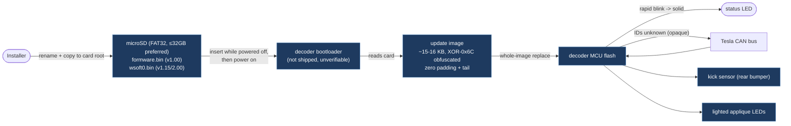

# evoffer / can-decoder-firmware

## 1. Provenance

- **Mode:** replace (user-directed). The pre-replace summary survives in git history; its claims are cited below as `git show HEAD:docs/legacy/evoffer-can-decoder-firmware.md` (line numbers refer to that blob).
- **Frontmatter:** preserved byte-for-byte. The description line carries no inherited trailing whitespace (`grep -nP ' +$'` on the pre-replace doc → no output), so nothing was stripped. The description is truncated mid-word (`... tailgate foot act`) — inherited defect kept as bytes, recorded in section 6.
- **Line endings:** the pre-replace file was CRLF throughout; this rewrite is LF-only per the skill's hygiene rule. Frontmatter line *content* is unchanged byte-for-byte (the CRLF→LF swap is a whole-file property, not a frontmatter edit).
- **Preserved `## Upstream (...)` sections:** none existed in the pre-replace doc (`git grep -nE '^## Upstream'` on `git show HEAD:docs/legacy/evoffer-can-decoder-firmware.md` → no output), so there is nothing to re-append after section 14.
- **Submodule:** `legacy/evoffer-can-decoder-firmware`, gitlink `160000 f6e3f37fb8862f68cf3e2050357a4563f1cac0a5 0`; `git -C legacy/evoffer-can-decoder-firmware rev-parse HEAD` matches; worktree clean (`status --porcelain` empty).
- **Upstream:** https://github.com/evoffer/can-decoder-firmware — no LICENSE file exists in the snapshot (`git -C legacy/evoffer-can-decoder-firmware grep -ilE 'licen'` → no output); the shipped artifacts are proprietary all-rights-reserved binaries.
- **Analysis date:** 2026-11-21.
- **History note:** the local clone contains exactly one commit (`f6e3f37 Add latest firmware for HW2.00`; `git log --all --oneline` → 1 line, no tags, `main` only). The snapshot is a squashed import; pre-pin upstream history was NOT reviewed (see section 17).

Upstream inventory: `git -C legacy/evoffer-can-decoder-firmware ls-files` lists exactly 17 files — `README.md` plus 16 `.bin` images (no hidden or platform subdirectories, no source, no DBC/JSON catalog, no tests). Negative anchors in section 16 prove the absence of source and license files.

Upstream files read:

| File | Lines / bytes | Coverage |
| --- | --- | --- |
| `README.md` | 1-42 (all) | FULL-READ |
| 16 × `.bin` images (all of them) | every byte processed by the analysis scripts (byte histogram, entropy, head/tail dumps, pairwise diffs, XOR-0x6C decrypt) | FULL-READ (byte statistics: all bytes of all 16 files) |
| `decoder hw200 sw226 wsoft0.bin` | eyeballed hex at 0x0000-0x0100, 0x01A0-0x0290, 0x0400-0x0860, 0x1000-0x1060, 0x1800-0x1860, 0x2400-0x2460, 0x3000-0x3060, 0x3800-0x3860, 0x3C00-0x3C5C, tail | RANGE-CITED (manual inspection) |
| other 15 × `.bin` | head 0x00-0x1F, tails (last 48-100 bytes), entropy/histogram, pairwise diff sites | RANGE-CITED (manual inspection) |

No TEST-READ evidence exists: this repo ships no tests. No CAPTURE evidence exists in this repo: no bus capture, no decode tool, no sample frames — only opaque binaries and prose.

Our-side files read for parity (TeslaCANModder):

| File | Lines | Coverage |
| --- | --- | --- |
| `firmware/lib/vehicle/can/feature/body/turn_signal.h` | 1-138 | FULL-READ |
| `firmware/lib/vehicle/can/feature/body/trunk.h` | 4-19, 61, 99-157 | RANGE-CITED |
| `firmware/lib/vehicle/can/feature/body/charge.h` | 1-41 | RANGE-CITED |
| `firmware/lib/vehicle/can/feature/telemetry/fw_compat.h` | 5-102 | RANGE-CITED |
| `firmware/lib/vehicle/can/feature/telemetry/vehicle_config.h` | 5-79 | RANGE-CITED |
| `firmware/lib/vehicle/can/feature/telemetry/bms.h` | 27-54, 188-221 | RANGE-CITED |
| `firmware/lib/vehicle/can/ids.h` | grep hits (0x3F5:70, 0x3B3:78, 0x392:60, 0x398:62, 0x292:44, 0x399:21/63) | RANGE-CITED |
| `firmware/lib/vehicle/can/handler/bus/vehicle.h` | 189, 440-441, 530 | RANGE-CITED |
| `client/src/hardware/webEspFlasher.ts` | 10-54 | RANGE-CITED |
| `client/src/screens/FlasherScreen.tsx` | 4, 9, 128-185 | RANGE-CITED |

## 2. Executive verdict

This repo is the release channel of a commercial product: 16 pre-built firmware images (~15-16 KB each, four hardware generations, sw208-sw226) for EVOffer's aftermarket "CAN Decoder" that adds tailgate foot activation and a lighted applique to Tesla Model S/X/3/Y, plus a 42-line README describing a microSD field-update ritual. There is no source, no protocol documentation, and one local commit. Byte-level analysis of the images yields hard facts anyway: every image is obfuscated with a constant single-byte XOR key `0x6C` (proven by the pure-`0x6C` zero-padding tail on all 16 files), the sw219→sw220 release is a two-byte semantic patch (one immediate byte `0x20→0x08` at offset 0x5B2, one parameter byte `0x0B→0x04` near the image end), and the image layout (4-byte entry table at offset 0, format change at sw216, isolated `0xFF` sentinel at content end) is stable enough to re-verify after upstream bumps. Nothing in the binaries maps to a Tesla CAN ID we can cite, so every feature claim (hazard interlock, car-wash mode, charging effect, blind spot signal) stays SUMMARY-ONLY. For TeslaCANModder the repo is reference material, not code: our firmware already decodes every vehicle function the product is advertised to consume (turn/hazard status, blind spot, trunk state, charging, model, gateway firmware), and our client already has a browser flasher that plays the role of their microSD ritual. The only concepts worth keeping are the hazard-state interlock pattern (a defensive gate idea — backlog, capture-first) and the observation that a vendor gates body features on vehicle firmware version, which parallels our `fw_compat` decode. The binaries themselves must never be copied or vendored: they are unlicensed proprietary artifacts.

## 3. Evidence map

| Source file | Lines / offsets | What it proves | Grade |
| --- | --- | --- | --- |
| `README.md` | 2 | Product purpose: tailgate foot activation + lighted applique for Tesla Model S/X/3/Y | SUMMARY-ONLY |
| `README.md` | 6-7, 9-10, 12-13, 15-16, 18-19, 21-23 | Changelog: sw223 Model X applique fix; sw222 charging logic for S/X 2021+ on Tesla 2022.20+; sw209 hazard interlock; sw214 car wash mode; sw216 applique charging effect; sw219 effect fix + blind spot signal | SUMMARY-ONLY |
| `README.md` | 27-28 | microSD, "32GB or below capacity is preferred", FAT32 | SUMMARY-ONLY |
| `README.md` | 31 | Fixed update filenames: `formware.bin` (v1.00) / `wsoft0.bin` (v1.15 / v2.00) | SUMMARY-ONLY |
| `README.md` | 35-38 | Update ritual: disconnect power, insert card, LED flashes rapidly, wait for solid LED, eject card | SUMMARY-ONLY |
| `README.md` | 35 | Typo "deocder" (sic) — the only textual blemish in the shipped instructions | CODE-READ (of README bytes) |
| `git ls-files` (all 16 `.bin`) | tail (last ≥48 bytes) | Every image ends in a pure `0x6C` run — plaintext zero padding under a constant XOR key 0x6C | CODE-READ |
| all 16 `.bin` | whole-file byte histograms | Cipher byte `0x6C` occurs 2115-2228 times/file (13.5-14 %); raw `0x00` occurs 0-6 times/file and `0xFF` 10-15 times/file — impossible for unencrypted flash, consistent with XOR-0x6C over zero-heavy firmware | CODE-READ |
| all 16 `.bin` | whole-file | Entropy 6.41-6.46 bits/byte (code-like, not compressed-like ~7.5+) | CODE-READ |
| `decoder hw200 sw226 wsoft0.bin` | 0x0000-0x0100 | Head: 4-byte marker `[var][0x31][0x00][0x04]` then a table of 4-byte entries `XX 16 00 01` / zeros, with 20+ `3D 16 00 01` filler entries | CODE-READ |
| `decoder hw200 sw226 wsoft0.bin` | 0x3C2C-0x3C5C | Twelve consecutive 4-byte entries `XX 00 00 04` (XX = AA,BA,9A,A2,84,94,8D,8A,92,82,A6,83) — a 12-entry table | CODE-READ |
| `decoder hw115/hw200 sw219/220` | 0x5B2, 0x3D28/0x3D34 | sw219→sw220 differs in exactly 2 bytes; decrypted: `0x20→0x08` at 0x5B2 and `0x0B→0x04` at image end | CODE-READ |
| `decoder hw115 sw219` vs `decoder hw200 sw219` | common prefix | 10863/15844 bytes differ (~69 %) — same sw, different hardware builds | CODE-READ |
| `decoder hw200 sw223` vs `sw226` | 0x0000 onward | First differing byte at offset 0x0; 13908/15884 prefix bytes differ — sw226 is a full rebuild, not a patch | CODE-READ |
| sw ≤215 files vs sw ≥216 files | content end | Tail format transition: older images end with a 24-byte trailer block ending `XX YY 00 01`; sw216+ images end with an isolated `0xFF` sentinel byte followed by zero padding | CODE-READ |
| `decoder hw200 sw226 wsoft0.bin` | 0x1A0-0x3860 (sampled) | Interior decodes as plausible Thumb-16 (e.g. `46 13`=MOV R3,R2, `80 13`=STRH R3,[R2], `12 C6 20 39`≈SUBS R0,#0x20 at the sw220 patch site); no ASCII strings anywhere (longest printable run 10 chars) | CODE-READ (bytes) — ISA attribution UNVERIFIED |

No TEST-READ evidence exists: this repo ships no tests. No CAPTURE evidence exists in this repo.

## 4. Architecture and build surface

There is no build surface: the repo ships release artifacts only. What can be reconstructed:

- **Entry points:** none in the repo — the flashed firmware's entry point lives inside the opaque images (the 4-byte head table at offset 0x0 is entry-shaped, semantics UNVERIFIED).
- **Shared core vs platform port:** four hardware families ship as parallel image sets — hw1 (v1.00, sw208-209), hw100 (v1.00, sw215/222), hw115 (v1.15, sw214-223), hw200 (v2.00, sw214-226) — same keystream and same layout across all, but hw115 vs hw200 same-sw images differ ~69 % in content, so each hardware generation is an independently built binary.
- **Build flags / dependency boundaries:** none observable (no sources, no toolchain files).
- **Update transport:** microSD, FAT32, fixed filename per hardware generation (`formware.bin` for v1.00, `wsoft0.bin` for v1.15/2.00), whole-image replace, LED as the only feedback channel.
- **Frame pipeline:** None found: no frame pipeline in this repo — no CAN decode, mutate, or TX code is shipped anywhere; the RX→decode→mutate/gate→TX flow lives inside opaque binaries and cannot be cited.



## 5. Mechanism catalogue

### M1 — microSD whole-image field update

- **Claim (README / summary):** rename to `formware.bin`/`wsoft0.bin`, place at card root, power-cycle, wait for solid LED (`README.md:27-38`).
- **Code path:** not shipped — bootloader binary is not in the repo; the package side is verifiable: fixed filenames exist as repo files, and every image is a complete flash image (content 0x3B4C-0x3E23 + zero padding to EOF), not a delta record.
- **Frame spec:** none.
- **Gates and timing:** power must be disconnected during card insertion (`README.md:35`); LED rapid-flash signals update in progress, solid signals completion (`README.md:37-38`); "≤32GB preferred" hints at known large-card failures (`README.md:28`).
- **State machine:** None found — no observable states beyond the two LED phases.
- **Tests:** None found — repo ships no tests.
- **Evidence grade:** SUMMARY-ONLY (flow); packaging facts CODE-READ (filenames, whole-image layout).
- **Verdict:** PARTIAL (packaging confirmed; bootloader mechanics unverifiable).
- **Adapt to TeslaCANModder?** no impact — our update path is the browser flasher downloading merged release images (`client/src/hardware/webEspFlasher.ts:44-54`, `client/src/screens/FlasherScreen.tsx:4`).

### M2 — constant single-byte XOR-0x6C image obfuscation

- **Claim (README / summary):** none — the obfuscation is undocumented; the pre-replace summary said "binary firmware only" without noticing it (`git show HEAD:docs/legacy/evoffer-can-decoder-firmware.md`, line 20).
- **Code path:** whole-file transform: `plain[i] = cipher[i] XOR 0x6C`. Proven three ways: (a) all 16 files end in a pure `0x6C` run = zero padding; (b) cipher `0x00`/`0xFF` are near-absent (0-6 / 10-15 per file) while `0x6C` is 13.5-14 %; (c) the same keystream across files makes cross-version byte diffs meaningful (M3).
- **Frame spec:** n/a (file-level).
- **Gates and timing:** none.
- **State machine:** None found.
- **Tests:** None found — repo ships no tests.
- **Evidence grade:** CODE-READ.
- **Verdict:** CONFIRMED (constant key across all 16 files; no chaining — identical plaintext at different offsets produces identical ciphertext).
- **Adapt to TeslaCANModder?** never port — security theater with zero integrity value, and it would imitate a proprietary protector's behavior for no gain in an open GPL firmware.

### M3 — release packaging: whole images with (at least one) 2-byte semantic patch

- **Claim (README / summary):** none; the README only labels versions.
- **Code path:** byte diff of `decoder hw115/hw200 sw219` vs `sw220`: exactly 2 differing bytes per file — offset 0x5B2 (`0x4C→0x64` cipher = `0x20→0x08` plaintext) and offset 0x3D34/0x3D28 (`0x67→0x68` = `0x0B→0x04`). The second site sits 12 bytes apart between hw115 and hw200 — exactly the length delta of the two builds, so the two hardware images share one layout up to a 12-byte insertion.
- **Frame spec:** n/a.
- **Gates and timing:** none.
- **State machine:** None found.
- **Tests:** None found — repo ships no tests.
- **Evidence grade:** CODE-READ.
- **Verdict:** CONFIRMED for the sw219→sw220 pair; NOT generalizable — sw223→sw226 differs at offset 0 and by 13908 prefix bytes (full rebuild), and sw214→sw216/sw215→sw222 are likewise full rebuilds.
- **Adapt to TeslaCANModder?** no impact — process observation only: a commercial vendor can field a behavior change as a 2-byte image edit while shipping whole images.

### M4 — 4-byte entry table at image head

- **Claim (README / summary):** none.
- **Code path:** offset 0x0 of every image: `[A][0x31][0x00][0x04]` where A = 0x05 (hw1 sw208), 0x40 (hw1 sw209 through all sw223), 0x41 (hw200 sw226), followed by 4-byte entries `XX 16 00 01` interleaved with zero slots and `3D 16 00 01` filler; a second cluster at 0x3C2C holds twelve `XX 00 00 04` entries. Whole-file autocorrelation peaks at period 12 (0.129) with 4/8/24 harmonics. Entry values drift by small deltas between full rebuilds (`AC 53`→`AE 53`, `0F 4C`→`49 4C`), the way code addresses move.
- **Frame spec:** entry = 4 bytes, values like `0x0100162A` (LE) in the head table and `0x040000AA` (LE) in the 12-entry cluster; no counter, no checksum observed in entries.
- **Gates and timing:** none.
- **State machine:** None found.
- **Tests:** None found — repo ships no tests.
- **Evidence grade:** CODE-READ (structure); semantics UNVERIFIED (vector table vs literal pool vs rule DB — no disassembler run).
- **Verdict:** PARTIAL (layout confirmed; meaning unknown).
- **Adapt to TeslaCANModder?** no impact — their platform's packaging, not a TeslaCANModder-relevant mechanism.

### M5 — tail format transition and 0xFF sentinel

- **Claim (README / summary):** none.
- **Code path:** sw ≤215 images (hw1 sw208/209, hw100 sw215, hw115 sw214, hw200 sw214) end with a 24-byte trailer block `XX YY 00 01 | 18 08 | E6 08 | 00 02 | 00 00 | 8F 1E 00 01 | E6 08 | 00 00 | XX YY 00 01` before zero padding; sw ≥216 images end with an isolated `0xFF` byte at content end (0x3DAF-0x3E23), then 53-71 zero bytes to EOF.
- **Frame spec:** n/a.
- **Gates and timing:** none.
- **State machine:** None found.
- **Tests:** None found — repo ships no tests.
- **Evidence grade:** CODE-READ.
- **Verdict:** CONFIRMED (format changed at sw216 and stayed).
- **Adapt to TeslaCANModder?** no impact.

### M6 — hardware-generation families and head marker byte

- **Claim (README / summary):** "v1.00 / v1.15 / v2.00" hardware implied by the update-filename instruction (`README.md:31`) and the pre-replace doc's file grouping (`git show HEAD:docs/legacy/evoffer-can-decoder-firmware.md`, lines 35-38).
- **Code path:** filename ladder per hardware: hw1 {sw208, sw209}, hw100 {sw215, sw222}, hw115 {sw214, sw219, sw220, sw222, sw223}, hw200 {sw214, sw216, sw219, sw220, sw222, sw223, sw226}; head marker byte 0x05/0x40/0x41; hw115 vs hw200 same-sw images differ ~69 % of bytes.
- **Frame spec:** n/a.
- **Gates and timing:** none.
- **State machine:** None found.
- **Tests:** None found — repo ships no tests.
- **Evidence grade:** CODE-READ (structure); marker semantics UNVERIFIED (0x05→0x40 changed between sw208 and sw209 on the *same* hardware, so the byte is not a hardware ID; it looks like a package-format generation counter).
- **Verdict:** PARTIAL.
- **Adapt to TeslaCANModder?** no impact.

### M7 — hazard-emergency-flash interlock on foot activation

- **Claim (README / summary):** "Add Tailgate Foot Activation disablement feature when emergency flash light is on" (`README.md:12-13`, sw209).
- **Code path:** not locatable — the sw208→sw209 pair are full rebuilds (first differing byte at 0x1; head marker changed 0x05→0x40), so the interlock bytes cannot be isolated.
- **Frame spec:** none citable (no CAN IDs in the repo).
- **Gates and timing:** hazard active ⇒ foot activation disabled (that is the whole claim).
- **State machine:** None found.
- **Tests:** None found — repo ships no tests.
- **Evidence grade:** SUMMARY-ONLY.
- **Verdict:** UNVERIFIED.
- **Adapt to TeslaCANModder?** no impact as code — concept recorded as a backlog gate idea in section 11 P2; our side already decodes indicator status (`firmware/lib/vehicle/can/feature/body/turn_signal.h:93-112`) but has no consumer that gates anything on it.

### M8 — car wash mode interlock

- **Claim (README / summary):** "Add Car Wash Mode for Model 3/Y Tailgate Foot Activation" (`README.md:15-16`, sw214).
- **Code path:** not locatable (opaque binaries).
- **Frame spec:** none citable.
- **Gates and timing:** unknown beyond the name.
- **State machine:** None found.
- **Tests:** None found — repo ships no tests.
- **Evidence grade:** SUMMARY-ONLY.
- **Verdict:** UNVERIFIED.
- **Adapt to TeslaCANModder?** no impact — we have no foot-activation feature to gate.

### M9 — lighted-applique charging effect with vehicle-firmware compat gate

- **Claim (README / summary):** sw216 "Update Model S/X Lighted Applique charging effect" (`README.md:18-19`); sw219 "Fix Model S/X Lighted Applique effect" (`README.md:21-22`); sw222 "Update charging logic for Model S/X 2021+ for Tesla Version 2022.20 or above" (`README.md:9-10`); sw223 "Fix Model X Lighted Applique charging effect" (`README.md:6-7`).
- **Code path:** the only byte-level handle is the sw219→sw220 2-byte patch (M3): plaintext `0x20→0x08` at 0x5B2 — in the sampled interior this offset sits in a `12 C6 20 39 / 12 C6 08 39` context that decodes as plausible Thumb-16 `SUBS R0,#0x20` → `SUBS R0,#8` (timing/loop immediate), plus the tail byte `0x0B→0x04` in a `0B 10 04|0C` triple where the third byte is the hardware-variant marker (0x04 hw115 / 0x0C hw200).
- **Frame spec:** none citable (effect bytes are on the applique output, not a Tesla frame we can name).
- **Gates and timing:** charging-state and vehicle-firmware-version dependent by the changelog; specifics unknown.
- **State machine:** None found.
- **Tests:** None found — repo ships no tests.
- **Evidence grade:** SUMMARY-ONLY (feature); the 2-byte patch itself CODE-READ; the "this patch IS the effect change" attribution UNVERIFIED (sw220 has no changelog entry).
- **Verdict:** UNVERIFIED.
- **Adapt to TeslaCANModder?** no impact — client-side UI domain; our charging telemetry already exists (`firmware/lib/vehicle/can/feature/telemetry/bms.h:50-54`, `firmware/lib/vehicle/can/feature/body/charge.h:38-41`).

### M10 — blind spot signal integration

- **Claim (README / summary):** "Add blind spot signal" (`README.md:23`, sw219).
- **Code path:** not locatable (opaque binaries).
- **Frame spec:** none citable; the pre-replace doc's "Blind spot signal integration" line is the same claim restated (`git show HEAD:docs/legacy/evoffer-can-decoder-firmware.md`, line 49).
- **Gates and timing:** unknown.
- **State machine:** None found.
- **Tests:** None found — repo ships no tests.
- **Evidence grade:** SUMMARY-ONLY.
- **Verdict:** UNVERIFIED.
- **Adapt to TeslaCANModder?** no impact — we already decode BSM levels (`firmware/lib/vehicle/can/feature/body/turn_signal.h:119-137`).

## 6. Summary vs code contradiction table

| # | Pre-replace / README claim | Code (or file-set) reality | Grades |
| --- | --- | --- | --- |
| 1 | README changelog order: `### update223` (line 6), `update222` (9), `update209` (12), `update214` (15), `update216` (18), `update219` (21) | The changelog is internally non-chronological: 223 precedes 222, and 209 precedes 214/216; the sw numbering of the shipped files says the true order is 209 → 214 → 215 → 216 → 219 → 220 → 222 → 223 → 226 | CODE-READ (both sides are README/file-set bytes) |
| 2 | README "Update Note" implies the changelog covers the releases; the only commit is "Add latest firmware for HW2.00" | The file set contradicts completeness: `sw208` (hw1), `sw215` (hw100), `sw220` (hw115+hw200), and `sw226` (hw200, the commit's own addition) ship with no changelog entry — the changelog terminates at update223 while the newest image is sw226 | CODE-READ (`git ls-files`) vs SUMMARY-ONLY (README) |
| 3 | Pre-replace: "The feature set (tailgate kick, lighting effects) is unrelated to FSD/autopilot CAN modifications" and "**Reusability**: None" (`git show HEAD:docs/legacy/evoffer-can-decoder-firmware.md`, lines 57, 59) | The advertised feature set consumes exactly the body-domain signals our firmware already decodes — hazard/indicator status (`turn_signal.h:93-112`), blind spot (`turn_signal.h:119-137`), trunk state (`trunk.h:61`, `handler/bus/vehicle.h:189`), charging (`bms.h:50-54`, `charge.h:38-41`), vehicle model and gateway firmware (`vehicle_config.h:55`, `fw_compat.h:46-85`) — "unrelated" understates the decode overlap, though no upstream byte is citable; the hazard-interlock *pattern* is a reusable idea even though the *code* is not | SUMMARY-ONLY (pre-replace judgment) vs CODE-READ (our side) |
| 4 | Frontmatter description: "designed to enable tailgate foot act" — sentence ends mid-word | Inherited truncation defect in the preserved frontmatter; kept byte-for-byte per replace-mode rules, flagged here instead of edited | CODE-READ (frontmatter bytes) |
| 5 | Pre-replace: "Platform: Unknown" (`git show HEAD:docs/legacy/evoffer-can-decoder-firmware.md`, line 19) | Not contradicted — the Thumb-16 reading of the decrypted interior is a hypothesis (UNVERIFIED, section 17), not enough to disprove "Unknown" | SUMMARY-ONLY vs UNVERIFIED |

Only rows 1-2 are hard factual contradictions (both inside the upstream README's own presentation); row 3 is a judgment contradiction recorded for honesty; rows 4-5 are inherited-defect and staleness notes kept per the replace-mode contract.

## 7. CAN frame and signal inventory

None found: no CAN frame is decoded, mutated, or injected by any *citable* artifact in this repo — the shipped `.bin` images are opaque and the README names vehicle functions without IDs. No DBC/JSON catalog exists to summarize.

Package-level byte inventory (the update-image format; NOT CAN frames — kept here so the byte facts have one home):

| Offset (hex+dec) | Region | Layout observed | Counter | Checksum | R/W | Grade |
| --- | --- | --- | --- | --- | --- | --- |
| 0x0000 / 0 | head marker | `[model byte: 0x05\|0x40\|0x41][0x31][0x00][0x04]` | — | none observed | package metadata | CODE-READ |
| 0x0004-0x03FF / 4-1023 | head entry table | 4-byte entries `XX 16 00 01`, zero slots, `3D 16 00 01` filler ×43; entries cluster at 0x0100_16xx, 0x0100_4Axx-0x0100_7Bxx | — | none observed | unknown (vector/pool/rule DB) | CODE-READ |
| 0x03C2C / 15372 | 12-entry table | `XX 00 00 04` ×12 (XX = AA,BA,9A,A2,84,94,8D,8A,92,82,A6,83) | — | none observed | unknown | CODE-READ |
| 0x005B2 / 1458 | sw220 patch site | sw219 `0x20` → sw220 `0x08` (plaintext), context `12 C6 20 39` → `12 C6 08 39` | — | — | code/data byte | CODE-READ |
| ~0x3D9x-0x3E2x / content end | tail triple | `[0B\|04] 10 [04\|0C]` — first byte changed by sw220, third byte is hw-variant (0x04 hw115 / 0x0C hw200) | — | — | version/parameter bytes | CODE-READ |
| content end (sw ≤215) | trailer block | 24 bytes: `XX YY 00 01\|18 08\|E6 08\|00 02\|00 00\|8F 1E 00 01\|E6 08\|00 00\|XX YY 00 01` | — | none observed | unknown | CODE-READ |
| content end (sw ≥216) | sentinel | isolated `0xFF` byte, then 53-71 zero bytes to EOF | — | not a checksum (isolated marker) | terminator | CODE-READ |
| whole file | obfuscation | `cipher = plain XOR 0x6C`, constant key, no chaining | — | no integrity field anywhere in the package | transport encoding | CODE-READ |

## 8. Constants and tuning table

| Constant | Value | File:offset | Meaning | Grade |
| --- | --- | --- | --- | --- |
| XOR obfuscation key | `0x6C` | all 16 `.bin`, whole file | single-byte plaintext keystream; proven by zero-padding tails and near-zero raw `0x00` counts | CODE-READ |
| Head marker tail | `31 00 04` | all 16 `.bin` @0x0001-0x0003 | constant bytes 1-3 of every image (only byte 0 varies) | CODE-READ |
| Head marker byte 0 | `0x05` → `0x40` → `0x41` | sw208 → sw209-223 → sw226 | package-format generation, not hardware ID (changed sw208→sw209 on same hw1) | CODE-READ (values), UNVERIFIED (semantics) |
| Entry suffix | `00 01` | head entries @0x0004+ | unknown entry type tag | CODE-READ (bytes), UNVERIFIED (meaning) |
| Filler entry | `3D 16 00 01` ×43 | head table @0x0054-0x00D3 region | default/null entry (like an unused-vector filler) | CODE-READ (bytes), UNVERIFIED (meaning) |
| sw220 patch immediate | `0x20` → `0x08` | `decoder hw115/hw200 sw219→sw220` @0x5B2 | plausibly a loop/timing immediate (`SUBS R0,#imm8` reading) — the only byte-level handle on the "charging effect" change | CODE-READ (bytes), UNVERIFIED (semantics) |
| Tail triple | `[0B\|04] 10 [04\|0C]` | image end, sw219+ hw115/hw200 | first byte = sw220-patched parameter, third byte = hardware-variant marker | CODE-READ (bytes), UNVERIFIED (semantics) |
| Cross-HW layout delta | 12 bytes | hw115 vs hw200 (e.g. tail patch at 0x3D34 vs 0x3D28) | hw200 images are the hw115 layout shifted by a 12-byte insertion; equals the length delta | CODE-READ |
| Tail sentinel | `0xFF` | content end of every sw ≥216 image | end-of-content marker after the sw216 format change | CODE-READ |
| SD capacity guidance | ≤32 GB "preferred" | `README.md:28` | implies known failures with larger cards | SUMMARY-ONLY |
| Filesystem | FAT32 | `README.md:28` | bootloader's card reader supports FAT32 only | SUMMARY-ONLY |
| Update filenames | `formware.bin` (v1.00), `wsoft0.bin` (v1.15/2.00) | `README.md:31` | fixed names the bootloader scans for ("formware" is EVOffer's own typo, kept in their docs) | SUMMARY-ONLY |
| LED feedback protocol | rapid blink = flashing, solid = done, stays on = healthy | `README.md:37-42` | the only update status channel | SUMMARY-ONLY |

## 9. Failure modes and edge cases

| Failure | Handling code path | Tested? | Grade |
| --- | --- | --- | --- |
| Update interrupted / LED never turns solid | not documented (`README.md:38` only says "wait"); bootloader not shipped, so recovery/rollback behavior is invisible | no | UNVERIFIED |
| Wrong filename on card (e.g. leaving the `decoder hw200 sw226` prefix) | inferred: update silently skipped — README's strict rename step (`README.md:31`) implies the bootloader scans only the two fixed names | no | UNVERIFIED |
| SD card >32 GB or exFAT | README hedges "32GB or below capacity is preferred" (`README.md:28`) — a known-issue smell, no fix documented | no | SUMMARY-ONLY |
| Power applied while inserting card | README requires power disconnect first (`README.md:35`); consequences of violating it undocumented | no | SUMMARY-ONLY |
| Corrupted or truncated image | no checksum/CRC field identified anywhere in the package layout (only the isolated `0xFF` sentinel and pure zero tails); whether the bootloader validates anything is invisible | no | CODE-READ (absence in observed layout) + UNVERIFIED (bootloader behavior) |
| Wrong-generation image flashed (e.g. hw115 file on hw200 unit) | README gives no guard; images for different HW share a filename convention only | no | UNVERIFIED |
| Bus-off / watchdog / OTA / queue overflow inside the shipped firmware | not observable — no sources; nothing citable | no | UNVERIFIED |

Every failure path in this repo is untested and mostly unverifiable without the physical device; the one code-level fact is the absence of any integrity field in the update package itself.

## 10. Test coverage map

None found — this repo ships no tests (no test files of any kind in `git ls-files`).

Critical paths with NO test (one-line risks):

- **The entire update flow** — a customer follows README steps against an unverified binary with no documented rollback; a failed flash bricks a commercial product.
- **The 2-byte sw220 patch** — shipped as a whole image with zero behavioral documentation beyond a changelog that never mentions sw220.
- **Vehicle-firmware compat gate (sw222)** — "Tesla Version 2022.20 or above" logic runs on real vehicles with no public test evidence.

## 11. Parity matrix with TeslaCANModder

| Signal/frame | Upstream decode (cite) | Our decode (cite) | Delta | Action |
| --- | --- | --- | --- | --- |
| P1 trunk/tailgate actuation | product's core purpose (`README.md:2`); no CAN ID citable | `sendRearTrunk` on 0x3B3 (`firmware/lib/vehicle/can/feature/body/trunk.h:18,61`), trunk-open state from 0x103 (`firmware/lib/vehicle/can/handler/bus/vehicle.h:189`) | no upstream bytes to compare — their actuation path (kick sensor → CAN) is opaque | ignore (nothing to align without a bench capture of their device) |
| P2 hazard/emergency-flash interlock | sw209 disables foot activation when hazards on (`README.md:12-13`); no ID, no bytes | indicator L/R status from 0x3F5 byte[6] bits 3:2 / 5:4 (`firmware/lib/vehicle/can/feature/body/turn_signal.h:93-112`); `TURN_HAZARD` inject on 0x3F5 byte[0] bits 1:0 (`turn_signal.h:20,28-31`) | we decode the same domain signal but have no consumer gating anything on hazard-active; their gate implementation is a black box | capture-first backlog: if a hazard-gated interlock is ever wanted, design it on our own decode + a listen-only bench capture; never on their SUMMARY-ONLY spec |
| P3 blind spot | sw219 "Add blind spot signal" (`README.md:23`); no ID, no bytes | BSM L/R levels from 0x399 byte[0] bits 5:4 / 7:6 (`turn_signal.h:119-137`, `ids.h:63`) | upstream drives an LED with an unknown signal; we expose the decode | already present (decode); their LED output path is client-domain, ignore |
| P4 charging state | applique "charging effect" + sw222 charging-logic update for S/X 2021+ (`README.md:9-10,18-19`); no ID, no bytes | SoC from 0x292 bits 0-9 ×0.1 % (`firmware/lib/vehicle/can/feature/telemetry/bms.h:50-54`), charge start/stop on 0x333 bit 2 (`firmware/lib/vehicle/can/feature/body/charge.h:38-41`) | upstream consumes charging state for an animation; we decode it and can command it | already present (decode + command); animation itself is client UI, ignore |
| P5 vehicle firmware compat gate | sw222 gates behavior on "Tesla Version 2022.20 or above" (`README.md:10`) | GTW firmware version from 0x392 with OK/WARN/FAIL levels (`firmware/lib/vehicle/can/feature/telemetry/fw_compat.h:46-85`, `FW_COMPAT_WARN` at :21,36,72,85) | same concept (vehicle-fw-aware feature gating), different mechanism and granularity | already present — our compat levels are richer and citable; nothing to port |
| P6 vehicle model detection | product sold per Model S/X/3/Y (`README.md:2`) | `decodeVehicleConfig` from 0x398 (`firmware/lib/vehicle/can/feature/telemetry/vehicle_config.h:55-79`) | identical purpose | already present |
| P7 field-update transport | microSD + fixed filename + LED protocol (`README.md:27-42`) | browser flasher downloads release asset over HTTP and flashes merged image (`client/src/hardware/webEspFlasher.ts:44-54`, `client/src/screens/FlasherScreen.tsx:4`) | different transport, same role (whole-image consumer-side update with status feedback) | already present (different mechanism); no alignment needed |
| P8 image obfuscation | XOR 0x6C over whole image (M2, byte-proven) | none — our release images ship unobfuscated | we publish GPL firmware; obfuscation adds no integrity and no security | never port |

Upstream side of P1-P4 is SUMMARY-ONLY (README claims, opaque binaries); P5-P6 upstream claims are also SUMMARY-ONLY but the *concept* is already present on our side with CODE-READ citations, so no row drives a porting decision. P7-P8 rows rest on CODE-READ on both sides.

## 12. Surface inventory and security notes

| Surface | Semantics | Notes |
| --- | --- | --- |
| microSD card slot | reads `formware.bin`/`wsoft0.bin` from FAT32 root at boot; whole-image flash; LED rapid-blink = in progress, solid = done (`README.md:27-38`) | physical-access-only update channel; no auth, no signature documented |
| status LED | only output channel during update; stays on when healthy (`README.md:41-42`) | no error code vocabulary documented |
| Tesla CAN bus (via X179-adjacent tap, unknown) | product's RX/TX to vehicle — IDs and frame shapes unknown (opaque binaries) | the product's entire value; also its entire risk |
| kick sensor (rear bumper) | foot-activation input trigger | not CAN; not our domain |
| lighted applique LEDs | charging animation / blind spot / effect output | client-side equivalent in our world |

Security/provenance findings:

- **Hardcoded credentials / keys:** None found — no text artifacts beyond README exist.
- **Obfuscation is not security:** the single-byte XOR-0x6C scheme (M2) is stripped by one command; it provides zero confidentiality and zero integrity. Treat any "protected" claim about these images as false.
- **No integrity field observed** in the update package (no CRC/checksum/signature bytes anywhere in the analyzed layout); a corrupted card image would flash verbatim unless the unshipped bootloader checks something invisibly (UNVERIFIED).
- **Untrusted binary provenance:** flashing closed, unlicensed, unverified third-party binaries into a vehicle-attached module is a supply-chain risk on the *customer* side; for us it means these artifacts are reference-only (section 14).
- **Dangerous build flags:** None found — no build system in the repo.

## 13. Adaptation assessment

| Mechanism | Value | Cost | Risk | Evidence grade | Decision |
| --- | --- | --- | --- | --- | --- |
| M1 microSD update flow | none — our browser flasher covers the same role (`webEspFlasher.ts:44-54`) | — | — | SUMMARY-ONLY + CODE-READ packaging | already present (different transport); no action |
| M2 XOR-0x6C obfuscation | none — anti-tamper theater | — | cargo-cult security, proprietary mimicry | CODE-READ | never port |
| M3 minimal-patch release discipline | process insight only (a vendor shipped a 2-byte behavior change as a whole image) | none | none | CODE-READ | no impact as code; keep as release-process observation |
| M4 head entry table | none — their platform's packaging | RE time | none to us | CODE-READ structure / UNVERIFIED semantics | no impact |
| M5 tail sentinel format | none | — | — | CODE-READ | no impact |
| M6 HW families + marker byte | none | — | — | CODE-READ structure / UNVERIFIED semantics | no impact |
| M7 hazard interlock | concept: a defensive gate keyed on decoded vehicle state | would be a new consumer over our existing decode (`turn_signal.h:93-112`) | upstream spec is SUMMARY-ONLY — cannot drive implementation per skill rules | SUMMARY-ONLY | no impact now; capture-first backlog (P2) — design from our own decode + bench capture if ever wanted |
| M8 car wash mode interlock | none — we have no foot-activation feature | — | — | SUMMARY-ONLY | no impact |
| M9 charging effect + fw-compat gate | concept already present on our side (`fw_compat.h:46-85`, `bms.h:50-54`) | — | animation bytes UNVERIFIED | SUMMARY-ONLY | already present (compat gating); ignore the animation |
| M10 blind spot signal | decode already present (`turn_signal.h:119-137`) | — | — | SUMMARY-ONLY | already present |

No mechanism qualifies as `candidate for future PR` under the evidence rules — every upstream behavior claim is SUMMARY-ONLY, and every concept that survives scrutiny is already present in our code with a CODE-READ citation. The honest takeaway is the P2 backlog entry: if TeslaCANModder ever wants a hazard-state interlock on vehicle-affecting commands, the idea exists here as a proven product behavior, but it must be designed from our own decode and a listen-only bench capture, not from this repo.

## 14. Do-not-copy list

| Item | File:offset / lines | Reason |
| --- | --- | --- |
| All 16 `.bin` firmware images | e.g. `decoder hw200 sw226 wsoft0.bin` @0x0000-EOF | proprietary, no LICENSE (`git grep -ilE 'licen'` → no output) — all-rights-reserved binaries; copying, vendoring, or redistributing them into a GPL-3.0 repo is a license violation; never import into `firmware/`, `client/`, `packages/`, `tools/` |
| Update instructions text | `README.md:25-42` | EVOffer's copyrighted instructions; cite, never copy into our docs |
| The XOR-0x6C protection scheme | all 16 `.bin`, whole file | even as a "derived idea" it is worthless — no integrity, trivially stripped — and it imitates a proprietary protector; a GPL firmware has no use for it |
| The sw220 patch bytes as a direct port | `decoder hw115/hw200 sw219→sw220` @0x5B2, 0x3D28/0x3D34 | semantics UNVERIFIED (never disassembled); porting unverified bytes from a proprietary binary into vehicle-facing firmware fails `docs/checklists/can-review-checklist.md` on every count |

## 15. History and evolution

Local history is a single commit; no pre-pin history was available locally and none was fetched (no network access performed):

| Commit | Subject | What it did |
| --- | --- | --- |
| `f6e3f37` | Add latest firmware for HW2.00 | the entire snapshot: README + 16 images, one squashed import (no earlier commits, no tags, `main` only) |

Evolution reconstructed from the changelog plus binary deltas (sw numbers are the vendor's own):

| sw | Files shipped | Changelog says | Binaries show |
| --- | --- | --- | --- |
| 208 | hw1 | nothing (undocumented) | old head marker 0x05; 24-byte trailer tail |
| 209 | hw1 | hazard interlock added (`README.md:12-13`) | head marker jumps to 0x40 on the same hardware — package-format change alongside the feature |
| 214 | hw115, hw200 | car wash mode (`README.md:15-16`) | trailer-tail format still old-style |
| 215 | hw100 | nothing (undocumented) | old-style trailer tail |
| 216 | hw200 only | applique charging effect update (`README.md:18-19`) | tail format flips to the 0xFF-sentinel layout; full rebuild vs sw214 (first diff 0x3C, 14030 prefix diffs) |
| 219 | hw115, hw200 | effect fix + blind spot signal (`README.md:21-23`) | full rebuild |
| 220 | hw115, hw200 | nothing (undocumented) | exactly 2 bytes differ from sw219 (M3) — the repo's only observable minimal patch |
| 222 | hw100, hw115, hw200 | charging logic for S/X 2021+ on Tesla 2022.20+ (`README.md:9-10`) | full rebuild; also backported to old hw100 |
| 223 | hw115, hw200 | Model X applique fix (`README.md:6-7`) | full rebuild |
| 226 | hw200 only | nothing (undocumented; added by the only commit) | head marker 0x41; full rebuild vs sw223 (first diff at offset 0) |

What was tried/abandoned: nothing is observable — no sources, no history. The one visible format pivot is the sw216 tail/trailer change and the sw208→sw209 head-marker change, both undocumented. Network-only claims (EVOffer's site, product pages, issue trackers) were not consulted: everything above comes from the local commit, the README, and the shipped bytes.

## 16. Re-verification recipe

```bash
OLD=f6e3f37fb8862f68cf3e2050357a4563f1cac0a5
git -C legacy/evoffer-can-decoder-firmware fetch --tags --prune
git -C legacy/evoffer-can-decoder-firmware log --oneline $OLD..origin/main
git -C legacy/evoffer-can-decoder-firmware diff --stat $OLD..origin/main
git ls-files -s legacy/evoffer-can-decoder-firmware   # expect: 160000 f6e3f37fb8862f68cf3e2050357a4563f1cac0a5 0
# history note: the clone has a single squashed commit; `git log --all` shows one line. Full upstream history was never fetched.
```

Anchors below were demonstrated at write time with `git grep -nE` (this Windows workspace lacks a standalone `grep`; on POSIX use `grep -nE` with the same patterns and files). For the byte-level claims the anchors are Python one-liners run from the repo root; their expected outputs were produced at write time.

Upstream text anchors:

```text
git -C legacy/evoffer-can-decoder-firmware grep -nE '^### update' -- README.md
  -> expect 6 hits in this order: :6 update223, :9 update222, :12 update209, :15 update214, :18 update216, :21 update219

git -C legacy/evoffer-can-decoder-firmware grep -nE 'formware|wsoft0|FAT32|32GB' -- README.md
  -> expect hits at :28 (FAT32/32GB), :31 (both filenames)

git -C legacy/evoffer-can-decoder-firmware ls-files -- '*.bin' | wc -l
  -> expect 16
```

Upstream negative anchors (absence claims):

```text
git -C legacy/evoffer-can-decoder-firmware grep -ilE 'licen'
  -> expect no output (no LICENSE file anywhere)

git -C legacy/evoffer-can-decoder-firmware grep -lE '.' -- '*.c' '*.cpp' '*.h' '*.ino' '*.py' '*.ts' '*.js'
  -> expect no output (no source files exist)
```

Byte-level anchors (run from repo root; each was executed for this analysis):

```text
python -c "b=open(r'legacy/evoffer-can-decoder-firmware/decoder hw200 sw226 wsoft0.bin','rb').read(); print(len(set(b[-48:])), hex(b[-48]))"
  -> expect: 1 0x6c   (pure 0x6C zero-padding tail => XOR key)

python -c "d=lambda f: open(r'legacy/evoffer-can-decoder-firmware/'+f,'rb').read(); A,B=d('decoder hw200 sw219 wsoft0.bin'),d('decoder hw200 sw220 wsoft0.bin'); print([hex(i) for i in range(len(A)) if A[i]!=B[i]], [hex(A[i]^0x6c)+'->'+hex(B[i]^0x6c) for i in range(len(A)) if A[i]!=B[i]])"
  -> expect: ['0x5b2', '0x3d28'] ['0x20->0x8', '0xb->0x4']   (the 2-byte sw220 patch, decrypted)

python -c "b=open(r'legacy/evoffer-can-decoder-firmware/decoder hw200 sw226 wsoft0.bin','rb').read(); print(' '.join(f'{x^0x6c:02X}' for x in b[:16]))"
  -> expect: 41 31 00 04 2A 16 00 01 2B 16 00 01 3B 16 00 01   (head marker + entry table)
```

Our-side drift anchors (the `already present` / `never port` decisions rest on these):

```text
git grep -nE 'TURN_HAZARD' -- firmware/lib/vehicle/can/feature/body/turn_signal.h
  -> expect hits at :20 (enum) and :77 (turn:hazard command)

git grep -nE 'decodeTurnSignalLeftActive|decodeBlindSpotLeftLevel' -- firmware/lib/vehicle/can/feature/body/turn_signal.h
  -> expect hits at :93 and :119

git grep -nE 'CAN_ID_VCFRONT_LIGHTS|CAN_ID_TRUNK_CTRL' -- firmware/lib/vehicle/can/ids.h
  -> expect hits at :70 (0x3F5) and :78 (0x3B3)

git grep -nE 'all-zero 0x398' -- firmware/lib/vehicle/can/handler/bus/vehicle.h
  -> expect hit at :440 (decode-side edge-case guard)

git grep -nE 'FW_COMPAT_WARN' -- firmware/lib/vehicle/can/feature/telemetry/fw_compat.h
  -> expect hits at :21, :36, :72, :85

git grep -nE 'decodeVehicleConfig' -- firmware/lib/vehicle/can/feature/telemetry/vehicle_config.h
  -> expect hit at :55

git grep -nE 'assetUrl' -- client/src/hardware/webEspFlasher.ts
  -> expect hits at :11 and :44 (browser flasher downloads release images)
```

If line numbers drift more than ~10, re-read the whole function; do not trust this document's numbers. For the binaries, offsets are the only stable anchors: if any byte-level anchor above fails, upstream shipped a new package format and the whole byte analysis (sections 3, 7, 8) must be re-run, not patched line-by-line.

## 17. Open questions and explicitly not investigated

- **ISA/MCU identity:** the decrypted interior reads as plausible Thumb-16 (e.g. `46 13`, `80 13`, `12 C6 20 39` contexts) and the image is Cortex-M-shaped (4-byte entry table, literal-pool-like clusters), but no disassembler was run — capstone/Ghidra were unavailable in this environment and installing one was out of scope. Verifying it would settle whether `0x0100162A`-style entries are function pointers.
- **Head entry table semantics:** vector table, literal pool, or rule database — three live hypotheses, none checked (needs disassembly). The 12-entry `XX 00 00 04` cluster and the period-12 autocorrelation peak remain unexplained.
- **sw220 patch semantics:** `0x20→0x08` at 0x5B2 is very likely the "charging effect" timing change (the changelog's update216/219/223 entries all touch the same effect), but sw220 itself has no changelog entry, so the attribution is circumstantial. A disassembly of the containing function would settle it.
- **Tail triple `[0B|04] 10 [04|0C]`:** parameter/version/hardware bytes — meaning unknown.
- **Which Tesla CAN IDs the product uses:** unknowable from the repo; would require a bench capture with a physical EVOffer decoder installed on a Tesla (listen-only tap). Not performed, no hardware available.
- **Whether the bootloader validates the image:** no checksum field exists in the package, but the bootloader binary is not shipped, so integrity/rollback behavior is UNVERIFIED.
- **sw223→sw226 behavioral delta:** both are full rebuilds; only the head marker (0x40→0x41) and length (+92) were compared. A content-level comparison would need alignment tools beyond this analysis.
- **hw1 vs hw100 relationship:** both are "v1.00" (README.md:31) with disjoint sw ladders (sw208/209 vs sw215/222) and different head markers at the extremes; whether hw100 is a board revision of hw1 is UNVERIFIED.
- **Pre-pin upstream history:** NOT reviewed — the local clone contains a single squashed commit; no fetch was performed. Any upstream history claim in this doc beyond `f6e3f37` does not exist.
- **Frontmatter staleness:** the preserved description line is truncated mid-word (section 6, row 4) — kept byte-for-byte per the replace-mode contract; fix only by explicit user request.
