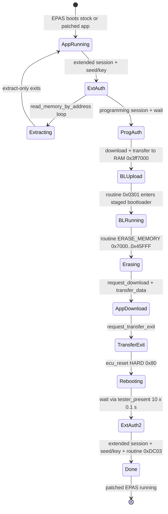

# gregjhogan / tesla-pre-ap-epas-patch

Deep-dive analysis produced with the `legacy-repo-deep-dive` skill in **replace mode**. Pinned gitlink: `160000 dcb2f3522bfbca5a83bb3fb265b370828194877f 0`.

## 1. Provenance

- **Submodule path:** `legacy/gregjhogan-tesla-pre-ap-epas-patch`
- **Pinned gitlink (canonical form from `git ls-files -s`):** `160000 dcb2f3522bfbca5a83bb3fb265b370828194877f 0` — matches `git -C legacy/gregjhogan-tesla-pre-ap-epas-patch rev-parse HEAD`; `git -C legacy/gregjhogan-tesla-pre-ap-epas-patch status --porcelain` is empty.
- **Upstream URL:** `https://github.com/gregjhogan/tesla-pre-ap-epas-patch` (origin fetch and push)
- **Upstream commit:** `dcb2f3522bfbca5a83bb3fb265b370828194877f` — "fix README spacing", 2022-04-28, Greg Hogan. It is the only commit in the local clone (grafted, shallow).
- **License:** GPL-3.0 (`LICENSE`, RANGE-CITED: lines 1-5 of 674 read; remainder is the standard GPLv3 text)
- **Analysis date:** 2026-11-21
- **Replace-mode preservation notes:**
    - Frontmatter above is preserved line-content byte-for-byte. The description line carried no inherited trailing whitespace, so nothing was stripped. That line is truncated mid-word in the original ("...vehicles to ena") and is kept exactly that way; the staleness is recorded in section 6, not edited.
    - The replaced doc contained **no** `## Upstream (...)` sections (verified against `git show HEAD:docs/legacy/gregjhogan-tesla-pre-ap-epas-patch.md`), so none were re-attached after section 14.
    - The original file used CRLF line endings throughout; this rewrite uses LF only. Frontmatter line content is unchanged.
- **Upstream files read:**
    - `patch.py` — FULL-READ (lines 1-278); the entire implementation
    - `README.md` — FULL-READ (lines 1-66)
    - `requirements.txt` — FULL-READ (line 1: `tqdm==4.46.0`)
    - `.gitignore` — FULL-READ (lines 1-2: `*.bin`, `*.hex`)
    - `LICENSE` — RANGE-CITED (lines 1-5)
    - `epas-bootloader-0x3ff7000-0x3ffacbd.bin` — STRUCTURAL-PARSE: 15550 bytes, first-64-byte hexdump, full-file MD5 + SHA-256, ASCII string scan (no identification strings present). Not disassembled.
- **Upstream files explicitly NOT read:** `LICENSE` lines 6-674; the bootloader binary beyond the structural parse described above.
- **Our-side files read for parity:**
    - `firmware/lib/vehicle/can/ids.h` — FULL-READ (lines 1-122)
    - `firmware/lib/vehicle/can/feature/das/das_drive.h` — RANGE-CITED (lines 20, 85, 219-233, 429)
    - `firmware/lib/vehicle/can/feature/safety/ban_detect.h` — FULL-READ (lines 1-73)
    - `firmware/lib/vehicle/can/feature/safety/ban_shield.h` — FULL-READ (lines 1-136)
    - `client/src/hardware/webEspFlasher.ts` — RANGE-CITED (lines 1-70)
    - Context only, not used as evidence: `docs/reference/commands.md`, `docs/reference/can-protocol.md` (SUMMARY-ONLY sources)

## 2. Executive verdict

This repo is a 2022, single-commit PC-side Python tool that enables steering-over-CAN on **pre-Autopilot** Teslas by patching the EPAS ECU's own firmware over UDS (comma.ai panda): it dumps the app region (0x7000-0x45FFF) with `ReadMemoryByAddress`, normalizes any prior patch, gates on a known-good MD5, flips three 4-byte sites so `EPB_epasEACAllow` / `GTW_epasControlType` / `GTW_epasLDWEnable` parse as constant 1, fixes two CRC32 firmware table entries, stages a vendored RAM bootloader at 0x3ff7000, and reflashes the app through it. The mechanisms that matter to TeslaCANModder are knowledge, not code: the pre-AP steering-gate frame pair (0x101/0x214) with the AP-era counterpart we already emulate (0x27D `APS_eacMonitor`), and the pre-flash image-integrity-gate pattern, which our web flasher currently lacks. Everything that writes to a vehicle ECU (seed→key bypass, firmware patch bytes, bootloader staging, reflash) must never be ported into shipping code.

## 3. Evidence map

No TEST-READ evidence exists: this repo ships no tests. No CAPTURE evidence exists in this repo.

| Source file                      | Lines      | What it proves                                                                       | Grade            |
| -------------------------------- | ---------- | ------------------------------------------------------------------------------------ | ---------------- |
| `patch.py`                       | 15, 261-262 | MD5 `9e51ddd80606fbdaaf604c73c8dde0d1` + exact size gate before any flash             | CODE-READ        |
| `patch.py`                       | 16-19, 241 | App region 0x7000-0x45FFF (258048 B), RAM bootloader address 0x3ff7000              | CODE-READ        |
| `patch.py`                       | 21-46      | UDS security-access seed→key algorithm with all constants                             | CODE-READ        |
| `patch.py`                       | 62-84      | Extraction via `read_memory_by_address` in 128-byte chunks, not download/transfer     | CODE-READ        |
| `patch.py`                       | 86-100     | Two firmware CRC32 table entries at 0x79c0/0x79d0, each 12 bytes, little-endian      | CODE-READ        |
| `patch.py`                       | 102-127    | Three 4-byte patches force the three allow signals to constant 1                      | CODE-READ        |
| `patch.py`                       | 129-167    | Bootloader staged to RAM, then routine 0x0301 jumps into it                          | CODE-READ        |
| `patch.py`                       | 169-222    | App reflash: erase → download → transfer → reset → re-auth → routine 0xDC03           | CODE-READ        |
| `patch.py`                       | 48-60      | Reboot resync: `tester_present` up to 10 times at 0.1 s timeout, else raise           | CODE-READ        |
| `patch.py`                       | 230-231    | UDS request CAN ID default 0x730, panda bus index 0                                  | CODE-READ        |
| `patch.py`                       | 235        | Panda set to `SAFETY_ELM327` mode (call site; panda-mode semantics are external)      | CODE-READ        |
| `patch.py`                       | 244-246    | Extraction normalizes already-patched firmware before hashing                         | CODE-READ        |
| `patch.py`                       | 274-275    | Duplicate `extract_only` exit after the flash calls — unreachable dead code           | CODE-READ        |
| `README.md`                      | 41-52      | 0x101 `GTW_epasControl`: `GTW_epasControlType` 3 bits, `GTW_epasLDWEnable` 1 bit       | SUMMARY-ONLY    |
| `README.md`                      | 54-60      | 0x214 `EPB_epasControl`: `EPB_epasEACAllow` 3 bits; set to 0 on non-AP cars           | SUMMARY-ONLY    |
| `README.md`                      | 62-63      | Patch replaces signal parsing with loading 1, after checksum validation               | SUMMARY-ONLY    |
| `README.md`                      | 65-66      | 0x214 must still be sent with good checksum+counter or the EPAS faults                | SUMMARY-ONLY    |
| `README.md`                      | 7-8        | Flashing can brick the EPAS; author's own warning                                     | SUMMARY-ONLY    |
| `epas-bootloader-*.bin`          | whole file | 15550 B; MD5 `09cdd03705692725290942f4065c2706`; no ASCII identification strings       | STRUCTURAL-PARSE |
| `LICENSE`                        | 1-5        | GPL-3.0                                                                              | RANGE-CITED      |

## 4. Architecture and build surface

- **Entry point:** `patch.py:224` (`if __name__ == "__main__":`) — single-file PC tool, no firmware, no shared core vs platform port split.
- **Dependency boundary:** `panda` + `panda.python.uds` from a local openpilot clone via `PYTHONPATH` (`patch.py:10-12`, `README.md:21,29`); only local dependency is `tqdm==4.46.0` (`requirements.txt:1`).
- **Build flags / build system:** None found — no build step; `.gitignore:1-2` (`*.bin`, `*.hex`) only affects future dumps, the committed bootloader `.bin` is already tracked.
- **CAN RX→decode→mutate→TX pipeline:** None found in the classic sense — the tool sends/receives only UDS PDUs on 0x730. The mutate step happens on **extracted firmware bytes**, then the result is flashed back. Byte-level pipeline below.

```mermaid
flowchart LR
    Host["patch.py on PC<br/>openpilot panda lib"] -->|"UDS session + seed/key"| EPAS["EPAS ECU<br/>pre-AP Tesla"]
    EPAS -->|"read_memory_by_address<br/>128-byte chunks 0x7000..0x45FFF"| Dump["fw_slice in RAM"]
    Dump --> Norm["normalize-on-extract<br/>patch_firmware restore=True<br/>update_checksums restore=True"]
    Norm --> Gate{"md5 == FW_MD5SUM<br/>and len == 258048"}
    Gate -->|"no"| Abort["AssertionError<br/>refuse to flash"]
    Gate -->|"yes"| Mod["patch_firmware<br/>3 sites to 20 56 01 00"]
    Mod --> Crc["update_checksums<br/>CRC32 at 0x79c0 and 0x79d0"]
    Crc --> BL["flash_bootloader<br/>bin to RAM 0x3ff7000<br/>routine 0x0301 enters it"]
    BL --> Flash["flash_firmware<br/>erase + download + transfer"]
    Flash --> Resync["ecu_reset HARD 0x80 + wait<br/>re-auth + routine 0xDC03"]
    Resync --> EPAS2["patched EPAS<br/>allow bits forced to 1"]
```



- **Code smell worth noting:** `patch.py:274-275` re-checks `args.extract_only` after the flash calls, but that flag already exited at `patch.py:251-252` — dead code, plus an inconsistent `exit(0)` vs `sys.exit(0)` pair.

## 5. Mechanism catalogue

Seven mechanisms. Every card lists all template fields; empty fields say `None found`.

### M1 — UDS firmware extraction with normalize-on-extract

- **Claim (README / summary):** "before flashing a backup of the firmware is take[n] from the EPAS to ensure that the firmware on your EPAS is the expected firmware and compatible" (`README.md:13-14`).
- **Code path:** `patch.py:62` — `extract_firmware()` → `diagnostic_session_control(EXTENDED_DIAGNOSTIC)` (:64) → `security_access(REQUEST_SEED)` (:67) → `get_security_access_key()` (:71) → `security_access(SEND_KEY)` (:73) → `read_memory_by_address(addr, 128)` loop (:80-83) → caller then runs `patch_firmware(fw, restore=True)` and `update_checksums(fw, restore=True)` (`patch.py:245-246`) → saved as `./epas-firmware-0x7000-0x45fff.bin` (:241, 248-249).
- **Frame spec:** None found (this mechanism moves firmware bytes over UDS PDUs, not CAN application frames).
- **Gates and timing:** extraction also triggers when the dump file is missing (`patch.py:242`); the normalize-on-extract step means an **already-patched** EPAS still produces the factory image, so the later MD5 gate passes. 128 bytes per read; a short read raises (`patch.py:82`).
- **State machine:** None found (linear).
- **Tests:** None found (repo ships no tests).
- **Evidence grade:** CODE-READ.
- **Verdict:** CONFIRMED — code matches the README backup claim, and the summary's missed detail (normalization) is in the code.
- **Adapt to TeslaCANModder?** no impact — read-only ECU dump technique; we do not talk UDS to vehicle ECUs.

### M2 — EPAS security access seed→key

- **Claim (README / summary):** pre-replace doc: "`get_security_access_key()` — Implements the EPAS security access algorithm (seed→key)" (`git show HEAD:docs/legacy/gregjhogan-tesla-pre-ap-epas-patch.md#43`).
- **Code path:** `patch.py:21` — `get_security_access_key(seed)`: seed zero-padded to 4 bytes, little-endian unpack, OR `0x20000000` (:24) → 32-step shift/LFSR round with feedback `key = (key | msb << 0x17) ^ 0x109028` (:25-30) → second fixed-mask round with `0x55f222f9` (:32-38) → 24-bit key packed into 3 bytes by nibble shuffle (:40-44).
- **Frame spec:** None found (UDS 0x27 security access PDU payload; exact SID bytes come from the panda library, external to this repo).
- **Gates and timing:** runs once per session handshake, at least 4 times per full run (extract :71, bootloader :145, post-flash re-auth :215).
- **State machine:** None found (pure function).
- **Tests:** None found (repo ships no tests).
- **Evidence grade:** CODE-READ for the algorithm as written; correctness UNVERIFIED — no seed/key test vector exists in the repo; verifying needs a live EPAS or a published pair.
- **Verdict:** PARTIAL — algorithm fully readable, but its correctness is unproven in-repo.
- **Adapt to TeslaCANModder?** never port — Tesla ECU security-bypass material; also irrelevant to our AP-era work. See section 14.

### M3 — Firmware identity gate (MD5 + size)

- **Claim (README / summary):** pre-replace doc: "validates MD5 against known good firmware" (`git show HEAD:docs/legacy/gregjhogan-tesla-pre-ap-epas-patch.md#36`).
- **Code path:** `patch.py:259` — `md5 = hashlib.md5(fw_slice).hexdigest()` → `assert len(fw_slice) == FW_SIZE` (:261) → `assert md5 == FW_MD5SUM` (:262). Depends on M1's normalization for already-patched units.
- **Frame spec:** None found.
- **Gates and timing:** gate runs before any modification and before any flash; the modified file is named by the **original** MD5 (`{md5}.modified.bin`, `patch.py:263`) — naming groups patches of the same base image.
- **State machine:** None found (single assertion gate).
- **Tests:** None found (repo ships no tests).
- **Evidence grade:** CODE-READ.
- **Verdict:** CONFIRMED.
- **Adapt to TeslaCANModder?** candidate for future PR — the **pattern** only: our web flasher verifies HTTP status but no image digest (`client/src/hardware/webEspFlasher.ts:44-54`). See parity row 4.

### M4 — Three-site allow-bit binary patch

- **Claim (README / summary):** "The firmware patch replaces parsing these signals with loading the value 1 (after the checksum is validated)" (`README.md:62-63`).
- **Code path:** `patch.py:102` — `patch_firmware(fw, offset, restore)`: three mods (:103-110), each asserted to match the original bytes before overwrite (:125); restore path swaps old/new and silently skips non-patched sites (:114-120).
- **Frame spec:** patched firmware sites (absolute EPAS addresses; index = addr − 0x7000):

    | Site    | Old bytes   | New bytes   | Signal forced         |
    | ------- | ----------- | ----------- | --------------------- |
    | 0x031750 | `80 ff 74 2b` | `20 56 01 00` | `EPB_epasEACAllow`   |
    | 0x031892 | `80 ff 32 2a` | `20 56 01 00` | `GTW_epasControlType`|
    | 0x031974 | `80 ff 50 29` | `20 56 01 00` | `GTW_epasLDWEnable`  |

    The new value is identical at all three sites; `01 00` is the constant 1. The message itself must still arrive on the bus — the code comments say "message must still be present on bus" for all three (`patch.py:104,106,108`).
- **Gates and timing:** hard assert if any site does not carry the expected original bytes — a different firmware variant aborts before flashing.
- **State machine:** None found (per-site match/swap/skip, no persistent states).
- **Tests:** None found (repo ships no tests).
- **Evidence grade:** CODE-READ for the byte patches; the pre-replace doc's "ARM instructions" claim is UNVERIFIED — nothing in the repo names the EPAS MCU's ISA (see negative anchor A9 in section 16).
- **Verdict:** CONFIRMED at byte level (patch sites and constant-1 semantics); CONTRADICTED in the pre-replace doc's "regardless of what the gateway sends" phrasing (section 6, row 3).
- **Adapt to TeslaCANModder?** never port — vehicle firmware modification; brick and legal risk.

### M5 — Firmware region CRC32 checksum-table update

- **Claim (README / summary):** pre-replace doc: "recalculates CRC32 checksums ... for patched firmware regions" (`git show HEAD:docs/legacy/gregjhogan-tesla-pre-ap-epas-patch.md#66`).
- **Code path:** `patch.py:86` — `update_checksums(fw, offset, restore)`: for table entries at 0x79c0 and 0x79d0 (:87), each a 12-byte record `[start u32 LE][end u32 LE][crc32 u32 LE]` (:90-92, 96, 99); recomputes `binascii.crc32(fw[start-offset:end-offset+1])` (:95) and writes it back.
- **Frame spec:** None found (firmware-internal table, not a CAN frame).
- **Gates and timing:** asserts entry start < end and end inside the region (:93-94); runs right after `patch_firmware` (:269) and in restore mode during extraction (:246). Print is suppressed in restore mode (:97-98).
- **State machine:** None found (linear over two entries).
- **Tests:** None found (repo ships no tests).
- **Evidence grade:** CODE-READ.
- **Verdict:** CONFIRMED.
- **Adapt to TeslaCANModder?** never port — exists only to make the patched vehicle firmware self-consistent.

### M6 — RAM bootloader staging and entry

- **Claim (README / summary):** pre-replace doc: bootloader binary "needed for the flash process" (`git show HEAD:docs/legacy/gregjhogan-tesla-pre-ap-epas-patch.md#38`).
- **Code path:** `patch.py:129` — `flash_bootloader()`: reads the vendored bin (:131-133) → `diagnostic_session_control(PROGRAMMING)` + `wait()` (:136-138) → seed/key (:140-147) → `request_download(0x3ff7000, fw_len)` (:153) → `transfer_data(cnt & 0xFF, chunk)` loop with `chunk_size = block_size - 2` (:157-161) → `request_transfer_exit()` (:164) → `routine_control(START, 0x0301, struct.pack(">I", start_addr))` (:167) — jumps the ECU into the freshly staged RAM bootloader.
- **Frame spec:** None found (UDS PDUs); staged image = `epas-bootloader-0x3ff7000-0x3ffacbd.bin`, 15550 bytes, MD5 `09cdd03705692725290942f4065c2706`, SHA-256 `5fdd472626f110ad83ea04b625b64cb4e0a761c6976110a67ed6993df1167b90`; filename range matches size exactly (0x3ffacbd − 0x3ff7000 + 1 = 15550).
- **Gates and timing:** the programming-session switch reboots the ECU — `wait()` pings `tester_present` until it answers again (:48-60).
- **State machine:** None found (linear upload then jump).
- **Tests:** None found (repo ships no tests).
- **Evidence grade:** CODE-READ for behavior; STRUCTURAL-PARSE for the binary itself (no ID strings, not disassembled, provenance unknown).
- **Verdict:** CONFIRMED for the staging flow; the staged image's provenance is UNVERIFIED.
- **Adapt to TeslaCANModder?** never port — uploading an unknown-provenance binary into a safety-critical ECU is exactly the class of operation TeslaCANModder must not perform.

### M7 — App reflash via staged bootloader with reboot resync

- **Claim (README / summary):** pre-replace doc: "`flash_firmware()` — Erases and writes patched firmware back to EPAS via UDS" (`git show HEAD:docs/legacy/gregjhogan-tesla-pre-ap-epas-patch.md#46`).
- **Code path:** `patch.py:169` — `flash_firmware()`: `routine_control(START, ERASE_MEMORY, pack(">II", start, len))` (:172-178) → `request_download` (:184) → `transfer_data` loop (:188-192) → `request_transfer_exit()` (:195) → `wait()` → `ecu_reset(RESET_TYPE.HARD | 0x80)` with the expected timeout suppressed (:197-205) → `wait()` → extended session + seed/key (:207-217) → `routine_control(START, 0xDC03)` "check dependencies" (:220). The erase/download/transfer traffic runs **through the RAM bootloader staged in M6**.
- **Frame spec:** None found (UDS PDUs on 0x730).
- **Gates and timing:** erase range is BE-packed `>II` while the firmware checksum table (M5) is LE `<I` — endianness differs per consumer; transfer block numbers wrap at `cnt & 0xFF` starting from 1; `wait()` = 10 tries × 0.1 s `tester_present`, else `raise Exception("reboot failed!")` (:60).
- **State machine:** the full run is one long-lived session state machine:



- **Tests:** None found (repo ships no tests).
- **Evidence grade:** CODE-READ.
- **Verdict:** CONFIRMED — matches the pre-replace doc's one-line description, with the RAM-bootloader dependency the doc omitted.
- **Adapt to TeslaCANModder?** never port — writes to a safety-critical vehicle ECU; brick risk the author himself warns about (`README.md:7-8`).

## 6. Summary vs code contradiction table

Pre-replace claims are cited from git history, not the live file: `git show HEAD:docs/legacy/gregjhogan-tesla-pre-ap-epas-patch.md#<line>`.

| # | Pre-replace claim (cite) | Code reality (cite) | Grade | Verdict |
| - | ------------------------ | ------------------- | ----- | ------- |
| 1 | "UDS extract (0x34/0x36)" — extraction drawn with the download/transfer pair (`git show HEAD:...#29`) | Extraction uses `read_memory_by_address` (`patch.py:81`); `request_download`/`transfer_data` appear only in the two flash paths (`patch.py:153,161,184,192`) | CODE-READ | CONTRADICTED |
| 2 | "UDS flash (0x31)" — flashing reduced to routine control (`git show HEAD:...#31`) | Routine control covers erase, bootloader entry, and dependency check (`patch.py:167,178,220`); the actual data write is download+transfer (`patch.py:184,192`) | CODE-READ | PARTIAL |
| 3 | Patch "enabl[es] CAN steering control regardless of what the gateway sends" (`git show HEAD:...#54`) | All three messages must still be present on the bus — code comments "message must still be present on bus" (`patch.py:104,106,108`); README: vehicles without EPB must still send 0x214 with good checksum and counter or the EPAS faults (`README.md:65-66`) | CODE-READ | CONTRADICTED — drops a safety-relevant precondition |
| 4 | "Replaces specific ARM instructions" (`git show HEAD:...#45`) | The repo names no ISA anywhere (negative anchor A9, section 16); patch bytes are recorded but their instruction-set identity is undetermined from this repo | UNVERIFIED | Doc overstates; code is silent |
| 5 | Frontmatter `description` ends mid-word: "...pre-Autopilot Tesla vehicles to ena" (`git show HEAD:...#3`) | Kept byte-for-byte per replace-mode rule; the truncation predates this analysis and is content-level stale | CODE-READ | Stale frontmatter, preserved intentionally |

## 7. CAN frame and signal inventory

The tool itself sends no application CAN frames — only UDS PDUs. The two frames below are consumed by the EPAS firmware the tool patches; their **bit offsets are not documented anywhere in this repo** (README gives only signal widths and value semantics). A pre-AP DBC or bench capture is required before any reuse.

| ID (hex + dec)              | Bus                     | Period             | DLC              | Byte/bit layout                      | Scale/units | Counter position | Checksum                        | Read or write          | Grade                            |
| --------------------------- | ------------------------ | ------------------ | ---------------- | ------------------------------------ | ----------- | ---------------- | ------------------------------- | ---------------------- | -------------------------------- |
| 0x101 (257) `GTW_epasControl` | chassis per `README.md:11` (SUMMARY-ONLY); code uses panda bus index 0 (`patch.py:231`) | "constantly" per `README.md:41`, no Hz value | not documented | `GTW_epasControlType` 3 bits (0=INHIBIT, 1=ANGLE, 2=TORQUE, 3=BOTH); `GTW_epasLDWEnable` 1 bit (0=DISABLE, 1=ENABLE); bit offsets unknown (`README.md:43-50`) | enum | not documented | referenced only as "after the checksum is validated" (`README.md:63`), formula unknown | read by EPAS firmware; parsing replaced with constant 1 at `patch.py:107,109` | SUMMARY-ONLY (signal semantics); CODE-READ (patch sites) |
| 0x214 (532) `EPB_epasControl` | same as above | "constantly" per `README.md:54` | not documented | `EPB_epasEACAllow` 3 bits (0=DISABLE, 1=ENABLE); offset unknown; frame must remain present with valid checksum+counter or the EPAS faults (`README.md:56-60,65-66`) | enum | referenced as "counter" (`README.md:66`), position unknown | referenced, formula unknown | read by EPAS firmware; parsing replaced with constant 1 at `patch.py:105` | SUMMARY-ONLY (signal semantics); CODE-READ (patch site) |
| 0x730 (1840) UDS request    | chassis per README; panda bus index 0 (`patch.py:230-231`) | on demand | n/a (UDS PDU) | UDS services: session control, security access, read-memory-by-address, routine control, request download, transfer data, transfer exit, tester present, ECU reset (`patch.py:64,67,73,81,153,161,164,167,178,184,192,195,200,208,211,217,220,54`) | n/a | transfer block counter `cnt & 0xFF` starting at 1 (`patch.py:161,192`) | handled inside the panda UDS client (external) | write (tool TX); responses on an ID the repo never names | CODE-READ |

## 8. Constants and tuning table

| Constant | Value | File:line | Meaning | Grade |
| -------- | ----- | --------- | ------- | ----- |
| `FW_MD5SUM` | `9e51ddd80606fbdaaf604c73c8dde0d1` | `patch.py:15` | MD5 of the only supported unmodified firmware; hard gate | CODE-READ |
| `FW_START_ADDR` | `0x7000` | `patch.py:16` | EPAS app region start | CODE-READ |
| `FW_END_ADDR` | `0x45FFF` | `patch.py:17` | app region end, inclusive | CODE-READ |
| `FW_SIZE` | `0x3F000` (258048) | `patch.py:18` | size assert before flash | CODE-READ |
| `BOOTLOADER_ADDR` | `0x3ff7000` | `patch.py:19` | RAM staging address for the vendored bootloader | CODE-READ |
| seed→key init | `0xc541a9` | `patch.py:22` | LFSR initial key value | CODE-READ |
| seed mask OR | `0x20000000` | `patch.py:24` | forces bit 29 set in the seed mask | CODE-READ |
| LFSR feedback XOR | `0x109028` | `patch.py:30,38` | applied in both rounds when the shifted-out bit is set | CODE-READ |
| round-2 mask | `0x55f222f9` | `patch.py:32` | fixed second-round mask | CODE-READ |
| key output packing | nibble shuffle of `0xff0/0xf000/0xf00000/0xf0000/0xf` | `patch.py:40-44` | packs the 24-bit key into the 3-byte UDS answer | CODE-READ |
| read chunk | `128` | `patch.py:79` | bytes per `read_memory_by_address` call | CODE-READ |
| CRC table entries | `0x79c0`, `0x79d0` | `patch.py:87` | firmware-internal `[start,end,crc32]` records, LE | CODE-READ |
| patch site 1 | `0x031750`: `80 ff 74 2b` → `20 56 01 00` | `patch.py:105` | `EPB_epasEACAllow` forced to 1 | CODE-READ |
| patch site 2 | `0x031892`: `80 ff 32 2a` → `20 56 01 00` | `patch.py:107` | `GTW_epasControlType` forced to 1 | CODE-READ |
| patch site 3 | `0x031974`: `80 ff 50 29` → `20 56 01 00` | `patch.py:109` | `GTW_epasLDWEnable` forced to 1 | CODE-READ |
| routine enter-bootloader | `0x0301` | `patch.py:167` | jump into staged RAM bootloader, BE-packed address | CODE-READ |
| routine check-deps | `0xDC03` | `patch.py:220` | post-flash dependency check | CODE-READ |
| reset suppress bit | `0x80` | `patch.py:200` | OR-ed into hard reset so the expected timeout confirms reboot | CODE-READ |
| reboot resync window | 10 tries × 0.1 s | `patch.py:51-52` | `wait()` `tester_present` cadence; exceeded → raise | CODE-READ |
| transfer block overhead | `block_size - 2` per block, counter `& 0xFF` from 1 | `patch.py:157-161,188-192` | UDS 0x36 payload sizing and 8-bit sequence wrap | CODE-READ |
| UDS request ID | `0x730` (default) | `patch.py:230` | diagnostic TX CAN ID | CODE-READ |
| bootloader image hash | MD5 `09cdd03705692725290942f4065c2706`, 15550 bytes | `epas-bootloader-0x3ff7000-0x3ffacbd.bin` | integrity reference for the vendored staged image (computed at analysis time) | CODE-READ |

## 9. Failure modes and edge cases

| Failure | Handling code path | Tested? | Grade |
| ------- | ------------------ | ------- | ----- |
| Firmware does not match the known-good MD5 | `assert md5 == FW_MD5SUM` aborts before any flash | No | CODE-READ |
| Dump size unexpected (short region, wrong ECU) | `assert len(fw_slice) == FW_SIZE` | No | CODE-READ |
| Short read from `read_memory_by_address` | per-chunk `assert len(dat) == chunk_size` | No | CODE-READ |
| Patch site bytes unexpected (different firmware variant, partial patch) | `assert fw[idx:...] == old_val` before overwrite | No | CODE-READ |
| CRC table entry out of range | asserts on start/end bounds (`patch.py:89-94`) | No | CODE-READ |
| ECU never returns after session change or reset | `wait()` raises `"reboot failed!"` after 10 × 0.1 s | No | CODE-READ |
| Reset response timeout | deliberately suppressed — suppress bit makes the timeout the reboot confirmation (`patch.py:199-204`) | No | CODE-READ |
| Power loss / bus fault mid-flash | None found — no guard anywhere in the repo; brick risk acknowledged only in prose (`README.md:7-8`) | No | CODE-READ |
| Restore run against never-patched firmware | silently skips each site (`patch.py:116-117`), then flashes the normalized image — no warning that nothing was undone | No | CODE-READ |
| CAN-level errors (bus-off, error frames) | delegated entirely to the panda library; no handling in this repo | No | CODE-READ |

## 10. Test coverage map

No TEST-READ evidence exists: this repo ships no tests. The full inventory (`git -C legacy/gregjhogan-tesla-pre-ap-epas-patch ls-files`) is six files, none of them tests.

Critical paths with no test, and the risk in one line each:

- **Seed→key correctness** — a wrong key aborts flashing, but nothing in-repo proves the algorithm was ever right for any real seed.
- **Patch byte assumptions** — the four-byte asserts are the only protection against patching a different firmware variant; unverified until a real EPAS answers.
- **CRC32 table math** — a wrong recomputation bricks the EPAS on next boot; recomputation is two lines and untested.
- **Flash sequencing** — order of erase/download/transfer/exit/reset/0xDC03 has no replay harness; a regression here is a brick, not a test failure.

## 11. Parity matrix with TeslaCANModder

Context: this upstream targets **pre-Autopilot** vehicles; our repo targets HW3/HW4/Legacy AP-era vehicles. The only true frame-level overlap is functional (steering-allow gating), not literal. Our AP-era EPAS-related frames (0x229 `EPAS_harness`, 0x370 `EPAS_sysStatus`, 0x27D `APS_eacMonitor`) are not touched by this upstream at all.

| Signal/frame | Upstream decode (cite) | Our decode (cite) | Delta | Action |
| ------------ | ---------------------- | ----------------- | ----- | ------ |
| EPAS steering-allow gate (`EPB_epasEACAllow` 0x214 + `GTW_epasControlType`/`GTW_epasLDWEnable` 0x101) | EPAS firmware's own parsing, forced to constant 1 by patching `patch.py:105-109`; signal semantics `README.md:41-60` (SUMMARY-ONLY) | We emulate the AP-era **producer** side: `APS_eacMonitor` 0x27D TX at 10 Hz — `firmware/lib/vehicle/can/feature/das/das_drive.h:20,219-233,429` (bits 0-1 allow=1, bits 8-11 counter, bits 16-23 checksum) and `firmware/lib/vehicle/can/ids.h:18` | Same gate, opposite ends and different vehicle generations: pre-AP gates via GTW/EPB messages parsed inside EPAS firmware; AP-era gates via a DAS-originated frame we inject | capture-first — only if pre-AP vehicles ever enter scope; never port the firmware patch |
| 0x101 / 0x214 in decode inventory | not decoded by the tool at all (it patches the decoder) | absent from our inventory — `firmware/lib/vehicle/can/ids.h` has no 0x101/0x214 (negative anchor A11) | no shared decode | ignore (generation mismatch) |
| UDS client toward a vehicle ECU | full client: sessions, seed/key, read, erase, download, transfer, reset, routines (`patch.py:62-222`) | none — no UDS client symbols in `firmware/lib` (negative anchor A13); our "ban shield" tier monitoring is CAN-frame based (`firmware/lib/vehicle/can/feature/safety/ban_detect.h:52-73`, via 0x7FF), not UDS | we have no path that writes to a vehicle ECU, and must not build one | ignore — vehicle-ECU write paths are out of scope by design |
| Pre-flash image-integrity gate | MD5 + size asserts after normalize-on-extract (`patch.py:15,244-246,261-262`) | our browser flasher checks HTTP status only; no image digest verification (`client/src/hardware/webEspFlasher.ts:44-54`, negative anchor A15) | we flash our own ESP32 without any digest gate — upstream's gate is the pattern worth having | **candidate for future PR** — verify release-image digests in the client flasher; derived idea, independent implementation; prefer SHA-256 from release metadata over upstream's MD5 |

## 12. Surface inventory and security notes

**CLI surface** (`patch.py:225-232`):

- `--extract-only` — dump firmware, do not flash (exits at `patch.py:251-252`; the second check at `patch.py:274-275` is dead code)
- `--restore` — flash the normalized (unmodified) image
- `--debug` — verbose UDS client
- `--bootloader <path>` — default `./epas-bootloader-0x3ff7000-0x3ffacbd.bin` (`patch.py:229`)
- `--can-addr 0x730` — UDS request CAN ID (`patch.py:230`)
- `--can-bus 0` — panda bus index (`patch.py:231`)

**UDS services invoked** (call sites are CODE-READ; the hex SID numbers live in the external panda library and are not derivable from this repo): `diagnostic_session_control` (:64,137,208), `security_access` (:67,73,141,147,211,217), `read_memory_by_address` (:81), `request_download` (:153,184), `transfer_data` (:161,192), `request_transfer_exit` (:164,195), `routine_control` (:167,178,220), `tester_present` (:54), `ecu_reset` (:200).

**Files written:** `./epas-firmware-0x7000-0x45fff.bin` (`patch.py:241,248-249`) and `<original-md5>.modified.bin` (`patch.py:263,270-272`).

**Security notes:**

- The full EPAS UDS security-access key derivation is committed in plain text (`patch.py:21-46`) — it is a working Tesla ECU lock bypass by itself.
- The vendored bootloader binary has **unknown provenance**: no source, no build recipe, no hash in the repo (hashes computed during this analysis, section 8). It is uploaded into and executed by a safety-critical ECU.
- `panda.set_safety_mode(Panda.SAFETY_ELM327)` (`patch.py:235`) — the call is CODE-READ; the mode's semantics (panda's free-TX passthrough) are external knowledge, SUMMARY-ONLY. If ELM327 mode is indeed unrestricted TX, the tool can send anything on the bus once running.
- MD5 as the identity gate is weak for adversarial purposes, though adequate as a variant fingerprint.
- The author's own warning stands: "do not flash something that you are not willing to pay to replace" (`README.md:7-8`).

## 13. Adaptation assessment

| Mechanism | Value | Cost | Risk | Evidence grade | Decision |
| --------- | ----- | ---- | ---- | -------------- | -------- |
| M1 extraction + normalize-on-extract | knowledge of a safe dump workflow | requires a UDS stack we do not ship | read-only, low | CODE-READ | no impact |
| M2 seed→key | Tesla ECU security internals | none to keep as knowledge | never in shipping code | CODE-READ | never port |
| M3 MD5/size identity gate | pattern for our flasher integrity gap | small client change | low — our side only | CODE-READ (upstream) + CODE-READ (our gap, `webEspFlasher.ts`) | **candidate for future PR** |
| M4 three-site allow-bit patch | pre-AP gate-frame knowledge (0x101/0x214) | would need captures to use at all | vehicle firmware modification — brick + legal | CODE-READ (sites), SUMMARY-ONLY (signal layout) | never port; frames go to capture-first backlog |
| M5 CRC32 table update | only meaningful with M4 | — | same as M4 | CODE-READ | never port |
| M6 RAM bootloader staging | none for us | — | executes unknown binaries in a vehicle ECU | CODE-READ + STRUCTURAL-PARSE | never port |
| M7 app reflash + resync | none for us | — | writes a safety-critical ECU | CODE-READ | never port |
| 0x101/0x214 frame knowledge | documents the pre-AP steering gate | a pre-AP DBC or bench capture | none (documentation only) | SUMMARY-ONLY | capture-first, only if pre-AP scope ever exists |

## 14. Do-not-copy list

- `patch.py:21-46` — `get_security_access_key()` and its constants: Tesla ECU security-bypass material; shipping it would make our firmware a lock-picking tool and has zero relevance to AP-era work.
- `patch.py:102-127` — the three patch sites and their byte patterns: vehicle firmware modification; brick and legal risk, and the bytes only apply to one 2022 EPAS firmware variant.
- `patch.py:129-222` — `flash_bootloader()` / `flash_firmware()` UDS write path: writes to a safety-critical vehicle ECU; TeslaCANModder must stay out of vehicle-ECU reflash territory entirely.
- `epas-bootloader-0x3ff7000-0x3ffacbd.bin` — the whole binary: unknown provenance, no source, executed on the ECU; also violates the standing rule that no legacy file is ever imported into shipping directories.
- `requirements.txt:1` — `tqdm==4.46.0` pin: unrelated dependency pinning style; nothing to reuse.

## 15. History and evolution

Mined from the submodule's local `git log` only:

- Exactly **one** grafted commit exists locally: `dcb2f3522bfbca5a83bb3fb265b370828194877f` — "fix README spacing" (2022-04-28, Greg Hogan). The commit added all six files at once (`git show --stat HEAD`).
- Despite the commit message, content typos survive in the README: "a backup of the firmware is take from" (`README.md:13`) and the garbled "connected in parallel with the EPAopenpilotS" (`README.md:11`) — the fix touched spacing only, which tells us the README was never content-reviewed after upload.
- Nothing was tried and rolled back within the observable history: there is no evolution to mine. Pre-pin upstream history was **not** reviewed — it is not present in the shallow local clone, and network history is out of scope for this analysis (UNVERIFIED).
- Upstream activity after 2022-04-28 is unknown without network access (UNVERIFIED).

## 16. Re-verification recipe

Pinned gitlink (canonical): `160000 dcb2f3522bfbca5a83bb3fb265b370828194877f 0`.

```bash
OLD=dcb2f3522bfbca5a83bb3fb265b370828194877f
git -C legacy/gregjhogan-tesla-pre-ap-epas-patch fetch --tags --prune
git -C legacy/gregjhogan-tesla-pre-ap-epas-patch log --oneline $OLD..origin/master
git -C legacy/gregjhogan-tesla-pre-ap-epas-patch diff --stat $OLD..origin/master
git ls-files -s legacy/gregjhogan-tesla-pre-ap-epas-patch   # compare gitlink to rev-parse HEAD
```

Grep anchors. On this Windows workspace `grep` is not on PATH in pwsh; `git grep -nE` is the demonstrated equivalent (same ERE semantics — never use plain `grep -n` with `|`, it is BRE and will not match). In Git Bash / WSL, `grep -nE` against the same files gives identical line numbers. Every anchor below was **run at write time** and the expected hits recorded.

Upstream anchors:

```text
git -C legacy/gregjhogan-tesla-pre-ap-epas-patch grep -nE 'FW_MD5SUM|FW_START_ADDR|FW_END_ADDR|BOOTLOADER_ADDR' -- patch.py
-> expect 14 hits, including :15 (FW_MD5SUM = "9e51ddd80606fbdaaf604c73c8dde0d1"), :19 (BOOTLOADER_ADDR = 0x3ff7000), :262 (md5 assert)

git -C legacy/gregjhogan-tesla-pre-ap-epas-patch grep -nE '0x031750|0x031892|0x031974' -- patch.py
-> expect exactly 3 hits: :105, :107, :109

git -C legacy/gregjhogan-tesla-pre-ap-epas-patch grep -nE 'read_memory_by_address' -- patch.py
-> expect exactly 1 hit: :81 (extraction service — contradiction row 1)

git -C legacy/gregjhogan-tesla-pre-ap-epas-patch grep -nE 'request_download\(|transfer_data\(|request_transfer_exit\(' -- patch.py
-> expect 6 hits: :153, :161, :164, :184, :192, :195 (flash paths only — contradiction rows 1-2)

git -C legacy/gregjhogan-tesla-pre-ap-epas-patch grep -nE '0x0301|0xDC03' -- patch.py
-> expect exactly 2 hits: :167, :220

git -C legacy/gregjhogan-tesla-pre-ap-epas-patch grep -nE '0x79c0|0x79d0' -- patch.py
-> expect exactly 1 hit: :87 (CRC table entries)

git -C legacy/gregjhogan-tesla-pre-ap-epas-patch grep -nE '0xc541a9|0x55f222f9|0x109028|0x20000000' -- patch.py
-> expect 5 hits: :22, :24, :30, :32, :38 (seed/key constants)

git -C legacy/gregjhogan-tesla-pre-ap-epas-patch grep -nE '0x101|0x214' -- README.md
-> expect exactly 2 hits: README.md:42 (0x101), README.md:55 (0x214)
```

Upstream negative anchors:

```text
git -C legacy/gregjhogan-tesla-pre-ap-epas-patch grep -nE 'ARM|Thumb|thumb|v850|V850|tricore|TriCore|renesas|Renesas|infineon|Infineon'
-> no output (exit 1). The repo never names the EPAS MCU ISA — contradiction row 4 stays UNVERIFIED.

Get-FileHash legacy/gregjhogan-tesla-pre-ap-epas-patch/epas-bootloader-0x3ff7000-0x3ffacbd.bin -Algorithm MD5
-> expect 09CDD03705692725290942F4065C2706 (file size 15550 bytes)
```

Our-side drift anchors (the `already present` / gap decisions rest on these files, so they need the same treatment):

```text
git grep -nE 'CAN_ID_APS_EAC_MONITOR' -- firmware/lib/vehicle/can/ids.h
-> expect exactly 1 hit: :18 (#define CAN_ID_APS_EAC_MONITOR 0x27D ... EPAS steer-allow gate)

git grep -nE '0x101|0x214' -- firmware/lib/vehicle/can/ids.h
-> no output (exit 1). Confirms pre-AP frames absent from our inventory (parity row 2).

git grep -nE 'APS_eacMonitor' -- firmware/lib/vehicle/can/feature/das/das_drive.h
-> expect 9 hits, including :20 (0x27D, 10 Hz), :219 (frame builder brief), :232 (d[0]=0x01 allow), :429 (10 Hz keepalive)

git grep -nE 'read_memory_by_address|security_access|SecurityAccess|0x730' -- firmware/lib
-> no output (exit 1). Confirms we ship no UDS client (parity row 3).

git grep -nE 'assetUrl|Failed to download' -- client/src/hardware/webEspFlasher.ts
-> expect 3 hits: :11, :44, :48 (URL fetch with HTTP-status check only)

git grep -nEi 'md5|sha|digest' -- client/src/hardware/webEspFlasher.ts
-> no output (exit 1). Confirms the flasher performs no image digest verification (parity row 4, the adaptation candidate).
```

If line numbers drift more than ~10, re-read the whole function; do not trust this document's numbers. This document was written against the pinned SHA only; upstream history before that SHA was not reviewed (see section 17).

## 17. Open questions and explicitly not investigated

- **EPAS MCU ISA** — the pre-replace doc's "ARM instructions" is UNVERIFIED; nothing in the repo names the instruction set, and the bootloader binary was not disassembled. Verifying: disassemble `epas-bootloader-0x3ff7000-0x3ffacbd.bin` (or the patched region of a dump) with candidate ISAs; the patch bytes (`20 56 01 00` forcing constant 1) and the RAM address 0x3ff7000 are the anchors to explain.
- **Bit offsets of the three signals** inside 0x101/0x214 — never documented in this repo. A pre-AP DBC or a bench capture of a pre-AP vehicle would settle it; until then, every 0x101/0x214 claim stays SUMMARY-ONLY.
- **Bootloader provenance** — who built `epas-bootloader-0x3ff7000-0x3ffacbd.bin`, from what source, is unknown and was not investigated (no network). The analysis only recorded its hashes and structure.
- **Which vehicles/firmware the MD5 covers** — model years and EPAS part numbers for `9e51ddd80606fbdaaf604c73c8dde0d1` are not stated anywhere in the repo.
- **Seed→key correctness** — no test vector exists in the repo; would require a live pre-AP EPAS or a published seed/key pair.
- **Panda `SAFETY_ELM327` semantics** — external library behavior (whether it is unrestricted TX); verify against the openpilot panda source if this ever matters to us. SUMMARY-ONLY.
- **UDS response CAN ID** — the repo never names it (the panda client derives it); our own docs associate 0x7FE with UDS negative responses, but that claim is ours, not this repo's.
- **Post-2022 upstream activity** — network claims stay UNVERIFIED; only the pinned snapshot was analyzed.
- **Pre-pin upstream history** — not reviewed; the local clone is grafted with a single commit, so there is nothing earlier to review locally.
- **Overlap with our "Legacy" variant** — whether any vehicle our Legacy variant (0x045 stalk, 0x3EE FSD mux) targets is also a pre-AP EPAS of this firmware generation is open; nothing in either codebase answers it.
