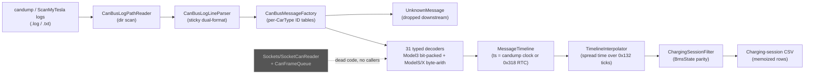
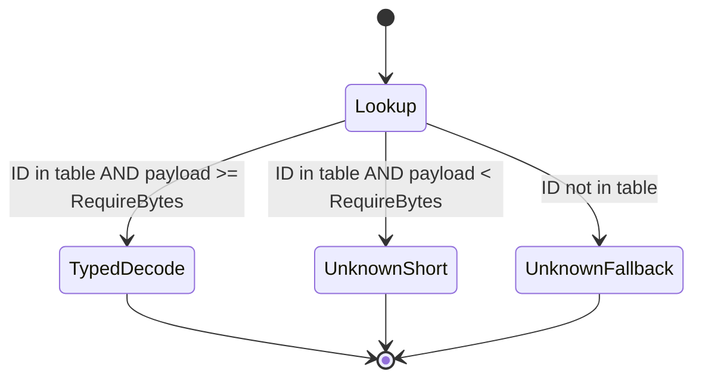

# hanswolff / TeslaCanBusInspector — Deep Dive

## 1. Provenance

- **Submodule path:** `legacy/hanswolff-TeslaCanBusInspector`
- **Pinned gitlink:** `160000 fa5f0d02af040deea8ea23591e8553fe4c68ae42 0` (from `git ls-files -s legacy/hanswolff-TeslaCanBusInspector`); matches `git -C legacy/hanswolff-TeslaCanBusInspector rev-parse HEAD`; worktree clean (`status --porcelain` empty). Pinned commit: `fa5f0d0` 2019-12-12 "Minor improvements".
- **Upstream URL:** `https://github.com/hanswolff/TeslaCanBusInspector` (origin, fetch+push)
- **License:** MIT — `LICENSE:1-3` (RANGE-CITED, first 5 lines read)
- **Analysis date:** 2026-11-21
- **Mode:** replace. The original frontmatter above is preserved byte-for-byte from the committed LF blob (no trailing whitespace existed on the description line, so no strip was needed). The pre-replace summary lives in git history; claims from it are cited below as `git show HEAD:docs/legacy/hanswolff-TeslaCanBusInspector.md#L<n>`. The original doc had **no `## Upstream (...)` sections**, so the preserve list is empty.
- **Upstream file citations** below are relative to the submodule root (e.g. `TeslaCanBusInspector.Common/Messages/...`).

**Files read (FULL-READ):** all 33 files under `TeslaCanBusInspector.Common/Messages/` (incl. `Model3/` 14 decoders, `ModelS/` 17 decoders, `ICanBusMessage.cs`, `UnknownMessage.cs`); `LogParsing/` (4 files); `Sockets/` (3 files); `Session/` (2 files); `Interpolation/TimelineInterpolator.cs`; `Statistics/` (2 files); `CanBusMessageFactory.cs`; `CarType.cs`; `BitArrayConverter.cs`; `GuardExtensions.cs`; `TimedValue.cs`; `CurrentLastValue.cs`; `IocConfig.cs` (both); `TeslaCanBusInspector/Program.cs`, `CanBusLogFileToJson.cs`, `Model3/Model3CanBusLogFileToCsv.cs`, `Model3/Model3ChargingSessionsToCsv.cs`, `Common/ChargingSessionRow.cs`, `Common/ChargingSessionRowWriter.cs`, `Common/CsvRow.cs`, `Common/CsvRowWriter.cs`, `Configuration/ChargingSessionTransformationOptions.cs`, `Properties/launchSettings.json`; all 31 test `.cs` files under `TeslaCanBusInspector.Tests/`; `README.md`; `build-and-run.sh`; `.github/workflows/dotnetcore.yml`; `.gitattributes`; `TeslaCanBusInspector.Common.csproj`; `TeslaCanBusInspector.Tests.csproj`; `ValueTypes/Ampere.cs` (read as the exemplar of the 16 value-type structs).

**Files read (RANGE-CITED):** `LICENSE` (lines 1-5); `TeslaCanBusInspector/TeslaCanBusInspector.csproj` (line 6 only, via grep).

**Files explicitly NOT read:** `.gitignore`, `TeslaCanBusInspector.sln`, `TeslaCanBusInspector.sln.DotSettings` (trivial solution/tooling metadata, no protocol content); the 15 `ValueTypes/*.cs` files other than `Ampere.cs` (uniform struct wrappers; `Ampere.cs` read as representative). No hidden directories exist in the inventory beyond `.github/` (read).

**Our-side files read for parity (CODE-READ):** `firmware/lib/vehicle/can/ids.h` (lines 20-99); `firmware/lib/vehicle/can/feature/telemetry/bms.h` (lines 1-585, full); `firmware/lib/vehicle/can/feature/telemetry/powertrain.h` (lines 1-111, full); `firmware/lib/vehicle/can/feature/telemetry/vehicle_config.h` (lines 40-119); `firmware/lib/vehicle/can/handler/bus/vehicle.h` (grep-level: all 38 `f.id ==` dispatch lines). Our-side client decoder catalogs (`client/src/assets/can-decoder/legacy_*.json`) were probed only at the `0x3B6` anchor level — STRUCTURAL-PARSE, not read in full (each file is 30k-300k+ lines of vendored DBC data).

## 2. Executive verdict

An abandoned (last commit 2019-12-12, shallow single-commit clone) offline .NET Core 3.1 CLI that parses Tesla CAN **log files** — candump `(ts) iface ID#hex` lines and raw ScanMyTesla/ELM327 hex lines — and decodes them into 31 typed message classes (14 Model 3 bit-packed, 17 Model S/X byte-arithmetic), then splits them into charging sessions and writes CSV. There is **no frame mutation, no injection, no TX path** anywhere; the only "socket" code (`Sockets/SocketCanReader.cs`, `CanFrameDecoder.cs`) is dead, unwired stub code. The value for TeslaCANModder is threefold: (1) a set of 2018-2019-era decode constants pinned by tests with example payloads, usable as a second-opinion oracle against our own decoders — several of which disagree with upstream on the very same IDs (0x257 speed, 0x106/0x115 RPM endianness, 0x352 layout, 0x292 field naming, 0x132 current scale); (2) a dual-format log-line parser we lack entirely (no `candump` reference exists in `tools/` or `packages/protocol` — verified); (3) a charging-session splitter keyed on BMS-state parity. It must never be ported as code (C# reflection factory, dead socket path, a shipped CSV column bug), only reinterpreted as behavior with independent implementation.

## 3. Evidence map

| Source file | Lines | What it proves | Grade |
| ----------- | ----- | -------------- | ----- |
| `LogParsing/CanBusLogLineParser.cs` | 11-18 | Exactly two accepted line formats: candump regex and ScanMyTesla hex regex | CODE-READ |
| `LogParsing/CanBusLogLineParser.cs` | 23-31, 43 | Skip-list for ELM327/ScanMyTesla adapter chatter (`ATCAF0`, `BUFFER FULL`, `Using ELM327 command set`); min line length 5 | CODE-READ |
| `LogParsing/CanBusLogLineParser.cs` | 52-68 | Sticky-format detection: last successful parser tried first | CODE-READ |
| `CanBusMessageFactory.cs` | 15-17, 53 | Three `ushort.MaxValue`-sized constructor tables (S/X/3); colliding IDs throw at static init | CODE-READ |
| `CanBusMessageFactory.cs` | 93-99 | Short payloads and unknown IDs both fall back to `UnknownMessage` | CODE-READ |
| `LogParsing/CanBusLogFileTimeLineReader.cs` | 45 | Timeline reader hardcodes `CarType.Model3` regardless of log origin | CODE-READ |
| `LogParsing/CanBusLogFileTimeLineReader.cs` | 64-78 | Timestamp fallback: candump wall-clock first, else 0x318 RTC | CODE-READ |
| `Messages/Model3/*.cs` | all | 14 Model 3 decoders, bit-offset decoding via `BitArrayConverter` | CODE-READ |
| `Messages/ModelS/*.cs` | all | 17 Model S/X decoders, flag `CarType.ModelS \| CarType.ModelX` (e.g. `ModelS/BatteryInfoMessage.cs:9`) | CODE-READ |
| `Messages/Model3/TimestampMessage.cs` | 8, 16, 28-31 | 0x318 decoded as RTC date/time; validity floor 2000-01-01 | CODE-READ |
| `Session/ChargingSessionFilter.cs` | 44 | Charging gate = `BmsState % 2 > 0` from 0x212 | CODE-READ |
| `Interpolation/TimelineInterpolator.cs` | 20, 36-37, 59 | Needs ≥2 timestamp messages; prefers 0x132 as the distribution tick; 10 s max window | CODE-READ |
| `Session/MessageTimeline.cs` | 104 | Non-sequential timestamps throw | CODE-READ |
| `TeslaCanBusInspector/Common/CsvRowWriter.cs` | 21 | Bug: `TotalCharge` CSV column formats `row.TotalDischarge` | CODE-READ |
| `TeslaCanBusInspector/Program.cs` | 17-36 | Sole shipping entry: 2 args, hardcoded 15-min minimum session, subdirs on | CODE-READ |
| `TeslaCanBusInspector/Program.cs` | 30 | Only `IModel3ChargingSessionsToCsv` is resolved; JSON and raw-CSV writers are unreachable from the CLI | CODE-READ |
| `Sockets/SocketCanReader.cs` | 45, 54 | Dead TCP CAN reader: 4096-byte buffer, `// TODO: parse CAN frames`, no callers | CODE-READ |
| `build-and-run.sh` | 3 | References `TeslaCanBusInspector.Site/...netcoreapp2.1` — a project that does not exist in the tree | CODE-READ |
| `TeslaCanBusInspector.Tests/**` | all | 31 test files pin decoder values from example payloads (e.g. 0x132 → 347.28 V at `BatteryPowerMessageTests.cs:16-20`) | TEST-READ |
| `README.md` | 3, 7 | README is a stub: one line claiming ".NET Core 3.0" plus a referral link; no technical content | CODE-READ |

No CAPTURE evidence exists in this repo: there are no capture files, only test fixture payloads whose real-world provenance is UNVERIFIED (section 17).

## 4. Architecture and build surface

- **Entry point:** `TeslaCanBusInspector/Program.cs:17-36` — `dotnet run <sourcePath> <destinationPath>`; everything else (options: 15-min minimum session duration, include subdirectories) is hardcoded (`Program.cs:32-35`).
- **Shared core:** `TeslaCanBusInspector.Common/` (decoders, parsing, session logic, statistics) has exactly one dependency (`Microsoft.Extensions.DependencyInjection` 3.1.0, `TeslaCanBusInspector.Common.csproj:8`); `Newtonsoft.Json` appears only in the app project (`CanBusLogFileToJson.cs:4`).
- **Platform port:** none — pure desktop .NET; the `Sockets/` namespace is a never-wired TCP stub, not a platform port.
- **Build flags:** none — `netcoreapp3.1` across all three csproj files; CI (`dotnetcore.yml:14-17`) builds Release with dotnet 3.0.100 and never runs tests.
- **Frame mutation pipeline:** None found: no frame mutation, injection, or TX exists in this repo — it is decode-only. The data flow ends at CSV/JSON output:



## 5. Mechanism catalogue

### 5.1 Dual-format CAN log-line parser with sticky format detection

- **Claim (README / summary):** old doc: "It parses CAN bus log files" without naming formats (`git show HEAD:docs/legacy/hanswolff-TeslaCanBusInspector.md#L51`).
- **Code path:** `CanBusLogLineParser.cs:52` `TryParseTrimmedLine()` → sticky `_lastSuccessfulAction` (line 34) → `TryParseLineCanDumpLine()` (line 77) or `TryParseLineScanMyTeslaLine()` (line 107).
- **Frame spec:** candump: `(unixTs) iface XXX#HEXHEX...` (regex at line 11); ScanMyTesla: pure hex, first 3 chars = ID (line 114), remainder = payload, timestamp 0 (line 128).
- **Gates and timing:** line length ≥5 (lines 43, 109); skip-list of adapter chatter (lines 23-31: `ATCAF0`, `ATCF 000`, `ATCM 000`, `BUFFER`, `BUFFER FULL`, `Adapter error ?`, `Connecting to car...`, `Using ELM327 command set`).
- **State machine:** 2 states (last-format-can / re-detect) — no diagram needed.
- **Tests:** `TryParseLine_CanDumpFormat`, `TryParseLine_ScanMyTeslaFormat`, `TryParseLine_AlternatingFormats` at `TeslaCanBusInspector.Tests/CanBusLogLineParserTests.cs:12-61` — assert both formats, skip-line rejection, and sticky re-detection.
- **Evidence grade:** CODE-READ + TEST-READ.
- **Verdict:** CONFIRMED.
- **Adapt to TeslaCANModder?** candidate (tools log import; see section 13).

### 5.2 Reflection message factory with per-CarType constructor tables

- **Claim (README / summary):** old doc: "a message factory that decodes known Tesla Model 3 CAN messages into typed objects" (`git show HEAD:...#L15`) — accurate but incomplete (Model S/X tables exist too).
- **Code path:** static ctor `CanBusMessageFactory.cs:20-66` scans the assembly for `ICanBusMessage` implementations → builds three `MessageInfo[ushort.MaxValue]` tables (lines 15-17) → `Create()` (line 86).
- **Frame spec:** n/a (dispatch layer). Per-message `RequireBytes` gates decoding.
- **Gates and timing:** collision on same ID → `InvalidOperationException` at static init (line 53); `payload.Length < RequireBytes` → `UnknownMessage` (lines 93-95); unknown ID → `UnknownMessage` (lines 97-99); invalid `CarType` argument → throw (lines 108-112).
- **State machine (Create path):**



- **Tests:** None found — `CanBusMessageFactory` has no test file.
- **Evidence grade:** CODE-READ.
- **Verdict:** CONFIRMED (behavior); UNTESTED.
- **Adapt to TeslaCANModder?** never port (reflection + 3×65536 arrays are meaningless on ESP32; our dispatch is a compile-time switch in `firmware/lib/vehicle/can/handler/bus/vehicle.h`).

### 5.3 Model 3 bit-packed decoder family

- **Claim (README / summary):** old doc: "typed signal parsing (useful as a DBC reference)" (`git show HEAD:...#L60`).
- **Code path:** `Messages/Model3/*.cs` constructors → `BitArrayConverter.ToUInt16/ToInt16/ToUInt32` (`BitArrayConverter.cs:10-113`) — LSB-first bit numbering, i.e. bit N = byte N/8, bit N%8.
- **Frame spec:** 14 IDs, see section 7 rows (0x108, 0x132, 0x186, 0x212, 0x241, 0x244, 0x252, 0x257, 0x292, 0x318, 0x321, 0x352, 0x3B6, 0x3D2). No counters, no checksums — read-only decode.
- **Gates and timing:** `payload.RequireBytes(RequireBytes)` throws on short payloads (`GuardExtensions.cs:7-16`), factory downgrades to `UnknownMessage` first.
- **State machine:** stateless decoders.
- **Tests:** 14 test files under `TeslaCanBusInspector.Tests/Messages/Model3/` — every decoder field is pinned to a concrete example payload (e.g. `SpeedMessageTests.cs:17-21`: payload `13 F8 34 1C 72 00 00 00` → 27.76 km/h signed, 28.0 km/h UI).
- **Evidence grade:** CODE-READ + TEST-READ.
- **Verdict:** CONFIRMED for the 2018-19 capture era the fixtures encode; conflicts with our decoders on 0x257/0x352/0x106/0x132-current (section 11).
- **Adapt to TeslaCANModder?** already present for overlapping IDs; constants are cross-check oracle material (capture-first, section 11).

### 5.4 Model S/X byte-arithmetic decoder family

- **Claim (README / summary):** old doc mentions only Model 3 (`git show HEAD:...#L42`); the code ships 17 S/X decoders — contradiction row 6.2.
- **Code path:** `Messages/ModelS/*.cs` constructors — direct byte arithmetic, manual sign handling, no `BitArrayConverter`.
- **Frame spec:** 17 IDs, see section 7. Notable formulas: signed 16-bit via `512 * (payload[5] & 0x80)` subtraction (`RearMotorRpmMessage.cs:22` — LE order); steering `((b0<<8)+b1-8200)/10` (`SteeringAngleMessage.cs:20`); brake pedal `(byte)(b0+(b1<<8)-3239)` (`BrakePedalPositionMessage.cs:20`).
- **Gates and timing:** `RequireBytes` per decoder; `VinMessage.cs:27` uses `Encoding.Default` (platform-dependent encoding for ASCII VIN parts).
- **State machine:** stateless decoders.
- **Tests:** 17 test files under `TeslaCanBusInspector.Tests/Messages/ModelS/`; `BrakePedalPositionMessageTests.cs:9` is `[Fact(Skip = "add data here")]` — the only skipped test in the repo, leaving that decoder unverified.
- **Evidence grade:** CODE-READ + TEST-READ (except `BrakePedalPositionMessage`: CODE-READ only).
- **Verdict:** CONFIRMED with two precedence quirks: `(payload[6] & 0x3f << 5)` binds as `payload[6] & 0x7E0` in `FrontMechPowerMessage.cs:30` and `RearMechPowerMessage.cs:33`; the tests (`FrontMechPowerMessageTests.cs:29-34`, `RearMechPowerMessageTests.cs:26-31`) pin the accidental-but-effective semantics, so the "intended" `(b6 & 0x3f) << 5` reading is CONTRADICTED by the pinned expectations (front: 9 kW, rear: 85 kW).
- **Adapt to TeslaCANModder?** no impact (pre-HW3 Model S frames we do not target) — except as oracle data for client legacy catalogs.

### 5.5 0x318 RTC timestamp message (Model 3) + timestamp fallback chain

- **Claim (README / summary):** not mentioned in old doc or README.
- **Code path:** `Messages/Model3/TimestampMessage.cs:28-31` → `CanBusLogFileTimeLineReader.cs:64-78` `TryGetTimestamp()`.
- **Frame spec:** 0x318 (792), DLC 8: `payload[0]`=year-2000, `[1]`=month, `[2]`=second, `[3]`=hour, `[4]`=day, `[5]`=minute, UTC. Guards: month 0 → invalid (`:28`), day 0 or >31 → invalid (`:29`), `ArgumentException` swallowed (`:32-34`). Validity floor 2000-01-01 (`:8,16`).
- **Gates and timing:** candump wall-clock timestamp wins when present (`CanBusLogFileTimeLineReader.cs:66-72`); RTC used only for ScanMyTesla lines (timestamp 0).
- **State machine:** 2 states (valid / invalid).
- **Tests:** `TimestampMessageTests.cs:13-17` — payload `13 0B 03 05 05 15 11 6C` → 2019-11-05 05:21:03 UTC.
- **Evidence grade:** CODE-READ + TEST-READ.
- **Verdict:** CONFIRMED upstream; **conflicts with our side**, which reserves 0x318 as `GTW_carState` (`firmware/lib/vehicle/can/ids.h:52`) with no decode handler found (`git grep 'CAN_ID_GTW_CAR_STATE' firmware/lib/vehicle/can/handler/bus/vehicle.h` → no output). Both meanings cannot be right for the same vehicle era — capture-first (sections 11, 17).
- **Adapt to TeslaCANModder?** capture-first; never port blind.

### 5.6 Timeline time interpolation between RTC ticks

- **Claim (README / summary):** old doc mentions "Data analysis utilities" without detail (`git show HEAD:...#L45`).
- **Code path:** `Interpolation/TimelineInterpolator.cs:16-84` `InterpolateTime()` — iterates consecutive valid 0x318 messages, builds a per-range histogram, distributes `timeDiff` evenly across the dominant message type's occurrences.
- **Frame spec:** n/a (timing layer). Prefers 0x132 (`BatteryPowerMessage`) as the interpolation carrier when present (lines 36-38).
- **Gates and timing:** requires ≥2 timestamp messages (line 20); windows >10 s or zero-length are skipped (line 59); slice = `timeDiff / (count+1)`.
- **State machine:** 3 conceptual phases (scan ticks / validate window / distribute slices) — linear loop, no diagram.
- **Tests:** `TimelineInterpolatorTests.cs:18-33` — 4× 0x132 messages between two 1-s-apart ticks get 250 ms spacing.
- **Evidence grade:** CODE-READ + TEST-READ.
- **Verdict:** CONFIRMED happy path; the >10 s and zero-diff skip branches are UNTESTED.
- **Adapt to TeslaCANModder?** no impact — our firmware timestamps at capture time; only relevant if we ever build an offline log replayer in `tools/`.

### 5.7 Charging-session extraction (BMS-state parity gate)

- **Claim (README / summary):** old doc: "can extract charging session data from log files" (`git show HEAD:...#L15`) — accurate.
- **Code path:** `Session/ChargingSessionFilter.cs:12-58` `GetChargingSessions()` → gate at line 44 `batteryInfoMessage.BmsState % 2 > 0` (0x212) → `Model3ChargingSessionsToCsv.cs:55-100` writes one CSV per session.
- **Frame spec:** depends on 0x212 `BmsState` (4 bits at bits 11-14, `Messages/Model3/BatteryInfoMessage.cs:25`).
- **Gates and timing:** session ends on parity flip to even; `StartTime`/`EndTime` default sessions skipped (`Model3ChargingSessionsToCsv.cs:57-59`); minimum duration 15 min hardcoded in `Program.cs:34`; file name from session UTC bounds (`Model3ChargingSessionsToCsv.cs:102-105`).
- **State machine:** 2 states (charging / not charging) — no diagram needed.
- **Tests:** `ChargingSessionFilterTests.cs:16-71` — no-session timeline yields empty; one-session timeline yields exactly the 4 messages between start and stop payloads.
- **Evidence grade:** CODE-READ + TEST-READ.
- **Verdict:** CONFIRMED.
- **Adapt to TeslaCANModder?** candidate (session splitter for recorder dumps in tools/client analytics), gated on revalidating the BmsState parity on our 0x212 decode (section 11 row 10).

### 5.8 CSV row memoization and row gating

- **Claim (README / summary):** not mentioned in old doc.
- **Code path:** `Model3CanBusLogFileToCsv.cs:55-80` `ParseMessage()`/`EnrichMemoizedValues()` — fields persist across rows until the next timestamp tick; `ChargingSessionRow.cs:29-36` `ShouldWriteRow` requires all five key fields non-null; `ChargingSessionRowWriter.cs:12-22` writes fixed column order.
- **Frame spec:** n/a.
- **Gates and timing:** rows with missing current/SoC/temp/power values are silently dropped (`Model3ChargingSessionsToCsv.cs:88-90`).
- **State machine:** stateless memoization.
- **Tests:** None found — no test covers the writers, the memoization, or `ShouldWriteRow`.
- **Evidence grade:** CODE-READ.
- **Verdict:** PARTIAL — works as designed, but ships a real bug: `CsvRowWriter.cs:21` formats the `TotalCharge` column from `row.TotalDischarge`, so both lifetime-energy columns output discharge totals. No test would have caught it.
- **Adapt to TeslaCANModder?** never port as-is (bug + we have no CSV export); the memoization *idea* is already covered by our `status:live` state snapshot semantics.

### 5.9 Dead code: SocketCAN TCP reader + raw-bit frame decoder

- **Claim (README / summary):** old doc: "No direct CAN integration" (`git show HEAD:...#L51`) — PARTIAL: the shipping pipeline is offline-only, but the repo does contain socket CAN code.
- **Code path:** `Sockets/SocketCanReader.cs:22-58` `ConnectAsync()` → `ReadStreamInternal()` (line 45: 4096-byte buffer; line 54: `// TODO: parse CAN frames`); `Sockets/CanFrameDecoder.cs:12-74` `CanFrameQueue.Dequeue()` walks SOF → 11-bit ID → RTR/IDE/reserved → DLC → data → CRC-15 → EOF at bit level.
- **Frame spec:** raw CAN 2.0 bit stream, never completed — decoded values are discarded (`CanFrameDecoder.cs:57 // TODO: put into CanFrame`).
- **Gates and timing:** `EnsureHasData()` (lines 56-75) busy-waits with 1 ms cancellation polls.
- **State machine:** linear bit walk, not a state machine.
- **Tests:** None found.
- **Evidence grade:** CODE-READ.
- **Verdict:** CONFIRMED as dead code — no caller anywhere in the tree; `Program.cs:30` resolves only the charging-session service.
- **Adapt to TeslaCANModder?** never port (we have MCP2515 drivers + GVRET TCP bridge already).

## 6. Summary vs code contradiction table

Pre-replace doc = `git show HEAD:docs/legacy/hanswolff-TeslaCanBusInspector.md` (line-cited as `#L<n>`). Only actual contradictions listed; agreements are in section 3.

| # | Summary claim | Code reality | Verdict |
| - | ------------- | ------------ | ------- |
| 6.1 | Frontmatter `#L3` description ends mid-word ("...converts them to str") and calls the tool a "desktop application" | Console CLI: `TeslaCanBusInspector/Program.cs:17-36` has no GUI; description text is truncated | Stale frontmatter (preserved byte-for-byte per replace-mode rule; recorded here, not edited) |
| 6.2 | `#L15`/`#L42`: "decodes known Tesla Model 3 CAN messages" / "Typed CAN message classes for Model 3" | 17 additional decoders are `CarType.ModelS \| CarType.ModelX` (`Messages/ModelS/BatteryInfoMessage.cs:9` etc.) | CONTRADICTED (incomplete) |
| 6.3 | `#L19`: "PC (.NET Core 3.0)" | All three csproj target `netcoreapp3.1` (`TeslaCanBusInspector.Common.csproj:4`, `TeslaCanBusInspector.Tests.csproj:4`, `TeslaCanBusInspector.csproj:6`) | CONTRADICTED (also upstream `README.md:3` says 3.0) |
| 6.4 | `#L21`/`#L51`: "No direct CAN integration" | Dead socket code exists: `Sockets/SocketCanReader.cs` TCP reader + `CanFrameDecoder.cs` bit-level parser, unwired (`SocketCanReader.cs:54` TODO) | PARTIAL — shipping pipeline is offline-only, summary hides existing socket code |
| 6.5 | `#L28` mermaid: log input is "CSV/PCAP" | Parser accepts only candump text (regex `CanBusLogLineParser.cs:11`) and ScanMyTesla hex (`:12`); no CSV or PCAP parser exists anywhere | CONTRADICTED |
| 6.6 | `#L38`: `CanBusLogFileToJson.cs` listed as a main-app component | No caller: `Program.cs:30` resolves only `IModel3ChargingSessionsToCsv`; `CanBusLogFileToJson.ReadFileToJson` (`CanBusLogFileToJson.cs:13`) is unreachable from the CLI | PARTIAL (dead from entry point) |
| 6.7 | `#L51`: logs "likely captured via tools like SavvyCAN" | Code's skip-list and second format are ELM327/ScanMyTesla-specific (`CanBusLogLineParser.cs:23-31`: `ATCAF0`, `BUFFER FULL`, `Using ELM327 command set`) | PARTIAL — ScanMyTesla/ELM327 is the evidenced source; SavvyCAN claim is UNVERIFIED |

## 7. CAN frame and signal inventory

All frames are **read-only decodes** (R); no frame is mutated, injected, or transmitted. "Bus" is n/a — input is a log file (candump interface token is recorded in `CanBusLogLine.CanInterface` but never consumed downstream). Periods are not encoded (timestamps only). No counters, no checksums — `git grep -nEi 'checksum|crc' -- TeslaCanBusInspector.Common/Messages/` returns no output (the only `crc15` in the tree is the dead raw-bit walker `CanFrameDecoder.cs:35`). DLC = upstream `RequireBytes` minimum.

### Model 3 (14 frames)

| ID (hex+dec) | DLC | Byte/bit layout | Scale/units | Grade |
| ------------ | --- | --------------- | ----------- | ----- |
| 0x108 (264) RearTorque | 8 | torque request bits 12-24 (13b, signed); torque bits 27-39 (13b, signed); axle RPM bits 40-55 (16b, signed) | ×2 Nm; ×0.1 RPM | TEST-READ (`RearTorqueMessageTests.cs`) |
| 0x132 (306) BatteryPower | 8 | voltage bits 0-15; current smooth bits 16-30 (15b, signed); current raw bits 32-47 (16b, signed); charge time bits 48-59 (12b) | V ×0.01; smooth ×−0.01 A; raw ×−0.05+500 A; minutes | TEST-READ |
| 0x186 (390) FrontTorque | 8 | identical layout to 0x108 (front axle) | ×2 Nm; ×0.1 RPM | TEST-READ |
| 0x212 (530) BatteryInfo | 8 | contactors bits 8-10 (3b); BmsState bits 11-14 (4b); isolation bits 19-28 (10b, signed); charge status bits 32-34 (3b); charge power bits 38-48 (11b); min temp bits 56-63 | contactors n/a; kΩ raw; kW ×0.125; °C ×0.5−40 | TEST-READ |
| 0x241 (577) CoolantFlow | 7 | battery flow bits 0-8 (9b); powertrain flow bits 22-30 (9b) | ×0.1 L/min | TEST-READ |
| 0x244 (580) FastChargeLimits | 8 | power bits 0-12 (13b); current bits 16-28 (13b); max V bits 32-44 (13b); min V bits 48-60 (13b) | ×0.06226 kW; ×0.073242 A; ×0.073242 V | TEST-READ |
| 0x252 (594) PowerLimits | 8 | regen limit bits 0-15; discharge limit bits 16-31 | ×0.01 kW each | TEST-READ |
| 0x257 (599) Speed | 8 | signed speed bits 12-23 (12b); UI speed bits 24-31 (8b) | signed ×0.08−40 km/h; UI raw km/h | TEST-READ |
| 0x292 (658) StateOfCharge | 8 | UI bits 0-9; min bits 10-19; max bits 20-29; avg bits 30-39 (10b each) | ×0.1 % each | TEST-READ |
| 0x318 (792) Timestamp | 8 | `[0]`=year−2000, `[1]`=month, `[2]`=second, `[3]`=hour, `[4]`=day, `[5]`=minute, UTC | guards: month≠0, 0<day≤31 | TEST-READ |
| 0x321 (801) Temperature | 8 | coolant battery inlet bits 0-9; coolant PT inlet bits 10-19; ambient raw bits 24-31; ambient filtered bits 40-47 | ×0.125−40 °C; ambient ×0.5−40 °C | TEST-READ |
| 0x352 (850) BatteryCapacity | 8 | full bits 0-9; remaining bits 10-19; expected bits 20-29; ideal bits 30-39; toComplete bits 40-49; buffer bits 50-59 (10b each) | ×0.1 kWh each | TEST-READ |
| 0x3B6 (950) Odometer | 4 | bytes 0-3 little-endian uint32 (`BitConverter`) | /1000 km | TEST-READ |
| 0x3D2 (978) ChargeDischarge | 8 | total discharge bits 0-31; total charge bits 32-63 (32b each) | ×0.001 kWh | TEST-READ |

### Model S / X (17 frames, flag `CarType.ModelS | CarType.ModelX`)

| ID (hex+dec) | DLC | Byte/bit layout | Scale/units | Grade |
| ------------ | --- | --------------- | ----------- | ----- |
| 0x00E (14) SteeringAngle | 3 | angle = `(b0<<8)+b1` | −8200, /10 → degrees | TEST-READ |
| 0x102 (258) BatteryInfo | 8 | current = `((b3&0x7F)<<8)+b2`, `<<1`, /20; voltage = `b0+(b1<<8)`; negative terminal = `b6+((b7&7)<<8)` | I = 1000−that A; V /100; terminal ×0.1−10 | TEST-READ |
| 0x106 (262) RearMotorRpm | 6 | `b4+(b5<<8) − 512*(b5&0x80)` — little-endian signed 16 | 1:1 RPM | TEST-READ |
| 0x115 (277) FrontMotorRpm | 6 | identical LE layout to 0x106 | 1:1 RPM | TEST-READ |
| 0x154 (340) RearTorque | 7 | torque = `b5+((b6&0x1F)<<8) − 512*(b6&0x10)`; pedal = b3 | torque ×0.25 Nm; pedal ×0.4 % | TEST-READ |
| 0x168 (360) BrakePedalPosition | 2 | `b0+(b1<<8) − 3239`, cast to byte | percent (wraps on overflow) | CODE-READ (test skipped, `BrakePedalPositionMessageTests.cs:9`) |
| 0x1D4 (468) FrontTorque | 7 | identical to 0x154 torque term | ×0.25 Nm | TEST-READ |
| 0x210 (528) DcDcInfo | 6 | current = b4; voltage = b5; coolant = b2; input = b3; output = b4×b5 | A raw; V /10; `(b2−2*(b2&0x80))/2+40` °C; W = `b3<<4`; W /10 | TEST-READ |
| 0x232 (562) BmsInfo | 4 | max charge = b0+(b1<<8); max discharge = b2+(b3<<8) | /100 kW each | TEST-READ |
| 0x266 (614) RearMechPower | 8 | inverter V = b0; mech = `b2+((b3&7)<<8)−512*(b3&4)`; diss = b1; stator = `b4+((b5&7)<<8)`; drive max = `(b6&0x3f<<5)+((b5&0xf0)>>3)`; regen max = `b7<<2` | V /10; kW /2; `b1×125/1000−0.5` kW; A raw; kW +1; kW −200 | TEST-READ |
| 0x2E5 (741) FrontMechPower | 8 | identical to 0x266 minus inverter-V and regen terms | as 0x266 | TEST-READ |
| 0x302 (770) StateOfCharge | 8 | type = `b2>>4` (0=DC, 1=AC); charge total = b4-b7 LE; socMin = `b0+((b1&3)<<8)`; displayed = `(b1>>2)+(((b2&0xF)<<6)/10)` | kWh /1000; min /10 %; displayed as coded | TEST-READ |
| 0x318 (792) Temperature (S) | 5 | outside = b0; filtered = b1; inside = b2; AC = b4 | /2 −40 °C each | TEST-READ — legal ID collision with Model 3 Timestamp: separate per-CarType tables |
| 0x382 (898) PackInfo | 8 | six 0.1 kWh fields packed across nibbles of b0-b7 (nominal full, nominal remaining, expected, ideal, to-complete, buffer) | ×0.1 kWh | TEST-READ |
| 0x398 (920) CountryCode | 2 | ASCII `b0b1` | 2-letter country string | TEST-READ |
| 0x3D2 (978) ChargeDischargeTotal | 8 | charge = b0-b3 LE; discharge = b4-b7 LE | /1000 kWh each | TEST-READ — field order OPPOSITE to the Model 3 decoder of the same ID |
| 0x508 (1288) Vin | 8 | `[0]`=part index; `[1..7]`=VIN segment (`Encoding.Default`, trimmed) | string | TEST-READ |
| 0x562 (1378) Odometer | 4 | bytes 0-3 little-endian uint32 | /1000 miles | TEST-READ |

## 8. Constants and tuning table

| Constant | Value | File:line | Meaning | Grade |
| -------- | ----- | --------- | ------- | ----- |
| Interpolation max window | 10 s | `Interpolation/TimelineInterpolator.cs:59` | RTC tick pairs further apart are not interpolated (gap = unsynchronized region) | CODE-READ |
| Interpolation min ticks | 2 | `Interpolation/TimelineInterpolator.cs:20` | below this, timeline left with null timestamps | CODE-READ |
| Interpolation carrier | 0x132 preferred | `Interpolation/TimelineInterpolator.cs:36-38` | 0x132 is the assumed-period heartbeat; else most frequent ID | CODE-READ |
| Minimum charging session | 15 min | `TeslaCanBusInspector/Program.cs:34` | shorter sessions dropped from CSV output | CODE-READ |
| Speed scale/offset | ×0.08, −40 | `Messages/Model3/SpeedMessage.cs:23` | 12-bit signed speed → km/h (conflicts with our /100 decode, section 11) | TEST-READ |
| Current smooth scale | ×−0.01 A | `Messages/Model3/BatteryPowerMessage.cs:29` | 15-bit signed at bit 16 | TEST-READ |
| Current raw scale/offset | ×−0.05, +500 A | `Messages/Model3/BatteryPowerMessage.cs:30` | 16-bit signed at bit 32 | TEST-READ |
| Charge-time bits | 48-59, minutes | `Messages/Model3/BatteryPowerMessage.cs:31` | `TimeSpan.FromMinutes` — agrees with our `bms.h:567-571` (raw × 1/60 h) | TEST-READ |
| Charge power scale | ×0.125 kW | `Messages/Model3/BatteryInfoMessage.cs:31` | 11-bit at bit 38 | TEST-READ |
| Min temp scale/offset | ×0.5, −40 °C | `Messages/Model3/BatteryInfoMessage.cs:32` | bits 56-63 — same slot our `decodeBmsStatusMinTemp` reads (`bms.h:394-397`) | TEST-READ |
| Fast-charge scales | 0.06226 / 0.073242 | `Messages/Model3/FastChargeLimitsMessage.cs:26-29` | kW and A/V limits, 13-bit fields, rounded | TEST-READ |
| RTC base year | 2000 | `Messages/Model3/TimestampMessage.cs:31` | `payload[0]`+2000; validity floor 2000-01-01 (`:8`) | TEST-READ |
| Sign trick | `512*(b&0x80)` | `Messages/ModelS/RearMotorRpmMessage.cs:22` (also 0x102, 0x154, 0x1D4) | manual two's-complement: term = 65536 when MSB set | CODE-READ |
| Steering offset | 8200, /10 | `Messages/ModelS/SteeringAngleMessage.cs:20` | Model S angle zero-point | TEST-READ |
| Brake pedal offset | 3239 | `Messages/ModelS/BrakePedalPositionMessage.cs:20` | zero-point; byte cast can wrap | CODE-READ (test skipped) |
| ELM327 skip-list | 8 lines | `LogParsing/CanBusLogLineParser.cs:23-31` | adapter chatter to drop during parse | TEST-READ |
| Min line length | 5 chars | `LogParsing/CanBusLogLineParser.cs:43,109` | input gate for both formats | CODE-READ |
| Socket buffer | 4096 B | `Sockets/SocketCanReader.cs:45` | dead TCP path only | CODE-READ |

## 9. Failure modes and edge cases

| Failure | Handling code path | Tested? | Grade |
| ------- | ------------------ | ------- | ----- |
| Unknown CAN ID in log | fallback to `UnknownMessage`, dropped downstream — `CanBusMessageFactory.cs:97-99`, `CanBusLogFileTimeLineReader.cs:46-49` | no (no factory tests) | CODE-READ |
| Payload shorter than decoder's `RequireBytes` | downgraded to `UnknownMessage` — `CanBusMessageFactory.cs:93-95` via `GuardExtensions.cs:7-16` | no | CODE-READ |
| Colliding decoder IDs per CarType | throws in static constructor — process dies at first use — `CanBusMessageFactory.cs:53` | no | CODE-READ |
| Out-of-order timestamps in timeline | `InvalidOperationException` — `Session/MessageTimeline.cs:104` | no | CODE-READ |
| Invalid RTC date (month 0, day 0 or >31, calendar overflow) | guards + swallowed `ArgumentException`, message stays invalid — `Messages/Model3/TimestampMessage.cs:28-34` | no (only valid-date test) | CODE-READ |
| Interpolation window >10 s or zero | skipped silently — `Interpolation/TimelineInterpolator.cs:59` | no (happy path only) | CODE-READ |
| Charging session with no valid bounds | skipped — `Model3ChargingSessionsToCsv.cs:57-59` | no | CODE-READ |
| Charging session shorter than 15 min | dropped — `Model3ChargingSessionsToCsv.cs:61-64` | no | CODE-READ |
| Row with missing battery/current/SoC/temp values | row not written — `ChargingSessionRow.cs:29-36`, `Model3ChargingSessionsToCsv.cs:88-90` | no | CODE-READ |
| CSV `TotalCharge` column | **bug: writes `TotalDischarge` values** — `TeslaCanBusInspector/Common/CsvRowWriter.cs:21` | no | CODE-READ |
| TCP stream error in dead socket path | `IOException`/`OperationCanceledException` swallowed — `Sockets/SocketCanReader.cs:36-44` | no (dead code) | CODE-READ |
| Queue starved in dead frame decoder | busy-wait, 1 ms polls — `Sockets/CanFrameDecoder.cs:56-75` | no (dead code) | CODE-READ |
| `Encoding.Default` VIN decode | platform-encoding-dependent output — `Messages/ModelS/VinMessage.cs:27` | tests pass on .NET Core only | CODE-READ |
| Bus-off / watchdog / OTA / brownout | None found — not applicable: offline log parser, no bus, no device state | n/a | — |

## 10. Test coverage map

Per test file (all under `TeslaCanBusInspector.Tests/`), what it actually asserts:

| Test file | Asserts |
| --------- | ------- |
| `BitArrayConverterTests.cs` | round-trip of `ToUInt16`/`ToUInt32` against `BitConverter` values |
| `CanBusLogLineParserTests.cs` | candump + ScanMyTesla parsing, skip-line rejection, sticky format re-detection |
| `Interpolation/TimelineInterpolatorTests.cs` | 250 ms slice spacing of 4× 0x132 between 1-s RTC ticks |
| `Session/ChargingSessionFilterTests.cs` | no-session → empty; one-session → exact message set between start/stop |
| `Messages/Model3/*Tests.cs` (13 files) | every field of every Model 3 decoder pinned to an example payload |
| `Messages/ModelS/*Tests.cs` (17 files) | every field of every Model S decoder pinned, except `BrakePedalPositionMessageTests.cs:9` (skipped) |
| `TestHelpers/TimestampMessageBuilder.cs` | helper building valid 0x318 payloads from `DateTime` |

**Critical paths with NO test (risk in one line each):**

- `CanBusMessageFactory` — a silent `UnknownMessage` regression would quietly drop every frame of a type (risk: empty analyses, no error).
- `CsvRowWriter`/`ChargingSessionRowWriter` — the shipped `TotalCharge`→discharge bug proves the risk concretely.
- `Model3CanBusLogFileToCsv` / `Model3ChargingSessionsToCsv` pipelines — memoization, gating, file naming untested (risk: wrong session boundaries in output).
- `CanBusLogPathReader` — extension filter and drive-root edge case (`path.Length <= 3 && path.Contains(':')`, line 29) untested.
- `TimelineInterpolator` skip branches (>10 s, zero diff) — untested (risk: silently unsynchronized regions).
- `TimestampMessage` invalid-date branches — untested (risk: `IsValid` regressions).
- `Sockets/*` — dead code, untested, unmaintained.
- `Program.cs` arg handling — untested.

## 11. Parity matrix with TeslaCANModder

Upstream cite = submodule-relative `file:line`. Our cite = repo-relative `file:line`, all CODE-READ. Frames upstream decodes that we never touch (0x00E, 0x108, 0x154, 0x168, 0x186, 0x1D4, 0x210, 0x232, 0x241, 0x244, 0x266, 0x2E5, 0x302, 0x321, 0x382, 0x3B6, 0x508, 0x562) have no parity row; 0x3B6 (odometer) exists on our side only in vendored client decoder catalogs (`client/src/assets/can-decoder/legacy_mcu2.json`, STRUCTURAL-PARSE) and is handled in section 13.

| Signal/frame | Upstream decode (cite) | Our decode (cite) | Delta | Action |
| ------------- | ---------------------- | ---------------- | ----- | ------ |
| 0x132 pack voltage | bits 0-15 ×0.01 V, BE — `Messages/Model3/BatteryPowerMessage.cs:27` | bytes 0-1 BE ×0.01 V — `firmware/lib/vehicle/can/feature/telemetry/bms.h:18-22` | none | align (already agree) |
| 0x132 pack current | smooth bits 16-30 ×−0.01 A; raw bits 32-47 ×−0.05+500 A — `BatteryPowerMessage.cs:29-30` | bytes 2-3 signed BE ×0.1 A — `bms.h:29-33` | scale, sign, and field position all differ | capture-first |
| 0x132 charge time remaining | bits 48-59 minutes — `BatteryPowerMessage.cs:31` | bits 48-59 ×1/60 h — `bms.h:567-571` | none (same minutes value, different unit expression) | align |
| 0x292 SoC fields | UI bits 0-9, min bits 10-19, max bits 20-29, avg bits 30-39 — `Messages/Model3/StateOfChargeMessage.cs:23-26` | soc bits 0-9 — `bms.h:50-54`; socUI bits 10-19 — `bms.h:191-195`; max bits 20-29 — `bms.h:202-206`; avg bits 30-39 — `bms.h:213-217` | bit positions agree; **UI/min labels swapped** (we call bits 0-9 "soc", 10-19 "socUI"; upstream the reverse) | capture-first (label which field is UI vs min on a live capture) |
| 0x252 regen/discharge limits | bits 0-15 / 16-31 ×0.01 kW — `Messages/Model3/PowerLimitsMessage.cs:22-23` | bytes 0-1 / 2-3 BE ×0.01 kW — `bms.h:147-162` | none | align |
| 0x257 vehicle speed | bits 12-23 (12b) ×0.08 − 40 — `Messages/Model3/SpeedMessage.cs:23` | bytes 2-3 signed BE /100 — `firmware/lib/vehicle/can/feature/telemetry/powertrain.h:18-22` | completely different formula, offset, and bit position | capture-first — both cannot be right for the same era; do not align either way without a bench capture |
| 0x106 / 0x115 motor RPM | `b4+(b5<<8)−512*(b5&0x80)` = little-endian signed 16 — `Messages/ModelS/RearMotorRpmMessage.cs:22`, `FrontMotorRpmMessage.cs:21` | `(data[4]<<8)\|data[5]` big-endian signed 16 — `powertrain.h:70-73` | **opposite byte order for the same bytes** (upstream test: b4=0xB3,b5=0x00 → 179 RPM; ours would read −19712) | capture-first — flagged as the sharpest conflict in this repo |
| 0x3D2 lifetime kWh totals (Model 3 order) | discharge bits 0-31, charge bits 32-63 ×0.001 — `Messages/Model3/ChargeDischargeMessage.cs:21-22` | discharge bytes 0-3, charge bytes 4-7 ×0.001 — `bms.h:491-508` | none (note: upstream's own Model S decoder of the same ID swaps the order) | align |
| 0x352 energy status | six 10-bit fields ×0.1 kWh at bits 0-59, unmuxed — `Messages/Model3/BatteryCapacityMessage.cs:21-26` | muxed: mux0 nominal full/remaining/ideal = bytes 2-3/4-5/6-7 ×0.02 kWh — `bms.h:92-118`; mux1 expected/buffer/to-complete — `bms.h:448-474` | incompatible layouts for the same ID | capture-first |
| 0x212 BMS status | contactors bits 8-10; BmsState bits 11-14; charge status bits 32-34; min temp bits 56-63 ×0.5−40 — `Messages/Model3/BatteryInfoMessage.cs:24-32` | preconditioning bit 3, heating bit 5 — `bms.h:354-367`; HV state bits 16-18 — `bms.h:374-387`; min temp bits 56-63 ×0.5−40 — `bms.h:394-397` | contactor count and min-temp slots agree; upstream BmsState bits 11-14 vs our bits 16-18 disagree; upstream charge-status/isolation/power fields we lack | capture-first (charging-session gate depends on this, mechanism 5.7) |
| 0x318 meaning | Model 3 RTC timestamp — `Messages/Model3/TimestampMessage.cs:9,28-31` | reserved as `GTW_carState`, **no decode handler found** — `firmware/lib/vehicle/can/ids.h:52`; `git grep CAN_ID_GTW_CAR_STATE firmware/lib/vehicle/can/handler/bus/vehicle.h` → no output | same ID, unrelated meanings | capture-first; see open question 17.4 |
| 0x398 meaning | Model S ASCII country code (2 bytes) — `Messages/ModelS/CountryCodeMessage.cs:19-20` | platform nibble byte 1 bits 7:4 + year byte 2 — `firmware/lib/vehicle/can/feature/telemetry/vehicle_config.h:55-85` | era difference (2018 Model S vs modern GTW_carConfig) | ignore (our decode is validated on modern buses) |
| 0x102 meaning | Model S battery V/I/power — `Messages/ModelS/BatteryInfoMessage.cs:19-24` | `VCLEFT_doorStatus` RX — `firmware/lib/vehicle/can/ids.h:31` | era difference | ignore |

No SUMMARY-ONLY rows: every our-side cell above is a CODE-READ citation verified during this analysis.

## 12. Surface inventory and security notes

| Surface | Semantics | Reachable from CLI? | Grade |
| ------- | --------- | ------------------- | ----- |
| `Program.cs` args | `<sourcePath> <destinationPath>`; source scanned recursively for `.log`/`.txt` (`CanBusLogPathReader.cs:13-14,34`); output = per-session CSVs named `ChargingSession-<start>-<end>.csv` | yes (only surface) | CODE-READ |
| `CanBusLogFileToJson.ReadFileToJson` | per-line JSON of decoded messages for a chosen `CarType` | no — no caller | CODE-READ |
| `Model3CanBusLogFileToCsv` | full-timeline CSV with memoized columns | no — registered in DI (`IocConfig.cs:13`), never resolved | CODE-READ |
| `SocketCanReader.ConnectAsync(host, port)` | TCP CAN reader stub | no — dead code | CODE-READ |

Security/provenance findings:

- No hardcoded credentials, keys, or certs anywhere. None found.
- No untrusted archives, no `curl | sh`, no dangerous build flags.
- `Properties/launchSettings.json:5` carries the author's personal Windows paths (`D:\Git\tesla\CAN\Model-3-Rocket`, `D:\Tesla`) — harmless PII-ish residue, evidence the fixtures came from a real personal capture corpus ("Model-3-Rocket").
- `README.md:7` is a Tesla referral link — the only README content besides a one-line title.
- `build-and-run.sh:3` references a `netcoreapp2.1` `TeslaCanBusInspector.Site` project that is absent — stale script, not a security issue.

## 13. Adaptation assessment

| Mechanism | Value | Cost | Risk | Evidence | Decision |
| --------- | ----- | ---- | ---- | -------- | -------- |
| 5.1 dual-format log parser | lets `tools/` import community candump logs and ScanMyTesla dumps; verified absent on our side (`git grep -niE 'candump' -- tools packages/protocol` → no output) | small: ~150 lines independent reimplementation in `tools/` | none: read-only file parsing | CODE-READ + TEST-READ | **candidate for future PR** |
| 5.7 charging-session splitter | session segmentation for our recorder dumps / client analytics | small; reuse our 0x212 decode | gate depends on unverified BmsState parity for our era | CODE-READ + TEST-READ | **candidate after capture validation** |
| 5.3/5.4 decode constants as oracle | 31 test-pinned decoders, 2018-19 era — second opinion against our decoders; already found 4 real conflicts (0x257, 0x106/0x115, 0x352, 0x132-current) | none: use as test-fixture inspiration only | none: read-only oracle | TEST-READ | **already present (our decoders); use as capture-first cross-check, do not re-port** |
| 5.5 0x318 RTC timestamp | gives vehicles a wall clock we do not decode | small | conflicts with our 0x318 reservation; unverified on modern cars | CODE-READ + TEST-READ | **capture-first** |
| 0x3B6 odometer (upstream-only frame) | lifetime mileage in 4 bytes; our firmware lacks it, but client decoder catalogs already know the ID (`client/src/assets/can-decoder/legacy_mcu2.json`, STRUCTURAL-PARSE) | small decode in `firmware/lib/vehicle/can/feature/telemetry/` | era validity unknown | TEST-READ upstream | **candidate after bench capture** |
| 5.6 timeline interpolation | offline log replay timing | medium; `tools/` only | none | CODE-READ + TEST-READ | **no impact** (real-time firmware timestamps at capture) |
| 5.2 reflection factory | none on ESP32 | — | — | CODE-READ | **never port** (no reflection on ESP32; 3×65536 tables; our switch dispatch is compile-time) |
| 5.8 CSV writers | we ship no CSV | — | ships a data bug (`CsvRowWriter.cs:21`) | CODE-READ | **never port as-is** |
| 5.9 socket/frame-decoder stub | we have MCP2515 + GVRET already | — | dead, busy-waiting | CODE-READ | **never port** |
| 5.4 `Encoding.Default` VIN | platform-dependent encoding | — | — | CODE-READ | **never port** (use explicit ASCII) |

Porting rule for any future adoption: behavior, constants, and byte layouts only — our names, our types (`Frame`, `State`), independent test oracle, attribution comment naming the upstream symbol, `derived idea, independent implementation`. MIT upstream license permits this; it does not permit verbatim file copying into shipping directories.

## 14. Do-not-copy list

| Item | File:line | Reason |
| ---- | --------- | ------ |
| `TotalCharge` column lambda | `TeslaCanBusInspector/Common/CsvRowWriter.cs:21` | formats `row.TotalDischarge` — shipped data bug |
| `(payload[6] & 0x3f << 5)` precedence idiom | `Messages/ModelS/FrontMechPowerMessage.cs:30`, `RearMechPowerMessage.cs:33` | `&` binds looser than `<<` in C#; effective mask is `0x7E0`, not the visually intended `(b6 & 0x3f) << 5`; tests pin the accidental semantics |
| `Encoding.Default.GetString` | `Messages/ModelS/VinMessage.cs:27` | platform-dependent encoding for ASCII VIN data |
| `512 * (payload[5] & 0x80)` sign trick | `Messages/ModelS/RearMotorRpmMessage.cs:22` (also 0x102, 0x154, 0x1D4) | obscure manual two's-complement; port the behavior (signed 16) with a cast, never the expression |
| busy-wait `EnsureHasData` | `Sockets/CanFrameDecoder.cs:56-75` | blocking spin with 1 ms polls |
| reflection factory + 3×65536 tables | `CanBusMessageFactory.cs:15-17` | startup reflection and 192 KB of tables; impossible/wasteful on ESP32 |
| `BrakePedalPositionMessage` decoder | `Messages/ModelS/BrakePedalPositionMessage.cs:20` | byte-cast overflow path, test skipped (`BrakePedalPositionMessageTests.cs:9`) — unverified code |
| `build-and-run.sh` | `build-and-run.sh:3` | stale reference to nonexistent `TeslaCanBusInspector.Site` |

## 15. History and evolution

Mined from the submodule's local `git log` (shallow clone — see 17.1) and from local files:

- **Single local commit:** `fa5f0d0` 2019-12-12 "Minor improvements". The clone is shallow (`git rev-parse --is-shallow-repository` → `true`), so no earlier history is available locally. Pre-pin history was NOT reviewed.
- **A deleted web project is traceable:** `build-and-run.sh:3` runs `TeslaCanBusInspector.Site/bin/Debug/netcoreapp2.1/TeslaCanBusInspector.Site.dll` — a `Site` project existed upstream at some point (netcoreapp2.1 era) and was removed before the pinned snapshot. What it did is UNVERIFIED.
- **Version drift:** README says ".NET Core 3.0" (`README.md:3`) while all csproj files say 3.1 — the README was never maintained.
- **README is a stub with a referral link** (`README.md:5-7`) and a self-deprecating TODO ("add some description here") — consistent with an abandoned side project; last activity 2019-12-12, predating HW3/HW4 era vehicles entirely.
- **Model Y never added:** `CarType` (`CarType.cs:5-11`) has S/X/3 only, even though the decoders were last touched in December 2019.
- **Model X claims are untested:** 17 decoders declare `CarType.ModelX` support, but every Model S/X fixture is S-derived; X effectively reuses S tables.
- **CI builds but never tests:** `.github/workflows/dotnetcore.yml` runs `dotnet build` only — the xUnit suite exists but no CI ever executed it (local-network claim about Actions runs: UNVERIFIED).
- **What was abandoned:** the socket CAN path (TODOs at `SocketCanReader.cs:54`, `CanFrameDecoder.cs:57`) and the JSON export (`CanBusLogFileToJson` unreachable from the entry point) — both left half-wired.

## 16. Re-verification recipe

Pinned snapshot: `160000 fa5f0d02af040deea8ea23591e8553fe4c68ae42 0`.

```bash
OLD=fa5f0d02af040deea8ea23591e8553fe4c68ae42
git -C legacy/hanswolff-TeslaCanBusInspector fetch --tags --prune
git -C legacy/hanswolff-TeslaCanBusInspector log --oneline $OLD..origin/master
git -C legacy/hanswolff-TeslaCanBusInspector diff --stat $OLD..origin/master
git -C legacy/hanswolff-TeslaCanBusInspector diff $OLD..origin/master -- TeslaCanBusInspector.Common/ TeslaCanBusInspector/ TeslaCanBusInspector.Tests/
git ls-files -s legacy/hanswolff-TeslaCanBusInspector   # compare gitlink to rev-parse HEAD
```

Every anchor below was executed at write time and its expected hit recorded (PowerShell; `git grep -nE` used as the repo has no bare `grep` on PATH).

Upstream anchors:

```text
git -C legacy/hanswolff-TeslaCanBusInspector grep -nE 'CanDumpFormat' -- TeslaCanBusInspector.Common/LogParsing/CanBusLogLineParser.cs
  -> expect lines 11 and 17

git -C legacy/hanswolff-TeslaCanBusInspector grep -nE 'BmsState % 2' -- TeslaCanBusInspector.Common/Session/ChargingSessionFilter.cs
  -> expect line 44

git -C legacy/hanswolff-TeslaCanBusInspector grep -nE 'FromSeconds\(10\)' -- TeslaCanBusInspector.Common/Interpolation/TimelineInterpolator.cs
  -> expect line 59

git -C legacy/hanswolff-TeslaCanBusInspector grep -nE 'FromMinutes\(15\)' -- TeslaCanBusInspector/Program.cs
  -> expect line 34

git -C legacy/hanswolff-TeslaCanBusInspector grep -nE 'MessageTypeIdConstant = 0x318' -- TeslaCanBusInspector.Common/Messages/Model3/TimestampMessage.cs
  -> expect line 9

git -C legacy/hanswolff-TeslaCanBusInspector grep -nE 'MessageTypeId => 0x318' -- TeslaCanBusInspector.Common/Messages/ModelS/TemperatureMessage.cs
  -> expect line 9

git -C legacy/hanswolff-TeslaCanBusInspector grep -nE '0\.08m - 40m' -- TeslaCanBusInspector.Common/Messages/Model3/SpeedMessage.cs
  -> expect line 23

git -C legacy/hanswolff-TeslaCanBusInspector grep -nE 'netcoreapp' -- TeslaCanBusInspector.Common/TeslaCanBusInspector.Common.csproj TeslaCanBusInspector.Tests/TeslaCanBusInspector.Tests.csproj TeslaCanBusInspector/TeslaCanBusInspector.csproj
  -> expect netcoreapp3.1 at lines 4, 4, 6
```

Upstream negative anchors:

```text
git -C legacy/hanswolff-TeslaCanBusInspector grep -nEi 'checksum|crc' -- TeslaCanBusInspector.Common/Messages/
  -> expect no output (decoders validate no checksums; only the dead CanFrameDecoder.cs:35 mentions crc15)

git -C legacy/hanswolff-TeslaCanBusInspector grep -nEi '0xAA' -- TeslaCanBusInspector.Common/
  -> expect no output (no binary framing anywhere; line-based text formats only)
```

Our-side drift anchors (the `already present` / conflict rows of section 11 rest on these):

```text
git grep -nE 'decodeVehicleSpeed|raw / 100' -- firmware/lib/vehicle/can/feature/telemetry/powertrain.h
  -> expect lines 18 and 21

git grep -nE 'decodeBmsSocUI' -- firmware/lib/vehicle/can/feature/telemetry/bms.h
  -> expect line 191 (comment 'bits 10-19' at 187/193)

git grep -nE 'raw \* 0\.02f; // kWh' -- firmware/lib/vehicle/can/feature/telemetry/bms.h
  -> expect lines 95, 106, 117, 451, 473

git grep -nE 'decodeBmsMaxRegenPower|decodeBmsMaxDischargePower' -- firmware/lib/vehicle/can/feature/telemetry/bms.h
  -> expect lines 147 and 158

git grep -nE 'decodeBmsKwhDischargeTotal|decodeBmsKwhChargeTotal' -- firmware/lib/vehicle/can/feature/telemetry/bms.h
  -> expect lines 491 and 503

git grep -nE 'decodeMotorRpm' -- firmware/lib/vehicle/can/feature/telemetry/powertrain.h
  -> expect line 70

git grep -nE 'decodeVehicleConfig|2016 \+' -- firmware/lib/vehicle/can/feature/telemetry/vehicle_config.h
  -> expect lines 55 and 83

git grep -nE 'VCLEFT_DOOR_STATUS' -- firmware/lib/vehicle/can/ids.h
  -> expect line 31
```

Our-side negative anchors:

```text
git grep -nE 'CAN_ID_GTW_CAR_STATE' -- firmware/lib/vehicle/can/handler/bus/vehicle.h firmware/lib/vehicle/can/handler/filters.h
  -> expect no output (0x318 reserved in ids.h:52 but never dispatched)

git grep -nEi 'candump' -- tools packages/protocol
  -> expect no output (no candump importer exists; precondition for the 5.1 adaptation candidate)
```

If line numbers drift more than ~10, re-read the whole function; do not trust this document's numbers. Upstream history before the pinned SHA was not reviewed (shallow clone, single commit).

## 17. Open questions and explicitly not investigated

1. **Pre-pin upstream history NOT reviewed.** The submodule is a shallow clone with a single commit (`fa5f0d0`, 2019-12-12). Whether the upstream repo has earlier history, what it contains, and when the project actually started (LICENSE says 2018) is UNVERIFIED. Verifying requires a network fetch of the full history.
2. **Upstream network state UNVERIFIED:** whether the GitHub repo is archived, starred, or has open issues was not checked; this analysis is entirely local-snapshot-based.
3. **Test fixture provenance UNVERIFIED:** the 31 example payloads are consistent with real 2018-19 captures (launchSettings.json points at a personal capture corpus, `Model-3-Rocket`), but there is no capture log in-tree proving it. Treat them as TEST-READ evidence, not CAPTURE. A bench capture on a supported vehicle would promote them.
4. **The 0x318 identity conflict is unresolved:** upstream decodes it as a Model 3 RTC timestamp (test-pinned, 2019); our firmware reserves it as `GTW_carState` with no decode handler found. A single bench capture of 0x318 on a modern vehicle settles which (if either) applies today — do not build on either claim first.
5. **Same-ID decode conflicts need bench captures before any alignment:** 0x257 (speed formula), 0x106/0x115 (RPM endianness — sharpest conflict), 0x352 (layout), 0x132 (current scale/sign), 0x292 (UI/min labeling), 0x212 (BmsState bit position, which the charging-session gate depends on). Both sides cannot be right for the same vehicle era; the captures must come from our supported HW3/HW4 vehicles, not from 2019 logs.
6. **`TeslaCanBusInspector.Site` (netcoreapp2.1) existence UNVERIFIED:** only `build-and-run.sh:3` references it. Whether it was a web UI over the same decoders is unknown without pre-pin history.
7. **Model X support is effectively untested** upstream (S fixtures reused); do not cite the S/X tables as X-validated.
8. **Client decoder catalogs not cross-checked:** `client/src/assets/can-decoder/legacy_*.json` contain a `0x3B6` odometer entry (STRUCTURAL-PARSE only); whether their signal definitions agree with upstream's test-pinned values was not investigated — they are vendored third-party data, out of scope for this repo dive.
9. **Files deliberately unread** (trivial, listed in section 1): `.gitignore`, `.sln`, `.sln.DotSettings`, 15 of 16 `ValueTypes` structs. No protocol content is expected in them, but a future agent can confirm.
