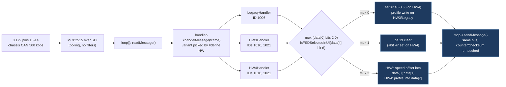

# herrfrei / tesla-fsd-canbus-esp32

Deep-dive analysis per `.opencode/skills/legacy-repo-deep-dive/SKILL.md`, replace mode. The pre-replace summary body was replaced wholesale; the pre-replace text remains citable from git history. The pre-replace doc contained **no `## Upstream (...)` sections**, so nothing was preserved beyond the frontmatter above (kept byte-for-byte; its `description` line is truncated mid-word — recorded in section 6, not edited).

Upstream citations below are relative to `legacy/herrfrei-tesla-fsd-canbus-esp32/`. Our-side citations are relative to the repo root.

## 1. Provenance

- Submodule path: `legacy/herrfrei-tesla-fsd-canbus-esp32`
- Pinned gitlink (canonical form from `git ls-files -s`): `160000 1d1f84594050fdb8028209c181ac2650b8f866e1 0`
- `git -C legacy/herrfrei-tesla-fsd-canbus-esp32 rev-parse HEAD` → `1d1f84594050fdb8028209c181ac2650b8f866e1` — matches gitlink
- `git -C legacy/herrfrei-tesla-fsd-canbus-esp32 status --porcelain` → empty (clean tree)
- HEAD commit: `1d1f845` "Add proper attribution and credits for original author (Starmixcraft)" (2026-03-29)
- Upstream URL: `https://github.com/herrfrei/tesla-fsd-canbus-esp32` (fetch/push confirmed via `git remote -v`)
- Upstream license: GPL-3.0 — stated only in the source header `CanFeather.ino:1-14`; **no standalone LICENSE file exists in the repo**
- This repo is itself an unofficial port of Starmixcraft's `gitlab.com/Starmixcraft/tesla-fsd-can-mod` (`README.md:3-7`) — that original was NOT reviewed (network)
- Analysis date: 2026-11-21
- Files read (FULL-READ, every line of every tracked file; `git ls-files` inventory is 4 files, no hidden directories):
    - `CanFeather.ino` (278 lines) — entire firmware
    - `README.md` (139 lines) — claims, wiring, credits
    - `CONNECTION.md` (113 lines) — per-chip wiring tables
    - `.gitignore` (4 lines) — `.env`, `*.log`, `build/`, `.DS_Store` (no secrets present)
- Files explicitly NOT read: none at upstream (repo fully read). Our-side reads were limited to the parity-relevant files cited in section 11; the rest of our tree was not re-read for this analysis.
- Pre-replace doc state: `docs/legacy/herrfrei-tesla-fsd-canbus-esp32.md` was clean at HEAD; pre-replace claims are cited as `git show HEAD:docs/legacy/herrfrei-tesla-fsd-canbus-esp32.md#L<n>`.

## 2. Executive verdict

A 278-line single-file Arduino sketch for ESP32 + MCP2515 on the Tesla X179 chassis bus (pins 13-14) that rewrites the FSD control mux frame per hardware variant, selected at compile time. It is the Starmixcraft GitLab firmware ported to more ESP32 chip variants. Its value to TeslaCANModder is **confirmation, not new mechanisms**: the byte layouts — mux-0 profile field `data[6] bits[2:1]`, HW4 profile field `data[7] bits[6:4]`, HW3 offset split `data[0] bits[7:6]` + `data[1] bits[5:0]`, UI-offset field `data[3] bits[6:1]` biased −30 scaled ×5 clamped 0..100, and both follow-distance→profile maps — are identical to our shipping handlers. Upstream is a strict functional subset of us (no bits 38/39 on mux 0, no HW4 offset, no 0x045 stalk, no master enable/AP gate/OTA guard, fixed 16 MHz crystal). Nothing is a port candidate; the only actionable outputs are two of our own doc gaps (commands.md understates the profile range; the stale pre-replace summary text also lives in the generated client docs bundle). Nothing here must be excluded beyond GPL hygiene (section 14).

## 3. Evidence map

No TEST-READ evidence exists: this repo ships no tests. No CAPTURE evidence exists in this repo. Reading coverage: FULL-READ for all four upstream files (stated per file in section 1).

| source file                | lines     | what it proves                                                                                          | grade    |
| -------------------------- | --------- | ------------------------------------------------------------------------------------------------------- | -------- |
| `CanFeather.ino`           | 21-26     | Compile-time variant selection: `#define HW HW3`; `HW4` alias documented as FSDV14 since 2026.2.3        | CODE-READ |
| `CanFeather.ino`           | 35-81     | Per-chip pin blocks for ESP32-S2/S3/C3/classic; `#error` on other targets; INT/STBY/RESET pins defined  | CODE-READ |
| `CanFeather.ino`           | 92-98     | Mux read `data[0] & 0x07`; UI-FSD gate `data[4]` bit 6                                                 | CODE-READ |
| `CanFeather.ino`           | 100-103   | Profile write `data[6]` bits [2:1], mask `~0x06`                                                       | CODE-READ |
| `CanFeather.ino`           | 107-132   | LegacyHandler: ID 1006, mux0 bit46+profile (gated on UI bit), mux1 bit19 clear                          | CODE-READ |
| `CanFeather.ino`           | 134-186   | HW3Handler: ID 1016 fd→profile; ID 1021 mux0 bit46+profile, mux1 bit19, mux2 offset write               | CODE-READ |
| `CanFeather.ino`           | 158-159   | HW3 offset: `(data[3]>>1 & 0x3F) - 30`, ×5, clamp 0..100; same field also drives profile 0/1/2          | CODE-READ |
| `CanFeather.ino`           | 188-223   | HW4Handler: ID 1016 fd→profile (5 positions), ID 1021 mux0 bits 46+60, mux1 bits 19/47, mux2 profile    | CODE-READ |
| `CanFeather.ino`           | 213-216   | HW4 profile write `data[7]` bits [6:4], mask `~(0x07 << 4)`                                             | CODE-READ |
| `CanFeather.ino`           | 229-253   | setup: STBY low + RESET high before SPI, 1500 ms delay, `setBitrate(CAN_500KBPS, MCP_16MHZ)`           | CODE-READ |
| `CanFeather.ino`           | 248-251   | Only `setBitrate` return checked; `reset()`/`setNormalMode()` return values ignored                     | CODE-READ |
| `CanFeather.ino`           | 269-277   | Polling loop: RX error → LED HIGH + return; success → LED LOW + dispatch; no filters, no interrupt       | CODE-READ |
| `README.md`                | 15-36     | Claims: TLSC toggle as trigger, variant table, HW4 = FSDV14 from 2026.2.3, 5-level profile               | CODE-READ |
| `README.md`                | 51-64     | MCP25625 vs MCP2515 modules; remove 120 Ω termination; STBY only for MCP25625                           | CODE-READ |
| `README.md`                | 111-120   | X179 pins 13/14 wiring; termination warning repeated                                                   | CODE-READ |
| `CONNECTION.md`            | 8-98      | Per-chip SPI/CS/INT/RST/STBY pin tables matching the `#define` blocks                                   | CODE-READ |
| `.gitignore`               | 1-4       | No build artifacts or secrets tracked                                                                   | CODE-READ |

## 4. Architecture and build surface

- Entry points: Arduino `setup()` (`CanFeather.ino:229`) and `loop()` (`CanFeather.ino:269`). No other tasks, no RTOS.
- Single translation unit; no shared core/platform split. All logic in `CanFeather.ino`.
- Build flags: none beyond Arduino target selection. Variant is chosen by editing `#define HW HW3` (`CanFeather.ino:26`) — recompile per car. No runtime variant switching, no NVS, no WiFi/BLE/serial command surface (Serial is debug-print only).
- Dependency boundary: `mcp2515` (autowp) library via SPI (`CanFeather.ino:17-18, 244-246`); standard Arduino `SPI.h`, `memory`.
- Hardware bring-up: MCP25625-style RESET release + STBY pull-low (`CanFeather.ino:232-236`), 1500 ms settle delay, 500 kbps with hard-coded `MCP_16MHZ` crystal profile (`CanFeather.ino:249`).
- Frame pipeline: single-bus poll → dispatch → mutate in place → re-send on the same bus. No checksum recomputation, no counter increment, no queue.



State diagrams: None found — no mechanism in this repo has a state machine (`speedProfile` is a plain int remapped per frame; no transitions, no re-arm logic).

## 5. Mechanism catalogue

### 5.1 Compile-time variant handler selection

- **Claim (README / summary):** three hardware generations selectable via `#define HW` (README.md:21-27).
- **Code path:** `CanFeather.ino:21-26` — `#define HW HW3` → `setup()` `CanFeather.ino:230` `std::make_unique<HW>()` → `loop()` `CanFeather.ino:277` `handler->handelMessage(frame)`.
- **Frame spec:** None found (dispatch mechanism, no frame of its own).
- **Gates and timing:** none; dispatch is static for the whole flash image.
- **State machine:** None found.
- **Tests:** None found — repo ships no tests.
- **Evidence grade:** CODE-READ
- **Verdict:** CONFIRMED
- **Adapt to TeslaCANModder?** no impact — we dispatch at runtime on a `Variant` enum (`firmware/lib/core/types.h:71-76`) with auto-detection from 0x398.

### 5.2 FSD enable injection on mux 0

- **Claim (README / summary):** "FSD enable bit is set when Traffic Light and Stop Sign Control is enabled" (README.md:33); pre-replace doc claimed mux0 sets "bit46 (+bit60 on HW4)" via `git show HEAD:docs/legacy/herrfrei-tesla-fsd-canbus-esp32.md#L56`.
- **Code path:** `CanFeather.ino:154-168` (HW3), `CanFeather.ino:200-206` (HW4), `CanFeather.ino:109-121` (Legacy) — `handelMessage()` → mux==0 && `isFSDSelectedInUI()` → `setBit()` → `mcp->sendMessage()`.
- **Frame spec:** ID 0x3FD/1021 (HW3/HW4) and 0x3EE/1006 (Legacy), assumed DLC 8, mux in `data[0] bits[2:0]`. HW3/Legacy set bit 46 and write profile into `data[6] bits[2:1]`; HW4 sets bit 46 and bit 60 only — **no profile write on HW4 mux 0** (`CanFeather.ino:204-206`); HW4 profile goes through mux 2.
- **Gates and timing:** gated only on `data[4]` bit 6 (`CanFeather.ino:96-98`). No master switch, no AP gate, no OTA guard, no timing window — mutation fires on every qualifying received frame.
- **State machine:** None found.
- **Tests:** None found — repo ships no tests.
- **Evidence grade:** CODE-READ
- **Verdict:** CONFIRMED (structure); the "Traffic Light and Stop Sign Control" label for the gate bit is UNVERIFIED (section 17).
- **Adapt to TeslaCANModder?** already present — ours sets a superset {38, 39, 46, 60} on HW4 (`firmware/lib/vehicle/can/handler/variant/hw4.h:138-141`) and {38, 39, 46} on HW3 (`firmware/lib/vehicle/can/handler/variant/hw3.h:131-134`), plus profile write on HW3 mux 0.

### 5.3 Nag suppression on mux 1

- **Claim (README / summary):** "clears the hands-on-wheel nag bit" (README.md:35).
- **Code path:** `CanFeather.ino:170-173` (HW3, Legacy `CanFeather.ino:123-126`), `CanFeather.ino:208-212` (HW4) — mux==1 → `setBit(frame, 19, false)` → send.
- **Frame spec:** ID 0x3FD/1021 (0x3EE/1006 Legacy), bit 19 cleared on all variants; HW4 additionally sets bit 47 (`CanFeather.ino:210`).
- **Gates and timing:** none — unconditional on every mux-1 frame while the sketch runs. No DAS hands-on request check.
- **State machine:** None found.
- **Tests:** None found — repo ships no tests.
- **Evidence grade:** CODE-READ
- **Verdict:** CONFIRMED
- **Adapt to TeslaCANModder?** already present — ours clears bit 19 and sets bit 47 (nag-organic / Summon EU unlock) with additional optional bits and region gating (`firmware/lib/vehicle/can/handler/variant/hw4.h:40-53`, `hw3.h:40-53`, `legacy.h:75-81`).

### 5.4 HW3 speed-offset auto-track and mux 2 write

- **Claim (README / summary):** "Adds speed-offset control via follow-distance" (README.md:26) — contradicted, see section 6.
- **Code path:** `CanFeather.ino:157-159` (read) and `CanFeather.ino:174-179` (write) — mux==0 reads `((data[3] >> 1) & 0x3F) - 30`, ×5, `max(min(val,100),0)`; mux==2 writes it back.
- **Frame spec:** ID 0x3FD/1021, source field `data[3] bits[6:1]` (6-bit, bias −30, scale ×5, clamp 0..100); destination `data[0] bits[7:6]` (2 low bits) + `data[1] bits[5:0]` (remaining 6 bits).
- **Gates and timing:** read happens only when the UI-FSD bit is set (mux 0 path); the mux 2 write is **not** gated on the UI bit (`CanFeather.ino:174` — no `FSDEnabled` check).
- **State machine:** None found.
- **Tests:** None found — repo ships no tests.
- **Evidence grade:** CODE-READ
- **Verdict:** CONFIRMED (code); README's "via follow-distance" phrasing CONTRADICTED.
- **Adapt to TeslaCANModder?** already present — byte-identical helpers `readHW3UiOffsetSteps` (`firmware/lib/vehicle/can/feature/fsd/offsets.h:31-35`), `calculateHW3SpeedOffset` (`offsets.h:42-50`), `writeHW3SpeedOffset` (`offsets.h:17-24`).

### 5.5 HW4 speed-profile write on mux 2

- **Claim (README / summary):** "Extended speed-profile range (5 levels)" (README.md:27).
- **Code path:** `CanFeather.ino:213-216` — mux==2 → clear `data[7] bits[6:4]` → OR `(speedProfile & 0x07) << 4` → send.
- **Frame spec:** ID 0x3FD/1021, profile field `data[7] bits[6:4]` (3 bits, values 0..4 used).
- **Gates and timing:** none on the mux 2 write itself.
- **State machine:** None found.
- **Tests:** None found — repo ships no tests.
- **Evidence grade:** CODE-READ
- **Verdict:** CONFIRMED
- **Adapt to TeslaCANModder?** already present — `writeHW4SpeedProfile` (`firmware/lib/vehicle/can/feature/fsd/profile.h:30-36`) is byte-identical; whether profile level 4 is honored by vehicles is UNVERIFIED (section 17).

### 5.6 Follow-distance → profile mapping (0x3F8)

- **Claim (README / summary):** "reads the follow-distance stalk setting and maps it to a speed profile" (README.md:17).
- **Code path:** `CanFeather.ino:137-153` (HW3) and `CanFeather.ino:190-199` (HW4) — ID 1016 → `(data[5] & 0b11100000) >> 5` → switch → `speedProfile`.
- **Frame spec:** ID 0x3F8/1016, field `data[5] bits[7:5]`, read-only (frame is never re-sent). HW3 map: 1→2, 2→1, 3→0. HW4 map: 1→3, 2→2, 3→1, 4→0, 5→4.
- **Gates and timing:** none.
- **State machine:** None found.
- **Tests:** None found — repo ships no tests.
- **Evidence grade:** CODE-READ
- **Verdict:** CONFIRMED
- **Adapt to TeslaCANModder?** already present — identical maps in `mapHW3FollowDistToProfile` (`firmware/lib/vehicle/can/feature/fsd/profile.h:43-47`) and `mapHW4FollowDistToProfile` (`profile.h:54-58`).

### 5.7 UI-offset → profile mapping on mux 0

- **Claim (README / summary):** "Speed profile is derived from the scroll-wheel offset or follow-distance setting" (README.md:34).
- **Code path:** `CanFeather.ino:112-118` (Legacy) and `CanFeather.ino:159-165` (HW3) — the −30-biased 6-bit field in `data[3] bits[6:1]` doubles as a profile selector: raw −30 values 0/1/2 → profile 0/1/2.
- **Frame spec:** source field `data[3] bits[6:1]`, values {0,1,2} meaningful; destination `data[6] bits[2:1]` via `setSpeedProfileV12V13` (`CanFeather.ino:100-103`).
- **Gates and timing:** only on mux 0 with the UI-FSD bit set.
- **State machine:** None found.
- **Tests:** None found — repo ships no tests.
- **Evidence grade:** CODE-READ
- **Verdict:** CONFIRMED
- **Adapt to TeslaCANModder?** already present — same derivation in `firmware/lib/vehicle/can/handler/variant/hw3.h:125-127` and `legacy.h:65-67`.

### 5.8 MCP2515 bring-up and polling loop

- **Claim (README / summary):** MCP25625/MCP2515 module support with STBY handling (README.md:51-64).
- **Code path:** `CanFeather.ino:232-252` — RESET high, STBY low, 1500 ms delay, `SPI.begin`, `mcp->reset()`, `setBitrate(CAN_500KBPS, MCP_16MHZ)`, `setNormalMode()`; `CanFeather.ino:269-277` — O3-compiled poll of `readMessage()`.
- **Frame spec:** None found (transport mechanism).
- **Gates and timing:** Serial timeout wait ≤1000 ms (`CanFeather.ino:240-241`); no filter/mask configuration (accepts all IDs); `CAN_INT_PIN` defined but never used — pure polling.
- **State machine:** None found.
- **Tests:** None found — repo ships no tests.
- **Evidence grade:** CODE-READ
- **Verdict:** CONFIRMED
- **Adapt to TeslaCANModder?** no impact — our driver auto-detects 8/16/20 MHz crystal profiles (`canclock:auto`) and monitors bus health; the MCP25625 RESET/STBY release sequence (`CanFeather.ino:232-236`) is the only mildly reusable bench note.

## 6. Summary vs code contradiction table

Pre-replace claims are cited from history as `git show HEAD:docs/legacy/herrfrei-tesla-fsd-canbus-esp32.md#L<n>` (the working-tree file was clean at HEAD, so disk line numbers equal HEAD line numbers at analysis time).

| # | claim | source | code says | verdict |
| - | ----- | ------ | --------- | ------- |
| 1 | "Supports Legacy (HW1/HW2), HW3, and HW4" | `git show HEAD:docs/legacy/herrfrei-tesla-fsd-canbus-esp32.md#L15`, repeated at `#L21`, `#L43` | Upstream README.md:25 labels LEGACY "HW3 Retrofit"; our `firmware/lib/core/types.h:75` labels it "Pre-HW3 (AP1/AP2)"; `grep -nE 'HW1|HW2'` over the repo → no hits | CONTRADICTED as stated; the variant's vehicle generation is UNRESOLVED (section 17) |
| 2 | mermaid node "TWAI + SPI" | `git show HEAD:docs/legacy/herrfrei-tesla-fsd-canbus-esp32.md#L22` | No TWAI anywhere; transport is MCP2515 over SPI only (`CanFeather.ino:18, 244-249`); `grep -nE 'TWAI'` → no hits | CONTRADICTED |
| 3 | "Mux 0: FSD enable bit46 (+bit60 on HW4), speed profile via setSpeedProfileV12V13()" | `git show HEAD:docs/legacy/herrfrei-tesla-fsd-canbus-esp32.md#L56` | HW4 mux 0 writes **no profile** — only bits 46 and 60 (`CanFeather.ino:203-207`); the profile write happens on mux 2 (`CanFeather.ino:213-216`) | PARTIAL — true for HW3/Legacy only |
| 4 | HW3 "Adds speed-offset control via follow-distance" | upstream `README.md:26` | The offset source is `data[3] bits[6:1]` on 0x3FD mux 0 (`CanFeather.ino:158-159`), not the follow-distance frame; 0x3F8 only maps the profile (`CanFeather.ino:137-153`) | CONTRADICTED |
| 5 | "runs on an ESP32-S2, S3, C3, or PICO" | upstream `README.md:15` | Code also supports classic ESP32 via the `CONFIG_IDF_TARGET_ESP32` block (`CanFeather.ino:68-77`, VSPI pins 18/19/23) | PARTIAL — omits a supported target |
| 6 | "our project already has a more mature version with WiFi dashboard and plugin support" | `git show HEAD:docs/legacy/herrfrei-tesla-fsd-canbus-esp32.md#L67` | No plugin subsystem exists in `firmware/`, `client/`, `packages/`, `tools/` — `grep -nE 'plugin'` there only hits markdown-it renderer config and other legacy docs; our features are compile-time handlers | CONTRADICTED (claim about our side) |
| 7 | frontmatter `description` ends mid-word: "...enable FSD functionality and conf" | frontmatter line 3 (preserved byte-for-byte) | Truncated summary text; original intent was presumably "...and configure speed profiles" | Stale frontmatter, kept as-is per replace mode |

## 7. CAN frame and signal inventory

Every frame this repo decodes, mutates, or injects. All rows CODE-READ. "Period" is on-RX (the sketch never self-injects; frames are only re-sent when received). DLC is never checked — the code indexes `data[3..7]` unconditionally (see section 9).

| ID (hex+dec)          | bus                  | period | DLC          | byte/bit layout                                                                                             | scale/units                    | counter position                | checksum                | read or write          | grade    |
| --------------------- | -------------------- | ------ | ------------ | ----------------------------------------------------------------------------------------------------------- | ------------------------------ | ------------------------------- | ----------------------- | ---------------------- | -------- |
| 0x3EE / 1006 (Legacy) | chassis (X179 13-14) | on RX | 8 assumed    | mux `data[0] bits[2:0]`; UI-FSD gate `data[4] bit 6`; UI-offset `data[3] bits[6:1]`; FSD bit 46; profile `data[6] bits[2:1]`; nag bit 19 | profile index 0..2; offset −30 bias | `data[0] bits[2:0]`, forwarded unchanged | not handled — forwarded | RX → mutate → re-TX     | CODE-READ |
| 0x3FD / 1021 (HW3)    | chassis (X179 13-14) | on RX | 8 assumed    | mux `data[0] bits[2:0]`; UI-FSD gate `data[4] bit 6`; UI-offset `data[3] bits[6:1]` (−30, ×5); FSD bit 46; nag bit 19; offset out `data[0] bits[7:6]` + `data[1] bits[5:0]`; profile `data[6] bits[2:1]` | offset 0..100; profile 0..2     | `data[0] bits[2:0]`, forwarded unchanged | not handled — forwarded | RX → mutate → re-TX     | CODE-READ |
| 0x3FD / 1021 (HW4)    | chassis (X179 13-14) | on RX | 8 assumed    | mux `data[0] bits[2:0]`; UI-FSD gate `data[4] bit 6`; FSD bits 46+60; nag bit 19 clear + bit 47 set; profile `data[7] bits[6:4]` | profile index 0..4              | `data[0] bits[2:0]`, forwarded unchanged | not handled — forwarded | RX → mutate → re-TX     | CODE-READ |
| 0x3F8 / 1016          | chassis (X179 13-14) | on RX | 8 assumed    | follow distance `data[5] bits[7:5]`                                                                        | stalk position 1..5             | not decoded (frame read-only)    | not decoded             | RX only                | CODE-READ |

No DBC/JSON catalog is vendored; nothing to label STRUCTURAL-PARSE.

## 8. Constants and tuning table

| constant                     | value            | file:line                    | meaning                                                                      | grade    |
| ---------------------------- | ---------------- | ---------------------------- | ---------------------------------------------------------------------------- | -------- |
| mux mask                      | `0x07`           | `CanFeather.ino:93`          | mux/counter field in `data[0] bits[2:0]`                                      | CODE-READ |
| UI-FSD gate                  | `data[4] >> 6 & 1` | `CanFeather.ino:96-98`     | gates all mux-0 FSD mutations                                                 | CODE-READ |
| profile mask (HW3/Legacy)    | `~0x06`, `<< 1`  | `CanFeather.ino:101-102`     | profile field `data[6] bits[2:1]`                                             | CODE-READ |
| UI-offset field              | `0x3F`, −30 bias | `CanFeather.ino:112, 158-159` | 6-bit field `data[3] bits[6:1]`, zero-centered at 30                          | CODE-READ |
| offset scale/clamp           | ×5, 0..100       | `CanFeather.ino:158`         | step count → speed offset value                                               | CODE-READ |
| follow-distance mask          | `0b11100000 >> 5` | `CanFeather.ino:138, 191`   | stalk position in `data[5] bits[7:5]`                                         | CODE-READ |
| HW3 fd→profile map           | 1→2, 2→1, 3→0    | `CanFeather.ino:139-151`     | three-position stalk to profile                                               | CODE-READ |
| HW4 fd→profile map           | 1→3, 2→2, 3→1, 4→0, 5→4 | `CanFeather.ino:192-198` | five-position stalk to profile, inverted scale + extra level 4                | CODE-READ |
| HW4 profile field mask       | `~(0x07 << 4)`   | `CanFeather.ino:214-215`     | profile in `data[7] bits[6:4]`                                               | CODE-READ |
| FSD bits                     | 46; 46+60 (HW4)  | `CanFeather.ino:119, 166, 204-205` | mux-0 FSD enable bits                                                  | CODE-READ |
| nag bits                     | 19 clear; 47 set (HW4) | `CanFeather.ino:124, 171, 209-210` | mux-1 hands-on nag suppression + HW4 organic bit           | CODE-READ |
| HW3 offset output split      | `data[0] bits[7:6]`, `data[1] bits[5:0]` | `CanFeather.ino:175-178` | mux-2 offset re-encoding                       | CODE-READ |
| CAN bitrate / crystal        | 500 kbps, `MCP_16MHZ` | `CanFeather.ino:249`   | hard 16 MHz crystal assumption; no 8/20 MHz fallback                          | CODE-READ |
| settle delay / serial wait   | 1500 ms / ≤1000 ms | `CanFeather.ino:238, 240-241` | MCP reset settle and USB CDC wait                                         | CODE-READ |

Trivial pin masks and the `O3` loop attribute are omitted as non-load-bearing.

## 9. Failure modes and edge cases

| failure                                     | handling code path                                                                                     | tested? | grade    |
| ------------------------------------------- | ------------------------------------------------------------------------------------------------------ | ------- | -------- |
| Malformed/short frame (DLC < 8)             | None — `data[3..7]` indexed without any DLC check (`CanFeather.ino:112-178, 213-215`)                  | no      | CODE-READ |
| `mcp->reset()` failure                      | return value ignored (`CanFeather.ino:248`)                                                            | no      | CODE-READ |
| `setBitrate()` failure                      | prints "setBitrate failed", continues (`CanFeather.ino:249-250`)                                       | no      | CODE-READ |
| `setNormalMode()` failure                   | return value ignored (`CanFeather.ino:251`) — sketch may run with controller stuck in config mode       | no      | CODE-READ |
| RX read error / bus-off                     | LED HIGH + skip iteration (`CanFeather.ino:272-275`); no recovery, no error-counter read               | no      | CODE-READ |
| RX buffer overflow during processing        | none — single-frame polling; frames arriving while the handler runs can be lost silently               | no      | CODE-READ |
| Watchdog / brownout / reboot state         | none — no watchdog configured, no persisted state (reboot = all-zero defaults)                         | no      | CODE-READ |
| OTA in progress                             | none — frames are mutated and re-injected regardless of vehicle update state                           | no      | CODE-READ |
| Wrong crystal (8 MHz module with 16 MHz profile) | none — `MCP_16MHZ` hard-coded; a mismatch silently produces garbage CAN timing                   | no      | CODE-READ |
| Checksum/counter rejection of mutated frames | none — counter and checksum bytes are never touched (`grep -nE 'checksum|crc'` → no hits)            | no      | CODE-READ |

Untested paths: all of the above — the repo ships no tests and no captures.

## 10. Test coverage map

None found — the repo contains no test files, no CI, and no assertions. Critical paths with no test: every mutation branch in `LegacyHandler`/`HW3Handler`/`HW4Handler`; the risk is that a wrong bit mask or field offset would only surface as a vehicle misbehavior on the bench.

## 11. Parity matrix with TeslaCANModder

| signal/frame                     | upstream decode (cite)                              | our decode (cite)                                                    | delta                                    | action            |
| -------------------------------- | --------------------------------------------------- | -------------------------------------------------------------------- | ---------------------------------------- | ----------------- |
| 0x3FD mux read                   | `CanFeather.ino:92-94` (`data[0] & 0x07`)           | `firmware/lib/core/types.h:63-66` (`readMuxID`)                       | identical                                | ignore            |
| UI-FSD gate bit                  | `CanFeather.ino:96-98` (`data[4]` bit 6)            | `firmware/lib/vehicle/can/ids.h:119-122` (`isFSDSelectedInUI`)       | identical bit; ours ANDs `s.fsdEnabled` + `fsdForceEnabled` (`hw3.h:120-121`, `hw4.h:134`) | ignore (ours gated) |
| HW3 mux-0 FSD bits               | `{46}` + profile write (`CanFeather.ino:166-168`)   | `{38, 39, 46}` + profile write (`hw3.h:131-134`)                      | upstream lacks bits 38/39                | ignore (ours superset) |
| HW4 mux-0 FSD bits               | `{46, 60}` (`CanFeather.ino:204-206`)               | `{38, 39, 46, 60}` (`hw4.h:138-141`)                                  | upstream lacks bits 38/39                | ignore (ours superset) |
| HW3/Legacy profile field         | `data[6] bits[2:1]`, `~0x06` (`CanFeather.ino:100-103`) | `profile.h:17-23` (`setSpeedProfileV12V13`)                       | identical                                | ignore            |
| HW4 mux-1 nag bits               | bit19 clear + bit47 set (`CanFeather.ino:208-212`)  | `hw4.h:40-53` (`applyHW4NagSuppressBits`) + EAP/lane-graph/ECE-R79 optional | upstream is a subset                | ignore            |
| HW3 mux-1 nag bit                | bit19 clear (`CanFeather.ino:170-173`)              | `hw3.h:40-53` (`applyHW3NagSuppressBits`)                             | upstream is a subset                     | ignore            |
| Legacy mux-1 nag bit             | bit19 clear (`CanFeather.ino:123-126`)              | `legacy.h:75-81`                                                      | identical (+ ours counts a diag counter)  | ignore            |
| HW4 mux-2 profile field          | `data[7] bits[6:4]`, `~(0x07<<4)` (`CanFeather.ino:213-216`) | `profile.h:30-36` (`writeHW4SpeedProfile`)                    | identical                                | ignore            |
| HW3 mux-2 offset encoding         | `data[0] bits[7:6]` + `data[1] bits[5:0]` (`CanFeather.ino:175-178`) | `offsets.h:17-24` (`writeHW3SpeedOffset`)                 | identical                                | ignore            |
| HW3 UI-offset read               | `(data[3]>>1 & 0x3F) - 30` (`CanFeather.ino:158-159`) | `offsets.h:31-35` (`readHW3UiOffsetSteps`)                         | identical                                | ignore            |
| HW3 offset scale/clamp           | ×5 clamp 0..100 (`CanFeather.ino:158`)               | `offsets.h:42-50` (`calculateHW3SpeedOffset`)                         | identical                                | ignore            |
| HW3 fd→profile map               | 1→2, 2→1, 3→0 (`CanFeather.ino:139-151`)             | `profile.h:43-47` (`mapHW3FollowDistToProfile`)                       | identical                                | ignore            |
| HW4 fd→profile map               | 1→3, 2→2, 3→1, 4→0, 5→4 (`CanFeather.ino:192-198`)  | `profile.h:54-58` (`mapHW4FollowDistToProfile`)                      | identical                                | ignore            |
| HW4 profile range               | 0..4 (`CanFeather.ino:197` case 5 → profile 4)      | `profile.h:104` accepts 0..4, but `docs/reference/commands.md` documents only `profile:0`–`profile:3` | our doc understates the range       | align our docs     |
| HW4 speed offset                 | None found — `HW4Handler` has no offset member (`CanFeather.ino:188-223`) | `hw4.h:160-164` + `offsets.h:87` (0..63)                  | ours-only feature                        | ignore            |
| 0x3F8 mutation surface           | RX-only, never re-sent (`CanFeather.ino:137-153, 190-199`) | ours also TX for LHD/assist bits (`hw3.h:78-110`, `hw4.h:92-124`) | ours-only mutation surface          | ignore            |
| 0x045 legacy stalk               | None found — no 0x045 handling (`CanFeather.ino:107-132`) | `legacy.h:40-54` (`CAN_ID_LEGACY_STALK`, `ids.h:15`)           | ours-only decode                         | ignore            |
| Legacy 0x3EE mux-0 shape         | bit46 + profile + offset-derived profile (`CanFeather.ino:109-121`) | `legacy.h:63-72` (same shape)                             | identical (+ ours adds `fsdAllowed` gate) | ignore            |
| Master enable / AP gate / OTA guard | none — mutation fires whenever UI bit set      | `types.h:837-842` (`apGateOpen`), `hw4.h:134` (`fsdAllowed`), OTA guard in our pipeline | upstream has no safety gates         | ignore (ours safer) |
| CAN crystal profile              | fixed 16 MHz (`CanFeather.ino:249`)                  | `canclock:auto` 8/16/20 MHz auto-detect                                | ours auto-detects                        | ignore            |
| Variant dispatch                 | compile-time `#define HW` (`CanFeather.ino:26, 230`) | runtime `Variant` enum (`types.h:71-76`)                              | ours runtime + auto-detect               | ignore            |

All our-side citations above are CODE-READ (files read this session); no row is SUMMARY-ONLY.

## 12. Surface inventory and security notes

- Transport surfaces: **one** — USB Serial at 115200 baud, output-only debug printf (`CanFeather.ino:127-128, 181-182, 218-219`). There is no command parser, no input surface, no WiFi, no BLE, no web endpoint. `enablePrint` (`CanFeather.ino:28`) toggles logging.
- Security findings: None found. No credentials, keys, certs, or untrusted archives; `.gitignore` lists `.env` defensively but none is tracked; no dangerous build flags; plain Arduino build.
- Provenance note: README.md:11 contains pricing commentary naming a third-party seller (Michal Gapinski, "500 €") — social commentary, no code impact.
- Attribution chain: upstream credits Starmixcraft (README.md:3-7, 128-139); final commit `1d1f845` exists solely to add that attribution.

## 13. Adaptation assessment

| mechanism                              | value                                          | cost | risk | evidence grade | decision                |
| ------------------------------------- | ---------------------------------------------- | ---- | ---- | -------------- | ----------------------- |
| Compile-time variant dispatch         | none — we have runtime dispatch + auto-detect   | —    | —    | CODE-READ      | no impact               |
| Mux-0 FSD enable (bits 46/60)         | confirms our superset {38,39,46(,60)}           | 0    | 0    | CODE-READ      | already present         |
| Mux-1 nag suppression (bits 19/47)     | confirms our identical bits                     | 0    | 0    | CODE-READ      | already present         |
| HW3 offset auto-track + mux-2 write    | confirms our byte-identical helpers             | 0    | 0    | CODE-READ      | already present         |
| HW4 mux-2 profile write               | confirms `writeHW4SpeedProfile` byte-identical   | 0    | 0    | CODE-READ      | already present         |
| HW4 5-level profile (level 4)          | corroborates our 0..4 command range             | doc fix on our side only | low | CODE-READ | already present — align `docs/reference/commands.md` (documents 0..3, code `profile.h:104` accepts 0..4) |
| fd→profile maps (HW3/HW4)             | confirms our identical maps                     | 0    | 0    | CODE-READ      | already present         |
| Legacy 0x3EE handling                  | confirms our legacy handler shape               | 0    | 0    | CODE-READ      | already present          |
| MCP25625 RESET/STBY release sequence   | bench note for MCP25625 modules                 | trivial | none | CODE-READ   | no impact (our driver assumes plain MCP2515) |
| Fixed `MCP_16MHZ` bitrate profile      | worse than our auto-detect                     | —    | —    | CODE-READ      | never port (regression vs `canclock:auto`) |
| Unconditional injection (no AP/OTA gate) | worse than our gated pipeline                 | —    | high | CODE-READ      | never port (safety regression) |

Net: **zero port candidates**. The upstream's independent arrival at our exact byte layouts is the strongest cross-check this repo offers; its only actionable outputs are on our side (commands.md profile range; stale summary copies, see section 17).

## 14. Do-not-copy list

- `CanFeather.ino:1-14` — GPL-3.0 license header text. Keep attribution as a comment reference ("derived idea, independent implementation — herrfrei/tesla-fsd-canbus-esp32, itself a port of Starmixcraft tesla-fsd-can-mod") if any behavior is ever ported; do not paste the header itself.
- `CanFeather.ino:100-103` (`setSpeedProfileV12V13`), `CanFeather.ino:92-98` (`readMuxID`/`isFSDSelectedInUI`), `CanFeather.ino:175-178` (offset write), `CanFeather.ino:256-267` (`setBit`) — these bodies are already independently implemented on our side (`profile.h:17-23`, `types.h:63-66`, `ids.h:119-122`, `offsets.h:17-24`, `types.h:45-56`). Importing upstream text over them would create derivative churn with zero functional gain.
- `CanFeather.ino:107, 134, 188` — upstream identifiers `LegacyHandler`/`HW3Handler`/`HW4Handler` and the typo'd `handelMessage` virtual; never adopt upstream naming over our `handleLegacy`/`handleHW3`/`handleHW4`.
- `README.md:17, 33` — the "Traffic Light and Stop Sign Control" semantic label for `data[4]` bit 6 is an unverified interpretation; do not copy it into our code comments as fact (ours already labels it `STEERING_MODE = 5`, equally unproven — see section 17).
- `README.md:11` — seller-pricing commentary; never copy into shipping docs.

## 15. History and evolution

Mined from the submodule's local `git log` (all 9 commits, linear, single `main` branch, no tags; repo spans only 2026-03-28 → 2026-03-29):

| commit    | date       | change                                                                                     |
| --------- | ---------- | ------------------------------------------------------------------------------------------ |
| `60d0e61` | 2026-03-28 | Initial commit: `CanFeather.ino` (210 lines) + `README.md` (77 lines)                       |
| `d620b1c` | 2026-03-28 | "licence" — adds the GPL-3.0 header to the sketch                                           |
| `01ba780` | 2026-03-28 | Refactors `HW4Handler` definition and cleans up `setup()` (4 insertions, 8 deletions)        |
| `00c86b4` | 2026-03-28 | "better readme"                                                                             |
| `c24e323` | 2026-03-28 | Adds the open-source rationale / pricing commentary to README                               |
| `3881032` | 2026-03-29 | Adds `.gitignore`, `CONNECTION.md`; updates sketch + README                                  |
| `3163918` | 2026-03-29 | Adds multi-chip support: ESP32-S3, C3, PICO / classic ESP32 (+65 sketch lines, CONNECTION rewrite) |
| `619ce1e` | 2026-03-29 | README: multi-chip targets + MCP2515/MCP25625 module guide                                  |
| `1d1f845` | 2026-03-29 | Adds attribution/credits for Starmixcraft (HEAD, pinned)                                     |

What the history shows: the CAN logic (handlers, bit numbers, fields) landed fully formed in the initial commit and was never touched afterward; every later commit is ports (pin tables), docs, license, and attribution. Nothing was tried and rolled back; no abandoned approaches visible in the local history. The original Starmixcraft GitLab history predates this repo and is not present locally — UNVERIFIED.

## 16. Re-verification recipe

```bash
OLD=1d1f84594050fdb8028209c181ac2650b8f866e1
git ls-files -s legacy/herrfrei-tesla-fsd-canbus-esp32   # expect: 160000 1d1f84594050fdb8028209c181ac2650b8f866e1 0
git -C legacy/herrfrei-tesla-fsd-canbus-esp32 rev-parse HEAD   # must equal 1d1f84594050fdb8028209c181ac2650b8f866e1
git -C legacy/herrfrei-tesla-fsd-canbus-esp32 status --porcelain # must be empty
git -C legacy/herrfrei-tesla-fsd-canbus-esp32 fetch --tags --prune
git -C legacy/herrfrei-tesla-fsd-canbus-esp32 log --oneline $OLD..origin/main
git -C legacy/herrfrei-tesla-fsd-canbus-esp32 diff --stat $OLD..origin/main
git -C legacy/herrfrei-tesla-fsd-canbus-esp32 diff $OLD..origin/main -- CanFeather.ino README.md CONNECTION.md
```

Anchor commands. This workspace's pwsh has no GNU `grep`; `git grep -nE` (same ERE engine) is the drop-in used for every demonstration below, run 2026-11-21 with the pinned SHA. In bash, `grep -nE` from inside `legacy/herrfrei-tesla-fsd-canbus-esp32/` is equivalent.

Upstream anchors:

```text
git -C legacy/herrfrei-tesla-fsd-canbus-esp32 grep -nE 'readMuxID|isFSDSelectedInUI' -- CanFeather.ino
  -> CanFeather.ino:92, 96 (defs) and 110, 111, 155, 156, 201, 202 (uses)
git -C legacy/herrfrei-tesla-fsd-canbus-esp32 grep -nE 'setBit\(frame, (46|60), true\)' -- CanFeather.ino
  -> CanFeather.ino:119, 166, 204, 205
git -C legacy/herrfrei-tesla-fsd-canbus-esp32 grep -nE 'setBit\(frame, (19|47)' -- CanFeather.ino
  -> CanFeather.ino:124, 171, 209, 210
git -C legacy/herrfrei-tesla-fsd-canbus-esp32 grep -nE '0x07 << 4|CAN_500KBPS|MCP_16MHZ' -- CanFeather.ino
  -> CanFeather.ino:214 (HW4 profile mask), CanFeather.ino:249 (bitrate/crystal)
git -C legacy/herrfrei-tesla-fsd-canbus-esp32 grep -nE 'enablePrint' -- CanFeather.ino
  -> CanFeather.ino:28 (decl), 127, 181, 218 (gates)
```

Upstream negative anchors:

```text
git -C legacy/herrfrei-tesla-fsd-canbus-esp32 grep -nE 'TWAI|checksum|crc|setFilter|attachInterrupt'
  -> no output (no TWAI, no checksum handling, no filter config, no interrupt usage)
git -C legacy/herrfrei-tesla-fsd-canbus-esp32 grep -nE 'HW1|HW2'
  -> no output (the HW1/HW2 label exists only in the pre-replace summary, not in code)
```

Our-side drift anchors (the "already present" decisions rest on these):

```text
git grep -nE 'FSD_BIT_AP_ACTIVE|FSD_BIT_EAP|FSD_BIT_DAS_DEV' -- firmware/lib/vehicle/can/handler/variant/bits.h
  -> bits.h:19 (38), bits.h:21 (46), bits.h:23 (60)
git grep -nE 'FSD_BIT_CONTINUE_ON_GREEN|FSD_BIT_NAG_ORGANIC|NAG_BIT_HANDS_ON_REQUIREMENT' -- firmware/lib/vehicle/can/handler/variant/bits.h
  -> bits.h:20 (39), bits.h:27 (47), bits.h:42 (19)
git grep -nE 'mapHW4FollowDistToProfile|writeHW4SpeedProfile' -- firmware/lib/vehicle/can/feature/fsd/profile.h
  -> profile.h:30 (writeHW4SpeedProfile), profile.h:54 (mapHW4FollowDistToProfile)
git grep -nE 'p < 0 \|\| p > 4' -- firmware/lib/vehicle/can/feature/fsd/profile.h
  -> profile.h:104 (profile command accepts 0..4)
git grep -nE 'maxVal' -- firmware/lib/vehicle/can/feature/fsd/offsets.h
  -> offsets.h:87 (HW4 offset max 63, HW3 100)
git grep -nE 'isFSDSelectedInUI' -- firmware/lib/vehicle/can/ids.h
  -> ids.h:119 (def; byte 4 bit 6)
git grep -nE 'CAN_ID_FSD_MUX|CAN_ID_FOLLOW_DIST|CAN_ID_LEGACY_FSD_MUX' -- firmware/lib/vehicle/can/ids.h
  -> ids.h:23 (0x3EE), ids.h:24 (0x3F8), ids.h:25 (0x3FD)
git grep -nE 'readMuxID' -- firmware/lib/core/types.h
  -> types.h:63 (def)
git grep -nE 'inline void setBit' -- firmware/lib/core/types.h
  -> types.h:45 (def)
git grep -nE 'plugin' -- firmware client packages tools
  -> only markdown-it/postcss/babel renderer config and other legacy docs; no plugin subsystem (contradiction row 6)
```

If line numbers drift more than ~10 after a bump, re-read the whole function; do not trust this document's numbers. Upstream history before the pinned SHA: the pinned SHA is HEAD and the initial commit is `60d0e61`, so the full local history was reviewed; no pre-pin local history exists. The upstream original (Starmixcraft GitLab) was not reviewed.

## 17. Open questions and explicitly not investigated

- **`data[4]` bit 6 semantics.** Upstream README calls it the "Traffic Light and Stop Sign Control" toggle (README.md:17, 33); our `ids.h:111-122` comment calls it "STEERING_MODE = 5 (FSD selected)". Same bit, two unproven labels. UNVERIFIED — a listen-only bench capture of 0x3FD while toggling the UI setting would settle it.
- **Counter/checksum integrity on 0x3FD/0x3EE.** Neither upstream nor our shipping handlers recompute any checksum or increment any counter on the FSD mux frames; both re-inject the mutated frame with original integrity bytes. If these frames are protected, both firmwares' edits would be silently dropped. UNVERIFIED — needs a bench capture comparing DAS acceptance with and without mutation (`docs/checklists/can-review-checklist.md` gates any such experiment anyway).
- **Legacy variant target generation.** Upstream README:25 says "HW3 Retrofit", the pre-replace summary said HW1/HW2, our `types.h:75` says "Pre-HW3 (AP1/AP2)". No code on either side proves which vehicles decode 0x3EE. UNVERIFIED.
- **HW4 profile level 4.** Upstream ships `fd position 5 → profile 4` blind (`CanFeather.ino:197`); no capture proves vehicles honor a 4th level. Our code accepts it (`profile.h:104`) with equally thin evidence.
- **HW4 = FSDV14 from vehicle firmware 2026.2.3** (README.md:29, `CanFeather.ino:23`). Code-level comment only; no decode of 0x392 or any version gate backs it. UNVERIFIED — our `fwcompat` decode could confirm or refute against captures.
- **Stale copies of the pre-replace summary.** The old claims (including "plugin support", contradiction row 6) are also embedded verbatim in `client/src/docs/_generated-docs.ts:7022`, a generated bundle. That file was not touched by this analysis; regenerating or pruning it is a separate task on our side.
- **Starmixcraft original (GitLab).** Not reviewed (network-only); all conclusions here describe the herrfrei port snapshot at the pinned SHA.
