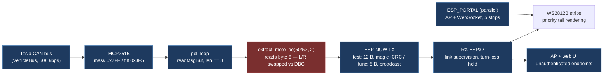
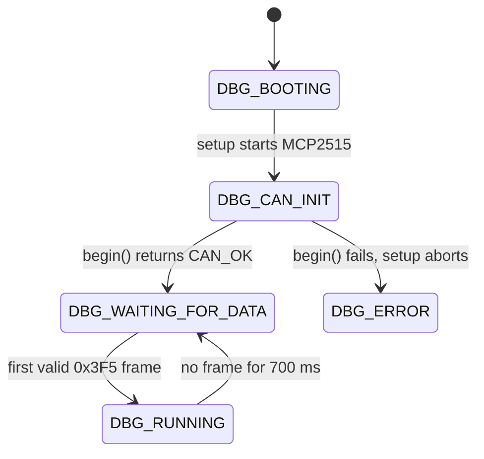
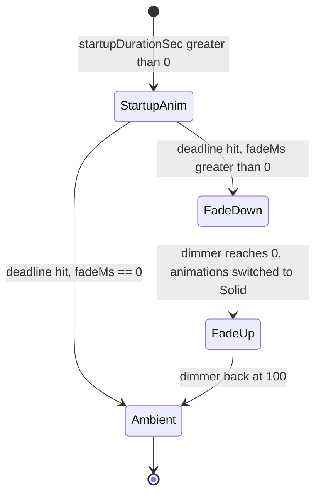

# honeer / Tesla-ESP-CAN

## 1. Provenance

- **Mode:** replace (user-directed). The pre-replace summary survives in git history; its claims are cited below as `git show HEAD:docs/legacy/honeer-Tesla-ESP-CAN.md` (line numbers refer to that blob).
- **Frontmatter:** preserved byte-for-byte. The pre-replace doc carries no trailing whitespace on any frontmatter line (`grep -nP ' +$'` on the file → no output), so nothing was stripped. The description line is truncated mid-sentence (`...WS2812B LED controller with`) — kept as bytes, recorded in section 6.
- **Preserved `## Upstream (...)` sections:** none existed in the pre-replace doc (its headings were Overview / Technical Details / Architecture / CAN Bus Integration / Relevance to Our Project), so there is nothing to re-append after section 14.
- **Submodule:** `legacy/honeer-Tesla-ESP-CAN`, gitlink `160000 feeb3522d6b613ccc626c6e70f55bbab3cb1beeb 0`; `git -C legacy/honeer-Tesla-ESP-CAN rev-parse HEAD` matches; worktree clean (`status --porcelain` empty).
- **Upstream:** https://github.com/honeer/Tesla-ESP-CAN — no LICENSE file for the sketches; the vendored DBC directory carries its own MIT license (`Tesla DBC CAN Messages/LICENSE.txt:1-3`, © 2019 Josh Wardell).
- **Analysis date:** 2026-11-21.
- **Snapshot quirk:** the local submodule history contains exactly one commit (`feeb3522`, 2025-10-18, "added new  versions" — double space in the subject). All five `.ino` file headers are dated October 4, 2025, so earlier iterations are not preserved locally; see section 15.

Upstream files read:

| File                                                                 | Lines    | Coverage     |
| -------------------------------------------------------------------- | -------- | ------------ |
| `1. Get MAC Address/get_mac_address.ino`                             | 1-36     | FULL-READ    |
| `2.For Testing/ESP-NOW/ESP_TX/ESP_TX.ino`                            | 1-152    | FULL-READ    |
| `2.For Testing/ESP-NOW/ESP_RX/ESP_RX.ino`                            | 1-230    | FULL-READ    |
| `2.For Testing/Standalone/ESP_standalone_test.ino`                   | 1-273    | FULL-READ    |
| `3. Functional Versions/ESP-NOW With Web Server/ESP_TX_WEB/ESP_TX_WEB.ino` | 1-148 | FULL-READ |
| `3. Functional Versions/ESP-NOW With Web Server/ESP_RX_WEB/ESP_RX_WEB.ino` | 1-600 | FULL-READ |
| `3. Functional Versions/ESP_PORTAL/ESP_PORTAL.ino`                    | 1-795    | FULL-READ    |
| `README.md`                                                          | 1-2      | FULL-READ    |
| `Tesla DBC CAN Messages/Contribution.txt`                            | 1-2      | FULL-READ    |
| `Tesla DBC CAN Messages/LICENSE.txt`                                 | 1-21     | FULL-READ    |
| `Tesla DBC CAN Messages/TeslaCANFiltered.dbc`                         | 1-3      | FULL-READ    |
| `Tesla DBC CAN Messages/TeslaCAN.dbc`                                | 855-901, 3689-3709 + schema stats | RANGE-CITED |

`TeslaCAN.dbc` coverage honesty: 4294 total lines, 159 `BO_` messages, 2752 `SG_` signals (counted via `Select-String '^BO_ '` / `' SG_ '`). Only the two cited ranges were read: the `BO_ 1013` message block (lines 863-891) and the `VAL_ 1013` enum block (lines 3689-3709). No claim below extends beyond those ranges or the counts.

Files explicitly NOT read: the five `.DS_Store` files (macOS Finder binary junk, listed by `git ls-files` — included in the inventory so no directory is silently omitted). No other hidden directories exist; `git -C legacy/honeer-Tesla-ESP-CAN ls-files` lists exactly the 17 files above.

Our-side files read for parity (TeslaCANModder):

| File                                                            | Lines read    | Coverage  |
| --------------------------------------------------------------- | ------------- | --------- |
| `firmware/lib/vehicle/can/feature/body/turn_signal.h`           | 1-138         | FULL-READ |
| `firmware/test/test_native_turn_signal/test_turn_signal.cpp`    | 115-164       | RANGE-CITED |
| `firmware/lib/vehicle/can/ids.h`                                | 70 (grep)     | RANGE-CITED |
| `firmware/lib/vehicle/can/handler/bus/vehicle.h`                | 165-166 (grep)| RANGE-CITED |
| `firmware/lib/vehicle/can/feature/fsd/auto_lane_change.h`       | 113-115 (grep)| RANGE-CITED |
| `firmware/lib/core/can/id_filter.h`                             | header scan   | RANGE-CITED |
| `firmware/lib/core/driver/common.h`                             | 15 (grep)     | RANGE-CITED |
| `firmware/lib/vehicle/can/feature/misc/can_clock.h`              | 19-38         | RANGE-CITED |
| `firmware/lib/core/types.h`                                     | 541-542, 574-575 | RANGE-CITED |
| `firmware/lib/client/command/messages.h`                         | 128 (grep)    | RANGE-CITED |
| `firmware/lib/client/api/routes.h`                               | 94 (grep)     | RANGE-CITED |
| `packages/protocol/src/commands.ts`                             | 429-433       | RANGE-CITED |
| `packages/protocol/src/reducer.ts`                              | 421-424       | RANGE-CITED |

## 2. Executive verdict

This is a "Honeer Automotive" WS2812B ambient-lighting product prototype, not a CAN tool: three of the seven sketches wire an MCP2515 to the Tesla bus, but only to passively listen for one frame (0x3F5 VCFRONT lighting) and mirror turn-signal status onto LED strips over ESP-NOW; nothing ever transmits on CAN. The single load-bearing mechanism — decoding turn-signal status from 0x3F5 byte 6 — is implemented with a bit-order bug: the author fed DBC Intel-numbered start bits (50/52) into a Motorola-MSB-numbered extractor, swapping left/right relative to the DBC vendored in the same repo. Our firmware already decodes this frame correctly per the DBC and pins it with tests, so the decode itself is "already present, upstream defective". What this repo genuinely offers us: (1) an independent MIT DBC (`joshwardell/model3dbc`) whose `indicatorLeftRequest/RightRequest` fields cast doubt on our own `turn:left3/right3/hazard` TX encoding (we pack a combined 1/2/3 code into the left-request nibble), flagged capture-first; (2) a TX-alive freshness window + sequence/RSSI status pattern worth borrowing for status-stream staleness display; (3) a cautionary tale — the author's test link had magic+version+XOR-CRC and the "functional" version dropped all three while switching to broadcast. Never port the bit-extraction, the unencrypted ESP-NOW, the hardcoded AP passwords, or the pin-config-from-web surface.

## 3. Evidence map

No TEST-READ evidence exists: this repo ships no tests (demonstrated: `grep -rnE 'RUN_TEST|Unity|TEST_ASSERT|CppUnitTest' legacy/honeer-Tesla-ESP-CAN/` → no output). No CAPTURE evidence exists in this repo — every 0x3F5 claim below is code-read against a DBC, never against a recorded vehicle trace.

| Source                                                   | Lines      | What it proves                                                                                      | Grade      |
| -------------------------------------------------------- | ---------- | --------------------------------------------------------------------------------------------------- | ---------- |
| `2.For Testing/ESP-NOW/ESP_TX/ESP_TX.ino`                | 26-28      | MCP2515 on CS 15, 500 kbps, 8 MHz crystal, target ID 0x3F5                                          | CODE-READ  |
| `2.For Testing/ESP-NOW/ESP_TX/ESP_TX.ino`                | 122-123    | Hardware filters: mask 0x7FF + filter 0x3F5 on both MCP2515 filter banks                            | CODE-READ  |
| `2.For Testing/ESP-NOW/ESP_TX/ESP_TX.ino`                | 70-76, 134-135 | `extract_moto_be()` is MSB-numbered (Motorola); decode called with start bits 50/52 → byte 6   | CODE-READ  |
| `2.For Testing/ESP-NOW/ESP_TX/ESP_TX.ino`                | 43-52, 49-54 | 12-byte packed ESP-NOW payload with magic 0xA5, version 1, XOR CRC over all preceding bytes         | CODE-READ  |
| `2.For Testing/ESP-NOW/ESP_TX/ESP_TX.ino`                | 66, 68     | 700 ms frame-loss timeout; 150 ms heartbeat cadence                                                  | CODE-READ  |
| `2.For Testing/ESP-NOW/ESP_TX/ESP_TX.ino`                | 115        | ESP-NOW peer added with `encrypt = false`                                                            | CODE-READ  |
| `2.For Testing/ESP-NOW/ESP_RX/ESP_RX.ino`                | 62-69      | 6-state debug mode machine (BOOTING → INIT → WAITING_LINK → WAITING_DATA → RUNNING / ERROR)        | CODE-READ  |
| `2.For Testing/ESP-NOW/ESP_RX/ESP_RX.ino`                | 141-166     | RX validates length, magic, version, CRC before accepting a packet                                  | CODE-READ  |
| `2.For Testing/ESP-NOW/ESP_RX/ESP_RX.ino`                | 77, 221-223 | 1000 ms link supervision drops link and blanks LEDs                                                | CODE-READ  |
| `2.For Testing/Standalone/ESP_standalone_test.ino`       | 195-210     | Standalone listener: same MCP2515 init + dual-bank 0x3F5 filters, no radio at all                   | CODE-READ  |
| `2.For Testing/Standalone/ESP_standalone_test.ino`       | 98          | Comment labels the extractor `start|len@1+` (Intel notation) while the body implements MSB-numbered | CODE-READ  |
| `3. Functional Versions/.../ESP_TX_WEB/ESP_TX_WEB.ino`   | 25-26, 117  | Functional pair moved to channel 6, broadcast MAC, still `encrypt = false`                          | CODE-READ  |
| `3. Functional Versions/.../ESP_TX_WEB/ESP_TX_WEB.ino`   | 38-41, 79   | 5-byte packet `{u32 seq; StateBits}` — magic, version and CRC all dropped vs the test pair          | CODE-READ  |
| `3. Functional Versions/.../ESP_TX_WEB/ESP_TX_WEB.ino`   | 69-75       | `parse_0x3F5` counts only `status == 1` as on; `ap/charging/plugged/track` bits hardcoded 0         | CODE-READ  |
| `3. Functional Versions/.../ESP_TX_WEB/ESP_TX_WEB.ino`   | 123-131     | MCP2515 init failure is survivable: sketch keeps heartbeating zeros                                 | CODE-READ  |
| `3. Functional Versions/.../ESP_RX_WEB/ESP_RX_WEB.ino`   | 39-41       | AP `AmbientLights` / `12345678` on channel 6                                                        | CODE-READ  |
| `3. Functional Versions/.../ESP_RX_WEB/ESP_RX_WEB.ino`   | 120, 468-495 | 1500 ms TX-alive window; status endpoint reports seq, age, RSSI, txAlive                          | CODE-READ  |
| `3. Functional Versions/.../ESP_RX_WEB/ESP_RX_WEB.ino`   | 230-239     | RX accepts any well-sized 5-byte ESP-NOW frame — no magic/version/CRC check                        | CODE-READ  |
| `3. Functional Versions/.../ESP_RX_WEB/ESP_RX_WEB.ino`   | 160-162, 165-173 | Turn-loss hold (200 ms default) and effect priority P_TURN > P_CHARGING > P_AUTOPILOT > P_TRACK > P_PLUGGED | CODE-READ |
| `3. Functional Versions/ESP_PORTAL/ESP_PORTAL.ino`       | 39-40       | Second AP: `ESP32-LED-Controller` / `esp32leds`                                                    | CODE-READ  |
| `3. Functional Versions/ESP_PORTAL/ESP_PORTAL.ino`       | 691, 702    | `serveStatic("/", SPIFFS, "/")` passthrough; SPIFFS format-on-fail                                  | CODE-READ  |
| `3. Functional Versions/ESP_PORTAL/ESP_PORTAL.ino`       | 664-684     | `runTest` uses `delay(120)` inside the async WebSocket handler                                      | CODE-READ  |
| `Tesla DBC CAN Messages/TeslaCAN.dbc`                    | 863, 876-877, 890-891 | `BO_ 1013` defines indicatorLeftRequest 0\|2@1+, indicatorRightRequest 2\|2@1+, turnSignalLeftStatus 50\|2@1+, turnSignalRightStatus 52\|2@1+ (all Intel) | RANGE-CITED |
| `Tesla DBC CAN Messages/TeslaCAN.dbc`                    | 3708-3709   | `VAL_ 1013` status enums: 0 OFF / 1 LIGHT_ON / 2 LIGHT_FAULT / 3 LIGHT_SNA                          | RANGE-CITED |
| `Tesla DBC CAN Messages/TeslaCANFiltered.dbc`            | 1-2         | File contains only the two `VAL_ 1013` request enums — no `BO_` messages at all                      | CODE-READ  |
| `Tesla DBC CAN Messages/Contribution.txt`                | 1           | DBC pulled from https://github.com/joshwardell/model3dbc                                           | CODE-READ  |
| `firmware/lib/vehicle/can/feature/body/turn_signal.h`    | 28-31, 42-52 | Our TX: byte 0 bits 1:0, values 0/1/2/3 = OFF/left3/right3/hazard, 3-frame burst at 100 ms          | CODE-READ  |
| `firmware/lib/vehicle/can/feature/body/turn_signal.h`    | 93-99, 106-112 | Our RX: left = byte 6 bits 3:2, right = byte 6 bits 5:4, active when status is 1 or 2            | CODE-READ  |
| `firmware/test/test_native_turn_signal/test_turn_signal.cpp` | 136-158  | `test_decode_turn_signal_left_active` / `..._right_active` pin our byte-6 bit mapping               | TEST-READ  |
| `firmware/lib/vehicle/can/handler/bus/vehicle.h`          | 165-166    | Pipeline stores decode into `s.turnSignalLeft/Right`                                              | CODE-READ  |
| `firmware/lib/vehicle/can/feature/fsd/auto_lane_change.h` | 113-115    | ALC auto-confirm infers direction from `turnSignalLeft/Right`                                      | CODE-READ  |
| `packages/protocol/src/commands.ts`                      | 429-433    | `espnow:on/off/channel:N` command strings exist in our protocol contract                            | CODE-READ  |
| `firmware/` (whole tree)                                  | —          | No ESP-NOW radio implementation: the negative anchor in section 16 (`git grep -niE` over `firmware/`) returns no output | CODE-READ  |

## 4. Architecture and build surface

- **Entry points:** seven standalone Arduino IDE sketches (`.ino`), no shared library, no PlatformIO manifest, no CI, no tests, no `.gitignore` discipline (`.DS_Store` files committed).
- **Sketch families:** (a) CAN listeners — `ESP_standalone_test` (MCP2515 → LEDs, no radio), `ESP_TX` / `ESP_TX_WEB` (MCP2515 → ESP-NOW); (b) receivers — `ESP_RX`, `ESP_RX_WEB` (ESP-NOW → LEDs + web); (c) pure lighting portal — `ESP_PORTAL` (AP + WebSocket → 5 strips, no CAN, no radio); (d) utility — `get_mac_address` (prints MAC for ESP-NOW pairing).
- **Shared core vs copies:** there is no shared core. Both TX/RX pairs duplicate the protocol struct by copy-paste, and the two pairs drifted: test pair = channel 1, unicast to a hardcoded MAC, 12-byte payload with magic+version+CRC; functional pair = channel 6, broadcast, 5-byte payload with no integrity fields. `ESP_RX_WEB.ino:41` even warns "keep in sync with TX channel".
- **Build flags:** only `DEBUG_LEDS_ENABLED` (`ESP_standalone_test.ino:54`) toggles the LED debug animations. No other feature gating.
- **Dependency boundaries:** external Arduino libraries — `mcp_can` (MCP2515), `Adafruit_NeoPixel`, `WiFi`/`esp_wifi`/`esp_now`, `WebServer` (RX_WEB), `AsyncTCP`/`ESPAsyncWebServer` + `ArduinoJson` + `Preferences` + `SPIFFS` (PORTAL). Each sketch is self-contained; the DBC files are data, not wired to any code.



No frame mutation, no CAN TX, no checksum computation on CAN frames anywhere in this repo — the pipeline is strictly RX → decode → radio/LED.

## 5. Mechanism catalogue

### M1 — Standalone 0x3F5 turn-signal listener (MCP2515 → LEDs)

- **Claim (README / summary):** `README.md:2` markets the repo as a "CAN Bus interface using ESP controllers for Tesla vehicles".
- **Code path:** `ESP_standalone_test.ino:194-210` — `SPI.begin()` → `CAN0.begin(MCP_ANY, CAN_500KBPS, MCP_8MHZ)` → `setMode(MCP_NORMAL)` → `init_Mask/init_Filt` ×2 banks → poll `CAN0.checkReceive()` (`loop()` line 228) → `extract_moto_be(buf, 50/52, 2)` (lines 235-236) → `showIndicators()`.
- **Frame spec:** ID 0x3F5 (1013), DLC 8, VehicleBus. Decodes left = byte 6 bits 5:4, right = byte 6 bits 3:2 (because MSB-numbered start bits 50/52 land there), values 0-3. No counter, no checksum on this frame per the DBC. RX only.
- **Gates and timing:** accepts only `rxId == 0x3F5 && len == 8`; `FRAME_TIMEOUT_MS = 700` (line 92) blanks indicators and returns to WAITING; RUNNING refresh every 120 ms (lines 265-271).
- **State machine:** 5 states with LED-rendered feedback.



- **Tests:** None found — repo ships no tests.
- **Evidence grade:** CODE-READ.
- **Verdict:** PARTIAL — mechanism works as an LED mirror, but the L/R bit mapping is swapped relative to the repo's own DBC (section 6 row 4); the "status" enums 1=ON / 2=FAULT / 3=SNA do match `VAL_ 1013` (DBC lines 3708-3709).
- **Adapt to TeslaCANModder?** already present — our `decodeTurnSignalLeftActive/RightActive` (`firmware/lib/vehicle/can/feature/body/turn_signal.h:93-112`) matches the DBC mapping and is pinned by `test_decode_turn_signal_left_active` / `test_decode_turn_signal_right_active`.

### M2 — ESP-NOW test link (unicast, 12-byte payload with XOR CRC)

- **Claim (README / summary):** pre-replace doc (`git show HEAD:docs/legacy/honeer-Tesla-ESP-CAN.md#L57`) calls this "ESP-NOW protocol usage between ESP32 devices (potential for multi-node setups)".
- **Code path:** `ESP_TX.ino:128-152` — CAN poll → status change → `sendPacket(true)` → `esp_now_send(PEER_MAC, ...)`; heartbeat every `HEARTBEAT_MS = 150` (line 68) sends only on change. `ESP_RX.ino:141-166` — `onRecv()` validates `len == sizeof(Payload)`, `magic == 0xA5`, `version == 1`, `calc_crc(p) == p.crc` before accepting. `get_mac_address.ino:21-36` is the pairing helper (prints the RX MAC to hardcode into `PEER_MAC`, `ESP_TX.ino:33`).
- **Frame spec:** 12-byte packed payload `{u8 magic 0xA5; u8 version 1; u8 leftStatus; u8 rightStatus; u8 flags; u16 seq; u32 ms; u8 crc}` — CRC = XOR of the first 11 bytes (`ESP_TX.ino:49-54`, mirrored `ESP_RX.ino:54-59`). Radio frame, not CAN.
- **Gates and timing:** TX frame-loss timeout 700 ms zeroes states and clears the `haveSeenData` flag (lines 145-146); RX link supervision `LINK_TIMEOUT_MS = 1000` (line 77) blanks LEDs; link (re)acquisition triggers a 3× green blink (lines 148-153, 189-209).
- **State machine:** covered by M1's diagram shape — same 6-mode enum in `ESP_RX.ino:62-69` (adds `DBG_WAITING_FOR_LINK` between INIT and WAITING_FOR_DATA).
- **Tests:** None found.
- **Evidence grade:** CODE-READ.
- **Verdict:** CONFIRMED as an implementation; the integrity fields are real and checked.
- **Adapt to TeslaCANModder?** no impact — our repo has no ESP-NOW radio code at all (only the command contract, section 11 row 7); if that ever changes, keep this pair's magic+version+CRC pattern, not the functional pair's.

### M3 — Functional ESP-NOW pipeline (broadcast, 5-byte payload, web UI)

- **Claim (README / summary):** pre-replace doc (`git show HEAD:...#L40`) describes "ESP-NOW receiver with web interface".
- **Code path:** `ESP_TX_WEB.ino:82-98` — `handle_can_once()` → `parse_0x3F5()` (line 69) → bits changed → `send_now()`; unconditional 120 ms heartbeat (lines 44, 142-145). `ESP_RX_WEB.ino:230-239` — `on_data_recv()` length check only → critical-section snapshot → `loop()` (lines 564-599) renders per-side priority tails via `pickPriority()` (lines 165-173).
- **Frame spec:** 5-byte payload `{u32 seq; StateBits bits}` where bits = left/right/ap/charging/plugged/track + 2 reserved (`ESP_TX_WEB.ino:28-41`, mirrored `ESP_RX_WEB.ino:55-68`). No magic, no version, no CRC. Only `left_on`/`right_on` are ever set by the TX; `ap_on/charging/plugged/track_on` are hardcoded 0 (`parse_0x3F5`, lines 74) — future placeholders.
- **Gates and timing:** TX sends immediately on CAN bit change; RX turn-loss hold `g_turnLossHoldMs = 200` (line 95, presets 180-250) rides out brief dropouts; TX-alive window `TX_ALIVE_WINDOW_MS = 1500` (line 120) drives the web status dot; render loop caps at `g_frameMs = 10` ms (~100 FPS, line 93).
- **State machine:** None found — no explicit modes; test mode is a boolean override (`g_testMode`, lines 575-582).
- **Tests:** None found.
- **Evidence grade:** CODE-READ.
- **Verdict:** PARTIAL — the transport works but dropped every integrity field the test pair had (section 6 row 8 for the comment-level claim; the drop itself is CODE-READ from both payload structs).
- **Adapt to TeslaCANModder?** candidate for future PR — not the radio, but the freshness pattern: seq + last-packet-age + 1500 ms alive-window reported on the status endpoint (`handleStatus`, lines 468-495) is a cheap, transport-agnostic way for any status consumer to show staleness; our `status:live` stream and client status dot could adopt it.

### M4 — ESP_PORTAL standalone 5-strip web controller

- **Claim (README / summary):** pre-replace doc (`git show HEAD:...#L40`) — "WiFi AP, web dashboard, animations, and persistent settings via NVS/SPIFFS".
- **Code path:** `ESP_PORTAL.ino:697-728` — `SPIFFS.begin(true)` → `loadDefaults()` → `loadConfigFromFS()` (lines 300-320) → `buildStrips()` (dynamic `new Adafruit_NeoPixel` per strip, lines 133-141) → `WiFi.softAP` → `setupWeb()` → startup animation. `loop()` (lines 730-777) drives the fade state and the animation registry `ANIMS[]` (lines 257-264: Solid / Color Wipe / Theater Chase / Rainbow / Scanner).
- **Frame spec:** None found — no CAN or radio frames; the only wire format is the WebSocket JSON messages `{type: setColor|setAnimation|setStartup|saveSettings|runTest}` (lines 624-684) and the SPIFFS `/config.json` schema (lines 281-298).
- **Gates and timing:** startup duration default 5 s, fade default 1000 ms (lines 62-63); animations self-throttle (Solid 500 ms, Wipe 25 ms, Chase 80 ms, Rainbow/Scanner 20 ms — lines 167, 174, 190, 220, 235).
- **State machine:** startup fade — `fadePhase` 0=none / 1=down / 2=up with `globalDimmer` 100→0→100 (lines 733-768).



- **Tests:** None found.
- **Evidence grade:** CODE-READ.
- **Verdict:** PARTIAL — the controller exists, but persistence is SPIFFS-JSON only: `Preferences.h` is included and `Preferences prefs;` declared (lines 34, 72) yet never used; no NVS key is ever written.
- **Adapt to TeslaCANModder?** no impact — LED-strip control is out of scope for our hardware; the dynamic strip rebuild is a nice pattern but we have nothing to rebuild.

### M5 — Vendored Tesla CAN DBC catalog (joshwardell/model3dbc)

- **Claim (README / summary):** pre-replace doc (`git show HEAD:...#L42`) — "TeslaCAN.dbc — Full Tesla CAN database file"; `Contribution.txt:1` confirms the pull source.
- **Code path:** data only — never parsed, referenced, or loaded by any sketch in the repo.
- **Frame spec:** 159 `BO_` messages / 2752 `SG_` signals over 4294 lines; buses named `VehicleBus` / `ChassisBus`. The load-bearing message for this repo: `BO_ 1013 ID3F5VCFRONT_lighting` (line 863) with the indicator request/status fields quoted in section 7.
- **Gates and timing:** None found (no cycle-time attributes checked — see section 17).
- **State machine:** None found.
- **Tests:** None found.
- **Evidence grade:** RANGE-CITED (lines 855-901, 3689-3709 + schema counts).
- **Verdict:** CONFIRMED as a data artifact; it is the reference that exposes the upstream decode bug and our TX-encoding question.
- **Adapt to TeslaCANModder?** already present in spirit (our decoder data lives in `packages/protocol` + firmware handlers); keep this DBC as a cross-check oracle for `can-review-checklist.md` walk-throughs, do not import it into shipping code.

## 6. Summary vs code contradiction table

| # | Claim (pre-replace doc or upstream README) | Code reality | Verdict |
| --- | --- | --- | --- |
| 1 | `git show HEAD:...#L15` — "the CAN-related content is limited to included DBC files" | Three sketches wire a real MCP2515: `ESP_TX.ino:26,122-123`, `ESP_TX_WEB.ino:18,123-126`, `ESP_standalone_test.ino:195-210` (init, dual-bank 0x3F5 filters, poll loop) | CONTRADICTED |
| 2 | `git show HEAD:...#L21` — "CAN Interface: N/A for the LED controller code"; `#L48` — "No direct CAN bus integration in the code" | True only for `ESP_PORTAL`; false for the three listener sketches above | CONTRADICTED (over-generalized) |
| 3 | `git show HEAD:...#L43` — "TeslaCANFiltered.dbc — Filtered version with commonly used signals" | The file is 3 lines: exactly two `VAL_ 1013` enum entries (`TeslaCANFiltered.dbc:1-2`), zero `BO_` messages — not a filtered signal catalog | CONTRADICTED |
| 4 | Upstream decode: left = `extract_moto_be(buf, 50, 2)`, right = `(52, 2)` (`ESP_TX.ino:134-135`, `ESP_standalone_test.ino:235-236`) | The repo's own DBC defines those start bits as Intel-numbered: `VCFRONT_turnSignalLeftStatus : 50\|2@1+` = byte 6 bits 3:2, `RightStatus : 52\|2@1+` = bits 5:4 (`TeslaCAN.dbc:890-891`) — upstream's MSB-numbered extractor lands left in bits 5:4 and right in bits 3:2, swapping the sides | CONTRADICTED (upstream code vs its own DBC) |
| 5 | Upstream comment: "Motorola/big-endian extract (start\|len@1+)" (`ESP_standalone_test.ino:98`) | `@1+` is the Intel marker; the function body is MSB-numbered (Motorola-style). The comment mislabels the very convention misuse that causes row 4 | CONTRADICTED (comment vs code) |
| 6 | `git show HEAD:...#L40` — ESP_PORTAL "persistent settings via NVS/SPIFFS" | SPIFFS `/config.json` only (`ESP_PORTAL.ino:296, 300-320`); `Preferences.h` included, `prefs` declared (lines 34, 72), never used | PARTIAL |
| 7 | `git show HEAD:...#L15` / frontmatter — "ESP-NOW-based multi-strip ... LED controller with a WiFi web portal" (one product) | Two different products conflated: the ESP-NOW pair drives 2 strips (`ESP_RX_WEB.ino:27-33`); the 5-strip controller `ESP_PORTAL` has no ESP-NOW and no CAN (demonstrated in section 16: no `esp_now_send`, `CAN_ID`, `init_Mask` or `mcp_can` match in that file) | PARTIAL (conflation) |
| 8 | Test pair has integrity fields (magic 0xA5, version, XOR CRC — `ESP_TX.ino:37-45,145-146`, `ESP_RX.ino:145-146`) | Functional pair drops all three and adds broadcast (`ESP_TX_WEB.ino:26,38-41,79`, `ESP_RX_WEB.ino:231`) — a silent protocol downgrade between "testing" and "functional" versions | CONFIRMED (regression, not doc drift) |
| 9 | Frontmatter description (preserved bytes) — truncated mid-sentence ("...WS2812B LED controller with") and describes the repo as primarily an LED controller | Kept byte-for-byte per skill; the truncation is an inherited defect; the "primarily LED" framing also hid rows 1-2 | STALE (recorded, not edited) |
| 10 | Upstream `README.md:2` — "CAN Bus interface using ESP controllers for Tesla vehicles" | The code is a one-way listener for a single frame mirrored to LEDs; no vehicle interface, no commands to the car | OVERSTATED |

Agreement worth noting (evidence map, not a contradiction): `git show HEAD:...#L52` says the DBC is "commonly available from other sources (e.g., joshwardell/model3dbc)" — confirmed by `Contribution.txt:1`.

## 7. CAN frame and signal inventory

Upstream never transmits or mutates a CAN frame; the only frame it touches is read-only. Our side both reads and injects it, so the row spans both.

| ID (hex/dec) | Bus | Period | DLC | Byte/bit layout | Scale/units | Counter | Checksum | Read/Write | Grade |
| --- | --- | --- | --- | --- | --- | --- | --- | --- | --- |
| 0x3F5 / 1013 `ID3F5VCFRONT_lighting` | VehicleBus | not stated in code or DBC (unknown) | 8 | Upstream reads left = byte 6 bits 5:4, right = byte 6 bits 3:2 (`ESP_TX.ino:134-135`); DBC defines turnSignalLeftStatus = byte 6 bits 3:2, turnSignalRightStatus = byte 6 bits 5:4 (`TeslaCAN.dbc:890-891`), plus indicatorLeftRequest = byte 0 bits 1:0, indicatorRightRequest = byte 0 bits 3:2 (lines 876-877) | status enums: 0=LIGHT_OFF, 1=LIGHT_ON, 2=LIGHT_FAULT, 3=LIGHT_SNA (`VAL_ 1013`, DBC lines 3708-3709); request enums: 0=OFF, 1=ACTIVE_LOW, 2=ACTIVE_HIGH (DBC lines 3697-3698, = `TeslaCANFiltered.dbc:1-2`) | none found in DBC or code | none found in DBC or code | upstream: RX only; ours: RX (`turn_signal.h:93-112`) + TX burst byte 0 bits 1:0 = 1/2/3 (`turn_signal.h:28-31,42-52`) | CODE-READ + RANGE-CITED |

Vendored catalog note (STRUCTURAL-PARSE, one line, not dumped): `TeslaCAN.dbc` is a 159-message / 2752-signal Model 3 DBC from joshwardell/model3dbc (MIT), buses VehicleBus + ChassisBus, not wired to any code in this repo.

ESP-NOW payloads are radio frames, inventoried in the mechanism cards (M2: 12-byte magic+version+CRC; M3: 5-byte broadcast, no integrity).

## 8. Constants and tuning table

| Constant | Value | File:line | Meaning | Grade |
| --- | --- | --- | --- | --- |
| `CAN_ID_VCFRONT_LIGHTING` | 0x3F5 | `ESP_TX.ino:26`, `ESP_TX_WEB.ino:18`, `ESP_standalone_test.ino:49` | The only CAN ID the repo listens for | CODE-READ |
| `CAN_BAUD` / `CAN_CLK` | 500 kbps / MCP_8MHZ | `ESP_TX.ino:27-28`, `ESP_TX_WEB.ino:19-20`, `ESP_standalone_test.ino:50-51` | Bus speed + MCP2515 crystal profile (comment: change to 16 MHz if needed) | CODE-READ |
| MCP mask/filters | 0x7FF mask + 0x3F5 filter, both banks | `ESP_TX.ino:122-123`, `ESP_TX_WEB.ino:125-126`, `ESP_standalone_test.ino:207-210` | Hardware accept filter for exactly one ID | CODE-READ |
| extract start bits | 50 / 52, len 2 | `ESP_TX.ino:134-135`, `ESP_TX_WEB.ino:70-71`, `ESP_standalone_test.ino:235-236` | DBC Intel-numbered starts misused as MSB-numbered → the L/R swap | CODE-READ |
| `FRAME_TIMEOUT_MS` | 700 | `ESP_TX.ino:66`, `ESP_standalone_test.ino:92` | Bus silence blanks the mirror | CODE-READ |
| `HEARTBEAT_MS` | 150 (test) / 120 (functional) | `ESP_TX.ino:68`, `ESP_TX_WEB.ino:44` | Radio keep-alive cadence; drifted between pairs | CODE-READ |
| `LINK_TIMEOUT_MS` | 1000 | `ESP_RX.ino:77` | RX drops the link after 1 s of silence | CODE-READ |
| link blink | 200 ms on / 200 ms off × 3 | `ESP_RX.ino:84-86` | Link-acquisition confirmation burst | CODE-READ |
| payload magic / version | 0xA5 / 1 | `ESP_TX.ino:44-45`, checked `ESP_RX.ino:145` | Test-pair packet authenticity gates | CODE-READ |
| CRC | XOR of all bytes except last | `ESP_TX.ino:49-54`, `ESP_RX.ino:54-59` | 1-byte integrity over the 11-byte prefix | CODE-READ |
| `WIFI_CHANNEL` | 1 (test) / 6 (functional) | `ESP_RX.ino:40`, `ESP_TX_WEB.ino:25`, `ESP_RX_WEB.ino:41` | Must match within a pair; drifted between pairs | CODE-READ |
| AP credentials | `AmbientLights`/`12345678`; `ESP32-LED-Controller`/`esp32leds` | `ESP_RX_WEB.ino:39-40`, `ESP_PORTAL.ino:39-40` | Hardcoded weak WPA2 passwords in source | CODE-READ |
| `TX_ALIVE_WINDOW_MS` | 1500 | `ESP_RX_WEB.ino:120` | Freshness window for the txAlive status dot | CODE-READ |
| `g_turnLossHoldMs` | 200 (Chill 250 / Normal 200 / Snappy 180) | `ESP_RX_WEB.ino:95,100-103` | Rides out brief turn-signal dropouts | CODE-READ |
| `g_frameMs` | 10 (Chill 20 / Snappy 8) | `ESP_RX_WEB.ino:93,100-103` | Render loop cap (~100 FPS) | CODE-READ |
| priority order | P_TURN=0, P_CHARGING=1, P_AUTOPILOT=2, P_TRACK=3, P_PLUGGED=4, P_NONE=255 | `ESP_RX_WEB.ino:108` | Effect arbitration for the strip tails | CODE-READ |
| strip defaults | L 67 / R 50 LEDs, tails 6/6, brightness 100 | `ESP_RX_WEB.ino:32-36` | Author's physical dashboard strip lengths | CODE-READ |
| LED pins | 21 (test/standalone); L 22 / R 21 (RX_WEB); 16,17,18,19,21 (PORTAL) | `ESP_RX.ino:24`, `ESP_RX_WEB.ino:27-28`, `ESP_PORTAL.ino:67` | WS2812B data pins | CODE-READ |
| startup anim | 5 s duration / 1000 ms fade | `ESP_PORTAL.ino:62-63` | Boot animation window before ambient solid | CODE-READ |
| pin input clamp | 0..39 from web | `ESP_RX_WEB.ino:298,416-421` | Accepts strapping/flash pins without validation — crash/brick risk | CODE-READ |

## 9. Failure modes and edge cases

| Failure | Handling code path | Tested? | Grade |
| --- | --- | --- | --- |
| MCP2515 init failure | Standalone: `DBG_ERROR`, setup aborts (`ESP_standalone_test.ino:197-201`); test TX: hard halt `while(1)` (`ESP_TX.ino:120`); functional TX: survivable, keeps heartbeating zeros with all bits 0 (`ESP_TX_WEB.ino:129-131`) — three different strategies for the same fault | no | CODE-READ |
| CAN frame loss while running | 700 ms timeout zeroes statuses, flags link dead (`ESP_TX.ino:145-146`, `ESP_standalone_test.ino:257-262`); functional TX has NO frame-loss supervision — stale bits keep broadcasting until the next change | no | CODE-READ |
| ESP-NOW init failure | RX test: `DBG_ERROR` stay (`ESP_RX.ino:182`); TX test: halt (`ESP_TX.ino:108`); RX_WEB: serial print only, web keeps running (`ESP_RX_WEB.ino:508`) | no | CODE-READ |
| add-peer failure | TX halt loop (`ESP_TX.ino:116`, `ESP_TX_WEB.ino:118-120`) | no | CODE-READ |
| RX link loss | 1000 ms supervision clears states and LEDs (`ESP_RX.ino:221-223`) | no | CODE-READ |
| Spoofed radio packet | Test pair: rejected by magic/version/CRC (`ESP_RX.ino:143-146`); functional pair: any 5-byte ESP-NOW frame is accepted (`ESP_RX_WEB.ino:231`) — broadcast + no integrity = trivial state injection | no | CODE-READ |
| Bus-off / MCP error states | None found — no CAN error-frame handling, no recovery, no re-init anywhere | no | CODE-READ |
| Watchdog / brownout / OTA | None found — no watchdog configured, no OTA code, no reboot-state persistence beyond NVS/SPIFFS settings | no | CODE-READ |
| Queue/ISR overflow | None found — all polling loops, no queues; RX_WEB takes a critical section around the packet snapshot (`ESP_RX_WEB.ino:233,469,580`) but writes `g_lastPktMs`/`g_lastRSSI` from the WiFi task without it (lines 234-235) — benign race, unhandled | no | CODE-READ |
| Async-context blocking | `runTest` "blink" calls `delay(120)` inside the AsyncWebSocket handler (`ESP_PORTAL.ino:664-673`), stalling the AsyncTCP task — works on a bench, fragile under load | no | CODE-READ |
| Corrupt config file | `deserializeJson` error → silent return, defaults kept (`ESP_PORTAL.ino:305-307`); first boot writes defaults (line 301); SPIFFS formats itself on mount failure (line 702) | no | CODE-READ |
| Invalid GPIO from web | Clamped 0..39 but not validated against usable pins (`ESP_RX_WEB.ino:416-421`, `ESP_PORTAL.ino` settings save path lines 649-663) — user can select flash/strapping pins | no | CODE-READ |

## 10. Test coverage map

None found. The repo ships no test files, no test framework, no CI (`grep -rnE 'RUN_TEST|Unity|TEST_ASSERT|CppUnitTest'` over the submodule → no output, demonstrated).

Critical paths with no test: the 0x3F5 bit mapping (proved buggy by section 6 row 4 — would have been caught by a one-line DBC-derived unit test), the ESP-NOW CRC round-trip, the 700 ms/1000 ms timeout branches, and the fade state machine. Risk in one line: every timing and bit-layout decision in this repo is unverified by anything except the author's bench observation.

## 11. Parity matrix with TeslaCANModder

| Signal / frame | Upstream decode (cite) | Our decode (cite) | Delta | Action |
| --- | --- | --- | --- | --- |
| 0x3F5 turnSignalLeftStatus | byte 6 bits **5:4** via MSB-numbered start 50 (`ESP_TX.ino:134`, `ESP_TX_WEB.ino:70`) — **swapped vs its own DBC** (`TeslaCAN.dbc:890`) | byte 6 bits **3:2** (`firmware/lib/vehicle/can/feature/body/turn_signal.h:97`), pinned by `test_decode_turn_signal_left_active` (`firmware/test/test_native_turn_signal/test_turn_signal.cpp:136-142`) | Ours matches the DBC; upstream is wrong | ignore upstream; keep ours — settle the last mile with a listen-only bench capture (no CAPTURE exists anywhere) |
| 0x3F5 turnSignalRightStatus | byte 6 bits **3:2** via start 52 (`ESP_TX.ino:135`) | byte 6 bits **5:4** (`turn_signal.h:110`), pinned by `test_decode_turn_signal_right_active` (`test_turn_signal.cpp:144-150`) | Same swap, mirrored side | same as above |
| "Active" semantics for status | functional TX counts only `status == 1` as on (`ESP_TX_WEB.ino:72-73`), matching LIGHT_ON strictly | we count `status == 1 or 2` (`turn_signal.h:98,111`) — LIGHT_FAULT also reads as active | Ours feeds ALC direction inference (`auto_lane_change.h:113-115`); a faulted bulb circuit could look like an active turn signal | capture-first, then consider aligning to `== 1` only; walk `can-review-checklist.md` if changed |
| 0x3F5 TX inject encoding | upstream never injects CAN; DBC defines byte 0 bits 1:0 as left request only (1=ACTIVE_LOW, 2=ACTIVE_HIGH) and bits 3:2 as right request (`TeslaCAN.dbc:876-877`, enums 3697-3698) | we write a combined code into byte 0 bits 1:0 for all commands: 1=left3, 2=right3, 3=hazard (`turn_signal.h:15-31,42-52`) | Per DBC semantics our right3 (2) lands as "left ACTIVE_HIGH" and hazard (3) is outside the field's `[0\|2]` range | capture-first before the next release touching `turn:*`; validate against a real vehicle or drop the feature to listen-only until proven |
| MCP2515 clock profile | fixed 8 MHz / 500 kbps, manual comment to change (`ESP_TX.ino:27-28`) | runtime profile 8/16/20 MHz with auto-detect + fallback (`firmware/lib/core/driver/common.h:15`, `firmware/lib/vehicle/can/feature/misc/can_clock.h:30-38`, `firmware/lib/core/types.h:574-575`) | ours strictly richer | already present |
| CAN ID filtering | MCP2515 hardware mask 0x7FF + filter 0x3F5, both banks (`ESP_TX.ino:122-123`) | software bitmask accept filter per bus (`firmware/lib/core/can/id_filter.h:80-90`) | different layer, same goal | already present |
| ESP-NOW transport | working radio code, two payload generations (`ESP_TX.ino:95`, `ESP_TX_WEB.ino:79`) | command contract only: `espnow:on/off/channel:N` (`packages/protocol/src/commands.ts:429-433`); no firmware radio code (demonstrated in section 16: a case-insensitive `git grep` for `espnow` or `esp_now` over `firmware/` returns no output) | our surface promises a feature no firmware implements | ignore for porting (different use case); note the contract gap as backlog |
| Turn-signal state on our wire | n/a (upstream has no JSON contract) | firmware decode → status JSON `turnSignalLeft` (`firmware/lib/vehicle/can/handler/bus/vehicle.h:165-166`, `firmware/lib/client/command/messages.h:128`) → protocol reducer (`packages/protocol/src/reducer.ts:421-424`) → REST (`firmware/lib/client/api/routes.h:94`) | internally consistent chain | no action |

## 12. Surface inventory and security notes

Upstream surfaces:

| Surface | Where | Semantics / exposure | Grade |
| --- | --- | --- | --- |
| USB serial (all sketches) | e.g. `ESP_TX.ino:100`, `ESP_RX_WEB.ino:559` | Debug prints only, no command parser | CODE-READ |
| ESP-NOW RX, test pair | `ESP_RX.ino:141` | Unicast, unencrypted (`encrypt = false`), but magic+version+CRC gated | CODE-READ |
| ESP-NOW RX/TX, functional pair | `ESP_RX_WEB.ino:230`, `ESP_TX_WEB.ino:26,79,117` | Broadcast, unencrypted, no integrity — any nearby ESP32 can inject LED state | CODE-READ |
| HTTP GET endpoints | `ESP_RX_WEB.ino:543-551` | `/set`, `/lengths`, `/effects`, `/startpins`, `/test`, `/status`, `/debug`, `/pktlog` — all unauthenticated; any AP client reconfigures pins and strips | CODE-READ |
| AP credentials | `ESP_RX_WEB.ino:39-40`, `ESP_PORTAL.ino:39-40` | Hardcoded weak passwords `12345678` / `esp32leds` in source | CODE-READ |
| AsyncWebSocket `/ws` + static files | `ESP_PORTAL.ino:71,591-694` | Unauthenticated JSON control; `serveStatic("/", SPIFFS, "/")` (line 691) exposes anything ever uploaded to SPIFFS | CODE-READ |
| Web-configurable GPIO | `ESP_RX_WEB.ino:298,416-421` | Pins clamped 0..39 without usable-pin validation — strapping/flash pins selectable | CODE-READ |
| Hardcoded peer MAC | `ESP_TX.ino:33` | Deployment-specific MAC burned into source | CODE-READ |

Provenance/security findings: no secrets beyond the two AP passwords; no keys/certs; no untrusted archives; no dangerous build flags. The DBC is properly attributed (MIT, `Contribution.txt:1`, `LICENSE.txt:1-3`).

## 13. Adaptation assessment

| Mechanism | Value | Cost | Risk | Evidence | Decision |
| --- | --- | --- | --- | --- | --- |
| M1 0x3F5 listener | none — we already decode correctly and test-pin it | — | importing their bit numbers would swap our L/R | CODE-READ + TEST-READ (ours) | already present (ours); never port upstream's start-bit misuse |
| M2 ESP-NOW test link | low — we have no ESP-NOW radio; contract only | medium (radio stack + peer mgmt) | unencrypted link pattern; also the functional pair shows how easily integrity gets dropped | CODE-READ | no impact; if `espnow:*` ever gets a firmware implementation, adopt the test pair's magic+version+CRC discipline, not the functional pair's |
| M3 functional pipeline freshness | medium — seq + last-packet-age + 1500 ms alive-window on a status endpoint is a clean staleness UX for `status:live` consumers | low (client-side status dot + age field) | none (display only) | CODE-READ | candidate for future PR (client staleness indicator; attribute idea to `ESP_RX_WEB` `handleStatus`) |
| M3 turn-loss hold | medium — 180-250 ms hysteresis against single dropped frames mirrors our decode-freshness concerns | low | none if display-only | CODE-READ | candidate for future PR, same PR as above |
| M4 portal | none for us | — | — | CODE-READ | no impact |
| M5 DBC catalog | medium as an oracle — it already exposed one upstream bug and one open question in our TX encoding | low (read-only cross-check) | none if never imported into shipping code | RANGE-CITED | keep as `can-review-checklist.md` cross-check source; cite `indicatorRequest` fields when reviewing `turn:*` |
| Derived: audit our `turn:*` TX encoding against DBC request fields | high — possible real defect in our injector (section 11 row 4) | low (bench capture or GW decode) | none if listen-only validated first | RANGE-CITED | capture-first backlog item, not a port |

## 14. Do-not-copy list

- `extract_moto_be()` fed with DBC Intel start bits — `2.For Testing/ESP-NOW/ESP_TX/ESP_TX.ino:70-76,134-135`, `2.For Testing/Standalone/ESP_standalone_test.ino:99-105,235-236`: swaps left/right relative to the DBC. Never port those bit numbers; port the DBC layout, not the code.
- The mislabeled comment `// Motorola/big-endian extract (start|len@1+)` — `ESP_standalone_test.ino:98`: wrong convention marker on a convention-sensitive helper; copying it propagates the confusion.
- Broadcast ESP-NOW without encryption or CRC — `ESP_TX_WEB.ino:26,79,117`: any device can inject state; also a downgrade from the author's own tested design.
- Hardcoded AP passwords — `ESP_RX_WEB.ino:40` (`12345678`), `ESP_PORTAL.ino:40` (`esp32leds`): weak credentials in source.
- `delay(120)` inside the AsyncWebSocket handler — `ESP_PORTAL.ino:664-673`: blocks the async TCP task from the control path.
- Unvalidated GPIO 0..39 from the web — `ESP_RX_WEB.ino:298,416-421`, `ESP_PORTAL.ino:649-663`: user-selectable strapping/flash pins; brick/crash risk.
- Copy-pasted protocol structs across TX/RX pairs — `Payload` (`ESP_TX.ino:36-45` vs `ESP_RX.ino:43-52`) and `StateBits` (`ESP_TX_WEB.ino:28-36` vs `ESP_RX_WEB.ino:55-63`): the pairs drifted (channel, CRC, addressing) with no shared definition; use our shared `packages/protocol` approach instead.
- Wholesale DBC import into shipping code — license is permissive (MIT) but repo rule stands: never import legacy files into `firmware/`, `client/`, `packages/`, `tools/`.

## 15. History and evolution

The local submodule history has exactly one commit: `feeb3522` 2025-10-18 "added new  versions" (double space in the subject). All five `.ino` header blocks are dated October 4, 2025 and claim v1.0. There is no changelog. Network-side history (GitHub commits before the pin) was not fetched and stays UNVERIFIED; what follows is read from the pinned snapshot only.

Evolution visible in the code, no external claims:

1. Standalone listener (`ESP_standalone_test`) — CAN → LEDs, rich debug state machine.
2. Split into TX/RX over ESP-NOW (`ESP_TX`/`ESP_RX`) — same decode, added a 12-byte radio packet with magic 0xA5, version, XOR CRC, unicast to a burned-in MAC, channel 1.
3. "Functional" rewrite (`ESP_TX_WEB`/`ESP_RX_WEB`) — channel 6, broadcast, packet shrunk to 5 bytes; magic, version and CRC all dropped; added the web UI, NVS persistence, priority rendering, freshness window. The author demonstrably traded integrity for simplicity when productizing.
4. `ESP_PORTAL` — CAN and ESP-NOW dropped entirely; AsyncWebServer + WebSocket + SPIFFS for 5 strips. The "Tesla-ESP-CAN" repo ends as a generic LED controller.

The interesting history is what was abandoned: the CRC-checked protocol survived exactly one generation, and the CAN interface itself was dropped rather than extended. Treat the repo's trajectory as a warning about integrity-field erosion, not as a feature roadmap.

## 16. Re-verification recipe

Pin: gitlink `160000 feeb3522d6b613ccc626c6e70f55bbab3cb1beeb 0` (canonical form from `git ls-files -s legacy/honeer-Tesla-ESP-CAN`).

```bash
OLD=feeb3522d6b613ccc626c6e70f55bbab3cb1beeb
git -C legacy/honeer-Tesla-ESP-CAN fetch --tags --prune
git -C legacy/honeer-Tesla-ESP-CAN log --oneline $OLD..origin/main
git -C legacy/honeer-Tesla-ESP-CAN diff --stat $OLD..origin/main
git ls-files -s legacy/honeer-Tesla-ESP-CAN   # compare gitlink to rev-parse HEAD
git -C legacy/honeer-Tesla-ESP-CAN rev-parse HEAD
```

All anchors below were demonstrated at write time (2026-11-21) with ripgrep, which shares `grep -nE` ERE semantics; expected hits are pasted. On Windows pwsh use `git grep -nE` or the harness grep; on POSIX use `grep -nE`. Paths are relative to the repo root.

Upstream anchors:

```text
grep -nE 'CAN_ID_VCFRONT_LIGHTING 0x3F5' "legacy/honeer-Tesla-ESP-CAN/2.For Testing/ESP-NOW/ESP_TX/ESP_TX.ino"
  -> L26: #define CAN_ID_VCFRONT_LIGHTING 0x3F5
grep -nE 'extract_moto_be\(buf, 5[02], 2\)' "legacy/honeer-Tesla-ESP-CAN/2.For Testing/ESP-NOW/ESP_TX/ESP_TX.ino"
  -> L134-135: leftStatus/rightStatus decode (the swapped start bits)
grep -nE 'turnSignal(Left|Right)Status : 5[02]\|2@1\+' "legacy/honeer-Tesla-ESP-CAN/Tesla DBC CAN Messages/TeslaCAN.dbc"
  -> L890-891: Intel-numbered status fields (the ground truth for the swap)
grep -nE 'indicator(Left|Right)Request : [02]\|2@1\+' "legacy/honeer-Tesla-ESP-CAN/Tesla DBC CAN Messages/TeslaCAN.dbc"
  -> L876-877: request fields our injector should be checked against
grep -nE 'TURN_SIGNAL_ACTIVE_HIGH' "legacy/honeer-Tesla-ESP-CAN/Tesla DBC CAN Messages/TeslaCANFiltered.dbc"
  -> L1-2: the only content of the "filtered" DBC
grep -nE 'TX_ALIVE_WINDOW_MS = 1500' "legacy/honeer-Tesla-ESP-CAN/3. Functional Versions/ESP-NOW With Web Server/ESP_RX_WEB/ESP_RX_WEB.ino"
  -> L120: freshness window constant
grep -nE 'AP_PASSWORD' "legacy/honeer-Tesla-ESP-CAN/3. Functional Versions/ESP-NOW With Web Server/ESP_RX_WEB/ESP_RX_WEB.ino" "legacy/honeer-Tesla-ESP-CAN/3. Functional Versions/ESP_PORTAL/ESP_PORTAL.ino"
  -> L40 in both: "12345678" and "esp32leds"
grep -nE 'peer\.encrypt = false' "legacy/honeer-Tesla-ESP-CAN/2.For Testing/ESP-NOW/ESP_TX/ESP_TX.ino" "legacy/honeer-Tesla-ESP-CAN/3. Functional Versions/ESP-NOW With Web Server/ESP_TX_WEB/ESP_TX_WEB.ino"
  -> L115 / L117: unencrypted radio in both generations
grep -nE 'leftStatus  == 1|rightStatus == 1' "legacy/honeer-Tesla-ESP-CAN/3. Functional Versions/ESP-NOW With Web Server/ESP_TX_WEB/ESP_TX_WEB.ino"
  -> L72-73: strict LIGHT_ON gating
grep -nE 'delay\(120\)' "legacy/honeer-Tesla-ESP-CAN/3. Functional Versions/ESP_PORTAL/ESP_PORTAL.ino"
  -> L670, L672: blocking calls in the async handler
```

Upstream negative anchors:

```text
grep -nE 'esp_now_send|CAN_ID|init_Mask|mcp_can' "legacy/honeer-Tesla-ESP-CAN/3. Functional Versions/ESP_PORTAL/ESP_PORTAL.ino"
  -> no output (portal has no CAN, no radio)
grep -rnE 'RUN_TEST|Unity|TEST_ASSERT|CppUnitTest' legacy/honeer-Tesla-ESP-CAN/
  -> no output (repo ships no tests)
```

Our-side drift anchors (the "already present" decisions rest on these):

```text
grep -nE 'bits 3:2|bits 5:4' firmware/lib/vehicle/can/feature/body/turn_signal.h
  -> L97 (left = byte 6 bits 3:2), L110 (right = byte 6 bits 5:4); L123 is the blind-spot decode, expected extra hit
grep -nE '0xFC' firmware/lib/vehicle/can/feature/body/turn_signal.h
  -> L30: TX writes byte 0 bits 1:0
grep -nE '\(1 << 2\)|\(2 << 4\)' firmware/test/test_native_turn_signal/test_turn_signal.cpp
  -> L140 (left test vector), L148 (right test vector); L165 is the combined blind-spot vector, expected extra hit
grep -nE 'espNow: \(on: boolean\)' packages/protocol/src/commands.ts
  -> L429: espnow command contract
git grep -niE 'espnow|esp_now' -- firmware/
  -> no output (no ESP-NOW radio implementation in firmware)
```

If line numbers drift more than ~10 after an upstream bump, re-read the whole function; do not trust this document's numbers.

## 17. Open questions and explicitly not investigated

- **Pre-pin upstream history:** not reviewed. The local clone contains a single commit (`feeb3522`); anything about earlier iterations, branches, or issues on GitHub is UNVERIFIED. Fetching `origin` history and diffing against the pin would settle it.
- **Real-vehicle validation of 0x3F5:** no CAPTURE evidence exists anywhere in this repo, and none for our side either. Both our decode (DBC-matching) and the status enums need a listen-only bench capture on a live vehicle to be considered proven — the DBC is a 2019-era Model 3 artifact and may not match current vehicles.
- **Our `turn:*` TX encoding vs the DBC request fields** (section 11 row 4): open. Settle with a bench capture or by decoding gateway behavior; until then treat `turn:right3`/`turn:hazard` semantics as UNVERIFIED on real hardware.
- **DBC cycle times:** the `BA_ "GenMsgCycleTime"` attributes of `TeslaCAN.dbc` were not read (outside the cited ranges); the 0x3F5 period in section 7 stays unknown.
- **`TeslaCANFiltered.dbc` intent:** why it contains only the two request enums is unclear — presumably a hand-extracted snippet for the turn-signal feature; UNVERIFIED, nothing in the repo references it.
- **Our `espnow:*` command surface vs missing firmware implementation:** flagged in section 11; whether it is planned backlog or dead contract was not investigated (would require project planning context, not code).
- **`ESP_TX.ino:25` `MCP2515_INT_PIN 4`:** declared "(optional) - not used here"; interrupt-driven receive was never investigated further — no sketch wires the INT pin.
