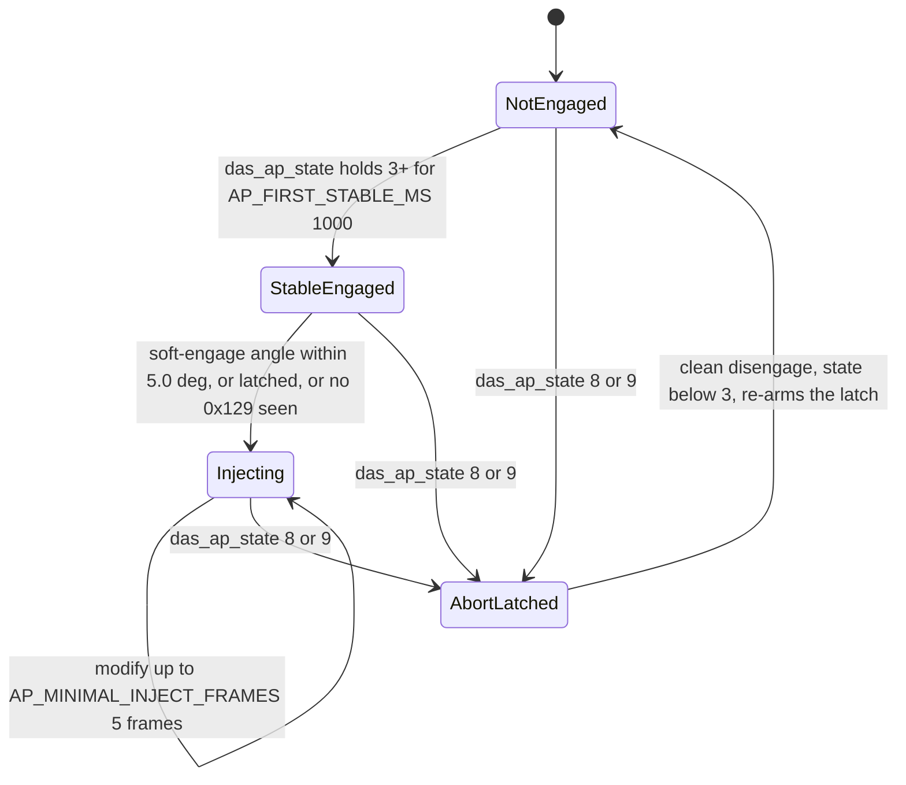
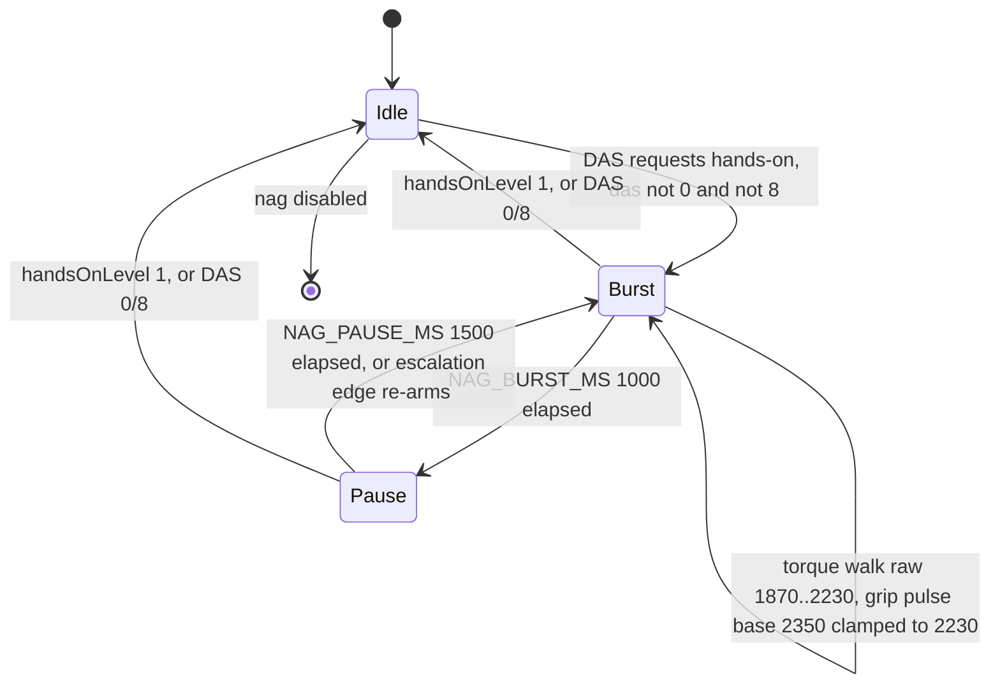
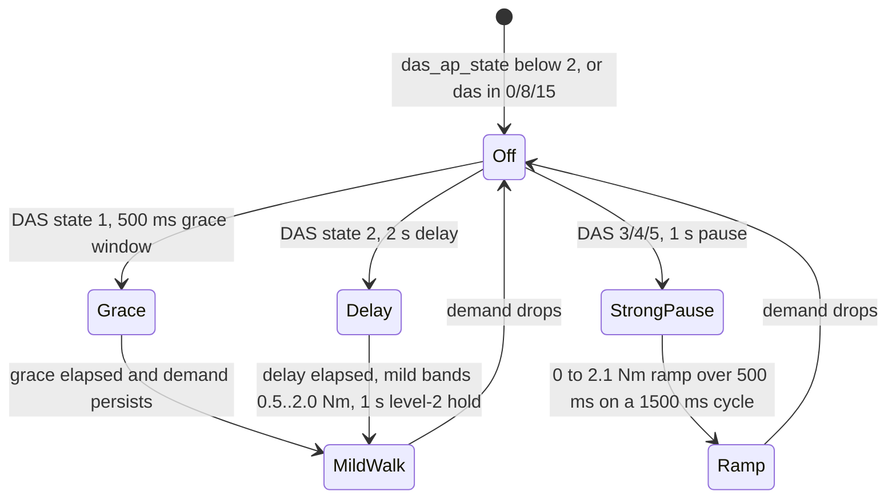
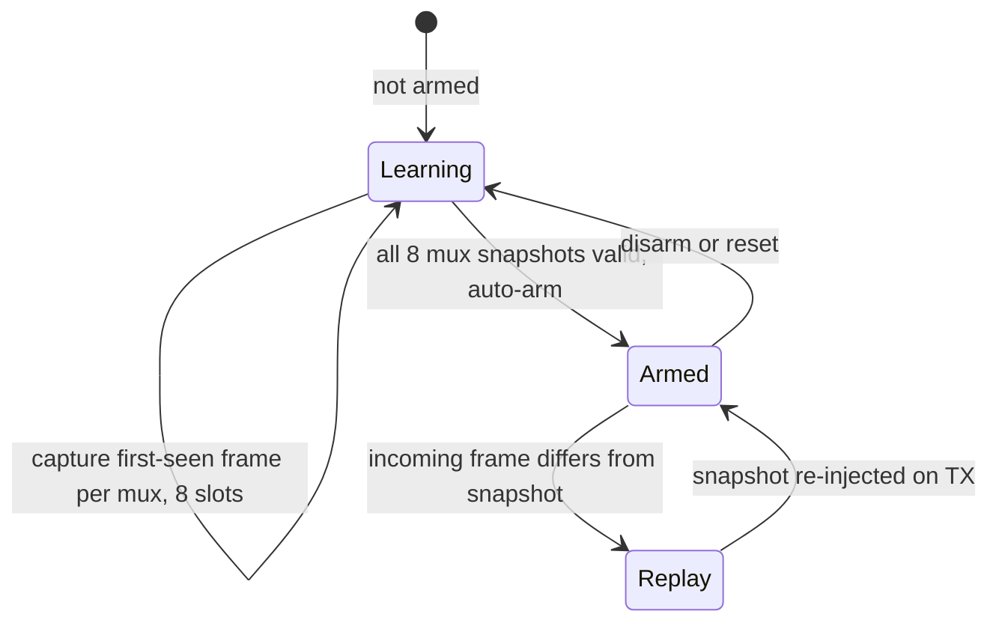
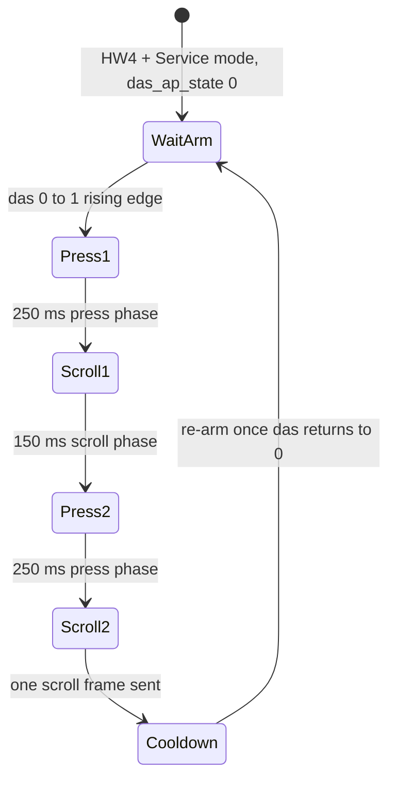

# hypery11 / flipper-tesla-fsd

## 1. Provenance

- Submodule path: `legacy/hypery11-flipper-tesla-fsd`.
- Pinned gitlink: `160000 d31b1ceb31c7fd46a252641f207295b03eb66a23`. `git -C legacy/hypery11-flipper-tesla-fsd rev-parse HEAD` returns the same SHA; `status --porcelain` is empty. Analyst did not mutate the submodule.
- Upstream: `https://github.com/hypery11/flipper-tesla-fsd` (origin fetch/push).
- Version at pin: `changelog.md:1` = `2.17-beta.6`; HEAD commit `d31b1ceb31c7fd46a252641f207295b03eb66a23` = "Merge pull request #282 from hypery11/docs/v2.17-beta.6".
- License: GPL-3.0 (`README.md:12,394`, `LICENSE`). Not GPL-compatible-with-copying: reimplement, do not lift source.
- Analysis date: 2026-11-20.

Files read (line ranges): `fsd_logic/fsd_handler.h:1-316`, `fsd_logic/fsd_types.h:1-60`, `fsd_logic/fsd_state.h:1-452`, `fsd_logic/fsd_handler.c:1-1388`, `fsd_logic/fsd_checksum.h:1-33`, `fsd_logic/fsd_freshness.h:1-66`, `fsd_logic/fsd_ota.h:1-49`, `fsd_logic/fsd_can_ops.h:1-74`, `fsd_logic/fsd_steer.h:1-88`, `fsd_logic/fsd_rx_whitelist.h:1-198`, `fsd_logic/fsd_autopark.h:1-165`, `fsd_logic/fsd_cp_status.h:1-91`, `fsd_logic/fsd_capability.h:1-173`, `fsd_logic/fsd_bms.h:1-135`, `fsd_logic/fsd_tpms.h:1-209`, `fsd_logic/fsd_events.h:1-98`, `fsd_logic/fsd_blackbox_filter.h:1-99`, `esp32/.firmware/fsd_handler.cpp:1-340,1205-1224`, `esp32/.firmware/can_counters.h:1-52`, `esp32/.firmware/gear_tx_route.h:1-42`, `esp32/.firmware/loop_health.h:1-90`, `esp32/.firmware/can_signals.h:184-197`, `esp32/.firmware/can_driver.cpp` (targeted greps at 64-65, 208-237, 272, 818, 1365-1381), `tools/feifan_0x370.py:1-133`, `tools/crack_0x229.py:1-120`, `tools/tesla_crc_cracker.py:1-80`, `enhauto-re/FEIFAN_CAN_ANALYSIS.md:1-186`, `changelog.md:1-30`, `README.md:1-398`, `test/test_fsd_core.c` (test-name inventory plus 784-873), and the pre-existing `docs/legacy/hypery11-flipper-tesla-fsd.md:1-171`.

Files explicitly NOT read: `esp32/.firmware/main.cpp` (2166 lines), `esp32/.firmware/web_dashboard.cpp` (3693), `esp32/.firmware/blackbox.cpp` (961), `esp32/.firmware/http_can_stream.cpp` (572), `esp32/.firmware/capability.cpp`, `esp32/.firmware/web_cmd.h`, `esp32/.firmware/web_i18n.inc`, `esp32/.firmware/prefs.cpp`, `esp32/.firmware/wifi_manager.cpp`, `esp32/.firmware/display.cpp`, `esp32/.firmware/ota_verify.cpp`, `esp32/.firmware/can_mcp2518fd.h`; all `scenes/*.c` and `scenes_config/*`; all `libraries/*`; all remaining `test/*` suites (only function-name inventory was collected); `tools/make_demo_gif.py`; `docs/tesla_can_findings.md`, `docs/cantest-format.md`, `docs/install/index.html`; `enhauto-re/` files other than `FEIFAN_CAN_ANALYSIS.md`; `HARDWARE.md`, `SECURITY.md`, `ROADMAP.md`, translations, `.catalog/*`, `.github/*`, binary assets.

## 2. Executive verdict

A mature, actively developed Flipper Zero FAP plus ESP32 firmware port that implements a single-bus read-modify-retransmit Tesla CAN toolkit. The load-bearing code is a hardware-free `fsd_logic/` core (one `CANFRAME`, GPL-3.0) shared header-only by both builds, with platform ports in `esp32/.firmware/`. The mechanisms that matter for TeslaCANModder are: the DAS-aware `0x370` nag echo and its newer EPAS-faithful/Mode-C and Feifan variants (M2-M4), the TX-freshness + fault/driver-torque guards added in 2.17-beta.4 (M5), the debounced OTA and Autopark TX pauses (M6-M7), the `0x7FF` GTW Config Replay snapshot defense (M8), the 0x25D/0x313/0x331/0x334/0x3C2 frame builders (M9, M11-M14), and the derived RX-ID whitelist + tap-capability verifier (M15-M16). Several are already present in our tree (GTW shield, TLSSC, ISA chime, nag organic/feifan, BMS/TPMS decoders) — the real gap is the freshness/fault guard layer, not the core frame edits. Must never be ported verbatim: upstream identifiers, GPL source text, the "Ban Shield" overclaim, and any Service-mode stalk injection. The existing summary is not trustworthy: it misstates torque ranges, DAS gating, 0x238 decoding, and the purpose of Ban Shield (section 6).

## 3. Evidence map

| Source file | Lines | What it proves | Grade |
| --- | --- | --- | --- |
| `fsd_logic/fsd_handler.c` | 221-371 | HW3/HW4 `0x3FD` mux0/1/2 rewrite, bit46/60/19, AP-First/Soft-Engage/Abort-Guard/Minimal-Inject gates | CODE-READ |
| `fsd_logic/fsd_handler.c` | 386-427 | Legacy `0x3EE` rewrite, bit46 + profile in byte6 bits 2:1 | CODE-READ |
| `fsd_logic/fsd_handler.c` | 431-436, 796-808 | ISA chime `0x399 byte1 |= 0x20` + checksum; TLSSC `0x331 byte0 low6 = 0x1B` | CODE-READ |
| `fsd_logic/fsd_handler.c` | 657-719 | 0x7FF Config Replay learn/arm/replay, 8 mux snapshot, tier override byte5 bits 4:2 | CODE-READ |
| `fsd_logic/fsd_handler.c` | 828-840 | 0x313 Track Mode rewrite + additive checksum, counter byte6 untouched | CODE-READ |
| `fsd_logic/fsd_handler.c` | 876-946 | 0x3C2 scroll-press state machine (5 states, 250/150/250 ms) | CODE-READ |
| `fsd_logic/fsd_handler.c` | 956-987, 1119-1227 | SCCM 0x249 builders; 0x370 nag echo with clamp and Mode-C | CODE-READ |
| `fsd_logic/fsd_handler.c` | 1269-1388 | nag burst/pause, PRNG walk, grip pulse, handsOnLevel=1, counter+1, checksum | CODE-READ |
| `fsd_logic/fsd_checksum.h` | 28-33 | `checksum = (id_lo + id_hi + sum(data[0..len-1])) & 0xFF` | CODE-READ |
| `fsd_logic/fsd_freshness.h` | 22-66 | `FSD_FRESH_TX_MAX_AGE_MS 25`, `fsd_tx_fresh`, `FSD_NAG_DRIVER_TORQUE_NM 2.5`, abort 8/9 guard | CODE-READ |
| `fsd_logic/fsd_ota.h` | 27-49 | `FSD_OTA_ASSERT_FRAMES 3`, `FSD_OTA_CLEAR_FRAMES 6`, repeat-byte6 requirement, raw==2 | CODE-READ |
| `fsd_logic/fsd_autopark.h` | 47-165 | engaged 3..6, Autopark speed gates 8/12/20 kph, all-TX block | CODE-READ |
| `fsd_logic/fsd_can_ops.h` | 19-74 | set_bit, mux low3 of byte0, RX accept (SFF/DLC<=8), FSD-selected bit38 | CODE-READ |
| `fsd_logic/fsd_steer.h` | 28-88 | 0x129 decode (status OK, validity VALID, 0.1 deg/bit -819.2), 500 ms freshness, 3 deg hold | CODE-READ |
| `fsd_logic/fsd_rx_whitelist.h` | 52-198 | derived 13 essentials + 13 readouts + feature ids; accept-all fallbacks; cap 40 | CODE-READ |
| `fsd_logic/fsd_capability.h` | 105-173 | per-feature CAP_* verdicts; 0x399 dual-meaning trap resolved by HW | CODE-READ |
| `fsd_logic/fsd_bms.h` | 54-135 | 0x312 plausibility -40..70C/20C spread; 0x292 socUI bit10|10; 0x33A 7-bit SOC | CODE-READ |
| `fsd_logic/fsd_tpms.h` | 48-209 | 5-byte and 7-byte 0x219 forms, kind 4/5, 0.025 bar, slot source arbitration | CODE-READ |
| `fsd_logic/fsd_events.h` | 52-98 | `FSD_EVENT_COOLDOWN_MS 10000`, EVT_ABORT/DISENGAGE/MANUAL/BUSOFF | CODE-READ |
| `fsd_logic/fsd_blackbox_filter.h` | 31-99 | 17 key IDs, `BLACKBOX_CAPTURE_ALL` escape hatch, 0x257 thinning to 10 Hz | CODE-READ |
| `esp32/.firmware/can_driver.cpp` | 208-237 | TWAI bus-off -> `twai_initiate_recovery()`, busoff edge event | CODE-READ (grep) |
| `esp32/.firmware/can_counters.h` | 17-52 | cumulative TWAI counters + MCP2515 RX queue stats | CODE-READ |
| `esp32/.firmware/loop_health.h` | 20-90 | 25 ms slow-pass threshold, stage timing | CODE-READ |
| `esp32/.firmware/can_signals.h` | 188-197 | 0x238 map speed is byte1 bits[4:0] enum buckets (1=5, 2=7, ... 30=unlimited, 31=SNA) | CODE-READ |
| `esp32/.firmware/fsd_handler.cpp` | 1214-1218 | 0x238 decode: raw 1->5 kph, 2->7 kph, else (raw-1)*5 kph | CODE-READ |
| `tools/feifan_0x370.py` | 5-38, 52-80 | 22,598-frame capture; checksum `sum(0..6)+0x73`; handsOnLevel left 0 | CAPTURE |
| `tools/crack_0x229.py` | 15-42 | 0x229 CRC is E2E/DataID-style, per-counter constant T[i], not plain affine | CODE-READ |
| `test/test_fsd_core.c` | 784-853, 3528 | Mode-C mild band 2098..2248 raw, handsOnLevel=0, counter+1, checksum; 0x238 in blackbox set | TEST-READ |
| `README.md` | 63-74, 94, 143 | README itself states the ±1.8 Nm cap and the honest GTW Config Replay scope | SUMMARY-ONLY |
| `docs/legacy/hypery11-flipper-tesla-fsd.md` (old) | 15, 72, 85, 115, 138 | stale torque/ban/0x238 claims, contradicted by code | SUMMARY-ONLY |
| Changelog claim "212 assertions" | old doc:132 | test binary not executed in this analysis | UNVERIFIED |

## 4. Architecture and build surface

- Entry points: Flipper `tesla_fsd_app.c` + `scenes/`; ESP32 `esp32/.firmware/main.cpp`. Both compile the same `fsd_logic/` headers (no `.c` is compiled by the ESP32 build — `fsd_checksum.h:15-17`, `fsd_freshness.h:18-20`).
- Shared core: `fsd_logic/` — hardware-free `CANFRAME` with union aliases (`fsd_types.h:27-41`), `FSDState` union of both platforms (`fsd_state.h:34-452`), stateless primitives (`fsd_can_ops.h`), checksum, OTA, freshness, steer, BMS, TPMS, autopark, capability, events, whitelist. Header-only `static inline` everywhere so no linker changes are needed on either platform.
- Platform ports: Flipper `libraries/mcp_can_2515.*`, `scenes/`, `application.fam`; ESP32 `esp32/.firmware/` with `CanDriver` abstraction (TWAI, MCP2515, MCP2518FD), WiFi web dashboard, NVS prefs, black-box recorder, HTTP CAN stream.
- Build flags: per-board PlatformIO envs in `esp32/platformio.ini` (m5stack-atom, esp32-lilygo, waveshare-s3-can, esp32-mcp2515, ttgo-tdisplay, lilygo-t2can, lilygo-t2can-fd). Cross-cutting macros seen in core: `BLACKBOX_CAPTURE_ALL` (`fsd_blackbox_filter.h:61,89`), `BOARD_TTGO_DISPLAY` (`fsd_handler.cpp:72`), `TESLA_CAN_SFF_MAX`/`TESLA_CAN_MAX_DLC` guards (`fsd_can_ops.h:41-42`).
- Dependency boundary: shared headers include only `<stdint.h>`, `<stdbool.h>`, `<string.h>` (and each other); no furi/HAL/Arduino. Reception acceptance requires 11-bit, non-remote, DLC<=8 (`fsd_can_ops.h:44-48`).
- Op modes: `OpMode_ListenOnly=0` (safe boot default on ESP32, `fsd_handler.cpp:46`), `Active=1`, `Service=2` (Flipper-only; gates aggressive features, `fsd_types.h:56-60`).

```mermaid
flowchart LR
    RX["MCP2515 / TWAI / MCP2518FD RX"] --> ACC["RX accept: SFF, non-remote, DLC max 8<br/>fsd_can_ops.h:44-48"]
    ACC --> WL["Optional RX-ID whitelist, default off<br/>fsd_rx_whitelist.h:148-198"]
    WL --> DISP["ID dispatch per handler<br/>fsd_handler.c:38-43, 556-628"]
    DISP --> GATES["TX gates: fsd_can_transmit() fsd_handler.c:45-52<br/>OTA latch fsd_ota.h, Autopark pause fsd_autopark.h"]
    GATES --> MUT["Per-frame handlers: 0x3FD / 0x3EE mux rewrite,<br/>0x370 nag echo, 0x7FF replay, 0x331, 0x313, 0x334, 0x3C2"]
    MUT --> FRESH["Modified-retransmit freshness gate<br/>25 ms max age, fsd_freshness.h:38 (nag path)"]
    FRESH -->|"fresh and gates open"| TX["CAN TX: modified frame retransmitted"]
    FRESH -->|"stale or fault"| DROP["drop"]
```



## 5. Mechanism catalogue

### M1 — FSD/AP activation mux rewrite + engagement gates

- **Claim:** FSD unlock via bit46/60 on `0x3FD` (HW3/HW4) and `0x3EE` (Legacy); AP-First delays injection until AP engaged.
- **Code path:** `fsd_handler.c:221` `fsd_handle_autopilot_frame()` -> `fsd_ap_first_allows()` (153) -> `fsd_soft_engage_allows()` (166) -> `fsd_abort_guard_allows()` (196) -> mux dispatch -> TX; Legacy mirror at 386.
- **Frame spec:** `0x3FD` mux0 bit46 (and bit60 HW4, bit59 emergency detect), mux1 bit19 cleared + bit47/45/46 extras, mux2 profile bits 60-62 (byte7 bits 6:4, bit63 preserved) and HW4 offset byte1 low6. Legacy `0x3EE` mux0 bit46 + profile byte6 bits 2:1. Mux = byte0 bits[2:0] (`fsd_can_ops.h:30-32`).
- **Gates/timing:** `DAS_APSTATE_ENGAGED=3` (h1:64), `AP_FIRST_STABLE_MS=1000` (h1:69), `AP_MINIMAL_INJECT_FRAMES=5` (h1:75), `SOFT_ENGAGE_ANGLE_DEG=5.0` (h1:85), abort states 8/9 (h1:97-98).
- **State machine:** AP state debounce latch, soft-engage once-per-engagement latch, abort latch (re-arm on clean disengage), per-engagement injection budget.
- **Tests:** `test_autopilot_hw4` c:166, `test_hw4_mux2_profile_layout` c:208, `test_autopilot_hw3` c:267, `test_abort_guard` c:1205, `test_legacy` c:1936.
- **Evidence grade:** CODE-READ + TEST-READ.
- **Verdict:** CONFIRMED.
- **Adapt to TeslaCANModder?** already present (our `handler/variant/{hw3,hw4,legacy}.h`, `nag.h` AP gate); recheck the 1000 ms stability and 5-frame budget as distinct additions.



### M2 — 0x370 nag echo (DAS-aware counter+1 + organic walk)

- **Claim:** DAS-aware echo, organic torque variation, grip pulses, burst/pause.
- **Code path:** `fsd_handler.c:1275` `fsd_handle_nag_killer()` -> `fsd_nag_suppress_fault()` (freshness.h:62) -> `nag_faithful_modec()` (1119) or legacy path (1295-1387) -> TX.
- **Frame spec:** `0x370`, DLC8. Byte2 low nibble + byte3 = torsion torque raw (`raw*0.01-20.5` Nm); byte4 bits[7:6] forced to 1 (legacy path, c:1374), byte6 low nibble counter+1, byte7 = additive checksum (`sum(byte0..6)+0x70+0x03`).
- **Gates/timing:** skip handsOnLevel==1; skip DAS 0/8; `NAG_BURST_MS=1000`, `NAG_PAUSE_MS=1500` (h1:119-120); walk raw 2150..2290 clamped to 1870..2230 (`NAG_TORQUE_RAW_MIN/MAX`, h1:125-126) = **-1.80..+1.80 Nm effective**; grip pulse base 2350±20 clamped to 2230; 125..224-frame cooldown.
- **State machine:** xorshift32 PRNG, walk, grip-pulse counter, escalation-edge re-arm, nag_burst cycle.
- **Tests:** `test_nag_killer` c:713, `test_nag_burst_cap` c:1696.
- **Evidence grade:** CODE-READ + TEST-READ.
- **Verdict:** PARTIAL — README (README.md:71) and code agree on the ±1.8 Nm cap; the old summary's 1.00-2.40 / 3.10-3.30 Nm figures are wrong (section 6, C1).
- **Adapt to TeslaCANModder?** already present (`nag.h` legacy/organic/natural/feifan modes, `nagEchoApply`); borrow the burst/pause duty cycle only if desired.



### M3 — 0x370 EPAS-faithful / Mode-C nag (v2.17, #100)

- **Claim:** demand-state torque model that never forces handsOnLevel, for 2026.14.x preflight.
- **Code path:** `nag_faithful_modec()` `fsd_handler.c:1119-1227` -> additive checksum -> TX.
- **Frame spec:** same 0x370 byte layout, but byte4 copied from real frame (`out->buffer[4]=frame->buffer[4]`, c:1218); handsOnLevel derived from torque only for state-1 grace tracking, never written. Raw 2048 = 0 Nm, `raw = 2048 + Nm*100`; clamp to 1870..2230.
- **Gates/timing:** global gate `das_ap_state>=2 && das∉{0,8,15}` (c:1150); DAS 1 = 500 ms grace, DAS 2 = 2 s delay then mild walk bands ±0.5..±2.0 Nm with 1 s level-2 hold, strong 3/4/5 = 1 s pause then 0->2.1 Nm ramp over 500 ms on 1500 ms cycle. Torque direction opposes steering via `fsd_steer_nag_dir()`.
- **Tests:** `test_nag_killer_faithful` c:784-853 (asserts 2098..2248 raw band, handsOnLevel=0, counter+1, checksum).
- **Evidence grade:** CODE-READ + TEST-READ. On-car status: README.md:154 says NOT yet confirmed on-car.
- **Verdict:** CONFIRMED (code), on-car UNVERIFIED.
- **Adapt to TeslaCANModder?** candidate — our `nag:mode:organic` is structurally similar (same 500/1000/1500/2000 ms constants) but ours still writes handsOnLevel for organic; the "leave byte4 untouched" invariant is worth a cross-read and bench capture.



### M4 — Feifan 0x370 reference capture/tool

- **Claim:** V4.1.00 commander capture proves handsOnLevel stays 0 and torque random-walks near 0 Nm.
- **Code path:** `tools/feifan_0x370.py:5-38` (capture description), `feifan_checksum()` 55-59, `build_0x370()` 62-80, `_validate()` 97-120.
- **Frame spec:** captured 22,598 frames; byte0 0x11/0x12, byte1/3 torque ~ -5..+2, byte4 bits[7:6]=0, byte6 counter+1, byte7 = `sum(0..6)+0x73` validated 22,598/22,598.
- **Evidence grade:** CAPTURE (tool documents captured frame count and 100% validation; capture file itself not in repo).
- **Verdict:** CONFIRMED as a reference artifact.
- **Adapt to TeslaCANModder?** already present — our `nag:mode:feifan` mirrors this (`nag.h:89-96,440-444`); no port needed.

### M5 — TX freshness + fault/driver-override guard (2.17-beta.4, #176)

- **Claim:** modified retransmits only when source frame is fresh; no spoof during abort or real driver torque.
- **Code path:** `fsd_freshness.h:38` `fsd_tx_fresh(rx_ms, now_ms)`, `:62` `fsd_nag_suppress_fault(das_ap_state, torque_nm)`; called at `fsd_handler.c:1289`.
- **Frame spec:** n/a (guard, not a frame).
- **Gates/timing:** `FSD_FRESH_TX_MAX_AGE_MS=25` (2.5 periods of 100 Hz 0x370); `rx_ms==0` treated as fresh (Flipper leaves it 0, c:34-40); `FSD_NAG_DRIVER_TORQUE_NM=2.5f`; abort states 8/9.
- **Tests:** not read in the invoked test subset; changelog:15-21 documents the originating field report.
- **Evidence grade:** CODE-READ.
- **Verdict:** CONFIRMED (code); safety importance HIGH.
- **Adapt to TeslaCANModder?** **candidate (top 1)** — grep of our `firmware/lib/**` found no `rx_ms`/freshness gate on modified retransmits; our docs claim an OTA guard but code has no `CAN_ID_GTW_CAR_STATE` consumer (see M6). Needs can-review-checklist + listen-only bench capture.

### M6 — OTA install guard (0x318, #183)

- **Claim:** TX pauses only on a stable "installing" value; rolling counter cannot trip it.
- **Code path:** `fsd_handler.c:38-43` `fsd_handle_gtw_car_state()` -> `fsd_ota_update()` `fsd_ota.h:34-49` -> `fsd_can_transmit()` c:45-52.
- **Frame spec:** `0x318` byte6 bits[1:0]; raw==2 is installing. A sample asserts only when raw==2 AND byte6 equals previous byte6 exactly.
- **Gates/timing:** 3 consecutive asserting samples latch, 6 others release. ESP32 adds `ignore_ota` override (`fsd_handler.cpp:106`), Flipper does not.
- **Tests:** `test_gtw_car_state` c:1804, `test_gtw_car_state_counter` c:1882.
- **Evidence grade:** CODE-READ + TEST-READ.
- **Verdict:** CONFIRMED.
- **Adapt to TeslaCANModder?** **candidate (top 2)** — our tree defines `CAN_ID_GTW_CAR_STATE 0x318` (`ids.h:52`) but grep found no consumer; `docs/reference/can-protocol.md:199-201,266` claims the guard exists. Verify with the maintainer, then port the debounce behavior (3/6 + repeat-byte6) into our TX gate with a test oracle.

### M7 — In-car Autopark TX pause (#180)

- **Claim:** all TX stops during an in-car Autopark episode; FSD engaged alone is not affected.
- **Code path:** `fsd_autopark.h:89` `fsd_autopark_parse()` from both DAS parsers (`fsd_handler.c:560,576`), `:128` `fsd_autopark_update()` from RX loop -> `fsd_can_transmit()` c:49.
- **Frame spec:** DAS_status byte3 bits0-2 = autoparkReady / autoParked / waitingForBrake; speed from 0x257.
- **Gates/timing:** engaged state 6; entry from <=2 at standstill or maneuver bit (3 s recency); release 20 kph with evidence / 12 kph without; entry max 8 kph; SNA speed (raw 4095 = 287.6 kph) treated unknown and fails safe.
- **Tests:** `test_autopark` c:2282, `test_autopark_176` c:2441.
- **Evidence grade:** CODE-READ + TEST-READ.
- **Verdict:** CONFIRMED.
- **Adapt to TeslaCANModder?** no impact (our project does not inject during Autopark; no counterpart TX gate found). Do not add unless a real incident warrants it.

### M8 — 0x7FF GTW Config Replay (formerly Ban Shield) + tier override

- **Claim:** learns 8 healthy mux frames, then replays any gateway-modified frame; README explicitly says it is broadcast-layer only.
- **Code path:** `fsd_handler.c:657` `fsd_handle_gtw_shield()` -> learn/arm/replay -> TX; tier readback `:634` `fsd_handle_gtw_autopilot_tier()`; override `:706` `fsd_handle_gtw_tier_override()`.
- **Frame spec:** `0x7FF`, mux = byte0 bits[2:0]; snapshot `[8][8]`; tier at byte5 bits[4:2] = 0 NONE / 1 HIGHWAY / 2 ENHANCED / 3 SELF_DRIVING / 4 BASIC; override writes `(orig & ~0x1C) | (3<<2)`.
- **Gates/timing:** auto-arm after all 8 muxes seen; no checksum/counter recompute; replay races the gateway frame.
- **Tests:** `test_gtw_shield` c:2865, `test_gtw_tier` c:2657.
- **Evidence grade:** CODE-READ + TEST-READ.
- **Verdict:** CONFIRMED as snapshot-replay; CONTRADICTED as "ban prevention" (old doc line 15/85/115).
- **Adapt to TeslaCANModder?** already present — our `ban_shield.h:95-136` `handleGtwShield()` is the same learn/arm/compare/replay algorithm and `ban_detect.h` decodes the same tier values. No port; keep our honest naming.



### M9 — TLSSC Restore (0x331)

- **Claim:** recover TLSSC on banned cars by spoofing SELF_DRIVING tier.
- **Code path:** `fsd_handler.c:796` `fsd_handle_tlssc_restore()`.
- **Frame spec:** `0x331` byte0 low 6 bits = 0x1B, upper 2 bits preserved; no checksum recompute in handler.
- **Gates/timing:** "read-modify-retransmit at ~1 Hz" in old doc is the car's frame rate, not a firmware throttle — no 1 Hz timer in the handler. UNVERIFIED.
- **Tests:** `test_tlssc_restore` c:593.
- **Evidence grade:** CODE-READ + TEST-READ.
- **Verdict:** CONFIRMED (byte edit); rate UNVERIFIED.
- **Adapt to TeslaCANModder?** already present — our `das/tlssc.h:46-60` `handleTlssc()` is byte-identical behavior.

### M10 — ISA chime suppression + additive checksum primitive

- **Claim:** HW4-only `0x399` byte1 bit5 set, checksum recomputed.
- **Code path:** `fsd_handler.c:431` `fsd_handle_isa_speed_chime()`; shared `fsd_checksum.h:28` `tesla_additive_checksum()`.
- **Frame spec:** `0x399` byte1 |= 0x20; byte7 = `(0x99+0x03+sum(byte0..6)) & 0xFF`. Checksum used also by 0x313, 0x370, 0x249.
- **Gates/timing:** DLC>=8; caller must gate on HW4 (same ID is DAS_status on HW3/Legacy).
- **Tests:** `test_isa_checksum` c:550, `test_additive_checksum` c:1746.
- **Evidence grade:** CODE-READ + TEST-READ.
- **Verdict:** CONFIRMED.
- **Adapt to TeslaCANModder?** already present — our `fsd/isa_chime.h:24-39` gates on `HW4`, and `vehicle/can/checksum.h` provides the primitive.

### M11 — Track Mode inject (0x313)

- **Claim:** adjustable handling balance/stability/cooling with checksum recomputed.
- **Code path:** `fsd_handler.c:828` `fsd_handle_track_mode_inject()`.
- **Frame spec:** byte0 bits1:0=1 ON; byte1 = pct*2 (rotation), byte2 = pct*2 (stability), byte3 bits0/1 = post-cooling/overclock; byte7 additive checksum; **byte6 counter untouched**.
- **Gates/timing:** master opt-in only, DLC8, no trim/readback gate.
- **Tests:** `test_track_mode_crc` c:617, `test_track_mode_adjust` c:646.
- **Evidence grade:** CODE-READ + TEST-READ.
- **Verdict:** CONFIRMED.
- **Adapt to TeslaCANModder?** already present (`feature/body/track_mode.h`); our implementation uses a fixed 20-frame burst instead of in-place rewrite — a possible behavior delta, not a port.

### M12 — Charge-port EU rewrite (0x25D, #228)

- **Claim:** rewrite US CP_type to IEC_CCS so EU Superchargers appear in nav.
- **Code path:** `fsd_cp_status.h:55-90` `fsd_cp_type_value()`, `fsd_cp_type_make_iec_ccs()`, `fsd_cp_plug_state()`, `fsd_cp_type_rewrite_eligible()`; consumed by `esp32/.firmware/fsd_handler.cpp:17`.
- **Frame spec:** `0x25D` DLC8, byte0 bits0-1 CP_type 0 US_TESLA / 3 IEC_CCS; set `(byte0 & 0xFC)|3`; no counter/checksum on this frame. Plug guard: rewrite only when `FSD_CP_PLUG_UNPLUGGED`, UNKNOWN fails closed; stale after 3 s.
- **Tests:** not in the read test subset.
- **Evidence grade:** CODE-READ.
- **Verdict:** CONFIRMED.
- **Adapt to TeslaCANModder?** no impact — different feature scope; do not port without a Vehicle-bus counterpart and can-review-checklist.

### M13 — Acceleration Mode override (0x334, #211)

- **Claim:** rewrite UI_pedalMap at standstill, keep counter, recompute checksum.
- **Code path:** `esp32/.firmware/fsd_handler.cpp:286` `fsd_handle_di_gear()`, `:297` `fsd_accel_standstill()`, `:313` `fsd_handle_accel_mode()`.
- **Frame spec:** `0x334`, DLC8, checksum byte7 must equal `tesla_additive_checksum(0x334, data, 7)`; UI_pedalMap byte0 bits5-6 (0 CHILL / 1 STANDARD / 2 PERFORMANCE, 3 rejected). New value latches only when speed within ±ACCEL_STANDSTILL_KPH or gear P; touchscreen change while moving drops to pass-through.
- **Gates/timing:** `ACCEL_CTX_FRESH_MS` freshness; bad DLC/checksum/pedal-map-3 frames counted and ignored.
- **Tests:** `test_esp32_core.cpp` (function inventory only).
- **Evidence grade:** CODE-READ (partial file read).
- **Verdict:** CONFIRMED (partial).
- **Adapt to TeslaCANModder?** already present (`feature/drive/pedal.h`, `drive_mode.h` inject 0x334 at 20 Hz). Our design is periodic injection, not in-place car-frame rewrite — note the delta; no port.

### M14 — Scroll-press AP engage (0x3C2, HW4/Service)

- **Claim:** human-like scroll sequence engages AP without touching 0x3FD.
- **Code path:** `fsd_handler.c:876` `fsd_handle_scroll_press_inject()`.
- **Frame spec:** `0x3C2` mux1 (byte0 bits1:0 == 1); `swcRightPressed` byte1 bits[5:4] set to 1; `swcRightScrollTicks` byte3 bits[5:0] set to 1; no CRC/counter.
- **Gates/timing:** HW4 + Service mode only; arm on das_ap_state==0, fire on 0->1; phases press 250 ms -> scroll 150 ms -> press 250 ms -> scroll (one frame) -> cooldown state5.
- **Tests:** `test_scroll_press` c:2907.
- **Evidence grade:** CODE-READ + TEST-READ (bench-verified per README:135).
- **Verdict:** CONFIRMED.
- **Adapt to TeslaCANModder?** never port — Service-mode actuation on steering-wheel controls; outside our command model and safety envelope.



### M15 — Read-only decoders + configurable signal map

- **Claim:** parse BMS/TPMS/DAS/steering/speed/map limit; signal map redirects DAS/steer sources.
- **Code path:** `fsd_bms.h:61-135`, `fsd_tpms.h:192-209`, `fsd_steer.h:41-77`, `fsd_handler.c:556-628,993-1063,1204-1214` (ESP32 map), `fsd_handler.c:1229-1267` `fsd_apply_signal_config()` / `fsd_das_ctx_fresh()`.
- **Frame spec:** 0x292 socUI bit10|10 (0.1%); 0x312 byte4/5 -40 with plausibility -40..70C, spread<=20; 0x33A 7-bit SOC; 0x219 5-byte sensor form / 7-byte kind4+5 form (0.025 bar); 0x129 status OK + validity VALID, 0.1 deg/bit -819.2; 0x39B/0x399 hands-on byte5[5:2], AP state byte0 low nibble; 0x238 byte1[4:0] enum buckets.
- **Gates/timing:** steering angle fresh 500 ms; BMS temp stale 30 s; TPMS stale 30 s; custom DAS source must be seen within `NAG_CTX_FRESH_MS=1000` or nag injection no-ops; mask 0 means unmapped.
- **Tests:** `test_bms_thermal` c:868, `test_ui_soc` c:927, `test_bms_soc` c:954, `test_steering_angle` c:1030, `test_signal_config` c:1114, `test_tpms_real_frames` c:3102.
- **Evidence grade:** CODE-READ + TEST-READ.
- **Verdict:** CONFIRMED.
- **Adapt to TeslaCANModder?** partially present (our `telemetry/{bms,tpms,powertrain}.h`); the 0x33A car-SOC, 0x219 7-byte form, 0x129 validity gate and configurable signal map with 1 s fail-closed freshness are candidate additions for a future PR.

### M16 — Tap capability verdicts + derived RX-ID whitelist

- **Claim:** verdicts per feature instead of bus names; hardware filter derived from state, accept-all fallback.
- **Code path:** `fsd_capability.h:116-173` `fsd_capability_eval()`; `fsd_rx_whitelist.h:148-198` `fsd_rx_whitelist_needed()`.
- **Frame spec:** n/a. 13 essentials + 13 readouts + track/TLSSC ids + blackbox ids + signal-map ids; cap `FSD_RXW_MAX_IDS 40`; accept-all when capture/capability/discovery active or union overflows.
- **Gates/timing:** 0x399 counted as DAS only when HW != HW4 (the dual-meaning trap).
- **Tests:** `test_capability` c:1333, `test_rx_whitelist.c` (inventory only).
- **Evidence grade:** CODE-READ + TEST-READ.
- **Verdict:** CONFIRMED.
- **Adapt to TeslaCANModder?** no impact for whitelist (our `handler/filters.h` already applies variant filters); capability verifier is a candidate UX feature only if bench work shows recurring wrong-tap support cases.

### M17 — Black-box recorder, event core, loop health

- **Claim:** key-ID filter keeps 10 s pre / 5 s post window; typed events with cooldown; slow-loop diagnostics.
- **Code path:** `fsd_blackbox_filter.h:60-99` `fsd_blackbox_should_record()` / `fsd_blackbox_thin_keep()`; `fsd_events.h:60-98` `fsd_events_emit()` / `fsd_events_poll()` / `fsd_events_inject()`; `loop_health.h:39-90`.
- **Frame spec:** 17 key IDs; 0x257 thinned to 10 Hz (`FSD_BLACKBOX_THIN_MS 100`); `FSD_EVENT_COOLDOWN_MS 10000`; `LOOP_SLOW_US 25000`.
- **Gates/timing:** `BLACKBOX_CAPTURE_ALL` build flag restores full capture.
- **Tests:** `test_fsd_events` c:1257, `test_blackbox_filter` c:3513, `test_loop_health.cpp` (inventory only).
- **Evidence grade:** CODE-READ + TEST-READ.
- **Verdict:** CONFIRMED.
- **Adapt to TeslaCANModder?** already present in spirit (`core/can/recorder.h` ring + `recorder:*` commands). Event-core trigger on abort/bus-off is a candidate enhancement; borrow the idea, not the code.

### M18 — TWAI bus-off recovery + cumulative counters + second-core web + HTTP CAN stream

- **Claim:** RX does not silently die after bus-off; counters survive mode switches; web load moved off the CAN core.
- **Code path:** `esp32/.firmware/can_driver.cpp:208-237` bus-off -> `twai_initiate_recovery()` and `EVT_BUSOFF` edge; `can_counters.h:17-52` `CanCarryCount::restart()`; `changelog.md:1-6` second-core web + RX whitelist; `http_can_stream.cpp` (not read).
- **Frame spec:** n/a.
- **Gates/timing:** acts only in BUS_OFF/RECOVERING states; counters carry across install/restart.
- **Tests:** `test_can_counters.cpp`, `test_can_mcp2518fd.cpp`, `test_web_cmd.cpp`, `test_captive_probe.cpp` — inventory only, not read.
- **Evidence grade:** CODE-READ (driver + counters), SUMMARY-ONLY (second-core/stream claims).
- **Verdict:** PARTIAL.
- **Adapt to TeslaCANModder?** no impact — our MCP2515-only bus topology has no TWAI equivalent; note the "counters survive re-init" idea as a maintenance candidate.

### M19 — CRC/checksum recovery tools

- **Claim:** recover Tesla counter+checksum schemes from candump captures.
- **Code path:** `tools/crack_0x229.py:15-42` (additive -> plain CRC8 -> E2E/DataID per-counter constant), `tools/tesla_crc_cracker.py:1-44` (additive + CRC8 parameter sweep over covered-byte subsets), `tools/feifan_0x370.py` (M4).
- **Frame spec:** 0x229 is 3 bytes: byte0 CRC, byte1[3:0] counter, byte1[6:4] stalk position, byte2[1:0] park button; CRC uses per-counter XOR constant T[counter].
- **Tests:** n/a (research tools).
- **Evidence grade:** CODE-READ.
- **Verdict:** CONFIRMED as tooling.
- **Adapt to TeslaCANModder?** candidate (low priority) — our `tools/` already has serial/bridge CLI; a capture-driven CRC oracle could strengthen independent test oracles, but must be written fresh.

## 6. Summary vs code contradiction table

| # | Summary claim (source) | Code evidence | Assessment |
| --- | --- | --- | --- |
| C1 | "organic torque variation [1.00-2.40 Nm] ... grip pulses [3.10-3.30 Nm]" (old doc:72, also 15) | `fsd_handler.c:1210,1369` apply `nag_clamp_torque()` with `NAG_TORQUE_RAW_MIN 1870 / MAX 2230` (h1:125-126) = ±1.80 Nm; grip base 2350±20 (c:1342) is clamped to 2230. Upstream `README.md:71` itself says capped at ±1.8 Nm. | CONTRADICTED — effective band is -1.80..+1.80 Nm on every path. Treat old doc torque figures as void. |
| C2 | "gates nag echo only when DAS actively demands hands-on (states 2-7, 9-10)" (old doc:74, 113) | `fsd_handler.c:1313` skips only `das==0 || das==8`; 0xFF (unseen) echoes conservatively (c:1306-1307). The 2-7/9-10 set is OUR `nag.h:57-60 dasHandsOnRequested()`, not upstream. | CONTRADICTED — upstream gate is "not 0 and not 8". |
| C3 | "0x7FF Ban Shield ... block server-side bans" / "block server-side ban modifications in real time" (old doc:15,85,115) | `fsd_handler.c:653-655` comment: "CAN-broadcast-layer mask only. It does not undo NVRAM changes ... nor backend-side entitlement flags." `fsd_handler.h:241-248` renames it "GTW Config Replay"; `README.md:63-67,126` says it does NOT prevent bans. | CONTRADICTED — replay is a broadcast-layer mask; keep our honest `gtwshield:*` naming. |
| C4 | "0x238 UI_driverAssistMapData — Map-derived speed limit (byte 0 / 2 = km/h, byte 1 speed limit sign type)" (old doc:138) | `can_signals.h:188-196` reads byte1 bits[4:0] as enum bucket (1=5, 2=7, 3=10 ... 29=160, 30=unlimited, 31=SNA); `fsd_handler.cpp:1213-1218` maps raw to kph via 5-kph steps. | CONTRADICTED — field is a 5-bit enum, not a byte of km/h. |
| C5 | "0x331 TLSSC Restore — read-modify-retransmit at ~1 Hz" (old doc:68,88) | `fsd_handler.c:796-808` has no timer; every matching frame is modified. 0x331's natural bus rate is not established in code. | UNVERIFIED — drop the "1 Hz" as a firmware claim; re-check with a capture. |
| C6 | "Host-native test suite with 212 assertions" (old doc:132) | test sources exist (`test/test_fsd_core.c` 3601 lines, ~55 `test_*` functions inventoried); binary was not executed. | UNVERIFIED — do not quote the number. |
| C7 | "AP-First mode ... required for Tesla firmware 2026.14.x" (old doc:116) | Code implements the 1000 ms debounce gate (`fsd_handler.h:69`, c:153-164); the "required for 2026.14.x" rationale comes from README/issues, not code. | SUMMARY-ONLY — gate CONFIRMED, rationale from upstream reports. |
| C8 | "operates at 500 kbps" (old doc:94) | No 500 kbit constant found in `config.h`, `platformio.ini`, or `mcp_can_2515.h` greps. | UNVERIFIED — likely true from hardware docs, but not code-backed here. |

## 7. CAN frame and signal inventory

Every ID below is referenced by upstream code (defines in `fsd_logic/fsd_handler.h:7-45` plus per-frame handlers). The repo's CAN dictionary `enhauto-re/CAN_DICTIONARY.md` exists but was NOT read in this analysis; every layout below comes from code or code comments only. Upstream is a single-tap device (one CAN port per build: Flipper MCP2515; ESP32 TWAI / MCP2515 / MCP2518FD), so the bus column is `tap` for all rows. Period is `source-rate` for read-modify-retransmit frames unless code states a timer. All rows are CODE-READ at the pinned snapshot; no TEST-READ or CAPTURE evidence backs any frame shape here except the feifan 0x370 capture (section 8).

| ID (hex+dec) | bus | period | DLC | byte/bit layout | scale/units | counter position | checksum | read or write | grade |
| --- | --- | --- | --- | --- | --- | --- | --- | --- | --- |
| 0x045 / 69 | tap | source-rate | — | None found (define `fsd_handler.h:7`; stalk parser h:112) | — | — | — | R | CODE-READ |
| 0x082 / 130 | tap | caller-driven, no timer found | 8 | byte0: bit0 tripPlanningActive, bit2 requestActiveBatteryHeating; built as 0x05 (`fsd_handler.c:77-83`) | — | — | None found | W | CODE-READ |
| 0x108 / 264 | tap | source-rate | — | None found (define h:35; parser h:305-306) | motor torque/power | — | — | R | CODE-READ |
| 0x118 / 280 | tap | source-rate | — | None found (define h:23; parser h:174-175) | track mode state + traction mode | — | — | R | CODE-READ |
| 0x129 / 297 | tap | source-rate | — | status + validity gated; 0.1 deg/bit, offset -819.2; fresh 500 ms; 3 deg hold (`fsd_steer.h:28-88`) | degrees | — | — | R | CODE-READ |
| 0x132 / 306 | tap | source-rate | — | None found (define h:15; parser h:159-160) | pack voltage / current / power | — | — | R | CODE-READ |
| 0x145 / 325 | tap | source-rate | — | ESP_driverBrakeApply bit29, 2 bits (h:210-213) | brake apply state | — | — | R | CODE-READ |
| 0x175 / 373 | tap | source-rate | — | None found (define h:39) | 4 wheel speeds | — | — | R | CODE-READ |
| 0x219 / 537 | tap | source-rate | 5 or 7 | 5-byte sensor form + 7-byte kind-4/5 slot form (`fsd_tpms.h:48-209`) | pressure 0.025 bar; temp raw-40 C | — | — | R | CODE-READ |
| 0x229 / 553 | tap | source-rate | 3 | byte0 CRC; byte1[3:0] counter; byte1[6:4] stalk; byte2[1:0] park button (`tools/crack_0x229.py:15-42`; park builder h:192-195) | — | byte1 low nibble | per-counter XOR constant T[i], E2E/DataID style | R+W | CODE-READ |
| 0x238 / 568 | tap | source-rate | — | byte1[4:0] enum buckets: 1=5, 2=7, 3=10 ... 29=160, 30=unlimited, 31=SNA; raw to kph (raw-1) x 5 with 1 to 5, 2 to 7 special cases (`can_signals.h:188-197`; esp32 `fsd_handler.cpp:1213-1218`) | kph | — | — | R | CODE-READ |
| 0x249 / 585 | tap | source-rate | 3 | high beam bit12, 2 bits; turn indicator bit16, 3 bits; wiper wash bit14, 2 bits (h:273-295) | — | byte1[3:0] | additive: 0x49 + 0x02 + data[1] + data[2] | W | CODE-READ |
| 0x257 / 599 | tap | source-rate | — | DI_vehicleSpeed bit12, 12 bits; DI_uiSpeed bit24, 8 bits (h:197-201) | 0.08 kph/bit, offset -40 | — | — | R | CODE-READ |
| 0x25D / 605 | tap | source-rate | 8 | byte0[1:0] CP_type, 0 US_TESLA / 3 IEC_CCS; bit3 cable_present; byte7 bit 0x20 inlet_exposed; rewrite (byte0 and 0xFC) or 3; eligible only DLC 8 + US_TESLA (`fsd_cp_status.h:55-90`) | — | — | None found | R+W | CODE-READ |
| 0x27D / 637 | tap | source-rate | — | None found (define h:42) | steering permission | — | — | R | CODE-READ |
| 0x286 / 646 | tap | source-rate | — | None found (define h:37) | cruise state, gear, park brake, digital speed | — | — | R | CODE-READ |
| 0x292 / 658 | tap | source-rate | — | socUI bit10, 10 bits (`fsd_bms.h:84`) | 0.1 % per bit | — | — | R | CODE-READ |
| 0x293 / 659 | tap | source-rate | — | None found (define h:30) | autosteer enable readback | — | — | R | CODE-READ |
| 0x2B9 / 697 | tap | source-rate | — | None found (define h:36) | ACC state + set speed | — | — | R | CODE-READ |
| 0x311 / 785 | tap | source-rate | — | None found (define h:38) | blinker, door, buckle, high beam | — | — | R | CODE-READ |
| 0x312 / 786 | tap | source-rate | — | pack temps byte4 / byte5, offset -40; plausibility -40..70 C, spread max 20 C (`fsd_bms.h:54-135`); the blackbox header itself flags "layout unconfirmed" (`fsd_blackbox_filter.h:49`) | Celsius | — | — | R | CODE-READ |
| 0x313 / 787 | tap | source-rate | 8 | byte0[1:0]=1 ON; byte1 pct x 2 rotation; byte2 pct x 2 stability; byte3 bits0/1 post-cooling/overclock; byte6 counter untouched; byte7 additive checksum (`fsd_handler.c:828-840`) | percent x 2 | byte6 | additive (`fsd_checksum.h:28-33`) | R+W | CODE-READ |
| 0x318 / 792 | tap | source-rate | — | byte6[1:0]; raw 2 = installing; debounce 3 assert / 6 clear with repeat-byte6 (`fsd_ota.h:27-49`) | — | — | — | R | CODE-READ |
| 0x331 / 817 | tap | ~1 Hz per h:31 comment, no firmware timer | 8 | byte0 low 6 bits = 0x1B, upper 2 preserved (`fsd_handler.c:796-808`) | tier enum | — | None found | R+W | CODE-READ |
| 0x334 / 820 | tap | source-rate | 8 | UI_pedalMap byte0[6:5], 0 CHILL / 1 STANDARD / 2 PERFORMANCE, 3 rejected; checksum byte7 (esp32 `fsd_handler.cpp:286-313`) | — | preserved | additive | R+W | CODE-READ |
| 0x33A / 826 | tap | source-rate | — | car-displayed SOC, 7-bit (`fsd_bms.h`; commit `b32a6a1`) | integer % | — | — | R | CODE-READ |
| 0x343 / 835 | tap | source-rate | — | None found (define h:24) | rear defrost state | — | — | R | CODE-READ |
| 0x370 / 880 | tap | ~100 Hz source (25 ms gate = 2.5 periods, `fsd_freshness.h:30`) | 8 | torque byte2 low nibble + byte3; handsOnLevel byte4[7:6]; counter byte6 low nibble +1 on echo; byte7 additive (`fsd_handler.c:1269-1388`) | torque raw x 0.01 - 20.5 Nm | byte6[3:0] | additive 0x70 + 0x03 | R+W | CODE-READ |
| 0x389 / 905 | tap | source-rate | — | None found (define h:29) | ACC report, activation failure | — | — | R | CODE-READ |
| 0x398 / 920 | tap | source-rate | — | None found (define h:10; `fsd_detect_hw_version` h:57) | HW version detection | — | — | R | CODE-READ |
| 0x399 / 921 | tap | source-rate | 8 | HW4: ISA chime byte1 bit5 set, byte7 checksum (`fsd_handler.c:431-436`); pre-Highland HW3/Legacy: DAS_status layout (h:220-226) — HW-dispatched dual meaning | — | — | additive 0x99 + 0x03 (HW4 ISA) | R+W | CODE-READ |
| 0x39B / 923 | tap | source-rate | — | hands-on byte5[5:2]; AP state byte0 low nibble; lane change, blind spot, FCW, vision speed limit (h:215-219) | — | — | — | R | CODE-READ |
| 0x3C2 / 962 | tap (Vehicle CAN per h:45) | source-rate | 8 | mux byte0[1:0]=1; swcRightPressed byte1[5:4]; swcRightScrollTicks byte3[5:0]; no CRC/counter (`fsd_handler.c:876-946`) | — | — | None found | W | CODE-READ |
| 0x3EE / 1006 | tap | source-rate | — | mux0 bit46 + profile byte6[2:1] (`fsd_handler.c:386-427`) | — | — | — | R+W | CODE-READ |
| 0x3F5 / 1013 | tap | source-rate | — | hazardLightRequest byte0[7:4]; DAS_wiperSpeed byte0[7:4] (h:182-190) | — | — | — | W | CODE-READ |
| 0x3F8 / 1016 | tap | source-rate | — | follow-distance read; driver-assist override bits 5, 13, 14, 40-41, 48-49 (h:44,109,255-258) | — | — | — | R+W | CODE-READ |
| 0x3FD / 1021 | tap | source-rate | — | mux0 bit46 + bit60 (HW4) + bit59 (EVD); mux1 bit19 cleared + bits 47/45/46; mux2 profile byte7[6:4], bit63 preserved, + HW4 offset byte1[5:0] (`fsd_handler.c:221-371`) | — | — | — | R+W | CODE-READ |
| 0x488 / 1160 | tap | source-rate | — | None found (define h:41; parser h:315-316) | DAS steering request type + angle | — | — | R | CODE-READ |
| 0x7FF / 2047 | tap | source-rate | 8 | mux byte0[2:0]; snapshot[8][8]; tier byte5[4:2], 0 NONE / 1 HIGHWAY / 2 ENHANCED / 3 SELF_DRIVING / 4 BASIC; override (orig and ~0x1C) or (3 shl 2) (`fsd_handler.c:634-719`) | — | — | None found, no recompute | R+W | CODE-READ |

Reading coverage for this table: `fsd_handler.h` FULL-READ (1-316); `fsd_handler.c` RANGE-CITED (77-90 plus targeted greps); rows whose layout says None found were not chased into the parser body — treat them as ID-level evidence only.

## 8. Constants and tuning table

Load-bearing constants only; pin masks and formatting widths skipped. Every row was re-read at the pinned snapshot during this update.

| constant | value | file:line | meaning | grade |
| --- | --- | --- | --- | --- |
| DAS_APSTATE_ENGAGED | 3 | `fsd_handler.h:64` | first genuinely engaged DAS state; 2 is only "available" | CODE-READ |
| AP_FIRST_STABLE_MS | 1000 | `fsd_handler.h:69` | AP must hold engaged 1 s before injection (steer-jerk window) | CODE-READ |
| AP_MINIMAL_INJECT_FRAMES | 5 | `fsd_handler.h:75` | per-engagement budget of modified AP-enable frames | CODE-READ |
| SOFT_ENGAGE_ANGLE_DEG | 5.0 | `fsd_handler.h:85` | wheel within 5 deg of centre at engage onset | CODE-READ |
| DAS_APSTATE_ABORTING / ABORTED | 8 / 9 | `fsd_handler.h:97-98` | abort states that latch the abort guard | CODE-READ |
| NAG_BURST_MS | 1000 | `fsd_handler.h:119` | nag echo burst window | CODE-READ |
| NAG_PAUSE_MS | 1500 | `fsd_handler.h:120` | rest window, mirrors an in-the-wild TSL6P-style device | CODE-READ |
| NAG_TORQUE_RAW_MAX / MIN | 2230 / 1870 | `fsd_handler.h:125-126` | hard cap, ±1.8 Nm around raw centre 2050, on every nag path | CODE-READ |
| NAG_CTX_FRESH_MS | 1000 | `fsd_handler.h:131` | custom DAS-source freshness; wrong or absent mapping fails to a no-op | CODE-READ |
| FSD_FRESH_TX_MAX_AGE_MS | 25 | `fsd_freshness.h:30` | modified retransmit only from a source frame at most 25 ms old | CODE-READ |
| FSD_NAG_DRIVER_TORQUE_NM | 2.5 | `fsd_freshness.h:47` | suppress the nag echo once real driver torque reaches 2.5 Nm | CODE-READ |
| FSD_OTA_ASSERT_FRAMES / CLEAR_FRAMES | 3 / 6 | `fsd_ota.h:27-49` | OTA debounce: 3 stable installing samples latch, 6 others release | CODE-READ |
| Autopark speed gates | 8 / 12 / 20 kph | `fsd_autopark.h:47-165` | entry max 8; release 12 without maneuver evidence, 20 with | CODE-READ |
| FSD_STEER_FRESH_MS | 500 | `fsd_steer.h:28-88` | steering angle freshness; 3 deg hold while invalid | CODE-READ |
| BMS temp plausibility | -40..70 C, spread max 20 C | `fsd_bms.h:54-135` | hides implausible pack temps | CODE-READ |
| Mode-C timing | 500 / 2000 / 1000 / 500 ms, 1500 ms cycle | `fsd_handler.c:1119-1227` | DAS-1 grace, DAS-2 delay, level-2 hold, strong ramp | CODE-READ |
| grip pulse base | 2350 ± 20 raw | `fsd_handler.c:1342` | clamped to 2230 by the hard cap | CODE-READ |
| 0x370 checksum constant | 0x70 + 0x03 | `fsd_handler.c:1269-1388` | additive sum over bytes 0-6 plus ID bytes | CODE-READ |
| 0x399 checksum constant | 0x99 + 0x03 | `fsd_handler.c:431-436` | additive sum over bytes 0-6 plus ID bytes | CODE-READ |
| feifan checksum constant | 0x73 | `tools/feifan_0x370.py:55-59` | sum(bytes 0..6) + 0x73, validated on 22,598 captured frames | CAPTURE |
| 0x238 bucket step | (raw-1) x 5 kph; 1 to 5, 2 to 7 | esp32 `fsd_handler.cpp:1213-1218` | enum bucket to kph mapping | CODE-READ |
| FSD_EVENT_COOLDOWN_MS | 10000 | `fsd_events.h:52` | per-type event cooldown | CODE-READ |
| FSD_BLACKBOX_THIN_MS | 100 | `fsd_blackbox_filter.h:79` | 0x257 thinned to 10 Hz | CODE-READ |
| LOOP_SLOW_US | 25000 | esp32 `loop_health.h:20-90` | slow-pass threshold, 25 ms | CODE-READ |
| 0x25D plug stale | 3 s | `fsd_cp_status.h:55-90` | CP rewrite goes stale after 3 s | CODE-READ |

## 9. Failure modes and edge cases

| failure | handling code path | tested? | grade |
| --- | --- | --- | --- |
| TWAI bus-off | `can_driver.cpp:208-237`: BUS_OFF/RECOVERING to `twai_initiate_recovery()`, `EVT_BUSOFF` edge to the event core | inventory only (`test_can_counters.cpp`, not read) | CODE-READ |
| Stale source frame on a modified retransmit | `fsd_freshness.h:30,38` `fsd_tx_fresh()` gate, called at `fsd_handler.c:1289` | TEST-READ: `test_esp32_core.cpp:2155-2159` (2 ms fresh; threshold fresh; +1 stale; 200 ms backlog stale) | TEST-READ |
| Unstamped rx_ms, Flipper leaves it 0 | `fsd_freshness.h:34-40`: treated as fresh, so the gate is inert on Flipper builds | TEST-READ: `test_esp32_core.cpp:2160` asserts "unstamped (0) treated as fresh" | TEST-READ |
| Nag echo during AP abort or real driver torque | `fsd_freshness.h:47,62` `fsd_nag_suppress_fault()`, called at `fsd_handler.c:1289` | UNVERIFIED: no direct CHECK located; the include comment `test_esp32_core.cpp:23` claims coverage | CODE-READ |
| OTA guard never armed, 0x318 unseen | `fsd_ota.h:27-49`: guard inert, TX allowed | TEST-READ: `test_gtw_car_state` c:1804 | TEST-READ |
| OTA rolling-counter flicker | sample asserts only when raw==2 AND byte6 equals the previous byte6 exactly (`fsd_ota.h:34-49`) | TEST-READ: `test_gtw_car_state_counter` c:1882 | TEST-READ |
| Autopark SNA speed, raw 4095 = 287.6 kph | `fsd_autopark.h:47-165`: unknown speed fails safe, keeps the TX block | TEST-READ: `test_esp32_core.cpp:340-343` "fresh SNA speed keeps the block" | TEST-READ |
| Stale speed during an Autopark episode | stale speed keeps the block, fail safe | TEST-READ: `test_esp32_core.cpp:323` | TEST-READ |
| Stale speed after release | episode stays ended | TEST-READ: `test_esp32_core.cpp:331` | TEST-READ |
| Implausible BMS pack temps | `fsd_bms.h:54-135` plausibility gate (-40..70 C, spread max 20 C) hides the reading | TEST-READ: `test_bms_thermal` c:868 plus freshness edge c:877-878 | TEST-READ |
| Stale or invalid steering angle | `fsd_steer.h:28-88`: unknown after 500 ms; soft-engage holds the last valid angle within 3 deg | TEST-READ: c:1050-1051 | TEST-READ |
| Wrong or absent custom DAS source mapping | `fsd_handler.h:131` NAG_CTX_FRESH_MS fail-closed no-op | TEST-READ: `test_signal_config` c:1114-1118 | TEST-READ |
| Malformed RX, non-SFF, DLC above 8, remote | `fsd_can_ops.h:44-48` reject | not found in read tests | CODE-READ |
| RX whitelist overflow or capture mode | `fsd_rx_whitelist.h:148-198` accept-all fallback, cap 40 IDs | inventory only (`test_rx_whitelist.c`, not read) | CODE-READ |
| CP rewrite on UNKNOWN plug state | `fsd_cp_status.h:55-90`: UNKNOWN fails closed; eligible only DLC 8 + US_TESLA; stale after 3 s | not found in read tests, no cp_type CHECK hits | CODE-READ |
| Accel-mode malformed frames, bad DLC, bad checksum, pedal-map 3 | esp32 `fsd_handler.cpp:286-313` counted and ignored | inventory only (`test_esp32_core.cpp`, that region not read) | CODE-READ |
| MCP2515 RX queue overflow | esp32 `can_counters.h:17-52` queue stats exposed | inventory only (`test_can_counters.cpp`) | CODE-READ |
| Low-RAM black-box ring | `7ffcd6a` sizes the RAM ring to free heap; `00ff755` halves the RAM-save transient | commit messages only | SUMMARY-ONLY |
| Vanished WebSocket clients stall the CAN loop | `30587af`, `67acc81` drop them fast | commit messages only | SUMMARY-ONLY |
| Blackbox trigger arriving during a save | `0b7be4a` arms it; `b6e743c` ends each save slice on a time budget | commit messages only | SUMMARY-ONLY |
| Reset-reason visibility | `06bdd1d` dashboard reset reason; `af44f57` S3 USB reset classification | commit messages only | SUMMARY-ONLY |

Brownout or reboot-state handling: None found in the read core files beyond the reset-reason display commits above. No CAPTURE evidence exists for any failure path; all rows are source- or test-level. Untested error paths worth flagging: bus-off recovery execution, CP rewrite guards, RX accept guards.

## 10. Test coverage map

Reading coverage: `test_fsd_core.c` RANGE-CITED (784-873 plus targeted greps at 602, 877-878, 1046-1051, 1109-1118); every other file STRUCTURAL-PARSE (test-name inventory via grep, bodies not read). The host test binary was NOT executed (see section 17).

- `test/test_fsd_core.c` — 3601 lines, ~55 test functions, 67 grep test-marks. Asserts: TLSSC modifies byte0 (CHECK c:602); nag Mode-C band 2098..2248 raw, handsOnLevel 0, counter +1, checksum (c:784-853); BMS thermal plausibility plus freshness edge (c:868-878); steering freshness (c:1046-1051); signal-map fail-closed freshness (c:1109-1118); plus the mechanism-card reads: HW4/HW3/legacy mux layouts, abort guard, nag killer, burst cap, GTW car state + counter, tier readback, ISA + additive checksum, track mode, scroll press, capability, events, blackbox filter.
- `test/test_esp32_core.cpp` — 49 marks. Freshness TX gate CHECKs c:2151-2160 including the unstamped-0 edge; Autopark block/release matrix c:323-347 and c:503-527; gear_tx_route stale-bus arbitration c:1947-1953.
- `test/test_rx_whitelist.c` — 7 marks: whitelist necessity and accept-all fallback. STRUCTURAL-PARSE.
- `test/test_can_counters.cpp` — 2 marks: counters carry across re-init. STRUCTURAL-PARSE.
- `test/test_can_capture_filter.cpp` — 4 marks: capture filter behaviour. STRUCTURAL-PARSE.
- `test/test_can_mcp2518fd.cpp` — 7 marks: FD probe and reset. STRUCTURAL-PARSE.
- `test/test_captive_probe.cpp` — 17 marks: captive portal probe. STRUCTURAL-PARSE.
- `test/test_loop_health.cpp` — 2 marks: slow-pass timing. STRUCTURAL-PARSE.
- `test/test_page_send.cpp` — 6 marks: dashboard page send. STRUCTURAL-PARSE.
- `test/test_power_log.cpp` — 1 mark: 12V power log. STRUCTURAL-PARSE.
- `test/test_web_cmd.cpp` — 14 marks: dashboard command parsing. STRUCTURAL-PARSE.
- `test/test_web_origin.cpp` — 8 marks: Origin allow/deny (`web_origin.h:27`). STRUCTURAL-PARSE.
- `test/test_web_page.py` — Python; the C-oriented inventory regex matched 0 marks; content not inventoried — UNVERIFIED.
- `test/Makefile` — host runner; not executed in this analysis.

Critical paths with NO test located:

- CP status rewrite guards (0x25D plug eligibility, fails-closed, 3 s stale) — risk: a silent rewrite on vehicles without the frame.
- TWAI bus-off recovery execution — risk: the "RX silently dies" regression returns unnoticed.
- `fsd_nag_suppress_fault` direct CHECKs — risk: the abort/driver-override safety guard could regress silently.
- `wifi_manager.cpp`, `web_dashboard.cpp` rendering, `blackbox.cpp` flush — no dedicated test files beyond page_send/web_cmd/web_origin — risk: transport regressions.

## 11. Parity matrix with TeslaCANModder

Our-side read coverage for this section, all reads fresh in this update: FULL-READ `handler/variant/hw4.h`, `handler/variant/legacy.h`, `feature/safety/ban_shield.h`, `feature/das/tlssc.h`, `feature/fsd/isa_chime.h`, `feature/body/track_mode.h`, `feature/drive/drive_mode.h`, `feature/telemetry/bms.h`, `feature/telemetry/powertrain.h`, `checksum.h`, `crc8.h`, `ids.h`; RANGE-CITED `handler/variant/hw3.h` (1-150), `feature/telemetry/tpms.h` (1-80), `feature/fsd/auto_lane_change.h` (1-130), `feature/fsd/nag.h` (1-120, 380-489). Every row below carries an our-side CODE-READ citation; none are SUMMARY-ONLY.

| frame / signal | upstream decode (cite) | our decode (cite) | delta | action |
| --- | --- | --- | --- | --- |
| 0x3FD mux0 FSD enable | `fsd_handler.c:221-371`: bit46 + bit60 (HW4) + bit59 EVD; gated by AP-First 1000 ms + soft-engage 5.0 deg + abort latch + 5-frame budget (`fsd_handler.h:69,75,85,97-98`) | `hw4.h:128-148` + `hw3.h:123-138`: `FSD_BIT_AP_ACTIVE`, continue-on-green, EAP, DAS-dev, EVD bits; gate is only AP-First `dasApState >= 2` (`hw4.h:131`) plus `apGateOpen` | same frame and bit family; upstream adds four engagement-safety gates we lack | capture-first (borrow gates individually) |
| 0x3FD mux1 nag bit | mux1: bit19 cleared + bits 47/45/46 (`fsd_handler.c:221-371`) | `hw4.h:150-155` + `applyHW4NagSuppressBits` `hw4.h:40-53`: bit19 clear + summon-EU + EAP + lane-graph + ECE R79 | aligned core; ours adds extra toggles on the same mux | ignore |
| 0x3FD mux2 profile / offset | mux2: profile byte7[6:4] bit63 preserved; HW4 offset byte1[5:0] | `hw4.h:157-167`: `writeHW4SpeedProfile` + offset write `hw4.h:163` | aligned | already present |
| 0x3EE legacy mux | `fsd_handler.c:386-427`: mux0 bit46 + profile byte6[2:1] | `legacy.h:56-83`: mux0 `FSD_BIT_EAP` + `setSpeedProfileV12V13` (`legacy.h:68-69`), mux1 bit19 clear (`legacy.h:77`) | both rewrite mux0/mux1; profile field-level cross-read not done (our writer lives in `profile.h`, not read) | capture-first (low priority) |
| 0x370 nag echo | `fsd_handler.c:1269-1388`: torque byte2 low nibble + byte3, handsOn byte4[7:6], counter byte6 +1, additive checksum 0x70+0x03; Mode-C leaves byte4 untouched (`fsd_handler.c:1218`) | `nag.h:457-487` `nagEchoApply`: counter byte 1 or 6, torque 12-bit or 16-bit, handsOn byte4[7:6] write (`nag.h:483`), `nagChecksum` additive (`checksum.h:67-75`); feifan keeps handsOn 0 (`nag.h:440-444`) | frame layout aligned; our organic mode writes handsOnLevel 0/1/2 where Mode-C never writes; ours lacks the 25 ms TX-freshness and 2.5 Nm driver-torque fault guard (`fsd_freshness.h:30,47`) | capture-first (Mode-C byte4-untouched) and align (freshness guard, top candidate) |
| 0x7FF GTW config replay | `fsd_handler.c:657-719` learn/arm/replay; tier byte5[4:2]; tier override `fsd_handler.c:706` | `ban_shield.h:95-136` `handleGtwShield` learn/compare/overwrite + `executeGtwShieldCmd` arm/disarm/reset (`ban_shield.h:53-81`) | same algorithm; ours keeps honest `gtwshield:*` naming, upstream renamed from Ban Shield (`fsd_handler.h:241-248`) | already present |
| 0x331 TLSSC | `fsd_handler.c:796-808`: byte0 low 6 bits = 0x1B, upper 2 preserved | `tlssc.h:46-60`: `(original & 0xC0) \| 0x1B` (`tlssc.h:54`) | byte-identical behavior | already present |
| 0x399 ISA chime | `fsd_handler.c:431-436`: byte1 bit5 set, byte7 = 0x99+0x03+sum(0..6); HW-version gate by caller | `hw4.h:70-81`: mask set + `computeHW4IsaChecksum` (`checksum.h:47-56`), gated `apGateOpen` | aligned; ours additionally gates on the AP injection gate | ignore |
| 0x313 track mode | `fsd_handler.c:828-840`: in-place rewrite byte0[1:0]=1 + pct bytes + additive checksum, byte6 counter untouched | `track_mode.h:22-33`: burst-from-zeros frame byte0[1:0]=0x01, `startBurst` 20 frames x 20 ms, no pct fields | same enable bits; strategy delta (in-place rewrite vs burst) and no trim fields ours-side | note delta; optional backlog |
| 0x334 drive / pedal map | esp32 `fsd_handler.cpp:286-313`: in-place UI_pedalMap byte0[6:5] rewrite at standstill, counter kept, checksum recomputed, 3 rejected | `drive_mode.h:84-131`: periodic 50 ms injection from cached `lastDrive`, byte0[6:5] (`drive_mode.h:109`), `driveChecksum` (`ids.h:90-96`); both encode Chill as 00 | same wire field; strategy delta (in-place vs periodic) | already present |
| 0x318 OTA guard | `fsd_handler.c:38-43` + `fsd_ota.h:27-49`: debounce 3/6 + repeat-byte6, raw 2 = installing | `ids.h:52` defines `CAN_ID_GTW_CAR_STATE 0x318`; no consumer (anchor below) | upstream implements it, ours does not — our docs claim the guard but the code has no consumer | capture-first port (top 2 candidate) |
| 0x39B DAS status | `fsd_handler.c:556-576`: hands-on byte5[5:2], AP state byte0 low nibble | ours reads the hands-on nibble at byte5[5:2] of the **0x370** frame (`nag.h:43-50`); 0x39B ours-side feeds only lane-change state byte4[4:0] (`auto_lane_change.h:30-35`) | same nibble position, different source frame for the hands-on gate | capture-first (verify hands-on source) |
| 0x129 steering angle | `fsd_steer.h:28-88`: status + validity gates, 0.1 deg/bit offset -819.2, 500 ms freshness, 3 deg hold | `powertrain.h:59-63`: signed 0.1 deg/bit, no validity gate, no freshness | ours lacks validity and freshness gating | align (candidate) |
| 0x257 vehicle speed | `fsd_handler.h:197-201`: bit12, 12 bits, x 0.08, offset -40 kph; SNA 4095 fails safe | `powertrain.h:18-22`: bytes 2-3 signed, x 100 kph; no SNA handling | decode disagreement: different bit position, scale and offset for the same ID | capture-first — settle with a bench capture before any change |
| 0x292 BMS SoC | socUI bit10, 10 bits (`fsd_bms.h:84`) | `bms.h:50-54` bits 0-9 plus `bms.h:191-195` socUI bits 10-19 | both expose socUI; ours also the raw field | already present |
| 0x312 BMS thermal | pack temps byte4 / byte5, offset -40, plausibility gate (`fsd_bms.h:54-135`); upstream itself calls the layout "unconfirmed" (`fsd_blackbox_filter.h:49`) | `bms.h:61-73` temps byte0 / byte1, offset -40; pack min/max at bits 44-52 / 53-61, x 0.25 offset -25 (`bms.h:332-347`) | byte-position disagreement on the same frame, and upstream doubts its own layout | capture-first |
| 0x33A car SOC | 7-bit SOC (`fsd_bms.h`, commit `b32a6a1`) | `bms.h:268-271` `decodeBmsActualSocInt`, data[6] and 0x7F | aligned | already present |
| 0x219 TPMS | 5-byte + 7-byte kind-4/5 slot forms, x 0.025 bar, -40 C (`fsd_tpms.h:48-209`) | `tpms.h:51-63`: 8-byte form only, x 0.025 bar, -40 C | ours lacks the 7-byte slot form | align (candidate, M15 top 3) |
| 0x249 stalk | 3-byte, counter byte1[3:0], checksum additive 0x49+0x02+data[1]+data[2] (`fsd_handler.h:273-283`) | `auto_lane_change.h:48-59`: 3-byte, counter byte1[3:0], CRC-8/OPENSAFETY + `MAGIC_0x249` (`crc8.h:53-54`) | checksum scheme disagreement, additive ID-sum vs CRC-8+magic, on the same frame; ours is marked "verified" (`crc8.h:52`) | capture-first — do not align either way without a bench capture |
| 0x3C2 VCLEFT switch | scroll-press inject, mux1, byte1[5:4], byte3[5:0] (`fsd_handler.c:876-946`), Service-only | `auto_lane_change.h:69-87`: ALC turn-button frame, mux A 0x29 in byte0, byte6/7 pattern | same ID, different mux and purpose | never port the upstream use; ours stays |
| 0x25D CP status | `fsd_cp_status.h:55-90`: rewrite US to IEC_CCS with plug guards | absent ours-side (negative anchor below) | upstream-only feature | ignore |

Our-side drift anchors, every one demonstrated at write time (run from the repo root):

```text
git grep -nE 'CAN_ID_GTW_CAR_STATE' -- firmware/lib  -> exactly one hit: ids.h:52 (define only, no consumer)
git grep -nE '0x25D|CP_status|CP_type' -- firmware/lib  -> no output
git grep -nE 'MAGIC_0x249' -- firmware/lib  -> 2 hits: crc8.h:53, auto_lane_change.h:58
git grep -nE 'FSD_BIT_AP_ACTIVE' -- firmware/lib/vehicle/can/handler/variant/hw4.h firmware/lib/vehicle/can/handler/variant/hw3.h  -> hw4.h:138, hw3.h:131
git grep -nE '0x1B' -- firmware/lib/vehicle/can/feature/das/tlssc.h  -> lines 38, 54
git grep -nE 'NAG_ORG_STRONG_CYCLE_MS|NAG_ORG_STATE1_GRACE_MS' -- firmware/lib/vehicle/can/feature/fsd/nag.h  -> 74, 76 (uses at 261, 308)
git grep -nE 'handleGtwShield|executeGtwShieldCmd' -- firmware/lib/vehicle/can/feature/safety/ban_shield.h  -> 53, 95
git grep -nE 'decodeBmsActualSocInt' -- firmware/lib/vehicle/can/feature/telemetry/bms.h  -> 268
git grep -nE 'decodeSteeringAngle' -- firmware/lib/vehicle/can/feature/telemetry/powertrain.h  -> 59
git grep -nE 'decodeTpmsFrame' -- firmware/lib/vehicle/can/feature/telemetry/tpms.h  -> 51, 74
git grep -nE 'buildStalkFrame|teslaCrc8' -- firmware/lib/vehicle/can/feature/fsd/auto_lane_change.h  -> 48, 58
```

Upstream spot anchors for the sharpest deltas, demonstrated at write time (run from `legacy/hypery11-flipper-tesla-fsd`):

```text
grep -nE 'fsd_handle_nag_killer|nag_faithful_modec' fsd_logic/fsd_handler.c  -> 1119, 1275, 1293
grep -nE 'out->buffer\[4\] = frame->buffer\[4\]' fsd_logic/fsd_handler.c  -> 1218
grep -nE 'das == 0 \|\| das == 8' fsd_logic/fsd_handler.c  -> 1313
grep -nE 'fsd_build_precondition_frame' fsd_logic/fsd_handler.c  -> 77
grep -nE 'fsd_tx_fresh' test/test_esp32_core.cpp  -> 2151, 2155-2160
grep -nE 'OTA_AUTH_USER' esp32/.firmware/web_dashboard.cpp  -> 76, 116, 133
```

If line numbers drift by more than ~10, re-read the whole function; do not trust this document's numbers.

## 12. Surface inventory and security notes

Transport surfaces:

- **Flipper FAP UI** — scenes `main_menu`, `hw_detect`, `hw_select`, `fsd_running`, `send_run`, `settings`, `extras`, `about`; OpMode ListenOnly / Active / Service with Service gating the aggressive write handlers (`fsd_types.h:56-60`). Scene bodies NOT read — scene semantics SUMMARY-ONLY.
- **ESP32 WiFi web dashboard** (`web_dashboard.cpp`, 3693 lines, NOT read; RANGE-CITED greps): OTA and restart sit behind admin auth using the AP password with a hardcoded username "admin" (`web_dashboard.cpp:76,110-120`); open setups with no AP password hard-block OTA/restart with 403 (`web_dashboard.cpp:113`) but keep one-click capture download open (`download_auth_ok`, `web_dashboard.cpp:130-134`).
- **Origin check** (`web_origin.h:2-27`): only the dashboard's own page may POST; a client sending no Origin is deliberately let through (`web_origin.h:10`); DNS-rebinding rationale documented (`web_origin.h:15-16`); tested (`test_web_origin.cpp`, STRUCTURAL-PARSE).
- **HTTP CAN stream** (`http_can_stream.cpp`, 572 lines, NOT read): web-stream capture during Active mode (commit `e9dbef7`, SUMMARY-ONLY).
- **Captive portal** (`captive_portal.cpp`, `captive_probe.h`): tested by `test_captive_probe.cpp`, STRUCTURAL-PARSE.
- **Serial**: `canstat` command with per-bus counters (commit `d779921`, SUMMARY-ONLY); debug frame lines behind a flag (commit `ee0d409`, SUMMARY-ONLY).
- **Host tools** (`tools/crack_0x229.py`, `tools/tesla_crc_cracker.py`, `tools/feifan_0x370.py`): offline research tools, no network surface.

Security notes:

- Hardcoded credential fragment: username constant "admin" (`web_dashboard.cpp:76`); the actual secret is the user-set AP password — single-secret design.
- WiFi AP and STA passwords are persisted as plaintext strings in NVS prefs (`prefs.cpp:70-73,159-162`) — no at-rest encryption found.
- No hardcoded keys, certs or tokens found in the greps performed (RANGE-CITED over `esp32/.firmware/*.{cpp,h}` for password, PSK, token, secret patterns); `ota_verify.cpp` NOT read — the OTA image verification path is UNVERIFIED.
- 64-character Wi-Fi passwords accepted only as hex keys (commit `836087d`, SUMMARY-ONLY, hardening history).
- A UDS poller was removed during security hardening (commit `b345c34`, SUMMARY-ONLY).
- Open setups allow unauthenticated blackbox capture download (`web_dashboard.cpp:130-134`) — a documented deliberate tradeoff; a risk if the device is shared.
- Untrusted archives: None found in the read surface. Dangerous build flags: None found; `BLACKBOX_CAPTURE_ALL` (`fsd_blackbox_filter.h:61,89`) is a debug surface, not a dangerous flag.

## 13. Adaptation assessment

| Mechanism | Value | Cost | Risk | Grade | Decision |
| --- | --- | --- | --- | --- | --- |
| M1 FSD mux + engage gates | med | low | high (AP engage safety) | CODE-READ | already present; borrow 5-frame budget only after capture |
| M2 Nag echo + walk | low | low | med | CODE+TEST | already present |
| M3 Mode-C faithful | high | med | high (preflight safety) | CODE+TEST | candidate for future PR (byte4-untouched invariant) |
| M4 Feifan reference | low | low | low | CAPTURE | already present |
| M5 Freshness + fault guard | high | med | high | CODE-READ | **candidate for future PR (top 1)** |
| M6 OTA debounce | high | low | high | CODE+TEST | **candidate for future PR (top 2)** |
| M7 Autopark pause | med | high | high | CODE+TEST | no impact |
| M8 GTW replay | low | low | low | CODE+TEST | already present |
| M9 TLSSC | low | low | low | CODE+TEST | already present |
| M10 ISA + checksum | low | low | low | CODE+TEST | already present |
| M11 Track Mode | low | low | low | CODE+TEST | already present (different TX strategy) |
| M12 CP EU rewrite | low | med | med | CODE-READ | no impact |
| M13 Accel Mode 0x334 | low | med | med | CODE-READ | already present (different TX strategy) |
| M14 Scroll-press AP | low | high | very high | CODE+TEST | never port |
| M15 Decoders + signal map | med | med | low | CODE+TEST | candidate for future PR (top 3: 0x33A / 0x219 7-byte / signal-map freshness) |
| M16 Capability + whitelist | low | med | low | CODE+TEST | no impact (capability UX optional) |
| M17 Blackbox/events/loop health | med | med | low | CODE+TEST | already present in spirit; event trigger candidate |
| M18 TWAI recovery/counters | low | high | low | CODE/SUMMARY | no impact |
| M19 CRC tools | low | med | low | CODE-READ | candidate (low priority, fresh implementation) |

Any candidate touching frame mutation, routing, checksum, or transport-visible shape requires `docs/checklists/can-review-checklist.md` and a listen-only bench capture before landing. Port behavior, constants and byte layout only; reimplement in our `Frame`/`State` style with independent test oracles.

## 14. Do-not-copy list

- Upstream source text / identifiers: `CANFRAME`, `CANFRAME::data_lenght`, `fsd_*` names — `fsd_types.h:27-41`, `fsd_handler.c` throughout. Use our `Frame`, `State`, camelCase, tabs/Allman. GPL-3.0 does not excuse line-copying.
- `nag_faithful_modec()` `fsd_handler.c:1119-1227` — reimplement the byte4-untouched invariant and timing constants in our existing `nagEchoCompute` pipeline (`nag.h:412-449`), never paste the function.
- `tesla_additive_checksum()` `fsd_checksum.h:28-33` — our `vehicle/can/checksum.h` already implements the math; do not import the header.
- `fsd_handle_gtw_shield()` `fsd_handler.c:657-698` — our `ban_shield.h:95-136` already covers it; copying would create a parallel mutation helper.
- `fsd_handle_tlssc_restore()` `fsd_handler.c:796-808` — our `tlssc.h:46-60` is already equivalent.
- `fsd_handle_scroll_press_inject()` `fsd_handler.c:876-946` and all Service-mode stalk builders (`fsd_handler.c:456-481,960-987`) — steering/lighting actuation outside our safety model; never port.
- The "Ban Shield"/ban-prevention framing (`fsd_handler.c:653-655`, old doc:15/85/115) — do not propagate the overclaim.
- `tools/crack_0x229.py` / `tesla_crc_cracker.py` source — write our own oracle; do not vendor legacy files into `tools/`.
- Any file under `legacy/` — read-only reference; comparative notes belong here, not in shipping directories.

## 15. History and evolution

Mined from the submodule's local `git log` at the pin (458 commits total, `git -C legacy/hypery11-flipper-tesla-fsd rev-list --count HEAD`). Commit-message level only; pre-pin diffs were not re-read.

- **Ban Shield arc (the big walk-back).** Introduced in v2.9.0 as "freeze GTW_carConfig to block server-side VIN bans" (`1687f4d`, release `7eabefe`); its learning phase was broken from the start and fixed later (`3a321b1`, "was broken since v2.9.0"); the wording was softened (`a449f81`); finally renamed GTW Config Replay (`5110bc2`, #81), matching `fsd_handler.h:241-248`. The author himself retired the ban-prevention claim — never resurrect it.
- **Nag evolution.** The fixed-schedule EPAS-faithful nag was rewritten as a demand-state (Mode-C) machine (`2bc2f33`, #100); grip pulses became on-demand on the nag-demand rising edge (`9f0474b`, #83); a HW4 nag-killer bit47 was removed and the symbol renamed (`3d18887`) — a small frame-shape rollback.
- **Feifan capture tooling** added (`cf631e5`, `tools/feifan_0x370.py`) to decode the in-the-wild V4.1.00 commander traffic.
- **Variant-handling rollback.** A forced HW3→HW4 upgrade on 0x39B was reverted (`5d32c9a`, #110/#122); what survived is the hands-on-only fallback parser (`fsd_handler.h:223-226`).
- **Abandoned approaches.** A UDS poller was removed in a security-hardening pass (`b345c34`); commercial-commander promotional framing was removed from docs (`7c00912`).
- **Freshness/fault guard** added after a field report (#176: `f82d031` stale-frame TX gate, `f6d41cf` abort/driver-torque suppression, tests `1bf45b5`).
- **Decode fixes worth remembering:** 0x129 decoded per the DBC with hold-while-invalid (`225dcd1`, ported to the Flipper `9d4a6cc`, `8e080b4`); 0x292 SOC read from BMS_socUI on both cores (`89729e2`); implausible 0x312 temps hidden (`9c07b55`); 7-byte 0x219 slots (`9b57b23`); Autopark release without maneuver evidence corrected to 12 km/h (`76e60a6`).
- **OTA rollback caution** documented in docs (`24aae9a`, `dc86626`).

Pre-pin upstream history beyond commit messages was NOT diff-reviewed; network-only claims (issue/PR threads) remain UNVERIFIED.

## 16. Re-verification recipe

```bash
OLD=d31b1ceb31c7fd46a252641f207295b03eb66a23
git -C legacy/hypery11-flipper-tesla-fsd fetch --tags --prune
git -C legacy/hypery11-flipper-tesla-fsd log --oneline $OLD..origin/main
git -C legacy/hypery11-flipper-tesla-fsd diff --stat $OLD..origin/main
git -C legacy/hypery11-flipper-tesla-fsd diff $OLD..origin/main -- fsd_logic/ esp32/.firmware/ tools/ test/
git ls-files -s legacy/hypery11-flipper-tesla-fsd   # compare gitlink to rev-parse HEAD
```

Grep anchors with expected hits (run from `legacy/hypery11-flipper-tesla-fsd`):

```text
grep -n 'NAG_TORQUE_RAW_MAX\|NAG_TORQUE_RAW_MIN' fsd_logic/fsd_handler.h  -> 2230 / 1870 (±1.8 Nm cap)
grep -n 'FSD_FRESH_TX_MAX_AGE_MS' fsd_logic/fsd_freshness.h              -> 25u
grep -n 'FSD_NAG_DRIVER_TORQUE_NM' fsd_logic/fsd_freshness.h            -> 2.5f
grep -n 'FSD_OTA_ASSERT_FRAMES\|FSD_OTA_CLEAR_FRAMES' fsd_logic/fsd_ota.h -> 3u / 6u
grep -n 'AP_FIRST_STABLE_MS\|AP_MINIMAL_INJECT_FRAMES' fsd_logic/fsd_handler.h -> 1000u / 5u
grep -n 'das == 0 || das == 8' fsd_logic/fsd_handler.c                  -> legacy nag gate (not 2..7/9..10)
grep -n 'out->buffer\[4\] = frame->buffer\[4\]' fsd_logic/fsd_handler.c -> Mode-C leaves handsOnLevel untouched
grep -n 'CHECKSUM_CONST\|0x73' tools/feifan_0x370.py                    -> 0x73 additive constant
grep -n 'SIG_UI_MAP_SPEED_LIMIT_BYTE' esp32/.firmware/can_signals.h       -> 1 (byte1 bits[4:0], not byte0 km/h)
grep -n 'FSD_BLACKBOX_KEY_IDS\|FSD_RXW_ESSENTIAL_IDS' fsd_logic/*.h      -> 17 key ids / 13 essential ids
```

If any line number drifts by more than ~10, re-read the whole function; do not trust this document's numbers. If `gitlink != rev-parse HEAD`, stop and re-anchor before using any citation.

## 17. Open questions and explicitly not investigated

- On-car validation of Mode-C / EPAS-faithful nag (upstream itself labels it unconfirmed, README.md:154). A labelled HW3/HW4 capture under 2026.14.x would settle it.
- Whether our firmware truly lacks the 0x318 OTA guard: `CAN_ID_GTW_CAR_STATE` appears only in `firmware/lib/vehicle/can/ids.h:52`; `docs/reference/can-protocol.md:199-201` claims an OTA guard. Needs maintainer confirmation before any port.
- Whether our modified retransmits carry a receive timestamp suitable for a 25 ms freshness gate (upstream added `CANFRAME::rx_ms`, `fsd_types.h:33-40`; our `Frame` was not inspected for an equivalent field).
- The "212 assertions" count: not executed. If needed, build and run upstream's host test (`test/Makefile`) and count `CHECK` macros independently.
- The "~1 Hz" TLSSC rate and "500 kbps" bit rate: not code-backed here.
- Full ESP32 surface: `main.cpp`, `web_dashboard.cpp`, `blackbox.cpp`, `http_can_stream.cpp`, `capability.cpp`, `web_cmd.h`, `can_mcp2518fd.h` not read. Second-core web and cross-core stream ring claims remain SUMMARY-ONLY.
- Flipper UI/scenes, MCP2515 driver internals, all non-fsd-core tests, HARDWARE.md/SECURITY.md pinouts and ban research, translations, and binary assets not read.
- No bench capture, no firmware build, and no test execution was performed for this analysis; all verdicts are source-level.

## Upstream (2026-06-20)

12 new commits on `main` (v2.16-beta.6 → beta.8):

- TWAI auto-recover from bus-off so RX does not silently die (`515e25a`).
- EPAS-faithful nag rewritten as a **demand-state (Mode-C) machine** (`2bc2f33`, `b9bb6c2`).
- HW4 Highland `0x39B` byte0 `DAS_autopilotState` auto-fallback (`b78acd2`).
- `tools/feifan_0x370.py` decode tool for captured `0x370` traffic (`cf631e5`).
- Web-stream CAN capture enabled during **Active** mode (`e9dbef7`).
- HARDWARE.md / README: tap Party CAN (2/3) for nag killer; relabel X179 13/14 as Chassis CAN (`8b9e286`, `c1f2c36`, `5c173ec`).
- Changelog headers for 2.16-beta.7 / beta.8 (`dedb996`, `2e3c4c8`).
- Contributor credits refresh across EN / zh-CN / zh-TW (`6651805`).

For TeslaCANModder: Mode-C is the same organic-state-machine idea our `nag:mode:organic` already implements but driven by DAS rather than a fixed schedule — worth a future cross-read of `fsd_handler.c`. The HW4 Highland `0x39B` byte0 fallback and the TWAI bus-off recovery pattern are also relevant. Full commit table: `docs/legacy/upstream-review-2026-06-20.md`.

## Upstream (2026-11-20)

- v2.16-beta.6 -> v2.17-beta.6 (304 commits). Opt-in RX ID whitelist (default off), second-core web server so CAN never stalls, cross-core HTTP-CAN stream ring fix.
- `f82d031` adds `fsd_freshness.h`: modified retransmit frames only go out when source frame is <=25 ms old. Direct candidate for our `0x370` echo and `0x3FD` rewrites.
- `f6d41cf` suppresses nag echo during AP ABORTING/ABORTED or driver torque >=2.5 Nm. Our `nag.h` has only the manual driver bypass toggle.
- Full list: `docs/legacy/upstream-review-2026-11-20.md`.
