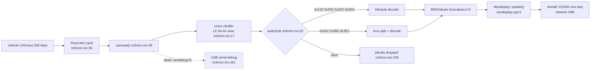

# ibmthinkpad / model3mon

## 1. Provenance

- Submodule path: `legacy/ibmthinkpad-model3mon`
- Pinned gitlink (`git ls-files -s legacy/ibmthinkpad-model3mon`): `160000 db9897789a9359a43cdcdc14058cb992e16bb3e8 0`
- Submodule HEAD (`git -C legacy/ibmthinkpad-model3mon rev-parse HEAD`): `db9897789a9359a43cdcdc14058cb992e16bb3e8` — matches the gitlink
- `git -C legacy/ibmthinkpad-model3mon status --porcelain`: clean
- Upstream URL: `https://github.com/ibmthinkpad/model3mon` (only remote)
- License: MIT — `LICENSE:1-21`, "Copyright (c) 2020 Rik L." (matches sketch author "Roderik Leijssen", `m3mon.ino:2`)
- Analysis date: 2026-11-21
- Mode: **replace** — this document replaces the previous summary in place. Pre-replace claims are cited as `git show HEAD:docs/legacy/ibmthinkpad-model3mon.md` (the working tree matched HEAD at analysis time, so the line numbers in those citations equal the pre-replace file's line numbers).
- Frontmatter: preserved byte-for-byte from the pre-replace doc except the inherited trailing space on the `description:` line, which was stripped. No other frontmatter change. The preserved frontmatter is not factually stale, so no contradiction row is needed for it.
- Preserved `## Upstream (...)` sections: **none found** — the pre-replace doc contained none (verified before writing).
- Files read (FULL-READ):
  - `legacy/ibmthinkpad-model3mon/m3mon.ino` lines 1-221
  - `legacy/ibmthinkpad-model3mon/bmsvalues.h` lines 1-37
  - `legacy/ibmthinkpad-model3mon/nexdisplay.h` lines 1-18
  - `legacy/ibmthinkpad-model3mon/nexdisplay.cpp` lines 1-51
  - `legacy/ibmthinkpad-model3mon/README.md` lines 1-4
  - `legacy/ibmthinkpad-model3mon/LICENSE` lines 1-21
- Files explicitly NOT read (binary Nextion artifacts; only header bytes 0-31 were inspected — STRUCTURAL-PARSE, no content claims made):
  - `hmifont.zi` (2,515 B), `hmifont2.zi` (6,036 B), `m3mon.tft` (276,660 B), `m3mon.hmi` (1,192,071 B)
- No hidden or platform subdirectories were skipped: `git -C legacy/ibmthinkpad-model3mon ls-files` lists exactly the 10 files above; none are dot-prefixed.
- Short names used below: `m3mon.ino`, `bmsvalues.h`, `nexdisplay.h/.cpp` — the submodule files. Our side: `bms.h` = `firmware/lib/vehicle/can/feature/telemetry/bms.h`; `vehicle.h` = `firmware/lib/vehicle/can/handler/bus/vehicle.h`; `ids.h` = `firmware/lib/vehicle/can/ids.h`; `can_sim.h` = `firmware/lib/vehicle/can/feature/misc/can_sim.h`; `test_bms.cpp` = `firmware/test/test_native_bms/test_bms.cpp`.

## 2. Executive verdict

A tiny (221-line) Teensy 3.2 read-only CAN sniffer that decodes 7 Tesla Model 3 BMS frames and pushes the values one-way to a Nextion HMI over UART; it never transmits a CAN frame and it ships no tests or captures. What matters for us is its DBC-faithful little-endian bit extraction: for six of the seven frames its byte/bit convention disagrees with our shipped decoders, which extract the same DBC comments with a different (big-endian / MSB-first) convention — a discrepancy that a bench capture must settle before either side is trusted on a real car. Adaptation candidates are the frames we do not decode at all: `0x3B2` CAC avg/min/max plus lifetime Ah totals (battery-health metrics absent from our firmware), the `0x332` cell-number indexes (which cell is hottest / weakest), and optionally the `0x132` raw-current signal. Never port: the Nextion UART driver, the union type-punning decode style, the monolithic `.ino` switch, and the dead USB debug path.

## 3. Evidence map

| Source file                | Lines      | What it proves                                                                    | Grade        |
| -------------------------- | ---------- | --------------------------------------------------------------------------------- | ------------ |
| `m3mon.ino`                | 39         | `Can0.begin(500000)` — single FlexCAN bus at 500 kbps                             | CODE-READ    |
| `m3mon.ino`                | 17-30      | `union cbuffer` type-punning gives a little-endian 64-bit view of RX bytes         | CODE-READ    |
| `m3mon.ino`                | 52-159     | 7-ID software switch; mux splits on 0x332, 0x3B2, 0x3F2; all other IDs dropped     | CODE-READ    |
| `m3mon.ino`                | 53-84      | 0x332 mux0 temps (0.5, -40) and mux1 brick voltages (0.002 V)                      | CODE-READ    |
| `m3mon.ino`                | 87-104     | 0x3B2 mux0 CAC avg/min/max (0.1 Ah) and mux6 lifetime charge/discharge Ah (0.1 Ah) | CODE-READ    |
| `m3mon.ino`                | 105-106    | Nextion refresh is triggered from the 0x3B2 case; author "fixme" admits coupling   | CODE-READ    |
| `m3mon.ino`                | 109-120    | 0x132 pack voltage/current, little-endian, with float range gates                  | CODE-READ    |
| `m3mon.ino`                | 122-128    | 0x2D2 configured min/max voltage (0.01 V)                                         | CODE-READ    |
| `m3mon.ino`                | 130-137    | 0x3D2 lifetime discharge/charge kWh (0.001 kWh, 32-bit)                            | CODE-READ    |
| `m3mon.ino`                | 139-145    | 0x292 UI SoC mask 0x3FF with a conflicting `10|10@1+` comment, avg SoC bits 30-39    | CODE-READ    |
| `m3mon.ino`                | 147-155    | 0x3F2 mux0 AC / mux1 DC lifetime charge kWh (0.001 kWh)                            | CODE-READ    |
| `m3mon.ino`                | 25,161,180,184 | USB debug path is dead: `candebug` is never set to 1 and the only call is commented out | CODE-READ |
| `nexdisplay.cpp`           | 5-49      | 22-field one-way Nextion serialization, `txt="%4.2f"` / `val=%i` + 0xFF x 3 EOT     | CODE-READ    |
| `bmsvalues.h`              | 6-35      | Plain 22-field public data container, no units, no methods                         | CODE-READ    |
| `README.md`                | 2,4       | Claims: reads "Vehicle CAN bus"; "can also dump the information via USB serial"    | SUMMARY-ONLY |
| `README.md`                | 4         | Claims the .tft/.hmi files "arent strictly neccesary"                               | SUMMARY-ONLY |

No TEST-READ evidence exists: this repo ships no tests. No CAPTURE evidence exists in this repo. Reading coverage: the six text files are FULL-READ; the four binary artifacts are STRUCTURAL-PARSE (32 header bytes each, used only to confirm file type).

## 4. Architecture and build surface

- Entry points: `setup()` at `m3mon.ino:34` (serial + CAN init), `loop()` at `m3mon.ino:42` (drain `Can0` into `canread()`).
- Platform: Arduino sketch for Teensy 3.2; no build flags, no PlatformIO manifest, no library version pinning. Dependencies: `Arduino.h`, `FlexCAN.h` (teachop, `m3mon.ino:5`), `SPI.h` (`m3mon.ino:13` — included but never used, no SPI symbol in the file), plus the two local headers.
- One bus, RX-only: no CAN transmit call exists anywhere (negative anchor in section 16); the sketch is a pure sniffer with a software ID filter (the `switch` at `m3mon.ino:52`).
- Shared core vs port: none — 100% of the logic sits in the sketch plus two leaf helpers (`bmsvalues.h` data container, `nexdisplay.cpp` serializer).



No frame mutation and no TX stage exists: RX → decode → display only.

## 5. Mechanism catalogue

### M1 — CAN RX decode pipeline (union + ID switch)

- **Claim (README / summary):** pre-replace doc line 35 (`git show HEAD:docs/legacy/ibmthinkpad-model3mon.md`): "message receive loop, CAN frame decoding with bitwise extraction of BMS signals".
- **Code path:** `m3mon.ino:43` `loop()` → `m3mon.ino:48` `canread()` → `Can0.read(inMsg)` → `memcpy(frame.bytes, &inMsg.buf, inMsg.len)` (`m3mon.ino:50`) → `switch (inMsg.id)` (`m3mon.ino:52`) → writes `BMSValues` fields.
- **Frame spec:** per-frame rows in section 7. No counter or checksum is consumed anywhere in the repo.
- **Gates and timing:** none found — every frame decoded on arrival, no rate limit, no freshness check.
- **State machine:** None found.
- **Tests:** None found.
- **Evidence grade:** CODE-READ
- **Verdict:** CONFIRMED
- **Adapt to TeslaCANModder?** already present — our equivalent is `vehicle.h:47` `handleVehicleBus()`; do not copy the union-punning style.

### M2 — 0x332 cell/brick min-max mux

- **Claim (README / summary):** pre-replace doc line 47: "multiplexed (mux 0 = temps, mux 1 = voltages)".
- **Code path:** `m3mon.ino:53` `case 0x332` → mux test `(frame.integer & 0x03) == 0` (`m3mon.ino:54`) → mux0 branch (55-71) / else branch (72-84) → `BMSValues` fields.
- **Frame spec:** ID 0x332 (818), DLC assumed 8. Mux in bits 0-1 (mask 0x03). Mux 0: temp max/min cell numbers bits 2-5 / 8-11; temp max/min bits 16-23 / 24-31 (0.5, -40 °C); model temp max/min bits 32-39 / 40-47 (0.5, -40 °C). Mux 1: brick V max/min bits 2-13 / 16-27 (0.002 V); brick V max/min cell numbers bits 32-38 / 40-46, offset +1.
- **Gates and timing:** none found.
- **State machine:** None found.
- **Tests:** None found.
- **Evidence grade:** CODE-READ
- **Verdict:** CONFIRMED (with the mux 2/3 edge case in section 9)
- **Adapt to TeslaCANModder?** partly already present — temps match ours exactly; brick-voltage windows conflict with ours (section 11, row 7); cell-number indexes are a candidate (row 8).

### M3 — 0x3B2 CAC + lifetime Ah mux (also the Nextion refresh trigger)

- **Claim (README / summary):** pre-replace doc line 48: "CAC avg/min/max (Ah capacity), total charge/discharge Ah — multiplexed (mux 0, mux 6)".
- **Code path:** `m3mon.ino:87` `case 0x3B2` → mux test `(frame.integer & 0x1F)` (88) → mux0 CAC branch (88-97) / mux6 Ah branch (98-104) → `display.update()` runs after both, for every 0x3B2 frame (`m3mon.ino:106`).
- **Frame spec:** ID 0x3B2 (946), DLC assumed 8. Mux in bits 0-4 (mask 0x1F). Mux 0: CAC avg bits 6-18, min bits 19-31, max bits 40-52, all (0.1, 0) Ah. Mux 6: charge Ah total bits 8-31, discharge Ah total bits 32-55, both (0.1, 0) Ah. Other muxes ignored.
- **Gates and timing:** display refresh rate is coupled to the 0x3B2 RX rate (`m3mon.ino:105` fixme comment: "screen updates are slow unless I update the screen at the slowest CAN message on the bus").
- **State machine:** None found.
- **Tests:** None found.
- **Evidence grade:** CODE-READ
- **Verdict:** CONFIRMED
- **Adapt to TeslaCANModder?** candidate for future PR — `ids.h` has no 0x3B2 and our firmware decodes neither CAC nor lifetime Ah (section 11, row 9).

### M4 — 0x132 HV pack voltage/current with range gates

- **Claim (README / summary):** pre-replace doc line 49: "Pack voltage (0.01V scale), smooth current (-0.1A scale), raw current (-0.05A + 500 offset)".
- **Code path:** `m3mon.ino:109` `case 0x132` → three extractions (110-119) → `bms.battvoltage`, `bms.smoothcurrenta`, `bms.rawcurrenta`.
- **Frame spec:** ID 0x132 (306), DLC assumed 8. Voltage bits 0-15 (0.01 V); smooth current bits 16-31 signed (-0.1 A); raw current bits 32-47 signed (-0.05, +500 A). All read little-endian through the union.
- **Gates and timing:** float range gates reject out-of-range raw values: smooth current kept only inside -3276.7..3276.7 (`m3mon.ino:114`), raw current only inside -1138.35..2138.4 (`m3mon.ino:118`).
- **State machine:** None found.
- **Tests:** None found.
- **Evidence grade:** CODE-READ
- **Verdict:** CONFIRMED (upstream-internal quirk: the `> -3276.7` half of the smooth-current gate is always true because `message` is unsigned — section 9)
- **Adapt to TeslaCANModder?** voltage/current already present on our side (byte-order conflict, section 11 rows 1-2); raw current is a low-priority candidate (row 3).

### M5 — 0x292 SoC pair decode

- **Claim (README / summary):** pre-replace doc line 52: "UI SOC %, average SOC % (0.1% scale, 10-bit)".
- **Code path:** `m3mon.ino:139` `case 0x292` → `ui_soc` (140-141), `avg_soc` (143-144).
- **Frame spec:** ID 0x292 (658), DLC assumed 8. `ui_soc` mask `frame.integer & 0x3FF` = bits 0-9, but the same-line DBC comment claims `10|10@1+` = bits 10-19 (`m3mon.ino:140`) — mask and comment disagree. `avg_soc` bits 30-39 (`0xFFC0000000 >> 30`, `m3mon.ino:143`), consistent with its comment. Both (0.1, 0) %.
- **Gates and timing:** none found.
- **State machine:** None found.
- **Tests:** None found.
- **Evidence grade:** CODE-READ
- **Verdict:** PARTIAL — the code is internally inconsistent about which window holds UI SoC; the mask contradicts the DBC comment it quotes.
- **Adapt to TeslaCANModder?** capture-first — our side ships two decoders covering both windows but with mask/comment mismatches of its own (section 11 rows 4-5).

### M6 — 0x3F2 muxed kWh counters

- **Claim (README / summary):** pre-replace doc line 53: "Total AC charge kWh, total DC charge kWh — multiplexed".
- **Code path:** `m3mon.ino:147` `case 0x3F2` → mux test `(frame.integer & 0x7)` (148) → mux0 AC total (149-150) / mux1 DC total (152-153); other muxes ignored.
- **Frame spec:** ID 0x3F2 (1010), DLC assumed 8. Mux in bits 0-2 (mask 0x7, comment `0|3@1+`). Counter bits 8-39 (0.001 kWh) on both muxes, little-endian.
- **Gates and timing:** none found.
- **State machine:** None found.
- **Tests:** None found.
- **Evidence grade:** CODE-READ
- **Verdict:** CONFIRMED
- **Adapt to TeslaCANModder?** already present (ours also decodes mux 2/3); endianness and mux-width deltas in section 11 row 12.

### M7 — Nextion serialization (nexdisplay)

- **Claim (README / summary):** pre-replace doc line 37: "serializes `BMSValues` to Nextion display commands via UART"; README:4 "in a very basic way".
- **Code path:** `m3mon.ino:106` `display.update()` → `nexdisplay.cpp:5` `update()` → 22 `sendCommand()` calls (6-30) → `nexdisplay.cpp:33/42` `sendCommand(char*, float/int)` → `port.print` + three `0xFF` terminators (36-39, 45-48).
- **Frame spec:** not a CAN frame. UART text protocol: `obj.txt="%4.2f"` for floats (`nexdisplay.cpp:35`), `obj.val=%i` for ints (`nexdisplay.cpp:44`), EOT `0xFF 0xFF 0xFF`. 22 objects: cellmaxtempnum, cellmintempnum, cellmaxtemp, cellmintemp, cellmaxvnum, cellminvnum, cellmaxv, cellminv, uisoc, avgsoc, batterybar, voltage, current, chargedkwh, dischargedkwh, chargedah, dischargedah, chargedac, chargeddc, cacmin, cacavg, cacmax.
- **Gates and timing:** driven only from the 0x3B2 case (`m3mon.ino:106`) — see M3. One-way: no Nextion response is ever read.
- **State machine:** None found.
- **Tests:** None found.
- **Evidence grade:** CODE-READ
- **Verdict:** CONFIRMED
- **Adapt to TeslaCANModder?** never port — platform-specific one-way UART UI; our equivalents (web dashboard, REST, BLE) already cover this surface.

### M8 — USB serial debug path (dead)

- **Claim (README / summary):** pre-replace doc line 15 ("displays it via USB serial") and README:4 ("it can also dump the information via USB serial").
- **Code path:** `m3mon.ino:25` `bool candebug = 0` → read only at `m3mon.ino:161`; `printBMSData()` declared at 22, defined at 184, its only call commented out at 180; `printBytes()` defined at 214, never called.
- **Frame spec:** None found (no CAN framing involved).
- **Gates and timing:** raw-dump gated on `candebug == 1` (`m3mon.ino:161`) — unreachable because nothing ever assigns 1.
- **State machine:** None found.
- **Tests:** None found.
- **Evidence grade:** CODE-READ
- **Verdict:** CONTRADICTED — as shipped, the sketch's only USB output is `"Starting up!"` (`m3mon.ino:37`); the documented USB dump requires editing the source.
- **Adapt to TeslaCANModder?** never port — no impact (our log ring and JSON status already provide this).

No mechanism in this repo has 3 or more states, so no state diagrams apply; the only diagram is the data-flow in section 4.

## 6. Summary vs code contradiction table

Pre-replace citations use `git show HEAD:docs/legacy/ibmthinkpad-model3mon.md`; line numbers equal the working-tree numbers because the tree matched HEAD.

| # | Claim (source) | Code says | Grade of the claim | Resolution |
| - | -------------- | --------- | ------------------ | ---------- |
| 1 | "displays it via USB serial" (pre-replace doc line 15) and "it can also dump the information via USB serial" (upstream `README.md:4`) | `candebug` is initialized 0 and never set (`m3mon.ino:25`, read at 161); the only `printBMSData()` call is commented out (`m3mon.ino:180`, function at 184); `printBytes()` (214) never called. Shipped USB output = `"Starting up!"` only (`m3mon.ino:37`) | SUMMARY-ONLY | Doc overstates: the USB dump exists only as dead code; enabling it requires a source edit |
| 2 | "Signal scale/offset values verified against community DBC" (pre-replace doc line 65) | The repo contains only inline DBC-style comments copied from the joshwardell DBC referenced at `m3mon.ino:7-8`; no test, no capture, no comparison artifact exists | SUMMARY-ONLY | "Verified" is an overstatement; agreement of comments with DBC text is SUMMARY-ONLY until a capture confirms behavior |
| 3 | "FlexCAN library usage on Teensy for native CAN (no external transceiver needed)" (pre-replace doc line 66) | `m3mon.ino:39` proves only that the FlexCAN library is used; the code cannot settle transceiver presence. Teensy 3.2's FlexCAN is a controller only — a 3.3 V CAN transceiver (e.g. SN65HVD230 class) is required hardware | SUMMARY-ONLY | Doc claim is wrong for Teensy 3.2 hardware; verify against the PJRC Teensy 3.2 CAN schematics/docs |
| 4 | — (upstream-internal) `Serial2` comment "baud=9600" (`m3mon.ino:36`) | Same line: `Serial2.begin(115200)` | CODE-READ | Comment and code disagree; which baud the shipped `.tft` expects is UNVERIFIED (binary not read) |
| 5 | — (upstream-internal) `SOCUI292 : 10|10@1+` DBC comment (`m3mon.ino:140`) | Same line: mask `frame.integer & 0x3FF` extracts bits 0-9, not 10-19 | CODE-READ | Mask and comment contradict; per the quoted DBC the mask is the suspect, so upstream `ui_soc` likely reads the wrong window |
| 6 | "`m3mon.tft` / `.hmi` … compiled display firmware" (pre-replace doc lines 38-39) | Header bytes match Nextion artifacts (`m3mon.hmi` starts `main.HMI`; `m3mon.tft` carries a Nextion-style header) — consistent | STRUCTURAL-PARSE | Not a contradiction; recorded to bound what the binaries can be claimed to be |

## 7. CAN frame and signal inventory

Bus column: the sketch has a single bus (`Can0`); "Vehicle CAN" comes from `README.md:2` (SUMMARY-ONLY). Period: None found in code for every frame. Counter position: None found — no frame in this repo carries a consumed counter. Checksum: None found — no frame in this repo carries a consumed checksum (negative anchor in section 16). All rows are read-only; the repo never transmits.

| ID (hex / dec)    | Bus                 | Period            | DLC | Byte/bit layout                                                                                                       | Scale / units             | Counter | Checksum | R/W  | Grade     |
| ----------------- | ------------------- | ----------------- | --- | --------------------------------------------------------------------------------------------------------------------- | ------------------------- | ------- | -------- | ---- | --------- |
| 0x332 / 818       | single bus (SUMMARY-ONLY: Vehicle) | None found | 8 assumed | mux bits 0-1; m0: temp# max/min bits 2-5 / 8-11, temp max/min bits 16-23 / 24-31, modelT max/min bits 32-39 / 40-47; m1: brick V max/min bits 2-13 / 16-27, brick V# max/min bits 32-38 / 40-46 (offset +1) | temps 0.5, -40 °C; V 0.002 V; numbers 1, +1 | None found | None found | Read | CODE-READ |
| 0x3B2 / 946       | single bus (SUMMARY-ONLY: Vehicle) | None found | 8 assumed | mux bits 0-4; m0: CAC avg/min/max bits 6-18 / 19-31 / 40-52; m6: charge Ah total bits 8-31, discharge Ah total bits 32-55 | 0.1 Ah throughout | None found | None found | Read | CODE-READ |
| 0x132 / 306       | single bus (SUMMARY-ONLY: Vehicle) | None found | 8 assumed | voltage bits 0-15; smooth current bits 16-31 signed; raw current bits 32-47 signed                    | 0.01 V; -0.1 A; -0.05, +500 A | None found | None found | Read | CODE-READ |
| 0x2D2 / 722       | single bus (SUMMARY-ONLY: Vehicle) | None found | 8 assumed | min voltage bits 0-15; max voltage bits 16-31                                           | 0.01 V                    | None found | None found | Read | CODE-READ |
| 0x3D2 / 978       | single bus (SUMMARY-ONLY: Vehicle) | None found | 8 assumed | discharge kWh bits 0-31; charge kWh bits 32-63                                          | 0.001 kWh (32-bit)        | None found | None found | Read | CODE-READ |
| 0x292 / 658       | single bus (SUMMARY-ONLY: Vehicle) | None found | 8 assumed | ui SoC: mask covers bits 0-9, comment claims bits 10-19 (see section 6 row 5); avg SoC bits 30-39 | 0.1 %                     | None found | None found | Read | CODE-READ |
| 0x3F2 / 1010      | single bus (SUMMARY-ONLY: Vehicle) | None found | 8 assumed | mux bits 0-2; m0 AC total bits 8-39; m1 DC total bits 8-39                               | 0.001 kWh (32-bit)        | None found | None found | Read | CODE-READ |

## 8. Constants and tuning table

| Constant          | Value              | File:line            | Meaning                                                             | Grade     |
| ----------------- | ------------------ | -------------------- | ------------------------------------------------------------------- | --------- |
| CAN bitrate       | 500000             | `m3mon.ino:39`       | Only bus rate; matches our vehicle bus 500 kbps                     | CODE-READ |
| USB / UART baud   | 115200             | `m3mon.ino:35-36`    | Serial + Serial2 rates; line 36's comment says 9600 (contradiction) | CODE-READ |
| Temp scale       | 0.5                | `m3mon.ino:62,65,68,71` | °C per LSB for all 0x332 mux0 temperatures                       | CODE-READ |
| Temp offset      | -40                | `m3mon.ino:62-71`    | °C offset for all 0x332 mux0 temperatures                            | CODE-READ |
| Brick V scale     | 0.002              | `m3mon.ino:73,76`    | V per LSB for 0x332 mux1 brick voltages                             | CODE-READ |
| Cell number offset | +1               | `m3mon.ino:79-83`    | Display numbering of brick V max/min cells (DBC `(1,1)`)             | CODE-READ |
| CAC / Ah scale    | 0.1                | `m3mon.ino:91,94,97,99-103` | Ah per LSB for CAC and lifetime Ah totals                     | CODE-READ |
| Voltage scale     | 0.01               | `m3mon.ino:111,123,126` | V per LSB for 0x132 and 0x2D2 voltages                            | CODE-READ |
| Smooth current    | -0.1               | `m3mon.ino:113-115`  | A per LSB, sign flipped (discharge negative)                        | CODE-READ |
| Raw current       | -0.05, +500        | `m3mon.ino:117-119`  | A per LSB with +500 offset                                           | CODE-READ |
| kWh scale         | 0.001              | `m3mon.ino:131-136,149-153` | kWh per LSB for 0x3D2 and 0x3F2 counters                        | CODE-READ |
| SoC scale         | 0.1                | `m3mon.ino:140-144`  | % per LSB for both 0x292 SoC signals                                | CODE-READ |
| Smooth-current gate | -3276.7 / 3276.7 | `m3mon.ino:114`    | float gate; the lower half is always true (unsigned `message`)      | CODE-READ |
| Raw-current gate  | -1138.35 / 2138.4  | `m3mon.ino:118`      | float gate on raw current                                           | CODE-READ |
| kWh float gate    | 4294967.295        | `m3mon.ino:132,135`  | Rejects the DBC maximum; not exactly representable in float         | CODE-READ |
| Mux masks         | 0x03 / 0x1F / 0x7  | `m3mon.ino:54,88,148` | Mux widths for 0x332 (2 bits), 0x3B2 (5 bits), 0x3F2 (3 bits)     | CODE-READ |
| Nextion EOT       | 0xFF x 3           | `nexdisplay.cpp:37-39,46-48` | End-of-transmission terminator for every Nextion command      | CODE-READ |
| Nextion float fmt | `%4.2f`            | `nexdisplay.cpp:35`  | Nextion has no float type; values sent as 2-decimal strings         | CODE-READ |

Trivial constants (buffer sizes, format widths, pin defaults) are skipped per the contract.

## 9. Failure modes and edge cases

| Failure                          | Handling code path                                                            | Tested? | Grade     |
| -------------------------------- | ------------------------------------------------------------------------------ | ------- | --------- |
| Short-DLC frame leaves stale bytes in the decode union | `memcpy(frame.bytes, &inMsg.buf, inMsg.len)` at `m3mon.ino:50` never zeroes the union first — bytes from the previous frame survive and get decoded as part of the current frame | No | CODE-READ |
| No DLC validation before masking  | every case masks `frame.integer` without checking `inMsg.len` (`m3mon.ino:52-159`) | No | CODE-READ |
| 0x332 mux 2 or 3 decoded as mux 1 | mux test is `== 0` with an `else` (`m3mon.ino:54,72`), so any non-zero mux (2, 3) falls into the brick-voltage branch | No | CODE-READ |
| kWh gate rejects the true maximum | `if ((float)message < 4294967.295)` (`m3mon.ino:132,135`) — the all-ones 32-bit counter is also not exactly representable in float | No | CODE-READ |
| Dead half of smooth-current gate  | `(float)message > -3276.7` with unsigned `message` is always true (`m3mon.ino:114`) | No | CODE-READ |
| No bus-off / error recovery       | `Can0.begin(500000)` once (`m3mon.ino:39`); no error flags polled, no retry, no watchdog | No | CODE-READ |
| Display freeze on missing 0x3B2   | `display.update()` fires only from the 0x3B2 case (`m3mon.ino:106`); if 0x3B2 stops, the HMI shows stale values with no staleness indicator | No | CODE-READ |
| Declared default constructor has no definition | `Nexdisplay()` declared at `nexdisplay.h:8`, only the 2-arg constructor defined at `nexdisplay.cpp:3` — linking would fail if used | No | CODE-READ |
| No OTA, queue, brownout, or reboot handling | None found - none of these concepts exist in the repo | No | CODE-READ |

## 10. Test coverage map

No TEST-READ evidence exists: this repo ships no tests (no test files in `git ls-files`, negative anchor in section 16).

Critical paths with no test, and the risk in one line each:

- Every mask/scale in section 7 — a single wrong bit position would silently produce plausible-looking garbage; nothing would catch it.
- Mux selection on 0x332 / 0x3B2 / 0x3F2 — including the mux 2/3 edge case (section 9).
- The stale-union short-DLC path (section 9) — would only appear with malformed frames.
- Nextion command framing (`nexdisplay.cpp:33-49`) — no loopback or echo check exists; a broken display link is invisible to the sketch.

## 11. Parity matrix with TeslaCANModder

Our-side citations in every row are CODE-READ from `bms.h` (full read, lines 1-585), `vehicle.h` (lines 1-330), `ids.h` (lines 1-122), `can_sim.h` (lines 1-80), and `test_bms.cpp` (lines 1-59). The recurring delta: upstream extracts through a little-endian union matching the quoted DBC `@1+` comments; our decoders extract the same named windows with a big-endian (word-aligned frames) or MSB-first (sub-byte signals) convention. Both sides claim the same DBC comments, so at most one convention is right for a real vehicle — every affected row is therefore capture-first.

| # | Signal / frame          | Upstream decode (cite)                        | Our decode (cite)                          | Delta                                             | Action |
| - | ----------------------- | --------------------------------------------- | ------------------------------------------- | ------------------------------------------------- | ------ |
| 1 | 0x132 pack voltage      | bits 0-15 little-endian, x0.01 (`m3mon.ino:110-111`) | `bms.h:18-22` big-endian `(data[0]<<8)\|data[1]`, x0.01, stored at `vehicle.h:77` | opposite byte order for the same window | capture-first |
| 2 | 0x132 smooth current    | bits 16-31 signed, -0.1 (`m3mon.ino:113-115`)  | `bms.h:29-33` bytes 2-3 signed BE, x0.1, stored at `vehicle.h:78` | opposite byte order | capture-first |
| 3 | 0x132 raw current       | bits 32-47, -0.05, +500 (`m3mon.ino:117-119`)  | None found — no decoder, no state field (`bms.h` full read; `ids.h:37`) | gap | candidate (capture first) |
| 4 | 0x292 UI SoC            | mask 0x3FF = bits 0-9 while the comment claims bits 10-19 (`m3mon.ino:140`) | two decoders: `bms.h:50-54` (bits 0-9 claimed) and `bms.h:191-195` `decodeBmsSocUI` (bits 10-19 claimed, mask `((data[1]&0x3F)<<4)\|(data[2]>>4)`), stored at `vehicle.h:90` | three mutually inconsistent implementations of one 10-bit signal | capture-first |
| 5 | 0x292 average SoC      | bits 30-39, x0.1 (`m3mon.ino:143-144`)         | `bms.h:213-217` claims bits 30-39 but masks `((data[3]&0x03)<<8)\|data[4]`, i.e. frame bits 24-25 + 32-39, stored at `vehicle.h:92` | our mask deviates from its own comment and from upstream | align + capture-first |
| 6 | 0x332 thermistor/model temps (mux 0) | bytes 2-5, 0.5, -40 (`m3mon.ino:61-71`) | `bms.h:527-560` bytes 2-5, 0.5, -40, stored at `vehicle.h:240-243` | none — identical byte-aligned decode | none — already present |
| 7 | 0x332 brick V max/min (mux 1) | bits 2-13 / 16-27 little-endian, x0.002 (`m3mon.ino:73-77`) | `bms.h:125-140` MSB-first masks `((data[0]&0x3F)<<6)\|(data[1]>>2)` / `(data[2]<<4)\|(data[3]>>4)`, x0.002, stored at `vehicle.h:234-235` | different bits extracted on identical wire bytes | capture-first |
| 8 | 0x332 cell number indexes | mux0 temp# bits 2-5 / 8-11; mux1 brick V# bits 32-38 / 40-46, +1 (`m3mon.ino:55-59,79-83`) | None found — no decoder or state field | gap (locating the hottest / weakest cell) | candidate for future PR |
| 9 | 0x3B2 CAC avg/min/max + lifetime Ah | mux0 CAC bits 6-18 / 19-31 / 40-52; mux6 Ah bits 8-31 / 32-55, x0.1 (`m3mon.ino:88-104`) | None found — `ids.h` has no 0x3B2 (negative anchor, section 16) | gap (battery-health metrics) | candidate for future PR (capture first) |
| 10 | 0x2D2 min/max bus voltage | bits 0-15 / 16-31 little-endian, x0.01 (`m3mon.ino:123-127`) | `bms.h:404-419` big-endian, x0.01, stored at `vehicle.h:277-278`; ours also decodes charge/discharge current limits (superset) | opposite byte order; coverage superset on our side | capture-first |
| 11 | 0x3D2 lifetime kWh      | bits 0-31 / 32-63 little-endian, x0.001 (`m3mon.ino:131-136`) | `bms.h:491-508` big-endian words, x0.001, stored at `vehicle.h:288-289` | opposite byte order | capture-first |
| 12 | 0x3F2 muxed kWh counters | mux mask 0x7 (3 bits), counter bits 8-39 little-endian, mux 0 AC / 1 DC (`m3mon.ino:147-153`) | `bms.h:515-520` big-endian bytes 1-4, x0.001; mux dispatch on the full byte at `vehicle.h:297-313` covers mux 0-3 (AC, DC, regen, drive discharge — superset) | opposite byte order; upstream masks the mux to its declared width, we do not | capture-first; align mux mask when touched |

Two cross-cutting facts bound this table:

- Our BMS decoders have no numeric test oracle: `test_bms.cpp:38-51` only asserts `executeBmsCmd` command recognition; no `firmware/test` file references any `decodeBms*` value (negative anchor in section 16).
- Our simulation (`can_sim.h:47-60`) generates 0x132 and 0x292 frames in the same big-endian convention our decoders read (`0x1068` -> 419.76 V at `can_sim.h:50`, `0x02BC` -> 70.0 % at `can_sim.h:59`), so sim-to-decoder agreement is self-consistency, not evidence about the real bus.

## 12. Surface inventory and security notes

| Surface | Semantics | Cite |
| ------- | --------- | ---- |
| USB Serial (`Serial`, 115200) | Output only. As shipped: `"Starting up!"` (`m3mon.ino:37`). Raw-dump and value-dump paths exist but are dead (`m3mon.ino:25,161,180,184,214`). No input is ever read from USB | `m3mon.ino:35-37,161-221` |
| Serial2 UART (115200; same-line comment says 9600) | One-way Nextion command stream: 22 object writes per 0x3B2 frame, `obj.txt="%4.2f"` / `obj.val=%i` + 0xFF x 3. Display responses are never read | `m3mon.ino:36`, `nexdisplay.cpp:5-49` |
| CAN Can0 (500 kbps) | RX only. 7 IDs decoded; every other ID silently dropped (`m3mon.ino:156-158`). No CAN transmit exists anywhere (negative anchor in section 16). No hardware acceptance filter is configured — the `switch` is the only filter | `m3mon.ino:39,52-159` |

Provenance and security findings:

- Hardcoded credentials / keys / certs: None found.
- Dangerous build flags: None found (no build system beyond Arduino IDE defaults).
- Untrusted archives / binaries: `m3mon.tft` is a 276,660-byte prebuilt Nextion display firmware blob of unreviewed provenance (STRUCTURAL-PARSE only). Anyone reusing this project flashes that blob unmodified; we never should.
- Untrusted inputs: CAN bytes are the only external input; all extraction is mask-bounded. Nextion-side input is ignored entirely.

## 13. Adaptation assessment

| Mechanism / idea | Value | Cost | Risk | Evidence grade | Decision |
| ---------------- | ----- | ---- | ---- | -------------- | -------- |
| 0x3B2 CAC avg/min/max + lifetime Ah totals | high — battery-health metrics our firmware does not expose at all | low — one mux branch in `vehicle.h` plus `State` fields, mirroring existing `bms.h` decoder style | low — read-only decode, no frame mutation | CODE-READ upstream, no CAPTURE | candidate for future PR (bench capture first; can-review checklist not triggered — no TX) |
| 0x332 cell number indexes | medium — identifies which cell is hottest / weakest, not just the value | low | low | CODE-READ upstream | candidate for future PR |
| 0x132 raw current | low — we already show smooth current and derived power | low | low | CODE-READ upstream | candidate (low priority, capture first) |
| Little-endian DBC-convention decode (6 frames) | high as a validation task — either our decoders or the quoted DBC convention is wrong on a real car | medium — one listen-only bench capture session | ignoring it risks shipping garbage BMS numbers while the sim looks fine | CODE-READ both sides, no CAPTURE either side | capture-first, then align the losing side |
| Nextion UART driver | none - platform-specific one-way UI | not assessed | not assessed | CODE-READ | never port |
| Union type-punning decode style | none - we have per-byte decode helpers | not assessed | strict-aliasing UB pattern | CODE-READ | never port |
| Monolithic `.ino` switch | none - we have the handler pipeline | not assessed | not assessed | CODE-READ | no impact |
| Dead USB debug path | none | not assessed | not assessed | CODE-READ | never port |
| Mux-width masking (mask to declared mux bits: 0x03 / 0x1F / 0x7) | low — robustness against mux bytes with extra bits set | low | low | CODE-READ upstream; our `vehicle.h:297` uses the full byte | align when next touching the 0x3F2 handler |

## 14. Do-not-copy list

| Item | File:line | Reason |
| ---- | --------- | ------ |
| `union cbuffer` type-punning decode | `m3mon.ino:17-20,50` | C++ strict-aliasing UB pattern; keep our per-byte extraction in `bms.h` |
| `memcpy` into a never-zeroed union | `m3mon.ino:50` | Stale-byte bug across frames (section 9) |
| 108-line monolithic ID switch in the sketch entry file | `m3mon.ino:52-159` | We have the handler pipeline (`vehicle.h:47`); port behavior, not structure |
| Misleading indentation around gated assignments | `m3mon.ino:131-137` | The `message = ...` at line 134 is indented as if gated by the `if` at 132 but always runs; also the meaningless float gates |
| `sprintf` into fixed 64-byte buffers with no bounds check | `nexdisplay.cpp:33-49` | Replace with our bounded JSON serialization if any of this is ever adapted |
| Binary Nextion artifacts (.tft / .hmi / .zi) | `m3mon.tft`, `m3mon.hmi`, `hmifont*.zi` | Never import binaries from `legacy/` into shipping trees; provenance unreviewed |
| Wholesale DBC comment text | `m3mon.ino:55-153` | Sourced from the joshwardell DBC (`m3mon.ino:7-8`); that catalog's license is not established in this repo — treat signal values as data to re-derive from captures, attribute the source |

## 15. History and evolution

- Local `git log` contains exactly one commit: `db9897789a9359a43cdcdc14058cb992e16bb3e8` — 2020-11-25 — "Added initial project files" — Rik L.
- No tags, single branch (`main`), no other refs. Nothing was visibly tried, abandoned, or rolled back — the project was published in one drop.
- Pre-pin history: none exists locally; the repo's local history begins at the pinned commit. Network-only history (GitHub issues/PRs) was not reviewed — UNVERIFIED.

## 16. Re-verification recipe

Pinned snapshot:

```bash
git ls-files -s legacy/ibmthinkpad-model3mon        # expect: 160000 db9897789a9359a43cdcdc14058cb992e16bb3e8 0
git -C legacy/ibmthinkpad-model3mon rev-parse HEAD  # expect: db9897789a9359a43cdcdc14058cb992e16bb3e8
git -C legacy/ibmthinkpad-model3mon status --porcelain # expect: empty
```

After an upstream bump:

```bash
OLD=db9897789a9359a43cdcdc14058cb992e16bb3e8
git -C legacy/ibmthinkpad-model3mon fetch --tags --prune
git -C legacy/ibmthinkpad-model3mon log --oneline $OLD..origin/main
git -C legacy/ibmthinkpad-model3mon diff --stat $OLD..origin/main
git -C legacy/ibmthinkpad-model3mon diff $OLD..origin/main -- '*.ino' '*.h' '*.cpp'
```

Grep anchors (all were executed at write time on the Windows host with `Select-String` using the identical extended-regex patterns; the expected hits are the observed output):

```text
grep -nE 'case 0x(332|3B2|132|2D2|3D2|292|3F2)' legacy/ibmthinkpad-model3mon/m3mon.ino
  -> expect 7 hits: 53 (0x332), 87 (0x3B2), 109 (0x132), 122 (0x2D2), 130 (0x3D2), 139 (0x292), 147 (0x3F2)
grep -nE 'Can0\.begin' legacy/ibmthinkpad-model3mon/m3mon.ino
  -> expect 1 hit: 39: Can0.begin(500000)
grep -nE '0\.5 \* message\) - 40' legacy/ibmthinkpad-model3mon/m3mon.ino
  -> expect 4 hits: 62, 65, 68, 71
grep -nE 'candebug' legacy/ibmthinkpad-model3mon/m3mon.ino
  -> expect 2 hits: 25 (init 0), 161 (only read)
grep -nE 'printBMSData' legacy/ibmthinkpad-model3mon/m3mon.ino
  -> expect 3 hits: 22 (prototype), 180 (commented-out call), 184 (definition)
grep -nE 'display\.update' legacy/ibmthinkpad-model3mon/m3mon.ino
  -> expect 1 hit: 106 (inside case 0x3B2)
grep -nE '0xFFC0000000|frame\.integer & 0x3FF\)' legacy/ibmthinkpad-model3mon/m3mon.ino
  -> expect 2 hits: 140 (ui_soc mask), 143 (avg_soc bits 30-39)
```

Negative anchors (absence claims):

```text
grep -nE 'Can0\.(write|send)|canWrite|txMsg' legacy/ibmthinkpad-model3mon/m3mon.ino
  -> expect no output (repo never transmits CAN)
grep -nEi 'checksum|crc' legacy/ibmthinkpad-model3mon/m3mon.ino
  -> expect no output (no checksum handling anywhere)
grep -nEi 'test' legacy/ibmthinkpad-model3mon/m3mon.ino
  -> expect no output (no tests shipped)
```

Our-side drift anchors (the `already present` and gap decisions rest on these):

```text
grep -nE 'CAN_ID_BMS_KWH_MUX' firmware/lib/vehicle/can/ids.h
  -> expect 1 hit: 68: #define CAN_ID_BMS_KWH_MUX 0x3F2
grep -nE '0x3B2' firmware/lib/vehicle/can/ids.h
  -> expect no output (we do not define 0x3B2 — parity row 9 gap)
grep -nE 'decodeBmsCellVoltageMax|decodeBmsSocAvg|decodeBmsSocUI' firmware/lib/vehicle/can/feature/telemetry/bms.h
  -> expect 3 hits: 125, 191, 213
grep -nE 'decodeBmsKwhMuxCounter|uint8_t mux = f\.data\[0\]' firmware/lib/vehicle/can/handler/bus/vehicle.h
  -> expect 4 hits: 209, 231 (mux & 0x0F), 297 (full-byte mux), 298
grep -nE 'executeBmsCmd' firmware/test/test_native_bms/test_bms.cpp
  -> expect 4 hits: 41, 48, 49, 50 (dispatch-only tests)
grep -rnE 'decodeBms(SocAvg|CellVoltageMax|KwhMuxCounter)' firmware/test
  -> expect no output (no numeric decode oracle for our BMS decoders)
grep -nE '0x1068|0x02BC' firmware/lib/vehicle/can/feature/misc/can_sim.h
  -> expect 2 hits: 50, 59 (sim generates BE-convention frames)
```

If line numbers drift more than ~10, re-read the whole function; do not trust this document's numbers. Pre-pin upstream history was not reviewed — there is none (single-commit repo, section 15).

## 17. Open questions and explicitly not investigated

- Byte-order conflict (UNVERIFIED): our big-endian / MSB-first decoders vs upstream's little-endian DBC-faithful extraction for 0x132, 0x292, 0x2D2, 0x332 (brick V), 0x3D2, 0x3F2. A listen-only bench capture comparing reported pack voltage and SoC against a known-good reader on the same car would settle all six at once.
- 0x292 UI SoC window (UNVERIFIED): upstream mask says bits 0-9, upstream comment says bits 10-19, our side ships decoders for both windows — only a capture can say which the car populates.
- Mux widths (UNVERIFIED): 0x332 — upstream masks 2 bits, our handler masks 4 bits (`vehicle.h:231`); 0x3F2 — upstream masks 3 bits, our handler uses the full byte (`vehicle.h:297`).
- 0x3B2 frame behavior on real vehicles (UNVERIFIED): presence, period, and whether mux 6 lifetime-Ah counters appear on our three-bus X179 tap; nothing in this repo or ours pins a period.
- Nextion baud (UNVERIFIED): code says 115200, the same-line comment says 9600; the shipped `.tft` (binary, unread) decides which is actually used.
- The four binary artifacts were not read beyond 32 header bytes (STRUCTURAL-PARSE); no claims are made about their contents.
- The "no external transceiver needed" claim (pre-replace doc line 66) is wrong for Teensy 3.2 hardware; verification against PJRC's Teensy 3.2 CAN documentation was not performed in this analysis.
- The joshwardell/model3dbc license status was not investigated; do-not-copy list row 7 stands until it is.
- Network-side upstream history (GitHub issues, PRs, forks) was not reviewed; only the local single-commit history was mined.
