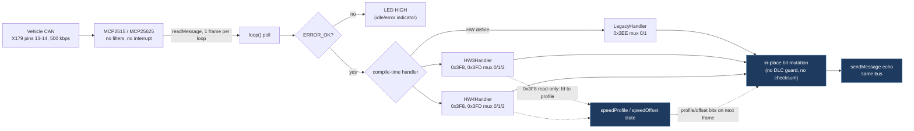

# iubns-tesla-fsd-can-mod

Deep-dive analysis, replace mode, 2026-11-21. The pre-replace summary remains retrievable as `git show HEAD:docs/legacy/iubns-tesla-fsd-can-mod.md` (all `#L<n>` citations in section 6 refer to that snapshot). The YAML frontmatter above is preserved byte-for-byte as stored at HEAD (blob is LF; the pre-replace working tree displayed CRLF as a checkout artifact), including its truncated description line — see contradiction row C5. This document uses LF endings. The pre-replace doc contained no `## Upstream (...)` sections, so no verbatim sections were carried over.

## 1. Provenance

- Submodule: `legacy/iubns-tesla-fsd-can-mod`
- Pinned gitlink (canonical form): `160000 b4a805f95fe25e5a8b8a9e718213ffd997561482 0` from `git ls-files -s legacy/iubns-tesla-fsd-can-mod`; matches `git -C legacy/iubns-tesla-fsd-can-mod rev-parse HEAD`; submodule working tree clean (`status --porcelain` empty).
- Upstream: `https://github.com/iubns/tesla-fsd-can-mod` (origin remote). Author from commit metadata: iubns <iubns@naver.com>.
- License: GPL-3.0 — `LICENSE:1-5` (RANGE-CITED; the remainder is the canonical 674-line GPL-3.0 text), restated `README.md:165-167`, header block `RP2040CAN.ino:1-14`.
- Analysis date: 2026-11-21. Mode: replace.
- Upstream files read, FULL-READ: `RP2040CAN.ino` (lines 1-226, entire file), `UNO_MCP2515_CAN.ino` (lines 1-306, entire file), `README.md` (lines 1-167, entire file), `README.ko.md` (lines 1-246, entire file, Korean wiring/setup guide). RANGE-CITED: `LICENSE` lines 1-5. `git -C legacy/iubns-tesla-fsd-can-mod ls-files` inventory is exactly these 5 files — no hidden or platform directories exist, nothing skipped.
- Our-side files read as parity evidence, FULL-READ: `firmware/lib/vehicle/can/handler/variant/hw4.h` (1-169), `firmware/lib/vehicle/can/handler/variant/hw3.h` (1-155), `firmware/lib/vehicle/can/handler/variant/legacy.h` (1-84), `firmware/lib/vehicle/can/handler/variant/bits.h` (1-58), `firmware/lib/vehicle/can/feature/fsd/profile.h` (1-111), `firmware/lib/vehicle/can/feature/fsd/offsets.h` (1-95), `firmware/lib/vehicle/can/feature/fsd/fsd.h` (1-58), `firmware/lib/vehicle/can/handler/helpers.h` (1-62). RANGE-CITED: `firmware/lib/vehicle/can/ids.h` (lines 15-25 via grep anchor A20, lines 90-122 read in full), `firmware/test/test_native_hw4/test_hw4.cpp` (159-188, 221-248), `firmware/test/test_native_hw3/test_hw3.cpp` (98-115), `firmware/lib/core/types.h` (lines 63, 315, 615, 780, 837 via grep), `firmware/lib/client/command/dispatch.h` (659-670 via grep), `firmware/lib/core/persist/nvs.h` (100, 155 via grep), `firmware/test/test_native_legacy/test_legacy.cpp` and `firmware/test/test_native_helpers/test_helpers.cpp` (test names and RUN_TEST lines via grep only).
- Files explicitly NOT read: everything else in the shipping firmware/client/protocol/tools trees (parity scope only, listed above); `LICENSE` lines 6-674. No unread directories exist inside the submodule.

## 2. Executive verdict

A minimal, single-bus Arduino echo-mod: two sketch files (RP2040 reference + AVR port) that passively poll one MCP2515, intercept three Tesla CAN IDs (1006/1016/1021), flip a handful of bits in place, and retransmit the mutated frame on the same bus. All four load-bearing mechanisms — FSD enable bits on 0x3FD mux 0, nag bit 19 (+47 on HW4) clear on mux 1, follow-distance-to-profile auto mapping on 0x3F8, and the HW3 speed-offset pipeline — already exist in TeslaCANModder's variant handlers with identical constants, plus runtime gates (AP gate, nag mode, fsd force), DLC guards, persistence, and native tests that this repo entirely lacks. Zero port candidates. The repo's real value is independent confirmation of the bit layout: it agrees with our `bits.h`/`profile.h`/`offsets.h` on every constant (46/60/59/19/47, follow-distance maps, -30 bias, ×5 offset scaling), which raises confidence in our frame spec without any CAPTURE evidence on either side. Do not copy the monolith style, the DLC-blind writes, or the unconditional mux-2 retransmit; and do not trust the README's ASS claim, its legacy profile table, or its "speed-offset via follow-distance" wording (contradicted by the code).

## 3. Evidence map

| Source file | Lines | What it proves | Grade |
| ----------- | ----- | -------------- | ----- |
| `RP2040CAN.ino` | 21-26 | Compile-time variant selection via `#define HW` (defaults HW3); HW4 comment ties FSD V14 to vehicle fw 2026.2.3 | CODE-READ |
| `RP2040CAN.ino` | 28-38 | `enablePrint` debug flag; `ENABLE_APPROACHING_EMERGENCY_VEHICLE_DETECTION` compile flag | CODE-READ |
| `RP2040CAN.ino` | 42-50 | `CarManagerBase` with dead `FSDEnabled` member; mux = `data[0] & 0x07` | CODE-READ |
| `RP2040CAN.ino` | 52-59 | FSD-UI bit = `data[4] >> 6 & 0x01`; v12/v13 profile = `data[6]` bits [2:1] | CODE-READ |
| `RP2040CAN.ino` | 61-72 | Generic `setBit()` bit-index helper, no bounds checks | CODE-READ |
| `RP2040CAN.ino` | 75-100 | Legacy handler: 0x3EE only; mux 0 sets bit 46 + profile; mux 1 clears bit 19; print uses never-written member | CODE-READ |
| `RP2040CAN.ino` | 102-154 | HW3 handler: 0x3F8 follow-distance map; 0x3FD mux 0 bit 46 + profile; mux 1 bit 19; mux 2 offset write | CODE-READ |
| `RP2040CAN.ino` | 156-194 | HW4 handler: 0x3F8 five-level map; mux 0 bits 46/60/(59); mux 1 bits 19/47; mux 2 profile bits [6:4] of byte 7 | CODE-READ |
| `RP2040CAN.ino` | 200-226 | 500 kbps / 16 MHz bring-up; polling loop; LED as error indicator; TX return ignored | CODE-READ |
| `UNO_MCP2515_CAN.ino` | 9-30 | AVR port: `HW_TARGET` selection, switchable `MCP2515_CLOCK`, static handler instances | CODE-READ |
| `UNO_MCP2515_CAN.ino` | 63-88 | `sendFrame()` TX-failure logging; shared `printHandlerStatus()` | CODE-READ |
| `UNO_MCP2515_CAN.ino` | 90-259 | Same bit-level mutation logic as RP2040 sketch; `constrain()` clamp; mux-2 gates on `selected` | CODE-READ |
| `UNO_MCP2515_CAN.ino` | 266-306 | UNO bring-up with `pinMode()` calls; handler null-guard in loop | CODE-READ |
| `README.md` | 17-64 | Claimed behaviour: FSD activation trigger, follow-distance mapping, HW4 EVD, variant table | SUMMARY-ONLY |
| `README.md` | 66-131 | Hardware list, board package, autowp MCP2515 library, X179/X652 wiring, 120 Ω cut | SUMMARY-ONLY |
| `README.md` | 133-155 | Profile tables (legacy offset-based, HW3/HW4 distance-based) | SUMMARY-ONLY |
| `README.ko.md` | 63-109, 227-233 | Korean install guide; UNO wiring table; clock and `setBitrate failed` troubleshooting | SUMMARY-ONLY |
| `LICENSE` | 1-5 | GPL-3.0 | CODE-READ |

No TEST-READ evidence exists: this repo ships no tests. No CAPTURE evidence exists in this repo. Reading coverage: every upstream source file was read line-by-line (FULL-READ) except `LICENSE` (RANGE-CITED 1-5); there are no DBC/JSON catalogs to STRUCTURAL-PARSE.

## 4. Architecture and build surface

- Entry points: Arduino `setup()` / `loop()` in each sketch. `RP2040CAN.ino:200-226` (reference, `std::unique_ptr` handler at :201, `__attribute__((optimize("O3")))` loop at :217) and `UNO_MCP2515_CAN.ino:266-306` (AVR port, static instances at :261-264, raw pointer at :264).
- Shared core vs platform port: both sketches duplicate the same four helpers (`readMuxID`, `isFSDSelectedInUI`, `setSpeedProfileV12V13`, `setBit`) and three handler structs; the UNO file renames `handelMessage`→`handleMessage`, replaces `std::max/std::min` with `constrain()` (UNO:162 vs RP:126), drops smart pointers, and adds `sendFrame()` error logging (UNO:63-69).
- Build flags: `HW` (RP2040CAN.ino:26, `HW3` default) / `HW_TARGET` (UNO:14, `TARGET_HW3` default); `ENABLE_APPROACHING_EMERGENCY_VEHICLE_DETECTION` (RP:38, UNO:28, `true`); `MCP2515_CLOCK` 16 MHz default with documented 8 MHz switch (UNO:23-25); `enablePrint` runtime bool (RP:28, UNO:16).
- Dependency boundary: external Arduino library `MCP2515` by autowp (README.md:96) — not vendored, version not pinned anywhere in the repo. Board support via earlephilhower arduino-pico package (README.md:87). No build system beyond the Arduino IDE; no CI.
- One CAN bus, X179 pins 13/14 (README.md:114-121), X652 pins 1/2 for pre-2020 Model 3 without X179 (README.md:123-129).
- No frame filters are configured (`grep -nE 'setFilter|...'` → no output), so the MCP2515 accepts every ID and the sketch polls all traffic. No interrupt use; `CAN_INT_PIN` reserved but unused (RP:33, UNO:21-22).



## 5. Mechanism catalogue

### M1. Compile-time variant handler selection

- **Claim (README / summary):** pre-replace doc `#L37` — polymorphic handler pattern (`LegacyHandler`, `HW3Handler`, `HW4Handler`) selected at compile time via `#define HW`; README.md:43-51 repeats the variant table.
- **Code path:** `RP2040CAN.ino:26` `#define HW HW3` → `:201` `handler = std::make_unique<HW>()` → `:225` `handler->handelMessage(frame)`. UNO: `UNO_MCP2515_CAN.ino:14` `#define HW_TARGET TARGET_HW3` → `:273-281` `#if` selection → `:303-305` null-guarded dispatch.
- **Frame spec:** None found (plumbing, not a frame mechanism).
- **Gates and timing:** variant fixed at compile time; no runtime switching, no auto-detection. UNO adds `#error` on invalid selection (UNO:280).
- **State machine:** None found.
- **Tests:** None found.
- **Evidence grade:** CODE-READ.
- **Verdict:** CONFIRMED (with the nuance that `#define HW` is RP2040-only; the UNO port uses `HW_TARGET`).
- **Adapt to TeslaCANModder?** already present — our runtime `variant` state with `variant:auto` detection (docs/reference/commands.md) is a superset.

### M2. FSD enable injection on 0x3FD mux 0

- **Claim (README / summary):** pre-replace doc `#L45` — "FSD enable (bit 46) ... HW4-specific bits (bit 60 FSD V14, bit 59 emergency vehicle detection)". README.md:61 ties activation to the "Traffic Light and Stop Sign Control" UI toggle.
- **Code path:** `HW3Handler::handelMessage` `RP2040CAN.ino:122-137` (`mux==0 && isFSDSelectedInUI` → `setBit(46)` → `setSpeedProfileV12V13` → `:136` `mcp->sendMessage`); `HW4Handler` `RP2040CAN.ino:171-178` (`setBit(46)`, `:173` `setBit(60,true)`, `:174-176` flag-gated `setBit(59,true)`).
- **Frame spec:** CAN 1021 / 0x3FD, DLC assumed 8 (never checked); mux in `data[0] & 0x07`; UI-FSD-selected bit `data[4]` bit 6; sets absolute bit 46 (byte 5 bit 6), HW4 also bit 60 (byte 7 bit 4) and optional bit 59 (byte 7 bit 3); HW3 additionally writes profile into `data[6]` bits [2:1]. Counter: none touched; checksum: none computed.
- **Gates and timing:** fires per received mux-0 frame, only when the UI-FSD bit is set; no interval logic (pure reactive echo); no AP-state gate; no fsd enable/disable toggle (always on).
- **State machine:** None found.
- **Tests:** None found.
- **Evidence grade:** CODE-READ.
- **Verdict:** CONFIRMED; the "Traffic Light and Stop Sign Control" ↔ `data[4]` bit 6 mapping is README-only (SUMMARY-ONLY, see section 17).
- **Adapt to TeslaCANModder?** already present — `hw3.h:123-137`, `hw4.h:136-147` set the same bits plus 38/39 and runtime gates (`s.fsdEnabled`, `fsdForceEnabled`, `apGateOpen()`).

### M3. Nag bit clear on mux 1 (0x3FD / 0x3EE)

- **Claim (README / summary):** pre-replace doc `#L43`/`#L45` — "clears bit 19 (nag suppression)".
- **Code path:** Legacy `RP2040CAN.ino:91-94`; HW3 `:138-141`; HW4 `:179-183` (`setBit(19,false)` + `:181` `setBit(47,true)`); UNO mirrors at `UNO_MCP2515_CAN.ino:120-123, 183-186, 243-247`.
- **Frame spec:** mux 1 of 0x3FD (HW3/HW4) or 0x3EE (Legacy); clears absolute bit 19 (byte 2 bit 3); HW4 additionally sets bit 47 (byte 5 bit 7). No counter/checksum handling.
- **Gates and timing:** unconditional — every mux-1 frame is mutated and echoed, no DAS hands-on state check, no pause windows.
- **State machine:** None found.
- **Tests:** None found.
- **Evidence grade:** CODE-READ.
- **Verdict:** CONFIRMED; equivalent to our `nag:mode:bit19`'s bit half plus HW4's bit 47.
- **Adapt to TeslaCANModder?** already present — `hw4.h:40-53` (`applyHW4NagSuppressBits`), `hw3.h:140-145`, `legacy.h:75-81`, gated by `nagModeUsesBit19()` + AP gate.

### M4. Follow-distance to speed-profile auto mapping (0x3F8)

- **Claim (README / summary):** pre-replace doc `#L44` — "reads follow-distance setting to map speed profiles"; README.md:34-35 and 147-155.
- **Code path:** HW3 `RP2040CAN.ino:105-121` (`data[5] & 0b11100000 >> 5` → switch 1→2, 2→1, 3→0); HW4 `:158-167` (1→3, 2→2, 3→1, 4→0, 5→4); UNO at `:135-151` and `:204-225`.
- **Frame spec:** CAN 1016 / 0x3F8, DLC assumed ≥6; distance nibble `data[5]` bits [7:5]; frame is never retransmitted (read-only state update).
- **Gates and timing:** no pinning — mapping always overwrites `speedProfile`; HW4 switch has no `default` on RP2040 (UNO:222-223 adds `default: break`), so out-of-range distances keep the last profile.
- **State machine:** None found.
- **Tests:** None found.
- **Evidence grade:** CODE-READ.
- **Verdict:** CONFIRMED, including the HW4-only five-level range (README.md:49).
- **Adapt to TeslaCANModder?** already present — identical maps in `profile.h:43-47` and `:54-58`, invoked at `hw3.h:74` and `hw4.h:88`, with our pinning (`profileOverride`) as the only delta.

### M5. HW3 speed-offset pipeline (mux 0 read → mux 2 write)

- **Claim (README / summary):** pre-replace doc `#L45` mentions "speed offset" without the formula. README.md:48 mis-attributes it to follow-distance (contradiction C2).
- **Code path:** read/derive `RP2040CAN.ino:126` `speedOffset = clamp(steps*5, 0, 100)` from `((data[3]>>1)&0x3F)-30`; write `:142-147` mux 2 → `data[0]` bits [7:6] = low 2 bits, `data[1]` bits [5:0] = high bits, then echo. UNO: `:161-162` (`constrain(rawOff*5, 0, 100)`) and `:188-194` (gated on `selected`).
- **Frame spec:** 0x3FD mux 0 carries the raw 6-bit steps field (bias −30) in `data[3]` bits [6:1]; mux 2 carries the computed offset split across bytes 0-1 as above; steps 0..2 also select the profile (switch at RP:127-133).
- **Gates and timing:** RP2040 mux-2 write gated only on the UI-FSD bit captured at frame entry (`:124`); no user override, no persistence, no clamp documentation.
- **State machine:** None found.
- **Tests:** None found.
- **Evidence grade:** CODE-READ.
- **Verdict:** CONFIRMED (formula), CONTRADICTED (README's "via follow-distance" wording).
- **Adapt to TeslaCANModder?** already present — `readHW3UiOffsetSteps` (`offsets.h:31-35`), `calculateHW3SpeedOffset` (`offsets.h:42-50`, same −30 bias and ×5 scale, clamp [0,100]), `writeHW3SpeedOffset` (`offsets.h:17-24`), wired at `hw3.h:125-129, 147-153`.

### M6. HW4 speed-profile write on mux 2

- **Claim (README / summary):** pre-replace doc does not describe this path explicitly; README.md:49 "Extended speed-profile range (5 levels)".
- **Code path:** `RP2040CAN.ino:184-188` — `frame.data[7] &= ~(0x07 << 4); frame.data[7] |= (speedProfile & 0x07) << 4; mcp->sendMessage(&frame);` UNO: `:249-253`.
- **Frame spec:** 0x3FD mux 2, profile bits [6:4] of `data[7]` (3-bit field); no offset write on HW4 (upstream never writes speed offset for HW4).
- **Gates and timing:** **unconditional** — every mux-2 frame is echoed with the profile, regardless of UI-FSD bit or any gate. This is the one behavioural spot where upstream is less safe than our handler.
- **State machine:** None found.
- **Tests:** None found.
- **Evidence grade:** CODE-READ.
- **Verdict:** CONFIRMED.
- **Adapt to TeslaCANModder?** already present — `writeHW4SpeedProfile` (`profile.h:30-36`) called at `hw4.h:157-167` behind `s.fsdEnabled && apGateOpen`, plus a HW4 offset-field write upstream does not have (`hw4.h:160-164`). Never port the unconditional gate.

### M7. Legacy 0x3EE mux 0 profile-from-offset + bit 46

- **Claim (README / summary):** pre-replace doc `#L43` — "reads FSD state from UI, sets bit 46 (FSD enable), writes speed profile to byte 6 bits 1–2".
- **Code path:** `RP2040CAN.ino:77-90` — mux 0 gated on `isFSDSelectedInUI` (`:79`), steps from `((data[3]>>1)&0x3F)-30` (`:80`), switch 2/1/0 → profile 2/1/0 (`:81-86`), `setBit(46,true)` (`:87`), `setSpeedProfileV12V13` (`:88`), echo (`:89`). UNO: `:92-128`.
- **Frame spec:** CAN 1006 / 0x3EE; mux `data[0] & 0x07`; profile into `data[6]` bits [2:1] (mask `~0x06`); bit 46 = byte 5 bit 6. No checksum/counter handling.
- **Gates and timing:** reactive echo per mux-0 frame, UI-FSD bit gate only.
- **State machine:** None found.
- **Tests:** None found.
- **Evidence grade:** CODE-READ.
- **Verdict:** CONFIRMED (README's offset-to-profile table is contradicted — row C3).
- **Adapt to TeslaCANModder?** already present — `legacy.h:56-73` with the same `readHW3UiOffsetSteps` derivation; our handler additionally maps stalk frames (0x045) that upstream Legacy never touches.

### M8. Polling RX loop with LED error indicator

- **Claim (README / summary):** not claimed in docs; observed in code.
- **Code path:** `RP2040CAN.ino:217-226` — `loop()` reads one frame, `r != ERROR_OK` → `digitalWrite(LED_PIN, HIGH); return;` (`:220-223`), success → LED LOW and dispatch (`:224-225`). UNO `:293-306` adds a null-guard on the handler pointer.
- **Frame spec:** None found.
- **Gates and timing:** as fast as the MCU allows; one frame per iteration; no interrupt, no queue, no overflow counter.
- **State machine:** two states (frame-processed / error-idle) — below the 3-state threshold, no state diagram.
- **Tests:** None found.
- **Evidence grade:** CODE-READ.
- **Verdict:** CONFIRMED. Note: the RP2040 sketch never calls `pinMode()` (negative anchor A14); the arduino-pico core configures GPIO direction inside `digitalWrite()`, so the LED still works — core-dependent behaviour, UNVERIFIED.
- **Adapt to TeslaCANModder?** no impact — we ship interrupt/ring-buffer plumbing (`firmware/lib/core/can/`).

### M9. UNO TX-failure logging

- **Claim (README / summary):** README.ko.md:149 — "우노 코드에는 CAN 송신 실패 시 `sendMessage failed: <에러코드>` 로그가 출력됩니다" (UNO logs CAN send failures).
- **Code path:** `UNO_MCP2515_CAN.ino:63-69` `sendFrame()` — checks `mcp.sendMessage()` return and prints the error code; all UNO handler sends route through it. The RP2040 sketch ignores every `sendMessage` return value (RP:89, 93, 136, 140, 147, 177, 182, 187).
- **Frame spec:** None found.
- **Gates and timing:** per-frame, print-only; no retry, no backoff, no error counter.
- **State machine:** None found.
- **Tests:** None found.
- **Evidence grade:** CODE-READ.
- **Verdict:** CONFIRMED.
- **Adapt to TeslaCANModder?** already present — our bus health counters and TX diagnostics cover this (see `docs/reference/state-fields.md` per-bus health).

### M10. MCP2515 bring-up profile

- **Claim (README / summary):** README.md:74 "CAN bus connection to the vehicle (500 kbit/s)"; README.ko.md:233 ties `setBitrate failed` to a wrong clock value.
- **Code path:** `RP2040CAN.ino:209-213` — `mcp->reset()`, `setBitrate(CAN_500KBPS, MCP_16MHZ)` with failure print only, `setNormalMode()`. UNO: `:283-290` with switchable `MCP2515_CLOCK` (`:25`).
- **Frame spec:** None found.
- **Gates and timing:** one-shot at boot; 1.5 s (RP:202) / 1.2 s (UNO:271) settle delay; RP waits up to 1 s for USB CDC (`:205`).
- **State machine:** None found.
- **Tests:** None found.
- **Evidence grade:** CODE-READ.
- **Verdict:** CONFIRMED; no crystal auto-detect, no error recovery.
- **Adapt to TeslaCANModder?** already present and exceeded — our `canclock:auto` profiles with safe fallback (docs/reference/commands.md).

## 6. Summary vs code contradiction table

| # | Claim | Claim cite | Code reality | Code cite | Grade |
| - | ----- | ---------- | ------------ | --------- | ----- |
| C1 | "ASS (Actually Smart Summon) is no longer restricted by EU regulations" | README.md:19 | No summon/ASS code exists; handlers touch only 1006/1016/1021; no 0x273, no frame bursts | negative anchor A9 (`summon\|0x273\|ASS` → no output); RP2040CAN.ino:77-194 | CODE-READ |
| C2 | HW3 "Adds speed-offset control via follow-distance" | README.md:48 | HW3 speed offset is derived from the UI offset-steps field in 0x3FD mux 0 byte 3, not from 1016; 1016 only maps the profile | RP2040CAN.ino:126 vs :105-119 | CODE-READ |
| C3 | Legacy profile table: offset 28 → Chill, 29 → Normal, 30 → Hurry | README.md:139-145 | Switch fires only for raw steps 30/31/32 (off 0/1/2 → profile 0/1/2); raw 28/29 yield off −2/−1 → default, no change; by the README's own HW3 table 30 → profile 0 = Chill, not Hurry | RP2040CAN.ino:80-86; README.md:147-155 | CODE-READ |
| C4 | Hardware requirement names "Adafruit Feather M4 CAN" | README.md:68 | Install instructions, board selection and sketch name target the Feather RP2040 CAN; pin macros are board-variant provided | README.md:90; RP2040CAN.ino:31-35 | CODE-READ |
| C5 | Frontmatter description reads as a complete sentence but is stored truncated mid-sentence at "(Adafruit Feather" | `git show HEAD:docs/legacy/iubns-tesla-fsd-can-mod.md#L3` | Inherited truncation; frontmatter bytes preserved per replace-mode contract, not repaired here | blob line 3, 133 bytes | CODE-READ |
| C6 | "Both files share identical CAN message manipulation logic" | `git show HEAD:docs/legacy/iubns-tesla-fsd-can-mod.md#L39` | Bit-level mutation identical, but observable behaviour differs: RP2040 Legacy print shows the never-written `FSDEnabled` member (always 0) while UNO prints the live `selected` value; UNO adds TX-failure logging absent from RP2040 | RP2040CAN.ino:44, 96 vs UNO_MCP2515_CAN.ino:97, 126, 63-69 | CODE-READ |

Treat the rest of the pre-replace summary as re-verified (it matched the code on every checked claim — see evidence map); its remaining judgments ("Reusability: High") are re-assessed per mechanism in section 13.

## 7. CAN frame and signal inventory

| ID (hex+dec) | Bus | Period | DLC | Byte/bit layout | Scale/units | Counter | Checksum | R/W | Grade |
| ------------ | --- | ------ | --- | -------------- | ----------- | ------- | -------- | --- | ----- |
| 0x3EE (1006) | single CAN | on RX (reactive echo) | assumed 8, never checked | mux `data[0]&0x07`; UI-FSD bit `data[4]` bit 6; steps `data[3]` bits [6:1]; bit 46 = byte 5 bit 6; profile `data[6]` bits [2:1]; bit 19 = byte 2 bit 3 | steps field biased −30; profile 2-bit 0..2 | none observed | none computed (in-place mutation only) | R + echo W | CODE-READ |
| 0x3F8 (1016) | single CAN | on RX | assumed ≥6, never checked | follow distance `data[5]` bits [7:5] | distance code 1..5 | none | none | R only (never retransmitted) | CODE-READ |
| 0x3FD (1021) | single CAN | on RX (reactive echo) | assumed 8, never checked | mux `data[0]&0x07`; UI-FSD bit `data[4]` bit 6; steps `data[3]` bits [6:1]; bit 46 = byte 5 bit 6; bit 47 = byte 5 bit 7; bit 19 = byte 2 bit 3; HW3 offset: `data[0]` bits [7:6] + `data[1]` bits [5:0]; HW3 profile `data[6]` bits [2:1]; HW4 mux0 bits 60 (byte 7 bit 4), 59 (byte 7 bit 3); HW4 profile `data[7]` bits [6:4] | steps biased −30, ×5 → offset km/h clamped 0..100; profiles HW3 0..2, HW4 0..4 | none observed | none computed | R + echo W | CODE-READ |

Upstream touches no other CAN ID (negative anchor A9 covers summon/0x273; a grep for `can_id` yields only 1006/1016/1021 — anchors A1/A2). No vendored DBC/JSON catalog exists.

## 8. Constants and tuning table

| Constant | Value | File:line | Meaning | Grade |
| -------- | ----- | --------- | ------- | ----- |
| mux mask | `0x07` | RP2040CAN.ino:49; UNO:39 | lower 3 bits of byte 0 select the mux | CODE-READ |
| UI-FSD bit | `data[4]>>6 & 0x01` | RP:52-54; UNO:42-44 | gate bit for all FSD-enable mutations | CODE-READ |
| FSD/EAP bit | 46 | RP:87, 134, 172; UNO:115, 178, 235 | set on mux 0 of 0x3FD/0x3EE | CODE-READ |
| FSD V14 bit | 60 | RP:173; UNO:236 | HW4 mux 0; comment RP:23 ties it to vehicle fw ≥ 2026.2.3 | CODE-READ |
| EVD bit | 59 | RP:175; UNO:238 | HW4 mux 0, gated by `ENABLE_APPROACHING_EMERGENCY_VEHICLE_DETECTION` | CODE-READ |
| nag bit | 19 | RP:92, 139, 180; UNO:121, 184, 244 | cleared on mux 1 | CODE-READ |
| HW4 nag aux bit | 47 | RP:181; UNO:245 | set on HW4 mux 1 alongside bit-19 clear | CODE-READ |
| v12/v13 profile mask | `~0x06`, `profile << 1` | RP:57-58; UNO:47-48 | profile into `data[6]` bits [2:1] | CODE-READ |
| HW4 profile mask | `~(0x07 << 4)` | RP:185; UNO:250 | profile into `data[7]` bits [6:4] | CODE-READ |
| HW3 offset masks | `~0b11000000`, `~0b00111111` | RP:143-146; UNO:189-192 | offset split across bytes 0-1 | CODE-READ |
| steps field | `(data[3]>>1)&0x3F` − 30 | RP:80, 126-127; UNO:100, 161 | 6-bit UI offset steps, bias −30 | CODE-READ |
| offset scale | `×5`, clamp 0..100 | RP:126; UNO:162 | steps → km/h offset | CODE-READ |
| follow-distance field | `data[5]&0b11100000 >> 5` | RP:106, 159; UNO:136, 205 | 3-bit stalk distance code | CODE-READ |
| HW3 fd→profile map | 1→2, 2→1, 3→0 | RP:108-116; UNO:137-148 | distance to profile | CODE-READ |
| HW4 fd→profile map | 1→3, 2→2, 3→1, 4→0, 5→4 | RP:160-166; UNO:206-224 | distance to 5-level profile | CODE-READ |
| CAN bitrate / clock | `CAN_500KBPS`, `MCP_16MHZ` | RP:210; UNO:25, 284 | bus speed and crystal profile (UNO switchable to 8 MHz) | CODE-READ |
| EVD compile flag | `true` | RP:38; UNO:28 | HW4 emergency-vehicle-detection default-on | CODE-READ |
| serial rate / settle | 115200; 1500/1200 ms | RP:203, 202; UNO:270, 271 | debug port and boot delay | CODE-READ |

Trivial constants skipped: LED/CS pin numbers, print strings, `delay` values already listed for context.

## 9. Failure modes and edge cases

| Failure | Handling code path | Tested? | Grade |
| ------- | ----------------- | ------- | ----- |
| MCP2515 read error / no frame | LED HIGH + return; no counter, no log | no | CODE-READ (RP:219-223; UNO:295-300) |
| `setBitrate` failure | Serial message only; firmware continues into `setNormalMode()` regardless | no | CODE-READ (RP:210-213; UNO:284-290) |
| TX failure | RP2040 ignores all `sendMessage` returns; UNO prints error code, no retry/backoff | no | CODE-READ (RP:89 etc.; UNO:63-69) |
| Short/DLC-mismatched frame | No DLC check anywhere (negative anchor A10); `can_frame.data` is fixed 8 bytes so no OOB write, but mutations on short frames read stale bytes | no | CODE-READ |
| RX overflow under bus load | One frame per `loop()` poll, no interrupt, no MCP2515 filter config (accept-all) → silent frame loss possible | no | CODE-READ (RP:217-226; absence of `setFilter` via A13) |
| Bus-off / MCP2515 error frames | No `CANINTF`/error-state handling at all (negative anchor A13) | no | CODE-READ |
| Dead debug state | `CarManagerBase::FSDEnabled` never assigned; RP2040 Legacy print always shows 0 | no | CODE-READ (RP:44 vs :96; UNO avoids via `selected`) |
| Out-of-range follow distance | HW4 RP2040 switch has no `default` (UNO adds one) → keeps stale profile | no | CODE-READ (RP:160-166; UNO:222-223) |
| Watchdog / brownout / OTA guard | None present (negative anchor A13) | no | CODE-READ |
| RP2040 LED without `pinMode` | Relies on arduino-pico core auto-configuring GPIO direction inside `digitalWrite` | no | UNVERIFIED (core semantics not read) |

## 10. Test coverage map

No test files exist in the repo. No TEST-READ evidence exists: this repo ships no tests.

Critical paths with no test (risk in one line each):

- Bit-mutation correctness relies entirely on in-vehicle observation — a wrong bit would be indistinguishable from "feature not working" (highest risk).
- The −30 bias and ×5 scale constants have no oracle; a typo would silently produce wrong offsets.
- The unconditional HW4 mux-2 echo has no regression guard (safety).
- No bench harness exists, so the repo cannot validate frame shape without a live vehicle.

## 11. Parity matrix with TeslaCANModder

Our-side citations are CODE-READ from `firmware/` unless noted; every row cites our side from the files listed in section 1.

| Signal/frame | Upstream decode/inject (cite) | Our decode/inject (cite) | Delta | Action |
| ------------ | ----------------------------- | ------------------------ | ----- | ------ |
| Mux read `data[0]&0x07` | RP:48-50; UNO:38-40 | `firmware/lib/core/types.h:63` `readMuxID`; TEST-READ `test_helpers.cpp:121-153` | identical | already present |
| UI-FSD bit `data[4]` bit 6 | RP:52-54; UNO:42-44 | `ids.h:119-122` `isFSDSelectedInUI` | identical | already present |
| 0x3FD mux 0 FSD bits | HW3 {46}, HW4 {46,60,59-flag} RP:134, 172-176 | HW3 {38,39,46} `hw3.h:123-137`; HW4 {38,39,46,60,59-runtime} `hw4.h:136-147` | we add bits 38/39, runtime EVD, and gates (`fsdEnabled`, `fsdForce`, `apGateOpen`) | already present (ours superset; upstream confirms the shared bits) |
| 0x3FD mux 1 nag bits | {19 clear}, HW4 +{47 set} RP:139, 180-181 | `hw4.h:40-53` + gate `hw4.h:150-155`; `hw3.h:140-145`; `legacy.h:75-81`; TEST-READ `test_hw4.cpp:221-231`, `test_hw3.cpp:159-169`, `test_legacy.cpp:176-187` | we add conditional EAP/lane-graph/ECE-R79 bits and nag-mode + AP gates | already present |
| 0x3FD mux 2 HW3 offset | steps ×5 clamp [0,100] split bytes 0-1 RP:126, 142-147 | `offsets.h:31-35, 42-50, 17-24` invoked `hw3.h:125-129, 147-153`; TEST-READ `test_hw3.cpp:181-199` | identical formula; ours honors `offsetOverride` | already present |
| 0x3FD mux 2 HW4 profile | unconditional write `data[7]` bits [6:4] RP:184-188 | `profile.h:30-36` invoked `hw4.h:157-167`; TEST-READ `test_hw4.cpp:244-266`; plus offset-field write `hw4.h:160-164` upstream lacks | ours gated (`fsdEnabled`, AP gate) and extends with byte-1 offset bits [5:0] (`bits.h:53-54`) | already present (never port the unconditional gate) |
| 0x3F8 follow-distance map | HW3 {-,2,1,0} RP:106-119; HW4 {-,3,2,1,0,4} RP:159-166 | `profile.h:43-47, 54-58`; TEST-READ `test_hw3.cpp:49-95`, `test_hw4.cpp:101-146` | identical values; ours honors `profileOverride` pinning | already present |
| 0x3EE legacy mux 0 | bit 46 + profile from steps RP:79-90 | `legacy.h:56-73` + `offsets.h:31-35`; TEST-READ `test_legacy.cpp:104-175` | identical | already present |
| 0x3EE legacy mux 1 | bit 19 clear RP:91-94 | `legacy.h:75-81`; TEST-READ `test_legacy.cpp:176-187` | identical + gates | already present |
| 0x045 legacy stalk → profile | absent upstream (negative anchor A12) | `legacy.h:40-53` | ours-only extra source of profile | already present (ours superset) |
| EVD bit 59 gating | compile-time flag RP:38, 174-176 | runtime `s.evdEnabled` (`types.h:615`), command `dispatch.h:659-670`, persisted `nvs.h:100, 155`, applied `hw4.h:143-144`; TEST-READ `test_hw4.cpp:347-369` | ours runtime-toggleable and persisted | already present (ours superset) |
| HW4 offset range | HW4 offset not implemented upstream | ours 0..63 HW4 vs 0..100 HW3 `offsets.h:86-89` | ours-only feature | already present |
| Profile write DLC guard | none (blind `data[6]/data[7]` writes) | `profile.h:19, 32` guard `f.dlc` | ours safer | already present (keep) |

Naming note: the pre-replace doc calls bit 46 "FSD enable"; our `bits.h:21` names it `FSD_BIT_EAP` and reserves "AP active" for bit 38. Upstream code never names bits, so both are interpretations — ours is internally consistent and test-anchored (`test_hw3.cpp:98-107`, `test_hw4.cpp:159-169`).

Drift note observed during this read (our side, out of scope for this doc): `docs/reference/can-protocol.md` says the HW4 mux-0 handler "Sets bits 38, 46, 60" but `hw4.h:138-141` also sets bit 39 (`FSD_BIT_CONTINUE_ON_GREEN`). Flagged in section 17, not fixed here.

## 12. Surface inventory and security notes

- **USB serial CDC, 115200 baud** (`RP2040CAN.ino:203`; UNO:270) — output-only debug lines (`HandlerName FSD/Profile/Offset`); **no command parser, no input surface at all**. `enablePrint` is a compile-time-editable bool (RP:28; UNO:16), not a runtime toggle.
- **No BLE, no WiFi, no web endpoint, no OTA** — the only mutation surface is the CAN wire.
- **CAN TX surface:** echo of mutated 0x3EE/0x3FD frames on the single bus; HW4 mux 2 echoes unconditionally (M6).
- **No credentials, keys, certs, archives, or dangerous build flags found** in the 5-file inventory. `ENABLE_APPROACHING_EMERGENCY_VEHICLE_DETECTION true` is a behaviour flag, not a security risk.
- **Hardware safety notes worth keeping:** cut the Feather's onboard 120 Ω termination (README.md:131); do not feed vehicle 12 V directly, use a verified 12 V→5 V DC-DC (README.ko.md:159-163); MCP2515 clock must match the module crystal or `setBitrate` fails (README.ko.md:233).
- Provenance: GPL-3.0 `LICENSE`; single-commit upstream (section 15) — no vendored third-party code inside the repo itself (the autowp MCP2515 library is an external IDE dependency, README.md:96).

## 13. Adaptation assessment

| Mechanism | Value | Cost | Risk | Evidence | Decision |
| --------- | ----- | ---- | ---- | -------- | -------- |
| M1 variant selection | low (we have runtime variant + auto-detect) | none | none | CODE-READ | already present |
| M2 FSD bits on mux 0 | confirmation of bits 46/60/59 | none | none (no new bits to take) | CODE-READ | already present |
| M3 nag bits 19/47 | confirmation of bit layout | none | none | CODE-READ | already present |
| M4 follow-distance maps | confirmation of both maps, incl. HW4 level 4 ("Sloth") | none | none | CODE-READ | already present |
| M5 HW3 offset pipeline | confirms −30 bias, ×5 scale, split masks | none | none | CODE-READ | already present |
| M6 HW4 profile write | none new | none | unconditional echo is a safety regression vs our AP gate | CODE-READ | already present; never port the unconditional gate |
| M7 legacy mux 0 | confirms byte 6 bits [2:1] and steps switch | none | none | CODE-READ | already present |
| M8 polling loop + LED | none | none | frame-loss under load | CODE-READ | no impact |
| M9 UNO TX logging | minor | none | none | CODE-READ | already present (bus health counters) |
| M10 MCP2515 bring-up | none (we have canclock auto-detect) | none | none | CODE-READ | already present (superset) |

Zero mechanisms are `candidate for future PR`. This repo serves as an independent second implementation agreeing with our frame spec — its adaptation value is evidence, not code.

## 14. Do-not-copy list

- `RP2040CAN.ino:16` `#include "memory"` — malformed quoted include of a standard header; RP2040-core accident. Never copy.
- `RP2040CAN.ino:40, 197` / `UNO_MCP2515_CAN.ino:30-36, 264` — global `MCP2515*` + global handler instance monolith; incompatible with our header-only lib pattern and `Frame`/`State` plumbing. Port behaviour, not structure.
- `RP2040CAN.ino:184-188` — unconditional HW4 mux-2 profile echo. Our `hw4.h:157-167` gates on `fsdEnabled` + AP gate; copying upstream here would be a safety regression.
- `RP2040CAN.ino:57-58, 185-186` — bit writes with no DLC check. Our `profile.h:19, 32` guards; keep the guard.
- `RP2040CAN.ino:124` — local `FSDEnabled` shadows the never-written member (dead state, misleading print at :96). Upstream bug; do not replicate.
- `RP2040CAN.ino:200-214` — no `pinMode()` for the LED; core-dependent behaviour. Do not rely on core auto-config in our firmware.
- `README.md:139-145` — legacy offset-to-profile table (28/29/30) contradicted by the code switch; do not copy into our docs as tuning truth.
- `README.md:19` — ASS EU-unlock claim with zero code behind it; SUMMARY-ONLY, never port.
- Both sketches' typo `handelMessage` (RP2040CAN.ino:45, 76, etc.) — carry nothing from this naming.

## 15. History and evolution

- The submodule's local history is a **single root commit**: `b4a805f95fe25e5a8b8a9e718213ffd997561482`, 2026-03-30, "Fix UNO sketch bugs and update Korean wiring/setup guide", author iubns <iubns@naver.com>, no parents, 5 files / 1619 insertions (verified via `git -C legacy/iubns-tesla-fsd-can-mod log` and `git show --stat HEAD`). The clone is not shallow — the repository simply starts at this commit.
- Consequence: **pre-pin upstream history was not reviewed and cannot be reviewed locally.** Whether this is a squash-import of an older project, or a fork of CanFeather (frontmatter/README title claim), is UNVERIFIED from local evidence.
- What the snapshot itself records: the UNO sketch is the *fixed* variant (commit subject) — its `constrain()` clamp, `sendFrame()` error logging, `handleMessage` spelling, and live `selected` print are the corrected forms; the RP2040 sketch retains the older quirks (F7, C6).
- Network-only claims (GitHub issues/PRs, release tags, earlier CanFeather lineage) stay UNVERIFIED; nothing was fetched during this analysis.

## 16. Re-verification recipe

```bash
OLD=b4a805f95fe25e5a8b8a9e718213ffd997561482
git -C legacy/iubns-tesla-fsd-can-mod fetch --tags --prune
git -C legacy/iubns-tesla-fsd-can-mod log --oneline $OLD..origin/main
git -C legacy/iubns-tesla-fsd-can-mod diff --stat $OLD..origin/main
git ls-files -s legacy/iubns-tesla-fsd-can-mod   # expect 160000 b4a805f95fe25e5a8b8a9e718213ffd997561482 0
git -C legacy/iubns-tesla-fsd-can-mod rev-parse HEAD   # must equal the gitlink SHA above
```

Anchors below were demonstrated at write time (GNU `grep -nE`; on this Windows host GNU grep lives at `C:\Program Files\Git\usr\bin\grep.exe` when invoked from pwsh, plain `grep` inside the repo's bash).

Upstream anchors:

```text
A1: grep -nE 'can_id == 1006|can_id == 1016|can_id == 1021' legacy/iubns-tesla-fsd-can-mod/RP2040CAN.ino
  -> expect 77, 105, 122, 158, 168
A2: grep -nE 'can_id (!=|==) 1006' legacy/iubns-tesla-fsd-can-mod/UNO_MCP2515_CAN.ino
  -> expect 92 (inverted guard form)
A3: grep -nE 'setBit\(frame, (46|60|59|19|47)' legacy/iubns-tesla-fsd-can-mod/RP2040CAN.ino
  -> expect 87, 92, 134, 139, 172, 173, 175, 180, 181
A4: grep -nE 'setBit\(frame, (46|60|59|19|47)' legacy/iubns-tesla-fsd-can-mod/UNO_MCP2515_CAN.ino
  -> expect 115, 121, 178, 184, 235, 236, 238, 244, 245
A5: grep -nE 'frame.data\[0\] & 0x07|0b11100000|frame.data\[3\] >> 1|0x07 << 4|0b11000000|0b00111111' legacy/iubns-tesla-fsd-can-mod/RP2040CAN.ino
  -> expect 49, 80, 106, 126, 127, 143, 144, 159, 185
A6: grep -nE 'ENABLE_APPROACHING_EMERGENCY_VEHICLE_DETECTION' legacy/iubns-tesla-fsd-can-mod/RP2040CAN.ino legacy/iubns-tesla-fsd-can-mod/UNO_MCP2515_CAN.ino
  -> expect RP:38, RP:174; UNO:28, UNO:237
A7: grep -nE 'constrain\(|std::max\(std::min' legacy/iubns-tesla-fsd-can-mod/RP2040CAN.ino legacy/iubns-tesla-fsd-can-mod/UNO_MCP2515_CAN.ino
  -> expect RP:126; UNO:162
A8: grep -nE 'sendMessage failed|setBitrate failed' legacy/iubns-tesla-fsd-can-mod/RP2040CAN.ino legacy/iubns-tesla-fsd-can-mod/UNO_MCP2515_CAN.ino
  -> expect UNO:66, UNO:286; RP:211 only
A8b: grep -nE 'CAN_500KBPS|MCP_8MHZ|setNormalMode' legacy/iubns-tesla-fsd-can-mod/RP2040CAN.ino legacy/iubns-tesla-fsd-can-mod/UNO_MCP2515_CAN.ino
  -> expect RP:210, RP:212; UNO:24, UNO:25, UNO:284, UNO:289
```

Upstream negative anchors (absence claims):

```text
A9: grep -niE 'summon|0x273|ASS' legacy/iubns-tesla-fsd-can-mod/RP2040CAN.ino legacy/iubns-tesla-fsd-can-mod/UNO_MCP2515_CAN.ino
  -> no output (proves C1: no ASS code)
A10: grep -niE 'can_dlc|\.dlc' legacy/iubns-tesla-fsd-can-mod/RP2040CAN.ino legacy/iubns-tesla-fsd-can-mod/UNO_MCP2515_CAN.ino
  -> no output (proves no DLC guards)
A11: grep -niE 'crc|checksum' legacy/iubns-tesla-fsd-can-mod/RP2040CAN.ino legacy/iubns-tesla-fsd-can-mod/UNO_MCP2515_CAN.ino
  -> no output (proves in-place mutation without checksum recompute)
A12: grep -nE '\b69\b|0x045' legacy/iubns-tesla-fsd-can-mod/RP2040CAN.ino legacy/iubns-tesla-fsd-can-mod/UNO_MCP2515_CAN.ino
  -> no output (proves the parity row: no legacy stalk handling)
A13: grep -nE 'CANINTF|watchdog|wdt|OTA|setFilter' legacy/iubns-tesla-fsd-can-mod/RP2040CAN.ino legacy/iubns-tesla-fsd-can-mod/UNO_MCP2515_CAN.ino
  -> no output (proves F6/F9 absence claims)
A14: grep -nE 'pinMode' legacy/iubns-tesla-fsd-can-mod/RP2040CAN.ino
  -> no output (proves the RP2040 pinMode absence)
```

Our-side drift anchors (the `already present` decisions rest on these):

```text
A15: grep -nE 'FSD_BIT_EAP |FSD_BIT_EVD|FSD_BIT_DAS_DEV|NAG_BIT_HANDS_ON_REQUIREMENT|FSD_BIT_NAG_ORGANIC' firmware/lib/vehicle/can/handler/variant/bits.h
  -> expect 21, 22, 23, 27, 42 (values 46, 59, 60, 47, 19)
A16: grep -nE '\{-1, 2, 1, 0\}|\{-1, 3, 2, 1, 0, 4\}' firmware/lib/vehicle/can/feature/fsd/profile.h
  -> expect 45, 56 (identical maps to upstream)
A17: grep -nE 'readHW3UiOffsetSteps|calculateHW3SpeedOffset|writeHW3SpeedOffset' firmware/lib/vehicle/can/feature/fsd/offsets.h
  -> expect 17, 31, 39, 42
A18: grep -nE 'writeHW4SpeedProfile|setSpeedProfileV12V13' firmware/lib/vehicle/can/feature/fsd/profile.h
  -> expect 17, 30
A19: grep -nE 'HW4_OFFSET_PRESERVE_MASK|HW4_OFFSET_FIELD_MASK' firmware/lib/vehicle/can/handler/variant/bits.h firmware/lib/vehicle/can/handler/variant/hw4.h
  -> expect bits.h:53, 54; hw4.h:163
A20: grep -nE 'CAN_ID_LEGACY_STALK|CAN_ID_ISA_SPEED|CAN_ID_LEGACY_FSD_MUX|CAN_ID_FOLLOW_DIST|CAN_ID_FSD_MUX' firmware/lib/vehicle/can/ids.h
  -> expect 15, 21, 23, 24, 25 (0x045, 0x399, 0x3EE, 0x3F8, 0x3FD)
A21: grep -nE 'readMuxID|isFSDSelectedInUI|readFollowDistance' firmware/lib/vehicle/can/ids.h firmware/lib/core/types.h
  -> expect ids.h:106, 119; types.h:63
A22: grep -nE 'evd:on|evd:off' firmware/lib/client/command/dispatch.h
  -> expect 659, 668
A23: grep -nE 'test_hw4_fsd_mux0_sets_bits_46_and_60|test_hw4_evd_sets_bit59_on_mux0' firmware/test/test_native_hw4/test_hw4.cpp
  -> expect 159, 347 (plus RUN_TEST lines 524, 545)
A24: grep -nE 'test_hw3_fsd_mux0_sends_with_bit46|test_hw3_mux2_sends_when_fsd_enabled' firmware/test/test_native_hw3/test_hw3.cpp
  -> expect 98, 181
A25: grep -nE 'test_legacy_fsd_mux0_sends_with_bit46|test_legacy_fsd_sets_speed_profile_in_frame' firmware/test/test_native_legacy/test_legacy.cpp
  -> expect 104, 164
A26: grep -nE 'CAN_ID_FSD_MUX' firmware/lib/vehicle/can/handler/variant/hw4.h firmware/lib/vehicle/can/handler/variant/hw3.h
  -> expect hw4.h:128; hw3.h:114 (legacy.h uses CAN_ID_LEGACY_FSD_MUX at :56)
```

If line numbers drift more than ~10 after an upstream bump, re-read the whole function; do not trust this document's numbers. Upstream history before the pinned SHA was **not** reviewed — there is none locally (single root commit, section 15).

## 17. Open questions and explicitly not investigated

- Pre-pin upstream history: not reviewed, and not reviewable locally — the submodule clone begins at the pinned root commit. Any claim about earlier evolution, or about the "fork/variant of CanFeather" ancestry (frontmatter line 3, README title), is UNVERIFIED. Fetching the GitHub network history would settle it.
- The "Traffic Light and Stop Sign Control" toggle ↔ `data[4]` bit 6 mapping (README.md:29, 61) is SUMMARY-ONLY; the code only reads the bit. A listen-only bench capture correlating the UI toggle with the FSD-UI bit would verify it.
- Whether 0x3FD/0x3EE carry a live counter or checksum on real vehicles: upstream mutates in place and recomputes nothing; our handlers do the same for the FSD mux. Neither repo has CAPTURE evidence — a bus capture would settle it. (Our ISA chime path does recompute a checksum, so the absence on the FSD mux is a design choice, not an oversight.)
- The autowp MCP2515 Arduino library version is not pinned anywhere in the repo; behaviour claims (polling return codes, default filters) were read from the sketches, not the library. UNVERIFIED which library release the author used.
- README profile names (Max/Hurry/Normal/Chill/Sloth, README.md:151-155) map to profile indices only by table inference; no decode evidence ties index 4 to "Sloth" behaviour. UNVERIFIED without capture.
- HW4-offset range 0..63 on our side vs upstream HW4 having no offset write at all: our extension's provenance is other legacy repos, not this one — not investigated further here.
- Our-side drift observed but out of scope for this doc: `docs/reference/can-protocol.md` HW4 mux-0 description omits bit 39 that `hw4.h:139` sets. Not fixed here (this doc's contract is the legacy analysis); flagged for a separate docs pass.
- F8's arduino-pico `digitalWrite` auto-direction assumption: the core source was not read; if the RP2040 LED claim ever matters, read the core's `digitalWrite` implementation.
