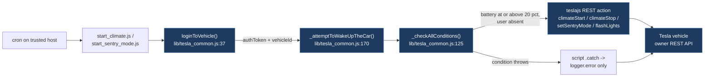
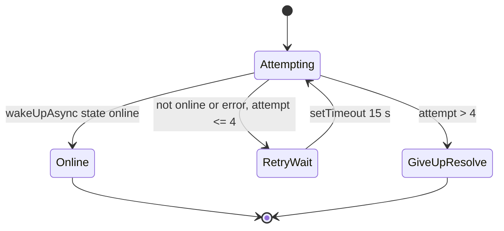
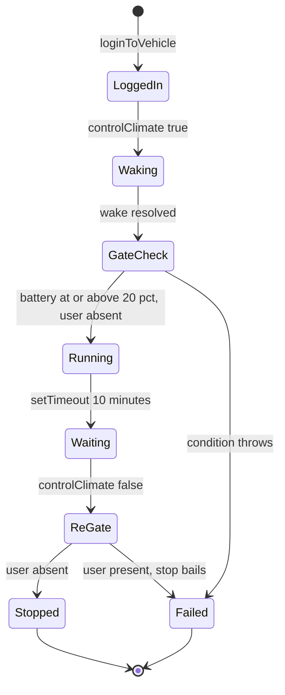

# jberstler-tesla-warmer

Deep-dive analysis (replace mode). The previous summary still exists in git history; pre-replace claims below are cited as `git show HEAD:docs/legacy/jberstler-tesla-warmer.md#<line>`, not as live text.

## 1. Provenance

- Submodule path: `legacy/jberstler-tesla-warmer`
- Pinned gitlink (`git ls-files -s legacy/jberstler-tesla-warmer`): `160000 6045bf343ec5b0c7a5e530283d911efd8863b190 0`
- `git -C legacy/jberstler-tesla-warmer rev-parse HEAD`: `6045bf343ec5b0c7a5e530283d911efd8863b190` — matches the gitlink. `status --porcelain`: empty. Last commit: `6045bf3 Add script to start Sentry Mode` (2019-03-18).
- Upstream URL: `https://github.com/jberstler/tesla-warmer` (remote `origin`, fetch and push)
- License: MIT — `LICENSE:1-3`, Copyright (c) 2019 Justin Berstler
- Analysis date: 2026-11-21
- Replace-mode notes: frontmatter preserved byte-for-byte except the inherited trailing space on the `description` line, which was stripped. The replaced doc contained no `## Upstream (...)` sections — nothing to preserve. The replaced doc did have frontmatter; it is kept as-is and is factually accurate (REST API, `teslajs`), so no staleness row is needed in section 6 for the frontmatter.

Reading coverage (closed vocabulary; per skill):

| File | Lines read | Coverage | Notes |
| --- | --- | --- | --- |
| `legacy/jberstler-tesla-warmer/README.md` | 1-32 | FULL-READ | Upstream lead document; read after code |
| `legacy/jberstler-tesla-warmer/lib/tesla_common.js` | 1-222 | FULL-READ | Shared core: auth, gates, wake, actions |
| `legacy/jberstler-tesla-warmer/start_climate.js` | 1-41 | FULL-READ | Climate timer script |
| `legacy/jberstler-tesla-warmer/start_sentry_mode.js` | 1-16 | FULL-READ | Sentry script |
| `legacy/jberstler-tesla-warmer/package.json` | 1-11 | FULL-READ | Manifest, deps |
| `legacy/jberstler-tesla-warmer/LICENSE` | 1-21 | FULL-READ | MIT text |
| `legacy/jberstler-tesla-warmer/.gitignore` | 1-61 | FULL-READ | Standard Node ignores; nothing project-specific |
| `legacy/jberstler-tesla-warmer/package-lock.json` | schema + spot fields | STRUCTURAL-PARSE | 387-line npm v1 lockfile; dependency identities and integrity hashes spot-checked, not read line-by-line |
| `56f3ae0810418b91c40d35bd8d0e620defa5ba1b:start_climate.js` | grep-selected lines (27, 67, 80, 104, 108) | RANGE-CITED | Pre-pin 0.0.1 monolith blob, read via `git show` for history |
| `firmware/lib/vehicle/can/feature/comfort/precondition.h` | 1-56 | FULL-READ | Our-side parity counterpart |
| `firmware/lib/vehicle/can/feature/comfort/climate.h` | 1-64 | FULL-READ | Our-side cabin-climate counterpart |
| `firmware/lib/vehicle/can/feature/body/sentry.h` | 1-58 | FULL-READ | Our-side sentry counterpart |
| `firmware/lib/vehicle/ble/msg.h` | 240-299 | RANGE-CITED | `buildClimateAction` region |
| `firmware/lib/vehicle/ble/handler/dispatch.h` | 55-109, 215-299 | RANGE-CITED | `runAuthCommand`, `tesla:wake`, `tesla:climate:*` |
| `firmware/lib/vehicle/can/feature/telemetry/bms.h` | grep-selected lines (46-52) | RANGE-CITED | Our SoC decode |
| `firmware/lib/vehicle/can/ids.h` | line 44 | RANGE-CITED | `CAN_ID_BMS_SOC` |
| `firmware/lib/core/types.h` | grep-selected lines (583, 593, 697) | RANGE-CITED | `*LastMs` scheduling pattern |
| `firmware/lib/vehicle/can/burst.h` | line 33 | RANGE-CITED | `burstLastMs` reset |

Files explicitly NOT read: none exist beyond the above — `git -C legacy/jberstler-tesla-warmer ls-files` returns exactly the 8 tracked files, with no hidden or platform subdirectories. `node_modules/` is not committed. The dependency sources (`teslajs`, `simple-node-logger`) are not vendored and were not read.

## 2. Executive verdict

A tiny, dormant (2019, last commit is the pinned HEAD) host-side Node.js project that warms the cabin and arms Sentry Mode through the Tesla owner REST API (`teslajs` 4.3.3) on a cron schedule. It contains zero CAN code, so nothing here can be copied into our firmware directly. What survives contact with our codebase are three behavioral patterns, all restated in our own terms: (1) a minimum-SoC gate before power-hungry actions — upstream `MIN_BATTERY_LEVEL = 20` at `lib/tesla_common.js:8`; we decode SoC at `firmware/lib/vehicle/can/feature/telemetry/bms.h:52` but gate nothing on it; (2) a bounded-duration action with a re-check before the automatic stop — upstream `CLIMATE_ON_MINUTES` at `start_climate.js:9`; our `precondition` re-injects 0x082 indefinitely while enabled (`firmware/lib/vehicle/can/feature/comfort/precondition.h:43-47`); (3) a wake-retry-with-confirmation loop. The core remote actions themselves (cabin climate, sentry) are already present on our side (`climate.h`, `sentry.h`, BLE `tesla:climate:*`), so the repo's relevance is gates and lifecycle, not features. Never port: the REST password auth, the credentials-in-source pattern, and the resolve-anyway retry implementation (which silently proceeds after failure). The pre-existing summary's two factual claims about safety checks are wrong in different directions: it credits the code with a door-open check that does not exist anywhere, and it denies the existence of `lib/tesla_common.js`, which is committed and is the heart of the repo.

## 3. Evidence map

No TEST-READ evidence exists: this repo ships no tests. No CAPTURE evidence exists in this repo.

| Source file | Lines | What it proves | Grade |
| --- | --- | --- | --- |
| `lib/tesla_common.js` | 3-4 | Credentials live as source-code constants (`username`/`password`) the user edits in place | CODE-READ |
| `lib/tesla_common.js` | 8 | `MIN_BATTERY_LEVEL = 20` — the only battery gate in the repo | CODE-READ |
| `lib/tesla_common.js` | 69-85 | `controlSentryMode()` applies the battery gate on both arm and disarm (line 73-75) | CODE-READ |
| `lib/tesla_common.js` | 92-121 | `controlClimate()` applies the battery gate only when starting (ternary at line 93) | CODE-READ |
| `lib/tesla_common.js` | 125-164 | `_checkAllConditions` + `_batteryMinimumCondition` + `_userPresentCondition`; gates signal failure by throwing; no door check exists | CODE-READ |
| `lib/tesla_common.js` | 170-215 | Wake retry: 15 s spacing, 4 attempts, and on exhaustion the promise still resolves (lines 200-204) | CODE-READ |
| `lib/tesla_common.js` | 166-167 | "408 without wake" is a code comment, not an observed/tested behavior | SUMMARY-ONLY |
| `lib/tesla_common.js` | 79-83, 106-118 | `DEBUG_MODE` swaps real actions for `tjs.flashLightsAsync` (dry-run) | CODE-READ |
| `lib/tesla_common.js` | 217-222 | Module exports: `controlClimate`, `loginToVehicle`, `logger`, `controlSentryMode` — no `tjs` export | CODE-READ |
| `start_climate.js` | 9, 24-33 | `CLIMATE_ON_MINUTES = 10`; `setTimeout` then a re-gated stop via `controlClimate(vehicle, false)` | CODE-READ |
| `start_climate.js` | 40 | `tjs.logoutAsync(vehicle)` — `tjs` is not in scope in this file | CODE-READ |
| `start_sentry_mode.js` | 15 | Same out-of-scope `tjs.logoutAsync(vehicle)` | CODE-READ |
| `package.json` | 7-10 | Deps: `teslajs` 4.3.3 (exact pin), `simple-node-logger` ^18.12.22 | CODE-READ |
| `LICENSE` | 1-3 | MIT, (c) 2019 Justin Berstler | CODE-READ |
| `README.md` | 9 | Upstream claims doors are checked before acting — contradicted by code (section 6) | SUMMARY-ONLY |
| `git show HEAD:docs/legacy/jberstler-tesla-warmer.md#39` | — | Pre-replace claim that `lib/tesla_common.js` is not committed — contradicted by `git ls-files` | SUMMARY-ONLY |
| Provenance commands | — | gitlink matches HEAD; working tree clean at pin time | CODE-READ |

## 4. Architecture and build surface

- Entry points: `start_climate.js` and `start_sentry_mode.js`, host Node scripts meant for cron (README.md:16-19). Both begin with a top-level `return` (`start_climate.js:17`, `start_sentry_mode.js:5`), which works only because Node wraps each module in a function — these are scripts, not require-able modules.
- Shared core: `lib/tesla_common.js` — login, condition gates, wake retry, the two action wrappers, and a self-executing logger singleton (lines 19-30).
- Dependency boundary: `teslajs` 4.3.3 exact pin (`package.json:9`) is the only vehicle interface; `simple-node-logger` ^18.12.22 (`package.json:8`) is the only logging interface. No CAN, BLE, or serial code of any kind.
- Build flags: none. Platform port: none — host-only, no embedded target.
- Naming drift (cosmetic, internal): README title and package name say `tesla-funhouse` (`README.md:1`, `package.json:2`), the lockfile says `tesla-app` (`package-lock.json:2`), and the repo directory is `tesla-warmer`. The 0.0.1 lockfile was generated before the package rename; upstream never regenerated it.
- No CAN frame pipeline exists (section 7). The only data flow is a REST request/response pipeline:



## 5. Mechanism catalogue

Six mechanisms. All `Frame spec` fields are `None found`: this repo never touches CAN.

### REST login and vehicle binding

- **Claim (README / summary):** README.md:15 — enter credentials in `TESLA_USERNAME` / `TESLA_PASSWORD` in `lib/tesla_common.js`.
- **Code path:** `lib/tesla_common.js:37` — `loginToVehicle()` → `tjs.loginAsync(username, password)` (line 40) → `tjs.vehicleAsync(options)` (line 53) → options object `{authToken, vehicleId}` (lines 49-62).
- **Frame spec:** None found.
- **Gates and timing:** none — the first vehicle of the account is taken implicitly (`vehicle.vehicle_id`, line 59); no VIN selection. Login error → `logger.fatal` + `process.exit(1)` (lines 42-44).
- **State machine:** single pass, no states.
- **Tests:** None found.
- **Evidence grade:** CODE-READ.
- **Verdict:** CONFIRMED.
- **Adapt to TeslaCANModder?** never — REST owner-API auth has no counterpart in our CAN/BLE architecture, and credential constants edited into source are a liability pattern.

### Wake retry loop with silent give-up

- **Claim (README / summary):** README.md:32 — the author himself flags the retry loop as needing cleanup ("Cleanup that weird retry loop code when waking up the car").
- **Code path:** `lib/tesla_common.js:170` — `_attemptToWakeUpTheCar(vehicle)` → `tjs.wakeUpAsync(vehicle)` (line 180) → `wakeUpLoop` recursion via `setTimeout` (line 207) → resolve.
- **Frame spec:** None found.
- **Gates and timing:** 15 s spacing (`interval_seconds = 15`, line 171), 4 attempts (`MAX_ATTEMPTS = 4`, line 174). Success condition: `response.state === "online"` (line 182). On exhaustion the promise still resolves (lines 200-204, comment: "resolve anyway and let the caller worry about it") — and the caller never inspects the result.
- **State machine:** three states; the give-up path resolves indistinguishably from success:



- **Tests:** None found.
- **Evidence grade:** CODE-READ.
- **Verdict:** CONFIRMED (code behavior); the "you'll get a 408 if you skip this" rationale at `lib/tesla_common.js:166-167` is SUMMARY-ONLY.
- **Adapt to TeslaCANModder?** candidate for future PR — the retry-then-confirm-online idea maps onto BLE `tesla:wake` (see section 11 row 4); the resolve-anyway implementation must never be copied.

### Safety condition gates (battery floor + user-present)

- **Claim (README / summary):** README.md:8-9 — minimum battery config exists, and "It will not turn features either on or off if any of the doors are open or the driver is present."
- **Code path:** `lib/tesla_common.js:125` — `_checkAllConditions(vehicle, ...conditions)` → `tjs.vehicleDataAsync(vehicle)` (line 127) → each condition function throws on failure (lines 129-135, author TODO at 131-132).
- **Frame spec:** None found.
- **Gates and timing:** two conditions only. `_batteryMinimumCondition(min)` (line 152): throws when `vehicleData.charge_state.battery_level < min`; passed as `MIN_BATTERY_LEVEL` for climate-start (line 99) and for sentry in both directions (lines 73-75), but as `null` for climate-stop (ternary at line 93, so stopping the climate is deliberately ungated on battery). `_userPresentCondition(false)` (line 138): throws when `vehicleData.vehicle_state.is_user_present` is true, applied in both directions for both features.
- **State machine:** pass/throw only, no states.
- **Tests:** None found.
- **Evidence grade:** CODE-READ.
- **Verdict:** PARTIAL — battery and user-present gates CONFIRMED; the door-open half of the README claim is CONTRADICTED (no door check anywhere in the repo; negative anchor in section 16).
- **Adapt to TeslaCANModder?** candidate for future PR — a decoded-SoC floor gate for our comfort/body burst features; see section 11 row 5 and section 13.

### Timed climate auto-off with re-gate

- **Claim (README / summary):** README.md:2 — start the climate, then after some time passes turn it back off.
- **Code path:** `start_climate.js:17` — `loginToVehicle()` → `controlClimate(vehicle, true)` (line 20) → `setTimeout` (lines 27-31) → `controlClimate(vehicle, false)` (line 29) → `.catch` logs (lines 35-37).
- **Frame spec:** None found.
- **Gates and timing:** the stop is delayed `CLIMATE_ON_MINUTES * 60 * 1000` ms (line 24, 10 min default). The stop path re-runs the full gate chain (`_userPresentCondition(false)` and a null battery condition), so a driver who entered the car during the window keeps the climate on — the stop bails instead of forcing.
- **State machine:** the script lifecycle:



- **Tests:** None found.
- **Evidence grade:** CODE-READ.
- **Verdict:** CONFIRMED.
- **Adapt to TeslaCANModder?** candidate for future PR — bounded-duration auto-off for `precondition`, which currently re-injects 0x082 for as long as the toggle stays on (`firmware/lib/vehicle/can/feature/comfort/precondition.h:43-47`); our `precondLastMs` slot (`firmware/lib/core/types.h:583`) is the natural anchor for the timer.

### Sentry toggle

- **Claim (README / summary):** README.md:2, 25 — `start_sentry_mode.js` enables Sentry Mode and leaves it on; changelog 0.0.2.
- **Code path:** `start_sentry_mode.js:5` — `loginToVehicle()` → `controlSentryMode(vehicle, true)` (line 8) → `tjs.setSentryModeAsync(vehicle, start)` (`lib/tesla_common.js:82`).
- **Frame spec:** None found.
- **Gates and timing:** wake, then battery floor and user-absent gates — but the battery gate is passed unconditionally (`lib/tesla_common.js:73-75`), so disarming Sentry with a battery below 20% also bails. Asymmetry vs the climate path, which nulls the gate for stop (line 93).
- **State machine:** pass/throw only, no states.
- **Tests:** None found.
- **Evidence grade:** CODE-READ.
- **Verdict:** CONFIRMED (with the off-path gate asymmetry noted as an upstream bug, section 9).
- **Adapt to TeslaCANModder?** already present — our `sentry:on` / `sentry:off` bursts CAN 0x284 (`firmware/lib/vehicle/can/feature/body/sentry.h:19-32`); only the gate idea is a candidate.

### DEBUG dry-run switch

- **Claim (README / summary):** README.md:10 — optional logging so you can see what is going on.
- **Code path:** `lib/tesla_common.js:9` — `DEBUG_MODE` → in `controlSentryMode` lines 79-83 and `controlClimate` lines 106-118, real actions are replaced by `tjs.flashLightsAsync(vehicle)`.
- **Frame spec:** None found.
- **Gates and timing:** `DEBUG_MODE` also forces `logfile = undefined` and `loglevel = 'debug'` (lines 20-23), so dry-runs log to console.
- **State machine:** single boolean, no states.
- **Tests:** None found.
- **Evidence grade:** CODE-READ.
- **Verdict:** CONFIRMED.
- **Adapt to TeslaCANModder?** no impact — the bench equivalent (synthetic frames that never reach the physical bus, `canSimLastMs` in `firmware/lib/core/types.h:697`) already covers the dry-run need.

## 6. Summary vs code contradiction table

| # | Claim (source) | Code evidence | Verdict |
| --- | --- | --- | --- |
| 1 | Door-open safety check: "Checks for open doors and driver presence before acting" (`git show HEAD:docs/legacy/jberstler-tesla-warmer.md#35`, inherited from `README.md:9` "It will not turn features either on or off if any of the doors are open") | Only two conditions are ever registered: `_batteryMinimumCondition` and `_userPresentCondition` (`lib/tesla_common.js:73-75`, `98-100`); no door field is read anywhere — `git -C legacy/jberstler-tesla-warmer grep -nE 'door'` hits only `README.md:9` itself (demonstrated, section 16). The pre-pin 0.0.1 monolith had no door check either (`56f3ae0810418b91c40d35bd8d0e620defa5ba1b:start_climate.js:104-108`). | CONTRADICTED |
| 2 | "A `lib/tesla_common.js` shared-utilities module ... is not present in the repository as committed" (`git show HEAD:docs/legacy/jberstler-tesla-warmer.md#39`) | `git -C legacy/jberstler-tesla-warmer ls-files` lists `lib/tesla_common.js` — 222 lines, committed, and the heart of the repo (all gates, wake, and actions live there). | CONTRADICTED |
| 3 | The repo "could complement CAN-level control for features like remote climate preconditioning" (`git show HEAD:docs/legacy/jberstler-tesla-warmer.md#47`) | Upstream toggles cabin HVAC (`tjs.climateStartAsync`, `lib/tesla_common.js:107`) and knows nothing about battery preconditioning; our preconditioning is battery heating via 0x082 (`firmware/lib/vehicle/can/feature/comfort/precondition.h:19-27`). The functional counterpart of upstream's "climate" is our `climate.h` (0x2F3), not `precondition.h`; the link to `precondition.h` is thematic ("warming") only. | PARTIAL — mis-mapped relevance, corrected in section 11 |

## 7. CAN frame and signal inventory

None found: this repo decodes, mutates, and injects no CAN frames, and vendors no DBC/JSON frame catalog. All vehicle control is Tesla REST (`teslajs`); the only "signals" read are REST JSON fields: `charge_state.battery_level` (`lib/tesla_common.js:154`) and `vehicle_state.is_user_present` (`lib/tesla_common.js:140`). Negative anchor: `git -C legacy/jberstler-tesla-warmer grep -nE 'door|CAN|0x[0-9A-Fa-f]+' -- README.md lib/tesla_common.js start_climate.js start_sentry_mode.js package.json` returns exactly one hit — the README door claim line itself (demonstrated, section 16).

## 8. Constants and tuning table

| Constant | Value | File:line | Meaning | Grade |
| --- | --- | --- | --- | --- |
| `MIN_BATTERY_LEVEL` | `20` | `lib/tesla_common.js:8` | SoC percent floor required to arm power-hungry actions; applied to climate-start and to sentry in both directions | CODE-READ |
| `CLIMATE_ON_MINUTES` | `10` | `start_climate.js:9` | Minutes the climate stays on before the re-gated auto-off timer fires | CODE-READ |
| `interval_seconds` | `15` | `lib/tesla_common.js:171` | Wake retry spacing in seconds | CODE-READ |
| `MAX_ATTEMPTS` | `4` | `lib/tesla_common.js:174` | Wake attempts before give-up — after which the promise resolves anyway (lines 200-204), so this is a silent-failure ceiling, not a hard failure | CODE-READ |
| `DEBUG_MODE` | `false` | `lib/tesla_common.js:9` | Dry-run switch: replaces every real action with `tjs.flashLightsAsync` (lines 79-83, 106-118) and forces console debug logging (lines 20-23) | CODE-READ |
| "408 response" rationale | comment | `lib/tesla_common.js:166-167` | Claimed reason the wake loop exists; never asserted by code or test | SUMMARY-ONLY |

## 9. Failure modes and edge cases

| Failure | Handling code path | Tested? | Grade |
| --- | --- | --- | --- |
| Login error | `logger.fatal` + `process.exit(1)` — `lib/tesla_common.js:42-44` | no | CODE-READ |
| Wake exhaustion after 4 attempts | Promise resolves anyway (lines 200-204); caller proceeds to `vehicleDataAsync` and the predicted 408 is an inferred downstream effect, not verified behavior | no | CODE-READ (resolve-anyway) / UNVERIFIED (downstream 408) |
| Condition gate rejection | Thrown string propagates to the script's `.catch` and is only logged — `start_climate.js:35-37`, `start_sentry_mode.js:10-12` | no | CODE-READ |
| Logout never runs | Both scripts call `tjs.logoutAsync` with `tjs` not in scope (`start_climate.js:40`, `start_sentry_mode.js:15`; exports at `lib/tesla_common.js:217-222` export no `tjs`). The identifier reference throws; the resulting rejection is unhandled at top level. The 0.0.1 monolith had `tjs` in scope (`56f3ae0810418b91c40d35bd8d0e620defa5ba1b:start_climate.js:27,67`), so the 0.0.2 refactor introduced this. | no | CODE-READ (identifier not in scope) / UNVERIFIED (process exit semantics, Node-version dependent) |
| Sentry disarm with low battery bails | `controlSentryMode` passes `MIN_BATTERY_LEVEL` unconditionally — `lib/tesla_common.js:73-75` — unlike `controlClimate`, which nulls the gate for stop (line 93) | no | CODE-READ |

Bus-off, watchdog, OTA, queue overflow, brownout/reboot state, missing-frame timeouts: None found — the repo has no CAN stack, no firmware, and no persistent state at all; every run is a fresh REST session.

## 10. Test coverage map

None found: this repo ships no tests. No test framework is configured (`package.json` has no scripts or devDependencies). Critical untested paths, one risk line each:

- Wake give-up resolves like success — any regression here silently no-ops the entire script; nothing would catch it.
- The gate chain relies on thrown strings — a typo in a field name (`vehicle_state.is_user_present`, `charge_state.battery_level`) would throw `TypeError` and be indistinguishable from a gate rejection in the logs.
- The broken `tjs` logout — a single smoke run of either script would have exposed the ReferenceError at 0.0.2.

## 11. Parity matrix with TeslaCANModder

| Signal / feature | Upstream decode (cite) | Our decode (cite) | Delta | Action |
| --- | --- | --- | --- | --- |
| Cabin climate on/off | `controlClimate` — REST `climateStartAsync`/`climateStopAsync`, gated on SoC and user-present (`lib/tesla_common.js:92-121`) | `controlClimate` — CAN 0x2F3 bits 33-34 mutated on the cached real frame, 30-frame burst at 20 ms (`firmware/lib/vehicle/can/feature/comfort/climate.h:27-38`); also BLE `tesla:climate:on/off` → `HvacAutoAction` field 14 (`firmware/lib/vehicle/ble/msg.h:261-269`, `firmware/lib/vehicle/ble/handler/dispatch.h:277-292`) | Transport only. Upstream gates on fresh REST data; ours gates on variant and frame-cache presence (`climate.h:48-51`) but never on SoC or occupancy | ignore (core already present); the SoC-floor gate is the actual gap — adaptation candidate 1 in section 13 |
| Sentry on/off | `controlSentryMode` — REST `setSentryModeAsync`, SoC+user gates both directions (`lib/tesla_common.js:69-85`) | `controlSentry` — CAN 0x284 byte[0] `0x20`/`0x00`, 30-frame burst at 20 ms on body bus, variant gate only (`firmware/lib/vehicle/can/feature/body/sentry.h:19-32,42-58`) | Transport only; no SoC/occupancy gate on our side | ignore (already present) |
| Battery preconditioning ("warming") | None found — upstream warms the cabin only; no preconditioning mechanism exists in the repo | `controlPrecondition` — CAN 0x082 `UI_tripPlanning`, `data[0] = 0x05` to heat, periodic re-injection ~500 ms while enabled (`firmware/lib/vehicle/can/feature/comfort/precondition.h:19-27,43-47`) | Feature exists only on our side; the pre-replace doc's "climate preconditioning" framing is corrected in section 6 row 3 | ignore (nothing to adopt) |
| Vehicle wake | `_attemptToWakeUpTheCar` — 4 attempts at 15 s, confirms `state === "online"`, then silently resolves on give-up (`lib/tesla_common.js:170-215`) | `tesla:wake` — single-shot `buildWakeAction` inside `runAuthCommand`: connect, ECDH session, one `sendCommand`, disconnect (`firmware/lib/vehicle/ble/handler/dispatch.h:222-226`, `runAuthCommand` at `dispatch.h:63-97`) | No retry and no online-confirmation loop at our dispatch level; whether `TeslaSession::sendCommand` internally awaits a reply was not traced (UNVERIFIED) | capture-first — BLE bench capture of `tesla:wake` response semantics before any retry design |
| Battery SoC as gate input | REST `vehicleData.charge_state.battery_level` read fresh per invocation and used as a gate (`lib/tesla_common.js:154`) | SoC decoded from CAN 0x292 `BMS_socStatus` bits 0-9 (`firmware/lib/vehicle/can/feature/telemetry/bms.h:52`, `firmware/lib/vehicle/can/ids.h:44`) and exposed as telemetry only — no feature gates on it | Same physical quantity, opposite role: upstream acts on it, we only report it; a our-side gate must also handle decode staleness (frame age), which upstream gets for free from the fresh REST fetch | align — this is the substance of adaptation candidate 1 |

## 12. Surface inventory and security notes

- Transport surfaces: none on-device. Host-side only — two cron-scheduled Node scripts that call the Tesla owner REST API through `teslajs` 4.3.3: `loginAsync`, `vehicleAsync`, `wakeUpAsync`, `vehicleDataAsync`, `climateStartAsync`, `climateStopAsync`, `setSentryModeAsync`, `flashLightsAsync`, `logoutAsync` (`lib/tesla_common.js`, `start_climate.js`, `start_sentry_mode.js`).
- No serial/BLE/WiFi endpoints, no listening sockets, no web UI.
- Provenance / security findings:
  - Credentials are edited directly into source as `const username` / `const password` placeholders (`lib/tesla_common.js:3-4`). Placeholders only — no real credentials are committed. The pattern itself is the finding: an accidental commit of real secrets is one paste away, and `.gitignore` (which does ignore `.env`) would not help since the values live in tracked code.
  - Password-based owner-API auth (pre-token era). Whether `teslajs` 4.3.3 logins still function at all is UNVERIFIED (network-era claim; the repo died in 2019).
  - `logger.trace(JSON.stringify(vehicle, ...))` dumps the full vehicle record (`lib/tesla_common.js:57`) — with `loglevel = 'debug'` default (`lib/tesla_common.js:12`) this is at least verbose, at worst sensitive data in a host logfile.
  - No keys/certs, no untrusted archives, no dangerous build flags. Lockfile integrity hashes present (package-lock.json, STRUCTURAL-PARSE).

## 13. Adaptation assessment

| Mechanism | Value | Cost | Risk | Evidence grade | Decision |
| --- | --- | --- | --- | --- | --- |
| SoC-floor gate before power-hungry bursts | Medium — keeps cabin-keep/sentry/precondition from draining a near-empty pack; mirrors upstream `MIN_BATTERY_LEVEL` intent with our decoded 0x292 SoC (`bms.h:52`) | Low — one shared gate helper next to the variant/cached-frame gates already in `climate.h:48-51` and `sentry.h:44` | Low-medium — needs a freshness bound on the cached SoC frame so a stale decode cannot pass the gate; not a frame-shape change but touches command behavior | CODE-READ both sides | candidate for future PR |
| Bounded-duration auto-off with re-gate | Medium — `precondition` currently heats until manually disabled; upstream's 10-min window with condition re-check bounds battery drain | Low — timer slot on the existing `precondLastMs` pattern (`firmware/lib/core/types.h:583`, `burst.h:33`) | Low | CODE-READ both sides | candidate for future PR |
| Wake retry with online confirmation | Low-medium — BLE `tesla:wake` is fire-and-forget at dispatch level (`dispatch.h:222-226`) | Medium — needs BLE response semantics first | Medium — copying the resolve-anyway give-up would import a silent failure | CODE-READ upstream; our-side response semantics UNVERIFIED | candidate for future PR, gated on bench capture (capture-first) |
| Sentry toggle | None — `sentry.h` already ships it | — | — | CODE-READ both sides | already present |
| Cabin climate toggle | None — `climate.h` + BLE `tesla:climate:*` already ship it | — | — | CODE-READ both sides | already present |
| DEBUG dry-run switch | Low — our bench flow (synthetic frames, listen-only tools) already covers dry-run; `canSimLastMs` exists (`types.h:697`) | — | — | CODE-READ | no impact |
| REST login path | None for a CAN/BLE device; credential-in-source pattern is a liability | — | — | CODE-READ | never port |

## 14. Do-not-copy list

- `lib/tesla_common.js:3-4` — credentials as source-code constants. Even with placeholders this is the pattern that turns one careless edit into a leaked secret. Behavior not worth porting anyway.
- `lib/tesla_common.js:37-63` — `loginToVehicle` password-grant REST auth. No counterpart in our architecture; if any idea here is ever revisited, it must be an independent implementation against our BLE key flow.
- `lib/tesla_common.js:170-215` — the resolve-anyway wake loop. Failure indistinguishable from success at the call site; the upstream README itself disowns it (`README.md:32`). The retry *idea* may be reinterpreted (section 13); this implementation must not be copied.
- `start_climate.js:38-41` and `start_sentry_mode.js:13-16` — `.finally` blocks referencing out-of-scope `tjs`, a latent ReferenceError on every successful run. Never copy; also never imitate the "cleanup in finally without checking scope" shape.

## 15. History and evolution

Local `git log --all` holds two disconnected root lines:

- Dangling chain (reachable only via tag `0.0.1`): `2e12e2224000011ab91e309442ed1f8a1ff1a92a` "Initial commit" (2019-03-03) → `a6b441df91d103fe47281a5d70780a99c07a4a9e` "yay! code!" (2019-03-03, adds a 201-line monolithic `start_climate.js`) → `56f3ae0810418b91c40d35bd8d0e620defa5ba1b` "fill out the readme" (2019-03-03, tagged `0.0.1`).
- `master` line: `6045bf343ec5b0c7a5e530283d911efd8863b190` "Add script to start Sentry Mode" (2019-03-18, tagged `0.0.2`) is an **orphan root** — it adds all 8 files (791 insertions) in a single commit with no parent. Upstream squashed and rewrote history between 0.0.1 and 0.0.2.

What the rewrite actually changed, from the diff `56f3ae0..6045bf3`:

- The 201-line monolithic `start_climate.js` was refactored into a shared `lib/tesla_common.js` (222 lines) plus slim 41/16-line scripts, to let the new sentry script reuse login, gates, and the wake loop. Same battery floor (20) and user-present checks in both versions (`56f3ae0810418b91c40d35bd8d0e620defa5ba1b:start_climate.js:104-108` vs `lib/tesla_common.js:138-164`); no door check in either — the README claim was wrong from day one.
- The refactor **introduced** the logout bug: in the 0.0.1 monolith `tjs` was in scope (`56f3ae0810418b91c40d35bd8d0e620defa5ba1b:start_climate.js:27`) and `tjs.logoutAsync(options)` at line 67 worked; the 0.0.2 scripts kept the `tjs.logoutAsync` call but lost the import, and nothing in the repo would ever have exercised it.
- README changelog (`README.md:24-26`) matches the tags: 0.0.1 climate, 0.0.2 sentry script.
- Abandoned/never done: the author's own TODO list (`README.md:29-32`) — CLI args, API token instead of username/password, and the retry-loop cleanup — none landed; the pinned HEAD is the final commit of the repo.

## 16. Re-verification recipe

Pinned snapshot (canonical form): `160000 6045bf343ec5b0c7a5e530283d911efd8863b190 0`.

```bash
OLD=6045bf343ec5b0c7a5e530283d911efd8863b190
git -C legacy/jberstler-tesla-warmer fetch --tags --prune
git -C legacy/jberstler-tesla-warmer log --oneline $OLD..origin/master
git -C legacy/jberstler-tesla-warmer diff --stat $OLD..origin/master
git -C legacy/jberstler-tesla-warmer diff $OLD..origin/master -- lib/ start_climate.js start_sentry_mode.js README.md package.json
git ls-files -s legacy/jberstler-tesla-warmer   # compare gitlink to rev-parse HEAD
git -C legacy/jberstler-tesla-warmer status --porcelain
```

All anchors below were executed at write time with `git grep -nE` from the repo root (equivalent to `grep -nE` over tracked content, and works from any shell). Expected hits are pasted from those runs.

Upstream anchors:

```text
git -C legacy/jberstler-tesla-warmer grep -nE 'MIN_BATTERY_LEVEL = 20|MAX_ATTEMPTS = 4|interval_seconds = 15' -- lib/tesla_common.js
  -> lib/tesla_common.js:8  (MIN_BATTERY_LEVEL = 20)
  -> lib/tesla_common.js:171 (interval_seconds = 15)
  -> lib/tesla_common.js:174 (MAX_ATTEMPTS = 4)

git -C legacy/jberstler-tesla-warmer grep -nE 'CLIMATE_ON_MINUTES = 10' -- start_climate.js
  -> start_climate.js:9

git -C legacy/jberstler-tesla-warmer grep -nE 'is_user_present|tjs\.logoutAsync|function controlSentryMode|function controlClimate' -- lib/tesla_common.js start_climate.js start_sentry_mode.js
  -> lib/tesla_common.js:69,92 (controlSentryMode / controlClimate)
  -> lib/tesla_common.js:140,141,145 (is_user_present)
  -> start_climate.js:40, start_sentry_mode.js:15 (tjs.logoutAsync)

git -C legacy/jberstler-tesla-warmer grep -nE 'door|CAN|0x[0-9A-Fa-f]+' -- README.md lib/tesla_common.js start_climate.js start_sentry_mode.js package.json
  -> README.md:9 only  (negative anchor: proves no door check in code, no CAN code, no hex frame constants; the single hit is the false claim line itself)
```

Our-side drift anchors (the `already present` decisions rest on these):

```text
git grep -nE 'CAN_ID_PRECONDITION|data\[0\] = enable' -- firmware/lib/vehicle/can/feature/comfort/precondition.h
  -> precondition.h:22, precondition.h:25

git grep -nE 'CAN_ID_SENTRY' -- firmware/lib/vehicle/can/feature/body/sentry.h
  -> sentry.h:22

git grep -nE 'climate:keep|climate:off' -- firmware/lib/vehicle/can/feature/comfort/climate.h
  -> climate.h:53, climate.h:58

git grep -nE 'strcmp\(sub, "climate:on"\)|strcmp\(sub, "wake"\)' -- firmware/lib/vehicle/ble/handler/dispatch.h
  -> dispatch.h:277 (climate:on), dispatch.h:222 (wake)

git grep -nE 'buildClimateAction' -- firmware/lib/vehicle/ble/msg.h
  -> msg.h:261
```

If line numbers drift more than ~10, re-read the whole function; do not trust this document's numbers.

Pre-pin upstream history: **was reviewed** — the 0.0.1 chain exists in the local object database (tag `0.0.1`, `refs/tags/0.0.1 -> 56f3ae0810418b91c40d35bd8d0e620defa5ba1b`) and was diffed against the pinned root (section 15). Network-side history (GitHub issues, PRs, remote branches beyond `origin/master`) was not reviewed.

## 17. Open questions and explicitly not investigated

UNVERIFIED items, each with what would settle it:

- Runtime effect of the broken logout (`start_climate.js:40`, `start_sentry_mode.js:15`): out-of-scope `tjs` is CODE-READ; whether it crashes or merely warns at exit depends on the Node version's unhandled-rejection policy. Settle by running either script once with a stubbed `teslajs`.
- Downstream behavior after the wake give-up (the predicted 408 at `lib/tesla_common.js:166-167`): a code comment, never observed. Settle only against a live vehicle — moot, since the password-era REST path is almost certainly dead.
- Whether `teslajs` 4.3.3 password logins still function at all (post-2023 token mandate): network-era claim; not needed for any decision in this document.
- Whether `TeslaSession::sendCommand` (called from `runAuthCommand`, `firmware/lib/vehicle/ble/handler/dispatch.h:87`) internally awaits a vehicle reply — the `tesla:wake` parity row (section 11 row 4) describes "fire-and-forget" at dispatch level only. Settle by reading `firmware/lib/vehicle/ble/feature/session.h` (not read in this analysis) or a bench capture.
- Whether a stale-SoC edge case matters for the gate candidate: our 0x292 decode freshness bound is a design question, not verified here.

Explicitly not investigated: `node_modules/` (not committed); `teslajs` / `simple-node-logger` internals; upstream GitHub issues/PRs; any UI or deployment story beyond README cron. `package-lock.json` was STRUCTURAL-PARSE only, as declared in section 1.
