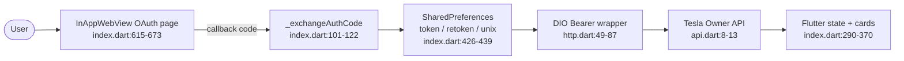
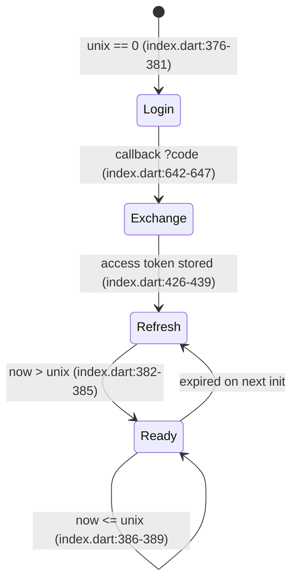

# jiezaichan-teslaAuthFlutter

## 1. Provenance

- Submodule path: `legacy/jiezaichan-teslaAuthFlutter`
- Parent gitlink: `160000 712f76f0653938173c2cefbcac4a07963a2c4051 0`
- `git -C legacy/jiezaichan-teslaAuthFlutter rev-parse HEAD` = `712f76f0653938173c2cefbcac4a07963a2c4051` — matches gitlink.
- `git -C legacy/jiezaichan-teslaAuthFlutter status --porcelain` — empty (clean).
- Local tip: `712f76f 补充协议` (2023-10-11), marked `(grafted)` — shallow clone, one commit only.
- Remote: `origin https://github.com/jiezaichan/teslaAuthFlutter`.
- License: GPL-3.0 (`LICENSE:1-3`, verified header only).
- Analysis date: 2026-11-21.

Files read (all Dart sources FULL-READ unless noted):

| File | Lines | Coverage |
| --- | --- | --- |
| `lib/main.dart` | 1-39 | FULL-READ |
| `lib/screens/global.dart` | 1-62 | FULL-READ |
| `lib/screens/index.dart` | 1-1215 | FULL-READ |
| `lib/common/utils/api.dart` | 1-14 | FULL-READ |
| `lib/common/utils/http.dart` | 1-108 | FULL-READ |
| `lib/common/utils/tesla.dart` | 1-100 | FULL-READ |
| `lib/common/utils/storage.dart` | 1-60 | FULL-READ |
| `lib/common/utils/date.dart` | 1-31 | FULL-READ |
| `lib/common/utils/utils.dart` | 1-6 | FULL-READ |
| `lib/common/values/constanins.dart` | 1-7 | FULL-READ |
| `lib/common/values/textinfo.dart` | 1-9 | FULL-READ |
| `lib/common/values/values.dart` | 1-4 | FULL-READ |
| `lib/common/widgets/btnlock.dart` | 1-103 | FULL-READ |
| `lib/common/widgets/btntemp.dart` | 1-47 | FULL-READ |
| `lib/common/widgets/loading.dart` | 1-15 | FULL-READ |
| `lib/common/widgets/widgets.dart` | 1-5 | FULL-READ |
| `models/TyrePsi.dart` | 1-14 | FULL-READ |
| `test/widget_test.dart` | 1-30 | FULL-READ |
| `README.md` | 1-16 | FULL-READ |
| `pubspec.yaml` | 1-49 | FULL-READ |
| `.metadata` | 1-10 | FULL-READ |
| `analysis_options.yaml` | 1-29 | FULL-READ |
| `LICENSE` | 1-3 | RANGE-CITED (header only) |
| `firmware/lib/client/api/auth.h` (our side) | 1-88 | FULL-READ |
| `firmware/lib/client/api/init.h` (our side) | 1-177 | FULL-READ |
| `firmware/lib/client/api/routes.h` (our side) | 1-396 | FULL-READ |
| `packages/protocol/src/index.ts` (our side) | 1-167 | FULL-READ |
| `packages/protocol/src/transportLifecycle.ts` (our side) | 1-108 | FULL-READ |
| `packages/protocol/src/gating.ts` (our side) | 1-120, 368-397, 560-599 | RANGE-CITED |
| `packages/protocol/src/parser.ts` (our side) | 1-120 | RANGE-CITED |
| `packages/protocol/src/commands.ts` (our side) | 220-319, 520-549 | RANGE-CITED |
| `packages/protocol/src/types.ts` (our side) | 250-284, 676-720, 1024-1053 | RANGE-CITED |

Files explicitly NOT read: full `android/**`, `ios/**`, `macos/**`, `web/**` scaffolding (only a `git grep` scan for credentials/bundle IDs was run), all PNG/SVG/mipmap assets, `pubspec.lock`, `ios/Podfile.lock`, `macos/Podfile.lock`, full `LICENSE` body, `.gitignore` files. Hidden dirs were inventoried with `git -C legacy/jiezaichan-teslaAuthFlutter ls-files` — no hidden source tree was skipped (`.metadata`, `.gitignore` present and accounted for).

No CAPTURE evidence exists in this repo: no bench run, no captured frames, no device traces. No runtime execution of the Flutter app was performed — behavior claims are static CODE-READ only.

## 2. Executive verdict

This is a Flutter/Dart companion app (package `tesla_animated_app`, version `1.0.0+1`, `pubspec.yaml:1-6`) that obtains a Tesla Owner API OAuth token through an embedded `flutter_inappwebview` WebView, stores the access/refresh token in plaintext `shared_preferences`, and calls Tesla cloud REST endpoints to fetch `vehicle_data` and issue a small set of vehicle commands. No CAN, MCP2515, frame decode, frame mutation, checksum, or injection path exists — every control action is an HTTPS POST to `owner-api.teslamotors.com` / `owner-api.vn.cloud.tesla.cn`. Mechanisms worth noting are the auth/refresh state machine, the unbounded wake polling loop, the 100-second status cache gate, and the command debounce layer. None are candidates for verbatim porting: the credential handling is unsafe (static PKCE verifier/challenge, hardcoded third-party API key, tokens logged to console), and our firmware already ships stronger local auth (`firmware/lib/client/api/auth.h:20-57`), command validation (`firmware/lib/client/api/routes.h:329-347`), and transport fallback (`packages/protocol/src/transportLifecycle.ts:38-65`). Only two derived ideas have modest value: a bounded-retry/timeout wrapper and a slow-data cache-window throttle.

## 3. Evidence map

| Source file | Lines | What it proves | Grade |
| --- | --- | --- | --- |
| `lib/main.dart` | 7-18, 20-39 | Entry point calls `Global.init()` before `runApp`; dark theme, `ScreenUtilInit` 375x720, `GetMaterialApp` | CODE-READ |
| `lib/screens/global.dart` | 14-36, 38-62 | `isRelease` reads `dart.vm.product` but is unused; `SharedPreferences` singleton init; `getstr`/`setstr`/`getjson` wrappers | CODE-READ |
| `lib/screens/index.dart` | 101-122 | OAuth callback code exchange → `setToken` → `getVehicles` → `wakeAndGetCarInfo` | CODE-READ |
| `lib/screens/index.dart` | 124-183 | `initState` restores cached car name/location/carinfo/lock flags; `getcarinfounix` deleted on init and dispose | CODE-READ |
| `lib/screens/index.dart` | 216-233 | Temperature clamp 8..35 with 0.5 steps; cool/heat flag derived from 20 C | CODE-READ |
| `lib/screens/index.dart` | 243-258 | 100-second `vehicle_data` cache gate keyed on `getcarinfounix` | CODE-READ |
| `lib/screens/index.dart` | 290-370 | `vehicle_data` decode into climate/vehicle/charge/drive groups + AMap reverse geocode + km conversion 1.6093 | CODE-READ |
| `lib/screens/index.dart` | 373-390 | Three-way auth branch on `unix` timestamp: login / refresh / wake+fetch | CODE-READ |
| `lib/screens/index.dart` | 393-415 | Unbounded wake loop with 1-second delay, no attempt cap | CODE-READ |
| `lib/screens/index.dart` | 418-439 | `refreshToken()` uses non-null `retoken`; `setToken()` stores token/retoken/unix and prints both secrets | CODE-READ |
| `lib/screens/index.dart` | 441-568 | Four command wrappers plus empty `headLock`; `handerCar` wakes then POSTs command, checks `response.result` | CODE-READ |
| `lib/screens/index.dart` | 615-673 | `InAppWebView` renders authorize URL; callback intercepted on `void/callback?code`; non-http schemes launched externally | CODE-READ |
| `lib/common/utils/api.dart` | 1-14 | Owner API / auth base URLs and `/api/1/vehicles` + `carhandle()` path builder | CODE-READ |
| `lib/common/utils/http.dart` | 9-43, 49-108 | `DIO` singleton, 10 s connect / 5 s receive timeout, Bearer header from global store, GET/POST helpers | CODE-READ |
| `lib/common/utils/tesla.dart` | 8-19 | Hardcoded client ID, static PKCE verifier/challenge, redirect URI, hardcoded authorize URL | CODE-READ |
| `lib/common/utils/tesla.dart` | 21-99 | Auth-code exchange, `getVehicles`, refresh-token exchange, deprecated JWT-bearer exchange marked `//作废` | CODE-READ |
| `lib/common/utils/storage.dart` | 15-59 | Plain `SharedPreferences` get/set/remove, no encryption | CODE-READ |
| `lib/common/values/constanins.dart` | 3-7 | UI constants; only `0x` literals in this repo are Flutter `Color` values | CODE-READ |
| `lib/common/widgets/btnlock.dart` | 6-103 | Four lock/HVAC buttons with animated SVG switch and loading state | CODE-READ |
| `lib/common/widgets/btntemp.dart` | 5-47 | Temperature buttons, 200 ms/1000 ms animations | CODE-READ |
| `models/TyrePsi.dart` | 9-13 | Hardcoded demo PSI/temperature list, never wired to real data | CODE-READ |
| `test/widget_test.dart` | 14-29 | Stale Flutter counter template test asserts `0`/`1`/`Icons.add` absent from this app | TEST-READ |
| `README.md` | 3-11 | Author claims real-time control and a token that lasted six months | SUMMARY-ONLY |
| Existing `docs/legacy/jiezaichan-teslaAuthFlutter.md` | 3, 15, 21, 40, 43-55 | Pre-replace summary; claims WebView OAuth, N/A CAN, "real-time", GetX pattern | SUMMARY-ONLY |
| `firmware/lib/client/api/auth.h` (our side) | 13, 20-57, 68-87 | Per-device 32-hex key from `esp_random()`, NVS `tcm_auth`, opt-in `requireAuth` | CODE-READ |
| `firmware/lib/client/api/init.h` (our side) | 49-56, 85-90 | `X-API-Key` collection, `/api/auth/verify`, `/api/status`, POST `/api/command` routes | CODE-READ |
| `firmware/lib/client/api/routes.h` (our side) | 29-231, 249-360, 365-368 | `buildStateJson`, CORS, JSON command validation, ping/ack responses | CODE-READ |
| `packages/protocol/src/commands.ts` (our side) | 221-231, 304-314, 526-539 | Wire commands `lock`, `unlock`, `sentry:on`, `climate:off`, `tesla:wake` etc. | CODE-READ |
| `packages/protocol/src/gating.ts` (our side) | 33-120, 368-392, 568-593 | `COMMAND_GATES` and `getCommandGate`; bus/feature preconditions | CODE-READ |
| `packages/protocol/src/transportLifecycle.ts` (our side) | 1-108 | `resolveTransportSelection` with `serial`/`ble`/`http` fallback and pending-command tracking | CODE-READ |
| `packages/protocol/src/parser.ts` (our side) | 1-120, 347-384 | JSON-line parser with section normalization | CODE-READ |
| `packages/protocol/src/types.ts` (our side) | 256-284, 676-720, 1024-1053 | `StatusMessage`, `BoardState`, `Transport` types | CODE-READ |
| Overall absence | — | No CAN frames, no decode pipeline, no checksums, no capture, no runtime verification | CODE-READ |

No TEST-READ evidence exists for any app behavior: the only test is the stale template test above. No CAPTURE evidence exists in this repo.

## 4. Architecture and build surface

None found: no frame pipeline in this repo.

Request flow (cloud HTTP, not CAN):



- Entry point: `lib/main.dart:7-18` → `Global.init()` (`lib/screens/global.dart:17-36`) → `StorageUtil().init()` + `DIO()` → `runApp(const MyApp())` → `IndexPage` (`lib/screens/index.dart:20-25`).
- Shared core: `lib/common/utils/**` (api, http, storage, tesla, date), `lib/common/values/**`, `lib/common/widgets/**`. No shared firmware/driver layer.
- Platform ports: `android/`, `ios/`, `macos/`, `web/` are stock Flutter scaffolding; only grep-level inspection was done. iOS release bundle ID is `com.jiezaichan.tesla` (`ios/Runner.xcodeproj/project.pbxproj:501`), Android/macOS remain `com.example.*`.
- Build flags: none. Dart environment gates only `bool.fromEnvironment("dart.vm.product")` (`lib/screens/global.dart:14`), consumed nowhere.
- Dependencies (`pubspec.yaml:11-38`): `flutter_inappwebview` (actual OAuth WebView), `http` and `dio` (REST), `shared_preferences` (token store), `get` (only `GetMaterialApp` and `Get.snackbar`), `flutter_screenutil`, `flutter_svg`, `intl`, `url_launcher`, `dio_cookie_manager` (declared, unused). `webview_flutter` is declared but never imported.
- Dependency boundary: all vehicle authority lives in Tesla's cloud; the app has no local transport, no serial/BLE/CAN surface.

## 5. Mechanism catalogue

### OAuth authorization-code + PKCE through InAppWebView

- **Claim (README / summary):** `git show HEAD:docs/legacy/jiezaichan-teslaAuthFlutter.md#15` — "Uses a WebView to handle Tesla OAuth login"; `README.md:9`.
- **Code path:** `lib/screens/index.dart:615-673` — `InAppWebView` → `shouldOverrideUrlLoading()` (`:639-650`) → `_exchangeAuthCode()` (`:101-122`) → `TeslaService.getTeslaAuthorizeUrl()` (`lib/common/utils/tesla.dart:15-19`) and `getOauth2Token()` (`:21-39`).
- **Frame spec:** None found (no CAN, no frames).
- **Gates and timing:** Redirect matched on literal `https://auth.tesla.com/void/callback?code` (`index.dart:642-647`); 120 ms delay after token set before vehicle fetch (`:109`); WebView options force `useShouldOverrideUrlLoading: true` and Android hybrid composition (`:51-62`).
- **State machine:**



- **Tests:** None found.
- **Evidence grade:** CODE-READ.
- **Verdict:** PARTIAL — flow confirmed; PKCE challenge/verifier are build-time constants, not per-session random (`tesla.dart:11-12,17`), so the PKCE binding is ineffective.
- **Adapt to TeslaCANModder?** no impact — cloud OAuth is orthogonal to our local API-key auth (`firmware/lib/client/api/auth.h:68-87`).

### Token persistence, hardcoded 8-hour expiry, and refresh

- **Claim (README / summary):** `git show HEAD:docs/legacy/jiezaichan-teslaAuthFlutter.md#15` — "stores the auth token locally"; `#54` — "Token persistence with shared_preferences".
- **Code path:** `lib/screens/index.dart:418-439` — `refreshToken()` → `setToken()` → `Global.setstr` → `lib/common/utils/storage.dart:28-30`; exchange helpers at `lib/common/utils/tesla.dart:59-99`.
- **Frame spec:** None found.
- **Gates and timing:** `expunix = getunixnow() + 28800000` (8 h, `index.dart:434`); branch on `unix` at `:374-389`; `retoken` accessed with non-null assertion `!` at `:420`; deprecated JWT-bearer exchange marked `//作废` at `tesla.dart:79`.
- **State machine:** None found (covered by previous card).
- **Tests:** None found.
- **Evidence grade:** CODE-READ.
- **Verdict:** PARTIAL — local persistence confirmed; 8 h is client-hardcoded, not taken from token response; refresh endpoint is `auth.tesla.cn` (`tesla.dart:69`) while initial exchange is `auth.tesla.com` (`tesla.dart:31`).
- **Adapt to TeslaCANModder?** never port — plaintext token/refresh token storage and console logging; our NVS key generation and opt-in enforcement already cover the need (`auth.h:20-57`).

### Unbounded wake-up polling

- **Claim (README / summary):** `README.md:5` and `git show HEAD:docs/legacy/jiezaichan-teslaAuthFlutter.md#15` — "real-time control".
- **Code path:** `lib/screens/index.dart:393-415` — `wakeAndGetCarInfo()` → `postbyapi(url.carhandle(id, 'wake_up'))` → `http.dart:100-103` → `api.dart:9-13`; same pattern inside `handerCar()` at `index.dart:535-568`.
- **Frame spec:** None found.
- **Gates and timing:** `while (!isWaked)` with `Future.delayed(Duration(seconds: 1))` (`index.dart:397-414`, `:540-565`); no maximum attempts, no timeout, no cancellation on widget dispose.
- **State machine:** None found.
- **Tests:** None found.
- **Evidence grade:** CODE-READ.
- **Verdict:** CONTRADICTED — "real-time" is 1-second cloud polling with no termination guarantee, not a push/stream path.
- **Adapt to TeslaCANModder?** candidate for future PR (derived idea only): add bounded retry + timeout + dispose-aware cancellation to any future polling path; never copy this loop.

### Vehicle-data snapshot with 100-second cache gate and third-party geocoding

- **Claim (README / summary):** `git show HEAD:docs/legacy/jiezaichan-teslaAuthFlutter.md#45` — "communicates ... via the Tesla REST API"; confirmed for cloud, no CAN.
- **Code path:** `lib/screens/index.dart:243-258` — `getpage()` → `getcarinfo()` at `:290-370` → `getbyapi()` (`http.dart:90-93`) → AMap reverse geocode (`index.dart:312-317`).
- **Frame spec:** None found.
- **Gates and timing:** cache window `(getunixnow() - getcarinfounix) < 100000` ms (`:251`); cache key deleted at init (`:134`) and dispose (`:181`); fetch only triggered when tab index 1 is selected (`:244`); `km = ideal_battery_range * 1.6093` (`:323`); display name hardcoded to "大土豆" (`:298`).
- **State machine:** None found.
- **Tests:** None found.
- **Evidence grade:** CODE-READ.
- **Verdict:** CONFIRMED — cloud JSON snapshot only (`climate_state`, `vehicle_state`, `charge_state`, `drive_state` at `:301-304`), no CAN frame involvement.
- **Adapt to TeslaCANModder?** candidate for future PR (derived idea): apply a slow-data cache-window throttle to client polling of our `GET /api/status`; our-side polling code was not read, so that half is UNVERIFIED.

### Cloud vehicle-command dispatch with per-command debounce

- **Claim (README / summary):** `README.md:5` and `git show HEAD:docs/legacy/jiezaichan-teslaAuthFlutter.md#15` — "control the vehicle".
- **Code path:** `lib/screens/index.dart:441-532` — `mainLock()`, `acLock()`, `sbLock()`, `truckLock()` → `handerCar()` at `:535-568` → `postdatabyapi()`/`postbyapi()` (`http.dart:95-107`).
- **Frame spec:** None found.
- **Gates and timing:** in-flight booleans `_isloadingget`, `_isacloadingget`, `_issbloadingget`, `_isbackloadingget` (`:442,466,490,517`) block double taps with a `Get.snackbar`; each command wakes the car first (`:542`); success is `response.result` truthy (`:552-554`).
- **State machine:** None found.
- **Tests:** None found.
- **Evidence grade:** CODE-READ.
- **Verdict:** PARTIAL — four commands send real requests (`command/door_unlock`, `command/door_lock`, `command/auto_conditioning_start|stop`, `command/set_sentry_mode`, `command/actuate_trunk` at `:450-525`); `headLock()` is a no-op stub (`:515`) though its button is rendered (`:940-951`).
- **Adapt to TeslaCANModder?** no impact on transport — semantics map cleanly to our wire commands (`lock`, `unlock`, `sentry:on`, `sentry:off`, `trunk:open`/`trunk:close` at `packages/protocol/src/commands.ts:221-222,304-305,229-230`); align names only, never copy the cloud HTTP layer.

### SharedPreferences persistence layer

- **Claim (README / summary):** `git show HEAD:docs/legacy/jiezaichan-teslaAuthFlutter.md#54` — token persistence via `shared_preferences`.
- **Code path:** `lib/screens/global.dart:17-62` — `Global.init/setstr/getstr/setjson/getjson/del` → `lib/common/utils/storage.dart:15-59`.
- **Frame spec:** None found.
- **Gates and timing:** single `SharedPreferences` singleton; no encryption, no migration, no schema version. Keys: `token`, `retoken`, `unix`, `id`, `vid`, `carinfo`, `carname`, `carlocation`, `isfirstopen`, `isacopen`, `issbopen`, `iscaropen`, `getcarinfounix`.
- **State machine:** None found.
- **Tests:** None found.
- **Evidence grade:** CODE-READ.
- **Verdict:** CONFIRMED — generic plaintext key/value store.
- **Adapt to TeslaCANModder?** already present in concept via NVS (`auth.h:13,34-57`); the plaintext-token pattern must never be ported.

### UI shell, animations, and demo tire card

- **Claim (README / summary):** `git show HEAD:docs/legacy/jiezaichan-teslaAuthFlutter.md#19-20,35-41` — Flutter multi-platform app with dark Tesla-themed UI and GetX state management.
- **Code path:** `lib/main.dart:20-39` → `lib/screens/index.dart:64-99` (animation controllers) → `build*` methods at `:815-1215` → `models/TyrePsi.dart:9-13`.
- **Frame spec:** None found.
- **Gates and timing:** temp animation 500 ms (`:67`), tyre animation 1000 ms (`:89`), `defaultDuration` 300 ms (`constanins.dart:7`), design size 375x720 (`main.dart:27`), temp clamp 8..35 and 0.5 C steps (`:217-218,1048,1058`), four tabs `Lock/Charge/Temp/Tyre` (`:1215`).
- **State machine:** None found.
- **Tests:** `test/widget_test.dart:14-29` — `Counter increments smoke test` asserts `find.text('0')`, `find.text('1')`, `Icons.add`, none of which exist in `MyApp`; it would fail if run.
- **Evidence grade:** CODE-READ (UI code), TEST-READ (stale test only).
- **Verdict:** PARTIAL — layout present; GetX is used only for `GetMaterialApp` (`main.dart:28`) and `Get.snackbar` (`index.dart:443`), with `SettingsService` commented out (`main.dart:16`); tyre data is hardcoded demo values (`TyrePsi.dart:9-13`), not telemetry.
- **Adapt to TeslaCANModder?** no impact — visual patterns only; our client already has state selectors (`packages/protocol/src/selectors.ts:137-150` via `index.ts`).

## 6. Summary vs code contradiction table

| Pre-replace claim | Code evidence | Verdict |
| --- | --- | --- |
| `git show HEAD:docs/legacy/jiezaichan-teslaAuthFlutter.md#40` — dependencies include `webview_flutter` for the OAuth flow | OAuth WebView is `flutter_inappwebview` (`lib/screens/index.dart:8`); `webview_flutter` is declared (`pubspec.yaml:27-28`) but never imported | CONTRADICTED |
| `git show HEAD:docs/legacy/jiezaichan-teslaAuthFlutter.md#15` and `README.md:5` — "real-time control" | Request/response cloud API, 100 s data cache (`index.dart:251`), 1 s wake polling (`index.dart:412,563`), no push/stream | CONTRADICTED |
| `git show HEAD:docs/legacy/jiezaichan-teslaAuthFlutter.md#3` — frontmatter description ends "Tesla OAut" | Truncated inherited string; preserved byte-for-byte per replace-mode rule; intended "OAuth" | CONTRADICTED (frontmatter staleness, not edited) |
| `git show HEAD:docs/legacy/jiezaichan-teslaAuthFlutter.md#51` — "Reusability: None" versus `#52-55` listing "GetX state management pattern" as a takeaway | GetX used only for `GetMaterialApp` (`main.dart:28`) and `Get.snackbar` (`index.dart:443`); `SettingsService` commented out (`main.dart:16`) | PARTIAL |
| `README.md:9-11` — token "能用很久不失效", still worked after six months | No code evidence for token lifetime; client hardcodes an 8 h expiry (`index.dart:434`) and never reads an expiry from the token response | UNVERIFIED |
| Code-internal (not a summary claim): `lib/common/utils/api.dart:3` defines `BASE_URL_CN` as `owner-api.vn.cloud.tesla.cn` | `lib/common/utils/http.dart:9` defines `BASE_URL_CN` as `owner-api.teslamotors.com` and uses it at `:16`; the CN constant is effectively dead | CONTRADICTED |

## 7. CAN frame and signal inventory

None found — the repo decodes, mutates, and injects zero CAN frames.

Negative anchors (all demonstrated, see section 16): `grep -nE '0x3FD|0x2B9|MCP2515|DAS_control|BMS_|UI_|canRingBuffer'` over `lib/` returns no output; `grep -nE 'XOR|0xAA'` over `lib/` returns no output. The only `0x...` literals in Dart are Flutter colors: `lib/common/values/constanins.dart:3-4`, `lib/common/widgets/loading.dart:12`, `lib/screens/index.dart:835,840`. Vehicle data is cloud JSON (`climate_state`, `vehicle_state`, `charge_state`, `drive_state` at `index.dart:301-304`); tire values are hardcoded demo data (`models/TyrePsi.dart:9-13`). No DBC/JSON catalog exists, so no STRUCTURAL-PARSE inventory applies.

## 8. Constants and tuning table

| Constant | Value | File:line | Meaning | Grade |
| --- | --- | --- | --- | --- |
| `url.BASE_URL` | `https://owner-api.teslamotors.com` | `lib/common/utils/api.dart:2` | Global Owner API base | CODE-READ |
| `url.BASE_URL_CN` | `https://owner-api.vn.cloud.tesla.cn` | `lib/common/utils/api.dart:3` | China Owner API base (declared, unused) | CODE-READ |
| `DIO.BASE_URL_CN` | `https://owner-api.teslamotors.com` | `lib/common/utils/http.dart:9` | Actual DIO base, misnamed CN | CODE-READ |
| `url.BASE_AUTH_URL` / `_CN` | `https://auth.tesla.com` / `https://auth.tesla.cn` | `lib/common/utils/api.dart:5-6` | Auth hosts (declared; not used by `tesla.dart`) | CODE-READ |
| `client_id` | `ownerapi` | `lib/common/utils/tesla.dart:17,25,63` | OAuth client identifier | CODE-READ |
| `_ownerapiClientId` | `c7257eb71a564034f9419ee651c7d0e5f7aa6bfbd18bafb5c5c033b093bb2fa3` | `lib/common/utils/tesla.dart:8-9` | Hardcoded Tesla public client ID | CODE-READ |
| `code_challenge` | `lwyXW65CA8kjNd90TP4FzeQGTztjZcQ_fxlzwikCNAs` | `lib/common/utils/tesla.dart:17` | Static PKCE challenge in authorize URL | CODE-READ |
| `_codeVerifier` | `81527cff06843c8634fdc09e8ac0abefb46ac849f38fe1e431c2ef21067963841234334232123232323232` | `lib/common/utils/tesla.dart:11-12` | Static PKCE verifier | CODE-READ |
| `redirect_uri` | `https://auth.tesla.com/void/callback` | `lib/common/utils/tesla.dart:10,17` | OAuth callback intercepted in WebView | CODE-READ |
| `state` | `teslaSwift` | `lib/common/utils/tesla.dart:17` | Fixed OAuth state (no CSRF randomness) | CODE-READ |
| `connectTimeout` / `receiveTimeout` | 10 s / 5 s | `lib/common/utils/http.dart:21,24` | DIO network timeouts | CODE-READ |
| Token expiry offset | `28800000` ms (8 h) | `lib/screens/index.dart:434` | Client-side expiry, not server-provided | CODE-READ |
| Status cache window | `100000` ms (100 s) | `lib/screens/index.dart:251` | `vehicle_data` freshness gate | CODE-READ |
| Wake retry delay | 1 s | `lib/screens/index.dart:412,563` | Poll interval, no max attempts | CODE-READ |
| Post-token delay | 120 ms | `lib/screens/index.dart:109` | Delay before vehicle fetch after login | CODE-READ |
| AMap key | `49521b5942bff4d41e5495698ab5bcb6` | `lib/screens/index.dart:315` | Hardcoded third-party geocoding key | CODE-READ |
| Range conversion | `1.6093` | `lib/screens/index.dart:323` | Miles → km for `ideal_battery_range` | CODE-READ |
| Temperature clamp / step | 8..35 C / 0.5 C | `lib/screens/index.dart:217-218,1048,1058` | UI setpoint bounds | CODE-READ |
| Animation durations | 500 ms / 1000 ms / 300 ms | `index.dart:67,89`; `constanins.dart:7` | Temp, tyre, and default UI animations | CODE-READ |
| Design size / display name | 375x720 / "大土豆" | `main.dart:27`; `index.dart:298` | ScreenUtil baseline; hardcoded car name | CODE-READ |

## 9. Failure modes and edge cases

| Failure | Handling code path | Tested? | Grade |
| --- | --- | --- | --- |
| Vehicle never wakes / cloud unreachable | `while (!isWaked)` loops forever with 1 s delay (`index.dart:397-414`, `:540-565`); no cap, no timeout, no dispose cancellation | No | CODE-READ |
| Missing refresh token on expiry | `String retoken = Global.getstr('retoken')!` non-null assertion (`index.dart:420`) throws if absent | No | CODE-READ |
| Missing vehicle id | `Global.getstr('id')!` (`index.dart:291,394,537`) throws if never set | No | CODE-READ |
| Empty vehicle list | `res['response'][0]['id']` assumes at least one vehicle (`tesla.dart:51`, `index.dart:114-115`) | No | CODE-READ |
| Network/HTTP errors | Empty catch + `print` only (`tesla.dart:36-38,54-56,73-75,96-98`; `index.dart:407-409,557-559`); `handerCar` returns false on exception (`:559`) | No | CODE-READ |
| Non-2xx HTTP responses | No status-code check; `jsonDecode(response.body)` on any body (`http.dart:63-66,86,92,97,102,107`) | No | CODE-READ |
| Credential leakage | `print('access_token is : $new_token')` and refresh token (`index.dart:437-438`) | No | CODE-READ |
| Static PKCE / state | Challenge, verifier, and `state` are compile-time constants (`tesla.dart:11-12,17`) | No | CODE-READ |
| Geocode failure | `resloca["regeocode"]["formatted_address"]` with `?? '未知地点'` only guards the leaf (`index.dart:316-317`) | No | CODE-READ |
| Stale data between tab visits | Fetch only on tab 1 selection (`index.dart:243-258`); no background refresh | No | CODE-READ |
| Frunk button | `headLock()` empty stub (`index.dart:515`) while button renders (`:940-951`) | No | CODE-READ |
| OTA update behavior | None found — no CAN bus, no OTA frame (0x318) handling in this repo | None found | CODE-READ |
| Bus-off / watchdog / queue overflow / brownout state | None found — no CAN driver in this repo | None found | CODE-READ |
| Runtime/app test failure risk | Only a stale counter test (`test/widget_test.dart:14-29`) that does not exercise app code | No | TEST-READ |

## 10. Test coverage map

Per test file:

- `test/widget_test.dart:14-29` — `Counter increments smoke test` pumps `const MyApp()`, asserts `find.text('0')` present / `find.text('1')` absent, taps `Icons.add`, then reverses the assertions. None of those widgets exist in `lib/screens/index.dart:570-813`; the test would fail if executed. Grade: TEST-READ (assertions read), not executed.

Critical paths with NO test (each is a one-line risk):

- OAuth authorize/callback/token exchange (`index.dart:101-122`, `tesla.dart:15-39`) — an authorize-URL change silently breaks login with no failing test.
- Token refresh and 8 h expiry (`index.dart:418-439`) — expiry math or null `retoken` fails at runtime only.
- Wake polling (`index.dart:393-415`, `:535-568`) — unbounded loop has no test harness or timeout assertion.
- `vehicle_data` decode and cache gate (`index.dart:243-370`) — field renames or the 100 s window are unverified.
- Command dispatch and debounce (`index.dart:441-568`) — no test that a command posts the right path or payload.
- REST helpers (`http.dart:49-107`) — no mock HTTP layer; Bearer header and JSON decode untested.
- Persistence (`global.dart:38-62`, `storage.dart:19-59`) — no test for key migration or missing values.
- Geocoding (`index.dart:312-317`) — no offline fixture; hardcoded key expiry would break silently.

## 11. Parity matrix with TeslaCANModder

| Signal / frame | Upstream decode (cite) | Our decode (cite) | Delta | Action |
| --- | --- | --- | --- | --- |
| CAN frames (any) | None — negative anchors in section 7 | `packages/protocol/src/types.ts:676-686` `CanFrame` with id/bus/dlc/data | Upstream has zero CAN; ours models all frames | ignore |
| Vehicle wake | `wake_up` POST `lib/screens/index.dart:399,542` | `teslaWake()` → `tesla:wake` `packages/protocol/src/commands.ts:532,648` | Cloud Owner API wake vs local BLE key wake | ignore |
| Door lock / unlock | `command/door_lock` / `door_unlock` `index.dart:450,455` | `lock`/`unlock` `commands.ts:221-222` | Cloud POST vs CAN injection | ignore |
| Sentry mode | `command/set_sentry_mode` `{"on":"true"}` `index.dart:498-505` | `sentryOn`/`sentryOff` `commands.ts:304-305`; gate `gating.ts:568-579` | Upstream sends string booleans; ours has discrete commands + bus gate | align semantics |
| HVAC | `command/auto_conditioning_start|stop` `index.dart:474,479` | `climateKeep`/`climateOff` `commands.ts:308-309`; gate `gating.ts:582-593` | Upstream "start/stop"; ours "keep/off" naming | align semantics |
| Trunk | `command/actuate_trunk` `{"which_trunk":"rear"}` `index.dart:524-525` | `trunkOpen`/`trunkClose` `commands.ts:229-230`; gate `gating.ts:374-385` | Upstream one command with selector; ours two commands | align semantics |
| Vehicle state snapshot | `vehicle_data` groups `index.dart:296-304` | `GET /api/status` `buildStateJson` `firmware/lib/client/api/routes.h:29-231`; `StatusMessage` `types.ts:256-284` | Cloud JSON vs locally CAN-derived state | align field naming for companion UI |
| Credential storage | plaintext `token`/`retoken` `index.dart:430-435`, `storage.dart:28-30` | NVS `tcm_auth` + `esp_random()` key `auth.h:13,20-57` | Upstream static long-lived secret; ours per-device random, opt-in | align (keep ours) |
| Auth on requests | `Authorization: Bearer <token>` `http.dart:59,82` | `X-API-Key` / `apiKey` param `auth.h:68-87` | Cloud token vs local key; ours enforces only when configured | align (keep ours) |
| Command input validation | None — arbitrary path string `index.dart:535-568` | charset whitelist + length <=31 `routes.h:329-347` | Ours strictly validates | align (keep ours) |
| Transport selection / fallback | Single HTTPS path `http.dart:45` | `resolveTransportSelection` BLE/serial/HTTP `transportLifecycle.ts:38-65` | Upstream has no fallback | no impact |
| Health check | None found in upstream | `GET /api/ping` → `{"t":"pong","v":1}` `routes.h:365-368` | Upstream has no ping endpoint | no impact |
| Tire pressure | hardcoded demo list `models/TyrePsi.dart:9-13` | real TPMS decode `routes.h:115-126` | Upstream data is fake | ignore |
| Auth/session lifecycle | login → refresh → ready `index.dart:373-390` | `reduceTransportLifecycle` connect/disconnect/pending `transportLifecycle.ts:68-108` | Different domain (cloud credentials vs local transport) | no impact |

## 12. Surface inventory and security notes

External HTTPS surfaces (client-side calls to Tesla / third party):

| Endpoint | Method | Source | Semantics |
| --- | --- | --- | --- |
| `https://auth.tesla.com/oauth2/v3/authorize?...` | GET (WebView) | `lib/common/utils/tesla.dart:15-19` | Starts OAuth with static challenge/state |
| `https://auth.tesla.com/oauth2/v3/token` | POST | `lib/common/utils/tesla.dart:30-34` | Exchanges auth code for OAuth token |
| `https://auth.tesla.cn/oauth2/v3/token` | POST | `lib/common/utils/tesla.dart:68-71` | Refreshes access token |
| `https://owner-api.vn.cloud.tesla.cn/api/1/vehicles` | GET | `lib/common/utils/tesla.dart:43-49` | Lists vehicles, caches first id |
| `/api/1/vehicles` and `/api/1/vehicles/{id}/...` | GET/POST | `lib/common/utils/api.dart:8-13`, `http.dart:49-107` | `vehicle_data`, `wake_up`, command paths |
| `https://restapi.amap.com/v3/geocode/regeo` | GET | `lib/screens/index.dart:312-315` | Third-party reverse geocode with hardcoded key |

Local surfaces: none found — no serial, WiFi server, BLE GATT, or CAN endpoint is exposed by this app. The only local entry is the WebView navigation interceptor (`index.dart:639-672`) and `url_launcher` fallback for non-http schemes (`index.dart:652-670`).

Security findings:

- Hardcoded AMap API key `49521b5942bff4d41e5495698ab5bcb6` (`index.dart:315`) — third-party credential committed in source.
- Static PKCE verifier (`tesla.dart:11-12`) and static `code_challenge` + `state=teslaSwift` (`tesla.dart:17`) — no per-session entropy, defeats PKCE/CSRF protection.
- Hardcoded Tesla public client ID (`tesla.dart:8-9`) — well-known value, but still a pinned third-party credential.
- Access and refresh tokens written to plaintext `SharedPreferences` (`index.dart:430-435`, `storage.dart:28-30`) and printed to console (`index.dart:437-438`); README explicitly warns users not to share the token (`README.md:9-11`).
- WebView grants every permission request unconditionally (`index.dart:632-638`).
- Non-http(s) WebView schemes are handed to `url_launcher` (`index.dart:652-670`) — navigation-controlled external launch surface.
- No TLS pinning evidence found — UNVERIFIED (would require network/intercept test).
- Pervasive `print()` diagnostics (`global.dart:13,17`, `index.dart` many, `tesla.dart` catch blocks) — log hygiene risk.
- In-app "unlock frunk" confirmation dialog has no action wired (`index.dart:260-288`); `headLock()` is a no-op (`index.dart:515`).

## 13. Adaptation assessment

| Mechanism | Value | Cost | Risk | Evidence grade | Decision |
| --- | --- | --- | --- | --- | --- |
| OAuth authorize/refresh state machine | Low for us — our auth is local, non-expiring | High — different authority model | High if static secrets copied | CODE-READ | no impact |
| Token persistence + 8 h expiry | Low — ours uses generated NVS key | Medium | High — plaintext secrets and console logging | CODE-READ | never port |
| Unbounded wake polling | Low | Low | High — infinite loop, no cancellation | CODE-READ | candidate for future PR (bounded-retry/timeout hardening idea only) |
| 100 s status-cache gate | Medium — could reduce client polling load | Low | Low — stale-data tradeoff; our-side poll code not read | CODE-READ (upstream) | candidate for future PR (derived idea; our-side half UNVERIFIED) |
| Cloud command dispatch + debounce | Low — transport differs | Low | Low | CODE-READ | no impact (align command names only) |
| SharedPreferences layer | Low — our NVS layer already present | Low | High if token storage copied | CODE-READ | already present (concept only) |
| UI shell / animations / demo tire card | Low — visual reference only | Medium | Low | CODE-READ | no impact |

No mechanism in this repo requires `docs/checklists/can-review-checklist.md`: no CAN frame mutation, routing, checksum, or transport-visible message shape is touched.

## 14. Do-not-copy list

| Item (file:line) | Reason |
| --- | --- |
| `lib/common/utils/tesla.dart:8-9` — `_ownerapiClientId` | Third-party OAuth client credential; not ours to ship |
| `lib/common/utils/tesla.dart:11-12` — `_codeVerifier` | Static PKCE verifier; must be per-session random if ever used |
| `lib/common/utils/tesla.dart:17` — hardcoded `code_challenge` and `state=teslaSwift` | Static, replayable; defeats PKCE/CSRF protection |
| `lib/screens/index.dart:315` — AMap key `49521b...` | Third-party API key committed in source |
| `lib/screens/index.dart:430-438` — token/retoken persistence + console logging | Credential leakage; our `auth.h:54` only logs first 8 chars of a generated key |
| `lib/common/utils/http.dart:53-62,75-85` — Bearer header from global store | Cloud OAuth model; our auth is `X-API-Key` with opt-in enforcement |
| `lib/screens/index.dart:397-414,540-565` — unbounded `while (!isWaked)` | No timeout, retry cap, or dispose cancellation |
| `lib/screens/index.dart:298` — hardcoded car name "大土豆" | Placeholder shipped as user data |
| `models/TyrePsi.dart:9-13` — demo PSI/temperature values | Fake telemetry; our TPMS data is CAN-derived (`routes.h:115-126`) |
| `test/widget_test.dart:14-29` — stale counter template test | Asserts widgets that do not exist; would fail |
| GPL-3.0 source text itself | License is compatible with our GPL-3.0, but port behavior/constants only, never verbatim identifiers or code |

## 15. History and evolution

Local history is shallow/grafted: `git -C legacy/jiezaichan-teslaAuthFlutter log --oneline --all` returns exactly one commit, `712f76f 补充协议` (2023-10-11). `rev-list --count HEAD` = 1. No changelog file is tracked. Consequently, no pre-pin history, rollback, or abandoned-branch evidence is available locally; anything about earlier commits, issues, or PRs is UNVERIFIED and would require `git fetch --unshallow` plus network review.

Code-internal evolution markers (CODE-READ):

- `lib/common/utils/tesla.dart:78-99` — `getOwnerApiAccessToken()` is marked `//作废` ("deprecated/void") at `:79`; the JWT-bearer exchange path was abandoned in favor of the direct OAuth-token flow.
- `lib/screens/index.dart:678-707` — commented-out "open webview" and "refresh token" debug buttons with manual token deletion (`Global.del('token')`, `'retoken'`, `'unix'`) — earlier manual-auth workflow retained as comments.
- `lib/main.dart:16` — `Get.putAsync(SettingsService()).init()` commented out — GetX service injection was tried and removed.
- `lib/common/utils/http.dart:9,16` vs `lib/common/utils/api.dart:3` — `BASE_URL_CN` name/value mismatch suggests a region-endpoint change where the constant was renamed in one file but not the other.
- `pubspec.yaml:19` — `# get: ^4.3.8` commented above the active `get:` block, another small version-pinning artifact.

## 16. Re-verification recipe

Pin (canonical form from `git ls-files -s legacy/jiezaichan-teslaAuthFlutter`):

```text
160000 712f76f0653938173c2cefbcac4a07963a2c4051 0
```

Clone is grafted; fetch history before diffing:

```bash
OLD=712f76f0653938173c2cefbcac4a07963a2c4051
git -C legacy/jiezaichan-teslaAuthFlutter fetch --unshallow --tags --prune
git -C legacy/jiezaichan-teslaAuthFlutter log --oneline $OLD..origin/master
git -C legacy/jiezaichan-teslaAuthFlutter diff --stat $OLD..origin/master
git -C legacy/jiezaichan-teslaAuthFlutter diff $OLD..origin/master -- lib models test pubspec.yaml
git ls-files -s legacy/jiezaichan-teslaAuthFlutter
git -C legacy/jiezaichan-teslaAuthFlutter rev-parse HEAD
```

Upstream anchors (demonstrated at write time; `grep -nE`, run from repo root):

```text
grep -nE 'BASE_URL|owner-api' legacy/jiezaichan-teslaAuthFlutter/lib/common/utils/api.dart legacy/jiezaichan-teslaAuthFlutter/lib/common/utils/http.dart
  -> api.dart:2 owner-api.teslamotors.com; api.dart:3 owner-api.vn.cloud.tesla.cn; http.dart:9 BASE_URL_CN = owner-api.teslamotors.com; http.dart:16 baseUrl: BASE_URL_CN
grep -nE 'code_challenge|code_verifier|redirect_uri' legacy/jiezaichan-teslaAuthFlutter/lib/common/utils/tesla.dart
  -> :17 authorize URL with code_challenge=lwyXW65... and redirect_uri; :26 code_verifier; :28 redirect_uri
grep -nE '49521b|restapi\.amap\.com' legacy/jiezaichan-teslaAuthFlutter/lib/screens/index.dart
  -> :313 restapi.amap.com/v3/geocode/regeo; :315 key=49521b5942bff4d41e5495698ab5bcb6
grep -nE 'access_token is|refresh_token is|setToken' legacy/jiezaichan-teslaAuthFlutter/lib/screens/index.dart
  -> :105 setToken; :422 setToken; :426 definition; :437 print access_token; :438 print refresh_token
grep -nE '28800000|100000|Duration\(seconds: 1\)' legacy/jiezaichan-teslaAuthFlutter/lib/screens/index.dart
  -> :251 100000 cache gate; :412 and :563 1-second delay; :434 28800000 expiry
grep -nE 'command/door_unlock|command/door_lock|auto_conditioning|set_sentry_mode|actuate_trunk|wake_up' legacy/jiezaichan-teslaAuthFlutter/lib/screens/index.dart
  -> :399 and :542 wake_up; :450 door_unlock; :455 door_lock; :474 auto_conditioning_stop; :479 auto_conditioning_start; :498 and :504 set_sentry_mode; :524 actuate_trunk
grep -nE 'flutter_inappwebview|webview_flutter' legacy/jiezaichan-teslaAuthFlutter/lib/screens/index.dart legacy/jiezaichan-teslaAuthFlutter/pubspec.yaml
  -> index.dart:8 import flutter_inappwebview; pubspec.yaml:27 webview_flutter; pubspec.yaml:35 flutter_inappwebview
grep -nE 'testWidgets|Counter increments' legacy/jiezaichan-teslaAuthFlutter/test/widget_test.dart
  -> :14 testWidgets('Counter increments smoke test', ...)
git -C legacy/jiezaichan-teslaAuthFlutter grep -nE '0x3FD|0x2B9|MCP2515|DAS_control|BMS_|UI_|canRingBuffer' -- lib
  -> no output (negative anchor: zero CAN surface)
git -C legacy/jiezaichan-teslaAuthFlutter grep -nE 'XOR|0xAA' -- lib
  -> no output (negative anchor: no binary framing)
```

Our-side drift anchors (demonstrated at write time; pin by symbol, not line number):

```text
git grep -nE 'generateApiKey|esp_random|AUTH_NVS_NS' -- firmware/lib/client/api/auth.h
  -> :13 "tcm_auth"; :20 generateApiKey; :25 esp_random; :48/:49 persist key
git grep -nE 'X-API-Key|requireAuth' -- firmware/lib/client/api/auth.h firmware/lib/client/api/init.h
  -> auth.h:68 requireAuth; auth.h:73 X-API-Key header; init.h:50 headerKeys; init.h:61/:124 requireAuth calls
git grep -nE 'handlePostCommand|invalid characters in cmd|/api/command' -- firmware/lib/client/api/routes.h firmware/lib/client/api/init.h
  -> init.h:87 POST route; routes.h:304 handlePostCommand; routes.h:344 invalid characters in cmd
git grep -nE 'teslaWake|teslaChargeStart|teslaClimateOn' -- packages/protocol/src/commands.ts
  -> :532 tesla:wake; :533 tesla:charge:start; :535 tesla:climate:on; :648/:651/:657 standalone builders
git grep -nE '^\s+(lock|unlock|sentryOn|climateOff):' -- packages/protocol/src/commands.ts
  -> :221 lock; :222 unlock; :304 sentry:on; :309 climate:off
git grep -nE 'resolveTransportSelection|fallbackOrder|reduceTransportLifecycle' -- packages/protocol/src/transportLifecycle.ts
  -> :38 resolveTransportSelection; :41 fallbackOrder serial/ble/http; :68 reduceTransportLifecycle
git grep -nE 'getCommandGate|COMMAND_GATES' -- packages/protocol/src/gating.ts
  -> :33 COMMAND_GATES; :989 getCommandGate
git grep -nE 'parseSerialLine|parseSerialChunk' -- packages/protocol/src/parser.ts
  -> :347 parseSerialLine; :374 parseSerialChunk
```

If line numbers drift more than ~10, re-read the whole function; do not trust this document's numbers. Upstream history before the pinned SHA was NOT reviewed — the local clone is grafted to a single commit. Listed UNVERIFIED items are inherited to the next agent.

## 17. Open questions and explicitly not investigated

- Pre-pin upstream history: not reviewed (grafted, one local commit). Would need `git fetch --unshallow` and a PR/issue sweep.
- Whether `auth.tesla.cn/oauth2/v3/token` (`tesla.dart:69`) is still valid in 2026 — UNVERIFIED; requires a live token-refresh test with a real account.
- Whether the static PKCE challenge/verifier (`tesla.dart:11-12,17`) is still accepted by Tesla's auth service — UNVERIFIED; requires an end-to-end authorize attempt.
- Whether Owner API v1 endpoints (`api.dart:8-13`) still operate for third-party clients — UNVERIFIED; network-only claim.
- Whether hardcoded AMap key (`index.dart:315`) is valid/owned by the upstream author — UNVERIFIED.
- README's "token usable after six months" claim (`README.md:9-11`) — UNVERIFIED; no code or capture evidence.
- TLS pinning / certificate validation — UNVERIFIED; not evidenced by code read.
- No runtime verification: the Flutter app and `flutter analyze`/`flutter test` were not executed; all behavior claims are static code reads. The stale test's failure is inferred from widget mismatch, not from an executed run.
- Platform scaffolding (`android/**`, `ios/**`, `macos/**`, `web/**`), lockfiles, and binary assets were not read in full; only a credential/bundle-ID grep was performed.
- Our client-side status polling code (needed to confirm the cache-throttle adaptation candidate) was not read — that half of the decision is UNVERIFIED, not SUMMARY-ONLY.
- No CAPTURE evidence exists: no device, no bench capture, no frame or trace data of any kind.
