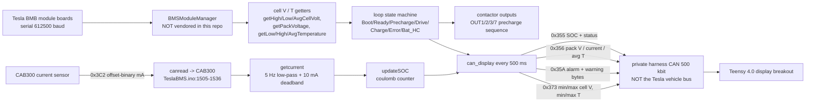
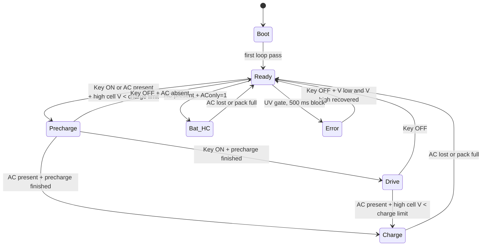

# jomytec-My_TeslaBMS

## 1. Provenance

- **Submodule path:** `legacy/jomytec-My_TeslaBMS`
- **Pinned gitlink (canonical form from `git ls-files -s`):** `160000 b262daf965eb3c68740c7b93851afa980682f42a 0`
- **Submodule HEAD:** `b262daf965eb3c68740c7b93851afa980682f42a` — matches the gitlink; `git -C legacy/jomytec-My_TeslaBMS status --porcelain` is empty. Snapshot is clean.
- **Upstream URL:** `https://github.com/jomytec/My_TeslaBMS` (origin, fetch and push).
- **License:** MIT — declared in the file header, `TeslaBMS.ino:1-19` ("Copyright (c) 2019 Simp ECO Engineering", MIT permission notice). The 2020 CAN-output mod is attributed in the same header, `TeslaBMS.ino:21-22` ("joromy 2020 Mods: Added CAN output"). Header comments are SUMMARY-ONLY evidence for attribution; the license text itself is CODE-READ at the cited lines.
- **Analysis date:** 2026-11-21.
- **Upstream tree:** exactly one tracked file, `TeslaBMS.ino` (`git ls-files`; no hidden or platform directories exist — `git ls-files` shows nothing else, and worktree status is clean). 1563 lines, 46,881 bytes, pure CRLF endings (byte dump: 1563 CRLF, zero lone CR/LF).
- **Files read:**
    - `legacy/jomytec-My_TeslaBMS/TeslaBMS.ino` lines 1-1563 — FULL-READ (every line; this is the entire repo).
    - Our side: `firmware/lib/vehicle/can/feature/telemetry/bms.h` lines 1-585 — FULL-READ; `firmware/lib/vehicle/can/handler/bus/vehicle.h` lines 65-139 and 225-309 — RANGE-CITED (decode call sites only); `firmware/lib/vehicle/can/ids.h` lines 37-68 — RANGE-CITED (CAN ID defines only); `firmware/test/test_native_bms/test_bms.cpp` lines 37-57 — RANGE-CITED; `firmware/lib/core/persist/nvs.h` lines 10-51 — RANGE-CITED.
    - Pre-replace summary: `git show HEAD:docs/legacy/jomytec-My_TeslaBMS.md` — read in full (74 lines) for the contradiction table.
- **Files explicitly NOT read (referenced but not present in the snapshot):** `BMSModuleManager.h`, `config.h` (defines `EEPROMSettings`, `SERIALBMS`, `SERIALCONSOLE`, `EEPROM_VERSION`), `SerialConsole.h`, `Logger.h` — all included at `TeslaBMS.ino:24-29` but **not vendored in this repo**; they come from the SimpBMS parent project. `<FlexCAN.h>` and `<Filters.h>` are external Arduino libraries (`TeslaBMS.ino:30-31`). Consequence: every claim about cell-module serial framing, board renumbering, balancing bytes, and the `EEPROM_VERSION` value is out of scope of this snapshot and graded UNVERIFIED below.
- **Coverage vocabulary:** no DBC/JSON frame catalogs exist in this repo, so no STRUCTURAL-PARSE entries appear anywhere in this document.
- **Replace-mode preservation notes:** the YAML frontmatter above is preserved byte-for-byte from the pre-replace doc (content lines 1-9; byte dump confirmed the `description:` line carries **no** inherited trailing whitespace, so nothing was stripped; the description text is truncated mid-sentence — "energy st" — an inherited defect kept intact per the replace contract and recorded in section 6). The pre-replace doc contained **no** `## Upstream (...)` sections (verified via `git show HEAD:docs/legacy/jomytec-My_TeslaBMS.md`), so none were preserved and none are appended.
- **Evidence-grade inventory for this doc:** CODE-READ (implementation lines in `TeslaBMS.ino` or our firmware), SUMMARY-ONLY (the file-header attribution comment), UNVERIFIED (named gaps below). No TEST-READ evidence exists: this repo ships no tests. No CAPTURE evidence exists in this repo.

## 2. Executive verdict

This is a one-file Arduino sketch (1563 lines, MIT, based on Simp ECO Engineering's SimpBMS V2) that turns a Teensy into a battery-management master for Tesla battery modules in a custom EV or stationary pack: it polls BMB cell/temperature data over a 612500-baud serial bus, sequences the HV contactors through a current-threshold precharge, coulomb-counts state of charge from a CAB300 CAN current sensor, packs alarms/warnings into bit flags, and — the joromy 2020 mod — broadcasts a 4-frame telemetry block (0x355/0x356/0x35A/0x373) on a **private harness CAN at 500 kbit/s** for a Teensy 4.0 display breakout. It decodes no Tesla powertrain frame that TeslaCANModder decodes; its CAN IDs and byte layouts are a bespoke display protocol, not Tesla vehicle semantics. The mechanisms worth remembering are the offset-binary CAB300 decode, the 5000 ms undervoltage persistence gate, and the 95/100 % charge-completion SOC reset points. The pre-replace summary is wrong on two load-bearing points (analog current sensing; charger control via CAN) and its cell-voltage/temperature story cannot be checked against this snapshot because the module-communication layer is not vendored. Adaptation value for TeslaCANModder is effectively nil — every shared-concept row in the parity matrix is "ignore" — and the contactor actuation code is a do-not-copy on safety grounds.

## 3. Evidence map

| Source file | Lines | What it proves | Grade |
| ----------- | ----- | -------------- | ----- |
| `legacy/jomytec-My_TeslaBMS/TeslaBMS.ino` | 1-23 | MIT license (Simp ECO Engineering 2019) + joromy 2020 "Added CAN output" attribution | SUMMARY-ONLY (header comment; license text visible) |
| `TeslaBMS.ino` | 24-31 | Includes: `BMSModuleManager.h`, `config.h`, `SerialConsole.h`, `Logger.h` not vendored; FlexCAN (collin80) and Filters (JonHub) external | CODE-READ |
| `TeslaBMS.ino` | 43-44, 581-603 | One-pole low-pass current filter, 5 Hz, applied to the **CAN-decoded** value | CODE-READ |
| `TeslaBMS.ino` | 62-70, 252-392 | Seven-state supervisor: Boot/Ready/Precharge/Drive/Charge/Error/Bat_HC | CODE-READ |
| `TeslaBMS.ino` | 104-144 | Factory defaults: 4.2/3.0 V OV/UV, 4.1 V charge, 3.2 V discharge, 65/-10 °C, 500 kbit CAN, 100 Ah, 12S, 2 s precharge, 1 A precharge finish | CODE-READ |
| `TeslaBMS.ino` | 108 | `settings.canSpeed = 500000` | CODE-READ |
| `TeslaBMS.ino` | 151-238 | `setup()`: 2 s boot delay, EEPROM load, CAN0 begin + all-pass filters 4-15, 115200 console, Teensy reset-reason dump, WDOG enable, 612500 BMS serial | CODE-READ |
| `TeslaBMS.ino` | 176-184 | FlexCAN all-pass filter setup including extended IDs — the bus accepts everything | CODE-READ |
| `TeslaBMS.ino` | 194-219 | Kinetis-style registers (`RCM_SRS*`, `MDM_AP`, `WDOG_STCTRLH`) — Teensy 3.x Kinetis family, matching the pre-replace platform guess | CODE-READ |
| `TeslaBMS.ino` | 223 | `SERIALBMS.begin(612500)` — Tesla BMB serial bus | CODE-READ |
| `TeslaBMS.ino` | 394-453 | 500 ms loop cadence: getAllVoltTemp, UV gate, balancing, SOC, `can_display()`, 5000 ms `clearmodules()` purge | CODE-READ |
| `TeslaBMS.ino` | 455-502 | Alarm/warning bit packing: 0x04 OV, 0x10 UV, 0x40 OT, 0x01 UT, 0x01 imbalance | CODE-READ |
| `TeslaBMS.ino` | 605-674 | Coulomb SOC with 1/3.6 constant, voltage re-seed, 95/100 % charge reset | CODE-READ |
| `TeslaBMS.ino` | 676-709 | Precharge sequence: NEG close → precharge relay until timer/current → IAA AUX relay → 8000 ms relay release | CODE-READ |
| `TeslaBMS.ino` | 711-762 | `can_display()`: TX 0x355/0x356/0x35A/0x373, 2 ms inter-frame delays, Teensy 4.0 display receiver | CODE-READ |
| `TeslaBMS.ino` | 766-1491 | Single-char serial menu, EEPROM save only on `q` exit | CODE-READ |
| `TeslaBMS.ino` | 1505-1536 | `canread()` dispatch on 0x3C2 → `CAB300()` offset-binary current decode | CODE-READ |
| `TeslaBMS.ino` | 1538-1544 | WDOG refresh sequence 0xA602/0xB480 | CODE-READ |
| `TeslaBMS.ino` | 1546-1563 | Balancing gate: duty 50 %, called each 500 ms pass | CODE-READ |
| Our `firmware/lib/vehicle/can/feature/telemetry/bms.h` | 18-585 | Our BMS decode set: 0x132/0x292/0x312/0x332/0x252/0x212/0x2D2/0x352/0x3D2/0x3F2/0x33A layouts | CODE-READ |
| Our `firmware/lib/vehicle/can/handler/bus/vehicle.h` | 75-128, 228-309 | Our decode call sites and mux handling | CODE-READ |
| Our `firmware/lib/vehicle/can/ids.h` | 37-68 | Our BMS CAN ID defines incl. `CAN_ID_VCLEFT_SWITCH 0x3C2` | CODE-READ |

No TEST-READ evidence exists: this repo ships no tests. No CAPTURE evidence exists in this repo.

## 4. Architecture and build surface

- **Entry points:** Arduino `setup()` at `TeslaBMS.ino:151-238`, `loop()` at `TeslaBMS.ino:240-453`. Single-threaded superloop; the heavy work (`getAllVoltTemp`, SOC, `can_display`, `alarmupdate`, WDT refresh) runs inside a `millis() - looptime > 500` block (`TeslaBMS.ino:394-453`).
- **Shared core vs platform port:** none — everything is in one `.ino`. The real "core" (module manager, logging, console, settings struct) lives in the **non-vendored** SimpBMS headers (`TeslaBMS.ino:24-29`), so this snapshot cannot be compiled standalone and its module-protocol layer is unobservable from here.
- **Build flags:** None found — no build system at all (no `platformio.ini`, no Makefile; Arduino IDE sketch).
- **Dependency boundaries:** `FlexCAN` (collin80, `TeslaBMS.ino:30`), `Filters` (JonHub, `TeslaBMS.ino:31`), `EEPROM` (Teensy core), plus the four missing SimpBMS headers. Single CAN controller (`Can0` only; `Can1` appears nowhere — demonstrated negative anchor in section 16).
- **Transport surfaces:** USB serial console at 115200 (`TeslaBMS.ino:186`, single-char menu), one CAN bus at 500 kbit (`TeslaBMS.ino:108,176`), one 612500-baud BMB serial bus (`TeslaBMS.ino:223`). No WiFi/BLE/MQTT.
- **Bus identity (load-bearing):** the CAN here is a **private BMS harness bus** carrying the CAB300 current sensor and the display broadcast — it is not the Tesla X179 vehicle bus, and none of these four TX IDs are Tesla-standard BMS frames in our decode set (negative anchor in section 16).



## 5. Mechanism catalogue

### 5.1 Seven-state BMS supervisor state machine

- **Claim (README / summary):** pre-replace doc lists "State machine with states: Boot, Ready, Drive, Charge, Precharge, Error, Bat_HC" (`git show HEAD:docs/legacy/jomytec-My_TeslaBMS.md#40`).
- **Code path:** `TeslaBMS.ino:62-70` (state defines) — `loop()` `switch (bmsstatus)` at `TeslaBMS.ino:252-392` — drives `OUT1/OUT2/OUT3/OUT7` GPIO.
- **Frame spec:** None found (GPIO actuation; the state byte itself is broadcast in 0x355 byte 2, `TeslaBMS.ino:717`).
- **Gates and timing:** Ready→Precharge on Key ON (IN1 HIGH) or AC present (IN3 HIGH) with high-cell V below `ChargeVsetpoint - ChargeHys` (`TeslaBMS.ino:279-296`); Ready→Bat_HC only when `AConly == 1` (`TeslaBMS.ino:281-284`); Charge→Ready on AC lost or pack full (`TeslaBMS.ino:341-344`); Error recovery requires Key OFF **and** `lowCellV >= UnderVSetpoint` **and** `highCellV >= OverVSetpoint` (`TeslaBMS.ino:355-361`). The Error entry gate (undervoltage persistence, mechanism 5.7) runs **outside** the switch, so Error can be entered from any state.
- **State machine:** Boot → Ready immediately (`TeslaBMS.ino:254-262`); Ready → Precharge | Bat_HC; Precharge → Drive | Charge | Ready (`TeslaBMS.ino:676-709`); Drive → Ready | Charge; Charge → Ready; Bat_HC → Ready; any → Error via the 500 ms UV gate. Bat_HC is an **inert stub**: it sets no output pins and energizes nothing (`TeslaBMS.ino:364-391` — only balancing flag, full-charge detection, and exit conditions), so "AC only no Charging" heat/cool mode performs no actuation.



    The `Ready --> Error` edge stands for the UV persistence gate at `TeslaBMS.ino:400-410`, which can fire from **any** state because it lives in the 500 ms block, not in the switch.
- **Tests:** None found — this repo ships no tests.
- **Evidence grade:** CODE-READ.
- **Verdict:** CONFIRMED (state list); PARTIAL (Bat_HC — exists but actuates nothing).
- **Adapt to TeslaCANModder?** no impact — our device is a passive X179 sniffer/mutator, not an HV supervisor.

### 5.2 Contactor precharge sequence with current threshold

- **Claim (README / summary):** pre-replace doc: "Contactor precharge sequence with current threshold check" (`git show HEAD:docs/legacy/jomytec-My_TeslaBMS.md#73`).
- **Code path:** `Prechargecon()` — `TeslaBMS.ino:676-709` — closes NEG contactor (`OUT7` HIGH, line 680), holds the precharge relay (`OUT2`) while `Pretimer + Pretime > millis()` **or** `currentact > Precurrent` (line 681), then closes the IAA HV AUX relay (`OUT1`, line 687) and releases the precharge relay 8000 ms later (lines 698-699).
- **Frame spec:** None found (GPIO + one analog-free current reading from mechanism 5.4).
- **Gates and timing:** `Pretime` default 2000 ms (`TeslaBMS.ino:138`), `Precurrent` default 1000 mA (`TeslaBMS.ino:139`, comment "(TESTED)"), precharge-relay release delay 8000 ms (`TeslaBMS.ino:698`); comment at 696: "Avoid open precharge before IAA has closed HV AUX relay".
- **State machine:** None found (linear relay sequence inside the Precharge state).
- **Tests:** None found — this repo ships no tests.
- **Evidence grade:** CODE-READ.
- **Verdict:** CONFIRMED.
- **Adapt to TeslaCANModder?** never port — safety-critical HV actuation with zero test coverage; also out of scope: our firmware only *decodes* contactor state (`decodeBmsContactorState`, our `bms.h:374-377`, called at our `vehicle.h:268`).

### 5.3 CAN telemetry broadcast (joromy 2020 mod)

- **Claim (README / summary):** pre-replace doc: "Specific CAN message IDs for TX/RX not visible in the portion read…" (`git show HEAD:docs/legacy/jomytec-My_TeslaBMS.md#61`); header comment: "joromy 2020 Mods: Added CAN output" (`TeslaBMS.ino:21-22`).
- **Code path:** `can_display()` — `TeslaBMS.ino:711-762` — builds and writes 0x355, 0x356, 0x35A, 0x373 with `delay(2)` between frames (lines 737, 750); called from the 500 ms loop block (`TeslaBMS.ino:425`), so each frame goes out at ~2 Hz.
- **Frame spec:** see section 7 rows for 0x355/0x356/0x35A/0x373. No counter byte, no checksum byte in any frame.
- **Gates and timing:** 500 ms cadence; 2 ms inter-frame spacing; no DAS/AP-style precondition — always broadcasts when the 500 ms block runs.
- **State machine:** None found.
- **Tests:** None found — this repo ships no tests.
- **Evidence grade:** CODE-READ.
- **Verdict:** CONFIRMED (and it closes the pre-replace doc's admitted gap).
- **Adapt to TeslaCANModder?** no impact — bespoke display protocol on a private bus; none of the four IDs exist in our firmware (negative anchor in section 16).

### 5.4 CAB300 offset-binary current decode + filter + deadband

- **Claim (README / summary):** pre-replace doc: "Current sensing via analog input with one-pole low-pass filter (5 Hz)" (`git show HEAD:docs/legacy/jomytec-My_TeslaBMS.md#42`) — the "analog input" part is wrong (see section 6).
- **Code path:** `canread()` — `TeslaBMS.ino:1505-1519` (dispatches only `case 0x3c2`) → `CAB300()` — `TeslaBMS.ino:1521-1536` → `getcurrent()` — `TeslaBMS.ino:581-603`.
- **Frame spec:** 0x3C2, first 4 bytes assembled big-endian into `uint32_t inbox` (`TeslaBMS.ino:1523-1526`); zero current = 0x80000000; positive current `raw - 0x80000000` mA, negative `(0x80000000 - raw) * -1` mA (`TeslaBMS.ino:1528-1533`).
- **Gates and timing:** 5 Hz one-pole low-pass (`TeslaBMS.ino:43-44,589-590`); ±10 mA deadband before coulomb integration ("LEM sensor have error of a few mA", `TeslaBMS.ino:592`); optional sign inversion via `settings.invertcur` (`TeslaBMS.ino:583-586`).
- **State machine:** None found.
- **Tests:** None found — this repo ships no tests.
- **Evidence grade:** CODE-READ.
- **Verdict:** CONFIRMED; the pre-replace "analog input" claim CONTRADICTED.
- **Adapt to TeslaCANModder?** no impact — we have no CAB300 on the X179 bus; our pack current comes from 0x132 (our `bms.h:29-33`).

### 5.5 Coulomb-counting SOC with voltage re-seed

- **Claim (README / summary):** pre-replace doc: "Current-based and voltage-based SOC calculation methods" (`git show HEAD:docs/legacy/jomytec-My_TeslaBMS.md#74`).
- **Code path:** `updateSOC()` — `TeslaBMS.ino:605-660`; `SOCcharged()` — `TeslaBMS.ino:662-674`.
- **Frame spec:** None found (internal SOC value; broadcast as 0x355 bytes 0-1, `TeslaBMS.ino:715-716`).
- **Gates and timing:** first-pass voltage seed via `map(avgCellV*1000, 3100 mV→10 %, 4100 mV→90 %)` (`TeslaBMS.ino:132-135,609`); `ampsecond` integrates `currentact * dt / 1000` (`TeslaBMS.ino:594`); SOC% = `ampsecond / (CAP * Pstrings * 36)` via the repeated magic constant `0.27777777777778` = 1/3.6 (`TeslaBMS.ino:616,624,626,629,657,667,672`); `voltsoc` mode re-seeds from voltage every pass (`TeslaBMS.ino:620-625`); clamp at 100 resets the integrator to full (`TeslaBMS.ino:627-631`); negative clamp keeps CAN value in range while the integrator keeps counting (`TeslaBMS.ino:634-637`).
- **State machine:** SOCset latch (first-seed once) — `TeslaBMS.ino:607-618`.
- **Tests:** None found — this repo ships no tests.
- **Evidence grade:** CODE-READ.
- **Verdict:** CONFIRMED; charge-completion resets SOC to **95** (avg cell below `ChargeVsetpoint - ChargeHys`) or **100** (above) and refills the integrator — `TeslaBMS.ino:664-673`, called at `TeslaBMS.ino:332-337,378-383`.
- **Adapt to TeslaCANModder?** no impact — we display the BMS-reported SoC (0x292, our `bms.h:50-54`), we do not compute one.

### 5.6 Alarm and warning bit packing

- **Claim (README / summary):** pre-replace doc implies functioning protections by listing the setpoints (`git show HEAD:docs/legacy/jomytec-My_TeslaBMS.md#48-51`).
- **Code path:** `alarmupdate()` — `TeslaBMS.ino:455-502` → 0x35A payload bytes at `TeslaBMS.ino:740-747`.
- **Frame spec:** alarm[0] bits: 0x04 over-V, 0x10 under-V, 0x40 over-T (`TeslaBMS.ino:458-469`); alarm[1] bit 0x01 under-T (`TeslaBMS.ino:471-474`); alarm[3] bit 0x01 cell imbalance (> CellGap 0.2 V) (`TeslaBMS.ino:476-479`); warnings mirror the alarms with `WarnOff` 0.1 V and `WarnToff` 5 °C offsets (`TeslaBMS.ino:482-501`). **alarm[2] is never written** — initialized 0 at `TeslaBMS.ino:76` and only read into the frame at `TeslaBMS.ino:742`, so 0x35A byte 2 ("Internal Failure | High Charge current" per the comment) is always 0x00. warning[2] and warning[3] are likewise never written.
- **Gates and timing:** recomputed every 500 ms pass (`TeslaBMS.ino:445`).
- **State machine:** None found.
- **Tests:** None found — this repo ships no tests.
- **Evidence grade:** CODE-READ.
- **Verdict:** PARTIAL — the five implemented bits work; the documented "high charge current / internal failure" bytes are permanently zero.
- **Adapt to TeslaCANModder?** no impact — we decode no alarm field (negative anchor in section 16).

### 5.7 Undervoltage persistence gate

- **Claim (README / summary):** pre-replace doc does not mention this gate.
- **Code path:** 500 ms block — `TeslaBMS.ino:400-410`: if `lowCellV < UnderVSetpoint` or `highCellV < UnderVSetpoint` and the last-good timestamp is older than `UnderDur`, enter Error; otherwise slide `UnderTime = millis() + UnderDur`.
- **Frame spec:** None found (internal gate).
- **Gates and timing:** `UnderDur` default 5000 ms (`TeslaBMS.ino:142`), menu-adjustable (`TeslaBMS.ino:918`). Recovery per state machine card 5.1 (`TeslaBMS.ino:355-361`).
- **State machine:** None found (single threshold latch).
- **Tests:** None found — this repo ships no tests.
- **Evidence grade:** CODE-READ.
- **Verdict:** CONFIRMED.
- **Adapt to TeslaCANModder?** no impact now; the *pattern* (persistence window before declaring a fault) is the only transferable idea in the repo, relevant only if we ever add BMS-value alarm logic.

### 5.8 Cell-balancing hysteresis gate

- **Claim (README / summary):** pre-replace doc: "Cell balancing algorithm with configurable voltage thresholds and duty cycle" (`git show HEAD:docs/legacy/jomytec-My_TeslaBMS.md#71`).
- **Code path:** `balancing()` — `TeslaBMS.ino:1546-1563` calls `bms.balanceCells(settings.balanceDuty, 0)` or `bms.StopBalancing()`; the `balancecells` flag is set in the state machine from `getHighCellVolt() > balanceVoltage && > lowCell + balanceHyst` (`TeslaBMS.ino:271-278,320-327,366-373`).
- **Frame spec:** None found — the balancing wire bytes are produced inside the **non-vendored** `BMSModuleManager`; this snapshot contains only the gate.
- **Gates and timing:** `balanceVoltage` 3.9 V, `balanceHyst` 0.04 V, `balanceDuty` 50 % (`TeslaBMS.ino:124-126`); 500 ms cadence.
- **State machine:** None found (hysteresis flag).
- **Tests:** None found — this repo ships no tests.
- **Evidence grade:** CODE-READ (gate only); the duty-cycle semantics are UNVERIFIED (implementation not in the repo).
- **Verdict:** PARTIAL — gate confirmed; actuation unobservable here. Note the dead branch: both sides of `if (debug == 1)` at `TeslaBMS.ino:1550-1557` make the identical call.
- **Adapt to TeslaCANModder?** no impact — we do not balance cells and never TX on BMS frame slots.

### 5.9 Teensy hardware watchdog

- **Claim (README / summary):** not mentioned in the pre-replace doc.
- **Code path:** setup enable — `TeslaBMS.ino:208-221` (`WDOG_UNLOCK` seq, `WDOG_TOVALH = 0x1000`, `WDOG_TOVALL = 0x0000`, `WDOG_PRESC = 0`, `WDOG_STCTRLH` bits); refresh — `resetwdog()` `TeslaBMS.ino:1538-1544` (`0xA602`/`0xB480`), called once per 500 ms block (`TeslaBMS.ino:446`).
- **Frame spec:** None found.
- **Gates and timing:** refresh cadence ~2 Hz; if the 500 ms block stalls (e.g. blocking BMB serial I/O), the WDT reboots the board, and the boot banner prints the reset cause (`TeslaBMS.ino:194-203`).
- **State machine:** None found.
- **Tests:** None found — this repo ships no tests.
- **Evidence grade:** CODE-READ for the literal register writes; the **effective timeout in ms is UNVERIFIED** — computing it needs the Teensyduino Kinetis header register widths (`WDOG_TOVALH` is an 8-bit half-register, so the written 0x1000 may truncate to 0x00) and the WDOG clock source, none of which are in this repo.
- **Verdict:** PARTIAL — watchdog demonstrably enabled and refreshed; exact timeout period unverified.
- **Adapt to TeslaCANModder?** no impact — Kinetis register code is meaningless on ESP32; our firmware has no explicit WDT code either (negative anchor in section 16), relying on the Arduino-ESP32 default task watchdog.

### 5.10 EEPROM serial menu configuration

- **Claim (README / summary):** pre-replace doc: "EEPROM-based configuration pattern with factory reset" (`git show HEAD:docs/legacy/jomytec-My_TeslaBMS.md#72`).
- **Code path:** `loadSettings()` — `TeslaBMS.ino:104-144`; `EEPROM.get(0, settings)` with version check — `TeslaBMS.ino:170-174`; `menu()` — `TeslaBMS.ino:766-1491`; `EEPROM.put(0, settings)` **only** on main-menu `q` — `TeslaBMS.ino:1332-1336`.
- **Frame spec:** None found.
- **Gates and timing:** menu pauses debug output (`TeslaBMS.ino:1488`) but the state machine and CAN broadcast keep running; settings changed without a final `q` are lost on power cycle.
- **State machine:** `menuload` levels 0-8 (main + six submenus + debug), driven by single chars.
- **Tests:** None found — this repo ships no tests.
- **Evidence grade:** CODE-READ.
- **Verdict:** CONFIRMED, with defects: `case 'g'` and `case 'j'` in the battery menu lack `break` (`TeslaBMS.ino:1072-1087`), so one keypress can fall through and consume up to three `parseInt()` values across `StoreVsetpoint`, `DisTSetpoint`, and `socvolt[1]`; unreachable orphaned blocks sit at `TeslaBMS.ino:834-836` and `TeslaBMS.ino:980-982`.
- **Adapt to TeslaCANModder?** already present, differentiated — we persist settings in NVS namespaces via `Preferences` (our `firmware/lib/core/persist/nvs.h:10-51`) and configure over JSON-RPC serial, not a char menu.

## 6. Summary vs code contradiction table

Pre-replace claims are cited from git history — `git show HEAD:docs/legacy/jomytec-My_TeslaBMS.md#<line>` — not from a live link. Only actual contradictions belong here; agreements are in section 3.

| Pre-replace claim | Code evidence | Verdict |
| ----------------- | -------------- | ------- |
| `#42` "Current sensing via analog input with one-pole low-pass filter (5 Hz)" | Current is decoded from **CAN 0x3C2** (CAB300) at `TeslaBMS.ino:1512-1536`; `analogRead` appears nowhere (demonstrated negative anchor, section 16). The 5 Hz filter exists (`TeslaBMS.ino:43-44`) but filters the CAN value. | CONTRADICTED |
| `#60` "Supports charger control via CAN (chargertype = 1 for Tesla CAN control)" | `settings.chargertype` is only initialized (`TeslaBMS.ino:141`), toggled in the menu (`TeslaBMS.ino:963-966`), and displayed (`TeslaBMS.ino:1260`); **no code path acts on it** — no charger-control frame is built or sent anywhere. | CONTRADICTED (setting is inert) |
| `#36` "BMSModuleManager — …(likely via serial SPI to Tesla BMS slave boards)" | Serial is right, SPI is wrong: `SERIALBMS.begin(612500)` at `TeslaBMS.ino:223`; `SPI` appears nowhere in the file (negative anchor, section 16); the manager header is not even vendored. | PARTIALLY CONTRADICTED |
| `#49` "Charge voltage (4.1V), discharge voltage (3.2V)" presented as active protections | `ChargeVsetpoint` is consumed (`TeslaBMS.ino:328,330`), but `DischVsetpoint`/`DischHys` (`TeslaBMS.ino:114-115`, menu `1116-1134`) have **no functional consumer** — the discharge voltage limit is menu-only and never gates anything. | CONTRADICTED (half the claim) |
| `#61` "Specific CAN message IDs for TX/RX not visible in the portion read" | Now closed from code: TX 0x355/0x356/0x35A/0x373 (`TeslaBMS.ino:713,725,738,751`), RX 0x3C2 (`TeslaBMS.ino:1512`). | Closed gap (was an honest admission, not a false claim) |
| `#69` Key takeaway: "Tesla battery module communication protocol (via BMSModuleManager)" | The protocol implementation is **not in this snapshot** — `BMSModuleManager.h` is not vendored (`git ls-files` shows only `TeslaBMS.ino`). The takeaway overstates what this repo contains. | PARTIALLY CONTRADICTED (repo ≠ parent project) |
| `#29` mermaid: "FlexCAN output (charge/bal state)" | The broadcast carries SOC, pack V/I/T, min/max cell V/T, and alarm bytes (`TeslaBMS.ino:711-762`) — far more than "charge/bal state". | PARTIALLY CONTRADICTED (understates scope) |
| Frontmatter `description:` (and body `#15`) — the description is truncated mid-sentence: "…custom EV or energy st" | Inherited defect of the pre-replace doc, not a code claim. Kept byte-for-byte per the replace-mode contract; the body sentence reads "…energy storage applications." | Recorded staleness, intentionally not edited |
| `#19` "Teensy (ARM Cortex-M4, likely Teensy 3.2/3.5/3.6)" | **Not** a contradiction: Kinetis-only register set (`RCM_SRS*`, `MDM_AP`, `WDOG_STCTRLH` — `TeslaBMS.ino:194-219`) supports the Kinetis K (Teensy 3.x) guess. The "Teensy 4.0" string at `TeslaBMS.ino:711` refers to the **display receiver breakout**, not this MCU. | Refined agreement (kept out of the verdict column's contradictions) |

## 7. CAN frame and signal inventory

One row per frame the repo decodes or injects. All frames live on the single private harness CAN (`Can0`, 500 kbit). Period for TX frames is the 500 ms loop cadence (`TeslaBMS.ino:394,425`) with 2 ms inter-frame spacing (`TeslaBMS.ino:737,750`). No frame in this repo carries a counter or checksum.

| ID (hex+dec) | Bus | Period | DLC | Byte/bit layout | Scale/units | Counter | Checksum | R/W | Grade |
| ------------ | --- | ------ | --- | -------------- | ----------- | ------- | -------- | --- | ----- |
| 0x3C2 (962) | harness CAN | sensor-defined (not in repo) | 8 on wire; bytes 0-3 used | bytes 0-3 big-endian uint32, offset-binary around 0x80000000 (`TeslaBMS.ino:1523-1533`) | mA | None found | None found | R | CODE-READ |
| 0x355 (853) | harness CAN | ~2 Hz | 8 | b0-1 SOC% (LE uint16), b2 bmsstatus 0-6, b3-7 zero (`TeslaBMS.ino:713-723`) | %, enum | None found | None found | W | CODE-READ |
| 0x356 (854) | harness CAN | ~2 Hz | 8 | b0-1 pack V, b2-3 current, b4-5 avg temp (all LE), b6-7 zero (`TeslaBMS.ino:725-735`) | V×0.01, A×0.01 (currentact mA /100), °C×0.01 (int16) | None found | None found | W | CODE-READ |
| 0x35A (858) | harness CAN | ~2 Hz | 8 | b0-3 alarm[0..3], b4-7 warning[0..3] (`TeslaBMS.ino:738-748`, bits per mechanism 5.6) | bit flags; **b2 and b6/b7 permanently 0x00** | None found | None found | W | CODE-READ |
| 0x373 (883) | harness CAN | ~2 Hz | 8 | b0-1 low cell V, b2-3 high cell V, b4-5 low temp, b6-7 high temp (all LE) (`TeslaBMS.ino:751-761`) | cell V in mV (V×1000), temp °C×0.01 | None found | None found | W | CODE-READ |

The underlying getter scales (`getHighCellVolt` in volts, temperatures in °C) are inferred from the multipliers at the TX builder lines above; the getters themselves are not vendored — see section 17.

## 8. Constants and tuning table

| Constant | Value | File:line | Meaning | Grade |
| -------- | ----- | --------- | ------- | ----- |
| SERIALBMS baud | 612500 | TeslaBMS.ino:223 | Tesla BMB module serial bus rate | CODE-READ |
| canSpeed | 500000 | TeslaBMS.ino:108 | Harness CAN bit rate | CODE-READ |
| filterFrequency | 5.0 Hz | TeslaBMS.ino:43 | Current low-pass cutoff | CODE-READ |
| Current deadband | ±10 mA | TeslaBMS.ino:592 | Coulomb integration threshold ("LEM sensor have error of a few mA") | CODE-READ |
| Coulomb factor | 0.27777777777778 (= 1/3.6) | TeslaBMS.ino:616,624,626,629,657,667,672 | As↔%SOC conversion; full pack = CAP×Pstrings×3600 As | CODE-READ |
| SOC seed curve | 3100 mV→10 %, 4100 mV→90 % | TeslaBMS.ino:132-135 | Voltage-based initial SOC map | CODE-READ |
| SOC charge reset | 95 / 100 % | TeslaBMS.ino:664-673 | Charge-completion reset points | CODE-READ |
| Loop cadence | 500 ms | TeslaBMS.ino:394 | Telemetry/monitoring period | CODE-READ |
| clearmodules purge | 5000 ms | TeslaBMS.ino:448-451 | Stale-module data purge period | CODE-READ |
| Pretime | 2000 ms | TeslaBMS.ino:138 | Precharge relay hold | CODE-READ |
| Precurrent | 1000 mA | TeslaBMS.ino:139 | Current threshold to finish precharge early ("TESTED") | CODE-READ |
| Precharge relay release delay | 8000 ms | TeslaBMS.ino:698 | Keep precharge closed after AUX relay closes | CODE-READ |
| UnderDur | 5000 ms | TeslaBMS.ino:142 | Undervoltage persistence before Error | CODE-READ |
| OverV/UnderV | 4.2 / 3.0 V | TeslaBMS.ino:109-110 | Cell V alarm bounds | CODE-READ |
| ChargeV / ChargeHys | 4.1 V / 0.2 V | TeslaBMS.ino:111-112 | Charge limit + hysteresis | CODE-READ |
| DischV / DischHys | 3.2 V / 0.2 V | TeslaBMS.ino:114-115 | **Inert** — no consumer (section 6) | CODE-READ |
| CellGap | 0.2 V | TeslaBMS.ino:116 | Imbalance alarm threshold | CODE-READ |
| OverT / UnderT | 65 / -10 °C | TeslaBMS.ino:117-118 | Temperature alarm bounds | CODE-READ |
| WarnOff / WarnToff | 0.1 V / 5 °C | TeslaBMS.ino:113,121 | Warning pre-alarm offsets | CODE-READ |
| balanceVoltage / balanceHyst / balanceDuty | 3.9 V / 0.04 V / 50 % | TeslaBMS.ino:124-126 | Balancing gate + duty | CODE-READ |
| CAP / Pstrings / Scells | 100 Ah / 1 / 12 | TeslaBMS.ino:128-130 | Pack geometry for SOC math | CODE-READ |
| changecur | 20000 mA | TeslaBMS.ino:140 | **Dead** — referenced nowhere else | CODE-READ |
| CAB300 offset | 0x80000000 | TeslaBMS.ino:1528-1533 | Zero-current midpoint of offset-binary current | CODE-READ |
| Alarm bits | 0x04 / 0x10 / 0x40 / 0x01 | TeslaBMS.ino:458-501 | OV / UV / OT / UT (+imbalance on alarm[3]) | CODE-READ |
| Inter-frame delay | 2 ms | TeslaBMS.ino:737,750 | CAN TX spacing | CODE-READ |
| WDOG_TOVALH/TOVALL/PRESC | 0x1000 / 0x0000 / 0 | TeslaBMS.ino:214-216 | Watchdog timeout registers — **effective ms UNVERIFIED** (needs Kinetis header widths + WDOG clock) | CODE-READ (literal), UNVERIFIED (meaning) |
| WDOG refresh | 0xA602 / 0xB480 | TeslaBMS.ino:1541-1542 | Unlock-then-refresh sequence | CODE-READ |
| EEPROM_VERSION | value not in snapshot | TeslaBMS.ino:107,171 | Settings-struct version gate — defined in non-vendored `config.h` | UNVERIFIED |

## 9. Failure modes and edge cases

| Failure | Handling code path | Tested? | Grade |
| ------- | ------------------ | ------- | ----- |
| WDT expiry (loop stall, e.g. blocking BMB serial) | WDT configured `TeslaBMS.ino:208-221`, refreshed at 2 Hz `TeslaBMS.ino:446,1538-1544`; reset cause printed at boot `TeslaBMS.ino:194-203` | No | CODE-READ (timeout period UNVERIFIED, see 5.9) |
| Undervoltage | Persistence gate 5000 ms → Error, outputs opened `TeslaBMS.ino:400-410,347-353`; recovery needs Key OFF + both bounds recovered `TeslaBMS.ino:355-361` | No | CODE-READ |
| Series-cells count mismatch | Console warning only — `!!! Series Cells Fault !!!` `TeslaBMS.ino:435-443`; **no state change, no Error trip** | No | CODE-READ |
| Stale module data | `bms.clearmodules()` every 5000 ms `TeslaBMS.ino:448-452` | No | CODE-READ |
| CAB300 sensor stops transmitting | **No freshness gate** — `currentact` keeps its last filtered value and SOC keeps integrating it forever; `getcurrent()` only runs on new 0x3C2 frames (`TeslaBMS.ino:1535,581-603`) | No | CODE-READ — this is a real SOC-drift hazard |
| EEPROM garbage | Version check → factory defaults `TeslaBMS.ino:170-174` | No | CODE-READ |
| Menu edits lost | `EEPROM.put` only on main-menu `q` `TeslaBMS.ino:1333`; power loss before exit loses changes | No | CODE-READ |
| Menu fall-through corruption | `case 'g'`/`case 'j'` missing `break` `TeslaBMS.ino:1072-1087` — one keypress can drain pending digits into up to three settings | No | CODE-READ |
| Bat_HC actuation absent | State is inert — no output pin is driven `TeslaBMS.ino:364-391`; AC-only heat/cool never energizes the HV path | No | CODE-READ |
| alarm[2] never written | 0x35A byte 2 permanently 0x00 despite "Internal Failure / High Charge current" comment `TeslaBMS.ino:742,76` | No | CODE-READ |
| Inert protection settings | `DischVsetpoint`, `DischHys`, `changecur`, `StoreVsetpoint`, `ChargeTSetpoint`, `DisTSetpoint`, `chargertype` — menu-editable, no functional consumer (section 6, 8) | No | CODE-READ |
| IN3 polarity comment conflict | Line 49 says "Modifed to low in!" but every check treats HIGH as AC-present (`TeslaBMS.ino:279,341,542,688,692`) — one of comment or wiring is wrong | No | CODE-READ (in-repo comment vs code) |
| OUT7 polarity comment conflict | Line 57 says "Low active Negative contactor" but `digitalWrite(OUT7, HIGH)` closes it (`TeslaBMS.ino:680,257`) | No | CODE-READ (in-repo comment vs code) |
| CAN bus-off / FlexCAN errors | None found in this file — `Can0.begin` only (`TeslaBMS.ino:176`); error handling would live in the non-vendored FlexCAN library | No | CODE-READ (absence in this file) |
| Unauthenticated CAN input | All-pass filters 4-15 incl. extended (`TeslaBMS.ino:176-184`): any node on the harness can spoof 0x3C2 current and skew SOC | No | CODE-READ |

## 10. Test coverage map

None found — this repo ships no tests: `git ls-files` lists exactly one `.ino`, there is no test directory, no CI configuration, and no assertion anywhere in the file.

Critical paths with no test:

- State-machine transitions (5.1) — a wrong edge strands the pack unpowered or, worse, energized; risk is undetectable until hardware smoke.
- Precharge current threshold (5.2) — an inverted comparison would weld the precharge relay path; risk is HV contactor damage.
- CAB300 sign decode (5.4) — the `0x80000000` subtraction in signed arithmetic is exactly the kind of code that inverts charge/discharge on an int-size change; risk is mirrored SOC.
- Coulomb constant math (5.5) — the 1/3.6 chain is only verifiable by recomputation, which nothing does.
- Alarm bit packing (5.6) — silent alarm-bit loss (alarm[2]) proves this was never exercised against a golden frame.
- Menu parsing (5.10) — the fall-through bugs at `TeslaBMS.ino:1072-1087` are the expected output of zero parser tests.

## 11. Parity matrix with TeslaCANModder

Every row carries a our-side CODE-READ citation. The headline result: **no frame is shared** between the two systems — upstream speaks a bespoke protocol on a private harness CAN; we decode Tesla vehicle CAN. Every action is therefore `ignore`, and nothing here needs capture-first.

| Signal/frame | Upstream decode (cite) | Our decode (cite) | Delta | Action |
| ------------ | ---------------------- | ----------------- | ----- | ------ |
| Pack voltage | TX 0x356 b0-1 LE, ×0.01 V — `TeslaBMS.ino:727-728` | RX 0x132 b0-1 **BE**, ×0.01 V — our `bms.h:18-22`, called at our `vehicle.h:75-84` | same scale, mirrored endianness, opposite bus and direction | ignore |
| Pack current | TX 0x356 b2-3 LE centiamps from CAB300 offset-binary — `TeslaBMS.ino:729-730,1521-1536` | RX 0x132 b2-3 signed BE, ×0.1 A — our `bms.h:29-33`, called at our `vehicle.h:78` | offset-binary sensor math vs signed payload; ×0.01 A vs ×0.1 A | ignore |
| State of charge | TX 0x355 b0-1 LE integer % — `TeslaBMS.ino:715-716` | RX 0x292 bits 0-9, ×0.1 % — our `bms.h:50-54`, called at our `vehicle.h:85-98` | integer vs 0.1 % resolution | ignore |
| Cell voltage max | TX 0x373 b2-3 LE mV — `TeslaBMS.ino:755-756` | RX 0x332 mux=1 bits 2-13, LSB 2 mV BE — our `bms.h:125-129`, called at our `vehicle.h:229-247` | 1 mV vs 2 mV LSB; own frame vs Tesla-muxed frame | ignore |
| Cell voltage min | TX 0x373 b0-1 LE mV — `TeslaBMS.ino:753-754` | RX 0x332 mux=1 bits 16-27, LSB 2 mV BE — our `bms.h:136-140`, called at our `vehicle.h:235` | same pattern as row above | ignore |
| Pack temp min/max | TX 0x373 b4-7 and 0x356 b4-5, ×0.01 °C LE — `TeslaBMS.ino:731-732,757-760` | RX 0x312 b0-1 offset −40 — our `bms.h:61-74`; RX 0x332 mux=0 b2-5 ×0.5 −40 — our `bms.h:527-560`, called at our `vehicle.h:238-244` | linear scale vs offset encodings — completely different conventions | ignore |
| Alarm/warning bits | TX 0x35A — `TeslaBMS.ino:740-747,455-502` | None found — our firmware decodes no alarm field (`grep -rnE 'alarm' firmware/lib` → no output, demonstrated in section 16) | we have no counterpart | ignore |
| CAN ID 0x3C2 collision caution | RX = CAB300 current sensor on private harness — `TeslaBMS.ino:1512` | TX = `CAN_ID_VCLEFT_SWITCH` yoke turn-signal/ALC on Tesla vehicle CAN — our `ids.h:66` | same numeric ID, unrelated semantics, opposite R/W roles — **never** map one onto the other | ignore |

## 12. Surface inventory and security notes

| Surface | Semantics | Notes |
| ------- | --------- | ----- |
| USB serial console, 115200 baud (`TeslaBMS.ino:186`) | Single-char menu (`s` main, `b/a/e/c/k/i/d` submenus, `q` save+exit, `R` reboot at `TeslaBMS.ino:1219-1221`); pauses debug prints only (`TeslaBMS.ino:1488`) — state machine and CAN broadcast keep running | No auth; physical-access config surface; settings saved only on `q` (`TeslaBMS.ino:1333`) |
| CAN RX (harness bus) | All-pass filters 4-15 incl. extended frames (`TeslaBMS.ino:176-184`); only 0x3C2 is consumed (`TeslaBMS.ino:1510-1517`) | Unauthenticated: a foreign node can inject fake current values that silently skew coulomb SOC (see section 9) |
| CAN TX (harness bus) | 0x355/0x356/0x35A/0x373 broadcast at ~2 Hz (`TeslaBMS.ino:711-762`) | Unauthenticated display protocol; no counter/checksum to detect staleness |
| BMB serial, 612500 baud (`TeslaBMS.ino:223`) | Module poll/renumber/clear-faults via non-vendored `BMSModuleManager` | Implementation not in this snapshot |

Provenance/security findings: None found for hardcoded credentials, keys, or certs (FULL-READ of the only file; no such strings). No untrusted archives, no dangerous build flags (no build system). The all-pass CAN filter and the never-refreshed current value are the only security-relevant behaviors, both recorded in section 9.

## 13. Adaptation assessment

| Mechanism | Value | Cost | Risk | Evidence grade | Decision |
| --------- | ----- | ---- | ---- | -------------- | -------- |
| 5.1 State supervisor | None — different domain | — | — | CODE-READ | no impact |
| 5.2 Precharge sequence | None; safety-critical actuation we never do | High | Very high (HV) | CODE-READ | never port |
| 5.3 CAN telemetry broadcast | None — bespoke display IDs, none in our set | — | — | CODE-READ | no impact |
| 5.4 CAB300 offset-binary decode | Low — we have no CAB300 on X179 buses | — | — | CODE-READ | no impact |
| 5.5 Coulomb SOC | Low — we display BMS-reported SoC, never compute | — | — | CODE-READ | no impact |
| 5.6 Alarm bit packing | None — no our-side counterpart exists | — | — | CODE-READ | no impact |
| 5.7 Undervoltage persistence gate | The one transferable *pattern* (persistence window before fault) — only relevant if we ever add BMS-value alarms | Low | Low | CODE-READ | no impact today; pattern-only, no PR warranted |
| 5.8 Balancing gate | None — actuation layer not even in this snapshot | — | — | CODE-READ (gate) | no impact |
| 5.9 Hardware watchdog | Platform-incompatible (Kinetis registers); our ESP32 relies on the Arduino core task WDT (no explicit WDT code in our firmware — negative anchor in section 16) | — | — | CODE-READ | no impact |
| 5.10 EEPROM menu config | We already persist in NVS namespaces — our `firmware/lib/core/persist/nvs.h:10-51` (`Preferences`, `NVS_NAMESPACE`) with JSON-RPC config instead of a char menu | — | — | CODE-READ | already present (differentiated) |

Net adaptation outcome: **zero port candidates**. The pre-replace doc's "Reusability: Low" (`git show HEAD:docs/legacy/jomytec-My_TeslaBMS.md#67`) survives contact with the code. If a future BMS-alarm feature ever lands in our firmware, mechanism 5.7's persistence window is the only idea worth re-deriving — as behavior, with our own names and an independent test oracle, never as copied code.

## 14. Do-not-copy list

| Item | File:line | Reason |
| ---- | --------- | ------ |
| Contactor/precharge actuation sequence | TeslaBMS.ino:676-709 | Safety-critical HV control, zero test coverage, unverified polarity comments (OUT7 line 57) — porting behavior without hardware validation risks contactor damage |
| CAB300 sign arithmetic (`CANmilliamps -= 0x80000000` etc.) | TeslaBMS.ino:1527-1534 | Overflow-adjacent signed-long hack; if a similar decode is ever needed, reimplement with an explicit two's-complement cast and a recomputing test |
| Alarm bit assignments | TeslaBMS.ino:455-502 | Arbitrary bespoke flags; copying would invent alarm semantics we have no frames for |
| Custom TX IDs 0x355/0x356/0x35A/0x373 | TeslaBMS.ino:713-761 | Not Tesla semantics; injecting them on a Tesla bus would be frame fabrication |
| Menu `switch` monolith with fall-through bugs | TeslaBMS.ino:766-1491 | Known-buggy parser (`1072-1087` missing breaks, `834-836`/`980-982` dead code); our JSON-RPC dispatch is the correct pattern |
| WDOG register sequence | TeslaBMS.ino:208-221,1538-1544 | Kinetis-specific; meaningless on ESP32, and the effective timeout is unverified even upstream |
| Magic constant `0.27777777777778` | TeslaBMS.ino:616-672 | Opaque inline constant repeated 7×; any reimplementation must name it (`AS_PER_HOUR = 3600`) and derive it once |
| Never-import rule (blanket) | TeslaBMS.ino (whole file) | Per repo policy, no legacy file may be imported into `firmware/`, `client/`, `packages/`, `tools/`; ideas only, with `derived idea, independent implementation` attribution |

## 15. History and evolution

- **Local `git log` (the only history in the clone):** exactly one commit — `b262daf` "Update TeslaBMS.ino", author `joromy <58606844+jomy-tech@users.noreply.github.com>`, 2020-05-27 19:25:45 +0200. `git rev-list --count HEAD` = 1; only `master` exists.
- The commit title "Update …" implies earlier versions existed upstream, but the local clone carries no pre-pin history, so nothing about the earlier evolution of this file was or can be reviewed locally. UNVERIFIED (network-only): whether the GitHub repository holds an initial commit and any post-pin commits — a `git -C legacy/jomytec-My_TeslaBMS fetch --tags --prune` followed by `git log --oneline b262daf..origin/master` would settle it.
- **Attribution chain (from the file header, SUMMARY-ONLY):** base is Simp ECO Engineering's SimpBMS V2 (2019, MIT); the 2020 joromy mod adds the CAN output — which matches the code: everything CAN-facing except the CAB300 read is confined to `can_display()` (`TeslaBMS.ino:711-762`). Nothing in this single-commit snapshot shows abandoned or rolled-back approaches; that question needs the pre-pin history, which is absent here.

## 16. Re-verification recipe

Pinned snapshot: gitlink `160000 b262daf965eb3c68740c7b93851afa980682f42a 0`; `git -C legacy/jomytec-My_TeslaBMS rev-parse HEAD` must return `b262daf965eb3c68740c7b93851afa980682f42a` and `status --porcelain` must be empty before trusting any line number below.

```bash
OLD=b262daf965eb3c68740c7b93851afa980682f42a
git -C legacy/jomytec-My_TeslaBMS fetch --tags --prune
git -C legacy/jomytec-My_TeslaBMS log --oneline $OLD..origin/master
git -C legacy/jomytec-My_TeslaBMS diff --stat $OLD..origin/master
git -C legacy/jomytec-My_TeslaBMS diff $OLD..origin/master -- TeslaBMS.ino
git ls-files -s legacy/jomytec-My_TeslaBMS   # compare gitlink to rev-parse HEAD
```

Anchors below were **all executed at write time (2026-11-21)** with the expected hits shown. The workspace shell (pwsh on Windows) has no GNU grep, so they were demonstrated with `git grep -nE <pattern> -- <file>` (identical POSIX-ERE alternation semantics; run from the paths noted). In a POSIX shell use the literal `grep -nE` forms:

```text
# upstream anchors — run inside legacy/jomytec-My_TeslaBMS/
grep -nE 'msg\.id[[:space:]]*=' TeslaBMS.ino
  -> 4 hits: 713 (0x355), 725 (0x356), 738 (0x35A), 751 (0x373)
grep -nE '0x3c2|CAB300' TeslaBMS.ino
  -> 1512, 1513, 1521
grep -nE '0x80000000' TeslaBMS.ino
  -> 1528, 1530, 1533
grep -nE '612500' TeslaBMS.ino
  -> 223
grep -nE '0\.27777777777778' TeslaBMS.ino
  -> 616, 624, 626, 629, 657, 667, 672
grep -nE 'chargertype' TeslaBMS.ino
  -> 141, 963, 964, 966, 1260 (no consumer beyond menu display — the section 6 contradiction)
grep -nE 'UnderDur|UnderTime|Pretime|Precurrent' TeslaBMS.ino
  -> 16 sites incl. 402, 409 (UV gate) and 681, 698 (precharge gate)
grep -nE 'WDOG_REFRESH|RCM_SRS' TeslaBMS.ino
  -> 194-203, 1541, 1542 (Kinetis register set — the platform evidence)

# upstream negative anchors (absence claims)
grep -nE 'analogRead|SPI|Can1' TeslaBMS.ino            -> no output
grep -nE '0x132|0x292|0x312|0x332|BMS_hvBusStatus' TeslaBMS.ino -> no output

# our-side drift anchors — run from the repo root
grep -nE 'decodeBmsCellVoltageMax' firmware/lib/vehicle/can/handler/bus/vehicle.h
  -> 234
grep -nE 'CAN_ID_BMS_MIN_MAX' firmware/lib/vehicle/can/handler/bus/vehicle.h
  -> 229
grep -nE 'CAN_ID_VCLEFT_SWITCH' firmware/lib/vehicle/can/ids.h
  -> 66 (#define ... 0x3C2 — the ID-collision caution row)
grep -nE 'decodeBmsCurrent' firmware/lib/vehicle/can/feature/telemetry/bms.h
  -> 29 (definition), 42 (used in power calc)

# our-side negative anchors
grep -rnE 'CAB300' firmware/lib                        -> no output
grep -rnE 'alarm' firmware/lib                         -> no output
grep -rnE '0x355|0x356|0x35A|0x373' firmware/lib       -> no output
grep -rnE 'esp_task_wdt|watchdog|WDT' firmware/lib firmware/src -> no output
```

If line numbers drift by more than ~10 after an upstream bump, re-read the whole enclosing function; do not trust this document's numbers. Upstream history **before** the pinned SHA was not reviewed (the local clone contains exactly one commit — see section 15).

## 17. Open questions and explicitly not investigated

UNVERIFIED items — each names what would settle it:

- **Effective WDOG timeout in ms** — `WDOG_TOVALH = 0x1000` may truncate in an 8-bit half-register; settle by reading the Teensyduino Kinetis header (`kinetis.h` register widths) plus the WDOG clock source.
- **CAB300 frame rate/DLC on the wire** — not in this repo; settle with a listen-only capture on the harness bus or the SimpBMS documentation.
- **Pre-pin upstream history** — local clone has one commit; settle with the fetch commands in section 16 (network).
- **BMB balancing semantics (`balanceCells(duty, 0)`) and board renumbering** — implementation is in the non-vendored `BMSModuleManager.h`; settle by reading the SimpBMS parent project (network).
- **Getter units behind the 0x356/0x373 layouts** — pack V in volts, cell V in volts, temps in °C are inferred from TX multipliers (`×100`, `×1000`) and names, not from vendored code; settle against SimpBMS source.
- **Exact Teensy board model** — Kinetis register set narrows it to the Teensy 3.x family; the exact board (3.2/3.5/3.6) is not determinable from this file.
- **EEPROM_VERSION value** — defined in the non-vendored `config.h`; only its role (EEPROM validity gate at `TeslaBMS.ino:170-174`) is CODE-READ.
- **Private-bus assumption** — strongly implied by the CAB300 + display IDs and the all-pass filters, but only a bench capture of the physical integration proves the harness CAN never touches the Tesla vehicle bus.

Explicitly not investigated: the SimpBMS parent project (jomytec/My_TeslaBMS is a mod of it — reading it means leaving this snapshot, and it is not vendored here); FlexCAN and Filters library internals; GitHub issues/PRs and any network-only history; hardware schematics for the SimpBMS V2 board. No CAPTURE evidence exists in this repo: every frame layout in section 7 is CODE-READ from the builder, so before any hypothetical reuse of a frame shape, a listen-only bench capture is mandatory per `docs/checklists/can-review-checklist.md`.
